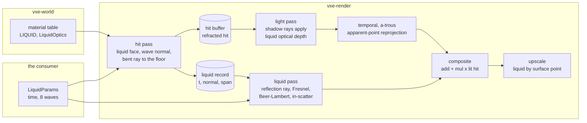

# 0034: Liquid surfaces: analytic waves, traced reflection and refraction rays, and absorption under the surface

> **Status:** approved (2026-10-22)
> **Created:** 2026-10-22
> **Milestone:** M10: Outdoors in `docs/roadmap.md`
> **Related ADRs:** [ADR-0029](../adrs/0029-liquid-surfaces-as-analytic-wave-normals-with-traced-reflection-and-refraction.md)
> (proposed with this plan: the liquid surface, its waves, rays and absorption, and the
> rejected displacement, screen-space and per-voxel options),
> [ADR-0018](../adrs/0018-direct-light-per-pixel-one-sample-from-a-hit-buffer-with-svgf-history-killed-by-edits.md)
> (the hit buffer, light pass and history this plan feeds),
> [ADR-0023](../adrs/0023-indirect-light-from-a-scrolling-probe-volume.md) (the probe
> irradiance that lights the medium and the reflected hits),
> [ADR-0024](../adrs/0024-own-temporal-upscaler-on-the-hit-buffer.md) (the upscaler's
> reprojection, which liquid pixels change), ADR-0026 (Plan 0032's atmosphere, the sky
> radiance a reflection reads), [ADR-0012](../adrs/0012-mask-first-brick-with-per-brick-palette-planes.md)
> (the translucent class is fixed for the world's life)
> **Source:** the owner's answers of 2026-10-22 (outdoors as a general engine capability;
> liquids render first, flow later; decide by measurement, a smooth natural look; readings on
> both adapters; every testbed toggle shows its mode in the window), the roadmap's "Floor,
> profiles and scene scale" decision (glass, water and lava are translucent voxels in the brick
> map), Plan 0015's translucent class and bounded walk
> ([done](done/0015-traversal-hierarchy-chunk-bits-brick-masks-and-translucent-class.md)).
> **Starts after:** Plan 0032 closes (the sky radiance a reflection and a refracted miss read,
> the sun as a light sample, the outdoor testbed source the goldens use). It is drafted against
> Plan 0024's `Frame`, hit buffer, `light.wgsl` and `composite.wgsl` as they stand in the
> plan-0024 branch, Plan 0029's probe gather and Plan 0030's upscale pass; the names `dev` finds
> in the tree win. Phase 7's upscaler half needs Plan 0030; if it has not closed, that half
> becomes a followup and the log says so. Independent of Plan 0033 (the far field); if it has
> closed, a reflection ray continues into the clipmap the way a primary ray does.

## TL;DR

A material row can be a liquid (`MaterialFlags::LIQUID`, always with `TRANSLUCENT`), with
absorption, scattering, an index of refraction and two wave scales. The hit pass finds the
first face where a liquid meets air, records it, bends the ray there by Snell's law and walks
on to the floor, which goes into the hit buffer and is lit like any other surface. A new liquid
pass traces one reflection ray from the surface and shades its hit with the light pass's
estimator and the probes, or the sky on a miss, and weighs reflection against transmission by
the exact Fresnel equations; light along every liquid span falls by Beer-Lambert and gains
ambient in-scatter. Waves are a normal, not geometry: a sum of eight Gerstner waves evaluated
at the face, animated by a time the game supplies. A camera under the surface sees Snell's
window and fog. Lava is the same class with emission and an absorption so high that its surface
is the hit. The first thing a reader sees is Phase 1's pond in the outdoor source, dark looking
down and bright with sky at grazing angles; the goldens are a lake at noon, the same lake from
under water, and a lava pool lighting a dark basin.

## Context & problem

Plan 0015 made glass, water and lava translucent voxels composited by a bounded second walk:
up to `translucent_layers` voxels (default 4), each `albedo x opacity`, along the unbent
primary ray, lit by the headlamp's cone with no shadow. In Plan 0024's frame the walk writes the
`layer` target (premultiplied colour and transmittance) and the composite lays it over the lit
hit. For water this is wrong in four ways the eye reads at once: a lake's colour depends on the
layer cap instead of its depth (at 10 cm voxels a 2 m lake is 20 layers deep), the floor seen
through it is not displaced by refraction, nothing reflects, and the brightness does not rise
toward grazing angles. Outdoors (the owner's M10) water is the commonest translucent surface,
and the roadmap's floor decision already placed it in the brick map.

What is settled. The world must not move for rendering: an edit is a deterministic operation
through the op log, and the mirror is uploaded from it (ADR-0002, ADR-0022). The game owns the
clock (`vxe-world` reads none, and `vxe-render` takes time as a parameter). The hit buffer
holds one surface per pixel with its world position, which the temporal pass (Plan 0024) and
the upscaler (Plan 0030) reproject by; the a-trous filter works on albedo-demodulated irradiance
with depth and normal edge-stopping. A ray costs about 0.9 ms per million full walks at 1080p
on the dev box (Plan 0015's figure, as Plan 0029 uses it). The light pass's estimator becomes
callable functions in Plan 0029 Phase 2, and the probe volume answers irradiance at any point
and normal. Plan 0032 gives sky radiance for a direction and the sun as one more light sample
with one shadow ray (ADR-0027). The extraction of emissive light samples (Plan 0024 Phase 2,
`exposed_emitters` in `gpu_world.rs`) takes only opaque voxels, so emissive lava would light
nothing today.

The consumer is underground (`project-context.md`, Rendering: mostly dark scenes, emissive
voxels as lights); a pool in a cave lit by a vein or by lava is its case, a lake under the sky
the outdoor consumers'. The `nfr.md` figures touched are §2 primary rays (the refraction walk
in the hit pass), §2 lighting (the liquid pass), §2 upscale (the liquid pixels' rule) and §3
"everything else" (the liquid targets).

## Decision

We build ADR-0029. **The liquid is a material class; its surface is the face where it meets
a cell that is neither opaque nor the same liquid; the shading normal there is analytic.**
`vxe-world` gains `MaterialFlags::LIQUID` and `Material::liquid: LiquidOptics` (renderer data
carried by the table, as `albedo` is), and nothing else; no voxel data changes. In
`vxe-render`, the translucent walk stops at the first liquid face and the hit pass writes a
liquid record; on a face whose normal is world up (+z, as the cutaway view assumes) the normal
is a sum of eight Gerstner waves from `LiquidParams`, which the game sets per frame with its
own time. The transmitted ray bends and is walked to the floor, which becomes the pixel's hit
(`HIT_REFRACTED`); its history reprojects by the apparent point. A new `liquid.wgsl` pass traces
the reflection ray, shades its hit with Plan 0029's callable estimator plus the probe
irradiance (sky on a miss), applies Beer-Lambert and in-scatter, and writes two targets the
composite combines with the lit hit: `c = add + mul x c_hit`. Reflected and refracted
radiance bypass the a-trous filter and keep no history; the upscaler reprojects liquid pixels by
the surface point. A liquid opaque within one voxel (lava) is its own hit.

We rejected displacing geometry (per-frame edits through the op log, or a height-field
intersection inside the walk), screen-space or planar reflections (blind to the cave ceiling
over a pool, or one plane only), keeping Plan 0015's per-voxel compositing for liquids, and
stochastic rough reflections through the denoiser. The reasons are in ADR-0029.

## Architecture diagram



## Implementation phases

Each phase ships as its own commit. `dev` implements all phases in one session with no review
between phases. The architect reviews once at the end, in a fresh session. Every golden this
plan changes is re-blessed on lavapipe in the phase that changes it, with the count of changed
pixels in the log; the harness's floor is Plan 0024's (at most 0.1 % of pixels differ by more
than 2/255). Numeric tests read the liquid targets back with `readback::read_rgba16f` in
linear values, lamp off, every filter off, exposure 1 and the identity tone map unless they say
otherwise. A "uniform sky of radiance `s`" is Plan 0032's constant-sky test mode, or, if it has
none, `Frame::set_sky_override(Some(s))` added in Phase 1.

### Phase 1: The liquid class, the surface record, and a Fresnel sky reflection
- **Owner skill:** dev
- **What:** the walking skeleton. `MaterialFlags::LIQUID`, `LiquidOptics`, `Material::liquid`
  (a constructor that sets `TRANSLUCENT | LIQUID`) and `MaterialTable::is_liquid` in
  `vxe-world`. The GPU material row grows from four `vec4` to six (`MATERIAL_VEC4S`, see Data
  shapes) and carries the liquid bit and the optics. The translucent walk stops at the first
  liquid face (Plan 0015's per-voxel compositing continues for non-liquid rows in front of it,
  and a liquid voxel is never composited as a layer); the hit pass writes the liquid record
  (`liquid_out`) with the face normal and the straight ray's hit unchanged. A new `liquid.wgsl`
  pass writes `liquid_add = F x sky(reflect(d, n))` and `liquid_mul = 1 - F`, `F` by the exact
  unpolarised dielectric Fresnel equations; the composite returns `add + mul x c_hit` before
  the glass layers. The outdoor source of Plan 0032 gains a pond (a rock basin filled with a
  testbed water row to a fixed height), and its pinned hashes are re-pinned once with the
  reason in the log.
- **Files touched:** `crates/vxe-world/src/material.rs`, `crates/vxe-world/tests/` (a new
  `liquid_material.rs`), `crates/vxe-render/src/gpu_world.rs` (the row stride and the liquid
  bit), `crates/vxe-render/src/shaders/march.wgsl` (the walk's stop, the record), new
  `crates/vxe-render/src/shaders/liquid.wgsl`, `composite.wgsl`, `crates/vxe-render/src/marcher.rs`
  (the targets, the pass, `LiquidParams` with its defaults), `crates/vxe-render/tests/` (a new
  `liquid.rs`), `apps/flythrough/src/` (the outdoor source's pond), `apps/flythrough/tests/determinism.rs`.
- **Done when:**
  - `Material::liquid(..)` reads `is_translucent()` and `is_liquid()` true; a row with `LIQUID`
    and no `TRANSLUCENT` reads `is_liquid()` false and the upload puts its voxels in the opaque
    mask (pinned by a mirror test on one brick).
  - Over a flat pond (wave amplitude 0) of the testbed water (`ior` 1.33) on a floor of albedo
    0, under a uniform sky of radiance 1, a view ray meeting the surface at incidence 0, 45, 60
    and 80 degrees reads `liquid_add` of 0.02006, 0.02752, 0.05913 and 0.34692 within 1e-3 in
    every channel (the exact Fresnel values for n = 1.33, worked in the log), and
    `liquid_mul` of one minus each.
  - Every existing golden renders byte for byte (no liquid row in them; the stride change moves
    no pixel), including `translucent.png`, whose glass rows are not liquid.
  - `apps/flythrough/tests/determinism.rs` hashes of every existing world are unchanged.

### Phase 2: The bent ray, the floor in the hit buffer, and absorption
- **Owner skill:** dev
- **What:** at the surface the transmitted direction bends by Snell's law; a `liquid_span`
  walk (a translucent-walk variant that runs while the cell is the liquid) measures the span
  to the first non-liquid cell, and the opaque walk continues from there along the bent ray.
  Its hit is the pixel's hit (`HIT_REFRACTED`, and `HIT_UNDER_LIQUID` when the span ended on
  it). The liquid pass multiplies the transmitted part by `T = exp(-(absorption + scattering)
  L)` and adds the in-scatter `S = scattering / (absorption + scattering) x (E / PI) x (1 - T)`
  per channel, `E` the probe irradiance at the span's midpoint with normal +z (zero scattering
  gives zero in-scatter, guarded). `add = F x sky + (1 - F) x S`, `mul = (1 - F) x T`. A
  refracted ray that misses folds `sky(t_dir)` into `add` and flags the record so the
  composite takes `c_hit = 0`.
- **Files touched:** `march.wgsl` (`liquid_span`, the bend, the flags), `liquid.wgsl`,
  `composite.wgsl`, `marcher.rs`, `tests/liquid.rs`.
- **Done when:**
  - A view ray at incidence 45 degrees meeting a flat surface at `(x_s, y_s, z_s)` over a floor
    20 voxels below reads a hit position of `x_s + 12.5546` within 0.01 voxel on the ray's
    horizontal axis and the floor's `z` (refraction angle `asin(sin 45 / 1.33)` = 32.118
    degrees, `20 tan 32.118` = 12.5546); with `ior` 1.0 the same ray reads `x_s + 20.0`.
  - Looking straight down through 10 voxels of water with absorption `[0.045, 0.006, 0.002]`
    per voxel and scattering 0, over a floor of albedo 0 and emission `[1, 1, 1]`, under a
    uniform sky of radiance 0: `liquid_mul` reads `[0.62484, 0.92287, 0.96054]` within 1e-3
    (`(1 - 0.02006) exp(-0.45, -0.06, -0.02)`), and the composite's pixel equals that value
    encoded within 2/255.
  - With absorption 0, scattering `[0.05, 0.05, 0.05]` per voxel, looking straight down through 20 voxels onto a floor of albedo 0 under a uniform
    sky of 0, and the probe volume's test irradiance set to `PI` everywhere (Plan 0029's `write_test_irradiance`),
    `liquid_add` reads `(1 - 0.02006) x 0.63212` = 0.61944 within 2e-3 (`1 - e^-1` of a radiance
    of 1).

### Phase 3: Waves: an analytic normal with the game's time
- **Owner skill:** dev
- **What:** `LiquidParams` carries `time_s`, `gravity` (voxels per s^2, for deep-water
  dispersion `omega = sqrt(g k)`) and eight `Wave`s (direction, wavelength in voxels, amplitude
  in voxels, steepness); `LiquidParams::wind_waves(dir, longest, shortest, steepness)` fills
  them (wavelengths geometric between the two, directions spread about the wind by a fixed
  table); the frame clamps the sum of `Q k A` to 1 so no crest loops. On a face whose normal is
  +z, the normal is the Gerstner normal (Finch, "Effective Water Simulation from Physical
  Models", GPU Gems ch. 1) at the face point, each wave's amplitude scaled by the row's
  `wave_amplitude` and its time by `wave_speed`, and each faded by `smoothstep(2f, 4f,
  wavelength)` with `f` the pixel's footprint at the surface (`t_s` times the view's angle per
  pixel). Other faces keep the face normal. The fly-through supplies its frame loop's time;
  the engine reads no clock.
- **Files touched:** `marcher.rs` (`LiquidParams`, `Wave`, the uniform), `march.wgsl`
  (`wave_normal`), `liquid.wgsl`, `apps/flythrough/src/main.rs` (the time), `tests/liquid.rs`.
- **Done when:**
  - One wave (direction +x, wavelength 32 voxels, amplitude 1 voxel, steepness 0, the other
    seven of amplitude 0, `gravity` 98.1) at a surface point with phase 0 at `time_s` 0 reads a
    recorded normal of `(-0.19267, 0, 0.98126)` within 1e-3 (`k = 2 PI / 32` = 0.19635); at
    `time_s` 1.43163 (one period, `omega = sqrt(98.1 k)` = 4.38884) the same; at half a period
    `(0.19267, 0, 0.98126)`; with the row's `wave_speed` 0.5, `time_s` 1.43163 reads the
    half-period normal.
  - The same wave at wavelength 8 on a surface pixel whose footprint is 4 voxels or more reads
    `(0, 0, 1)` within 1e-4 (faded out).
  - With every amplitude 0 the frame matches Phase 2's byte for byte; a side face of the pond
    (carved open) reads its face normal at any time.

### Phase 4: The traced reflection, and the lake at noon
- **Owner skill:** dev
- **What:** the liquid pass traces the reflection ray from the surface (offset along the face
  normal as Plan 0024's shadow-ray origin is) through the full walk, and shades its hit with
  Plan 0029's callable estimator (headlamp, one emissive sample, Plan 0032's sun with its
  shadow ray) plus the probe irradiance at the hit, plus the hit's emission under the frame's
  scale; a miss reads `sky(r)` (or the clipmap, if Plan 0033 has closed). A liquid row whose
  roughness is 0.3 or more traces nothing and adds no reflection. `LiquidParams::reflection`
  is `Trace`, `Sky` (no ray, `sky(r)` only) or `Off` (no reflection term). The golden
  `lake_noon.png` (Plan 0032's time of day at noon, the outdoor pond with a rock pillar on its
  shore, `wind_waves` at steepness 0.3, `time_s` 2.0, 32 accumulated frames, 320 x 180) is
  blessed.
- **Files touched:** `liquid.wgsl`, `light.wgsl` (only if a callable function needs a new
  argument), `marcher.rs`, `tests/liquid.rs`, `apps/flythrough/tests/golden.rs`, new
  `apps/flythrough/tests/golden/lake_noon.png`.
- **Done when:**
  - A camera above a flat pond looking down at 45 degrees, a floor of albedo 0, a uniform sky
    of radiance 0, and a wall of emission `[1, 0, 0]` and albedo 0 behind the camera, outside
    the frustum (no pixel's hit record holds the wall's material): the centre
    pixel's `liquid_add` reads `[0.02752, 0, 0]` within 1e-3 in `Trace` and `[0, 0, 0]` in
    `Sky`. Off-screen content reflects.
  - The same scene under a uniform sky of 1 with the wall removed reads 0.02752 in `Trace` and
    in `Sky` alike (a ray that misses reads the sky), and 0 in `Off`.
  - `lake_noon.png` is blessed, and `--liquid-reflection sky` on the same pose differs from it
    in the pillar's reflection region (a property, the pixel count in the log).

### Phase 5: Under the surface: the camera in the liquid, Snell's window, and shadow rays through water
- **Owner skill:** dev
- **What:** a primary ray whose first cell is a liquid starts in the span: it walks the liquid
  to its first non-liquid cell; an opaque cell is the hit (`HIT_UNDER_LIQUID`, span `t_hit`);
  a face to air is the surface from below, where the ray refracts out (`1.33 -> 1`) or, beyond
  the critical angle of 48.753 degrees, reflects totally, the reflection ray then walking back
  through the liquid with its own span's absorption. `add = S0 + T0 x F x R`, `mul = T0 x (1 -
  F)` for the span before the surface. Every shadow ray from a hit flagged `HIT_UNDER_LIQUID`
  (the light pass's headlamp, emissive and sun rays) whose walk saw a translucent brick runs
  `liquid_depth` along its segment and multiplies its visibility by `exp(-optical depth)`.
  The golden `under_water.png` (the pond's camera 6 voxels under the surface, looking up 30
  degrees from horizontal, noon, the Phase 4 waves) is blessed.
- **Files touched:** `march.wgsl` (the start state, `liquid_depth`), `light.wgsl` (the shadow
  rays' transmittance), `liquid.wgsl`, `marcher.rs`, `tests/liquid.rs`,
  `apps/flythrough/tests/golden.rs`, new `apps/flythrough/tests/golden/under_water.png`.
- **Done when:**
  - A camera under a flat surface (absorption and scattering 0) under a uniform sky of 1, over
    walls and floor of albedo 0: a ray 30 degrees from the vertical reads `liquid_mul` of
    0.97491 within 1e-3 and a final pixel value of 0.97491 encoded within 2/255 (`1 - F` from
    the dense side, 0.02509); a ray at 45 degrees reads `liquid_mul` of 0.86581 (`F` =
    0.13419); a ray at 50 and at 60 degrees reads 0 (total internal reflection onto black
    walls).
  - A camera in water with absorption `[0.045, 0.006, 0.002]` looking horizontally at a wall of
    emission `[1, 1, 1]` and albedo 0 20 voxels away reads `[0.40657, 0.88692, 0.96079]` within
    2e-3 (`exp(-20 sigma)`), with no surface crossing (the record's from-below flag clear).
  - A floor under 10 voxels of water (absorption as above, scattering 0; the pond wide enough
    that the sun's ray from the floor's centre leaves through the top face) lit by Plan 0032's sun
    at 30 degrees from the zenith, lamp off, probe gather off, averaged over 64 frames, reads an
    irradiance ratio to the same floor with the water removed of `[0.59475, 0.93306, 0.97717]`
    within 2 % per channel (`exp(-sigma 10 / cos 30)`).
  - `under_water.png` is blessed; the frame shows the sky only inside the window (a property
    checked by the test: no pixel whose ray is beyond 48.753 degrees from the vertical at a
    flat surface takes the sky).

### Phase 6: Lava: an opaque emissive liquid and its light samples
- **Owner skill:** dev
- **What:** a liquid whose one-voxel transmittance `exp(-(absorption + scattering))` is under
  1/255 in every channel (absorption plus scattering over `ln 255` = 5.5413 per voxel) is
  opaque at its surface: the hit pass writes the surface itself as the hit (material, wave
  normal), so the light pass lights it and the composite adds its emission, and the liquid
  pass adds only its reflection (none for a rough row). The light-sample extraction counts an
  emissive liquid voxel's face as exposed when the voxel across it is air (material 0); its
  interior faces against the same liquid do not emit. The outdoor source gains a lava pool in
  a closed rock basin under a roof (dark), and the golden `lava_pool.png` (lamp off, the pool
  as the only light, `wave_speed` 0.2 and roughness 0.6 on the lava row, 32 accumulated frames)
  is blessed.
- **Files touched:** `march.wgsl`, `liquid.wgsl`, `crates/vxe-render/src/gpu_world.rs`
  (`exposed_emitters`), `crates/vxe-render/tests/mirror.rs` or `apps/flythrough/tests/lights.rs`
  (the counts), `tests/liquid.rs`, `apps/flythrough/src/` (the pool), `apps/flythrough/tests/golden.rs`,
  new `apps/flythrough/tests/golden/lava_pool.png`.
- **Done when:**
  - A 4 x 4 x 1 pool of an emissive liquid row with absorption 8 per voxel in a rock basin, air
    above, holds 16 light samples after a sync, each showing the +z face alone; the same pool
    4 x 4 x 2 deep holds 16 (the lower layer has no air face); before this phase the rule took
    0.
  - With the probe gather off, replacing the rock under the lava by a rock of albedo 1
    changes no lava pixel of the frame (the surface is the hit; nothing beneath is walked), and a lava pixel's
    hit record holds the lava's material id.
  - `lava_pool.png` is blessed, and with the lava's emission scale set to 0 the basin's walls
    read black in every pixel that is not lava (the pool was the only light).

### Phase 7: History on liquid pixels: the temporal pass and the upscaler
- **Owner skill:** dev
- **What:** the temporal pass reprojects a `HIT_REFRACTED` pixel by its apparent point (`o +
  d (t_s + |hit - surface point|)`, the straight ray at the bent path's length) and compares
  the real hit positions as it does today. The upscaler reprojects a liquid pixel by its
  surface point, compares the liquid record's material instead of the hit's, and blends it at
  `LIQUID_ALPHA` (0.25, a starting value the owner reviews in Phase 9) instead of 0.1. The
  a-trous filter and reservoir reuse leave `liquid_add` and `liquid_mul` alone (they are not
  inputs to either).
- **Files touched:** `temporal.wgsl`, `upscale.wgsl`, `marcher.rs`, `apps/flythrough/tests/lights.rs`,
  `apps/flythrough/tests/upscale.rs`.
- **Done when:**
  - A still camera over a flat pond for 16 frames reads age 16 in every refracted floor pixel,
    as on dry ground.
  - A camera moving one voxel sideways over the flat pond keeps temporal age at least 1 in a
    fraction of refracted floor pixels at least as large as reprojection by the real hit
    position keeps (both fractions in the log; a property, not a threshold).
  - At internal 256 x 144 and output 384 x 216, a camera moving one voxel sideways over the flat
    pond keeps upscaler history in at least 95 % of the lake's output pixels (Plan 0030 Phase 2's
    bar for dry ground; the surface is a plane, so reprojection by it is exact).
  - With waves at steepness 0.3 and a still camera, the lake's mean absolute frame-to-frame
    change in the upscaled output over 32 frames is recorded beside the native render's, and
    their ratio goes in the log (how much the history damps the waves; Phase 9 judges it).

### Phase 8: The testbed's switches, the mode banner, and the readings
- **Owner skill:** dev
- **What:** `--liquid-reflection trace|sky|off` and `F9` cycling it; `--waves on|frozen` and
  `F10` freezing the time the fly-through supplies (Plan 0032 binds `F8`, Plan 0036 `F11` and `F12`; the
  banner names whatever key `dev` binds); both shown on Plan 0024 Phase 14's mode banner for 3 s
  after start and after each change. `--spawn lake|under-water|lava` places the camera at the
  goldens' poses in the outdoor source. HUD rows for the liquid pass's GPU time and its
  reflection-ray count; the autopilot prints the liquid pass's p50 and p99. `frame_bytes`
  counts the liquid targets. Readings on both adapters (`nfr.md` §1).
- **Files touched:** `apps/flythrough/src/main.rs`, `hud.rs`, `apps/flythrough/tests/hud_golden.rs`
  (the banner test), the root `README.md` (flags, keys), `docs/nfr.md` §2 and §3.
- **Done when:**
  - A test drives the frame clock: `F9` changes the banner's text through `reflection trace`,
    `reflection sky`, `reflection off` and back, `F10` through `waves on` and `waves frozen`,
    and the banner reads empty 3 s after the last change.
  - The parse test pins the three new flags and their refusal of an unknown value.
  - On the dev box's NVIDIA card and on the AMD iGPU (`--adapter`), quiet box, 1080p output at
    the default internal scale, `flythrough --headless --seed 1 --spawn lake --frames 300`,
    median of the last 30, three runs: the hit pass, the liquid pass and the frame are read in
    each reflection mode and recorded in `nfr.md` §2 with the adapter, the commit and the
    lake's share of the screen; the same at `--spawn under-water` and `--spawn lava`.
    `frame_bytes` rises by 32 bytes per internal pixel and no more (29.5 MB at 1280 x 720).

### Phase 9: The owner's windowed check
- **Owner skill:** human
- **What:** the owner flies the outdoor lake at noon and at a low sun, dives under it, holds the
  camera still over moving waves, sweeps across the lake at speed, visits the lava pool, and
  tries `F9` and `F10` while watching the banner, on the dev box.
- **Files touched:** this plan's log, then ADR-0029's Outcome at the close.
- **Done when:** the owner has recorded a verdict on the wave look (smooth or busy, the
  horizon's flat silhouette acceptable or a followup for displaced geometry), on smearing or
  shimmer of reflections under motion (`LIQUID_ALPHA` kept or a new value), on the depth
  colour and the underwater fog, and a default for `--liquid-reflection`.

## Data shapes

```rust
// illustrative: vxe-world, carried by the table like albedo; read only with LIQUID
impl MaterialFlags { pub const LIQUID: Self = Self(4); } // meaningful with TRANSLUCENT only

#[derive(Clone, Copy, Debug, PartialEq, Default)]
pub struct LiquidOptics {
    pub absorption: [f32; 3], // per voxel of path, Beer-Lambert
    pub scattering: [f32; 3], // per voxel of path, isotropic, toward the ambient light
    pub ior: f32,             // relative to air; the testbed's water 1.33
    pub wave_amplitude: f32,  // scale on the frame's waves; 0 is a still surface
    pub wave_speed: f32,      // scale on the frame's time
}
// Material gains `pub liquid: LiquidOptics` (Material::named: all zero, ior 1.0).

// illustrative: vxe-render
pub struct Wave { pub dir: [f32; 2], pub wavelength: f32, pub amplitude: f32, pub steepness: f32 }
pub struct LiquidParams {
    pub time_s: f32,                  // the game's clock; the engine reads none
    pub gravity: f32,                 // voxels / s^2 (98.1 at 10 cm voxels)
    pub waves: [Wave; 8],
    pub reflection: ReflectionMode,   // Trace | Sky | Off
}
impl Frame { pub fn set_liquid(&mut self, p: &LiquidParams) { /* uniform, 288 B */ } }
```

GPU material row, six `vec4` (was four): `[0]` albedo + roughness, `[1]` emission + flag bits
(the liquid bit beside the translucent one), `[2]` detail scale, detail strength, opacity,
spare, `[3]` absorption + ior, `[4]` scattering + wave amplitude, `[5]` wave speed + three
spare. If Plan 0032 or 0033 claims the spares first, the stride grows again; it is one
constant.

Per-pixel targets at the internal resolution, no history:

| target | format | bytes | content |
|---|---|---|---|
| `liquid_out` (record) | rgba32uint | 16 | `t_s` (f32 bits, BIG for none); wave normal as two snorm16 octahedral coordinates; liquid material (bits 0..16) and flags (surface, camera in liquid, from below, total internal reflection, opaque liquid, refracted miss); the span length (f32 bits) |
| `liquid_add` | rgba16float | 8 | `F R + (1 - F) S`, or `S0 + T0 F R` from below |
| `liquid_mul` | rgba16float | 8 | `(1 - F) T`, or `T0 (1 - F)` from below |

32 bytes per pixel: 66.4 MB at 1920 x 1080 internal, 29.5 MB at 1280 x 720 (Plan 0030's
scale 1.5). Hit-record flags gain bit 6 `HIT_REFRACTED` and bit 7 `HIT_UNDER_LIQUID`. The frame
order becomes hit, light, probes, temporal, a-trous, liquid, composite, upscale, sharpen.

```wgsl
// illustrative: one wave's contribution to the normal at face point p (Finch, GPU Gems ch. 1)
let k = 2.0 * PI / w.wavelength;
let theta = k * dot(w.dir, p.xy) - sqrt(params.gravity * k) * speed * params.time_s;
let a = w.amplitude * amp_scale * smoothstep(2.0 * f, 4.0 * f, w.wavelength);
n.x -= w.dir.x * k * a * cos(theta);
n.y -= w.dir.y * k * a * cos(theta);
n.z -= w.steepness * k * a * sin(theta);   // n starts at (0, 0, 1); normalised after the sum
```

## Budgets

| `nfr.md` figure | line | projection (a guess until Phase 8 reads it) | how the close measures it |
|---|---|---|---|
| §2 Primary rays | 3.0 ms | the refraction walk adds one walk per transmitting liquid pixel: a lake on half of a 1280 x 720 internal frame is 0.46 M walks, about 0.4 ms on the NVIDIA card at 0.9 ms per million; lava adds none | Phase 8, `--spawn lake`, both adapters |
| §2 Lighting | 6.0 ms | the liquid pass on the same half-screen lake: a reflection walk plus a coarse sun shadow ray and the estimator, about 0.5 to 0.8 ms on the NVIDIA card in `Trace`, under 0.1 ms in `Sky`; shadow rays of under-liquid hits add a `liquid_depth` walk only where they saw a translucent brick | Phase 8, each reflection mode, both adapters |
| §2 Upscale, tone map, post | 1.5 ms | unchanged within noise: one flag test and a different reprojection point per liquid pixel | Phase 8 |
| §3 Everything else in VRAM | 1.5 GB | +29.5 MB at 1280 x 720 internal, +66.4 MB at 1080p internal | `frame_bytes` |
| §2 Streaming, upload, light extraction | 1.0 ms | none: the table grows by two `vec4` per row; the extraction's rule change touches only emissive liquid voxels | the autopilot's `light_us`, unchanged on a world with no liquid |

The slow adapter's figures have no projection: Plan 0024's and Plan 0030's readings there
are the scale, and Phase 8 records them, labelled by adapter. If the NVIDIA card reads the
liquid pass over 1.5 ms in `Trace` on the half-screen lake, the close says so and the default
for the floor tier becomes `Sky` by the owner's call in Phase 9.

## Risks & open questions

- **Noise in reflections.** The reflected hit's one emissive sample is stochastic and nothing
  but the upscaler's clipped history smooths it (ADR-0029, Negative). If the owner sees
  shimmer in reflections of vein-lit rock, the fallback is to drop the emissive sample from
  reflected hits and keep the probes' (smooth) indirect only; one flag in `liquid.wgsl`.
- **Waves alias at a distance.** The footprint fade removes waves under two pixels; the slope
  they carried is lost, so a far lake reads smoother than a real one. A distance roughness
  (LEAN-style slope variance) is a followup if Phase 9 asks.
- **Refraction and history.** Reprojection by the apparent point is exact for a flat surface
  and a still camera and approximate otherwise; under steep waves the floor's history resets
  more. Phase 7 records the fraction; the edit-box and gradient killers are unchanged.
- **Second interfaces.** A reflection, shadow or probe ray that meets another liquid surface
  sees no interface (no Fresnel, no bend); shadow rays apply its optical depth only from hits
  flagged under liquid, and probe rays treat liquids as air (Plan 0029: translucent voxels are
  not receivers). A lake floor's indirect light is therefore slightly too bright. Recorded as
  a followup, not a phase.
- **World up.** Waves exist only on +z faces. A consumer with another up axis needs a
  parameter; none asks today.
- **Plan 0032 is drafted in parallel.** This plan assumes a WGSL function for sky radiance by
  direction, a constant-sky test mode, the sun as a light sample in the callable estimator,
  and an outdoor testbed source. If any is missing when `dev` starts, Phase 1 adds the
  constant-sky override and the pond goes into the level's source behind a flag instead.
- **Determinism.** `vxe-world` changes only the table's shape: a flag and five carried fields,
  no voxel data, no float in any edit path; the determinism hashes of existing worlds are
  pinned unchanged. Rendering is deterministic per adapter as Plan 0024's; goldens are blessed
  on lavapipe.
- **Collision and audio.** Liquid voxels stay solid to every CPU reader (Plan 0015's rule):
  the fly-through's free flight enters the water, walk mode stands on it. A passable class
  belongs with flowing liquids. The acoustic triple is unchanged.
- **Adapter features.** None new: two more `rgba16float` storage textures, one `rgba32uint`
  (Plan 0024's hit buffer uses both kinds), one more uniform binding.

## What this plan does NOT do

- **Flowing liquid.** Spreading, levelling and draining are a later deterministic simulation
  plan in `vxe-world` (the owner, 2026-10-22); a carve into a lake here leaves a static hole.
- **Caustics, light shafts under water and refraction of light paths.** Shadow rays go
  straight through the surface; volumetric light belongs with Plan 0035's volumetrics.
- **Displaced wave geometry** (ADR-0029 Alternative A), and rough or glossy reflections for any
  material (Alternative D).
- **Rain on water, wind-driven waves from weather, wet surfaces.** Plan 0036 sets
  `LiquidParams` through the same API; this plan adds no weather.
- **The sky, sun and time of day** (Plan 0032), **the far field** (Plan 0033) and **aerial
  perspective and clouds** (Plan 0035); this plan reads the first and, if present, the second.
- **Swimming**, a passable class for collision, and underwater audio filtering.
- **Glass**: non-liquid translucent rows keep Plan 0015's per-voxel compositing.

## Implementation log

> Written by `dev`: one row per phase as its commit lands, then the close block. **The phases
> above are the contract. This section records what happened.** Observations, never conclusions:
> no pass list, no self-assessment. Deviations and unmet done-whens are **always** disclosed.
> Keep it shorter than `## Implementation phases`.

| phase | owner | state | commit |
|---|---|---|---|
| 1: The liquid class, the surface record, and a Fresnel sky reflection | dev | not started | |
| 2: The bent ray, the floor in the hit buffer, and absorption | dev | not started | |
| 3: Waves: an analytic normal with the game's time | dev | not started | |
| 4: The traced reflection, and the lake at noon | dev | not started | |
| 5: Under the surface: the camera in the liquid, Snell's window, and shadow rays through water | dev | not started | |
| 6: Lava: an opaque emissive liquid and its light samples | dev | not started | |
| 7: History on liquid pixels: the temporal pass and the upscaler | dev | not started | |
| 8: The testbed's switches, the mode banner, and the readings | dev | not started | |
| 9: The owner's windowed check | human | not started | |

### Notes

_(Deviations from the plan, with the commit, stated without justification. Done-whens not
satisfiable as stated, and what was done instead. Followups noticed and not acted on. One line
each. Empty is fine.)_

### Close triggers

_(Facts for the architect. No recommendations, and no suggested version bump.)_

- **What shipped:** feature / fix-only / docs-chore-only
- **Public API changed:** types, traits, functions, shader interfaces, config (list them, or none)
- **Budget readings:** each `nfr.md` figure touched, with its measured value, machine and commit
- **Gate at the tip:** the commands run (build, nextest, doctests, clippy, fmt, deny), exit codes, test counts
- **Outstanding `human` phases:** which, or none

## Followups

- Flowing liquids: a deterministic spread-and-level simulation in `vxe-world` with a passable
  collision class (the owner's "flow later").
- Caustics on underwater floors, derived from the same wave sum.
- A distance roughness for faded waves, if the far lake reads too smooth.
- Liquid interfaces on secondary rays (reflection, shadow, probe), if a scene shows the gap.
- A reference worth adding to `docs/references/`: Finch, "Effective Water Simulation from
  Physical Models", GPU Gems (2004), ch. 1; Tessendorf, "Simulating Ocean Water" (2001).
