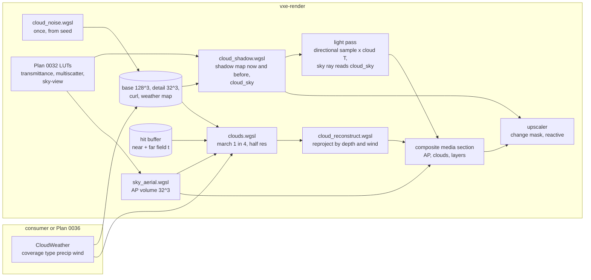

# 0035: Aerial perspective over the near and far field, and volumetric clouds that shadow the ground

> **Status:** approved (2026-10-22), amended 2026-11-10 (review pass)
> **Created:** 2026-10-22
> **Milestone:** M10: Outdoors in [`docs/roadmap.md`](../roadmap.md)
> **Related ADRs:** [ADR-0030](../adrs/0030-volumetric-cloud-shell-amortised-march-and-projected-shadow-map.md)
> (proposed with this plan: the cloud shell, its amortised march, its lighting and the
> projected shadow map, and the rejected alternatives),
> [ADR-0018](../adrs/0018-direct-light-per-pixel-one-sample-from-a-hit-buffer-with-svgf-history-killed-by-edits.md)
> (the hit buffer the march clips against and the light pass the cloud shadow enters),
> [ADR-0026](../adrs/0026-atmosphere-from-hillaire-luts-built-on-the-gpu-at-runtime.md) (the
> atmosphere's LUTs; it leaves the aerial-perspective volume to this plan),
> [ADR-0027](../adrs/0027-the-sun-shadow-is-one-per-pixel-ray-in-the-light-pass.md) (the
> directional sample the cloud shadow darkens, and the sky ray),
> [ADR-0028](../adrs/0028-far-field-as-a-clipmap-of-source-generated-coarse-chunks.md) (the far
> field, whose hits land in the same hit buffer),
> [ADR-0031](../adrs/0031-weather-is-cosmetic-client-state-rendered-against-a-fall-map.md)
> (Plan 0036's weather, which drives this plan's weather input),
> [ADR-0044](../adrs/0044-direct-light-from-a-fixed-list-of-analytic-lights-one-shadow-ray-each.md)
> (Plan 0058's direct target, where the sun and the sky ray land and whose change mask this
> plan adds to),
> [ADR-0046](../adrs/0046-static-emissive-light-is-baked-per-chunk-when-a-chunk-loads-or-changes.md) (the baked store:
> emissive only, and no per-frame term enters the bake)
> **Source:** the owner's interview answers of 2026-10-22 (outdoors as a general engine
> capability; Hillaire 2020 atmosphere; volumetric Nubis-style clouds at reduced resolution
> with temporal accumulation, casting shadows, coverage from weather; the 2.5D layer
> rejected); the roadmap's M8 note on fog, dust and smoke as a separate coarse volume; the
> review of every active plan of 2026-11-10.
> **Starts after:** Plan 0034's close. M10 is linear (owner order, 2026-11-10): Plans 0060,
> 0061, 0058, 0044 and 0045, the plan that removes the `own` upscaler and the render-profile
> plan (both owed, not drafted), then Plans 0032, 0033, 0034, this plan, 0036 and 0037. The
> base commit is main after Plan 0034's close. Plan 0045 splits `marcher.rs`, `march.wgsl`
> and the fly-through's `main.rs` before M10 starts, so every "Files touched" below names
> today's files and `dev` re-reads the paths at the base commit.
> **Written against:** [Plan 0032](0032-sun-and-sky-hillaire-atmosphere-time-of-day-and-an-outdoor-testbed.md)'s
> section "Interface for Plans 0033 to 0037" and nothing else of that plan, Plan 0058's
> direct target (its Data shapes), and the tree at main 82ea836. The probe volume is the
> lamp's bounce channel (ADR-0043) and takes no sky, sun or cloud term; nothing here touches
> it. Readings go in `docs/plans/logs/0035.md`.

## TL;DR

Two things make an outdoor view read as outdoors: distance haze and a sky with weight in it.
This plan builds the aerial-perspective volume that ADR-0026 leaves to it (Hillaire 2020's
32^3 froxel LUT, from Plan 0032's transmittance and multiple-scattering LUTs) and applies it
to every surface pixel, near field and far field, in the composite. It adds a volumetric
cloud layer: a spherical shell at 1.5 to 4 km altitude whose density is seeded Perlin-Worley
and Worley noise shaped by a weather map (coverage, precipitation, type, wind offset),
ray-marched in a buffer at half the internal resolution per axis where each frame marches one
pixel in every 2 x 2 and a reconstruction pass reprojects the rest by the cloud's depth and
the wind. Clouds are lit by the sun or the moon through a short cone march with three
scattering octaves and an ambient term from the sky-view LUT. A 512 x 512 transmittance map,
projected along the light onto the shell's base, multiplies the visibility of Plan 0032's
directional sample in the light pass, and a small map of the sky under clouds replaces the
clear sky for Plan 0032's sky ray. The first thing a reader sees is Phase 1's flat grey
overcast slab hiding the sky over an empty world, and a headless test that reads its front
depth at 1500 m from the ground and at 1000 m from 5 km above.

## Context & problem

After Plan 0032 the outdoor testbed has a physically based clear sky, a sun and a moon, and
after Plan 0033 terrain to about 1 km. Two gaps remain. Distant terrain has the same contrast
as near terrain, so the far field reads as a model, not a landscape. And the sky is always
clear: no cloud, no overcast light, no moving shadow on the ground, and no surface Plan 0036's
weather can attach to (rain falls from clouds; ADR-0031 hands coverage to this plan).

The consumer is underground (`project-context.md`); outdoors is a general engine capability
for later consumers (owner, 2026-10-22). Nothing here names a game concept: the game sets
coverage, type, precipitation and wind, or lets Plan 0036's `Weather` set them; the engine
reads no clock.

Facts the design uses:

- **Sphere arithmetic.** With Hillaire's ground radius `R = 6360 km` and a shell from 1.5 to
  4.0 km altitude, a ray from the ground spans: straight up, 1.5 to 4.0 km; at 30 degrees of
  elevation, 2.999 to 7.992 km; at 5 degrees, 16.953 to 44.151 km; at 2 degrees, 39.475 to
  94.524 km; horizontal, from 138.14 km. From 2 km altitude (inside) it spans 0 to 2.0 km up
  and 0 to 0.5 km down; from 5 km (above) looking down, 1.0 to 3.5 km. These numbers are the
  Phase 1 test table.
- **Cost of a cloud ray.** A march of up to 64 view samples with a seven-sample light march at
  each dense one reads a few hundred filtered 3D-texture samples. At 720p internal (FSR 2 at
  scale 1.5 for 1080p output, the default) there are 921 600 internal pixels: every pixel
  marched is 921 600 rays, a half-resolution buffer is 230 400, and one pixel in four of that
  buffer is 57 600 (at 1080p internal, 129 600). ADR-0030 chooses the last as the default.
- **The near and far field write one hit buffer.** The hit record carries `t` per pixel
  (`BIG` on a miss); Plan 0033's far field is the same walk continued into coarser clip
  levels (ADR-0028), so its hits land in the same record. The march clips at that distance
  and the composite tests against it.
- **What Plan 0032 offers** (its Interface section). World +z is up, +x east, +y north;
  `sky_altitude(p)` maps a position to metres. `sky_radiance(d)` and `transmittance(alt_m,
  mu)` are linear and not pre-exposed. On a primary miss the composite sets
  `c = (sky_radiance(d) + body_disc(d)) * exposure_now()` ahead of its variant select, and a
  plan that draws on miss pixels adds its absolute radiance there, times `exposure_now()`
  once; the meter reads `c / ex`, so anything added to `c` is metered. The key light (the sun
  above the horizon, else the moon, else none) is in the sky uniform. The directional sample
  and the sky ray are added to Plan 0058's `direct` target, whose accumulation follows a
  change to 90 % within eleven frames. A term that changes the direct target frame to frame
  stays under the upscalers' mask thresholds or adds its own now-and-then pair to their
  comparison, and raises neither `LIGHTING_LIGHTS_CHANGED` nor `LIGHTING_EMISSION_CHANGED`.
  No sky, sun, cloud or weather term enters the bake's source or its bindings.
- **Cloud radiance fits the target.** The brightest cloud radiance is forward-scattered
  sunlight, the sun's illuminance times `HG(0.8, 0) = 3.58`. Plan 0032 sets the illuminance
  in frame units (a guess the owner tunes, near 3000 at the draft, which gives about 10 700);
  `rgba16float` holds 65 504.
- **FSR 2 reprojects a miss by its ray direction** (`fsr2/input.wgsl`), and it is the default
  upscaler. It does not follow the wind. The cloud image must be temporally stable by itself,
  which is the reconstruction pass's job, and FSR 2 must be told not to lean on its history
  where cloud moves over the pixel.
- **The bake compiles `march.wgsl` and `light.wgsl`** (`bake_source()` in `bake.rs`). A
  texture binding or a call added to `light.wgsl` reaches the bake's module. The cloud terms
  therefore live in a source of their own (Decision, "Where the cloud light lives").
- **The aerial-perspective LUT and M8's fog are different volumes with one composite rule**
  (decided here, see Decision). The roadmap's M8 note puts dust, fog, mist and smoke in a
  separate coarse volume marched at half resolution and composited over the opaque hit.

`nfr.md` figures touched: §2 "Headroom (entities, volumetrics, game work)" (the cloud
passes), §2 "Upscale, tone map, post" (the aerial perspective and the cloud upsample in the
composite, the mask's extra reads), §2 "Lighting" (one bilinear read per directional sample,
one per sky ray), §3 "Everything else in VRAM" (about 32 MB, Data shapes), §7 time to first
frame (the noise generation runs once at startup).

## Decision

**We apply the aerial perspective in the composite and render clouds per ADR-0030.**

- **Aerial perspective.** ADR-0026 leaves the aerial-perspective volume to this plan. A new
  `sky_aerial.wgsl` pass builds it every frame per view: 32 x 32 x 32 `rgba16float`, in-
  scattered radiance per unit illuminance (rgb, both bodies summed as the sky-view LUT does)
  and mean transmittance (a), integrated along each froxel column from the camera with
  Plan 0032's `transmittance` and multiple-scattering lookups, Hillaire 2020's method. Its
  depth slices are quadratic, slice `k` ending at `32 km * (k / 32)^2`, so Plan 0033's 1 km
  spans the first six slices (`32 km * (6/32)^2 = 1.125 km`) and the last slice is 1.97 km
  thick for clouds; linear slices of 1 km would put the whole world in the first. In
  `composite.wgsl` every surface pixel's pre-exposed radiance `L` at hit distance `t` becomes
  `L * T_ap(uv, t) + S_ap(uv, t) * exposure_now()`, near field and far field alike, and the
  cloud pass applies the same to each cloud sample's contribution at its depth. Beyond 32 km
  a cloud reads the last slice. A primary miss is not touched: the sky-view LUT already holds
  the whole path.
- **One composite rule for every participating medium, two volumes.** The composite applies
  media from far to near: aerial perspective on the surface, then clouds, then (M8, later) the
  local fog volume, each as `L = L * T + S` sampled at the pixel and its depth. We do not put
  M8's fog in the aerial-perspective volume: the LUT spans 32 km in 32 quadratic slices and
  holds only the atmosphere, while a fog of dust and smoke needs decimetre to metre slices
  over the first 100 m and local, edit-driven density. They share the rule and its place in
  the composite, which this plan writes down as a `media` section of `composite.wgsl` with
  the cloud and aerial-perspective terms in it; M8's plan adds its term after the clouds.
- **The media section sits ahead of the variant select, and is metered.** It modifies the
  composite's `c` where Plan 0032 sets the miss colour, so the display variant, FSR 2's HDR
  variant and the exposure meter all carry haze and cloud with no branch of their own. An
  overcast sky drives auto exposure as a clear one does.
- **The shell and the density.** Shell base 1.5 km, top 4.0 km above Plan 0032's ground
  altitude (both `CloudParams` fields, HZD's figures). Density follows Schneider 2015 and the
  Nubis talks: base volume 128^3 `rgba8unorm` (R a Perlin-Worley, GBA Worley fBm at 4, 8 and
  16 cells per tile), detail volume 32^3 `rgba8unorm` (RGB Worley fBm at 2, 4, 8 cells per
  tile), a 128^2 `rgba8unorm` curl-noise texture, all tileable, generated once by
  `cloud_noise.wgsl` from `CloudParams::seed` with full mip chains.
- **The weather map.** A 512 x 512 `rgba8unorm` texture over `extent_m` (32 km by default)
  with repeat addressing, generated from the seed or supplied by the game. Its channels are a
  contract Plan 0036 conforms to: **R coverage, G precipitation, B cloud type, A unused and
  written 0.** G is the channel Plan 0036 drives and reads; this plan only darkens the cloud
  base by it. There is no glow or lightning slot in the map. Effective coverage is
  `clamp(R + 2 * (coverage - 0.5), 0, 1)` and effective type
  `clamp(B + 2 * (cloud_type - 0.5), 0, 1)`, so `coverage = 0` is a sky with no cloud and
  `coverage = 1` is overcast whatever the map says. The base shape is remapped by coverage,
  multiplied by a height profile per type (stratus low and thin, cumulus tall and rounded),
  and eroded by the curl-distorted detail, wispy at the base and billowy at the top. The
  weather map and the noise sample at the horizontal position `world_xy_m + wind_offset_m`
  (z is up) and the altitude.
- **Lighting of the cloud.** Per view sample: extinction `sigma_t = extinction * density`
  (0.05 per metre by default, a guess to tune by eye), albedo 0.99, Hillaire 2016's
  energy-conserving step integral, three octaves with extinction, scattering and eccentricity
  scaled by 0.5 per octave, a phase that blends Henyey-Greenstein lobes at `g = 0.8` and
  `g = -0.5`. The key light is the body in the sky uniform, its radiance through
  `transmittance(alt, mu)` at the sample's altitude; a seven-sample cone march toward it (six
  near samples and one far one, detail noise on the first three) gives its transmittance.
  With no key light the cloud takes the ambient term alone. Ambient: a `cloud_ambient`
  dispatch reduces the sky-view LUT's upper hemisphere to one irradiance, and the sample
  takes it scaled from the ground's bounce at the shell base to the full value at the top.
  Schneider's Beer-Powder term is the switchable alternative.
- **Resolution and time.** The cloud buffer is half the internal size per axis. The march
  dispatches one pixel per 2 x 2 block (`OneInFour`, the default), one per 4 x 4
  (`OneInSixteen`, for the slow adapter if its reading asks), or every pixel (`Every`, used
  inside the shell and by the goldens); the marched pixel follows a Bayer order of the frame
  index and its march starts at a blue-noise offset (the frame's 128 x 128 texture). The
  reconstruction pass reprojects every pixel's transmittance-weighted mean depth through the
  previous view after subtracting the frame's wind displacement, clamps the history to the
  box of this frame's marched neighbours, blends a marched pixel at 0.25 over valid history
  and takes the history alone for the others, and falls back to the nearest marched neighbour
  where history is invalid.
- **Composite.** The cloud buffer is upsampled to the internal pixel with bilinear weights
  zeroed for texels whose front depth lies beyond the pixel's hit `t` (a pixel in front of
  the cloud gets none of it), then applied after the aerial perspective and before the
  translucent layers, which lie within metres of the camera. The cloud's absolute radiance is
  multiplied by `exposure_now()` there, once.
- **Cloud shadow.** `cloud_shadow.wgsl` rebuilds a 512 x 512 `r32float` transmittance map
  every frame over a 4 km square, texel-snapped (7.8125 m per texel), centred where the
  camera projects along the key light onto the plane of the shell base; a texel marches 16
  base-shape samples along the light through the shell, capped at 10 km of path. A receiver
  at `p` reads the texel where `p + light_dir * (base_alt - alt(p)) / light_dir.z` lands; off
  the square, with the light below 2 degrees of elevation or with no key light it reads the
  mean transmittance of the square (1 with no key light). `cloud_sun_transmittance(p)`
  multiplies the visibility of Plan 0032's directional sample at the one place the light
  pass computes it, so near-field and far-field receivers darken under the same cloud.
- **A moving shadow and the upscalers.** The shadow is a term that changes the direct target
  frame to frame. The direct accumulation's own blend follows it (90 % of a step within
  eleven frames, Plan 0032's Interface). For the upscalers this plan adds a now-and-then pair
  to their comparison: the map of this frame and the map of the frame before, each with its
  square's origin, kept as two copies that swap. The mask compares
  `key_light_at(p, n) * cloud_sun_transmittance` under the two and marks the pixel changed
  and reactive past Plan 0058's `change_abs` and `change_rel`, so FSR 2 lets go of its
  history under a shadow edge that moved. It sets neither lighting change bit.
- **The sky under clouds.** A 128 x 64 `rgba16float` map of the upper hemisphere's radiance
  with clouds composited (`cloud_sky`, azimuth by elevation, marched at 32 view steps, one
  eighth of its texels per frame) replaces `sky_radiance(d)` for Plan 0032's sky ray when
  clouds are on, through `cloud_sky_radiance(d)`. An overcast day then lights the ground grey
  and dim, not blue. The map changes by an eighth of its texels a frame and the sky ray's
  estimate is spread over the hemisphere, so its frame-to-frame change is expected under the
  mask thresholds; Phase 6 reads it and stops if it is not. Primary misses keep
  `sky_radiance(d)` with the cloud buffer composited over it.
- **Where the cloud light lives.** The shadow maps, `cloud_sky`, their sampler and the two
  functions sit in a new source, `cloud_light.wgsl`, composed into the light pass's module
  and the upscalers' input modules beside Plan 0032's sky source, at the next free bindings
  of the group that source uses. `light.wgsl` and `march.wgsl` gain no cloud name, so
  `bake_source()` compiles unchanged and the bake's layouts gain no binding. A test asserts
  a baked face is byte-equal with clouds on and off.
- **Camera inside or above the layer.** The march's segment is computed from the two spheres
  for any camera altitude: below, it starts at the base; inside, at the camera; above, at the
  top. From above, only the first entry into the shell is marched (a ray that dips under the
  base and re-emerges beyond a horizon is cut at the base; it would hit the ground or the far
  field first in every view the testbed reaches). Inside the shell the update is forced to
  `Every` and history is blended at 0.5, because near cloud has parallax that a one-in-four
  update ghosts. Above the shell the default update holds. The cloud shadow and the
  `cloud_sky` map are independent of the camera's altitude.
- **Weather input.** `CloudWeather { coverage, cloud_type, precipitation, wind_m_s,
  wind_offset_m, evolution }` and `WeatherMap::{Procedural, Supplied}` are the whole input.
  `CloudWeather::scattered()` and `CloudWeather::overcast()` are the two presets, in
  `vxe-render`, so the crate's own tests and the testbed read one set of values. The engine
  never advances `wind_offset_m` itself; `CloudWeather::advance(dt_s)` is a pure helper the
  caller (the testbed, or Plan 0036's `Weather::step`) calls with its own time.

We rejected marching every pixel every frame (sixteen times the rays), marching the noise
along every sun shadow ray (a second march per lit pixel) and clouds in a froxel volume
shared with the aerial perspective and the fog (kilometre-deep slices at cloud distance); the
reasons are in ADR-0030. The 2.5D layer was rejected in the owner's interview.

## Architecture diagram



## What Plans 0036 and 0037 may rely on

A name here is a contract; `dev` may add to it and does not rename it without an architect
amendment.

- **Rust, `vxe_render::clouds`.** `Clouds`, `CloudParams`, `CloudWeather` (with `advance`,
  `scattered()` and `overcast()`), `WeatherMap::{Procedural, Supplied}`,
  `CloudUpdate::{Every, OneInFour, OneInSixteen}`, `CloudLighting::{Octaves, BeerPowder}`,
  `CloudDebug`, `Clouds::set_weather`, `Clouds::set_weather_map`, `Clouds::bytes`,
  `Clouds::effective_update`, and the CPU `cloud_segment`.
- **The weather map.** 512 x 512 `rgba8unorm`, repeat addressing over `extent_m`: R coverage,
  G precipitation, B cloud type, A unused and 0. Plan 0036 drives G through
  `CloudWeather::precipitation` or a supplied map. No glow slot.
- **WGSL.** `cloud_segment` (the shell's ray segment), `cloud_sun_transmittance(p)` and
  `cloud_sky_radiance(d)` in `cloud_light.wgsl`, and the `media` section of `composite.wgsl`
  with its far-to-near order: aerial perspective, clouds, then a later medium's term.
- **Passes.** `sky_aerial`, `clouds`, `cloud_reconstruct` and `cloud_shadow` in
  `FRAME_PASSES`; the cloud buffer's front depth and mean depth per texel, for a plan that
  draws behind or in front of cloud.
- **Miss pixels.** A plan that draws on miss pixels behind the clouds (stars, an aurora) adds
  its radiance to `c` before the media section, so the cloud covers it.
- **Change rule.** The shadow's now-and-then pair is in the upscalers' comparison. A later
  term that scales the directional sample (a lightning flash is not one; it is its own term)
  follows Plan 0032's rule, not this plan's pair.
- **Headroom.** The allotment table in Budgets.
- **Not offered.** Clouds in water reflections, cloud light in the probe volume or the baked
  store, light shafts, a per-pixel march end.

## Implementation phases

Each phase ships as its own commit. `dev` implements all phases in one session with no review
between phases. The architect reviews once at the end, in a fresh session.

**Goldens.** Every golden this plan adds is blessed on lavapipe at the harness's 320 x 180
under its floor (at most 0.1 % of pixels differ by more than 2/255 in any channel), with the
count of changed pixels printed by the test. Every existing golden stays byte-identical with
clouds off and aerial off.

**Tests and tiers.** A phase gates on `node scripts/test-changed.mjs --profile quick` and
`--profile gpu` under the perf lock; the tip gates on `cargo nextest run --profile gate`. A
test that opens a GPU device lives in a `tests/gpu_*.rs` file; a CPU-only bar is a unit test
in `src/clouds.rs`, so it stays in the quick tier. Tests on an empty world or a synthetic
scene live in `crates/vxe-render/tests/gpu_clouds.rs` and `gpu_aerial.rs`; tests that need
the outdoor source or the far field live in `apps/flythrough/tests/gpu_clouds.rs` and
`gpu_aerial.rs`, since `vxe-render` cannot reach the testbed's source. Each named test
carries its expected wall time on lavapipe. **Every time below is an estimate: nothing was
run.** `dev` reads each with `node scripts/test-times.mjs`; a test over 30 s on lavapipe
(60 s on CI) is marked `#[ignore = "soak"]`, leaves the gate, and the phase keeps the smaller
variant its done-when names. A number a done-when says is "printed" is printed by the test
that asserts beside it. A measurement that asserts nothing is `#[ignore]`d inside a
`mod reading`. A reading taken by running the fly-through is a run, not a test.

**Slots, bits and keys.** This plan names no binding slot, flag bit or key. Each addition
takes the next free one and `dev` reads the tree at the phase start. Each toggle's contract
is the word its banner shows, and a done-when asserts that word.

### Phase 1: The shell, a flat layer, and its front depth (walking skeleton)
- **Owner skill:** dev
- **What:** a `clouds` module in `vxe-render` with `Clouds`, `CloudParams` and a debug flat
  density (`density = effective coverage` everywhere in the shell, no noise); `clouds.wgsl`
  marches every internal pixel through the shell segment (camera-relative positions, the
  planet centre as an offset, altitude from `sky_altitude`), clipped at the hit buffer's `t`
  and at 60 km, with Beer transmittance, one unshadowed key-light term and the ambient term,
  writing radiance, transmittance and front depth; the composite's `media` section applies it
  over the pixel when the pixel's `t` lies beyond the front depth, ahead of the variant
  select. `cloud_segment` exists twice, in WGSL and as a CPU reference in Rust; the
  fly-through gets a cloud toggle on a free key that cycles `off` and `flat overcast` with
  the mode banner.
- **Files touched:** new `crates/vxe-render/src/clouds.rs`, new
  `crates/vxe-render/src/shaders/clouds.wgsl`, `crates/vxe-render/src/marcher.rs` (the
  `Frame` owns `Clouds`, a `clouds` timestamp in `FRAME_PASSES`),
  `crates/vxe-render/src/shaders/composite.wgsl`, `crates/vxe-render/src/lib.rs`,
  `crates/vxe-render/tests/gpu_shader_portability.rs`, new
  `crates/vxe-render/tests/gpu_clouds.rs`, `apps/flythrough/src/main.rs`,
  `apps/flythrough/src/hud.rs` (the mode line).
- **Done when:**
  1. `cloud_segment_matches_the_sphere_table` (a unit test in `clouds.rs`, CPU, under 1 s):
     for `R = 6360 km` and the shell at 1.5 and 4.0 km the CPU `cloud_segment` returns,
     within 1 m: ground up `[1500, 4000]` m; ground at 30 degrees `[2999, 7992]` m; ground at
     5 degrees `[16953, 44151]` m; ground at 2 degrees `[39475, 60000]` m (the cap); ground
     horizontal empty (it starts at 138.14 km, past the cap); 2 km up `[0, 2000]`; 2 km down
     `[0, 500]`; 5 km down `[1000, 3500]`.
  2. `the_gpu_segment_agrees_with_the_cpu` (`gpu_clouds.rs`, about 2 s): a probe dispatch of
     the same rays agrees with the CPU reference within 1 m (camera-relative f32).
  3. `a_flat_overcast_hides_the_sky_at_the_shell` (`gpu_clouds.rs`, about 3 s): over an empty
     world with the flat layer at coverage 1 and extinction 0.05 per metre, from the ground
     looking up the centre pixel's front depth is 1500 m within one step (2500 m / 64 = 39 m)
     and its transmittance is 0 (optical depth 125, under the 0.01 early-out); from 5 km
     looking down, front depth 1000 m within 39 m and transmittance 0. With coverage 0 the
     frame is byte for byte the frame with clouds off.
  4. `the_cloud_toggle_names_its_mode` (a unit test beside the fly-through's banner tests,
     CPU, under 1 s): the toggle changes the banner's text to `clouds off` and
     `clouds flat overcast` in turn.

### Phase 2: Seeded noise, the weather map, the Nubis density and the weather input
- **Owner skill:** dev
- **What:** `cloud_noise.wgsl` generates the base, detail and curl textures and their mips
  from `CloudParams::seed` (a PCG hash of the cell coordinate and seed places the Worley
  feature points, wrapped by the tile period) at `Clouds::new` and on `set_seed`;
  `cloud_weather.wgsl` generates the procedural weather map from the seed, in the channel
  layout of the Decision; `Clouds::set_weather` takes `CloudWeather`,
  `Clouds::set_weather_map` takes `WeatherMap::Supplied { size, texels, extent_m }` (texels
  uploaded once per call, never per frame); `CloudWeather::scattered()` and `overcast()`;
  the density function replaces the flat one (kept as `CloudDebug::Flat`): coverage remap,
  height profile by type, curl-distorted detail erosion, wind offset. A cheap-then-fine step
  scheme: base-only samples at twice the step until density appears, back one step, full
  samples until six consecutive empty ones. The cloud toggle's cycle gains `scattered` and
  `overcast`.
- **Files touched:** new `crates/vxe-render/src/shaders/cloud_noise.wgsl`, new
  `crates/vxe-render/src/shaders/cloud_weather.wgsl`, `clouds.wgsl`, `clouds.rs`,
  `crates/vxe-render/tests/gpu_shader_portability.rs`,
  `crates/vxe-render/tests/gpu_clouds.rs`, `apps/flythrough/src/main.rs` and `hud.rs`.
- **Done when:**
  1. `the_noise_is_a_function_of_its_seed` (`gpu_clouds.rs`, about 8 s, the 2.4 million
     texels generated three times): two generations with seed 1 on one adapter read back
     byte-identical base, detail and curl textures, and seed 2 differs from seed 1 (the test
     prints the number of differing texels).
  2. `the_base_noise_tiles` (`gpu_clouds.rs`, about 3 s): for every channel of the base
     volume, the mean absolute difference across the wrap seam (column 127 against column 0)
     is no greater than the largest such difference between any two adjacent interior
     columns.
  3. `a_supplied_disc_clouds_only_its_cone` (`gpu_clouds.rs`, about 4 s): a supplied
     512 x 512 map over 4 km with R = 1 inside a 300 m disc at the origin and 0 elsewhere, at
     `coverage = 0.5`, over an empty world with the camera on the ground at the origin
     looking straight up. Every pixel more than 12.5 and less than 40 degrees off vertical
     reads transmittance exactly 1.0. The lower bound: a ray there is already
     `1.5 km * tan 12.5 = 333 m` off axis at the shell base and moves outward above it, past
     the disc's 300 m plus two 7.8 m texels of filter (the weather map is not
     curl-distorted). The upper bound: the map repeats every 4 km, so the disc's first copy
     starts at 3.7 km, and a ray 40 degrees off vertical is `4 km * tan 40 = 3.36 km` off
     axis at the shell top, short of it. The mean transmittance of the pixels within 10
     degrees is below 1.0. With `coverage = 0` every pixel reads 1.0 whatever the map.
  4. `advance_moves_the_offset_by_wind_times_time` (a unit test in `clouds.rs`, CPU, under
     1 s): `CloudWeather::advance(2.0)` with wind (3, -1) m/s moves `wind_offset_m` by
     exactly (6, -2).
  5. The banner test of Phase 1 names `clouds scattered` and `clouds overcast` in the cycle.

### Phase 3: Light: the cone march, scattering octaves, the phase, ambient, and the moon
- **Owner skill:** dev
- **What:** the key light's seven-sample cone march (six near samples at cumulative distances
  30, 75, 135, 210, 300 and 405 m and one far sample at 1.2 km; detail noise on the first
  three); the key light's radiance from Plan 0032's transmittance LUT at the sample's
  altitude; Hillaire 2016's step integral with three octaves; the two-lobe phase; the
  `cloud_ambient` reduction of the sky-view LUT; `CloudLighting::{Octaves, BeerPowder}` as a
  mode; the moon as the key light when the sky uniform says so, and ambient alone with no key
  light. A cloud-lighting toggle on a free key, with the banner.
- **Files touched:** `clouds.wgsl`, new `crates/vxe-render/src/shaders/cloud_ambient.wgsl`,
  `clouds.rs`, `crates/vxe-render/tests/gpu_shader_portability.rs`,
  `crates/vxe-render/tests/gpu_clouds.rs`, `apps/flythrough/src/main.rs` and `hud.rs`.
- **Done when:**
  1. `clouds_scatter_forward` (`gpu_clouds.rs`, about 6 s): with `CloudWeather::scattered()`
     at seed 1 over an empty world and the sun at 20 degrees of elevation in front of the
     camera, the mean radiance of cloud pixels within 10 degrees of the sun's direction is
     higher than that of cloud pixels 80 to 100 degrees from it, in both lighting modes (the
     test prints the ratio for each).
  2. `a_thin_layer_reads_the_single_scattering_closed_form` (`gpu_clouds.rs`, about 2 s):
     with one octave, both phase lobes at `g = 0` (isotropic), ambient off, and the flat
     debug layer at coverage 1 and extinction 4e-6 per metre (optical depth
     `tau = 2500 m * 4e-6 = 0.01` across the shell), the cloud buffer's centre texel seen
     straight up from the ground with the sun at zenith reads within 2 % of
     `E * albedo * tau * exp(-tau) / (4 pi)` (along the light every scattering depth sees
     view and light paths that sum to `tau`, so the product of their transmittances is
     `exp(-tau)` everywhere; the cone march's estimate of the light path can be off by at
     most the whole `tau`, 1 %, which the 2 % covers).
  3. `the_moon_lights_clouds_at_night` (`gpu_clouds.rs`, about 4 s): with the sun 10 degrees
     below the horizon and the moon at 40 degrees, cloud pixels have radiance above zero and
     below the same view at noon.
  4. The banner test names `cloud light octaves` and `cloud light beer-powder` in turn.

### Phase 4: Half resolution, the update modes, reconstruction, and the camera in the layer
- **Owner skill:** dev
- **What:** the cloud buffer at half the internal size per axis; `CloudUpdate::{Every,
  OneInFour, OneInSixteen}`; `cloud_reconstruct.wgsl` (reprojection by the mean depth minus
  this frame's wind displacement through the previous view, history clamp to the marched
  neighbours' box, blend 0.25, nearest-marched fill); the composite's depth-weighted upsample;
  the forced `Every` and blend 0.5 inside the shell; the cloud buffers resize with
  `Frame::resize` and `set_resolution`. FSR 2's input pass reads the upsampled cloud's
  `1 - transmittance` into its reactive mask, weighted by a `reactive_cloud` tuning (a
  starting value Phase 8 judges), as it does a translucent layer's
  (`reactive_translucent`). An update-mode toggle on a free key, with the banner.
- **Files touched:** `clouds.wgsl`, new `crates/vxe-render/src/shaders/cloud_reconstruct.wgsl`,
  `composite.wgsl`, `fsr2/input.wgsl`, `fsr2.rs`, `clouds.rs`, `marcher.rs`
  (`cloud_reconstruct` in `FRAME_PASSES`), `crates/vxe-render/tests/gpu_shader_portability.rs`,
  `crates/vxe-render/tests/gpu_clouds.rs`, `apps/flythrough/src/main.rs` and `hud.rs`.
- **Done when:**
  1. `the_amortised_march_converges_on_the_full_one` (`gpu_clouds.rs`, about 20 s, three
     64-frame series at 320 x 180): with a still camera on `scattered()`, `OneInFour` and
     `OneInSixteen` after 64 frames each differ from `Every` after 64 frames by a mean
     absolute difference smaller than `Every`'s own first frame's difference from it (the
     test prints the difference per mode). If its time reads over 30 s it is marked soak and
     the gate keeps the same claim at 160 x 90 internal.
  2. `the_march_dispatches_its_share` (`gpu_clouds.rs`, about 2 s): at 320 x 180 internal the
     cloud buffer is 160 x 90; `OneInFour` marches 80 x 45 = 3 600 rays (a sixteenth of
     57 600); `OneInSixteen` marches 40 x 23 = 920 rays on frames whose Bayer row is 0 or 1
     and 40 x 22 = 880 on rows 2 and 3 (90 rows is not a multiple of 4).
  3. `history_follows_a_turn_and_the_wind` (`gpu_clouds.rs`, about 10 s): a camera yawing 0.5
     degrees per frame keeps history in at least 95 % of the cloud pixels whose reprojection
     lies inside the previous frame; a still camera with the wind moving the field 50 m per
     frame keeps history in at least 95 % of cloud pixels with wind compensation, and its
     8-frame image is closer to `Every` than the same run with compensation off (the test
     prints the two differences).
  4. `inside_the_shell_every_pixel_is_marched` (a unit test in `clouds.rs`, CPU, under 1 s):
     with the camera at 2.5 km altitude `Clouds::effective_update` returns `Every` whatever
     the mode, and at 0.5 km and 5 km returns the mode.
  5. `fsr2_reads_cloud_into_its_reactive_mask` (`gpu_clouds.rs`, about 3 s): under FSR 2 the
     reactive mask reads 0 on a clear-sky miss and the tuning's value under an opaque cloud.
  6. The banner test names `cloud update every`, `cloud update 1 in 4` and
     `cloud update 1 in 16` in turn.

### Phase 5: Aerial perspective in the composite, the media rule and the meter
- **Owner skill:** dev
- **What:** `sky_aerial.wgsl` builds the aerial-perspective volume per view every frame
  (quadratic slices, Decision); the composite applies it to each surface pixel at its hit
  distance (near field and far field) and the cloud pass to each cloud sample at its depth,
  in the far-to-near order of the Decision, written as the composite's `media` section ahead
  of the variant select with the M8 slot named in its comment; an `--aerial on|off` flag and
  a toggle on a free key, with the banner; a brute-force mode that integrates the atmosphere
  per pixel along the view ray with the volume's own functions, for the test.
- **Files touched:** new `crates/vxe-render/src/shaders/sky_aerial.wgsl`, `sky.rs` (the
  volume and its pass, in Plan 0032's module), `composite.wgsl`, `clouds.wgsl`, `marcher.rs`
  (`sky_aerial` in `FRAME_PASSES`), `crates/vxe-render/tests/gpu_shader_portability.rs`, new
  `crates/vxe-render/tests/gpu_aerial.rs`, new `apps/flythrough/tests/gpu_aerial.rs`,
  `apps/flythrough/tests/gpu_fsr2.rs` (the tone test's poses, if it lists them),
  `apps/flythrough/src/main.rs` and `hud.rs`.
- **Done when:**
  1. `the_volume_reads_sea_level_extinction_at_a_kilometre` (`vxe-render`'s `gpu_aerial.rs`,
     about 2 s): with Plan 0032's default `Atmosphere`, the camera at altitude 0 and the sun
     at noon, the volume's transmittance (the mean over rgb, Hillaire 2020's `a`) read at
     1 km along the horizon is 0.9784 within 0.002 (`exp(-1000 m * (rayleigh + mie
     extinction))` per channel at sea-level density: 0.98985, 0.98220 and 0.96319, mean
     0.97842; the 0.002 covers `rgba16float` and the interpolation between the slices ending
     at 0.781 and 1.125 km).
  2. `a_hit_at_the_camera_keeps_its_radiance` (`vxe-render`'s `gpu_aerial.rs`, about 2 s): a
     probe dispatch of the media function at `t = 0` returns its input radiance exactly, and
     its transmittance falls monotonically over 64 distances from 0 to 2 km.
  3. `the_volume_agrees_with_the_brute_force_march` (the fly-through's `gpu_aerial.rs`, about
     15 s): on the outdoor source at noon with the far field at the smallest clip radius Plan
     0033 accepts, the LUT image agrees with the brute-force image within the harness floor
     over the near and far field, and along the centre row a pixel's transmittance does not
     rise with its hit distance. If its time reads over 30 s it is marked soak and the gate
     keeps the same comparison with the far field off.
  4. `haze_and_cloud_are_metered` (`vxe-render`'s `gpu_aerial.rs`, about 4 s): over an empty
     world at noon with a fixed view, the meter's mean luminance equals the mean of the
     read-back composite's `c / ex` within 1 % with clouds off and with `overcast()`, and the
     two means differ by more than 5 %.
  5. `the_tone_pass_reproduces_the_composites_bytes` (`gpu_fsr2.rs`, existing) stays green
     with aerial and clouds on at one outdoor pose: the display variant and FSR 2's tone pass
     agree byte for byte, so the media section is in both variants.
  6. With clouds off and aerial off, the frame is byte for byte the frame at the base commit;
     the banner test names `aerial on` and `aerial off` in turn.

### Phase 6: Cloud shadow on the directional sample, and the sky ray under clouds
- **Owner skill:** dev
- **What:** `cloud_shadow.wgsl` builds the transmittance map, into the copy that is this
  frame's, and the `cloud_sky` hemisphere map (one eighth of its texels per frame). New
  `cloud_light.wgsl` holds the two shadow-map copies with their origins, `cloud_sky`, a
  sampler, `cloud_sun_transmittance(p)` and `cloud_sky_radiance(d)`; it is composed into the
  light pass's module and the upscalers' input modules beside Plan 0032's sky source, never
  into `bake_source()`. The directional sample multiplies its visibility by
  `cloud_sun_transmittance(p)` at the one place the light pass computes it. The sky ray reads
  `cloud_sky_radiance(d)` in place of `sky_radiance(d)` when clouds are on. The upscalers'
  change and reactive mask gains the shadow's now-and-then pair (Decision). A cloud-shadow
  toggle on a free key, with the banner. Nothing in this phase touches `probe_update.wgsl`,
  `probes.rs`, `bake.rs` or `bake.wgsl`.
- **Files touched:** new `crates/vxe-render/src/shaders/cloud_shadow.wgsl`, new
  `crates/vxe-render/src/shaders/cloud_light.wgsl`, Plan 0032's light-pass sky source (the
  directional sample's visibility and the sky ray's lookup; `dev` reads its path at the
  base), `fsr2/input.wgsl` and any other upscaler input the tree has at the base, `clouds.rs`,
  `marcher.rs` (`cloud_shadow` in `FRAME_PASSES`),
  `crates/vxe-render/tests/gpu_shader_portability.rs`,
  `crates/vxe-render/tests/gpu_clouds.rs`, new `apps/flythrough/tests/gpu_clouds.rs`,
  `apps/flythrough/tests/gpu_bake.rs`, `apps/flythrough/src/main.rs` and `hud.rs`.
- **Done when:**
  1. `the_shadow_map_follows_the_light` (`vxe-render`'s `gpu_clouds.rs`, about 4 s): in the
     flat debug density with a shell from 1.5 to 2.0 km, coverage 0.5 and the supplied 300 m
     disc map of Phase 2, the camera at the origin at ground altitude, a probe dispatch
     evaluates `cloud_sun_transmittance` at ground-altitude points (x, y). With the sun at
     zenith, (0, 0) reads at most 0.01 (optical depth `500 m * 0.05 = 25`) and (500 m, 0) is
     exactly 1.0. With the sun at 45 degrees of elevation toward +x, (-1750 m, 0) reads at
     most 0.01 (its ray crosses the shell at x from -250 to +250 m, inside the disc; path
     707 m, optical depth 35) and (+300 m, 0) reads exactly 1.0 (its ray crosses at x from
     1.8 to 2.3 km). With no key light every point reads 1.0.
  2. `no_cloud_no_shadow` (`vxe-render`'s `gpu_clouds.rs`, about 3 s): with coverage 0 the
     direct target is byte for byte that with the cloud shadow off.
  3. `a_shadow_step_is_followed_within_eleven_frames` (`vxe-render`'s `gpu_clouds.rs`, about
     5 s): on a lit level floor under the disc map, moving the disc 1 km in one frame, a
     floor pixel that goes from lit to shadowed reads within 10 % of its new direct value
     after eleven frames (the direct target's blend, Plan 0032's Interface), and no lighting
     change bit was set on any of those frames.
  4. `a_moving_shadow_edge_trails_by_at_most_four_frames` (`vxe-render`'s `gpu_clouds.rs`,
     about 8 s): with the wind carrying the disc's shadow edge two shadow texels a frame
     across the floor for 32 frames, the half-value crossing of the accumulated direct target
     trails the map's edge by no more than four frames of motion (an exponential blend at
     Plan 0058's `ALPHA` of 0.2 puts a moving step's half value `ln 0.5 / ln 0.8 = 3.1`
     frames behind; `dev` reads `ALPHA` at the base and recomputes the bound if it differs).
     The test prints the lag.
  5. `fsr2_marks_a_moved_cloud_shadow` (`vxe-render`'s `gpu_clouds.rs`, about 4 s): under
     FSR 2, on the frame after the 1 km move of done-when 3, the change and reactive mask is
     set on floor pixels whose shadow changed and 0 on floor pixels whose shadow did not; with
     the disc still it is 0 everywhere on the floor.
  6. `an_overcast_sky_lights_the_ground_dimmer_and_greyer` (the fly-through's
     `gpu_clouds.rs`, about 12 s): on the outdoor source at noon with the far field off, the
     mean rgb of the direct target over ground pixels under `overcast()` is lower than under
     a clear sky, and its blue-to-red ratio is lower (the test prints both).
  7. `a_baked_face_ignores_the_clouds` (`gpu_bake.rs`, about 6 s): a baked face is byte-equal
     with clouds and the cloud shadow on and off, and Plan 0032's
     `a_baked_face_ignores_the_sky` stays green. `gpu_shader_portability.rs` still compiles
     the bake's module, which holds no cloud name.
  8. `reading::cloud_sky_stillness` (`vxe-render`'s `gpu_clouds.rs`, a reading): on the level
     floor under `scattered()` with a still camera and wind at 10 m/s, the frame-to-frame
     change of the sky ray's term in the direct target, beside the mask thresholds. **Stop
     rule:** if the 99th percentile is over `change_abs`, `dev` stops for an architect
     amendment (a now-and-then pair for `cloud_sky`, or a slower update) before Phase 7.
  9. The banner test names `cloud shadow on` and `cloud shadow off` in turn.

### Phase 7: The testbed's presets, the goldens, and the readings on both adapters
- **Owner skill:** dev
- **What:** the fly-through's outdoor source (`--source outdoor`, Plan 0032) gets the cloud
  presets as flags (`--clouds off|flat|scattered|overcast`, `--cloud-update`,
  `--cloud-light`, `--cloud-shadow`, `--aerial`), the testbed advances
  `CloudWeather::advance` with its frame `dt` as it does the time of day, the toggles of
  Phases 1 to 6 settle into one mode line, the autopilot prints the `sky_aerial`, `clouds`,
  `cloud_reconstruct` and `cloud_shadow` timestamps and `Clouds::bytes`; three goldens;
  readings on both adapters.
- **Files touched:** `apps/flythrough/src/main.rs`, `apps/flythrough/src/hud.rs`,
  `apps/flythrough/tests/gpu_golden.rs`, new goldens
  `apps/flythrough/tests/golden/clouds_overcast.png`, `clouds_cumulus_sunset.png` and
  `cloud_shadow_terrain.png`, `docs/nfr/02-frame-budget.md` and `docs/nfr/03-memory.md` (the
  readings), `docs/plans/logs/0035.md`.
- **Done when:**
  1. The three goldens render on lavapipe at 320 x 180 with seed 1, `Every` update, wind
     offset zero and 16 frames, and match their blessed images within the harness's floor:
     **overcast** (`clouds_overcast_golden`, far field off, about 15 s: coverage 1, type 0.2,
     sun at 40 degrees, camera on the terrain looking 15 degrees up), **scattered cumulus at
     sunset** (`clouds_cumulus_sunset_golden`, about 25 s: coverage 0.45, type 1.0, sun at 3
     degrees, camera facing 30 degrees off the sun's azimuth, aerial perspective on, the far
     field at the smallest clip radius Plan 0033 accepts), **cloud shadow on terrain**
     (`cloud_shadow_terrain_golden`, about 25 s: coverage 0.45, type 1.0, sun at 50 degrees,
     camera 60 m above the terrain looking 35 degrees down, the same clip radius). The
     overcast golden has no far field so that one cloud golden stays in the gate whatever the
     other two read; a far-field golden over 30 s is marked soak.
  2. The mode-line test shows every word of every toggle of Phases 1 to 6 changing on its
     key: the cloud preset, the cloud lighting, the update mode, aerial and cloud shadow.
  3. The readings of the Budgets table are runs of the fly-through on both adapters, recorded
     in `docs/nfr/02-frame-budget.md` and `docs/nfr/03-memory.md` labelled by adapter and
     commit, with the default update mode per adapter chosen from them and named in the log.

### Phase 8: The owner's windowed check
- **Owner skill:** human
- **What:** the owner flies the outdoor testbed on both adapters (pinged when ready, batched
  with the other outdoor checks): overcast, scattered cumulus through a sunset into night,
  a flight up through the shell and above it, the cloud shadows crossing terrain with the
  wind, each lighting mode and update mode, the aerial perspective on and off, under FSR 2.
- **Files touched:** `docs/plans/logs/0035.md` (dev records the owner's verdicts).
- **Done when:** the owner has named the lighting mode and update modes to keep (per
  adapter), and said whether the look is smooth and natural (no banding, no blocky
  reconstruction, no ghost trailing a turn, no shimmer under a moving shadow); every
  toggle's banner was seen on screen.

## Data shapes

```rust
// illustrative: the inputs, all in vxe-render::clouds
pub struct CloudParams {
    pub seed: u32,
    pub base_km: f32, pub top_km: f32,      // 1.5, 4.0
    pub extinction_per_m: f32,              // 0.05, a guess tuned by eye
    pub albedo: f32,                        // 0.99
    pub max_distance_km: f32,               // 60
    pub view_steps: u32, pub light_steps: u32, // 64 and 7 (dev reference)
    pub octaves: u32,                       // 3; scale 0.5 per octave
    pub phase: [f32; 3],                    // g forward 0.8, g back -0.5, back weight 0.2
    pub update: CloudUpdate, pub lighting: CloudLighting, pub debug: CloudDebug,
}
pub struct CloudWeather {
    pub coverage: f32, pub cloud_type: f32, pub precipitation: f32, // 0..1 each
    pub wind_m_s: [f32; 2], pub wind_offset_m: [f32; 2], pub evolution: f32,
}
impl CloudWeather {
    pub fn scattered() -> Self { /* coverage 0.45, type 1.0 */ }
    pub fn overcast() -> Self { /* coverage 1.0, type 0.2 */ }
    pub fn advance(&mut self, dt_s: f32) { /* offset += wind * dt */ }
}
pub enum WeatherMap { Procedural { extent_m: f32 }, Supplied { size: u32, texels: Vec<u8>, extent_m: f32 } }
pub enum CloudUpdate { Every, OneInFour, OneInSixteen }
pub enum CloudLighting { Octaves, BeerPowder }
```

GPU resources, arithmetic (internal 1920 x 1080 as the worst case; at 720p internal the
cloud-buffer rows shrink to 4/9):

| resource | format | size | bytes |
|---|---|---|---|
| base noise, with mips | rgba8unorm 3D | 128^3 down to 1^3: 2 396 745 texels | 9 586 980 |
| detail noise, with mips | rgba8unorm 3D | 32^3 down to 1^3: 37 449 texels | 149 796 |
| curl noise | rgba8unorm | 128^2 | 65 536 |
| weather map (R coverage, G precipitation, B type, A 0) | rgba8unorm | 512^2 | 1 048 576 |
| cloud shadow map, this frame's and the one before | r32float | 512^2, two copies | 2 097 152 |
| `cloud_sky` | rgba16float | 128 x 64 | 65 536 |
| cloud history: radiance + transmittance | rgba16float | 960 x 540, two copies | 8 294 400 |
| cloud history: front and mean depth | rg32float | 960 x 540, two copies | 8 294 400 |
| this frame's marched samples | rgba16float + rg32float | 480 x 270 (sized for `OneInFour`; `Every` marches it four times a frame) | 2 073 600 |
| aerial-perspective volume, one view | rgba16float 3D | 32^3 | 262 144 |

About 31.9 MB (31 938 120 B), against §3's "everything else" line; the frame's own targets
and Plan 0032's LUT bytes are in `docs/nfr/03-memory.md`. A second view adds a second
aerial-perspective volume and a second set of cloud buffers. Storage-texture formats are
WebGPU core (`rgba8unorm`, `rgba16float`, `r32float`, `rg32float`), so no adapter feature is
requested.

## Budgets

Every projection is a guess: nothing here was measured. The dev box is the RTX 3080 Laptop
GPU at 720p internal and 1080p output under FSR 2; the slow adapter is the Cezanne Radeon on
RADV. The lines are `docs/nfr.md`'s; their readings are in `docs/nfr/02-frame-budget.md` and
`docs/nfr/03-memory.md`. Each "before" is read at this plan's base commit, on both adapters,
under the perf lock.

| `nfr.md` figure | projection (guesses) | how the close measures it |
|---|---|---|
| §2 Headroom (volumetrics) | RTX: march 0.3 to 0.6 ms in `OneInFour`, reconstruct 0.05 ms, shadow map and `cloud_sky` 0.1 to 0.2 ms; slow adapter eight to nine times that (a guess from the two adapters' compute and bandwidth ratio), 3.6 to 7.7 ms, hence `OneInSixteen` and 32 view steps as its candidate profile | runs of `flythrough --source outdoor --clouds scattered --render 1920x1080 --internal-scale 1.5 --headless --frames 300`, and `--clouds overcast`, per-pass timestamps, median of the last 30, three runs, `--adapter` on each of the two adapters, every update mode |
| §2 Upscale, tone map, post | the composite's aerial perspective and cloud upsample add 0.05 to 0.1 ms on the RTX; `sky_aerial` (32 768 froxels, 32 steps each) under 0.05 ms; the mask's two shadow-map reads under 0.05 ms. **This line is already over under the FSR 2 default** (`docs/nfr.md` §2), so the reading is the delta against the base, not a pass | the composite's, `sky_aerial`'s and the upscaler input's timestamps, same runs, `--aerial on` against `off`, `--cloud-shadow on` against `off` |
| §2 Lighting | one bilinear read per directional sample and one per sky ray, under 0.05 ms | the light pass's timestamp, cloud shadow on against off |
| §3 Everything else in VRAM | 31.9 MB at 1080p internal (table) | `Clouds::bytes` printed by the autopilot |
| §7 Time to first frame | noise generation once, a few milliseconds on the RTX. **This line was already missed at Plan 0059's close**, so the reading is the delta | the autopilot's startup timers, clouds on against off, both adapters |

**The headroom allotment.** §2's Headroom line is 2.1 ms on the floor. This plan owns the
table that splits it across the outdoor media; Plans 0036 and 0037 cite it and do not restate
it. Every row is a proposal until a reading replaces it.

| plan | what | share of the 2.1 ms on the floor (proposal) |
|---|---|---|
| 0035 | clouds, cloud shadow, `cloud_sky`, aerial perspective | 1.0 ms |
| 0036 | the fall map, precipitation, wet and snow shading | 0.8 ms |
| 0037 | stars, sky bodies, the aurora, the night-light map | 0.3 ms |

The three shares take the whole line: M8's fog, entities and game work have nothing left of
it until the render-profile plan arbitrates, which is that plan's job and is stated here so
nobody reads the table as leaving room. The floor is two to three times slower than the dev
box (a projection; the card is not on hand), so the RTX reading must stay under about 0.35 to
0.5 ms for this plan's share to hold; the slow adapter's reading is recorded against it, not
gated. A miss is recorded with the profile that was measured.

## Risks & open questions

- **f32 precision near a 6360 km planet.** World-space positions measured from the planet's
  centre lose about 0.4 m of precision. Every cloud and segment computation is camera-relative
  with the planet centre as an offset (Hillaire 2020's practice); Phase 1's GPU probe against
  the CPU reference checks it.
- **Terrain that pierces the shell.** One front depth per cloud texel cannot clip a cloud
  around a peak inside it (ADR-0030, Negative). The testbed's terrain stays below 1.5 km; a
  consumer with mountains into the clouds needs a per-pixel march end, a followup.
- **Ghosting on fast turns and cuts.** The one-in-four update reveals a screen edge at a
  quarter of its pixels. Reprojection makes slow turns safe; a cut (teleport) resets history,
  and its first frames show the spatial fill. Phase 8 judges it.
- **FSR 2 and the sky.** FSR 2 accumulates misses by direction, so wind or a low update mode
  can smear cloud edges; the reactive term of Phase 4 is the first answer. If the owner sees
  it, a followup gives the upscaler the cloud's mean depth for reprojection.
- **A shadow edge under the blend.** The direct target's short blend trails a moving edge by
  about three frames (Phase 6, done-when 4), and the mask releases FSR 2's history there. At
  storm wind the edge is soft by the blend; whether it shimmers is Phase 8's to see, and the
  owner's first priority is a still image. The knob is the shadow map's own temporal filter,
  a followup.
- **The sky ray under a changing `cloud_sky`.** Phase 6's reading and its stop rule cover it.
- **Quadratic slices against the paper's.** Hillaire 2020 spaces its 32 slices over 32 km
  for a world seen from the air; ours is a 1 km world under a sky of clouds, hence the
  quadratic mapping. Phase 5's brute-force comparison is the check that six slices carry
  the kilometre without banding; if they do not, a 48-slice volume (393 216 B) is the knob.
- **Lavapipe cost.** Generating 2.4 million noise texels and marching 14 400 cloud rays for
  16 frames on the software adapter takes seconds per test; the times in the phases are
  estimates. The noise is generated once per test binary where the harness allows, and the
  far-field goldens use the smallest clip radius.
- **Plan 0032's names.** This plan is written against that plan's Interface section, before
  it is built. Where `dev` finds a different name at the base commit, the tree wins and the
  log says so; a missing mechanism (the one place the directional visibility is computed, the
  sky ray's lookup) is an architect amendment, not a workaround.
- **Cloud self-shadowing range.** The cone march reaches 1.2 km; a cloud's base under a tall
  tower more than that deep is lit as if the tower's top were thin. Nubis accepts it; Phase 8
  judges it at sunset.

## Architect calls of the 2026-11-10 pass

The owner was away; each is the recommended option and each is the owner's to overturn.

1. **The shadow gets a now-and-then pair, not a threshold argument.** Two copies of the map
   (1 MiB more) and two reads in the upscalers' mask, so FSR 2 follows a shadow edge at any
   wind. The cheaper option was to rely on the shadow moving under the thresholds in calm
   weather.
2. **`cloud_sky` gets no pair, a reading and a stop rule.** It changes by an eighth of its
   texels a frame; Phase 6 measures before a mechanism is added.
3. **Cloud light lives in its own source, `cloud_light.wgsl`.** So the bake's module and
   layouts cannot see it; the alternative was a flag inside `light.wgsl`.
4. **Seven cone samples.** The phase listed six near samples plus a far one; the count is
   now seven everywhere.
5. **The weather map's channels: R coverage, G precipitation, B type, A unused.** G is what
   Plan 0036 drives; there is no glow slot, and the old "A reserved for Plan 0036" is gone.
6. **The headroom split 1.0 / 0.8 / 0.3 ms** takes the whole 2.1 ms; all three are proposals.
7. **Phase 2's disc bar is bounded to 12.5 to 40 degrees** off vertical, since the 4 km map
   repeats.
8. **The meter bar asserts that the meter follows the composite and that overcast moves it**,
   not the direction it moves: whether an overcast frame meters brighter or darker than a
   clear one depends on the extinction the owner tunes by eye.
9. **No key is named.** The banner word is the contract.
10. **This plan starts after Plan 0034**, by the linear order; it reads nothing of Plan 0034,
    and clouds in water reflections stay a followup.

## What this plan does NOT do

- **Plan 0032:** the transmittance, multi-scattering and sky-view LUTs (this plan builds the
  aerial-perspective volume, as ADR-0026 says), the sun, the moon, time of day, the
  directional sample, the sky ray and the outdoor testbed source. This plan reads them,
  multiplies the directional sample's visibility and swaps the sky ray's lookup.
- **The probe volume and the baked store.** No cloud, sky or sun term enters either. The
  probe volume is the lamp's bounce channel (ADR-0043); the store is emissive only
  (ADR-0046). A sunlight or sky bounce is the backlog's per-source indirect entry.
- **Plan 0033:** the far field. This plan clips the march against its hits and applies the
  aerial perspective to them.
- **Plan 0034:** water. Reflections of the sky do not show clouds here; `cloud_sky` is
  there for a followup to read.
- **Plan 0036:** rain, snow, wind effects, wet surfaces, snow cover, lightning and the weather
  state that drives `CloudWeather`. This plan's weather input is the receiving end, and the
  weather map's G channel is the one it drives.
- **M8:** the local fog, dust and smoke volume. This plan fixes the composite rule and the
  slot it takes, not its grid.
- Light shafts (crepuscular rays) through cloud gaps, cumulonimbus anvils, cloud-to-cloud
  shadows beyond the cone march, clouds below the camera's ground (fog banks in valleys), and
  any server-side or deterministic cloud state: clouds are cosmetic and client-side.
- Any `vxe-world` change: this plan touches `vxe-render` and the fly-through only.

References worth an annotated entry in `docs/references/` (not added by this plan): Schneider
and Vos, "The Real-time Volumetric Cloudscapes of Horizon Zero Dawn" (SIGGRAPH 2015 Advances
in Real-Time Rendering); Schneider, "Nubis: Authoring Real-Time Volumetric Cloudscapes with
the Decima Engine" (SIGGRAPH 2017 Advances) and the later Nubis talks; Hillaire, "Physically
Based Sky, Atmosphere and Cloud Rendering in Frostbite" (SIGGRAPH 2016 Physically Based
Shading course); Hillaire, "A Scalable and Production Ready Sky and Atmosphere Rendering
Technique" (EGSR 2020); Wrenninge, Kulla and Lundqvist, "Oz: The Great and Volumetric"
(SIGGRAPH 2013 talk); Hillaire, "Towards Unified and Physically-Based Volumetric Lighting in
Frostbite" (SIGGRAPH 2015 Advances), for the froxel design M8 may take.

## Implementation log

> Written by `dev`: one row per phase as its commit lands, then the close block. **The phases
> above are the contract. This section records what happened.** Observations, never conclusions:
> no pass list, no self-assessment. Deviations and unmet done-whens are **always** disclosed.
> Keep it shorter than `## Implementation phases`. Readings, gate counts, attempts, sweeps and
> resume notes go to the plan's readings log, `docs/plans/logs/0035.md` (started from
> `templates/readings-log.md`), and this section links it once it exists.

| phase | owner | state | commit |
|---|---|---|---|
| 1: The shell, a flat layer, and its front depth | dev | not started | |
| 2: Seeded noise, the weather map, the density and the weather input | dev | not started | |
| 3: Light: cone march, octaves, phase, ambient, moon | dev | not started | |
| 4: Half resolution, update modes, reconstruction, camera in the layer | dev | not started | |
| 5: Aerial perspective in the composite, the media rule and the meter | dev | not started | |
| 6: Cloud shadow on the directional sample, the sky ray under clouds | dev | not started | |
| 7: Presets, goldens, readings on both adapters | dev | not started | |
| 8: The owner's windowed check | human | not started | |

### Notes

_(Deviations from the plan, with the commit, stated without justification. Done-whens not
satisfiable as stated, and what was done instead. Followups noticed and not acted on. One line
each. Empty is fine.)_

### Close triggers

_(Facts for the architect. No recommendations, and no suggested version bump.)_

- **What shipped:** feature / fix-only / docs-chore-only
- **Public API changed:** types, traits, functions, shader interfaces, config (list them, or none)
- **Budget readings:** each `nfr.md` figure touched, with its measured value, machine and commit
- **Gate at the tip:** the commands run (build, nextest, doctests, clippy, fmt, deny), exit codes, test counts
- **Outstanding `human` phases:** which, or none

## Followups

- A per-pixel march end for terrain that pierces the cloud layer (Risks).
- Upscaler reprojection of sky and cloud pixels by the cloud's mean depth, if Phase 8 sees
  shimmer (Risks).
- A temporal filter on the shadow map, if Phase 8 sees a shadow edge shimmer (Risks).
- Clouds in Plan 0034's water reflections, through `cloud_sky_radiance(d)`.
