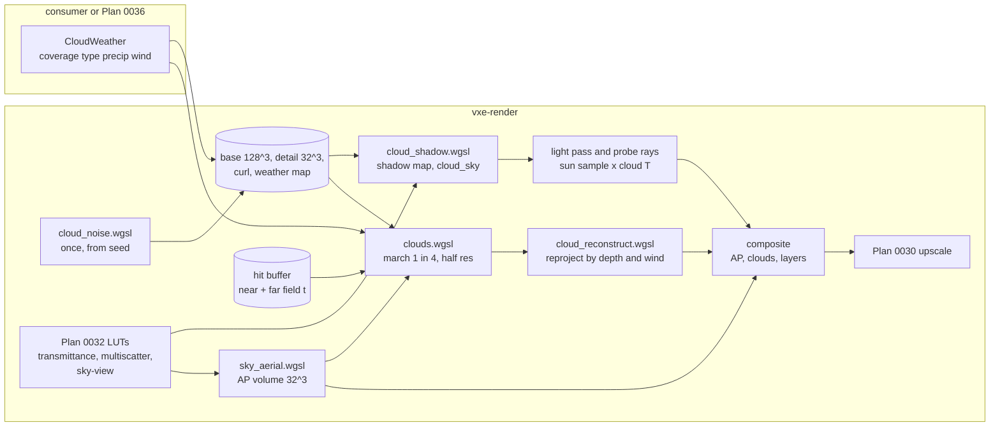

# 0035: Aerial perspective over the near and far field, and volumetric clouds that shadow the ground

> **Status:** approved (2026-10-22)
> **Created:** 2026-10-22
> **Milestone:** M10: Outdoors in [`docs/roadmap.md`](../roadmap.md)
> **Related ADRs:** [ADR-0030](../adrs/0030-volumetric-cloud-shell-amortised-march-and-projected-shadow-map.md)
> (proposed with this plan: the cloud shell, its amortised march, its lighting and the
> projected shadow map, and the rejected alternatives),
> [ADR-0018](../adrs/0018-direct-light-per-pixel-one-sample-from-a-hit-buffer-with-svgf-history-killed-by-edits.md)
> (the hit buffer the march clips against and the light pass the cloud shadow enters),
> [ADR-0023](../adrs/0023-indirect-light-from-a-scrolling-probe-volume.md) (the probes whose
> sky term the clouds darken), [ADR-0024](../adrs/0024-own-temporal-upscaler-on-the-hit-buffer.md)
> (the upscaler that runs after the composite),
> [ADR-0026](../adrs/0026-atmosphere-from-hillaire-luts-built-on-the-gpu-at-runtime.md) (the
> atmosphere's LUTs; it leaves the aerial-perspective volume to this plan),
> [ADR-0027](../adrs/0027-the-sun-shadow-is-one-per-pixel-ray-in-the-light-pass.md) (the
> directional sample the cloud shadow darkens),
> [ADR-0028](../adrs/0028-far-field-as-a-clipmap-of-source-generated-coarse-chunks.md) (the far
> field, whose hits land in the same hit buffer),
> [ADR-0031](../adrs/0031-weather-is-cosmetic-client-state-rendered-against-a-fall-map.md)
> (Plan 0036's weather, which drives this plan's weather input); all four drafted in the same
> batch
> **Source:** the owner's interview answers of 2026-10-22 (outdoors as a general engine
> capability; Hillaire 2020 atmosphere; volumetric Nubis-style clouds at reduced resolution
> with temporal accumulation, casting shadows, coverage from weather; the 2.5D layer
> rejected); the roadmap's M8 note on fog, dust and smoke as a separate coarse volume.
> **Starts after:** Plan 0032 (the atmosphere's LUTs, the sun and moon, time of day, the sun's
> shadow ray as a light sample, the sky in the probes, the outdoor testbed source) and Plan
> 0033 (the far field, whose hits the aerial perspective covers and the march clips against).
> Drafted against Plan 0024's `Frame`, `View`, hit buffer, `light.wgsl` and `composite.wgsl`
> (read in the plan-0024 worktree), Plan 0029's probe volume (`probe_update.wgsl`), Plan
> 0030's internal and output sizes, and [Plan 0032](0032-sun-and-sky-hillaire-atmosphere-time-of-day-and-an-outdoor-testbed.md)'s
> draft (`Sky`, `Body`, `sky.wgsl`'s `sky_radiance` and `transmittance`, the directional
> sample, the sky ray beyond the probes, pre-exposure, `--source outdoor`). Plans 0032 and
> 0033 were drafted in parallel with this one: the names dev finds in the tree win.

## TL;DR

Two things make an outdoor view read as outdoors: distance haze and a sky with weight in it.
This plan builds the aerial-perspective volume that ADR-0026 leaves to it (Hillaire 2020's
32^3 froxel LUT, from Plan 0032's transmittance and multiple-scattering LUTs) and applies it to
every surface pixel, near field and far field, in the composite, and adds a volumetric cloud layer: a spherical shell at 1.5 to 4 km
altitude whose density is seeded Perlin-Worley and Worley noise shaped by a weather map
(coverage, precipitation, type, wind offset), ray-marched in a buffer at half the internal
resolution per axis where each frame marches one pixel in every 2 x 2 and a reconstruction
pass reprojects the rest by the cloud's depth and the wind. Clouds are lit by the sun or the
moon through a short cone march with three scattering octaves and an ambient term from the
sky-view LUT. A 512 x 512 transmittance map, projected along the light onto the shell's base,
darkens Plan 0032's sun sample on the ground and in the probes. The first thing a reader sees
is Phase 1's flat grey overcast slab hiding the sky over the outdoor testbed, and a headless
test that reads its front depth at 1500 m from the ground and at 1000 m from 5 km above.

## Context & problem

After Plan 0032 the outdoor testbed has a physically based clear sky, a sun and a moon, and
after Plan 0033 terrain to about 1 km. Two gaps remain. Distant terrain has the same contrast
as near terrain, so the far field reads as a model, not a landscape. And the sky is always
clear: no cloud, no overcast light, no moving shadow on the ground, and no surface Plan 0036's
weather can attach to (rain falls from clouds; ADR-0031 hands coverage to this plan).

The consumer is underground (`project-context.md`); outdoors is a general engine capability
for later consumers (owner, 2026-10-22). Nothing here names a game concept: the game sets
coverage, type, precipitation and wind, or lets Plan 0036's `Weather` set them; the engine
reads no clock.

Facts the design uses:

- **Sphere arithmetic.** With Hillaire's ground radius `R = 6360 km` and a shell from 1.5 to
  4.0 km altitude, a ray from the ground spans: straight up, 1.5 to 4.0 km; at 30 degrees of
  elevation, 2.999 to 7.992 km; at 5 degrees, 16.953 to 44.151 km; at 2 degrees, 39.475 to
  94.524 km; horizontal, from 138.14 km. From 2 km altitude (inside) it spans 0 to 2.0 km up
  and 0 to 0.5 km down; from 5 km (above) looking down, 1.0 to 3.5 km. These numbers are the
  Phase 1 test table.
- **Cost of a cloud ray.** A march of up to 64 view samples with a six-sample light march at
  each dense one reads a few hundred filtered 3D-texture samples. At 720p internal (Plan
  0030's scale 1.5 for 1080p output) there are 921 600 internal pixels: every pixel marched is
  921 600 rays, a half-resolution buffer is 230 400, and one pixel in four of that buffer is
  57 600 (at 1080p internal, 129 600). ADR-0030 chooses the last as the default.
- **The near and far field write one hit buffer.** Plan 0024's hit record carries `t` per
  pixel (`BIG` on a miss); Plan 0033's far field is the same walk continued into coarser
  clip levels (ADR-0028), so its hits land in the same record. The march clips at that
  distance and the composite tests against it.
- **Plan 0032's units.** World +z is up, +x east, +y north; `Sky` maps voxel z to altitude.
  LUT radiance is per unit of top-of-atmosphere illuminance, scaled by the body's illuminance
  in frame units (the sun near 3000, a guess the owner tunes), and every HDR value a lighting
  pass stores is pre-exposed. The cloud buffers store radiance before exposure, as the sky
  does, and the composite multiplies both by the frame's exposure; the brightest cloud
  radiance, forward-scattered sunlight at `3000 * HG(0.8, 0) = 3000 * 3.58`, about 10 700,
  fits `rgba16float`'s 65 504. The aerial perspective barely shows inside the near field
  (optical depth 0.005 to 154 m, Plan 0032's arithmetic); it matters across Plan 0033's
  kilometre and at cloud distances.
- **Plan 0030 rejects history on a miss**, so sky and cloud pixels take the composite's
  current value through the upscaler. The cloud image must be temporally stable by itself,
  which is the reconstruction pass's job.
- **The aerial-perspective LUT and M8's fog are different volumes with one composite rule**
  (decided here, see Decision). The roadmap's M8 note puts dust, fog, mist and smoke in a
  separate coarse volume marched at half resolution and composited over the opaque hit.

`nfr.md` figures touched: §2 "Headroom (entities, volumetrics, game work)" 2.1 ms (the cloud
passes), §2 "Upscale, tone map, post" 1.5 ms (the aerial perspective and the cloud upsample in
the composite), §2 "Lighting" 6.0 ms (one bilinear read per sun sample), §3 "Everything else
in VRAM" 1.5 GB (about 31 MB, Data shapes), §7 time to first frame (the noise generation runs
once at startup).

## Decision

**We apply the aerial perspective in the composite and render clouds per ADR-0030.**

- **Aerial perspective.** ADR-0026 leaves the aerial-perspective volume to this plan. A new
  `sky_aerial.wgsl` pass builds it every frame per view: 32 x 32 x 32 `rgba16float`, in-
  scattered radiance per unit illuminance (rgb, both bodies summed as the sky-view LUT does)
  and mean transmittance (a), integrated along each froxel column from the camera with
  Plan 0032's `transmittance` and multiple-scattering lookups, Hillaire 2020's method. Its
  depth slices are quadratic, slice `k` ending at `32 km * (k / 32)^2`, so Plan 0033's 1 km
  spans the first six slices (`32 km * (6/32)^2 = 1.125 km`) and the last slice is 1.97 km
  thick for clouds; linear slices of 1 km would put the whole world in the first. In
  `composite.wgsl` every surface pixel's radiance `L` at hit distance `t` becomes
  `L * T_ap(uv, t) + S_ap(uv, t)`, near field and far field alike, and the cloud pass applies
  the same to each cloud sample's contribution at its depth. Beyond 32 km a cloud reads the
  last slice. A primary miss is not touched: the sky-view LUT already holds the whole path.
- **One composite rule for every participating medium, two volumes.** The composite applies
  media from far to near: aerial perspective on the surface, then clouds, then (M8, later) the
  local fog volume, each as `L = L * T + S` sampled at the pixel and its depth. We do not put
  M8's fog in the aerial-perspective volume: the LUT spans 32 km in 32 quadratic slices and
  holds only the atmosphere, while a fog of dust and smoke needs decimetre to metre slices
  over the first 100 m and local, edit-driven density. They share the rule and its place in
  the composite, which this plan writes down as a `media` section of `composite.wgsl` with
  the cloud and aerial-perspective terms in it; M8's plan adds its term after the clouds.
- **The shell and the density.** Shell base 1.5 km, top 4.0 km above Plan 0032's ground
  altitude (both `CloudParams` fields, HZD's figures). Density follows Schneider 2015 and the
  Nubis talks: base volume 128^3 `rgba8unorm` (R a Perlin-Worley, GBA Worley fBm at 4, 8 and
  16 cells per tile), detail volume 32^3 `rgba8unorm` (RGB Worley fBm at 2, 4, 8 cells per
  tile), a 128^2 `rgba8unorm` curl-noise texture, all tileable, generated once by
  `cloud_noise.wgsl` from `CloudParams::seed` with full mip chains. A 512 x 512 `rgba8unorm`
  weather map (R coverage, G precipitation, B type, A reserved for Plan 0036) covers
  `extent_m` (32 km by default) with repeat addressing, generated from the seed or supplied
  by the game. Effective coverage is `clamp(R + 2 * (coverage - 0.5), 0, 1)` and effective
  type `clamp(B + 2 * (cloud_type - 0.5), 0, 1)`, so `coverage = 0` is a sky with no cloud and
  `coverage = 1` is overcast whatever the map says. The base shape is remapped by coverage,
  multiplied by a height profile per type (stratus low and thin, cumulus tall and rounded),
  and eroded by the curl-distorted detail, wispy at the base and billowy at the top. The
  weather map and the noise sample at the horizontal position `world_xy_m + wind_offset_m`
  (z is up) and the altitude.
- **Lighting.** Per view sample: extinction `sigma_t = extinction * density` (0.05 per metre
  by default, a guess to tune by eye), albedo 0.99, Hillaire 2016's energy-conserving step
  integral, three octaves with extinction, scattering and eccentricity scaled by 0.5 per
  octave, a phase that blends Henyey-Greenstein lobes at `g = 0.8` and `g = -0.5`. The key
  light is the body Plan 0032's directional sample uses (the sun by day, the moon at night),
  its radiance through `transmittance(alt, mu)` at the sample's altitude; a six-sample cone march toward it
  (detail noise on the first three) gives its transmittance. Ambient: a `cloud_ambient`
  dispatch reduces the sky-view LUT's upper hemisphere to one irradiance, and the sample takes
  it scaled from the ground's bounce at the shell base to the full value at the top. Schneider's
  Beer-Powder term is the switchable alternative.
- **Resolution and time.** The cloud buffer is half the internal size per axis. The march
  dispatches one pixel per 2 x 2 block (`OneInFour`, the default), one per 4 x 4
  (`OneInSixteen`, for the slow adapter if its reading asks), or every pixel (`Every`, used
  inside the shell and by the goldens); the marched pixel follows a Bayer order of the frame
  index and its march starts at a blue-noise offset (Plan 0024's 128 x 128 texture). The
  reconstruction pass reprojects every pixel's transmittance-weighted mean depth through the
  previous view after subtracting the frame's wind displacement, clamps the history to the
  box of this frame's marched neighbours, blends a marched pixel at 0.25 over valid history
  and takes the history alone for the others, and falls back to the nearest marched neighbour
  where history is invalid.
- **Composite.** The cloud buffer is upsampled to the internal pixel with bilinear weights
  zeroed for texels whose front depth lies beyond the pixel's hit `t` (a pixel in front of
  the cloud gets none of it), then applied after the aerial perspective and before the
  translucent layers, which lie within metres of the camera.
- **Cloud shadow.** `cloud_shadow.wgsl` rebuilds a 512 x 512 `r32float` transmittance map
  every frame over a 4 km square, texel-snapped (7.8125 m per texel), centred where the
  camera projects along the key light onto the plane of the shell base; a texel marches 16
  base-shape samples along the light through the shell, capped at 10 km of path. A receiver
  at `p` reads the texel where `p + light_dir * (base_alt - alt(p)) / light_dir.z` lands; off
  the square or with the light below 2 degrees of elevation it reads the mean transmittance
  of the square. Plan 0032's directional sample (ADR-0027) multiplies its visibility by it,
  in `light.wgsl` and through the shared estimator in Plan 0029's probe rays.
- **The sky under clouds.** A 128 x 64 `rgba16float` map of the upper hemisphere's radiance
  with clouds composited (`cloud_sky`, azimuth by elevation, marched at 32 view steps, one
  eighth of its texels per frame) replaces `sky_radiance(d)` for lighting rays when clouds
  are on: Plan 0032's probe-ray misses in `probe_update.wgsl` and its one cosine-weighted sky
  ray beyond the probes in `light.wgsl`. An overcast day then lights the ground grey and dim,
  not blue. Primary misses keep `sky_radiance(d)` with the cloud buffer composited over it.
- **Camera inside or above the layer.** The march's segment is computed from the two spheres
  for any camera altitude: below, it starts at the base; inside, at the camera; above, at the
  top. From above, only the first entry into the shell is marched (a ray that dips under the
  base and re-emerges beyond a horizon is cut at the base; it would hit the ground or the far
  field first in every view the testbed reaches). Inside the shell the update is forced to
  `Every` and history is blended at 0.5, because near cloud has parallax that a one-in-four
  update ghosts. Above the shell the default update holds. The cloud shadow and the
  `cloud_sky` map are independent of the camera's altitude.
- **Weather input.** `CloudWeather { coverage, cloud_type, precipitation, wind_m_s,
  wind_offset_m, evolution }` and `WeatherMap::{Procedural, Supplied}` are the whole input.
  The engine never advances `wind_offset_m` itself; `CloudWeather::advance(dt_s)` is a pure
  helper the caller (the testbed, or Plan 0036's `Weather::step`) calls with its own time.

We rejected marching every pixel every frame (sixteen times the rays), marching the noise
along every sun shadow ray (a second march per pixel and per probe ray) and clouds in a
froxel volume shared with the aerial perspective and the fog (kilometre-deep slices at cloud
distance); the reasons are in ADR-0030. The 2.5D layer was rejected in the owner's interview.

## Architecture diagram



## Implementation phases

Each phase ships as its own commit. `dev` implements all phases in one session with no review
between phases. The architect reviews once at the end, in a fresh session. Every golden this
plan adds is blessed on lavapipe at the harness's 320 x 180 with its floor (at most 0.1 % of
pixels differ by more than 2/255 in any channel), with the count of changed pixels in the log.
Render tests skip with a printed reason where no adapter exists, as today.

### Phase 1: The shell, a flat layer, and its front depth (walking skeleton)
- **Owner skill:** dev
- **What:** a `clouds` module in `vxe-render` with `Clouds`, `CloudParams` and a debug flat
  density (`density = effective coverage` everywhere in the shell, no noise); `clouds.wgsl`
  marches every internal pixel through the shell segment (camera-relative positions, planet
  centre and the altitude from `Sky`'s altitude mapping), clipped at the hit buffer's `t` and
  at 60 km, with Beer transmittance, one unshadowed key-light term and the ambient term,
  writing radiance, transmittance and front depth; the composite applies it over the pixel
  when the pixel's `t` lies beyond the front depth. `cloud_segment` exists twice, in WGSL and
  as a CPU reference in Rust; the fly-through gets a cloud key that cycles `off` and
  `flat overcast` with the mode banner.
- **Files touched:** new `crates/vxe-render/src/clouds.rs`, new
  `crates/vxe-render/src/shaders/clouds.wgsl`, `crates/vxe-render/src/marcher.rs` (the
  `Frame` owns `Clouds`, a `clouds` timestamp in `FRAME_PASSES`),
  `crates/vxe-render/src/shaders/composite.wgsl`, `crates/vxe-render/src/lib.rs`, new
  `crates/vxe-render/tests/clouds.rs`, `apps/flythrough/src/main.rs`,
  `apps/flythrough/src/hud.rs` (the mode line).
- **Done when:** the CPU `cloud_segment` returns, for `R = 6360 km` and the shell at 1.5 and
  4.0 km, within 1 m: ground up `[1500, 4000]` m; ground at 30 degrees `[2999, 7992]` m;
  ground at 5 degrees `[16953, 44151]` m; ground at 2 degrees `[39475, 60000]` m (the cap);
  ground horizontal empty (it starts at 138.14 km, past the cap); 2 km up `[0, 2000]`; 2 km
  down `[0, 500]`; 5 km down `[1000, 3500]`; and a GPU probe dispatch of the same rays agrees
  with it within 1 m (camera-relative f32). On the GPU over an empty world (every pixel a
  miss) with the flat layer at coverage 1 and extinction 0.05 per metre: from the ground
  looking up, the centre pixel's front depth is
  1500 m within one step (2500 m / 64 = 39 m) and its transmittance is 0 (optical depth 125,
  under the 0.01 early-out); from 5 km looking down, front depth 1000 m within 39 m and
  transmittance 0. With coverage 0 the frame is byte for byte the frame with clouds off. The
  banner test: the cloud key changes the banner's text to `clouds off` and `clouds flat
  overcast` in turn.

### Phase 2: Seeded noise, the weather map, the Nubis density and the weather input
- **Owner skill:** dev
- **What:** `cloud_noise.wgsl` generates the base, detail and curl textures and their mips
  from `CloudParams::seed` (a PCG hash of the cell coordinate and seed places the Worley
  feature points, wrapped by the tile period) at `Clouds::new` and on `set_seed`;
  `cloud_weather.wgsl` generates the procedural weather map from the seed; `Clouds::set_weather`
  takes `CloudWeather`, `Clouds::set_weather_map` takes `WeatherMap::Supplied { size, texels,
  extent_m }` (texels uploaded once per call, never per frame); the density function replaces
  the flat one (kept as `CloudDebug::Flat`): coverage remap, height profile by type, curl
  distorted detail erosion, wind offset. A cheap-then-fine step scheme: base-only samples at
  twice the step until density appears, back one step, full samples until six consecutive
  empty ones.
- **Files touched:** new `crates/vxe-render/src/shaders/cloud_noise.wgsl`, new
  `crates/vxe-render/src/shaders/cloud_weather.wgsl`, `clouds.wgsl`, `clouds.rs`,
  `crates/vxe-render/tests/clouds.rs`, `apps/flythrough/src/main.rs` (presets `scattered`
  and `overcast` added to the cloud key's cycle).
- **Done when:** two generations with seed 1 on one adapter read back byte-identical base,
  detail and curl textures, and seed 2 differs from seed 1 (the number of differing texels
  logged); for every channel of the base volume, the mean absolute difference across the wrap
  seam (column 127 against column 0) is no greater than the largest such difference between
  any two adjacent interior columns (a seam that did not tile would stand out of that
  spread); a supplied 512 x 512 map over 4 km with R = 1 inside a 300 m disc at the origin and
  0 elsewhere, at `coverage = 0.5`, over an empty world (every pixel a miss) with the camera
  on the ground at the origin looking straight up: every pixel more than 12.5 degrees off
  vertical reads transmittance exactly 1.0 (its ray is already `1.5 km * tan 12.5 = 333 m`
  off axis at the shell base and moves outward above it, past the disc's 300 m plus two
  7.8 m texels of filter; the weather map is not curl-distorted), and
  the mean transmittance of the pixels within 10 degrees is below 1.0; with `coverage = 0`
  every pixel reads 1.0 whatever the map. `CloudWeather::advance(2.0)` with wind (3, -1) m/s
  moves `wind_offset_m` by exactly (6, -2).

### Phase 3: Light: the cone march, scattering octaves, the phase, ambient, and the moon
- **Owner skill:** dev
- **What:** the key light's six-sample cone march (cumulative distances 30, 75, 135, 210,
  300 and 405 m plus one sample at 1.2 km; detail noise on the first three); the key light's
  radiance from Plan 0032's transmittance LUT at the sample's altitude; Hillaire 2016's step
  integral with three octaves; the two-lobe phase; the `cloud_ambient` reduction of the
  sky-view LUT; `CloudLighting::{Octaves, BeerPowder}` as a mode; the moon as the key light
  when the sun is below the horizon.
- **Files touched:** `clouds.wgsl`, new `crates/vxe-render/src/shaders/cloud_ambient.wgsl`,
  `clouds.rs`, `crates/vxe-render/tests/clouds.rs`, `apps/flythrough/src/main.rs` and
  `hud.rs` (a cloud-lighting key with the banner).
- **Done when:** in the scattered preset at seed 1 with the sun at 20 degrees of elevation
  in front of the camera, the mean radiance of cloud pixels within 10 degrees of the sun's
  direction is higher than that of cloud pixels 80 to 100 degrees from it (forward
  scattering; the ratio logged for both lighting modes); with one octave, both phase lobes at
  `g = 0` (isotropic), ambient off, and the flat debug layer at coverage 1 and extinction
  4e-6 per metre (optical depth `tau = 2500 m * 4e-6 = 0.01` across the shell), the cloud
  buffer's centre texel seen straight up from the ground with the sun at zenith reads within
  2 % of the single-scattering closed form `E * albedo * tau * exp(-tau) / (4 pi)` (along
  the light every scattering depth sees view and light paths that sum to `tau`, so the
  product of their transmittances is `exp(-tau)` everywhere; the cone march's estimate of the
  light path can be off by at most the whole `tau`, 1 %, which the 2 % covers); with the sun 10 degrees below the horizon and the moon at 40 degrees, cloud
  pixels have radiance above zero and below the same view at noon; the banner names
  `cloud light octaves` and `cloud light beer-powder` in turn.

### Phase 4: Half resolution, the update modes, reconstruction, and the camera in the layer
- **Owner skill:** dev
- **What:** the cloud buffer at half the internal size per axis; `CloudUpdate::{Every,
  OneInFour, OneInSixteen}`; `cloud_reconstruct.wgsl` (reprojection by the mean depth minus
  this frame's wind displacement through the previous view, history clamp to the marched
  neighbours' box, blend 0.25, nearest-marched fill); the composite's depth-weighted upsample;
  the forced `Every` and blend 0.5 inside the shell; the cloud buffers resize with
  `Frame::resize` and `set_resolution`.
- **Files touched:** `clouds.wgsl`, new `crates/vxe-render/src/shaders/cloud_reconstruct.wgsl`,
  `composite.wgsl`, `clouds.rs`, `marcher.rs` (`cloud_reconstruct` in `FRAME_PASSES`),
  `crates/vxe-render/tests/clouds.rs`, `apps/flythrough/src/main.rs` and `hud.rs` (an
  update-mode key with the banner).
- **Done when:** with a still camera on the scattered preset, `OneInFour` and `OneInSixteen`
  after 64 frames each differ from `Every` after 64 frames by a mean absolute difference that
  is logged per mode and is smaller than `Every`'s own first frame's difference from it (the
  amortised image converges past one frame of the full march); the march dispatch covers 1/16 of the internal pixels in `OneInFour`
  (at 320 x 180 internal the cloud buffer is 160 x 90 and one in four is 80 x 45 = 3 600
  rays, a sixteenth of 57 600) and one pixel per 4 x 4 block in `OneInSixteen` (90 rows is
  not a multiple of 4: 40 x 23 = 920 rays on frames whose Bayer row is 0 or 1, 40 x 22 = 880
  on rows 2 and 3; the test asserts both counts);
  a camera yawing 0.5 degrees per frame keeps history in at least 95 % of the cloud pixels
  whose reprojection lies inside the previous frame; a still camera with the wind moving the
  field 50 m per frame keeps history in at least 95 % of cloud pixels with wind compensation,
  and its 8-frame image is closer to `Every` than the same run with compensation off (the
  two differences logged); with the camera at 2.5 km altitude `Clouds::effective_update`
  returns `Every` whatever the mode, and at 0.5 km and 5 km returns the mode.

### Phase 5: Aerial perspective in the composite, and the media rule
- **Owner skill:** dev
- **What:** `sky_aerial.wgsl` builds the aerial-perspective volume per view every frame
  (quadratic slices, Decision); the composite applies it to each surface pixel at its hit
  distance (near field and far field) and the cloud pass to each cloud sample at its depth,
  in the far-to-near order of the Decision, written as the composite's `media` section with
  the M8 slot named in its comment; an `--aerial on|off` flag and a key, with the banner; a
  brute-force mode that integrates the atmosphere per pixel along the view ray with the
  volume's own functions, for the test.
- **Files touched:** new `crates/vxe-render/src/shaders/sky_aerial.wgsl`, `sky.rs` (the
  volume and its pass), `composite.wgsl`, `clouds.wgsl`, `marcher.rs` (`sky_aerial` in
  `FRAME_PASSES`), new `crates/vxe-render/tests/aerial.rs`, `apps/flythrough/src/main.rs` and
  `hud.rs`.
- **Done when:** with Plan 0032's default `Atmosphere`, the camera at altitude 0 and the sun
  at noon, the volume's transmittance (the mean over rgb, Hillaire 2020's `a`) read at 1 km
  along the horizon is 0.9784 within 0.002 (`exp(-1000 m * (rayleigh + mie extinction))` per
  channel at sea-level density: 0.98985, 0.98220 and 0.96319, mean 0.97842; the 0.002 covers
  `rgba16float` and the interpolation between the slices ending at 0.781 and 1.125 km); a
  pixel whose hit is at `t = 0` keeps its radiance exactly; on the outdoor testbed source at
  noon the LUT image agrees with the brute-force image
  within the harness floor (at most 0.1 % of pixels differ by more than 2/255) over the near
  and far field; a pixel's transmittance falls monotonically with its hit distance along the
  centre row; and with clouds off and aerial off, the frame is byte for byte Plan 0033's.

### Phase 6: Cloud shadows on the ground and in the probes, and the sky under clouds
- **Owner skill:** dev
- **What:** `cloud_shadow.wgsl` builds the transmittance map and the `cloud_sky` hemisphere
  map (one eighth of its texels per frame); a shared WGSL function `cloud_sun_transmittance(p)`
  that Plan 0032's directional sample multiplies its visibility by, in `light.wgsl` and in the
  probe rays through the shared estimator; a lighting-ray sky lookup that reads `cloud_sky`
  instead of `sky_radiance(d)` when clouds are on, for the probe-ray misses and the sky ray
  beyond the probes; a cloud-shadow key with the banner.
- **Files touched:** new `crates/vxe-render/src/shaders/cloud_shadow.wgsl`,
  `crates/vxe-render/src/shaders/light.wgsl`, `probe_update.wgsl`, `sky.wgsl` (the lighting-ray
  lookup), `clouds.rs`, `marcher.rs` (`cloud_shadow` in `FRAME_PASSES`),
  `crates/vxe-render/tests/clouds.rs`, `apps/flythrough/src/main.rs` and `hud.rs`.
- **Done when:** in the flat debug density with a shell from 1.5 to 2.0 km, coverage 0.5 and
  the supplied 300 m disc map of Phase 2, the camera at the origin at ground altitude, and a
  probe dispatch evaluating `cloud_sun_transmittance` at ground-altitude points (x, y): with
  the sun at zenith, (0, 0) reads at most 0.01 (optical depth
  `500 m * 0.05 = 25`) and at (500 m, 0) is exactly 1.0; with the sun at 45 degrees of
  elevation toward +x, ground point (-1750 m, 0) reads at most 0.01 (its ray crosses the shell
  at x from -250 to +250 m, inside the disc; path 707 m, optical depth 35) and (+300 m, 0)
  reads exactly 1.0 (its ray crosses at x from 1.8 to 2.3 km); with coverage 0 the light
  pass's irradiance is byte for byte that with the cloud shadow off; on the outdoor source at
  noon, the overcast preset's mean probe irradiance is lower than the clear sky's and its
  blue-to-red ratio is lower (both logged).

### Phase 7: The testbed's presets, the goldens, and the readings on both adapters
- **Owner skill:** dev
- **What:** the fly-through's outdoor source (`--source outdoor`, Plan 0032) gets the cloud
  presets as flags (`--clouds off|flat|scattered|overcast`, `--cloud-update`, `--cloud-light`,
  `--cloud-shadow`, `--aerial`), the testbed advances `CloudWeather::advance` with its frame
  `dt` as it does the time of day, the keys of Phases 1 to 6 settle into one mode line, the autopilot prints the
  `sky_aerial`, `clouds`, `cloud_reconstruct` and `cloud_shadow` timestamps and `Clouds::bytes`; three
  goldens; readings on both adapters.
- **Files touched:** `apps/flythrough/src/main.rs`, `apps/flythrough/src/hud.rs`,
  `apps/flythrough/tests/golden.rs`, new goldens `apps/flythrough/tests/golden/clouds_overcast.png`,
  `clouds_cumulus_sunset.png` and `cloud_shadow_terrain.png`, `docs/nfr.md` (the readings),
  this plan's log.
- **Done when:** the three goldens render on lavapipe at 320 x 180 with seed 1, `Every`
  update, wind offset zero and 16 frames, and match their blessed images within the
  harness's floor: **overcast** (coverage 1, type 0.2, sun at 40 degrees, camera on the
  terrain looking 15 degrees up), **scattered cumulus at sunset** (coverage 0.45, type 1.0,
  sun at 3 degrees, camera facing 30 degrees off the sun's azimuth, aerial perspective on),
  **cloud shadow on terrain** (coverage 0.45, type 1.0, sun at 50 degrees, camera 60 m above
  the terrain looking 35 degrees down, so the shadows fall on visible ground); the mode-line
  test shows every cloud mode's word changing on its key; the autopilot's readings in the
  Budgets table are taken on both adapters and recorded in `docs/nfr.md` labelled by adapter,
  with the default update mode per adapter chosen from them and named in the log.

### Phase 8: The owner's windowed check
- **Owner skill:** human
- **What:** the owner flies the outdoor testbed on both adapters (pinged when ready, batched
  with the other outdoor checks): overcast, scattered cumulus through a sunset into night,
  a flight up through the shell and above it, the cloud shadows crossing terrain with the
  wind, each lighting mode and update mode, the aerial perspective on and off.
- **Files touched:** this plan's log (dev records the owner's verdicts).
- **Done when:** the owner has named the lighting mode and update modes to keep (per
  adapter), and said whether the look is smooth and natural (no banding, no blocky
  reconstruction, no ghost trailing a turn); every switch's banner was seen on screen.

## Data shapes

```rust
// illustrative: the inputs, all in vxe-render::clouds
pub struct CloudParams {
    pub seed: u32,
    pub base_km: f32, pub top_km: f32,      // 1.5, 4.0
    pub extinction_per_m: f32,              // 0.05, a guess tuned by eye
    pub albedo: f32,                        // 0.99
    pub max_distance_km: f32,               // 60
    pub view_steps: u32, pub light_steps: u32, // 64 and 6 (dev reference)
    pub octaves: u32,                       // 3; scale 0.5 per octave
    pub phase: [f32; 3],                    // g forward 0.8, g back -0.5, back weight 0.2
    pub update: CloudUpdate, pub lighting: CloudLighting, pub debug: CloudDebug,
}
pub struct CloudWeather {
    pub coverage: f32, pub cloud_type: f32, pub precipitation: f32, // 0..1 each
    pub wind_m_s: [f32; 2], pub wind_offset_m: [f32; 2], pub evolution: f32,
}
impl CloudWeather { pub fn advance(&mut self, dt_s: f32) { /* offset += wind * dt */ } }
pub enum WeatherMap { Procedural { extent_m: f32 }, Supplied { size: u32, texels: Vec<u8>, extent_m: f32 } }
pub enum CloudUpdate { Every, OneInFour, OneInSixteen }
pub enum CloudLighting { Octaves, BeerPowder }
```

GPU resources, arithmetic (internal 1920 x 1080 as the worst case; at 720p internal the
cloud-buffer rows shrink to 4/9):

| resource | format | size | bytes |
|---|---|---|---|
| base noise, with mips | rgba8unorm 3D | 128^3 down to 1^3: 2 396 745 texels | 9 586 980 |
| detail noise, with mips | rgba8unorm 3D | 32^3 down to 1^3: 37 449 texels | 149 796 |
| curl noise | rgba8unorm | 128^2 | 65 536 |
| weather map | rgba8unorm | 512^2 | 1 048 576 |
| cloud shadow map | r32float | 512^2 | 1 048 576 |
| `cloud_sky` | rgba16float | 128 x 64 | 65 536 |
| cloud history: radiance + transmittance | rgba16float | 960 x 540, two copies | 8 294 400 |
| cloud history: front and mean depth | rg32float | 960 x 540, two copies | 8 294 400 |
| this frame's marched samples | rgba16float + rg32float | 480 x 270 (sized for `OneInFour`; `Every` marches it four times a frame) | 2 073 600 |
| aerial-perspective volume, one view | rgba16float 3D | 32^3 | 262 144 |

About 30.9 MB (30 889 544 B), against §3's 1.5 GB "everything else" line beside Plan 0024's
276 MB, Plan 0029's 50.3 MB, Plan 0030's history and Plan 0032's 0.56 MB. A second view adds
a second aerial-perspective volume and a second set of cloud buffers. Storage-texture formats are WebGPU core
(`rgba8unorm`, `rgba16float`, `r32float`, `rg32float`), so no adapter feature is requested.

## Budgets

| `nfr.md` figure | line | projection (guesses: dev box at 720p internal, 1080p output) | how the close measures it |
|---|---|---|---|
| §2 Headroom (volumetrics) | 2.1 ms (shared) | NVIDIA: march 0.3 to 0.6 ms in `OneInFour`, reconstruct 0.05 ms, shadow map and `cloud_sky` 0.1 to 0.2 ms; slow adapter eight to nine times that (a guess from the compute and bandwidth ratio of the two adapters), 3.6 to 7.7 ms, hence `OneInSixteen` and 32 view steps as its candidate profile | `flythrough --source outdoor --clouds scattered --render 1920x1080 --internal-scale 1.5 --headless --frames 300`, and `--clouds overcast`, per-pass timestamps, median of the last 30, three runs, `--adapter` on each of the two adapters, every update mode |
| §2 Upscale, tone map, post | 1.5 ms | the composite's aerial perspective and cloud upsample add 0.05 to 0.1 ms on NVIDIA; `sky_aerial` (32 768 froxels, 32 steps each) under 0.05 ms | the composite's and `sky_aerial`'s timestamps, same runs, `--aerial on` against `off` |
| §2 Lighting | 6.0 ms | one bilinear read per sun sample and per probe ray, under 0.05 ms | the light pass's timestamp, cloud shadow on against off |
| §3 Everything else in VRAM | 1.5 GB | 30.9 MB at 1080p internal (table) | `Clouds::bytes` printed by the autopilot |
| §7 Time to first frame | 3 s | noise generation once, a few milliseconds on NVIDIA, a guess | the autopilot's startup timers, clouds on against off, both adapters |

This plan proposes a sub-line for `nfr.md` §2's headroom: clouds and aerial perspective at
most 1.0 ms on the floor, leaving the rest for M8's fog, entities and game work. The floor is
two to three times slower than the dev box (a projection; the card is not on hand), so the
NVIDIA reading must stay under about 0.35 to 0.5 ms for the projection to meet it; the slow
adapter's reading is recorded against it, not gated. A miss is recorded with the profile that
was measured, as with every render plan since Plan 0028.

## Risks & open questions

- **f32 precision near a 6360 km planet.** World-space positions measured from the planet's
  centre lose about 0.4 m of precision. Every cloud and segment computation is camera-relative
  with the planet centre as an offset (Hillaire 2020's practice); Phase 1's GPU probe against
  the CPU reference checks it.
- **Terrain that pierces the shell.** One front depth per cloud texel cannot clip a cloud
  around a peak inside it (ADR-0030, Negative). The testbed's terrain stays below 1.5 km; a
  consumer with mountains into the clouds needs a per-pixel march end, a followup.
- **Ghosting on fast turns and cuts.** The one-in-four update reveals a screen edge at a
  quarter of its pixels. Reprojection makes slow turns safe; a cut (teleport) resets history,
  and its first frames show the spatial fill. Phase 8 judges it.
- **Plan 0030 and the sky.** The upscaler takes misses at alpha 1.0, so cloud pixels get no
  upscaler accumulation and are as soft as the half-resolution reconstruction. Clouds are soft;
  if the owner sees shimmer at cloud edges over the sky, a followup gives the upscaler the
  cloud's mean depth for reprojection of misses.
- **Quadratic slices against the paper's.** Hillaire 2020 spaces its 32 slices over 32 km
  for a world seen from the air; ours is a 1 km world under a sky of clouds, hence the
  quadratic mapping. Phase 5's brute-force comparison is the check that six slices carry
  the kilometre without banding; if they do not, a 48-slice volume (393 216 B) is the knob.
- **Keys.** Plan 0032 binds `F8`, `,`, `.` and `/`, and Plans 0033 and 0034 add keys in the
  same batch. Dev takes unbound keys and lists them in the mode line; the banner, not the
  key, is the contract.
- **Lavapipe cost.** Generating 2.4 million noise texels and marching 14 400 cloud rays for
  16 frames on the software adapter may take seconds per golden. The goldens use `Every` at
  320 x 180 and the noise is generated once per test binary where the harness allows.
- **Cloud self-shadowing range.** The cone march reaches 1.2 km; a cloud's base under a tall
  tower more than that deep is lit as if the tower's top were thin. Nubis accepts it; Phase 8
  judges it at sunset.

## What this plan does NOT do

- **Plan 0032:** the transmittance, multi-scattering and sky-view LUTs (this plan builds the
  aerial-perspective volume, as ADR-0026 says), the sun, the moon, stars, time of day, the sun's shadow ray, the sky in the probes and the
  outdoor testbed source. This plan reads them, and darkens the sun sample and the probes'
  sky.
- **Plan 0033:** the far field. This plan clips the march against its hits and applies the
  aerial perspective to them.
- **Plan 0034:** water. Reflections of the sky do not show clouds here; `cloud_sky` is
  there for that plan or a followup to read.
- **Plan 0036:** rain, snow, wind effects, wet surfaces, snow cover, lightning and the weather
  state that drives `CloudWeather`. This plan's weather input is the receiving end; the
  weather map's A channel is reserved for it.
- **M8:** the local fog, dust and smoke volume. This plan fixes the composite rule and the
  slot it takes, not its grid.
- Light shafts (crepuscular rays) through cloud gaps, cumulonimbus anvils, cloud-to-cloud
  shadows beyond the cone march, clouds below the camera's ground (fog banks in valleys), and
  any server-side or deterministic cloud state: clouds are cosmetic and client-side.
- A flowing-liquid or any `vxe-world` change: this plan touches `vxe-render` and the
  fly-through only.

References worth an annotated entry in `docs/references/` (not added by this plan): Schneider
and Vos, "The Real-time Volumetric Cloudscapes of Horizon Zero Dawn" (SIGGRAPH 2015 Advances
in Real-Time Rendering); Schneider, "Nubis: Authoring Real-Time Volumetric Cloudscapes with
the Decima Engine" (SIGGRAPH 2017 Advances) and the later Nubis talks; Hillaire, "Physically
Based Sky, Atmosphere and Cloud Rendering in Frostbite" (SIGGRAPH 2016 Physically Based
Shading course); Hillaire, "A Scalable and Production Ready Sky and Atmosphere Rendering
Technique" (EGSR 2020); Wrenninge, Kulla and Lundqvist, "Oz: The Great and Volumetric"
(SIGGRAPH 2013 talk); Hillaire, "Towards Unified and Physically-Based Volumetric Lighting in
Frostbite" (SIGGRAPH 2015 Advances), for the froxel design M8 may take.

## Implementation log

> Written by `dev`: one row per phase as its commit lands, then the close block. **The phases
> above are the contract. This section records what happened.** Observations, never
> conclusions: no pass list, no self-assessment. Deviations and unmet done-whens are
> **always** disclosed. Keep it shorter than `## Implementation phases`.

| phase | owner | state | commit |
|---|---|---|---|
| 1: The shell, a flat layer, and its front depth | dev | not started | |
| 2: Seeded noise, the weather map, the density and the weather input | dev | not started | |
| 3: Light: cone march, octaves, phase, ambient, moon | dev | not started | |
| 4: Half resolution, update modes, reconstruction, camera in the layer | dev | not started | |
| 5: Aerial perspective in the composite, and the media rule | dev | not started | |
| 6: Cloud shadows on the ground and in the probes, the sky under clouds | dev | not started | |
| 7: Presets, goldens, readings on both adapters | dev | not started | |
| 8: The owner's windowed check | human | not started | |

### Notes

_(Deviations from the plan, with the commit, stated without justification. Done-whens not
satisfiable as stated, and what was done instead. Followups noticed and not acted on. One line
each. Empty is fine.)_

### Close triggers

_(Facts for the architect. No recommendations, and no suggested version bump.)_

- **What shipped:** feature / fix-only / docs-chore-only
- **Public API changed:** types, traits, functions, shader interfaces, config (list them, or none)
- **Budget readings:** each `nfr.md` figure touched, with its measured value, machine and commit
- **Gate at the tip:** the commands run (build, nextest, doctests, clippy, fmt, deny), exit codes, test counts
- **Outstanding `human` phases:** which, or none

## Followups

- A per-pixel march end for terrain that pierces the cloud layer (Risks).
- Upscaler reprojection of sky and cloud pixels by the cloud's mean depth, if Phase 8 sees
  shimmer (Risks).
