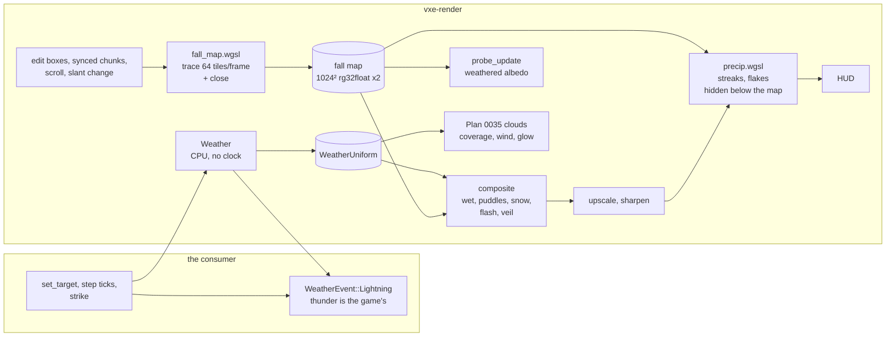

# 0036: Weather: rain, snow, wind, wet surfaces and snow cover, lightning

> **Status:** approved (2026-10-22)
> **Created:** 2026-10-22
> **Milestone:** M10: Outdoors in `docs/roadmap.md`
> **Related ADRs:** [ADR-0031](../adrs/0031-weather-is-cosmetic-client-state-rendered-against-a-fall-map.md)
> (proposed with this plan: cosmetic client weather and the fall map, with voxel snow, a
> coarse-grid height map, per-pixel sky rays and screen-space layers rejected),
> [ADR-0018](../adrs/0018-direct-light-per-pixel-one-sample-from-a-hit-buffer-with-svgf-history-killed-by-edits.md)
> (the hit buffer and `Frame::invalidate`),
> [ADR-0023](../adrs/0023-indirect-light-from-a-scrolling-probe-volume.md) (the probe rays
> that shade with the weathered albedo),
> [ADR-0024](../adrs/0024-own-temporal-upscaler-on-the-hit-buffer.md) (the particles draw
> after its sharpen pass)
> **Source:** the owner's outdoor answers (2026-10-22: full dynamic sky and weather driven by
> the game through a small API, cosmetic client-side, no wall clock).
> **Starts after:** Plan 0035 closes (and so Plans 0032 and 0033). Drafted against Plan
> 0024's `Frame`, hit buffer and `composite.wgsl`, Plan 0029's `probe_update.wgsl` and Plan
> 0030's output-resolution `sharpen.wgsl`. For Plans 0032, 0033 and 0035, which were drafted
> beside this one, the names below are assumptions, listed under "Assumed interfaces". The
> names dev finds in the tree win.

## TL;DR

The game sets a `WeatherState`: rain and snow rates, a wind vector, wetness and snow-cover
levels, cloud coverage and a lightning rate. It advances a `Weather` toward that state with its
own ticks. The renderer traces a **fall map** through the mirror and the far field. The map is
a 1024 x 1024 grid at 0.2 m around the camera. Each texel holds the height where something
falling along the wind-slanted fall direction first meets solid ground. Rain streaks and
snowflakes are stateless particles in a box around the camera, hidden below the map. Wetness,
puddles in closed basins and snow cover recolour only the faces the map calls exposed.
Lightning is a seeded event the game hears through `Weather::step`, plus a flash that lights
the exposed faces and the clouds. The first things a reader sees are a flat test floor that
reads the snow albedo in the albedo view (Phase 1), then a tunnel whose floor stays bit-for-bit
dry while rain falls outside its mouth (Phase 3).

## Context & problem

The owner's outdoor answers make sky and weather general engine mechanisms (2026-10-22). Plan
0032 gives a physically based sky and sun, Plan 0033 a far field to about 1 km, and Plan 0035
volumetric clouds whose coverage comes from a weather input. Nothing yet makes it rain. The
first consumer is underground (`project-context.md`), so the weather property that matters
most for this engine is the negative one: a cave stays dry and dark while a storm rages at its
mouth. ADR-0031 chooses the mechanism and records why not voxel snow, a CPU height map from the
coarse grid, per-pixel sky rays, or screen-space layers.

Facts the design rests on:

- A full-walk ray costs about 0.9 ms per million at 1080p on the dev box (Plan 0015). The
  fall map's per-frame cap of 64 tiles x 1024 texels = 65 536 rays projects to about
  0.06 ms there. A full rebuild of 1 048 576 rays takes 16 frames at that cap.
- A chunk is 64 voxels (6.4 m) on an edge (`coords.rs`). At 2 voxels per texel, a 32-texel
  tile is one chunk column, so a streamed or edited chunk marks whole tiles. 32 x 32 tiles
  cover 204.8 m. That matches the full-detail radius `r_full` 16 (102.4 m) on each side of
  the camera.
- The world is z-up (`camera.rs`). The hit buffer holds each pixel's position and `t`
  (`rgba32float`) and its shading normal and material (`rgba16uint`). The composite multiplies
  a hit's albedo by an albedo-free irradiance (Plan 0024), so changing the albedo there touches
  no denoiser history.
- The material table carries `roughness` (`material.rs`). It is used here as the porosity
  proxy for wet darkening (Lagarde, "Water drop 3b: physically based wet surfaces", 2013). No
  new material column.

`nfr.md` figures touched: §2's "Headroom (entities, volumetrics, game work)" line, 2.1 ms,
which Plan 0035's clouds also draw on. Weather adds no CPU work to the streaming line beyond
setting tile bits. It adds 16 MiB to §3's "Everything else in VRAM" line.

## Decision

The decision is ADR-0031, built in `vxe-render`:

- **`weather` module, CPU only, no `wgpu` types.** It holds `WeatherState`, `Weather` (set a
  target, step by ticks, force a strike, read the current state), `WeatherEvent` and a `Pod`
  `WeatherUniform`.
- **`FallMap`.** It holds two `rg32float` 1024 x 1024 maps and a dirty-tile mask per map.
  `fall_map.wgsl` has a `trace` entry, which walks one ray per texel of the listed tiles, and a
  `close` entry, which runs a separable 17-texel max-then-min closing for puddle basins.
- **`weather.wgsl` functions.** `exposure`, `wet`, `snow_cover` and `puddle` are shared by
  `composite.wgsl`, for the pixels, and `probe_update.wgsl`, for the bounce.
- **`precip.wgsl` render pass.** Instanced streak and flake quads with no vertex buffer, drawn
  after the sharpen pass at output resolution and before the HUD.
- **The flash.** A cone light toward the strike in the composite, gated by exposure, plus a
  glow term handed to Plan 0035's cloud march.

The game hears strikes as events, and nothing in `vxe-audio` changes.

Rejected (ADR-0031): snow and wetness as voxels in `vxe-world`; a CPU height map from the
coarse grid; per-pixel and per-particle sky rays; screen-space rain layers. In this plan we also
reject simulated particle buffers: they need a state buffer, a simulation dispatch and a respawn
rule, where hashed positions wrapped in a box need none of them and give the same look.

## Architecture diagram



## Implementation phases

Each phase ships as its own commit. `dev` implements all phases in one session with no review
between phases. The architect reviews once at the end, in a fresh session.

### Phase 1: The weather state, its ticks, and an unoccluded cover
- **Owner skill:** dev
- **What:** the `weather` module (`WeatherState`, `Weather::new(seed, ticks_per_second)`,
  `set_target(state, over_ticks)`, `step(ticks, &mut Vec<WeatherEvent>)`, `strike`,
  `current`, `uniform(tick_fraction)`); `Frame::set_weather`; `weather.wgsl`'s `wet` and
  `snow_cover` applied in the composite with exposure fixed at 1 (no map yet); the fly-through's
  `--weather clear|rain|storm|snow|blizzard` presets, defined in the testbed, and the
  key `F11` (Plan 0029 binds `F8`, Plan 0032 `Tab`, Plan 0034 `F9` and `F10`) cycling them with the mode banner
  naming the preset.
- **Files touched:** new `crates/vxe-render/src/weather.rs`, new
  `crates/vxe-render/src/shaders/weather.wgsl`, `composite.wgsl`, `marcher.rs` (the `Frame`),
  `lib.rs`, `apps/flythrough/src/main.rs`, `apps/flythrough/src/hud.rs` (the banner's modes),
  new `apps/flythrough/tests/weather.rs`.
- **Done when:**
  - *Transitions.* Unit tests in `weather.rs`. A `Weather` at rain 0 given
    `set_target(rain 1.0, 600)` reads rain exactly 0.5 after `step(300)`, 1.0 after
    `step(300)` more, and 1.0 after 300 further ticks. A new target set mid-transition starts
    from the current value: at rain 0.5, `set_target(rain 0.0, 100)` then `step(50)` reads
    0.25.
  - *Strike schedule.* Two `Weather`s with seed 7 at 60 ticks per second and 60 strikes per
    minute, one stepped 36 000 x 1 tick and one 360 x 100 ticks, report identical event lists
    (tick, direction, distance, intensity). Their count lies in 600 +/- 100, which is 4.1
    standard deviations of the binomial with n 36 000 and p 1/60 (mean 600, sd 24.3). Seed 8
    gives a different list. Lightning rate 0 gives no events. `strike` reports its event at the
    next `step`.
  - *Cover.* On lavapipe at 320 x 180, a flat floor of material albedo 0.5 and roughness 1 is
    viewed from above in the albedo view. With snow cover 1 every floor pixel reads the snow
    albedo `[0.90, 0.90, 0.92]` within 2/255 as the albedo view encodes it. With wetness 1 and
    no snow it reads `0.5 x (1 - 0.45 x 1 x 1) = 0.275` within 2/255. With
    `WeatherState::default()` it reads exactly what it reads with no weather set, so the
    pre-plan goldens are unchanged.
  - *Banner.* A `Modes` test in the style of Plan 0024 Phase 14's: each press of the preset
    key changes the banner to `weather: <preset>`, cycling through the five presets and back.

### Phase 2: The fall map
- **Owner skill:** dev
- **What:** `FallMap`, created only when weather is enabled, with:
  - two maps (active and building), each with a slant `s` (quantized to multiples of 1/8 per
    axis, `|s|` capped at 0.625) and an origin in tiles, so that texel `(i, j)` covers the
    column whose fall line meets `z = 0` at `(2 i, 2 j)` voxels from the origin times 64,
    addressed toroidally;
  - the `trace` entry. Each texel's ray falls along `d = normalize(s_x, s_y, -1)` from the top
    of the far field's coarsest ball above its column. It runs as two walks ("Assumed
    interfaces", Plan 0033): the clipmap down to the full-detail sphere, then a fresh
    near-field walk. It stores the top `z` of the first solid voxel, translucent included. A ray that leaves the world stores the sentinel `-3.0e38`;
  - per-frame tile selection on the CPU, up to `tiles_per_frame` (default 64) in this order:
    edit tiles (from `Frame::invalidate`'s box projected along `s`), scrolled-in tiles, tiles
    of chunks `GpuWorld::sync` wrote this frame, then rebuild tiles; nearest the camera first
    within each class;
  - a slant change, which starts a rebuild into the building map. The readers switch to it when
    its last tile lands, and until then edits mark both maps;
  - `fall_map.wgsl`'s `close` entry over each traced tile and its eight neighbours: the g
    channel is the red channel's max over 17 x 17 texels followed by the min over 17 x 17.
- **Files touched:** new `crates/vxe-render/src/fall_map.rs`, new
  `crates/vxe-render/src/shaders/fall_map.wgsl`, `gpu_world.rs` (report the chunks a `sync`
  wrote), `marcher.rs`, `lib.rs`, `tests/weather.rs`.
- **Done when:** on lavapipe, the test world has a flat ground whose top is `z = 0` and a roof
  slab `z` in `[40, 48)` over `x, y` in `[0, 128)`. Readback shows:
  - *Vertical fall.* `s = 0`: every texel whose column centre lies inside the roof's footprint
    reads 48.0, every texel at least 2 texels outside it reads 0.0, and a texel over a column
    with nothing under it reads the sentinel.
  - *Slanted fall.* `s = (0.5, 0)`. A column's fall line rises by 0.5 in `x` per voxel of
    height, so the ground point `x` is under the roof when `x + 0.5 z'` lands in `[0, 128)`
    for some `z'` in `[40, 48)`, which is `x` in about `[-24, 108)`. The exposure function
    calls the ground points at `x = -10` and `x = 100` covered and those at `x = -30` and
    `x = 116` exposed, each at least 4 voxels from an edge.
  - *Edit.* A radius-8 carve centred at `(64, 64, 44)` cuts a full-depth hole where
    `dx^2 + dy^2 <= 64 - 16 = 48`. After the edit's next frame, with vertical fall, every
    texel whose column centre lies within 6 voxels of `(64, 64)` reads 0.0, and the texels of
    tiles the edit's box did not reach read back bit-for-bit as before.
  - *Scroll.* A camera move of 3 chunks along `x` leaves the 29 x 32 tiles that stay
    bit-for-bit unchanged. The 96 entering tiles are traced within 2 frames at 64 tiles a frame.
  - *Slant change.* After a slant change the readers keep the old map until the rebuild's
    1024 tiles land, which is 16 frames at 64.
  - *Close.* A 20 x 20-voxel, 1-voxel-deep depression in the ground (no roof) reads closed
    minus height 1.0 at its centre (the 17-texel, 3.4 m window spans it), and a flat ground
    reads exactly 0.

### Phase 3: Rain and snow particles, wind, and the cave mouth
- **Owner skill:** dev
- **What:** `precip.wgsl`, an instanced render pass on the output target after the sharpen
  pass:
  - **Rain** is `round(rain x 32 768)` streaks in a 24 x 24 x 16 m box. Each is a 2-pixel-wide
    quad from `p` to `p - v t_shutter`, with velocity `v = (wind, -9 m/s)`.
  - **Snow** is `round(snow x 24 576)` flakes in a 20 x 20 x 12 m box, falling at 1 m/s with
    the wind plus a per-flake sway whose phase is hashed from the index.
  - **Positions.** `p_i = box_min + fract((hash3(i) + offset_i - box_min) / box) x box`. Here
    `offset` is the fall offset `Weather::step` integrates per tick, which keeps the particles
    still in the world when the camera turns.
  - **Occlusion.** A particle is dropped when its centre is below the active map's height at its
    column. A fragment is discarded when its distance is beyond the hit buffer's `t` at the
    internal pixel under it.
  - **Shading.** Streaks and flakes are lit by Plan 0032's sky irradiance plus the flash.
  - **Veil.** In the composite, rain adds a distance veil toward the horizon radiance:
    `rain x (1 - exp(-max(t - 12 m, 0) / 150 m)) x 0.35`, applied only at hits the map calls
    exposed.
  - **Wind** slants the map (Phase 2's quantized `s` from the wind over the fall speed) and the
    particles.
- **Files touched:** new `crates/vxe-render/src/shaders/precip.wgsl`, new
  `crates/vxe-render/src/precip.rs`, `weather.rs`, `composite.wgsl`, `marcher.rs` (the pass
  after sharpen; the output texture gains `RENDER_ATTACHMENT`), `tests/weather.rs`,
  `apps/flythrough/tests/golden.rs`.
- **Done when:** the test world is the cave-mouth scene: a hill 128 x 128 x 64 voxels with a
  16 x 16-voxel tunnel 48 voxels long into its `-y` face, the camera 40 voxels inside looking
  out. At rain 1, no wind, wetness 0 and snow cover 0, the precip pass's coverage, read back from a
  coverage-only debug target, has:
  - zero covered pixels among the pixels whose hit lies inside the tunnel (more than 4 voxels
    in from the mouth's plane);
  - at least one covered pixel among the pixels whose hit lies outside;
  - more covered pixels at rain 1 than at rain 0.25, and none at rain 0.

  The same frame index and tick render byte-identical coverage twice. With wind `(6, 0)` m/s
  the streaks' screen direction tilts toward `+x`: the mean streak direction reads non-vertical
  with the sign of the wind. `weather_cave_mouth.png` is blessed at 320 x 180 after 64 frames
  at rain 1 and wetness 0. Phase 4 re-blesses it with wetness 1 and records the changed pixel
  count in the log.

### Phase 4: Wet surfaces, puddles and snow cover under the map
- **Owner skill:** dev
- **What:**
  - **Exposure.** `exposure(p, n)` compares `p + n x 0.2 m` against the active map with a
    2 x 2 filter and a 0.25 m bias. It is 1 outside the map, so beyond 102.4 m the cover
    follows the normal alone.
  - **Wetness.** `wet` darkens the albedo by `1 - 0.45 w porosity`, with
    `w = wetness x exposure x (0.5 + 0.5 max(n.z, 0))` and porosity the material's roughness.
    It adds a specular term: Plan 0032's sky-view radiance in the reflected direction times
    exposure, plus the key light's GGX lobe times exposure times Plan 0035's cloud-shadow
    transmittance, at roughness `mix(roughness, 0.1, w)`.
  - **Puddles.** `puddle` covers the near-horizontal faces (`n.z > 0.9`) where closed minus
    height exceeds `0.2 + 2.0 (1 - wetness)` voxels. It sets the albedo factor to 0.3 and the
    roughness to 0.02, and in rain bends the normal with procedural ripples whose density
    follows the rain rate.
  - **Snow cover.** `snow_cover = saturate(1.6 cover - 4.0 (1 - n.z) - 0.3 noise) x exposure`,
    with `noise` a value noise in `[0, 1]` at 0.5 m. At cover 1 it saturates on every exposed
    face up to 22 degrees (`4.0 (1 - cos 22) = 0.29`, and `1.6 - 0.29 - 0.3 >= 1`). It is 0
    on faces steeper than 53 degrees (`4.0 (1 - cos 53) = 1.6`). On a flat face it saturates at
    `cover >= 1.3 / 1.6 = 0.8125`. It blends the albedo toward `[0.90, 0.90, 0.92]` and the
    roughness toward 0.6.
  - **Exclusions.** Translucent layers and emissive hits take none of it.
  - **Bounce.** `probe_update.wgsl` shades its hits with the same weathered albedo.
- **Files touched:** `weather.wgsl`, `composite.wgsl`, `probe_update.wgsl`, `tests/weather.rs`,
  `apps/flythrough/tests/golden.rs`.
- **Done when:** on lavapipe in the albedo view:
  - *Cave mouth.* At wetness 1, every pixel whose hit is inside the tunnel and more than
    0.5 m from the drip line reads the albedo it reads with weather off, exactly. At least
    90 % of the outside ground's pixels read the wet `0.275` within 2/255.
  - *Puddles.* A 20 x 20-voxel, 1-voxel-deep exposed depression reads the puddle factor
    (`0.5 x 0.3 = 0.15` within 2/255) at its centre at wetness 1. At wetness 0.5 its threshold
    is `0.2 + 1.0 = 1.2` voxels, deeper than the 1-voxel depression, so it is not a puddle and
    reads `0.5 x (1 - 0.45 x 0.5) = 0.3875`.
  - *Snow hillside.* The test world has a 15-degree slope, a 70-degree cliff and an overhang
    1.6 m above part of the slope, at snow cover 1. Exposed slope pixels read the snow albedo
    within 2/255, since 15 degrees is under 22. Cliff pixels read rock within 2/255, since 70
    degrees is over 53. Slope pixels under the overhang more than 0.5 m from its drip line read
    rock exactly.
  - *Goldens.* `weather_snow_hillside.png` is blessed, and `weather_cave_mouth.png` is
    re-blessed with wetness on.
  - *Furnace.* Plan 0029's furnace test still passes with weather off.

### Phase 5: Lightning, and the clouds take the weather
- **Owner skill:** dev
- **What:**
  - **Envelope.** `WeatherUniform` carries the active strike's direction and `flash(dt)`: two
    to four return strokes hashed from the strike, the first at `dt = 0`, the others within
    250 ms, each `exp(-(dt - t_k) / 30 ms)`, scaled by the intensity and by
    `clamp(2 km / distance, 0.2, 1)`.
  - **Flash light.** The composite adds `flash x L_f x exposure x max(n . l, 0) x Omega`. It is
    a cone of half-angle 30 degrees toward the strike, so `Omega = 2 pi (1 - cos 30) = 0.842`
    sr. There is no shadow ray toward the strike.
  - **Clouds.** Plan 0035's weather map takes `cloud_coverage` as its coverage, the rain and
    snow rates as its precipitation channel, and the wind as its offset. Its march takes a glow
    term centred on the strike point at the shell's base altitude.
  - **Sound.** The fly-through prints each `WeatherEvent` to stdout, and the key
    `F12` forces a strike, with the banner showing `lightning`. No sound plays:
    thunder is a consumer's.
- **Files touched:** `weather.rs`, `weather.wgsl`, `composite.wgsl`, Plan 0035's cloud shader
  and params (the names in the tree), `apps/flythrough/src/main.rs`, `hud.rs`,
  `tests/weather.rs`, `apps/flythrough/tests/golden.rs`.
- **Done when:**
  - *Envelope.* `flash(0)` reads the strike's scaled peak, `flash` reads 0 before the strike,
    and `flash(1 s)` reads under 1e-3 of the peak, since after the last stroke at 250 ms,
    `exp(-750 / 30) = 1.4e-11`.
  - *Flash light.* The test world is the cave-mouth scene with Plan 0032's sun and sky off (its
    switch, or a time of day with both below the horizon), the lamp off, indirect off, filter
    off, the identity tone map, a forced zenith strike of intensity 1 at 2 km or nearer (so
    its scale is 1), the frame at the strike's tick (`flash = 1`), and `L_f` set so that
    `L_f x Omega = pi`. An exposed flat ground pixel of albedo
    0.5, dry, reads `0.5` linear, encoded `0.5^(1/2.2) = 0.73`, 186/255 within 2/255. Every
    tunnel pixel more than 0.5 m from the drip line reads 0.
  - *Coverage hand-off.* With clouds on, a cloud-coverage change of 0.2 to 0.9 reaches Plan
    0035's coverage parameter in the next frame's uniform.
  - *Banner.* The strike key changes the banner text.
  - *Golden.* `weather_lightning.png` is blessed at the strike's peak frame with clouds on.

### Phase 6: The switches, the HUD and the readings
- **Owner skill:** dev
- **What:** HUD rows for the fall map's and the precip pass's GPU time, the tiles traced this
  frame and the current state (`rain 0.80 snow 0.00 wind 6.0,0.0 wet 0.62 cover 0.00`);
  `--wind X,Y` and `--fall-tiles N`; `FRAME_PASSES` gains the two passes; the autopilot prints
  their p50 and p99 and the map's bytes in `Frame::frame_bytes`; the readings below on both
  adapters.
- **Files touched:** `apps/flythrough/src/main.rs`, `hud.rs`, `marcher.rs`, the root
  `README.md` (flags, keys), `docs/nfr.md` §2 and §3.
- **Done when:**
  - *VRAM.* `frame_bytes` rises by `2 x 1024 x 1024 x 8 = 16 777 216` B plus the uniform and
    the tile list (under 1 KiB) with weather enabled, and by 0 with weather off.
  - *Dev box.* In the storm preset (rain 1, wind 6 m/s) at Plan 0032's outdoor spawn at 1080p
    output, the fall map plus precip passes read at most 0.8 ms (median of the last 30 of 3000
    frames, three runs) and the composite at most 0.15 ms over weather off.
  - *Full rebuild.* The fall map's p99 under a forced slant change every 120 frames is recorded.
  - *Slow adapter.* The same readings are taken on the slow adapter (`nfr.md` §1) with no bar.
  - *Settled view.* At the cave spawn with weather off, the march and frame readings match the
    pre-plan binary's within run noise.

### Phase 7: The owner's windowed check
- **Owner skill:** human
- **What:** the owner flies Plan 0032's outdoor source through each preset, stands in a cave
  mouth in the storm, digs a hole in a roof in the rain, walks out into snow, and forces
  strikes. The verdict covers:
  - the drip line's softness at 0.2 m;
  - the streak density and look;
  - snow on slopes against the "no Lego" bar;
  - whether the flash needs a shadow ray (open question 1 below).
- **Files touched:** this plan's log; ADR-0031's Outcome at the close.
- **Done when:** the owner's verdict and the flash-shadow choice are recorded in the log.

## Data shapes

```rust
// illustrative: the game-facing API (vxe-render::weather, no wgpu types)
#[derive(Clone, Copy, Debug, Default, PartialEq)]
pub struct WeatherState {
    pub rain: f32,                 // 0..1 of the heaviest rain; rain and snow together are sleet
    pub snow: f32,                 // 0..1 of the heaviest snowfall
    pub wind: [f32; 2],            // m/s in the world's x and y; slants particles and the fall map
    pub wetness: f32,              // 0..1 surface wetness the faces approach
    pub snow_cover: f32,           // 0..1 surface snow cover
    pub cloud_coverage: f32,       // 0..1, handed to Plan 0035's clouds
    pub lightning_per_minute: f32, // expected strikes per minute of ticks; 0 = only forced ones
}
pub enum WeatherEvent {
    Lightning { tick: u64, direction: [f32; 3], distance_m: f32, intensity: f32 },
}
impl Weather {
    pub fn new(seed: u64, ticks_per_second: u32) -> Self;
    pub fn set_target(&mut self, target: WeatherState, over_ticks: u32); // linear from current
    pub fn step(&mut self, ticks: u32, events: &mut Vec<WeatherEvent>);  // caller reuses the Vec
    pub fn strike(&mut self, direction: [f32; 3], distance_m: f32, intensity: f32);
    pub fn current(&self) -> &WeatherState;
    pub fn uniform(&self, tick_fraction: f32) -> WeatherUniform;        // what Frame::set_weather takes
}
// strike at tick t when splitmix64(seed ^ t) >> 32 < threshold(rate, ticks_per_second)
```

```text
fall map: 2 x rg32float 1024 x 1024 (r: top z of first solid along d, voxels; g: closed r)
          texel = 2 voxels (0.2 m); tile = 32 x 32 texels = one chunk column; 32 x 32 tiles
          per map: slant s (k/8, |s| <= 0.625), origin in tiles, dirty mask 1024 bits
tile list: up to 64 u32 per frame; trace + close dispatches over those tiles
precip:    no buffers; instance i -> hash3(i), offset from WeatherUniform; draw(6, n)
```

## Assumed interfaces

Plans 0032, 0033 and 0035 were drafted beside this one. This section was written against
their ADRs (0026 to 0028 and 0030), with their plans not yet readable. Where the plans name
these differently, the plans' names win and this plan is read through them:

- **Plan 0032 (ADR-0026, ADR-0027):**
  - the game's `Sky`, the key light (the sun or the moon, ADR-0027's CPU rule) with its
    direction and illuminance, and the transmittance LUT;
  - the sky-view LUT, 192 x 108 with absolute azimuth, sampled by the reflected direction for
    wet specular and by the horizon direction for the rain veil;
  - a scalar sky irradiance for the particles, reduced from that LUT;
  - a frame with no `Sky` set, or a time with both bodies below the horizon, for the flash
    test;
  - the outdoor testbed source and its spawn.

  ADR-0027 folds the key light's shadow-ray visibility into the denoised irradiance and keeps
  no per-pixel visibility. So the wet key-light lobe here is gated by exposure times Plan
  0035's cloud-shadow transmittance, not by the shadow ray. A wet face in a hill's shadow can
  show a faint sun glint (risk 8).
- **Plan 0033 (ADR-0028):** the clipmap levels and the far walk. ADR-0028's walk never takes a
  finer level along one ray, and it picks the level by distance from the camera. A ray that
  starts high above the column would stay coarse all the way down. The fall map's `trace`
  therefore runs two walks per texel:
  - a clipmap walk from the top of the coarsest level's ball down to the point where the
    column enters the full-detail sphere;
  - a fresh near-field walk from there, only if the first found nothing.
- **Plan 0035 (ADR-0030):**
  - the 2D weather map (coverage, precipitation, type) and the wind offset. ADR-0030 names
    them as the one input this plan drives. `cloud_coverage` drives its coverage, the rain and
    snow rates its precipitation channel, and the wind its offset;
  - the 512 x 512 cloud-shadow transmittance map, read by the wet lobe;
  - a place in the cloud march for one emissive glow term, the flash.

## Budgets

| `nfr.md` figure | line | projection | how the close measures it |
|---|---|---|---|
| §2 Headroom (entities, volumetrics, game work), shared with Plan 0035 | 2.1 ms | dev box: fall map 0.05 to 0.15 ms (65 536 rays), precip 0.2 to 0.5 ms (fill-bound, a guess), composite terms under 0.15 ms. Slow adapter: 3 to 10 times that, a guess | Phase 6, storm preset, outdoor spawn, 1080p output, three runs, both adapters |
| §2 Upscale, tone map, post | 1.5 ms | unchanged: the precip pass is reported on its own row, not in this line | Plan 0030's rows at the same runs |
| §2 Streaming line | 1.0 ms | adds the per-frame tile bookkeeping (bit sets over the synced chunks, a sort of at most 1024 tiles), projected under 0.02 ms | the autopilot's render-thread timers, weather on against off |
| §3 Everything else in VRAM | 1.5 GB | +16 777 216 B (two maps), under 1 KiB of uniforms | `frame_bytes` |

The slow adapter's reading may want `--fall-tiles 16`, which spreads a full rebuild over 64
frames (about 1 s). That is a setting, not a code path.

## Risks & open questions

1. **The flash has no shadow.** Exposure gates it, but a hill between the strike and a valley
   does not. Options for the owner at Phase 7: (a) keep it, at no cost; (b) add one coarse
   shadow ray toward the strike on flash frames only (about 0.5 to 1 ms on the dev box, on
   frames that last under 0.5 s); (c) trace the strike direction as a second slant into the
   fall map's building buffer when a strike lands (one 16-frame rebuild, so the shadow arrives
   late). This plan builds (a).
2. **The sky beyond the far field's top.** A column whose ray starts in air reads as open sky.
   A deep cave under an air pocket above that extent would get rain. ADR-0031 records it, and
   the game sets the rates for such places.
3. **Slant quantization.** The slant moves in steps of 1/8 (about 7 degrees near vertical). A
   gusting wind flips the map no faster than one rebuild every 16 frames. The old map stays
   valid meanwhile, so the error is a drip line about 7 degrees off, never rain in a cave.
4. **Shadow-map acne.** The 0.25 m bias and the 0.2 m normal offset are guesses. Phase 4's
   0.5 m margin from the drip line keeps the done-when away from them, and Phase 7's eye is
   the bar.
5. **Determinism.** Nothing touches `vxe-world`. The strike schedule is integer-hashed, so the
   same seed gives the same strike ticks on every client. The rest is f32 and cosmetic.
   Goldens are deterministic per adapter and blessed on lavapipe.
6. **Adapter features.** `rg32float` storage textures with write access are in WebGPU's core
   list. The precip pass is an ordinary render pipeline. No new feature is required.
7. **Threading.** None. Every pass is recorded on the frame's encoder, and `Weather::step`
   runs where the game calls it.
8. **The wet glint ignores the hill's shadow.** ADR-0027 keeps no per-pixel key-light
   visibility, so the wet lobe uses exposure and the cloud shadow only. If Phase 7 sees glints
   in shade, Plan 0032's light pass can write the directional sample's visibility to a spare
   channel for the composite. That is an amendment to Plan 0032's output, owed by a followup.
9. **If weather becomes gameplay.** The game owns the schedule in its deterministic logic (its
   ticks, its seed, its op log or messages). It sets `lightning_per_minute` to 0 and calls
   `strike` from its own decisions. It answers "is this spot sheltered?" from `vxe-world` (a
   raycast up, or the coarse grid), never from the fall map. A shelter query in `vxe-world`
   would be a separate general mechanism, not this plan.

## What this plan does NOT do

- **Sky, sun, moon and time of day:** Plan 0032. **The far field:** Plan 0033. **Water
  surfaces, their reflections and underwater fog:** Plan 0034. **Aerial perspective and the
  clouds themselves:** Plan 0035. This plan hands values to Plan 0035 and draws nothing in the
  sky but the flash's glow term.
- **Snow or water as matter:** no voxels are written, no snow drifts, no collision, no flowing
  water (the later flowing-liquids plan).
- **Rain audio:** the rain hiss, its occlusion indoors, and drops on materials are a followup
  for `vxe-audio`. **Thunder** is the game's sound, fed by `WeatherEvent`.
- **Splashes, drips from ledges, rain rings on Plan 0034's water, a visible lightning bolt,
  wind on vegetation or entities:** followups.
- **The flash in the probe volume:** the flash is direct light only. A 300 ms event is shorter
  than the probes' hysteresis.
- **A gameplay weather schedule or a shelter query:** the consumer's (risk 9).

## Implementation log

> Written by `dev`: one row per phase as its commit lands, then the close block. **The phases
> above are the contract. This section records what happened.** Observations, never conclusions:
> no pass list, no self-assessment. Deviations and unmet done-whens are **always** disclosed.
> Keep it shorter than `## Implementation phases`.

| phase | owner | state | commit |
|---|---|---|---|
| 1: The weather state, its ticks, and an unoccluded cover | dev | not started | |
| 2: The fall map | dev | not started | |
| 3: Rain and snow particles, wind, and the cave mouth | dev | not started | |
| 4: Wet surfaces, puddles and snow cover under the map | dev | not started | |
| 5: Lightning, and the clouds take the weather | dev | not started | |
| 6: The switches, the HUD and the readings | dev | not started | |
| 7: The owner's windowed check | human | not started | |

### Notes

_(Deviations from the plan, with the commit, stated without justification. Done-whens not
satisfiable as stated, and what was done instead. Followups noticed and not acted on. One line
each. Empty is fine.)_

### Close triggers

_(Facts for the architect. No recommendations, and no suggested version bump.)_

- **What shipped:** feature / fix-only / docs-chore-only
- **Public API changed:** types, traits, functions, shader interfaces, config (list them, or none)
- **Budget readings:** each `nfr.md` figure touched, with its measured value, machine and commit
- **Gate at the tip:** the commands run (build, nextest, doctests, clippy, fmt, deny), exit codes, test counts
- **Outstanding `human` phases:** which, or none

## Followups

- Rain audio in `vxe-audio`: a hiss bed whose level follows the rain rate and the listener's
  exposure, read on the CPU as an upward ray fan through the material table, the way
  ADR-0015's room fan works.
- Rain rings on Plan 0034's water surface, splashes on exposed ground, drips at drip lines.
- A visible lightning bolt (a midpoint-displaced polyline from the strike's seed).
- The references worth adding to `docs/references/`: Tatarchuk, "Artist-Directable Real-Time
  Rain Rendering in City Environments" (SIGGRAPH 2006 course); Lagarde, "Water drop" series
  (2012 to 2013); Ohlsson and Seipel, "Real-time Rendering of Accumulated Snow" (SIGRAD 2004),
  the exposure-map-plus-normal method this plan's snow cover follows.
