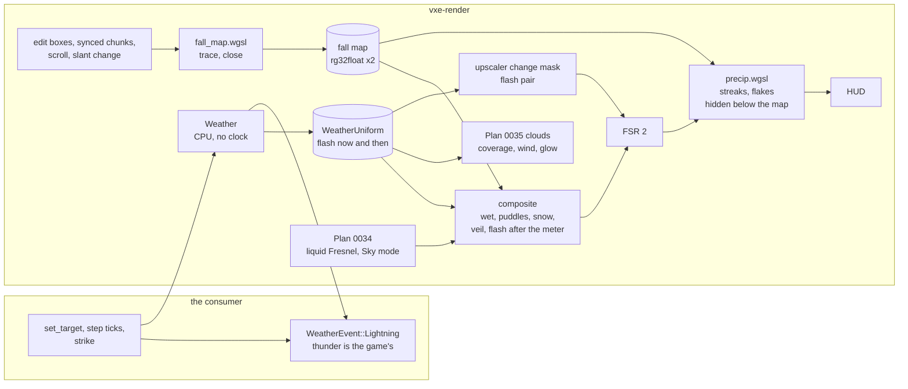

# 0036: Weather: rain, snow, wind, wet surfaces and snow cover, lightning

> **Status:** approved (2026-10-22), amended 2026-11-10 (review pass)
> **Created:** 2026-10-22
> **Milestone:** M10: Outdoors in [`docs/roadmap.md`](../roadmap.md)
> **Related ADRs:** [ADR-0031](../adrs/0031-weather-is-cosmetic-client-state-rendered-against-a-fall-map.md)
> (proposed with this plan: cosmetic client weather and the fall map, with voxel snow, a
> coarse-grid height map, per-pixel sky rays and screen-space layers rejected),
> [ADR-0018](../adrs/0018-direct-light-per-pixel-one-sample-from-a-hit-buffer-with-svgf-history-killed-by-edits.md)
> (the hit buffer and `Frame::invalidate`),
> [ADR-0029](../adrs/0029-liquid-surfaces-as-analytic-wave-normals-with-traced-reflection-and-refraction.md)
> (proposed with Plan 0034: the liquid Fresnel reflection a puddle reuses),
> [ADR-0030](../adrs/0030-volumetric-cloud-shell-amortised-march-and-projected-shadow-map.md)
> (proposed with Plan 0035: the clouds this plan drives),
> [ADR-0033](../adrs/0033-eye-adaptation-as-an-asymmetric-two-stage-exposure-on-the-gpu.md)
> (the exposure meter the flash stays out of),
> [ADR-0034](../adrs/0034-fsr-2-ported-to-wgsl-as-the-default-upscaler-candidate.md) (FSR 2 at
> 1.5, the default upscaler: the flash is in its change mask, the particles draw after it),
> [ADR-0043](../adrs/0043-emissive-light-from-a-world-space-per-face-table-and-a-lamp-bounce-probe-channel.md)
> (accepted: the probes are a lamp-only bounce channel),
> [ADR-0044](../adrs/0044-direct-light-from-a-fixed-list-of-analytic-lights-one-shadow-ray-each.md)
> (proposed with Plan 0058: the light list the flash is not an entry of),
> [ADR-0046](../adrs/0046-static-emissive-light-is-baked-per-chunk-when-a-chunk-loads-or-changes.md)
> (accepted: the baked emissive store, which takes no weather term)
> **Source:** the owner's outdoor answers (2026-10-22: full dynamic sky and weather driven by
> the game through a small API, cosmetic client-side, no wall clock), of 2026-11-03 (a stable
> image without flicker or aliasing comes first; snow cover reads the 27-count gradient) and of
> 2026-11-10 (the order below).
> **Starts after:** [Plan 0035](0035-aerial-perspective-and-volumetric-clouds-with-cloud-shadows.md)
> closes. M10 is linear: Plans 0060, 0061, 0058, 0044, 0045, the plan that removes the `own`
> upscaler and the render-profile plan (the last two are owed), then Plans 0032, 0033, 0034,
> 0035, this plan, 0037. **The base commit** in every bar is main after Plan 0035's close.
> [Plan 0045](0045-structure-pass-split-the-mega-files-share-the-fixtures.md) splits
> `marcher.rs`, `gpu_world.rs`, `march.wgsl` and the fly-through's `main.rs` before M10, so
> every "Files touched" below names the file as it is at main 82ea836 and `dev` re-reads the
> paths at the base commit; the names `dev` finds in the tree win. The names of today's tree
> were checked at 82ea836. The names of Plans 0032 to 0035 are contracts those plans state
> ("Interfaces this plan relies on"), and the architect re-reads this plan against them at Plan
> 0035's close, before this lane starts.

## TL;DR

The game sets a `WeatherState`: rain and snow rates, a wind vector, wetness and snow-cover
levels, cloud coverage and a lightning rate. It advances a `Weather` toward that state with its
own ticks. The renderer traces a **fall map** through the mirror and the far field: a grid at
0.2 m around the camera whose texels hold the height where something falling along the
wind-slanted fall direction first meets solid ground. Rain streaks and snowflakes are stateless
particles in a box around the camera, hidden below the map and drawn after the upscaler.
Wetness, puddles in closed basins and snow cover recolour only the faces the map calls open to
the sky. Lightning is a seeded event the game hears through `Weather::step`, plus a flash in
the composite that lights the open faces and the clouds, stays out of the exposure meter and is
in the upscalers' change mask. The first things a reader sees are a flat test floor that reads
the snow albedo in the albedo view (Phase 1), then a tunnel whose floor stays bit-for-bit dry
while rain falls outside its mouth (Phase 3).

## Context & problem

The owner's outdoor answers make sky and weather general engine mechanisms (2026-10-22). Plan
0032 gives a physically based sky and sun, Plan 0033 a far field to about 1 km, Plan 0034
liquid surfaces and Plan 0035 volumetric clouds whose coverage comes from a weather input.
Nothing yet makes it rain. The first consumer is underground (`project-context.md`), so the
weather property that matters most for this engine is the negative one: a cave stays dry and
dark while a storm rages at its mouth. ADR-0031 chooses the mechanism and records why not
voxel snow, a CPU height map from the coarse grid, per-pixel sky rays, or screen-space layers.

Facts the design rests on:

- A full-walk ray costs about 0.9 ms per million at 1080p on the dev box (Plan 0015; the
  reading is in [`docs/nfr/02-frame-budget.md`](../nfr/02-frame-budget.md)). The fall map's
  per-frame cap of 64 tiles x 1024 texels = 65 536 rays projects to about 0.06 ms there, a
  guess until Phase 6 reads it. A full rebuild of 1 048 576 rays takes 16 frames at that cap.
- A chunk is 64 voxels (6.4 m) on an edge (`coords.rs`). At 2 voxels per texel, a 32-texel
  tile is one chunk column, so a streamed or edited chunk marks whole tiles. 32 x 32 tiles
  cover 204.8 m, the fly-through's full-detail radius `r_full` 16 (102.4 m) on each side of
  the camera.
- The world is z-up. The hit buffer holds each pixel's position and `t` and its shading normal
  and material. The composite multiplies a hit's albedo by an albedo-free irradiance (the
  baked store's emissive plus Plan 0058's direct target), so changing the albedo there touches
  no light history and no baked value.
- The material table carries `roughness` (`material.rs`). It is used here as the porosity
  proxy for wet darkening (Lagarde, "Water drop 3b: physically based wet surfaces", 2013). No
  new material column.
- The lighting base (ADR-0043, ADR-0046, Plan 0032): the probes carry the lamp's bounce only,
  the baked store is emissive only and takes no per-frame term, and sun and sky light live in
  the direct target. Weather adds nothing to any of the three.

## Decision

The decision is ADR-0031, built in `vxe-render`:

- **`weather` module, CPU only, no `wgpu` types.** It holds `WeatherState`, `Weather` (set a
  target, step by ticks, force a strike, read the current state), `WeatherEvent` and a `Pod`
  `WeatherUniform`. It lives in `vxe-render` because it is cosmetic client state (ADR-0031):
  a game whose weather is gameplay owns the schedule in its own deterministic logic (risk 10)
  and hands this module targets and strikes.
- **`FallMap`.** Two `rg32float` maps and a dirty-tile mask per map. `fall_map.wgsl` has a
  `trace` entry, which walks one ray per texel of the listed tiles, and a `close` entry, which
  runs a separable 17-texel max-then-min closing for puddle basins.
- **`weather.wgsl` functions.** `sky_open`, `wet`, `snow_cover` and `puddle`, read by
  `composite.wgsl`. `sky_open(p, n)` is the shelter test: 1 where the point is open to what
  falls, 0 under cover. It is not the camera's exposure (`exposure_now()`), and no function of
  this plan is named `exposure`.
- **`precip.wgsl` render pass.** Instanced streak and flake quads with no vertex buffer, drawn
  at output resolution after the frame's last colour pass and before the HUD, so no particle
  passes through the upscaler's history.
- **Puddles reflect through Plan 0034's code.** A puddle's reflection is the liquid Fresnel
  term of Plan 0034 in `ReflectionMode::Sky`: one implementation for standing water, whoever
  draws it.
- **The flash.** A cone light toward the strike in the composite, gated by `sky_open`,
  multiplied by `exposure_now()`, added after the pixel's meter term is taken, with a
  now-and-then pair in the upscalers' change mask; plus a glow term this plan adds to Plan
  0035's cloud march.

The game hears strikes as events, and nothing in `vxe-audio` changes. No weather term enters
the bake's source or bindings, the probe volume's gather, or the direct target.

Rejected (ADR-0031): snow and wetness as voxels in `vxe-world`; a CPU height map from the
coarse grid; per-pixel and per-particle sky rays; screen-space rain layers; a second, sky-only
glossy reflection for wet faces. In this plan we also reject simulated particle buffers: they
need a state buffer, a simulation dispatch and a respawn rule, where hashed positions wrapped
in a box need none of them and give the same look. And the flash is not an entry of ADR-0044's
light list: a list light is a point or a cone with a reach of `sqrt(intensity / floor)` from
its position, blended in the direct target over about eleven frames, and it holds one of eight
slots. A strike is kilometres away, directional, and over in a third of a second, so the
direct target's blend would smear it and its reach would not arrive.

## Architecture diagram



## Interfaces this plan relies on

- **Plan 0032**, its section "Interface for Plans 0033 to 0037", as written: `Sky`,
  `Sky::uniform(L)` and `Frame::set_sky`; `sky_radiance(d)`, linear and not pre-exposed; the
  key light's `none` state; the exposure convention (absolute radiance times `exposure_now()`
  once, where it enters a pre-exposed target; anything added to the composite's `c` is
  metered); the change rule (a later term adds its own now-and-then pair and raises neither
  lighting bit); the bake takes no weather term; `--source outdoor` and `--spawn`. Plan 0032
  offers no scalar sky irradiance and no per-pixel key-light visibility, and this plan asks
  for neither.
- **Plan 0033:** the far field is walked through `march`, and a caller states the origin its
  level rule measures from. The fall map's `trace` passes each texel's own column, so a ray
  from high above a near column is not held at a coarse level. If Plan 0033 closes with no
  per-caller origin, `trace` runs two walks per texel (the far field down to the full-detail
  sphere, then a fresh near walk), and `dev` records which in the log.
- **Plan 0034**, which precedes this plan: the liquid pass's Fresnel reflection with
  `ReflectionMode { Trace, Sky, Off }`, and the hit flags for a refracted hit and an
  under-liquid hit (`HIT_REFRACTED` and `HIT_UNDER_LIQUID` in its text; the names in the tree
  win). If its Fresnel and sky-mode functions are not callable from the composite, Phase 4
  moves them to a shared source file, a move with no change.
- **Plan 0035**, its section "What Plans 0036 and 0037 may rely on": `CloudWeather`
  (coverage, precipitation, wind) and `Clouds::set_weather` are the one input this plan
  drives. Its weather map's G channel is precipitation, driven through
  `CloudWeather::precipitation`; this plan supplies no map of its own (its rates are one value
  over the view). The map has no glow slot, so this plan adds the glow to the cloud march
  itself, as a uniform term. Its change rule says a flash is its own term, which Phase 5
  builds. Plan 0035 owns the table that allots section 2's Headroom line (Budgets).

## Implementation phases

Each phase ships as its own commit. `dev` implements all phases in one session with no review
between phases. The architect reviews once at the end, in a fresh session.

**Goldens.** Every golden this plan adds is blessed on lavapipe at 320 x 180 under the
harness's floor: at most 0.1 % of pixels differ by more than 2/255. Every existing golden stays
byte-identical while no weather is set, and each phase's test run asserts it.

**Tests and tiers.** A phase gates on `node scripts/test-changed.mjs --profile quick` and, for
a render phase, `--profile gpu` under the perf lock; the tip gates on `cargo nextest run
--profile gate`. Tests that open a device are in `apps/flythrough/tests/gpu_weather.rs` (the
`gpu_` prefix classifies the file; `.config/nextest.toml` is not edited) and the goldens in
`apps/flythrough/tests/gpu_golden.rs`. CPU bars are unit tests in `weather.rs` and the
fly-through's `Modes` tests, so they stay in the quick tier. **Every wall time below is an
estimate on lavapipe: nothing was run.** `dev` reads each with `node scripts/test-times.mjs`;
a test over 30 s there (60 s on CI) is marked `#[ignore = "soak"]`, and the phase then keeps a
smaller variant of the same claim in the gate. A number a bar only logs is printed by the test
that asserts beside it; a measurement that asserts nothing is `#[ignore]`d inside a
`mod reading`. A reading taken by running the fly-through is a run, not a test.

**Slots, bits and keys.** This plan names no binding slot, flag bit or key. Each addition
takes the next free one, and `dev` reads the tree at the phase's start. A key's done-when
names the word the banner shows, and the root `README.md` names the key `dev` picked.

### Phase 1: The weather state, its ticks, and an unoccluded cover
- **Owner skill:** dev
- **What:** the `weather` module (`WeatherState`, `Weather::new(seed, ticks_per_second)`,
  `set_target(state, over_ticks)`, `step(ticks, &mut Vec<WeatherEvent>)`, `strike`,
  `current`, `uniform(tick_fraction)`); `Frame::set_weather`; `weather.wgsl`'s `wet` and
  `snow_cover` applied in the composite with `sky_open` fixed at 1 (no map yet); the
  fly-through's `--weather clear|rain|storm|snow|blizzard` presets, defined in the testbed,
  and a free key cycling them with the mode banner naming the preset.
- **Files touched:** new `crates/vxe-render/src/weather.rs`, new
  `crates/vxe-render/src/shaders/weather.wgsl`, `composite.wgsl`, `marcher.rs` (the `Frame`),
  `lib.rs`, `apps/flythrough/src/main.rs`, `apps/flythrough/src/hud.rs` (the banner's modes),
  new `apps/flythrough/tests/gpu_weather.rs`.
- **Done when:**
  - *Transitions.* `a_target_is_approached_linearly_from_the_current_value`, a unit test in
    `weather.rs` (under 1 s). A `Weather` at rain 0 given `set_target(rain 1.0, 600)` reads
    rain exactly 0.5 after `step(300)`, 1.0 after `step(300)` more, and 1.0 after 300 further
    ticks. A new target set mid-transition starts from the current value: at rain 0.5,
    `set_target(rain 0.0, 100)` then `step(50)` reads 0.25.
  - *Strike schedule.* `the_strike_schedule_does_not_depend_on_the_step_size`, a unit test
    (under 1 s). Two `Weather`s with seed 7 at 60 ticks per second and 60 strikes per minute,
    one stepped 36 000 x 1 tick and one 360 x 100 ticks, report identical event lists (tick,
    direction, distance, intensity). Their count lies in 600 +/- 100, which is 4.1 standard
    deviations of the binomial with n 36 000 and p 1/60 (mean 600, sd 24.3). Seed 8 gives a
    different list. Lightning rate 0 gives no events. `strike` reports its event at the next
    `step`.
  - *Cover.* `full_cover_reads_the_snow_albedo_and_full_wetness_the_wet_one` in
    `gpu_weather.rs` (about 5 s). At 320 x 180, a flat floor of material albedo 0.5 and
    roughness 1 is viewed from above in the albedo view. With snow cover 1 every floor pixel
    reads the snow albedo `[0.90, 0.90, 0.92]` within 2/255 as the albedo view encodes it.
    With wetness 1 and no snow it reads `0.5 x (1 - 0.45 x 1 x 1) = 0.275` within 2/255.
  - *Off is off.* `default_weather_changes_no_pixel` (about 5 s): with
    `WeatherState::default()` the shaded frame is byte-identical to the frame with no weather
    set, so the existing goldens are unchanged.
  - *Banner.* `the_weather_banner_names_each_preset`, a `Modes` test (under 1 s): each press
    of the preset key changes the banner to `weather: <preset>`, cycling through the five
    presets and back.

### Phase 2: The fall map
- **Owner skill:** dev
- **What:** `FallMap`, created only when weather is enabled, from a
  `FallMapConfig { tiles_per_side: 32, tiles_per_frame: 64 }` (the defaults; the tests below
  use 8 tiles a side so they stay in the gate), with:
  - two maps (active and building), each with a slant `s` (quantized to multiples of 1/8 per
    axis, `|s|` capped at 0.625) and an origin in tiles, so that texel `(i, j)` covers the
    column whose fall line meets `z = 0` at `(2 i, 2 j)` voxels from the origin times 64,
    addressed toroidally;
  - **the fall convention, used everywhere in this plan.** Something falling moves along
    `d = normalize(s_x, s_y, -1)`: it gains `s` voxels horizontally per voxel it descends. So
    the fall line through the ground point `(x, y, 0)` is at `(x - s_x z', y - s_y z')` at
    height `z'`, and a roof shelters the ground downwind of itself. `s` is the wind over the
    fall speed, quantized;
  - the `trace` entry. Each texel's ray falls along `d` from the top of the far field's
    coarsest level above its column, through the far field and the mirror ("Interfaces", Plan
    0033), and stores the top `z` of the first solid voxel, translucent included. A ray that
    leaves the world stores the sentinel `-3.0e38`;
  - per-frame tile selection on the CPU, up to `tiles_per_frame` in this order: edit tiles
    (from `Frame::invalidate`'s box projected along `s`), scrolled-in tiles, tiles of chunks
    `GpuWorld::sync` wrote this frame, then rebuild tiles; nearest the camera first within
    each class;
  - a slant change, which starts a rebuild into the building map. The readers switch to it
    when its last tile lands, and until then edits mark both maps;
  - `fall_map.wgsl`'s `close` entry over each traced tile and its eight neighbours: the g
    channel is the red channel's max over 17 x 17 texels followed by the min over 17 x 17.

  `rg32float` is not filterable, so every reader of the map does four `textureLoad`s and
  weights them itself.
- **Files touched:** new `crates/vxe-render/src/fall_map.rs`, new
  `crates/vxe-render/src/shaders/fall_map.wgsl`, `gpu_world.rs` (report the chunks a `sync`
  wrote), `marcher.rs`, `lib.rs`, `gpu_weather.rs`.
- **Done when:** in `gpu_weather.rs`, the test world has a flat ground whose top is `z = 0`
  and a roof slab `z` in `[40, 48)` over `x, y` in `[0, 128)`. Each test below is about 3 to
  5 s at 8 tiles a side. Readback shows:
  - *Vertical fall.* `a_vertical_fall_reads_the_roof_and_the_ground`. `s = 0`: every texel
    whose column centre lies inside the roof's footprint reads 48.0, every texel at least 2
    texels outside it reads 0.0, and a texel over a column with nothing under it reads the
    sentinel.
  - *Slanted fall.* `a_slanted_fall_shelters_the_ground_downwind_of_the_roof`.
    `s = (0.5, 0)`. By the convention the ground point `x` is under the roof when
    `x - 0.5 z'` lands in `[0, 128)` for some `z'` in `[40, 48)`, which is `x` in about
    `[20, 152)`. `sky_open` calls the ground points at `x = 30` and `x = 140` covered and
    those at `x = 10` and `x = 160` open, each at least 8 voxels from an edge of that
    interval. (`x = 10` lies under the roof's footprint and is rained on; `x = 140` lies
    outside it and is dry.)
  - *Edit.* `an_edit_opens_the_map_under_its_box_only`. A radius-8 carve centred at
    `(64, 64, 44)` cuts a full-depth hole where `dx^2 + dy^2 <= 64 - 16 = 48`. After the
    edit's next frame, with vertical fall, every texel whose column centre lies within 6
    voxels of `(64, 64)` reads 0.0, and the texels of tiles the edit's box did not reach read
    back bit-for-bit as before.
  - *Scroll.* `a_scroll_keeps_the_tiles_that_stay`. At 8 tiles a side, a camera move of 3
    chunks along `x` leaves the 5 x 8 tiles that stay bit-for-bit unchanged, and the 24
    entering tiles are traced in the next frame.
  - *Slant change.* `a_slant_change_switches_maps_when_the_rebuild_lands`. At 8 tiles a side
    and 4 tiles a frame, the readers keep the old map for the 16 frames the rebuild's 64
    tiles take, and read the new one on the frame after.
  - *Close.* `a_closed_basin_reads_its_depth`. A 20 x 20-voxel, 1-voxel-deep depression in
    the ground (no roof) reads closed minus height 1.0 at its centre (the 17-texel, 3.4 m
    window spans it), and a flat ground reads exactly 0.
  - *The default size.* `the_default_map_fills_in_sixteen_frames`, born `#[ignore = "soak"]`
    (about 30 to 60 s: 1 048 576 full-walk rays on lavapipe): at the default config the first
    fill's 1024 tiles land in 16 frames, a 3-chunk scroll leaves 29 x 32 tiles unchanged and
    traces the 96 entering ones within 2 frames. The 8-tile tests above are its gated variant.

### Phase 3: Rain and snow particles, wind, and the cave mouth
- **Owner skill:** dev
- **What:** `precip.wgsl`, an instanced render pass on the output target after the frame's
  last colour pass at the base commit (`fsr2 tone` under FSR 2):
  - **Rain** is `round(rain x 32 768)` streaks in a 24 x 24 x 16 m box. Each is a 2-pixel-wide
    quad from `p` to `p - v t_shutter`, with velocity `v = (wind, -9 m/s)`.
  - **Snow** is `round(snow x 24 576)` flakes in a 20 x 20 x 12 m box, falling at 1 m/s with
    the wind plus a per-flake sway whose phase is hashed from the index.
  - **Positions.** `p_i = box_min + fract((hash3(i) + offset_i - box_min) / box) x box`. Here
    `offset` is the fall offset `Weather::step` integrates per tick, which keeps the particles
    still in the world when the camera turns.
  - **Occlusion.** A particle is dropped when its centre is below the active map's height at
    its column. A fragment is discarded when its distance is beyond the hit buffer's `t` at
    the internal pixel under it.
  - **Shading.** A particle's radiance is a fixed fraction of the mean of
    `sky_radiance(up)` and `sky_radiance` toward the horizon in the view's azimuth, plus the
    flash, times `exposure_now()`. The pass draws after the tone pass, so the fragment applies
    the tone curve that pass applies. It is a stand-in for the sky's irradiance, which Plan
    0032 does not offer as a scalar; Phase 7's eye is its bar.
  - **Veil.** In the composite, rain adds a distance veil toward the horizon radiance:
    `rain x (1 - exp(-max(t - 12 m, 0) / 150 m)) x 0.35` of
    `sky_radiance(horizon) x exposure_now()`, applied only at hits the map calls open. It is
    scene radiance and is metered.
  - **Wind** slants the map (Phase 2's quantized `s`) and the particles.
- **Files touched:** new `crates/vxe-render/src/shaders/precip.wgsl`, new
  `crates/vxe-render/src/precip.rs`, `weather.rs`, `composite.wgsl`, `marcher.rs` (the pass
  after the last colour pass; the output texture gains `RENDER_ATTACHMENT`), `gpu_weather.rs`,
  `apps/flythrough/tests/gpu_golden.rs`.
- **Done when:** the test world is the cave-mouth scene: a hill 128 x 128 x 64 voxels with a
  16 x 16-voxel tunnel 48 voxels long into its `-y` face, the camera 40 voxels inside looking
  out, under `Sky::uniform(1.0)`.
  - *Dry inside.* `rain_falls_outside_the_tunnel_and_never_inside` (about 8 s). At rain 1, no
    wind, wetness 0 and snow cover 0, the precip pass's coverage, read back from a
    coverage-only debug target, has zero covered pixels among the pixels whose hit lies inside
    the tunnel (more than 4 voxels in from the mouth's plane), at least one covered pixel
    among the pixels whose hit lies outside, more covered pixels at rain 1 than at rain 0.25,
    and none at rain 0. The same frame index and tick render byte-identical coverage twice.
  - *Wind.* `streaks_lean_with_the_wind` (about 5 s). With wind `(6, 0)` m/s the mean streak
    direction on screen is non-vertical and tilts the way `+x` projects.
  - *Golden.* `weather_cave_mouth.png` is blessed at rain 1 and wetness 0 after 64 frames
    (about 20 s). If it reads over 30 s it is marked soak, and the gate keeps the same golden
    name rendered after 16 frames, which the particles (stateless) and the 8-tile map allow.
    Phase 4 re-blesses it with wetness 1; the changed pixel count is printed by the golden
    test.

### Phase 4: Wet surfaces, puddles and snow cover under the map
- **Owner skill:** dev
- **What:**
  - **Shelter.** `sky_open(p, n)` compares `p + n x 0.2 m` against the active map with four
    `textureLoad`s, a 2 x 2 weight and a 0.25 m bias. It is 1 outside the map, so beyond
    102.4 m the cover follows the normal alone.
  - **Wetness.** `wet` darkens the albedo by `1 - 0.45 w porosity`, with
    `w = wetness x sky_open x (0.5 + 0.5 max(n.z, 0))` and porosity the material's roughness.
    A wet face that is not a puddle gets the darkening and no added reflection.
  - **Puddles.** `puddle` covers the near-horizontal faces (`n.z > 0.9`) where closed minus
    height exceeds `0.2 + 2.0 (1 - wetness)` voxels. It sets the albedo factor to 0.3 and adds
    Plan 0034's liquid Fresnel reflection in `ReflectionMode::Sky` for a flat surface, times
    `sky_open`: the same function the liquid pass calls, with no ray traced. In rain the
    normal is bent by procedural ripples whose density follows the rain rate.
  - **Snow cover.**
    `snow_cover = saturate(1.6 cover - 3.0 (1 - n_g.z) - 0.25 noise) x sky_open`, with `noise`
    a value noise in `[0, 1]` at 0.5 m and `n_g` the cover's normal (below). At cover 1 it
    saturates at every noise value on an open face up to 27.9 degrees
    (`3.0 (1 - cos t) <= 0.35`). It is 0 at every noise value on a face of 62.2 degrees or
    steeper (`3.0 (1 - cos t) >= 1.6`). On a flat face it saturates at
    `cover >= 1.25 / 1.6 = 0.78125`. It blends the albedo toward `[0.90, 0.90, 0.92]` and the
    roughness toward 0.6.
  - **The cover's normal (owner, 2026-11-03).** On the default honest cubes the shading normal
    is an axis normal near the camera, so a slope is treads and risers. `snow_cover` reads the
    27-count gradient around the hit voxel (`gradient27_normal`'s input) for `n_g` alone; the
    shading normal does not change, and `sky_open`, `wet` and `puddle` keep it, so `wet` on a
    hillside is full on treads and half on risers, for Phase 7's eye. The read runs only where
    snow cover is above 0, so a frame with no snow pays nothing. `composite.wgsl` has no
    mirror binding today: `dev` carries the gradient's `z` from the hit pass or binds
    occupancy in the composite, whichever the Phase 6 snow reading finds cheaper. If the hit
    pass carries it, `march.wgsl` changes and the bake's source with it: Plan 0032's
    baked-face test stays green, and a store saved by `--bake-file` re-bakes once.
  - **Why 3.0 and 0.25.** A floor-rasterised 15-degree stair reads 0, 18.4 and 26.6 degrees
    through that gradient, not 15; it reads 26.6 (`g = (3, 0, -6)`, `n_g.z = 0.8944`) on the
    column before each riser, about a quarter of the open columns. There the rule gives
    `1.6 - 0.3167 - 0.25 noise`, at least 1.033, so the whole slope saturates. A 70-degree
    cliff reads 63.4 degrees or steeper (`n_g.z <= 0.4472`), where the rule gives at most
    `1.6 - 1.658 = -0.058`, so the cliff takes none.
  - **Exclusions.** Translucent layers, emissive hits, liquid surfaces and Plan 0034's
    refracted and under-liquid hits take none of it: a lake's floor is not rained or snowed
    on through the water.
  - **Bounce.** With `Lighting::lamp_bounce` on, the lamp channel's probe hits use the
    weathered albedo, so a lamp over snow bounces as snow. The probes take no other weather
    term.
- **Files touched:** `weather.wgsl`, `composite.wgsl`, `probe_update.wgsl`, the source file
  that holds Plan 0034's Fresnel and sky-mode functions (the name in the tree; a move if they
  are not shared), `march.wgsl` (only if the hit pass carries the gradient), `gpu_weather.rs`,
  `apps/flythrough/tests/gpu_golden.rs`.
- **Done when:** in `gpu_weather.rs`, in the albedo view unless a bar says otherwise:
  - *Cave mouth.* `the_tunnel_floor_stays_dry_in_the_rain` (about 8 s). At wetness 1, every
    pixel whose hit is inside the tunnel and more than 0.5 m from the drip line reads the
    albedo it reads with weather off, exactly. At least 90 % of the outside ground's pixels
    read the wet `0.275` within 2/255; the test prints the share.
  - *Puddles.* `a_basin_is_a_puddle_only_when_wet_enough` (about 5 s). A 20 x 20-voxel,
    1-voxel-deep open depression reads the puddle factor (`0.5 x 0.3 = 0.15` within 2/255) at
    its centre at wetness 1. At wetness 0.5 its threshold is `0.2 + 1.0 = 1.2` voxels, deeper
    than the 1-voxel depression, so it is not a puddle and reads
    `0.5 x (1 - 0.45 x 0.5) = 0.3875`.
  - *One reflection.* `a_puddle_reflects_the_sky_by_the_liquid_fresnel` (about 5 s). In the
    shaded view under `Sky::uniform(1.0)`, exposure pinned at 1, lamp off, the puddle's centre
    pixel minus the same pixel with the reflection switched off equals Plan 0034's Fresnel
    factor for the view angle, computed on the CPU from that plan's formula, within 2/255. A
    dry floor and a wet non-puddle floor add nothing.
  - *Snow hillside.* `snow_lies_on_the_slope_and_not_on_the_cliff_or_under_the_overhang`
    (about 8 s). The test world has a 15-degree slope, a 70-degree cliff and an overhang 1.6 m
    above part of the slope, at snow cover 1. Open slope pixels read the snow albedo within
    2/255. Cliff pixels read rock within 2/255. Slope pixels under the overhang more than
    0.5 m from its drip line read rock exactly.
  - *Liquids.* `weather_leaves_liquid_hits_alone` (about 5 s). At wetness 1 and snow cover 1,
    a pond's surface pixels and the floor pixels seen through it read what they read with
    weather off, exactly.
  - *Bounce.* `the_lamp_bounce_is_brighter_over_snow` (about 10 s). With the lamp and
    `lamp_bounce` on, the gathered bounce at a wall pixel beside an open flat floor is higher
    at snow cover 1 than at cover 0 (albedo 0.9 against 0.5); the test prints both.
  - *The lamp furnace.* `the_lamp_furnace_reads_its_albedo_times_the_direct_mean`
    (`gpu_indirect.rs`, soak-marked) passes with weather off, run once at this phase by name:
    `cargo nextest run -p flythrough --profile soak --run-ignored only -E
    'test(=the_lamp_furnace_reads_its_albedo_times_the_direct_mean)'`. It is not a gate;
    `default_weather_changes_no_pixel` is the gated form of the same claim.
  - *Goldens.* `weather_snow_hillside.png` is blessed (about 15 s), and
    `weather_cave_mouth.png` is re-blessed with wetness on.

### Phase 5: Lightning, and the clouds take the weather
- **Owner skill:** dev
- **What:**
  - **Envelope.** `WeatherUniform` carries the active strike's direction and `flash(dt)` for
    this frame and for one frame older: two to four return strokes hashed from the strike, the
    first at `dt = 0`, the others within 250 ms, each `exp(-(dt - t_k) / 30 ms)`, scaled by
    the intensity and by `clamp(2 km / distance, 0.2, 1)`.
  - **Flash light.** The composite adds
    `flash x L_f x sky_open x max(n . l, 0) x Omega x exposure_now()` to a hit's irradiance.
    It is a cone of half-angle 30 degrees toward the strike, so
    `Omega = 2 pi (1 - cos 30) = 0.842` sr. There is no shadow ray toward the strike.
  - **The meter.** The composite takes the pixel's meter term (`meter_of(c / ex)`) before the
    flash is added, so a strike on the ground does not move the auto exposure. The clouds'
    glow is part of the clouds' radiance and is metered; Phase 5's reading and stop rule cover
    it.
  - **The upscalers.** The change and reactive mask of every upscaler in the tree at the base
    commit (`fsr2/input.wgsl`) evaluates the flash term at the pixel under `flash` now and
    `flash` one frame older, with the same `sky_open` and normal, and marks the pixel when the
    two differ past the mask's thresholds. A sheltered pixel is never marked. The flash raises
    neither `LIGHTING_LIGHTS_CHANGED` nor `LIGHTING_EMISSION_CHANGED`, and it is not in the
    direct target.
  - **Clouds.** `Clouds::set_weather` takes a `CloudWeather` with `cloud_coverage` as its
    coverage, the larger of the rain and snow rates as its precipitation and the wind as its
    wind. The cloud march gains one glow term this
    plan adds: centred on the strike point at the shell's base altitude, scaled by `flash`.
  - **Sound.** The fly-through prints each `WeatherEvent` to stdout, and a free key forces a
    strike, with the banner showing `lightning`. No sound plays: thunder is a consumer's.
- **Files touched:** `weather.rs`, `weather.wgsl`, `composite.wgsl`, `fsr2/input.wgsl` (and
  any other upscaler input pass in the tree), Plan 0035's cloud shader and params (the names
  in the tree), `apps/flythrough/src/main.rs`, `hud.rs`, `gpu_weather.rs`,
  `apps/flythrough/tests/gpu_golden.rs`.
- **Done when:**
  - *Envelope.* `the_flash_envelope_peaks_at_the_strike_and_dies_in_a_second`, a unit test in
    `weather.rs` (under 1 s). `flash(0)` reads the strike's scaled peak, `flash` reads 0
    before the strike, and `flash(1 s)` reads under 1e-3 of the peak, since after the last
    stroke at 250 ms, `exp(-750 / 30) = 1.4e-11`.
  - *Flash light.* `a_zenith_strike_lights_open_ground_and_no_tunnel_pixel` (about 5 s). The
    cave-mouth scene with no `Sky` set, the lamp off, lamp bounce off, the filter off, the
    identity tone map, exposure pinned at 1, a forced zenith strike of intensity 1 at 2 km or
    nearer (so its scale is 1), the frame at the strike's tick (`flash = 1`), and `L_f` set so
    that `L_f x Omega = pi`. An open flat ground pixel of albedo 0.5, dry, reads `0.5` linear,
    encoded `0.5^(1/2.2) = 0.73`, 186/255 within 2/255. Every tunnel pixel more than 0.5 m
    from the drip line reads 0. With exposure pinned at 2 and intensity 0.5 the ground pixel
    reads the same 186/255.
  - *Meter.* `a_strike_on_the_ground_is_not_metered` (about 5 s). Clouds off, auto exposure
    on, `Sky::uniform(0.5)`: the meter tiles read back on the strike's frame are bit-equal to
    those of the same frame with no strike.
  - *Mask.* `the_flash_marks_open_ground_and_no_sheltered_pixel` (about 8 s). Under FSR 2 at
    1.5, on the strike's frame and on the frame after, every open ground pixel is marked
    changed and reactive and no tunnel pixel more than 0.5 m from the drip line is; two
    frames with no strike mark neither.
  - *Coverage hand-off.* `cloud_coverage_reaches_the_clouds_next_frame` (about 3 s). With
    clouds on, a cloud-coverage change of 0.2 to 0.9 reaches Plan 0035's coverage parameter in
    the next frame's uniform.
  - *Banner.* `the_strike_key_shows_lightning`, a `Modes` test (under 1 s).
  - *Golden.* `weather_lightning.png` is blessed at the strike's peak frame with clouds on
    (about 20 s; soak if over 30 s, the *Flash light* bar being its gated form).
  - *Reading and stop rule.* `reading::a_strike_under_clouds_moves_the_exposure_by` prints
    the largest change of the exposure state over the 120 frames after a forced overhead
    strike at overcast, auto exposure on. If it is over 5 %, `dev` stops for an architect
    amendment (the meter holds its target while a flash is live, or the glow is scaled) before
    Phase 6.

### Phase 6: The switches, the HUD and the readings
- **Owner skill:** dev
- **What:** HUD rows for the fall map's and the precip pass's GPU time, the tiles traced this
  frame and the current state (`rain 0.80 snow 0.00 wind 6.0,0.0 wet 0.62 cover 0.00`);
  `--wind X,Y` and `--fall-tiles N` (tiles a frame); `FRAME_PASSES` gains the two passes; the
  autopilot prints their p50 and p99 and the map's bytes in `Frame::frame_bytes`; the readings
  below on both adapters of `docs/nfr.md` section 1.
- **Files touched:** `apps/flythrough/src/main.rs`, `hud.rs`, `marcher.rs`, the root
  `README.md` (flags, keys), `docs/nfr/02-frame-budget.md` and `docs/nfr/03-memory.md` (the
  readings), `docs/plans/logs/0036.md`.
- **Done when:**
  - *VRAM.* `the_fall_map_costs_its_bytes_only_when_weather_is_on` (about 3 s): `frame_bytes`
    rises by `2 x 1024 x 1024 x 8 = 16 777 216` B plus the uniform and the tile list (under
    1 KiB) with weather enabled, and by 0 with weather off.
  - *HUD.* `the_hud_weather_row_reads_the_state`, a text test (under 1 s): the row shows the
    state string above for a fixed `WeatherState`.
  - *Dev box (a run).* In the storm preset (rain 1, wind 6 m/s) at `--source outdoor --spawn
    outside`, 1080p output, FSR 2 at 1.5, the fall map plus the precip pass plus the
    composite's rise over weather off read at most 0.8 ms in all (median of the last 30 of
    300 frames, three runs, per-pass timestamps).
  - *Snow (a run, a reading, no bar).* The same run in the snow preset records the cover's
    gradient cost and names the pass that pays it.
  - *Full rebuild (a run).* The fall map's p99 under a forced slant change every 120 frames is
    recorded.
  - *Slow adapter (runs, no bar).* The same three readings on the slow adapter, and again at
    `--fall-tiles 16`.
  - *Settled view (a run).* At the cave spawn with weather off, the march and frame readings
    match the base commit's within run noise.

### Phase 7: The owner's windowed check
- **Owner skill:** human
- **What:** the owner flies the outdoor source through each preset, stands in a cave mouth in
  the storm, digs a hole in a roof in the rain, walks out into snow, and forces strikes. The
  verdict covers:
  - the drip line's softness at 0.2 m;
  - the streak density and look, and the particles' stand-in shading;
  - snow on slopes, on the honest cubes the default is;
  - a puddle at the cave mouth that mirrors sky where rock stands (risk 2);
  - wet ground with no sheen and no sun glint (risk 9);
  - the flash under FSR 2: any trail or shimmer after a strike;
  - whether the flash needs a shadow ray (risk 1).
- **Files touched:** this plan's log; ADR-0031's Outcome at the close.
- **Done when:** the owner's verdict and the flash-shadow choice are recorded in the log.

## Data shapes

```rust
// illustrative: the game-facing API (vxe-render::weather, no wgpu types)
#[derive(Clone, Copy, Debug, Default, PartialEq)]
pub struct WeatherState {
    pub rain: f32,                 // 0..1 of the heaviest rain; rain and snow together are sleet
    pub snow: f32,                 // 0..1 of the heaviest snowfall
    pub wind: [f32; 2],            // m/s in the world's x and y; slants particles and the fall map
    pub wetness: f32,              // 0..1 surface wetness the faces approach
    pub snow_cover: f32,           // 0..1 surface snow cover
    pub cloud_coverage: f32,       // 0..1, handed to Plan 0035's clouds
    pub lightning_per_minute: f32, // expected strikes per minute of ticks; 0 = only forced ones
}
pub enum WeatherEvent {
    Lightning { tick: u64, direction: [f32; 3], distance_m: f32, intensity: f32 },
}
impl Weather {
    pub fn new(seed: u64, ticks_per_second: u32) -> Self;
    pub fn set_target(&mut self, target: WeatherState, over_ticks: u32); // linear from current
    pub fn step(&mut self, ticks: u32, events: &mut Vec<WeatherEvent>);  // caller reuses the Vec
    pub fn strike(&mut self, direction: [f32; 3], distance_m: f32, intensity: f32);
    pub fn current(&self) -> &WeatherState;
    pub fn uniform(&self, tick_fraction: f32) -> WeatherUniform;        // what Frame::set_weather takes
}
// strike at tick t when splitmix64(seed ^ t) >> 32 < threshold(rate, ticks_per_second)
```

```text
fall map: 2 x rg32float 1024 x 1024 (r: top z of first solid along d, voxels; g: closed r)
          texel = 2 voxels (0.2 m); tile = 32 x 32 texels = one chunk column; 32 x 32 tiles
          per map: slant s (k/8, |s| <= 0.625), origin in tiles, dirty mask 1024 bits
          read by four textureLoads and a 2 x 2 weight; rg32float is not filterable
tile list: up to 64 u32 per frame; trace + close dispatches over those tiles
precip:    no buffers; instance i -> hash3(i), offset from WeatherUniform; draw(6, n)
uniform:   the state, the fall offset, the strike direction, flash now and flash one frame older
```

The composite's order for a hit: weathered albedo (wet, puddle, snow), times the irradiance;
plus the puddle's reflection and the veil; the meter term is taken; then the flash is added.
Absolute terms (the reflection, the veil, the flash) are multiplied by `exposure_now()` once.

## Budgets

| `docs/nfr.md` figure | line | projection (every figure a guess until Phase 6) | how the close measures it |
|---|---|---|---|
| Section 2, Headroom (entities, volumetrics, game work) | 2.1 ms, of which this plan's share is 0.8 ms by the allotment table in Plan 0035's Budgets (a proposal until measured) | dev box, storm: fall map 0.05 to 0.15 ms (65 536 rays), precip 0.2 to 0.5 ms (fill-bound), composite terms under 0.15 ms; bar 0.8 ms in all. Slow adapter: 3 to 10 times that, so the share is projected missed there; a reading, and `--fall-tiles` and the particle counts are what a render profile turns down | Phase 6's runs, storm preset, outdoor spawn, 1080p output, FSR 2 at 1.5, three runs, both adapters |
| Section 2, the line of the pass that reads the cover's gradient: Primary rays (3.0 ms) if the hit pass carries it, else this plan's Headroom share | as left | under snow only: at most about the +1.6 ms Plan 0055 read for a whole-frame `gradient27` (RTX 3080 Laptop, showcase pose; the reading is in `docs/nfr/02-frame-budget.md`). A reading, no bar: the snow preset is not held to the 0.8 ms share | Phase 6's snow run on both adapters, which names the pass that paid |
| Section 2, Upscale, tone map, post | 1.5 ms, already over under the FSR 2 default (the readings are in `docs/nfr.md` section 2) | the mask's flash pair adds one map read per pixel on flash frames; the precip pass is reported on its own row, not in this line | the upscaler's rows at the same runs; the reading is the rise over weather off |
| Section 2, Streaming, upload, light extraction | 1.0 ms | the per-frame tile bookkeeping (bit sets over the synced chunks, a sort of at most 1024 tiles), under 0.02 ms | the autopilot's render-thread timers, weather on against off |
| Section 3, Everything else in VRAM | 1.5 GB | +16 777 216 B (two maps), under 1 KiB of uniforms | `frame_bytes` (Phase 6's test) |

The ledger row for weather in `docs/nfr/02-frame-budget.md` is a projection made before this
pass; the close replaces it with Phase 6's readings.

## Risks & open questions

1. **The flash has no shadow.** `sky_open` gates it, but a hill between the strike and a
   valley does not. Options for the owner at Phase 7: (a) keep it, at no cost; (b) one shadow
   ray toward the strike on flash frames, which makes the flash a directional sample in the
   light pass on Plan 0032's key-light path and needs a history rule there for a third of a
   second of light; (c) trace the strike direction as a second slant into the fall map's
   building buffer when a strike lands (one 16-frame rebuild, so the shadow arrives late).
   This plan builds (a).
2. **A puddle mirrors the sky only.** `ReflectionMode::Sky` traces nothing, so a puddle at a
   cave mouth or under a cliff shows sky where rock stands in the reflected direction.
   ADR-0029 rejects sky-only reflection for water for that reason; ADR-0031 records why a
   puddle takes it anyway (no ray in the composite, and a puddle is centimetres of a face, not
   a lake). If Phase 7 sees it, puddle pixels route through the liquid pass's traced
   reflection, an amendment.
3. **The flash and the upscaler.** A frame-wide light step is what temporal upscalers ghost
   on. The now-and-then pair marks the open pixels and no sheltered one; Phase 5's mask test
   holds the mark, and Phase 7 holds the look. No bar measures a trail after a strike.
4. **The clouds' glow is metered.** A strike overhead can move the auto exposure through the
   clouds. Phase 5 reads it and stops over 5 %.
5. **The sky beyond the far field's top.** A column whose ray starts in air reads as open sky.
   A deep cave under an air pocket above that extent would get rain. ADR-0031 records it, and
   the game sets the rates for such places.
6. **Slant quantization.** The slant moves in steps of 1/8 (about 7 degrees near vertical). A
   gusting wind flips the map no faster than one rebuild every 16 frames. The old map stays
   valid meanwhile, so the error is a drip line about 7 degrees off, never rain in a cave.
7. **Shadow-map acne.** The 0.25 m bias and the 0.2 m normal offset are guesses. Phase 4's
   0.5 m margin from the drip line keeps the done-whens away from them, and Phase 7's eye is
   the bar.
8. **The snow rule's margins are thin.** The slope saturates by 0.033 and the cliff clears
   zero by 0.058, on gradient readings carried from the 2026-11-03 arithmetic (26.6 and 63.4
   degrees). If the snow-hillside test finds another reading on either face, `dev` stops for
   an architect amendment of the two constants.
9. **Wet ground has no sheen and no sun glint.** A glossy lobe needs the key light's per-pixel
   visibility, which Plan 0032 does not write out, and a second reflection model beside Plan
   0034's. Followup.
10. **If weather becomes gameplay.** The game owns the schedule in its deterministic logic (its
    ticks, its seed, its op log or messages). It sets `lightning_per_minute` to 0 and calls
    `strike` from its own decisions. It answers "is this spot sheltered?" from `vxe-world` (a
    raycast up, or the coarse grid), never from the fall map. A headless server that wants
    this module's strike ticks would link `vxe-render`, and so `wgpu`; moving the CPU-only
    `weather` state to a crate without it is a followup, taken when a consumer asks.
11. **Determinism.** Nothing touches `vxe-world`. The strike schedule is integer-hashed, so the
    same seed gives the same strike ticks on every client. The rest is f32 and cosmetic.
    Goldens are deterministic per adapter and blessed on lavapipe.
12. **Adapter features.** `rg32float` storage textures with write access are in WebGPU's core
    list; the map is read by `textureLoad` only. The precip pass is an ordinary render
    pipeline. No new feature is required, and nothing branches on the backend.
13. **Threading.** None. Every pass is recorded on the frame's encoder, and `Weather::step`
    runs where the game calls it.

## What this plan does NOT do

- **Sky, sun, moon and time of day:** Plan 0032. **The far field:** Plan 0033. **Liquid
  surfaces, their reflections and absorption:** Plan 0034. **Aerial perspective and the clouds
  themselves:** Plan 0035. This plan hands values to Plan 0035 and draws nothing in the sky
  but the flash's glow term.
- **Snow or water as matter:** no voxels are written, no snow drifts, no collision, no flowing
  water (the later flowing-liquids plan).
- **Wind on liquids.** `LiquidParams` is the game's to set, and a game may set its waves from
  the same wind it hands `WeatherState`; no phase here does it.
- **Rain audio:** the rain hiss, its occlusion indoors, and drops on materials are a followup
  for `vxe-audio`. **Thunder** is the game's sound, fed by `WeatherEvent`.
- **Splashes, drips from ledges, rain rings on liquid surfaces, a visible lightning bolt, wind
  on vegetation or entities, a wet sheen or sun glint, a per-place rain rate:** followups.
- **The flash in the probe volume, the baked store or the direct target:** the flash is direct
  light in the composite only.
- **A gameplay weather schedule or a shelter query:** the consumer's (risk 10).

## Owner answers

1. **Snow cover on cubes (owner, 2026-11-03).** "the main thing that I care about for now is a
   stable image without any flicker or aliasing artiacts. we move towards this image by any
   means possible, considering performance of course. all other things doesnt really matter as
   of now, so just go with recommended" So the recommended option: the 27-count gradient for
   the cover only, at a cost only under snow (Phase 4; Budgets).
2. **The order (owner, 2026-11-10).** Plans 0060, 0061, 0058, 0044, 0045, then M10; the
   outdoor plans stay approved through the review pass.

### Architect calls of the 2026-11-10 pass

The owner was away; each call takes the recommended option and is his to overturn.

1. **Snow constants 3.0 and 0.25**, the pair the 2026-11-03 arithmetic proposed (Phase 4).
2. **Puddles reflect through Plan 0034's Fresnel code in `ReflectionMode::Sky`**; the sky-only
   artefact is recorded (risk 2, ADR-0031).
3. **Wet faces that are not puddles get no added reflection**; the GGX sun lobe and the
   sky-view sheen of the earlier draft are gone (risk 9).
4. **The flash is added after the meter term**; the clouds' glow stays metered, under a
   reading and a 5 % stop rule.
5. **The flash is in the upscalers' mask by its own now-and-then pair**, per pixel, not a
   frame-wide mark, so a sheltered pixel keeps its history through a storm.
6. **The flash is not a light of ADR-0044's list** (Decision).
7. **"Bounce" is the lamp channel's weathered albedo only**; the flash never reaches the
   probes.
8. **The dev-box bar is 0.8 ms in all**, this plan's share of the Headroom line, where the
   earlier draft allowed 0.95 ms; the snow preset is a reading with no bar.
9. **`FallMapConfig` has a tile count**, so the fall-map tests run at 8 tiles a side inside
   the gate and the default size is a soak test.
10. **Particles are shaded by a stand-in** built from two `sky_radiance` reads (Phase 3).
11. **This plan supplies no weather map**; it drives `CloudWeather` (the map's G channel
    through `precipitation`) and adds the glow as a uniform term.

## Implementation log

> Written by `dev`: one row per phase as its commit lands, then the close block. **The phases
> above are the contract. This section records what happened.** Observations, never conclusions:
> no pass list, no self-assessment. Deviations and unmet done-whens are **always** disclosed.
> Keep it shorter than `## Implementation phases`. Readings, gate counts, attempts, sweeps and
> resume notes go to the plan's readings log, `docs/plans/logs/0036.md` (started from
> `templates/readings-log.md`), and this section links it once it exists.

| phase | owner | state | commit |
|---|---|---|---|
| 1: The weather state, its ticks, and an unoccluded cover | dev | not started | |
| 2: The fall map | dev | not started | |
| 3: Rain and snow particles, wind, and the cave mouth | dev | not started | |
| 4: Wet surfaces, puddles and snow cover under the map | dev | not started | |
| 5: Lightning, and the clouds take the weather | dev | not started | |
| 6: The switches, the HUD and the readings | dev | not started | |
| 7: The owner's windowed check | human | not started | |

### Notes

_(Deviations from the plan, with the commit, stated without justification. Done-whens not
satisfiable as stated, and what was done instead. Followups noticed and not acted on. One line
each. Empty is fine.)_

### Close triggers

_(Facts for the architect. No recommendations, and no suggested version bump.)_

- **What shipped:** feature / fix-only / docs-chore-only
- **Public API changed:** types, traits, functions, shader interfaces, config (list them, or none)
- **Budget readings:** each `nfr.md` figure touched, with its measured value, machine and commit
- **Gate at the tip:** the commands run (build, nextest, doctests, clippy, fmt, deny), exit codes, test counts
- **Outstanding `human` phases:** which, or none

## Followups

- Rain audio in `vxe-audio`: a hiss bed whose level follows the rain rate and the listener's
  shelter, read on the CPU as an upward ray fan through the material table, the way ADR-0015's
  room fan works.
- Rain rings on Plan 0034's liquid surfaces, splashes on open ground, drips at drip lines.
- A wet sheen and the sun's glint on wet faces, once the light pass writes the key light's
  visibility where the composite can read it.
- A per-place rain rate, read from a supplied weather map's G channel.
- A visible lightning bolt (a midpoint-displaced polyline from the strike's seed).
- The CPU-only `weather` state in a crate without `wgpu`, if a consumer's server wants it.
- The references worth adding to `docs/references/`: Tatarchuk, "Artist-Directable Real-Time
  Rain Rendering in City Environments" (SIGGRAPH 2006 course); Lagarde, "Water drop" series
  (2012 to 2013); Ohlsson and Seipel, "Real-time Rendering of Accumulated Snow" (SIGRAD 2004),
  the exposure-map-plus-normal method this plan's snow cover follows.
