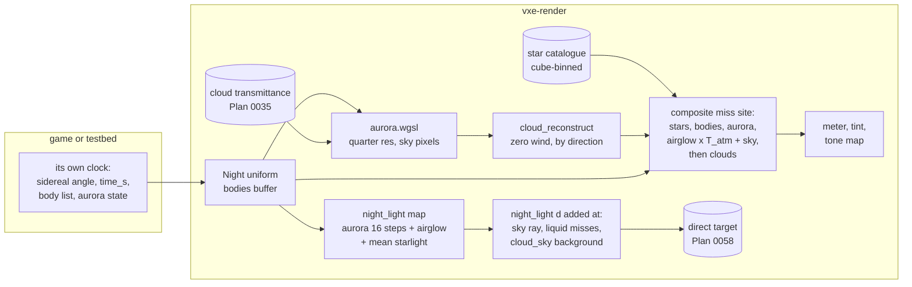

# 0037: The night sky: a star field, the moon's phases, sky bodies the game lists, an aurora that lights the ground, and a night tint

> **Status:** approved (2026-10-22), amended 2026-11-10 (review pass)
> **Created:** 2026-10-22
> **Milestone:** M10: Outdoors in [`docs/roadmap.md`](../roadmap.md)
> **Related ADRs:** [ADR-0032](../adrs/0032-night-sky-drawn-analytically-on-miss-pixels-with-a-marched-aurora-shell.md)
> (proposed with this plan: stars as a binned catalogue splatted by flux, sky bodies as a list,
> the aurora as a marched shell lighting through a hemisphere map the sky ray reads, the night
> tint, and the rejected alternatives),
> [ADR-0026](../adrs/0026-atmosphere-from-hillaire-luts-built-on-the-gpu-at-runtime.md) (the
> transmittance and sky-view LUTs),
> [ADR-0027](../adrs/0027-the-sun-shadow-is-one-per-pixel-ray-in-the-light-pass.md) (the moon
> as the key light and the sky ray, both unchanged here),
> [ADR-0030](../adrs/0030-volumetric-cloud-shell-amortised-march-and-projected-shadow-map.md)
> (the cloud buffer over the night terms, the update modes and reconstruction the aurora
> reuses),
> [ADR-0044](../adrs/0044-direct-light-from-a-fixed-list-of-analytic-lights-one-shadow-ray-each.md)
> (the direct target the sky ray's light lands in),
> [ADR-0046](../adrs/0046-static-emissive-light-is-baked-per-chunk-when-a-chunk-loads-or-changes.md)
> (the baked store, which takes no sky term)
> **Source:** the owner's question of 2026-10-22 about a comet and northern lights at night;
> the outdoor batch's standing answers (outdoors is a general engine capability; the game sets
> time; the engine reads no clock; every toggle shows its mode in the window; readings on both
> adapters); the owner's answer of 2026-10-22 that the night look is a blue-shifted,
> desaturated tint; the owner's priority of 2026-11-03 (no flicker, no aliasing).
> **Order (owner, 2026-11-10):** Plans 0060, 0061, 0058, 0044, 0045, the `own`-removal plan and
> the render-profile plan (both owed, see [`docs/backlog.md`](../backlog.md)), then M10 in a
> line: 0032, 0033, 0034, 0035, 0036, 0037.
> **Starts after:** [Plan 0036](0036-weather-rain-snow-wind-wet-surfaces-snow-cover-lightning.md)
> closes. The base is main after that close. It builds on
> [Plan 0032](0032-sun-and-sky-hillaire-atmosphere-time-of-day-and-an-outdoor-testbed.md)
> through that plan's section "Interface for Plans 0033 to 0037", on
> [Plan 0034](0034-water-surface-waves-reflection-refraction-underwater-fog.md)'s liquid
> shader and its secondary-ray miss lookup, and on
> [Plan 0035](0035-aerial-perspective-and-volumetric-clouds-with-cloud-shadows.md)'s
> `CloudUpdate`, `cloud_reconstruct`, `cloud_sky_radiance(d)` and the composite's `media`
> section (that plan's section "What Plans 0036 and 0037 may rely on"). All of
> these are plans, not code: none of `sky.rs`, `sky.wgsl`, the liquid pass or the cloud passes
> is in the tree at `82ea836`. The names `dev` finds in the tree at the start commit win, and a
> name that differs is recorded in the log.
> **Files touched are provisional.** Plan 0045 splits `marcher.rs`, `march.wgsl`, `main.rs` and
> their neighbours before M10. `dev` re-reads every path below against the tree at the start
> commit; a moved path is not a deviation.
> **Readings** go in `docs/plans/logs/0037.md`, which `dev` starts at Phase 1.

> **Amended 2026-11-10 (test cost, owner).** Phases 1 to 9 are **exploration** (lane rules 2b):
> the owner's window in Phase 10 is their gate. Each lands its CPU tests of data, determinism
> and API; every test it names that judges the image (goldens, SSIM or pixel floors, stillness,
> settle and difference bars) runs as a reading from `live/`, a `mod reading` or the strip tool,
> recorded in the readings log, and is written as a test in Phase 11, after the window, against
> the picks. Phase 9 keeps its switches, banner and readings before the window; its goldens and image bars move to Phase 11. Per phase the gpu check runs only the `gpu_*` binaries the phase names
> (`test-changed.mjs --binaries`, Plan 0066); a named test over 10 s on lavapipe is born
> `#[ignore = "soak"]` (`docs/nfr.md` section 7). The mechanisms and bars stand; only when they
> become tests moves.

## TL;DR

The night gets a sky worth looking at. A seeded star catalogue to magnitude 6.5 (or one the
game supplies) turns with the time of day and the latitude, dims and reddens toward the
horizon, twinkles there if asked, and hides behind clouds and the moon. Each star is drawn by
its flux, so its brightness does not depend on the jitter or the resolution. The moon shows
its phases with Lommel-Seeliger shading, and a helper gives its brightness per phase. The game
lists sky bodies each frame: direction, size, brightness, a flat or sunlit look, an optional
texture and an optional tail. A comet's tail points away from the sun, and a meteor's trail
runs where the game says. An aurora of curtains 90 to 320 km up, animated by the game's time,
is marched at quarter resolution on sky pixels. Its glow lights the ground through Plan 0032's
sky ray, which reads a small hemisphere map of the night's light, and through no other path:
no probe and no baked store takes it. A night tint, driven by each pixel's luminance before
exposure, moves dark pixels toward a desaturated blue the game sets without changing their
luminance. All of it is off by default and costs nothing off.

The first thing a reader sees is Phase 1's headless golden of an empty world's night sky full
of stars around the celestial pole, and a unit test that counts the stars brighter than
magnitude 0.5, 2.5 and 4.5 for seed 1 as 9, 90 and 900, each within one. Phase 2 then measures
a still star through FSR 2 at 1.5, the default upscaler, before anything else is built on the
splat.

## Context & problem

After Plans 0032 to 0036 a miss pixel at night shows the sky-view LUT, which holds the moon's
in-scattering, plus the moon's flat disc, under clouds. Nothing draws stars, an aurora or any
other object. Plan 0032 lists stars, a moon phase shape, an aurora and a night tint under
"does NOT do" and leaves them to this plan.

The first consumer is underground (`project-context.md`) and sets the sky off; it must see no
change. The engine offers mechanisms and names no game concept: "comet" and "meteors" are
testbed presets of one body primitive.

The lighting base, as Plan 0032's Interface section fixes it:

- **Misses.** The composite sets a primary miss's colour at one site, ahead of its variant
  select, so the display variant, FSR 2's HDR variant and the meter all carry it. A plan that
  draws on miss pixels adds its absolute radiance there, times `exposure_now()`.
- **Light on the ground.** Sky light reaches a surface through the sky ray alone: a
  cosine-weighted ray per lighting pixel whose result is added to Plan 0058's `direct` target.
  The probe volume is the headlamp's bounce channel (ADR-0043) and reads no sky. The baked
  store is emissive only (ADR-0046) and no sky term enters the bake's source. So the night's
  light on the ground can only arrive by what the sky ray reads when it reaches the sky.
- **Secondary misses.** A reflection or refraction ray of Plan 0034 that misses reads
  `sky_radiance(d)`. With clouds on, the sky ray reads Plan 0035's `cloud_sky_radiance(d)`
  in its place: a hemisphere map (`cloud_sky`) marched with the clouds over the sky.
- **Exposure.** Absolute radiance is multiplied by `exposure_now()` once, where it enters a
  pre-exposed target, and the meter reads the composite's `c / ex`.

Facts the design rests on:

- **Units.** Plan 0032 puts the sun's top-of-atmosphere illuminance near 3000 frame units
  (a guess the owner tunes) for about 127 500 lux. A magnitude-0 star gives about 2.54e-6
  lux, so in frame units about `3000 x 2.54e-6 / 127 500 = 5.98e-8`. Plan 0032's testbed
  moon is `E_sun / 400 000 = 7.5e-3`.
- **A star in a pixel.** At 720p internal (scale 1.5 for 1080p output) with a 90 degree field,
  an internal pixel is on average `(pi/2) / 1280 = 1.227e-3` rad wide, or `1.506e-6` sr. If
  30 % of a magnitude-0 star's flux lands in its brightest pixel, that pixel's radiance is
  `5.98e-8 x 0.3 / 1.506e-6 = 0.0119`. Under the outdoor testbed's auto exposure at its `max`
  of 4.0 (Plan 0032 Phase 4; a moonless night pins there) and the ACES curve with the 1/2.2
  gamma, magnitudes -1, 0, 1, 2, 3, 4, 5 and 6 read about 111, 60, 31, 17, 10, 6, 4 and 3 of
  255 on a black sky. At physical brightness the eye gets stars to about magnitude 4 to 5 on
  screen. `Night::star_gain` is there for a game that wants more.
- **Jitter and the upscaler.** FSR 2 at 1.5 is the default; it jitters every ray by a
  sub-pixel offset per frame and accumulates miss pixels reprojected by direction. Its phase
  count comes from the scale: `fsr2::jitter_phases` is `int(8 (display / render)^2)`, which is
  18 at 1.5. A star sampled at a point flickers. A star whose flux is integrated over the
  pixel's box does not, at the composite: every pixel shares the jitter, so the boxes tile the
  screen and the flux in them sums to the star's at any offset. What FSR 2's lock and
  accumulation then do to a one-pixel peak is not known, and Phase 2 measures it.
- **Real star counts.** The sky holds about 9100 stars to magnitude 6.5, about 900 to 4.5,
  about 90 to 2.5 and about 9 to 0.5. The count rises close to `10^(0.5 m)`, which is the
  seeded field's law below.
- **Aurora geometry.** Curtains are about 1 km thick and hundreds of km long, with a sharp
  lower border near 100 km, green emission (557.7 nm) above it, and red (630.0 nm) from about
  180 to 300 km. With Plan 0032's ground radius `R = 6360 km`, a ray from the ground meets a
  shell from 90 to 320 km at these distances: straight up from 90 to 320 km (path 230 km); at
  30 degrees of elevation from 176.38 to 599.58 km (423.19 km); at 10 degrees from 435.92 to
  1217.77 km (781.85 km); at 0 degrees from 1073.73 to 2042.74 km (969.01 km). A 1 km curtain
  at 150 km subtends 0.38 degrees, which is about eight 1080p pixels at a 90 degree field
  (0.047 degrees a pixel) and a fifth of a sky-view LUT texel.
- **The moon's phases.** A Lommel-Seeliger sphere (Jensen et al. 2001's model for the moon)
  lit at phase angle `alpha` has disc-integrated brightness, relative to full, of
  `Phi(alpha) = 1 - sin(alpha/2) tan(alpha/2) ln(cot(alpha/4))`: 0.7440 at 45 degrees,
  0.3768 at 90, 0.1760 at 120 and 0.0453 at 150, and 0 at 180. A numerical integration over
  the disc agrees to 1e-4. The real moon falls faster because of its opposition surge. Allen's
  empirical law `m(alpha) = -12.73 + 0.026 alpha + 4e-9 alpha^4` (alpha in degrees) gives
  0.3353 of full at 45 degrees, 0.0910 at 90 and 0.0116 at 135.

`nfr.md` figures touched: section 2 "Upscale, tone map, post" (stars, bodies and the tint in
the composite), section 2 "Headroom (entities, volumetrics, game work)" (the aurora march),
section 2 "Lighting" (one map read per sky-reaching sky ray), section 3 "Everything else in
VRAM" (Data shapes), section 7 time to first frame (the catalogue's generation).

## Decision

We build ADR-0032's night sky in `vxe-render`, in a new `night` module behind
`Frame::set_night(Option<Night>)`. `None` is the default, and with `None` every image is byte
for byte the same.

1. **The composite's order for a primary miss.** At Plan 0032's miss site we start from
   `B = texture(d) + stars(d)`. Each opaque body (and the moon's disc) lays its coverage `a`
   over it as `B (1 - a) + L_body`. Additive bodies (tails, flat glows) and the aurora add on
   top. The airglow background adds last, because it sits at 90 km, in front of the moon. The
   sum is multiplied by the atmosphere's transmittance from the camera to the top along `d`
   (`transmittance`), and Plan 0032's `sky_radiance(d)` and sun disc are added. The whole is
   multiplied by `exposure_now()` once, there. Plan 0035's `media` section then lays the
   clouds over the pixel, and the translucent layers come after. The night terms are in `c`
   before the meter's read, so the meter sees them.
2. **Stars.** `StarCatalogue::generate(&StarParams)` builds the seeded field on the CPU. Star
   `i` of `N` (brightest first) takes `u = (i + h_i) / N` with `h_i` a PCG hash of `(seed, i)`
   in `[0, 1)`, and magnitude `m = limit + log10(u) / slope`, clamped to `brightest`. So the
   number of stars brighter than `m` is `N 10^(slope (m - limit))` within one, by
   stratification. Directions are uniform on the sphere from two more hashes, with an
   optional fraction pulled toward a band (a galactic plane). A colour temperature is drawn
   from a stated distribution, and its colour comes from a table of blackbody colours in
   linear sRGB of unit luminance (Wyman, Sloan and Shirley 2013's fit of the CIE functions),
   desaturated by `colour_saturation`. `StarCatalogue::from_stars` takes a supplied list (for
   example, a real catalogue in right ascension, declination and magnitude). Upload sorts the
   stars into the cells of a 6 x 32 x 32 cube grid with an offsets table. The composite tests
   a miss pixel's cell and its 8 neighbours. For each star it projects the star into the
   frame, takes the fraction of a Gaussian of sigma `star_psf_px` (internal pixels) inside the
   pixel's jittered box (a product of two `erf` differences), and adds `E_star x fraction /
   Omega_pixel`. The loop is skipped where the catalogue's brightest star would be under
   1/256 of the pixel's sky radiance, so daylight costs a branch. The default `star_psf_px` is
   the one Phase 2's reading keeps.
3. **The celestial frame.** `celestial_to_world(sidereal_angle, latitude)` returns the
   rotation from the celestial frame (+z the celestial pole, +x the zero of right ascension)
   to world axes (+x east, +y north, +z up). It agrees with Plan 0032's `body_direction`: a
   star at right ascension `ra` and declination `dec` lands at `body_direction(theta - ra,
   dec, latitude)`. The game sets the sidereal angle from its own time. The testbed uses the
   sun's hour angle at its equinox.
4. **Twinkle, airglow and the sky texture.** A star's flux is multiplied by `1 + a n(i, t)`,
   where `n` is a smooth hashed noise in `[-1, 1]` of the star's index and `Night::time_s`,
   and `a = twinkle x clamp((X - 1) / 9, 0, 1)` with the air mass `X = 1 / sin(elevation)`. A
   star at the zenith never twinkles. `Night::background` is the airglow's radiance.
   `Frame::set_sky_texture` takes an optional `rgb9e5ufloat` cube map in the celestial frame,
   scaled by `Night::texture_scale`.
5. **The moon's phases.** `BodyLook::{Flat, Lit { earthshine }}` and an optional texture
   apply to the moon (`Night::moon_look`) and to every sky body. Lit shading draws the near
   hemisphere of a sphere lit by the sun's direction, with weight `w = 2 mu0 / (mu0 + mu)`
   (Lommel-Seeliger, `mu0 = n.s`, `mu = n.v`). This is constant over the disc at full phase,
   which matches the flat disc. The radiance is normalised so that the disc's flux equals the
   body's illuminance: `L = E w / (Omega Phi_c)` with `Phi_c = max(Phi(alpha), 1e-4)`.
   Earthshine adds `earthshine x E / (Omega Phi_c)` where `mu0 <= 0`. **The division by `Phi`
   is clamped at 1e-4**, which is the only guard: `Phi` is 0 at new moon, and the clamp keeps
   both terms finite there. `moon_phase_illuminance(full, alpha)` is Allen's law, and
   `phase_angle(sun, body)` is `pi - acos(s.m)`, in 0 to `pi`. The moon stays Plan 0032's
   light. The game passes the phase-scaled illuminance, and its in-scattering and directional
   sample follow.
6. **Sky bodies.** `Frame::set_sky_bodies(&[SkyBody])` writes up to `MAX_SKY_BODIES` into a
   buffer reserved once, and returns an error beyond that. A body is a world direction, an
   angular radius, an illuminance, a look, an optional texture slot (256 x 256 slots in one
   array, set by `Frame::set_body_texture`) and an optional `Tail`. A body narrower than half
   an internal pixel is splatted like a star. A tail is a fan along a great circle from the
   head: radiance `L0 exp(-s / length) exp(-(q / (width + spread s))^2)` for angular distance
   `s` along the axis and `q` across it. Its axis is `AwayFromSun` or `Toward(dir)`. The CPU
   culls the list to the bodies whose disc or tail can reach the view.
7. **The aurora.** `Aurora` is the game's per-frame state: intensity, three colours (low, high
   and edge), the shell (90 and 320 km by default), the vertical profile, the curtain field
   (a band centre in world kilometres, an azimuth, 1 to 4 curtains, their spacing and
   thickness, fold amplitude and scale, striation scale and contrast, drift and flicker
   rates), its own `time_s`, a seed for its 256 x 256 `rg8unorm` noise tile (generated on the
   CPU, uploaded once), the update mode, and a debug mode. Emission at a point is
   `F(x, y) P(h)`. `F` sums, over the curtains, a Gaussian of the signed distance to a line
   warped by fold noise drifting with `time_s`, times `1 - contrast + contrast r(s, t)`,
   where `r` is the striation noise along the curtain's coordinate. `P` is the green
   exponential above a sharp lower border, the red band above it, and the edge colour's thin
   fringe at the border. `aurora.wgsl` marches each texel of a buffer at half the internal
   size per axis whose 2 x 2 internal pixels hold a miss. It runs 32 steps through the shell
   segment from a blue-noise offset. At each step it integrates the curtain Gaussian along
   the step with `erf`, from the signed distances at the step's ends, so a curtain between
   two samples is still counted. The step's profile `P` is read at its point of closest
   approach to the curtain, not at its midpoint. It writes radiance and a validity bit. The
   march skips a texel where this frame's reconstructed cloud transmittance is under 0.01, or
   where the aurora's peak is under 1/256 of the sky's radiance. Plan 0035's `CloudUpdate` and
   its reconstruction serve it with the aurora's own buffers, zero wind and the shell's mid
   distance as depth, which is a reprojection by direction. The composite upsamples it
   bilinearly with zero weight on invalid texels, on miss pixels only.
8. **Night light.** `night_light`, a 128 x 64 `rgba16float` map over the upper hemisphere
   (azimuth by elevation) with a mip chain, is rebuilt every frame while a night is set, before
   the light pass. It holds the aurora marched at 16 steps, the background, the catalogue's
   mean radiance (its total flux over `4 pi`, a CPU constant) and the sky texture's lowest
   useful mip, times the atmosphere's transmittance. `night_light(d)` in `night.wgsl` is its
   lookup, and this plan adds it to `sky_radiance(d)` at three sites: Plan 0032's sky ray
   where it reaches the sky with clouds off, Plan 0034's secondary-ray miss, and the
   background of the march that fills Plan 0035's `cloud_sky` map. With clouds on the sky ray
   reads `cloud_sky_radiance(d)` as Plan 0035 has it, which then carries the night's light
   behind the clouds, so clouds hide the aurora's light too. `night.wgsl` is composed into
   the light pass's and the liquid pass's modules and never into `bake_source()`.
   The sky ray's result lands in the `direct` target under that target's blend, as Plan 0032
   has it; this plan adds no target and no history. The mip the sky ray reads is chosen by
   Phase 7's stillness reading, not here. A night light that changes from frame to frame (a
   pulsing aurora) raises neither `LIGHTING_LIGHTS_CHANGED` nor `LIGHTING_EMISSION_CHANGED`;
   it adds its own now-and-then pair to the upscalers' comparison, per Plan 0032's change
   rule: the map's cosine-weighted zenith irradiance for this frame and for one frame older,
   a CPU-side scalar triple read from the map's top mip.
9. **The night tint** (the owner's answer, 2026-10-22). `NightTint { strength, hue,
   full_below, none_above }`, set by `Frame::set_night_tint` and independent of `Night`, moves
   a pixel's colour toward `Y h`, its own luminance `Y` times the game's hue normalised to
   unit luminance, by a weight that is 0 above `none_above`, `strength` below `full_below`,
   and a smoothstep in `log10 Y` between (Phase 8 gives the formula). `Y` is the pre-exposure
   luminance in frame units, read from the composite's `c / ex` where the meter reads it, so
   the tint follows how dark the scene is, not how far the exposure has brightened it, and a
   bright lamp at night keeps its colour. The mix keeps `Y` exactly, so the meter, the stars'
   flux and every luminance test above are unchanged. It runs in the composite after the
   meter's read and before the tone map, in both composite variants. It models the look of
   rod vision (Thompson, Shirley and Ferwerda 2002), not the rods' spectral sensitivity: a
   scotopic luminance (CIE 1951 `V'(lambda)`) would change each pixel's brightness, the meter
   and the stars' calibrated flux, and is not used. The testbed's bounds are the usual
   mesopic band, about 0.001 to 3 cd/m2 (CIE 191:2010 sets its own at 0.005 and 5), converted
   through Plan 0032's unit.

We rejected a painted skybox as the whole night sky, the aurora as a textured sheet or a
sky-view LUT term, bodies as voxel models at a distance, stars hashed per pixel with no
catalogue, the night's light through the probes or the baked store, physical darkness alone,
and a night-adapted exposure key (ADR-0032).

## Architecture diagram



## Implementation phases

Each phase ships as its own commit. `dev` implements all phases in one session with no review
between phases. The architect reviews once at the end, in a fresh session.

**Goldens.** Every golden this plan adds is blessed on lavapipe at 320 x 180 under the
harness's floor: at most 0.1 % of pixels differ by more than 2/255 in any channel. Each
phase's test run asserts that every existing golden stays byte-identical while `Night` and
`NightTint` are `None`. The goldens of Plans 0032 to 0036 in `gpu_golden.rs` pass `--night
off` and `--night-tint off`, so the testbed's new defaults leave them alone.

**Tests and tiers.** A phase gates on `node scripts/test-changed.mjs --profile quick` and, for
a render phase, `--profile gpu` under the perf lock; the tip gates on `cargo nextest run
--profile gate`. A test that opens a GPU device lives in a `tests/gpu_*.rs` file. A CPU-only
bar is a unit test in `crates/vxe-render/src/night.rs` or in the fly-through's sources, so it
stays in the quick tier. Each named test carries its expected wall time on lavapipe. **Every
time below is an estimate: nothing was run.** `dev` reads each test's time with `node
scripts/test-times.mjs`; a test over 30 s on lavapipe (60 s on CI) is marked `#[ignore =
"soak"]` and leaves the gate, and where that would take a phase's only gated bar, the phase
names a smaller gated variant. A number that is only logged is printed by the test that
asserts beside it, or it lives in a named `reading::<name>` inside a `mod reading`. A run of
the fly-through binary is called a run, not a test.

**The analytic rig.** The analytic tests use a 320 x 180 frame with a 90 degree horizontal
field, so the focal length is `160 / tan(45 degrees) = 160` pixels, with jitter off unless the
test names it. "Probe dispatch" means a test-only entry point in `night.wgsl` that evaluates a
shader function over a grid and writes `f32` results to a storage buffer.

**Keys and slots.** No phase names a key, a binding or a flag bit. `dev` takes a free key and
the next free slot from the tree at the phase's start, and the README says which key. The
banner's mode word, not the key, is the contract.

### Phase 1: A seeded catalogue, the celestial frame and stars on miss pixels (walking skeleton)
- **Owner skill:** dev
- **What:** `night.rs` with `Night` (celestial rotation, `zero_mag_illuminance`, `star_gain`,
  `star_psf_px`), `StarParams`, `StarCatalogue::{generate, from_stars}`,
  `celestial_to_world`, `Frame::set_night` and `Frame::set_star_catalogue`. A white star
  colour for now. The cube binning and its offsets table. `night.wgsl` holds the cell
  mapping, `erf` (Abramowitz and Stegun 7.1.26), the box-integrated splat and the
  transmittance factor. The composite adds the stars at the miss site, multiplied by
  `transmittance`, before `sky_radiance`. The fly-through gets `--night off|on` and a stars
  key cycling `stars off` and `stars on`, shown on the mode banner.
- **Files touched:** new `crates/vxe-render/src/night.rs` (with its unit tests), new
  `crates/vxe-render/src/shaders/night.wgsl`, `composite.wgsl`, `marcher.rs` (the `Frame`
  owns the night state and its buffers), `lib.rs`, new
  `crates/vxe-render/tests/gpu_night.rs`, `apps/flythrough/src/main.rs`, `hud.rs`,
  `apps/flythrough/tests/gpu_golden.rs`, new golden `night_empty_stars.png`.
- **Done when:**
  1. **The magnitude law holds within one.** `the_seeded_magnitude_law_counts_within_one`, a
     unit test in `night.rs` (no adapter, under 1 s): for `StarParams::default()` at seed 1
     (count 9000, limit 6.5, slope 0.5, brightest -1.5), the stars brighter than 0.5, 2.5 and
     4.5 number 9, 90 and 900, each within 1, and all 9000 are at most 6.5. Arithmetic:
     `9000 x 10^(0.5 (m - 6.5))` is 9.0, 90.0 and 900.0. Two generations with seed 1 are
     equal star for star, and seed 2 differs.
  2. **The frames agree.** `the_celestial_frame_agrees_with_body_direction`, a unit test in
     `night.rs` (under 1 s): for 64 seeded `(theta, latitude, ra, dec)`,
     `celestial_to_world(theta, latitude) x unit(ra, dec)` equals `body_direction(theta - ra,
     dec, latitude)` within 1e-5. At latitude 45 degrees the celestial pole lands at elevation
     45 degrees toward +y for every `theta` of 0, 90, 180 and 270 degrees.
  3. **A star lands where the geometry says.** `a_star_lands_where_the_geometry_says` in
     `gpu_night.rs` (about 3 s): a one-star catalogue at `ra = 0`, `dec = 0`, latitude 45
     degrees, `theta = 0`, the camera facing south, pitched up 45 degrees. The star's
     flux-weighted centroid is the image centre `(160, 90)` within 0.1 px. At `theta = 15`
     degrees it is the projection of `body_direction(15 degrees, 0, 45 degrees)` within 0.1 px.
  4. **Flux is conserved at every jitter.** `a_stars_flux_is_the_same_at_every_jitter` in
     `gpu_night.rs` (probe dispatch, a uniform test sky with transmittance 1; about 5 s): for
     a star of illuminance `E = 1e-4` at an arbitrary sub-pixel position, the sum of `radiance
     x Omega_pixel` over the 9 x 9 pixels around it equals `E` within 1 %, at
     `star_psf_px` 0.6 and 1.0, at every offset of two sequences: FSR 2's at scale 1.5
     (`fsr2::jitter_offset` over its `jitter_phases`, 18 at 1.5) and `marcher::jitter_at` over
     `JITTER_PHASES`. The box fractions of a Gaussian tile to 1. The 1 % covers the pixel's
     solid angle taken as `cos^3(theta) / f^2` at its centre, and the 9 x 9 window's
     truncation at 4.5 px, which is `7.5 sigma` at 0.6.
  5. **No night, no change.** With `Night` `None`, every existing golden is byte-identical
     (the gate's golden tests), and `night_none_reserves_nothing` in `gpu_night.rs` (about 2
     s) reads `frame_bytes` equal before and after `set_night(None)`.
  6. **Golden.** `night_empty_stars_golden` in `gpu_golden.rs` (about 6 s) blesses
     `night_empty_stars.png`: an empty world, Plan 0032's sky with the sun and the moon at -45
     degrees, seed 1, latitude 45 degrees, the camera facing north pitched up 45 degrees (the
     pole at the centre), manual exposure 4.0, and `zero_mag_illuminance` 1e-5 (a test value,
     so faint stars show at 320 x 180).
  7. **Banner.** The fly-through's banner test (no adapter, under 1 s) finds `stars on` after
     the stars key and `stars off` after the next press.

### Phase 2: A still star through the upscalers, measured before the splat is built on
- **Owner skill:** dev
- **What:** a measurement, then one regression test. The splat conserves flux at the composite
  (Phase 1 bar 4); FSR 2 then accumulates a one-pixel peak by direction through its lock and,
  when sharpening is on, its RCAS pass, and nothing has read what comes out. The reading
  `reading::star_spread_through_the_upscalers` in `gpu_night.rs` renders a magnitude-1 star on
  a black uniform test sky (transmittance 1, manual exposure 4.0, still camera) at a
  sub-pixel position that is not a pixel centre, for 36 settle frames and then 36 measured
  frames (two of FSR 2's 18-phase sequences), and prints, for each of `star_psf_px` 0.25,
  0.6 and 1.0, under FSR 2 at 1.5 with sharpness 0 and with the fly-through's default
  sharpness, and under every other upscaler the tree has at the start commit: the summed
  display-linear output over a 13 x 13 output window per frame; its spread over the 36
  frames, `(max - min) / mean`; and its mean over the composite's flux scaled to output
  pixels. The table goes in `docs/plans/logs/0037.md`.
- **The stop rule.** The default `star_psf_px` is the smallest of 0.6 and 1.0 whose spread
  under FSR 2 at 1.5, at the default sharpness, is at most 10 %, and whose mean is within 25 %
  of the composite's flux. Both thresholds are proposals, not measurements: 10 % of a
  magnitude-1 star's peak is about three display levels at the testbed's exposure, which is
  the size of change the owner's no-flicker priority is about. **If neither value meets both,
  `dev` stops and the architect amends the plan before Phase 3.** The named candidates for
  that amendment are a wider splat with the flux kept, a star term marked reactive so FSR 2's
  lock does not hold it, or stars added after the upscaler at output resolution; none is built
  without the reading.
- **Files touched:** `crates/vxe-render/tests/gpu_night.rs`, `night.rs` (the default
  `star_psf_px`), `docs/plans/logs/0037.md`.
- **Done when:**
  1. **The reading exists.** The log holds the table for every upscaler and point-spread
     value above, and states the default `star_psf_px` and the rule that chose it, or the
     stop.
  2. **A still star holds.** `a_still_star_holds_through_fsr2` in `gpu_night.rs` (72 frames
     at 320 x 180 internal under FSR 2 at 1.5; about 15 s): at the default `star_psf_px` the
     spread is at most 10 % and the mean is within 25 % of the composite's flux. This is the
     stop rule as a regression test.
  3. **A wider splat is steadier.** The same test asserts that the spread at `star_psf_px`
     1.0 is at most the spread at 0.25 under FSR 2, and prints both.

### Phase 3: The stars' look: colour, twinkle, a band, airglow and a sky texture
- **Owner skill:** dev
- **What:** the colour temperature distribution (log-uniform in 3000 to 12 000 K, a stated
  guess), the blackbody table (64 entries over 1000 to 40 000 K in log steps, built at
  startup from the Wyman, Sloan and Shirley fit, normalised to luminance 1),
  `colour_saturation` (0.6 by default, a guess), `StarBand { pole, fraction, width }` (a band
  star's latitude from the band's plane is uniform within `+-width`), twinkle with
  `Night::time_s`, `Night::background`, `Frame::set_sky_texture` (an `rgb9e5ufloat` cube, face
  size up to 1024, with mips) and `Night::texture_scale`. The star loop's skip rule against
  the sky's radiance. The stars key gains `stars twinkle`.
- **Files touched:** `night.rs`, `night.wgsl`, `composite.wgsl`, `marcher.rs`,
  `crates/vxe-render/tests/gpu_night.rs`, `apps/flythrough/src/main.rs`, `hud.rs`.
- **Done when:**
  1. **Colour runs with temperature.** `the_blackbody_table_runs_red_to_blue`, a unit test in
     `night.rs` (under 1 s): the 3000 K entry has `R > G > B`, the 15 000 K entry has `B > G >
     R`, the 6500 K entry's largest channel is under 1.15 times its smallest, and each entry's
     luminance (Rec. 709 weights) is 1 within 1e-3.
  2. **Twinkle grows with air mass.** `twinkle_grows_with_air_mass` in `gpu_night.rs` (probe
     dispatch, a uniform test sky, `twinkle = 0.5`; about 4 s): a star at the zenith reads the
     same summed flux, bit for bit, at 32 values of `time_s` spaced by 0.05 s. A star at
     elevation 10 degrees reads a flux that differs between at least two of those times, and
     every reading lies within `E (1 +- 0.2644)`. Arithmetic: `X = 1 / sin(10 degrees) =
     5.759`, `a = 0.5 x (5.759 - 1) / 9 = 0.2644`.
  3. **The band holds its fraction.** `the_band_holds_its_fraction`, a unit test in `night.rs`
     (under 1 s): with `fraction = 0.3` and `width = 10` degrees, the stars within 10 degrees
     of the band's plane number at least `0.3 x 9000 = 2700` plus the uniform share `0.7 x
     9000 x sin(10 degrees) = 1094`, less 3 % (a property bound on the seeded draw). The
     magnitude counts of Phase 1 bar 1 are unchanged.
  4. **Airglow is behind the atmosphere.** `airglow_sits_behind_the_atmosphere` in
     `gpu_night.rs` (an empty world, the sun and the moon at -45 degrees, stars off; about 3
     s): a pixel at the zenith reads `background x (0.9404, 0.8677, 0.7623)` within 1 %, which
     is Plan 0032 Phase 1's zenith transmittance. A sun 45 degrees down adds no in-scattering,
     by Plan 0032 Phase 2's arithmetic.
  5. **The texture turns with the sky.** `the_sky_texture_turns_with_the_sidereal_angle` in
     `gpu_night.rs` (about 4 s): on a test cube map that is black except a 3 x 3 patch of
     radiance 1 around the celestial pole, at latitude 45 degrees with the camera north and
     pitched up 45 degrees, the brightest pixel lies within 1 px of the image centre at
     `theta` 0 and 90 degrees.
  6. **Daylight skips the loop.** `daylight_skips_the_star_loop` in `gpu_night.rs` (about 3
     s): at Plan 0032's noon the composite's output is byte-identical with stars on and off.
  7. **Banner.** The banner test finds `stars off`, `stars on` and `stars twinkle` in turn.

### Phase 4: The moon's phases
- **Owner skill:** dev
- **What:** `BodyLook::{Flat, Lit { earthshine }}` with an optional `BodyTexture { slot,
  north }`, `Night::moon_look`, `Frame::set_body_texture(slot, &[u8])` (256 x 256
  `rgba8unorm-srgb`, the slots in one array with mips, allocated on the first call),
  `moon_phase_illuminance`, `phase_angle`, and the Lit disc in Plan 0032's `body_disc` with
  `Phi(alpha)` in closed form and the division by `Phi` clamped at 1e-4 (Decision 5). The
  moon's disc coverage hides the stars and the texture behind it. In the fly-through,
  `--moon-phase DEG` takes a position in the cycle, 0 to 315 in steps of 45: 0 is full, 180
  is new, and the testbed's moon sits at the sun's hour angle plus `180 - DEG` degrees. The
  phase angle the shading and the helper take is the fold `alpha = DEG` for `DEG <= 180` and
  `alpha = 360 - DEG` above it (225, 270 and 315 give 135, 90 and 45), with the lit limb on
  the other side, which the moon's place relative to the sun gives without a flag. A moon key
  steps the position by 45 degrees. The testbed passes `moon_phase_illuminance(E_sun /
  400 000, alpha)` as the moon's illuminance and `Lit { earthshine: 0.002 }` (a guess).
- **Files touched:** `night.rs`, `night.wgsl`, `sky.wgsl` (`body_disc`), `sky.rs`,
  `composite.wgsl`, `marcher.rs`, `crates/vxe-render/tests/gpu_night.rs`, new
  `apps/flythrough/src/night.rs` (the testbed's moon and, later, its presets),
  `apps/flythrough/src/main.rs`, `hud.rs`.
- **Done when:**
  1. **The helpers' numbers.** `the_phase_helpers_match_allens_law`, a unit test in
     `night.rs` (under 1 s): `moon_phase_illuminance(1, 90 degrees)` is 0.0910 within 0.5 %,
     and at 0 degrees it is exactly 1. `phase_angle` of opposite directions is 0, and of equal
     directions is `pi`. The testbed's fold maps 225, 270 and 315 to 135, 90 and 45 (a unit
     test beside the flag's parser, under 1 s).
  2. **Lit equals flat at full.** `the_lit_disc_is_the_flat_disc_at_full` in `gpu_night.rs`
     (probe dispatch, a test moon of angular radius 5 degrees at the image centre, `f tan(5
     degrees) = 14.0` px; about 3 s): at phase 0, every pixel of the Lit disc equals the Flat
     disc's within 1e-5 relative.
  3. **The disc's flux is the body's illuminance.** `a_lit_discs_flux_is_its_illuminance` in
     `gpu_night.rs` (about 4 s): at phases 45, 90 and 120 degrees with earthshine 0, the sum
     of `radiance x Omega_pixel` over the disc equals `E` within 2 %, because the
     normalisation by `Phi` holds.
  4. **The terminator.** `the_terminator_splits_the_disc_at_quarter` in `gpu_night.rs`
     (about 3 s): at phase 90 degrees with the sun to the right of the moon as seen, every
     pixel whose centre is inside the disc and right of its centre column reads above 0, and
     every one left of it reads exactly 0 with earthshine 0, or `0.002 E / (0.3768 Omega)`
     within 1 % with earthshine 0.002 (`Phi(90 degrees) = 0.3768`).
  5. **New moon is finite.** `a_new_moon_is_finite` in `gpu_night.rs` (about 3 s): at phase
     180 degrees, where `Phi` is 0 and the clamp is 1e-4, every pixel inside the disc is
     finite; it reads exactly 0 with earthshine 0, and `0.002 E / (1e-4 Omega) = 20 E /
     Omega` within 1 % with earthshine 0.002. No pixel of the frame is NaN or infinite. Four
     of this plan's goldens use phase 180, so this path is on every night golden.
  6. **The moon hides the stars.** `the_moon_hides_the_star_behind_it` in `gpu_night.rs`
     (about 3 s): with a star placed behind the disc's centre, the centre pixel reads the same
     with the star in the catalogue and without it.
  7. **Banner.** The banner test steps `moon phase 0` to `moon phase 45` and on to `moon phase
     315`, then back to 0.

### Phase 5: Sky bodies and their tails
- **Owner skill:** dev
- **What:** `SkyBody`, `Tail`, `TailAxis::{AwayFromSun, Toward}`, `Frame::set_sky_bodies`
  with its capacity error, the CPU cull, the body loop in the composite (the opaque looks
  over the stars, the additive ones added), the splat path for sub-pixel bodies, and the
  tail fan. In the fly-through, `apps/flythrough/src/night.rs` gains two presets. The
  `comet` preset is a head of angular radius 0.05 degrees and a tail of length 12 degrees
  away from the sun, placed by the testbed above the western horizon. The `meteors` preset
  is a seeded schedule in the testbed's own time: a radiant, a start every 2 to 8 s, 0.3 to
  1.0 s lives, 10 to 30 degrees per second away from the radiant, and a trail `Toward` the
  radiant. A bodies key cycles `sky bodies none`, `comet` and `meteors`.
- **Files touched:** `night.rs`, `night.wgsl`, `composite.wgsl`, `marcher.rs`,
  `crates/vxe-render/tests/gpu_night.rs`, `apps/flythrough/src/night.rs`, `main.rs`, `hud.rs`,
  `apps/flythrough/tests/gpu_golden.rs`, new golden `dusk_comet.png`.
- **Done when** (probe dispatch or lavapipe readback of pre-display radiance, a uniform test
  sky with transmittance 1, jitter off; each test in `gpu_night.rs`, about 3 to 4 s):
  1. **Size and place.** `a_flat_body_covers_its_disc`: a Flat body of angular radius 2
     degrees at the image centre covers an area (the sum of its edge coverage over the pixels)
     of 98.07 px within 2 %. Arithmetic: `r = 160 tan(2 degrees) = 5.587` px, `pi r^2 =
     98.07`. The same body at azimuth 20 degrees right of the view axis on the horizon has its
     coverage centroid at x = 218.24 within 0.25 px (`160 + 160 tan(20 degrees)`), y = 90
     within 0.1 px, and an area of `98.07 / cos^3(20 degrees) = 118.2` px within 3 %.
  2. **A tail points away from the sun.** `a_tail_points_away_from_the_sun`: a head at
     elevation 15 degrees in the view's centre, with the sun at the same azimuth at elevation
     -7 degrees, has a tail whose flux centroid (outside the head's disc) lies at x = 160
     within 0.5 px and above the head. The rows below the head's centre hold under 1 % of the
     tail's flux. With `Toward(dir)` for a `dir` 30 degrees to the right of the head, the
     centroid lies on the projected arc toward it within 0.5 px.
  3. **A point-sized body is a star.** `a_point_body_is_splatted_like_a_star`: a body of
     radius 0.001 degrees and illuminance `E` reads the same summed flux as a catalogue star
     of the same `E` within 1 %.
  4. **Capacity.** `the_body_list_refuses_one_over_its_cap`: `set_sky_bodies` with
     `MAX_SKY_BODIES` bodies succeeds, and with one more returns the error and leaves the
     previous list in place.
  5. **Golden.** `dusk_comet_golden` in `gpu_golden.rs` (about 10 s) blesses
     `dusk_comet.png`: the outdoor source with seed 1, spawn `outside` facing west, 18:40 (the
     sun at -7.05 degrees: `sin(el) = cos(45 degrees) cos(100 degrees) = -0.1228`), the comet
     preset, stars on, moon phase 180 (new, set with the sun), clouds off, and auto exposure
     with instant adaptation.
  6. **Banner.** The banner test cycles the three words.

### Phase 6: The aurora
- **Owner skill:** dev
- **What:** `Aurora`, `AuroraDebug::{UniformShell { emission_per_km }, Constant(L)}`, the
  noise tile, `aurora.wgsl` (the shell segment, which reuses Plan 0035's `cloud_segment`
  generalised to any two radii, the curtain field, the profile, the per-step `erf`
  integration, the skips), the quarter-resolution buffers, the update modes through
  `CloudUpdate` and Plan 0035's `cloud_reconstruct`, and the composite's masked upsample. The pass
  order puts it after `cloud_reconstruct` and before the composite, with `aurora` and
  `aurora_reconstruct` in `FRAME_PASSES`. The testbed has three presets. `quiet` is one
  curtain, green only, peak emission 1e-4 per km. `active` is three curtains with folds,
  rays and red tops, 5e-4. `storm` is four curtains with the band overhead (the corona), the
  edge colour on and fast drift, 2e-3. All three intensities are guesses tuned at Phase 10.
  `--aurora` and an aurora key choose the preset, and `--aurora-update
  every|one-in-four|one-in-sixteen` chooses the update.
- **Files touched:** new `crates/vxe-render/src/shaders/aurora.wgsl`, `night.rs`,
  `night.wgsl`, `clouds.rs` and Plan 0035's cloud shaders (`cloud_segment` shared, `cloud_reconstruct`
  bindable for the aurora's buffers, if it is not already), `composite.wgsl`,
  `marcher.rs`, new `crates/vxe-render/tests/gpu_aurora.rs`, `apps/flythrough/src/night.rs`,
  `main.rs`, `hud.rs`, `apps/flythrough/tests/gpu_golden.rs`, new golden `night_aurora.png`.
- **Done when** (lavapipe, an empty world, the sun and the moon at -45 degrees, stars off,
  clouds off, update `Every`; each test in `gpu_aurora.rs`):
  1. **The shell's path is right.** `a_uniform_shell_reads_its_path_length` (about 5 s): with
     `UniformShell { emission_per_km: e }`, the buffer's texel straight up reads `230 e
     (0.9404, 0.8677, 0.7623)` within 1 %, and the texel at elevation 30 degrees reads
     `423.19 e (0.8844, 0.7528, 0.5811)` within 1 %. Arithmetic: the path lengths are from
     Context. The transmittance is Plan 0032's zenith value and `exp(-2 x (0.0614, 0.1420,
     0.2714))`; the flat air mass of 2 at 60 degrees from the zenith moves a transmittance by
     at most 0.2 % against the curved one (Plan 0032 Phase 5). The air above 90 km adds under
     1e-4 to the optical depth, because `exp(-90 / 8) = 1.3e-5` of the Rayleigh column lies
     there.
  2. **A thin curtain is not missed.** `a_thin_curtain_is_not_missed` (about 6 s): with
     intensity 1, no folds and no striations, and one straight vertical curtain of thickness
     0.5 km at 200 km north of the camera, every texel whose ray crosses the curtain's plane
     between 100 and 300 km of altitude reads above 0, at 8 steps and at 32. The 8-step and
     32-step readings of the texel at elevation 45 degrees agree within 5 %, because the `erf`
     integral is exact for a straight curtain.
  3. **Off is free.** `no_aurora_runs_no_pass` (about 3 s): with `Night::aurora` `None`, the
     frame is byte for byte the frame before this phase, and no aurora pass runs (the
     timestamp list has none).
  4. **Time is the game's.** `the_aurora_moves_only_with_its_time` (about 5 s): two frames at
     the same `Aurora::time_s` are byte-identical, and frames at `time_s` 100 and 101 differ
     in more than 1 % of the aurora's pixels.
  5. **Clouds hide it.** `an_overcast_sky_skips_the_march` (about 5 s): under
     `CloudWeather::overcast()` with its coverage set to 1 in the test (transmittance 0 on
     every sky texel, which the test asserts first), the march writes nothing (every texel skips), and the miss pixels
     equal those with the aurora off.
  6. **The meter sees it.** `the_meter_sees_a_constant_aurora` (about 4 s): with
     `Constant(0.05)` and auto exposure with instant adaptation, the exposure settles at
     `0.18 / 0.05 = 3.6` within 1 % after 2 frames (3.6 is under the meter's `max`).
  7. **Amortised modes converge.** `one_in_four_converges_on_a_still_aurora` (two 16-frame
     series; about 12 s): with a still camera on the `active` preset and `time_s` frozen,
     `OneInFour` after 16 frames is closer to `Every` after 16 frames than `Every`'s first
     frame is. The test prints both differences. A 64-frame form of the same comparison is `#[ignore = "soak"]` (about 45 s).
  8. **Golden.** `night_aurora_golden` in `gpu_golden.rs` (about 12 s) blesses
     `night_aurora.png`: the outdoor source with seed 1, spawn `outside` facing north and
     pitched up 10 degrees, 00:00, moon phase 180, stars on, `active` at `time_s = 100`,
     update `Every`, and auto exposure with instant adaptation.
  9. **Banner.** The banner test cycles `aurora off`, `quiet`, `active` and `storm`.

### Phase 7: Night light: the aurora and the airglow light the ground through the sky ray
- **Owner skill:** dev
- **What:** in two steps, the first a measurement.
  - **The mechanism.** The `night_light` map with its mips and its pass (the `night_light`
    timestamp), the `night_light(d)` lookup in `night.wgsl`, and its addition to
    `sky_radiance(d)` at the three sites of Decision 8: Plan 0032's sky ray where it reaches
    the sky with clouds off, Plan 0034's secondary-ray miss in its liquid shader, and the
    background of the march that fills Plan 0035's `cloud_sky` map. The sky ray's
    light lands in the `direct` target as Plan 0032 has it. No probe shader, no bake source
    and no store binding changes. The now-and-then pair of Decision 8 joins the upscalers'
    comparison.
  - **Step A, the reading.** An aurora is a bright band on a dark sky, so one sky ray a pixel
    that reads the map at full resolution is a high-variance estimate where a uniform sky is
    not. `reading::night_light_stillness` in the fly-through's
    `tests/gpu_night_light.rs` runs Plan 0032 Phase 6's rig (the level rock floor, a still
    camera 40 voxels above it looking down at 45 degrees, the filter on, FSR 2 at 1.5 and
    native) with the sun and the moon at -45 degrees, lamp off, stars off, and prints the
    frame-to-frame change of the composited floor pixels over 64 still frames after 64 settle
    frames (the mean and the 99th percentile of the absolute change in display levels, at
    manual exposure pinned so the floor reads mid-grey) for: `UniformShell`; the `active`
    preset at a frozen `time_s`; and the `active` preset with the sky ray reading the map at
    mips 0, 2 and 4 (128 x 64, 32 x 16, 8 x 4); and the `active` preset under
    `CloudWeather::scattered()`, where the sky ray reads `cloud_sky_radiance(d)`. Beside them it prints the headlamp's
    statistics on the same floor with the night off, which is Plan 0032's reference. The
    table goes in `docs/plans/logs/0037.md`.
  - **The stop rule.** The sky ray reads the finest of mips 0, 2 and 4 whose 99th-percentile
    change under the `active` preset is at or under the headlamp's on the same floor, under
    FSR 2 at 1.5. A coarser mip trades the aurora's directional shadowing on the ground for
    stillness; the ray still decides visibility. **If mip 4 does not meet it, or the scattered-cloud
    row does not, `dev` stops and the architect amends the plan** before Step B. The named candidate is Plan 0032's own
    fallback for the sky ray (ADR-0027, Alternative F: a target of its own on a longer
    history); it is not built without the reading.
  - **Step B, the bars**, at the mip Step A keeps.
- **Files touched:** `aurora.wgsl` (the map's entry point), `night.wgsl`, `light.wgsl` (or
  wherever Plan 0032's sky ray reads the sky), the liquid shader of Plan 0034,
  `cloud_shadow.wgsl` of Plan 0035 (the `cloud_sky` map's background), the upscalers' change-mask inputs (`upscale.wgsl` and `fsr2/input.wgsl`
  at `82ea836`), `night.rs`, `marcher.rs`, `crates/vxe-render/tests/gpu_aurora.rs`, new
  `apps/flythrough/tests/gpu_night_light.rs`, `apps/flythrough/tests/gpu_bake.rs`,
  `docs/plans/logs/0037.md`.
- **Done when** (lavapipe, Plan 0032 Phase 6's level scene of a 1024 x 1024 voxel rock floor,
  the sun and the moon at -45 degrees, lamp off, no list light, no emissive material, filter
  off, manual exposure 1.0, stars off, `UniformShell` aurora unless a bar names another):
  1. **The reading exists and the mip follows it.** The log holds Step A's table and states
     the mip the sky ray reads and the rule that chose it, or the stop.
  2. **The map is the march.** `the_night_map_is_the_march` in `gpu_aurora.rs` (about 5 s):
     the map's texel straight up reads Phase 6 bar 1's zenith value within 1 %.
  3. **The floor reads the map's cosine integral.**
     `the_floor_reads_the_night_maps_cosine_integral` in `gpu_night_light.rs` (a 64-frame
     mean; about 10 s): the test integrates the read-back map's radiance times `cos(theta)`
     over the upper hemisphere on the CPU (`E_ref`). The `direct` target's irradiance at the
     floor pixel under the camera, read over the frame's exposure, is within 10 % of `E_ref`,
     and a floor pixel 400 voxels out reads the same within 10 %: there is one mechanism at
     every distance. This is Plan 0032 Phase 6's `pi` test with the night's sky.
  4. **Nothing else lights it.** `a_dark_night_lights_nothing` in `gpu_night_light.rs` (about
     4 s): with the aurora off, the background 0 and stars off, the floor's direct irradiance
     is exactly 0.
  5. **No leak.** `a_closed_box_takes_no_night_light` in `gpu_night_light.rs` (about 8 s):
     Plan 0032 Phase 6's closed rock box reads under 2 % of bar 3's value inside, under the
     camera and at 400 voxels.
  6. **Clouds take the light too.** `an_overcast_sky_takes_the_night_light` in
     `gpu_night_light.rs` (a 64-frame mean; about 12 s): with the coverage-1 overcast of
     Phase 6 bar 5, the floor's direct irradiance is under 2 % of bar 3's.
  7. **Stillness holds at the kept mip.**
     `the_aurora_lit_floor_is_as_still_as_the_lamp_lit_one` in `gpu_night_light.rs` (Step A's
     rig on the `active` preset at the kept mip, 128 frames at 320 x 180 under FSR 2; about
     25 s, and a candidate for the soak mark, in which case a 32-frame native variant stays in
     the gate): the 99th-percentile frame-to-frame change of the aurora-lit floor is at or
     under the lamp-lit floor's. This is the stop rule as a regression test.
  8. **A pulse is followed and marked.** `a_stepped_aurora_reaches_the_floor_in_eleven_frames`
     in `gpu_night_light.rs` (about 8 s): with `UniformShell` stepped from `e` to `2 e`
     between two frames, the floor's direct irradiance is within 10 % of its new value eleven
     frames later (the `direct` target's blend, Plan 0032's Interface), and on the frame of
     the step the upscalers' change mask is set on the floor's pixels.
  9. **The bake takes none of it.** The baked-face test Plan 0032 Phase 5 adds to
     `gpu_bake.rs` gains a night arm (about 5 s more): a baked face is byte-equal with a
     `Night` and a `storm` aurora set and with `Night` `None`.
  10. **Off is free.** With `Night` `None`, the light pass's output is byte for byte the base
      commit's (`no_night_changes_the_light_pass` in `gpu_night_light.rs`, about 4 s).

### Phase 8: The night tint (the owner's "movie night" look)
- **Owner skill:** dev
- **What:** `NightTint { strength, hue, full_below, none_above }` and
  `Frame::set_night_tint(Option<NightTint>)`, independent of `Night` (a lamp-lit cave can use
  it too). The composite applies it to every pixel, hit or miss, after the night terms, the
  clouds and the translucent layers, after the meter has read the frame, and before the tone
  map, in the display variant and in FSR 2's HDR variant alike. The composite's colour is
  pre-exposed, so the tint reads `c = colour / ex` and writes back times `ex`:
  `Y = dot(c, (0.2126, 0.7152, 0.0722))`;
  `t = clamp((log10(none_above) - log10(max(Y, 1e-30))) / (log10(none_above) -
  log10(full_below)), 0, 1)` (the floor keeps `log10` defined at `Y = 0`, where `t` is 1);
  `w = strength x t^2 (3 - 2t)`; `h = hue / dot(hue, (0.2126, 0.7152, 0.0722))`; and `c' =
  mix(c, Y h, w)`, skipped where `w = 0`. The pixel keeps its luminance and its exposure, and
  only its chromaticity moves toward the game's night hue (Decision 9). In the fly-through,
  `--night-tint off|on` and `--night-tint-strength S` (0 to 1) set it. The default is `on`
  with `--source outdoor` (the owner's chosen look) and `off` with the cave source. A tint key
  toggles `night tint on` and `night tint off` on the mode banner. The testbed's values are
  guesses the owner tunes at Phase 10: `strength` 0.8, `hue` (0.80, 0.92, 1.30), and the
  bounds tied to Plan 0032's unit (`E_sun` frame units for 127 500 lux, so 1 cd/m2 is `E_sun /
  127 500`): `none_above = 3 E_sun / 127 500` (3 cd/m2, 0.0706 at `E_sun` 3000), and
  `full_below = 1e-3 E_sun / 127 500` (0.001 cd/m2, 2.353e-5), the mesopic band's usual
  bounds. As an illustration at those values, a floor of albedo 0.3 under the testbed's full
  moon (`E_sun / 400 000`) has `Y = 7.16e-4` (0.030 cd/m2), so `t = 0.573`, `t^2 (3 - 2t) =
  0.609` and `w = 0.487`. A moonless floor sits under `full_below` at `w = 0.8`, and a noon
  floor (`Y` about 286) at `w = 0`.
- **The tint and noise.** In the ramp between the bounds `w` depends on the pixel's own `Y`,
  so a pixel whose luminance moves from frame to frame (a dim wall under the headlamp's
  sampled shadow) would have its chromaticity move too. Bar 4 measures that against the tint
  off. **If bar 4 fails, `dev` stops and the architect amends this phase**; the named
  candidate is a weight read from a filtered luminance (the meter's tile mean around the
  pixel) in place of the pixel's own.
- **Files touched:** `night.rs` (`NightTint`), `composite.wgsl`, `night.wgsl` (the tint
  function and its probe entry), `marcher.rs`, `lib.rs`,
  `crates/vxe-render/tests/gpu_night.rs`, new `apps/flythrough/tests/gpu_night_tint.rs`,
  `apps/flythrough/src/main.rs`, `hud.rs`, `apps/flythrough/tests/gpu_golden.rs`, new golden
  `night_tint_moonless.png`.
- **Done when:**
  1. **The luminance ramp.** `the_tint_follows_its_luminance_ramp` in `gpu_night.rs` (probe
     dispatch; about 3 s). The test uses `NightTint { strength: 1, hue: (0.80, 0.92, 1.30),
     full_below: 1e-4, none_above: 1e-1 }` and an input of chromaticity `(0.6, 0.4, 0.2)`
     scaled to unit luminance, `k = (1.4016, 0.9344, 0.4672)`, with saturation `(max - min) /
     max = 0.6667` and blue share `B / (R + G + B) = 0.1667`. The normalised hue is `h =
     (0.8678, 0.9979, 1.4101)` (`dot(hue, W) = 0.92192`), with saturation 0.3846 and blue
     share 0.4305. The ramp is `c = Y k` for `Y` in {1, 0.1, 0.01, 0.001, 1e-4, 1e-5, 0}.
     - **At and above `none_above`** (`Y` = 1 and 0.1, `t = 0`), the output equals the input
       bit for bit.
     - **At `Y = 0.01`**, `t = 1/3` and `w = 7/27 = 0.2593`, so `c' / Y = (1.2632, 0.9509,
       0.7117)`: saturation 0.4366, blue share 0.2432.
     - **At `Y = 0.001`**, `t = 2/3` and `w = 20/27 = 0.7407`, so `c' / Y = (1.0062, 0.9814,
       1.1656)`: saturation 0.1580, blue share 0.3697.
     - **At and below `full_below`** (`Y` = 1e-4 and 1e-5, `w = 1`), `c' / Y = h`.
     - **At `Y = 0`** the output is exactly 0 and finite.
     - Each component is within 1e-4 of these values. Every output's luminance equals its
       `Y` within 1e-5 relative. Below `none_above`, every output's saturation is under the
       input's 0.6667, and the blue share rises strictly as `Y` falls to `full_below`.
  2. **Off is the frame before.** `the_tint_off_is_the_frame_before` in `gpu_night.rs` (about
     4 s): with `None`, and with `Some` at `strength` 0, the frame is byte-identical to the
     frame before this phase. A `Frame` that renders a frame with the tint on, then turns it
     off, renders the next frame byte for byte as a `Frame` that never set it.
  3. **The exposure ignores the tint.** `the_meter_ignores_the_tint` in `gpu_night_tint.rs`
     (about 8 s): on bar 5's moonless pose with auto exposure and instant adaptation, the
     settled exposure is bit-identical with the tint on and off.
  4. **The tint adds no flicker of its own.**
     `the_tint_moves_a_dim_lamp_lit_wall_no_more_than_the_lamp_does` in `gpu_night_tint.rs`
     (the cave source, a still camera 2 m from a rock wall, the headlamp dimmed so the wall's
     mean `Y` sits at the geometric middle of the testbed's bounds, `t = 0.5`, where the
     ramp is steepest; FSR 2 at 1.5; 32 measured frames after 32 settle frames; about 12 s):
     the 99th-percentile frame-to-frame change of any display channel over the wall's pixels
     with the tint on is at most 1.25 times that with the tint off, plus one display level.
     The factor and the level are proposals. The test prints both percentiles and the
     frame-to-frame spread of the wall's mean blue share with the tint on and off.
  5. **Golden.** `night_tint_moonless_golden` in `gpu_golden.rs` (about 12 s) blesses
     `night_tint_moonless.png`: Phase 9's `night_stars_moonless` pose (the outdoor source with
     seed 1, spawn `outside` facing north and pitched up 30 degrees, 00:00, moon phase 180,
     stars at gain 1, auto exposure with instant adaptation) with the testbed's tint. The same
     test renders the pose with the tint off and reads the HDR target over the frame's
     exposure: each pixel's luminance matches within 1e-5 relative, and the mean blue share
     over pixels with a channel above `full_below` is higher with the tint on. It prints both
     means.
  6. **Banner.** The banner test finds `night tint off` after the tint key and `night tint
     on` after the next press.

### Phase 9: The testbed's night, the goldens and the readings on both adapters
- **Owner skill:** dev
- **What:** the outdoor source's defaults become `--night on` with stars on, the moon Lit,
  airglow `background` set to 1/100 of the full moon's sky radiance at the zenith (a guess),
  the bodies none and the aurora off. The testbed's sidereal angle is the sun's hour angle
  (an equinox), and it sets `Night::time_s` and `Aurora::time_s` from its one clock.
  `zero_mag_illuminance` is `E_sun x 2.54e-6 / 127 500` times `--star-gain` (default 1). A
  stats HUD row shows the night passes' GPU time, the star count, the active bodies and the
  aurora preset. The autopilot prints the `aurora`, `aurora_reconstruct` and `night_light`
  timestamps, the composite's time with stars on and off, and the night's bytes. One golden of
  the moonless outdoor night, and the runs below.
- **Files touched:** `apps/flythrough/src/main.rs`, `apps/flythrough/src/night.rs`, `hud.rs`,
  `apps/flythrough/examples/hero.rs` (`--night`, `--aurora`, `--moon-phase`),
  `apps/flythrough/tests/gpu_golden.rs`, `apps/flythrough/tests/gpu_hud_golden.rs` (if the
  HUD row moves its golden), new golden `night_stars_moonless.png`, the root `README.md`
  (flags, keys), `docs/nfr/02-frame-budget.md`, `docs/nfr/03-memory.md`, `docs/nfr.md`
  section 7, `docs/plans/logs/0037.md`.
- **Done when:**
  1. **Golden.** `night_stars_moonless_golden` in `gpu_golden.rs` (about 12 s) blesses
     `night_stars_moonless.png`: the outdoor source with seed 1, spawn `outside` facing north
     and pitched up 30 degrees, 00:00, moon phase 180, stars at gain 1, `--night-tint off`,
     and auto exposure with instant adaptation. The test also reads the settled exposure,
     which equals the outdoor testbed's `max` (4.0 as Plan 0032 Phase 4 sets it, or the value
     its close kept), because a moonless sky's mean is far under `key / max`.
  2. **The four goldens differ.** `the_night_goldens_differ` in `gpu_golden.rs` (reads the
     blessed files, no render; under 1 s): `night_empty_stars`, `dusk_comet`, `night_aurora`
     and `night_stars_moonless` differ pairwise in more than 10 % of their pixels by more than
     8/255. `night_tint_moonless` is left out: it keeps every pixel's luminance, and Phase 8
     bar 5 states its difference from `night_stars_moonless` as a property.
  3. **The banner test** (no adapter, under 1 s) presses each night key in turn and finds
     each word of Phases 1, 3 to 6 and 8 on `Modes::line()`, and the banner empty 3 s after
     the last press.
  4. **Runs on both adapters** (fly-through runs, not tests; `--adapter`, quiet box, under the
     perf lock, 1920 x 1080 output at internal scale 1.5, 300 frames after the queue and the
     streamer are idle, the median of the last 30, three runs each; a run that cannot wait
     for idle says "unsettled" beside its numbers): `flythrough --source outdoor --headless
     --seed 1 --render 1920x1080 --internal-scale 1.5 --frames 300 --time 00:00 --moon-phase
     180`, with `--aurora off`, `active` and `storm`, each update mode for `storm`, and the
     scattered cloud preset beside clouds off for `active`. Each run reads `aurora`,
     `aurora_reconstruct`, `night_light`, the composite and the light pass. The same pose at
     `--night off` gives the composite's and the light pass's baseline. `--time 12:00` with
     the night on shows the daylight skip as a composite time within noise of `--night off`.
     The moonless pose with `--aurora off` is also read with `--night-tint on` and `off`. The
     frame-time rows go in `docs/nfr/02-frame-budget.md`, the night's bytes in
     `docs/nfr/03-memory.md`, the catalogue's generation time at startup in `docs/nfr.md`
     section 7, and the default aurora update per adapter is chosen from the runs and named
     in the log.

### Phase 10: The owner's windowed check
- **Owner skill:** human
- **What:** the owner flies the outdoor source at night on both adapters (pinged when ready,
  batched with the other outdoor checks). They watch a moonless sky turn through the night
  with the time key of Plan 0032, step the moon through its phases, watch the comet at dusk
  and the meteors, cycle the aurora's presets with clouds off and scattered, look straight up
  into a `storm` corona, try `--star-gain` at 1, 4 and 16, and try `--aurora-update` modes on
  the slow adapter. They toggle the night tint on a moonless night, under a full moon and at
  dusk, and try `--night-tint-strength` at 0.5, 0.8 and 1. Everything is judged on the
  default, FSR 2 at 1.5.
- **Files touched:** `docs/plans/logs/0037.md` (dev records the verdicts), then ADR-0032's
  Outcome at the close.
- **Done when:** the owner has recorded a verdict on the stars' brightness and gain (the
  default to keep), on twinkle (on or off by default), on the stars' look in motion (no
  shimmer at scale 1.5, or the `star_psf_px` to keep), on the moon's phases and earthshine,
  on the comet and the meteors, on the aurora presets' intensities and colours, on the
  aurora's motion under the update mode each adapter keeps, on whether its glow on the
  ground reads and holds still, on the night's darkness (the exposure's `max`, `star_gain`
  and airglow kept under the tint), and on the night tint (its strength, hue and luminance
  bounds, whether a dim lamp-lit wall holds its colour still, and whether the outdoor testbed
  keeps the tint on by default); every switch's banner was seen on screen.

### Phase 11: The picks as tests

- **Owner skill:** dev
- **What:** the image tests, goldens and bars Phases 1 to 9 name, written now with the
  values the Phase 10 window settled, and the readings they replace cited from the log.
- **Files touched:** the `gpu_*` test files and `golden/` images Phases 1 to 9 name,
  `docs/plans/logs/0037.md`.
- **Done when:** every image test Phases 1 to 9 name exists, asserts the picked value or
  the bar the plan states (a bar the window moved says so in the log, with the owner's words),
  and passes in the gpu tier under the lock; each one over 10 s on lavapipe is
  `#[ignore = "soak"]` and passes once by name. A test for a mechanism the window dropped
  is not written, and the log names it.

## Data shapes

```rust
// illustrative: crates/vxe-render/src/night.rs
pub struct Night {
    pub celestial_to_world: [[f32; 3]; 3], // from celestial_to_world(sidereal, latitude)
    pub time_s: f32,                        // the game's time; drives the stars' twinkle only
    pub zero_mag_illuminance: f32,          // frame units; a mag-0 star's illuminance
    pub star_gain: f32, pub star_psf_px: f32, pub twinkle: f32, // 1.0, Phase 2's pick, 0.0
    pub background: [f32; 3],               // airglow radiance, frame units
    pub texture_scale: [f32; 3],
    pub moon_look: BodyLook,                // Flat keeps Plan 0032's disc
    pub moon_texture: Option<BodyTexture>,
    pub aurora: Option<Aurora>,
}
pub struct StarParams { pub seed: u32, pub count: u32, pub limit: f32, pub slope: f32,
    pub brightest: f32, pub temperature_k: [f32; 2], pub colour_saturation: f32,
    pub band: Option<StarBand> }            // 9000, 6.5, 0.5, -1.5, [3000, 12000], 0.6
pub struct Star { pub ra: f32, pub dec: f32, pub magnitude: f32, pub temperature_k: f32 }
pub enum BodyLook { Flat, Lit { earthshine: f32 } }
pub struct BodyTexture { pub slot: u8, pub north: [f32; 3] }
pub struct SkyBody { pub direction: [f32; 3], pub angular_radius: f32,
    pub illuminance: [f32; 3], pub look: BodyLook, pub texture: Option<BodyTexture>,
    pub tail: Option<Tail> }
pub struct Tail { pub axis: TailAxis, pub radiance: [f32; 3], pub length: f32,
    pub width: f32, pub spread: f32 }      // angles in radians
pub enum TailAxis { AwayFromSun, Toward([f32; 3]) }
pub struct Aurora { pub seed: u32, pub intensity: f32,
    pub colour_low: [f32; 3], pub colour_high: [f32; 3], pub colour_edge: [f32; 3],
    pub bottom_km: f32, pub top_km: f32, pub green_scale_km: f32, pub high_weight: f32,
    pub edge_weight: f32, pub band_centre_km: [f32; 2], pub band_azimuth: f32,
    pub curtains: u32, pub spacing_km: f32, pub thickness_km: f32,
    pub fold_amplitude_km: f32, pub fold_scale_km: f32, pub ray_scale_km: f32,
    pub ray_contrast: f32, pub drift_km_s: f32, pub flicker_hz: f32,
    pub time_s: f32,                         // the game's time; drives drift and flicker only
    pub update: CloudUpdate, pub debug: Option<AuroraDebug> }
pub struct NightTint { pub strength: f32,  // 0..1; the weight below full_below
    pub hue: [f32; 3],                       // linear RGB; normalised to unit luminance
    pub full_below: f32, pub none_above: f32 } // pre-exposure luminance, frame units
pub const MAX_SKY_BODIES: usize = 64;
pub fn celestial_to_world(sidereal_angle: f32, latitude: f32) -> [[f32; 3]; 3];
pub fn moon_phase_illuminance(full: [f32; 3], phase_angle: f32) -> [f32; 3];
pub fn phase_angle(sun: [f32; 3], body: [f32; 3]) -> f32;  // 0 (full) to pi (new)
// Frame::set_night(Option<Night>), set_star_catalogue(Option<&StarCatalogue>),
// set_sky_bodies(&[SkyBody]) -> Result<(), SkyBodiesFull>,
// set_body_texture(slot, &[u8]), set_sky_texture(Option<SkyTexture<'_>>),
// set_night_tint(Option<NightTint>)
```

**Two clocks.** `Night::time_s` drives the stars' twinkle and nothing else. `Aurora::time_s`
drives the curtains' drift and flicker and nothing else. A game may run them at different
rates or freeze one; the testbed sets both from its one clock. Both are `f32` and enter only
through `fract`-wrapped phases.

`Night` and `Aurora` are plain `Copy` values, and the per-frame setters take values and
slices, so the game allocates nothing per frame. `GpuStar` is 32 bytes: the direction (12),
the flux relative to magnitude 0 (4), the colour as three `f16` (8, with 2 bytes spare) and
the index for the twinkle hash (4), plus 4 bytes of padding. `GpuBody` is 96 bytes in six
16-byte rows. The night uniform also holds the night light's zenith irradiance for this frame
and for one frame older (Decision 8).

GPU resources, sizes worked out (1080p internal as the worst case; at 720p internal, the
default, the aurora rows shrink to 4/9):

| resource | format | size | bytes |
|---|---|---|---|
| star catalogue, default | storage, `GpuStar` | 9000 x 32 B | 288 000 |
| star cell offsets | storage `u32` | 6 x 32 x 32 + 1 | 24 580 |
| sky bodies | storage, `GpuBody` | 64 x 96 B | 6 144 |
| aurora noise tile | `rg8unorm` | 256 x 256 | 131 072 |
| aurora history | `rgba16float` | 960 x 540, two copies | 8 294 400 |
| aurora marched samples (amortised modes) | `rgba16float` | 480 x 270 | 1 036 800 |
| `night_light` with its mips | `rgba16float` | 128 x 64 down to 1 x 1 | 87 384 |
| night uniform | uniform | one block | under 256 |

The default total is 9 868 636 B, about 9.9 MB (4 684 636 B, about 4.7 MB, at 720p internal).
These are optional and allocated on their first set:

| resource | format | size | bytes |
|---|---|---|---|
| body textures | `rgba8unorm-srgb` array with mips | 8 x 256 x 256 | 2 796 192 |
| sky texture, face 512 | `rgb9e5ufloat` cube with mips | 6 x 512 x 512 | 8 388 600 |
| sky texture, face 1024 (the cap) | the same | 6 x 1024 x 1024 | 33 554 424 |
| a catalogue at the cap `MAX_STARS` 65 536 | storage | 65 536 x 32 B | 2 097 152 |

No frame target and no history is added for the night's light on the ground: it rides in
Plan 0058's `direct` target.

## Budgets

Every projection is a guess: nothing here is built, and each figure is for the dev box (the
RTX 3080 Laptop) at 1080p output and 720p internal on an all-sky night view. The close
replaces each with a reading on both named adapters (the RTX 3080 Laptop and the Cezanne
RADV), at a named commit, in `docs/nfr/02-frame-budget.md` and `docs/nfr/03-memory.md`. The
"before" of every row is a run at this plan's start commit, same pose, `--night off`.

| `nfr.md` figure | projection (a guess) | how the close measures it |
|---|---|---|
| Section 2, Upscale, tone map, post. **The line is already over under the FSR 2 default** (`docs/nfr.md` section 2), so the reading is the delta, not a fit | composite with stars and bodies: +0.05 to 0.15 ms (about 13 star tests per miss pixel); the slow adapter about eight times that. In daylight, a branch. The tint: under 0.01 ms | Phase 9's runs: the composite's timestamp with the night on against `--night off`, at 00:00 and 12:00, and with the tint on against off |
| Section 2, Headroom (entities, volumetrics, game work) | aurora `Every` at quarter resolution, 230 400 rays of 32 steps: 0.2 to 0.5 ms; `night_light` under 0.05 ms; the slow adapter eight times the march, so `OneInFour` is its candidate. Zero with the aurora off, near zero under overcast | `aurora`, `aurora_reconstruct` and `night_light` timestamps, Phase 9's runs, every update mode |
| Section 2, Lighting | one map read per sky-reaching sky ray, under 0.05 ms | the light pass's timestamp, night on against off, same pose |
| Section 3, Everything else in VRAM | 4.7 MB at 720p internal by default, 9.9 MB at 1080p internal, plus the optional textures (Data shapes) | `Frame::frame_bytes` printed by the autopilot |
| Section 7, time to first frame. **The line is already missed** (Plan 0059's close) | the catalogue generated and binned on the CPU, under 5 ms | the autopilot's startup timers, night on against off |
| Section 7, test times | no gate test over 30 s on lavapipe | `node scripts/test-times.mjs` on the tip's gate log |

**The headroom share.** Plan 0035 owns the table that allots section 2's Headroom on the
floor across the outdoor plans: 1.0 ms to Plan 0035, 0.8 ms to Plan 0036 and 0.3 ms to this
plan, proposals until measured. This plan's 0.3 ms covers the aurora, `night_light` and the
composite's star and body share on an all-sky view. The floor projects two to three times the
dev box, so the dev-box reading must stay under about 0.1 to 0.15 ms for the projection to
meet it. That likely makes `OneInFour` the aurora's default on every adapter, which Phase 9
decides from the runs. The slow adapter's reading is recorded against the line, not gated. A
miss is recorded with the profile measured. The ledger's "night sky" row in
`docs/nfr/02-frame-budget.md` carries the projection until then.

## Risks & open questions

1. **How dark is the night? Answered 2026-10-22 (owner): the tint.** At physical brightness
   and the outdoor testbed's `max` exposure of 4.0, a moonless landscape is black, the stars
   read to about magnitude 4 to 5, and a moonlit one is dim. The owner chose a scotopic tint,
   the classic "night look", as Phase 8; `max`, `star_gain` and the airglow `background` are
   still tuned at Phase 10 under it. Physical darkness with exposure tuning alone is the tint
   at `None` and is rejected as the look (ADR-0032). A night-adapted exposure key is not
   built. The tint's bounds sit in frame units tied to Plan 0032's guessed sun constant: if
   the owner retunes `E_sun`, the testbed's bounds move with it by construction, and a game
   sets its own.
2. **A star through FSR 2.** Flux is conserved at the composite. FSR 2 accumulates misses by
   direction, so a star may hold, or its lock and RCAS passes may brighten or ring it. Phase 2
   measures this before Phases 3 to 6 build on the splat, with a stop rule. Its 10 % and 25 %
   thresholds are proposals.
3. **A structured sky through one ray.** The aurora is a bright band, and one sky ray a pixel
   reading it sharply is noisy on the ground. Phase 7 measures it against the lamp's
   stillness and reads a coarser mip if it must, with a stop rule. A coarse mip loses the
   aurora's directional shadowing; the glow is diffuse, so that is the trade taken first.
4. **The aurora's light lags.** The `direct` target follows a change to 90 % within eleven
   frames, and `cloud_sky` refreshes an eighth of its texels a frame (Plan 0035), so a pulsing display
   lights the ground a fraction of a second late and smoothed. That is acceptable for a glow;
   Phase 7 bar 8 pins the eleven frames and Phase 10 judges it.
5. **The tint and noise.** A per-pixel weight on a noisy luminance moves chromaticity. Phase 8
   bar 4 measures it on a dim lamp-lit wall, with a stop rule and a named fallback.
6. **Aurora intensities are units by convention.** The presets' emission figures are guesses
   in frame units. Real displays span two to three orders of magnitude, and the game sets
   them.
7. **Stars through translucent layers and water.** A primary ray through glass that then
   misses shows the stars through the layer, as the sky does. Plan 0034's reflection and
   refraction misses get `night_light(d)` (the aurora's glow and the airglow), not the star
   splat. Stars reflected in a calm lake are a followup.
8. **Precision of time.** Both `time_s` are `f32` and enter only through `fract`-wrapped
   phases. At 86 400 s the step is 7.8 ms, which is fine for visuals. A game that runs for
   days wraps them.
9. **Earlier plans' names.** Plan 0032's `body_disc`, `sky_radiance` and the sky ray, Plan
   0034's miss lookup and Plan 0035's `cloud_segment`, `cloud_reconstruct`, `CloudUpdate` and
   `cloud_sky_radiance` are plans' names, not code. If `cloud_reconstruct` cannot be bound to
   the aurora's buffers, `dev` factors its reprojection into a shared WGSL function and logs
   it.
10. **Determinism.** Nothing touches `vxe-world`. The catalogue is generated on the CPU from
    integer hashes with `f64` arithmetic and pinned by its counts, not by bytes across
    platforms. A game that needs a star's or the moon's direction in server logic computes it
    there from its own ticks with the same formulas.
11. **Adapter features.** `rgb9e5ufloat` is a sampled format in WebGPU core. Storage textures
    are `rgba16float`. There are no subgroups, no 64-bit atomics and no binding arrays: the
    body textures are one 2D array texture.
12. **The gradient history mode.** It re-shades the headlamp only. Like Plan 0032's sky term,
    the night light is not taught to it; this follows whatever Plan 0058 and Plan 0032 settle
    for the `direct` target.

## Architect calls of the 2026-11-10 pass

The owner was away for this pass. Each call below is the recommended option, taken by the
architect, and the owner may overturn any of them.

- **Night light arrives through the sky ray only.** The alternative the old text named, a
  per-source aurora feed into the lamp's probe channel, is dropped: Plan 0032's redesign
  offers no sky term in the probes, and one path at every distance is simpler and steadier.
- **No target of its own for the night light.** It rides in Plan 0058's `direct` target under
  that target's blend. A longer history is the named fallback, built only if Phase 7's
  reading demands it.
- **The sky ray may read a coarse mip of the night map** (Phase 7's stop rule), trading the
  aurora's directional shadowing for stillness.
- **A measuring phase sits right after Phase 1** (new Phase 2), so the phases are renumbered:
  the stars' look is 3, the moon 4, bodies 5, the aurora 6, night light 7, the tint 8, the
  testbed 9 and the owner's check 10.
- **Thresholds that are proposals:** Phase 2's 10 % spread and 25 % mean, and Phase 8 bar 4's
  factor of 1.25 plus one display level. The stillness references in Phase 7 are the
  headlamp's, as in Plan 0032, not invented numbers.
- **The pulse's upscaler pair** is the night map's zenith irradiance now and one frame older,
  one scalar triple, not a per-direction comparison.
- **Plan 0034 is a prerequisite**, not a conditional: M10 runs in a line and this plan is
  last.
- **No key, binding or bit is named.** `dev` reads the tree at each phase's start.
- **Earthshine's guard is a clamp on the division by `Phi`**, not a switch on `Phi`.
- **`--moon-phase` is a position in the cycle** (0 to 315) folded to a phase angle (0 to
  180) for the shading and the helper.
- **Everything is judged on FSR 2 at 1.5.** The other upscaler, while the tree has one, is
  read in Phase 2's table and gates nothing.

## What this plan does NOT do

- **Plan 0032:** the atmosphere, the sun and the moon as lights, the sky ray, the exposure
  model and `body_direction`. This plan draws the moon's phase shape and gives the phase's
  illuminance as a helper. The game still sets the moon's light.
- **Plan 0033:** the far field. Bodies, stars and the aurora show on misses only, so far
  terrain hides them like near terrain.
- **Plan 0034:** stars reflected or refracted in water (a followup). Its misses get the night
  light only.
- **Plan 0035:** the clouds, their buffers, the aerial perspective and the media rule. This
  plan lays the night terms under them and reuses the update modes.
- **Plan 0036:** weather and lightning. Rain and snow over a starry sky are composited by
  that plan's own passes.
- **Night light in the probes, in the baked store or on translucent layers,** and any bounce
  of it. The probe volume stays the headlamp's channel and the bake takes no sky term
  (Plan 0032's Interface). Per-source indirect light is a backlog entry.
- Light from sky bodies (a bright comet or a second moon casts no light or shadow; a game
  that needs a second key light asks for it in a later plan), eclipses, in-scattering of the
  aurora's glow in the lower atmosphere, the zodiacal light, planets' own ephemerides (the
  game computes directions), motion blur of meteors, a low-light exposure key, a
  scotopic-luminance brightness shift or a spatial night blur (Phase 8 tints chromaticity
  only), and any server-side or deterministic sky state.

References worth an annotated entry in `docs/references/` (not added by this plan): Jensen,
Durand, Stark, Premoze, Dorsey and Shirley, "A Physically-Based Night Sky Model" (SIGGRAPH
2001), for stars, the moon's Lommel-Seeliger shading and airglow; Lawlor and Genetti,
"Interactive Volume Rendering Aurora on the GPU" (Journal of WSCG, 2011); Baranoski, Rokne,
Shirley, Trondsen and Bastos, "Simulating the Aurora" (Journal of Visualization and Computer
Animation, 2003); Wyman, Sloan and Shirley, "Simple Analytic Approximations to the CIE XYZ
Color Matching Functions" (JCGT, 2013); Allen's Astrophysical Quantities, for the lunar phase
law and the zero-magnitude illuminance; Krawczyk, Myszkowski and Seidel, "Lightness Perception
in Tone Reproduction for High Dynamic Range Images" (2005), for the exposure key not taken;
Thompson, Shirley and Ferwerda, "A Spatial Post-Processing Algorithm for Images of Night
Scenes" (Journal of Graphics Tools, 2002), for the night tint's blue shift; CIE 191:2010,
"Recommended System for Mesopic Photometry Based on Visual Performance", for the mesopic band
the tint's bounds follow.

## Implementation log

> Written by `dev`: one row per phase as its commit lands, then the close block. **The phases
> above are the contract. This section records what happened.** Observations, never conclusions:
> no pass list, no self-assessment. Deviations and unmet done-whens are **always** disclosed.
> Keep it shorter than `## Implementation phases`. Readings, gate counts, attempts, sweeps and
> resume notes go to the plan's readings log, `docs/plans/logs/0037.md` (started from
> `templates/readings-log.md`), and this section links it once it exists.

| phase | owner | state | commit |
|---|---|---|---|
| 1: A seeded catalogue, the celestial frame and stars on miss pixels | dev | not started | |
| 2: A still star through the upscalers, measured | dev | not started | |
| 3: The stars' look: colour, twinkle, a band, airglow and a sky texture | dev | not started | |
| 4: The moon's phases | dev | not started | |
| 5: Sky bodies and their tails | dev | not started | |
| 6: The aurora | dev | not started | |
| 7: Night light through the sky ray | dev | not started | |
| 8: The night tint | dev | not started | |
| 9: The testbed's night, the goldens and the readings on both adapters | dev | not started | |
| 10: The owner's windowed check | human | not started | |
| 11: The picks as tests | dev | not started | |

### Notes

_(Deviations from the plan, with the commit, stated without justification. Done-whens not
satisfiable as stated, and what was done instead. Followups noticed and not acted on. One line
each. Empty is fine.)_

### Close triggers

_(Facts for the architect. No recommendations, and no suggested version bump.)_

- **What shipped:** feature / fix-only / docs-chore-only
- **Public API changed:** types, traits, functions, shader interfaces, config (list them, or none)
- **Budget readings:** each `nfr.md` figure touched, with its measured value, machine and commit
- **Gate at the tip:** the commands run (build, nextest, doctests, clippy, fmt, deny), exit codes, test counts
- **Outstanding `human` phases:** which, or none

## Followups

- Stars and bodies in calm-water reflections (Plan 0034's reflection ray with the splat at the
  reflected footprint).
- A night-adapted exposure key (Krawczyk et al. 2005), as its own plan and ADR, if Phase 10
  finds the tint alone leaves the night too bright or too flat.
- The aurora's directional shadowing on the ground at full map resolution, if Phase 7 keeps a
  coarse mip and the owner misses it: a longer-history sky target (ADR-0027, Alternative F).
