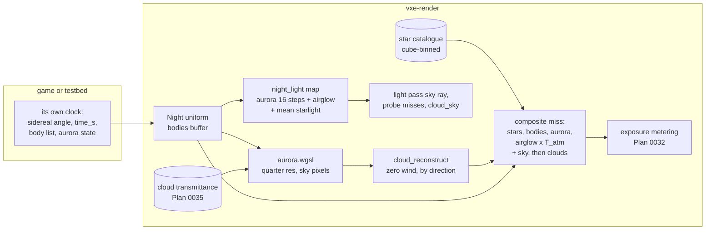

# 0037: The night sky: a star field, the moon's phases, sky bodies the game lists, and an aurora that lights the ground

> **Status:** draft
> **Created:** 2026-10-22
> **Milestone:** M10: Outdoors in [`docs/roadmap.md`](../roadmap.md)
> **Related ADRs:** [ADR-0032](../adrs/0032-night-sky-drawn-analytically-on-miss-pixels-with-a-marched-aurora-shell.md)
> (proposed with this plan: stars as a binned catalogue splatted by flux, sky bodies as a list,
> the aurora as a marched shell lighting through a hemisphere map, and the rejected skybox,
> 2D aurora, voxel bodies and hashed stars),
> [ADR-0026](../adrs/0026-atmosphere-from-hillaire-luts-built-on-the-gpu-at-runtime.md) (the
> transmittance and sky-view LUTs),
> [ADR-0027](../adrs/0027-the-sun-shadow-is-one-per-pixel-ray-in-the-light-pass.md) (the
> moon as the key light, unchanged here),
> [ADR-0030](../adrs/0030-volumetric-cloud-shell-amortised-march-and-projected-shadow-map.md)
> (the cloud buffer over the night terms, the update modes and reconstruction the aurora
> reuses), [ADR-0023](../adrs/0023-indirect-light-from-a-scrolling-probe-volume.md) (the
> probes whose misses read the night light)
> **Source:** the owner's question of 2026-10-22 about a comet and northern lights at night,
> and the orchestrator's analysis given to the owner the same day; the outdoor batch's
> standing answers (outdoors is a general engine capability; the game sets time; the engine
> reads no clock; every toggle shows its mode in the window; readings on both adapters).
> **Starts after:** [Plan 0032](0032-sun-and-sky-hillaire-atmosphere-time-of-day-and-an-outdoor-testbed.md)
> and [Plan 0035](0035-aerial-perspective-and-volumetric-clouds-with-cloud-shadows.md) close.
> Drafted against their approved text (`Sky`, `Body`, `body_direction`, `sky.wgsl`'s
> `sky_radiance` and `transmittance`, the disc draw, `Exposure`, the sky ray beyond the
> probes; `Clouds`, `CloudUpdate`, `cloud_reconstruct.wgsl`, `cloud_sky`, the composite's
> `media` section) and Plan 0024's composite on main (`composite.wgsl`, `display()`,
> `hud::Modes`). The names dev finds in the tree win.

## TL;DR

The night gets a sky worth looking at. A seeded star catalogue of 9000 stars to magnitude 6.5
(or one the game supplies) turns with the time of day and the latitude, dims and reddens
toward the horizon, twinkles there if asked, and hides behind clouds and the moon. Each star
is drawn by its flux, so it neither flickers with the jitter nor changes with the resolution.
The moon shows its phases with Lommel-Seeliger shading, and a helper gives its brightness per
phase. The game lists up to 64 sky bodies each frame: direction, size, brightness, a flat or
sunlit look, an optional texture and an optional tail. A comet's tail points away from the
sun, and a meteor's trail runs where the game says. An aurora of curtains 90 to 320 km up,
animated by the game's time, is marched at quarter resolution on sky pixels. Its glow lights
the ground through the probes and the sky ray. All of it is off by default and costs nothing
off. The first thing a reader sees is Phase 1's headless golden of an empty world's night sky
full of stars around the celestial pole, and a test that counts exactly 9 stars brighter
than magnitude 0.5 and 900 brighter than 4.5 for seed 1.

## Context & problem

After the outdoor batch (Plans 0032 to 0036) a miss pixel at night shows the sky-view LUT,
which holds the moon's in-scattering, plus the moon's flat disc, under clouds. Nothing draws
stars, an aurora or any other object. Plan 0032 lists "stars, a moon phase shape" under "does
NOT do" and leaves them to a night-sky plan. **Moon phases are therefore this plan's.**
(Plan 0035's own "does NOT do" list attributes stars to Plan 0032. That is a slip in its
text. Neither plan builds them.)

The first consumer is underground (`project-context.md`) and sets the sky off; it must see no
change. Outdoors is a general engine capability (owner, 2026-10-22). The engine offers
mechanisms and names no game concept: "comet" and "meteor" are testbed presets of one body
primitive.

Facts the design rests on:

- **Units.** Plan 0032 puts the sun's top-of-atmosphere illuminance near 3000 frame units
  (a guess the owner tunes) for about 127 500 lux. A magnitude-0 star gives about 2.54e-6
  lux, so in frame units about `3000 x 2.54e-6 / 127 500 = 5.98e-8`. Plan 0032's testbed
  moon is `E_sun / 400 000 = 7.5e-3`.
- **A star in a pixel.** At 720p internal (Plan 0030's scale 1.5 for 1080p output) with a 90
  degree field, an internal pixel is `(pi/2) / 1280 = 1.227e-3` rad wide, or `1.506e-6` sr.
  If 30 % of a magnitude-0 star's flux lands in its brightest pixel, that pixel's radiance is
  `5.98e-8 x 0.3 / 1.506e-6 = 0.0119`. Under Plan 0032's auto exposure at its `max` of 4.0
  (a moonless night pins there) and the ACES curve with the 1/2.2 gamma, magnitudes -1, 0, 1,
  2, 3, 4, 5 and 6 read about 111, 60, 31, 17, 10, 6, 4 and 3 of 255 on a black sky. At
  physical brightness the eye gets stars to about magnitude 4 to 5 on screen. `Night::star_gain`
  is there for a game that wants more.
- **Jitter and the upscaler.** Plan 0030 jitters every ray by a sub-pixel offset per frame
  and takes miss pixels with no history. A star sampled at a point flickers. A star whose
  flux is integrated over the pixel's box does not, because every pixel shares the jitter, so
  the boxes tile the screen and the flux in them sums to the star's at any offset.
- **Real star counts.** The sky holds about 9100 stars to magnitude 6.5, about 900 to 4.5,
  about 90 to 2.5 and about 9 to 0.5. The count rises close to `10^(0.5 m)`, which is the
  seeded field's law below.
- **Aurora geometry.** Curtains are about 1 km thick and hundreds of km long, with a sharp
  lower border near 100 km, green emission (557.7 nm) above it, and red (630.0 nm) from about
  180 to 300 km. With Plan 0032's ground radius `R = 6360 km`, a ray from the ground meets a
  shell from 90 to 320 km at these distances: straight up from 90 to 320 km (path 230 km); at
  30 degrees of elevation from 176.38 to 599.58 km (423.19 km); at 10 degrees from 435.92 to
  1217.77 km (781.85 km); at 0 degrees from 1073.73 to 2042.74 km (969.01 km). A 1 km curtain
  at 150 km subtends 0.38 degrees, which is five 1080p pixels and a fifth of a sky-view LUT
  texel.
- **The moon's phases.** A Lommel-Seeliger sphere (Jensen et al. 2001's model for the moon)
  lit at phase angle `alpha` has disc-integrated brightness, relative to full, of
  `Phi(alpha) = 1 - sin(alpha/2) tan(alpha/2) ln(cot(alpha/4))`: 0.7440 at 45 degrees,
  0.3768 at 90, 0.1760 at 120 and 0.0453 at 150. A numerical integration over the disc
  agrees to 1e-4. The real moon falls faster because of its opposition surge. Allen's
  empirical law `m(alpha) = -12.73 + 0.026 alpha + 4e-9 alpha^4` (alpha in degrees) gives
  0.3353 of full at 45 degrees, 0.0910 at 90 and 0.0116 at 135.

`nfr.md` figures touched: §2 "Upscale, tone map, post" 1.5 ms (stars and bodies in the
composite), §2 "Headroom (entities, volumetrics, game work)" 2.1 ms (the aurora march), §2
"Lighting" 6.0 ms (one more map read per lighting-ray miss), §3 "Everything else in VRAM"
(about 9.8 MB, Data shapes), §7 time to first frame (the catalogue's generation).

## Decision

We build ADR-0032's night sky in `vxe-render`, in a new `night` module behind
`Frame::set_night(Option<Night>)`. `None` is the default, and with `None` every image is byte
for byte the same.

1. **The composite's order for a primary miss.** We start from `B = texture(d) + stars(d)`.
   Each opaque body (and the moon's disc) lays its coverage `a` over it as `B (1 - a) + L_body`.
   Additive bodies (tails, flat glows) and the aurora add on top. The airglow background adds
   last, because it sits at 90 km, in front of the moon. The sum is multiplied by the
   atmosphere's transmittance from the camera to the top along `d` (Plan 0032's
   `transmittance`), and Plan 0032's in-scattering `sky_radiance(d)` and sun disc are added.
   Plan 0035's `media` section then lays the clouds over the pixel (`L T + S`), and the
   translucent layers come after. The night terms join the miss's radiance before the
   exposure metering of Plan 0032 Phase 4, so the metering sees them.
2. **Stars.** `StarCatalogue::generate(&StarParams)` builds the seeded field on the CPU. Star
   `i` of `N` (brightest first) takes `u = (i + h_i) / N` with `h_i` a PCG hash of `(seed, i)`
   in `[0, 1)`, and magnitude `m = limit + log10(u) / slope`, clamped to `brightest`. So the
   number of stars brighter than `m` is `N 10^(slope (m - limit))` within one, by
   stratification. Directions are uniform on the sphere from two more hashes, with an
   optional fraction pulled toward a band (a galactic plane). A colour temperature is drawn
   from a stated distribution, and its colour comes from a table of blackbody colours in
   linear sRGB of unit luminance (Wyman, Sloan and Shirley 2013's fit of the CIE functions),
   desaturated by `colour_saturation`. `StarCatalogue::from_stars` takes a supplied list (for
   example, a real catalogue in right ascension, declination and magnitude). Upload sorts the
   stars into the cells of a 6 x 32 x 32 cube grid with an offsets table. The composite tests
   a miss pixel's cell and its 8 neighbours. For each star it projects the star into the
   frame, takes the fraction of a Gaussian of sigma `star_psf_px` (internal pixels) inside the
   pixel's jittered box (a product of two `erf` differences), and adds `E_star x fraction /
   Omega_pixel`. The loop is skipped where the catalogue's brightest star would be under
   1/256 of the pixel's sky radiance, so daylight costs a branch.
3. **The celestial frame.** `celestial_to_world(sidereal_angle, latitude)` returns the
   rotation from the celestial frame (+z the celestial pole, +x the zero of right ascension)
   to world axes (+x east, +y north, +z up). It agrees with Plan 0032's `body_direction`: a
   star at right ascension `ra` and declination `dec` lands at `body_direction(theta - ra,
   dec, latitude)`. The game sets the sidereal angle from its own time. The testbed uses the
   sun's hour angle at its equinox.
4. **Twinkle, airglow and the sky texture.** A star's flux is multiplied by `1 + a n(i, t)`,
   where `n` is a smooth hashed noise in `[-1, 1]` of the star's index and the game's
   `time_s`, and `a = twinkle x clamp((X - 1) / 9, 0, 1)` with the air mass `X = 1 /
   sin(elevation)`. A star at the zenith never twinkles. `Night::background` is the airglow's
   radiance. `Frame::set_sky_texture` takes an optional `rgb9e5ufloat` cube map in the
   celestial frame, scaled by `Night::texture_scale`.
5. **The moon's phases.** `BodyLook::{Flat, Lit { earthshine }}` and an optional texture
   apply to the moon (`Night::moon_look`) and to every sky body. Lit shading draws the near
   hemisphere of a sphere lit by the sun's direction, with weight `w = 2 mu0 / (mu0 + mu)`
   (Lommel-Seeliger, `mu0 = n.s`, `mu = n.v`). This is constant over the disc at full phase,
   which matches the flat disc. The radiance is normalised so that the disc's flux equals the
   body's illuminance: `L = E w / (Omega Phi(alpha))`. Earthshine adds `earthshine x E / (Omega
   Phi(alpha))` where `mu0 <= 0`, a fraction of the full disc's radiance at that phase's
   scale. `moon_phase_illuminance(full, alpha)` is Allen's law, and
   `phase_angle(sun, body)` is `pi - acos(s.m)`. The moon stays Plan 0032's light. The game
   passes the phase-scaled illuminance, and its in-scattering and directional sample follow.
6. **Sky bodies.** `Frame::set_sky_bodies(&[SkyBody])` writes up to `MAX_SKY_BODIES` (64)
   into a buffer reserved once, and returns an error beyond that. A body is a world direction,
   an angular radius, an illuminance, a look, an optional texture slot (eight 256 x 256 slots
   in one array, set by `Frame::set_body_texture`) and an optional `Tail`. A body narrower
   than half an internal pixel is splatted like a star. A tail is a fan along a great circle
   from the head: radiance `L0 exp(-s / length) exp(-(q / (width + spread s))^2)` for
   angular distance `s` along the axis and `q` across it. Its axis is `AwayFromSun` or
   `Toward(dir)`. The CPU culls the list to the bodies whose disc or tail can reach the view.
7. **The aurora.** `Aurora` is the game's per-frame state: intensity, three colours (low, high
   and edge), the shell (90 and 320 km by default), the vertical profile, the curtain field
   (a band centre in world kilometres, an azimuth, 1 to 4 curtains, their spacing and
   thickness, fold amplitude and scale, striation scale and contrast, drift and flicker
   rates), `time_s`, a seed for its 256 x 256 `rg8unorm` noise tile (generated on the CPU,
   uploaded once), the update mode, and a debug mode. Emission at a point is
   `F(x, y) P(h)`. `F` sums, over the curtains, a Gaussian of the signed distance to a line
   warped by fold noise drifting with `time_s`, times `1 - contrast + contrast r(s, t)`,
   where `r` is the striation noise along the curtain's coordinate. `P` is the green
   exponential above a sharp lower border, the red band above it, and the edge colour's thin
   fringe at the border. `aurora.wgsl` marches each texel of a buffer at half the internal
   size per axis whose 2 x 2 internal pixels hold a miss. It runs 32 steps through the shell
   segment from a blue-noise offset. At each step it integrates the curtain Gaussian along
   the step with `erf`, from the signed distances at the step's ends, so a curtain between
   two samples is still counted. The step's profile `P` is read at its point of closest
   approach to the curtain, not at its midpoint. It writes radiance and a validity bit. The march skips a
   texel where this frame's reconstructed cloud transmittance is under 0.01, or where the
   aurora's peak is under 1/256 of the sky's radiance. `CloudUpdate` and the
   `cloud_reconstruct` pass serve it with the aurora's own buffers, zero wind and the shell's
   mid distance as depth, which is a reprojection by direction. The composite upsamples it
   bilinearly with zero weight on invalid texels, on miss pixels only.
8. **Night light.** `night_light`, 128 x 64 `rgba16float` over the upper hemisphere (azimuth
   by elevation), is rebuilt every frame while a night is set. It holds the aurora marched at
   16 steps, the background, the catalogue's mean radiance (its total flux over `4 pi`, a CPU
   constant) and the sky texture's lowest useful mip, times the atmosphere's transmittance.
   It is built before the light pass. `sky_light(d)` in `sky.wgsl` is the lighting rays'
   lookup: Plan 0032's probe misses and its sky ray beyond the probes, and the secondary-ray
   miss of Plan 0034. It adds `night_light(d)` to `sky_radiance(d)`. With clouds on, Plan
   0035's `cloud_sky` march takes `sky_radiance + night_light` as its background, so clouds
   hide the aurora's light too.

We rejected a painted skybox as the whole night sky, the aurora as a textured sheet or a
sky-view LUT term, bodies as voxel models at a distance, and stars hashed per pixel with no
catalogue (ADR-0032). We also rejected putting the aurora's glow in the sky-view LUT: primary
misses read that LUT, and the aurora would show twice, once sharp and once as a blur. We
rejected an exposure model of our own here: the metering sees the night terms, and the
night's darkness is Plan 0032's `min` and `max`, with one owner question below.

## Architecture diagram



## Implementation phases

Each phase ships as its own commit. `dev` implements all phases in one session with no review
between phases. The architect reviews once at the end, in a fresh session. Every golden this
plan adds is blessed on lavapipe at 320 x 180 under the harness's floor: at most 0.1 % of
pixels differ by more than 2/255 in any channel. Each phase's test run asserts that every
existing golden stays byte-identical while `Night` is `None`. Plan 0032's and Plan 0035's
goldens pass `--night off` in `golden.rs`, so the testbed's new default leaves them alone.
The analytic tests below use a 320 x 180 frame with a 90 degree horizontal field, so the
focal length is `160 / tan(45 degrees) = 160` pixels, with jitter off unless the test names
it. "Probe dispatch" means a test-only entry point in `night.wgsl` that evaluates a shader
function over a grid and writes `f32` results to a storage buffer, as in Plan 0035 Phase 1.

### Phase 1: A seeded catalogue, the celestial frame and stars on miss pixels (walking skeleton)
- **Owner skill:** dev
- **What:** `night.rs` with `Night` (celestial rotation, `zero_mag_illuminance`, `star_gain`,
  `star_psf_px`), `StarParams`, `StarCatalogue::{generate, from_stars}`,
  `celestial_to_world`, `Frame::set_night` and `Frame::set_star_catalogue`. A white star
  colour for now. The cube binning and its offsets table. `night.wgsl` holds the cell
  mapping, `erf` (Abramowitz and Stegun 7.1.26), the box-integrated splat and the
  transmittance factor. The composite adds the stars to a miss, multiplied by
  `transmittance`, before `sky_radiance`. The fly-through gets `--night off|on` and a stars
  key (proposed `;`) cycling `stars off` and `stars on`, shown on the mode banner.
- **Files touched:** new `crates/vxe-render/src/night.rs`, new
  `crates/vxe-render/src/shaders/night.wgsl`, `composite.wgsl`, `marcher.rs` (the `Frame`
  owns the night state and its buffers), `lib.rs`, new `crates/vxe-render/tests/night.rs`,
  `apps/flythrough/src/main.rs`, `hud.rs`, `apps/flythrough/tests/golden.rs`, new golden
  `night_empty_stars.png`.
- **Done when:**
  1. **The magnitude law is exact** (CPU, no adapter). For `StarParams::default()` at seed 1
     (count 9000, limit 6.5, slope 0.5, brightest -1.5), the stars brighter than 0.5, 2.5 and
     4.5 number 9, 90 and 900, each within 1, and all 9000 are at most 6.5. Arithmetic:
     `9000 x 10^(0.5 (m - 6.5))` is 9.0, 90.0 and 900.0. Two generations with seed 1 are
     equal star for star, and seed 2 differs.
  2. **The frames agree** (CPU). For 64 seeded `(theta, latitude, ra, dec)`,
     `celestial_to_world(theta, latitude) x unit(ra, dec)` equals `body_direction(theta - ra,
     dec, latitude)` within 1e-5. At latitude 45 degrees the celestial pole lands at elevation
     45 degrees toward +y for every `theta` of 0, 90, 180 and 270 degrees.
  3. **A star lands where the geometry says** (lavapipe). Take a one-star catalogue at
     `ra = 0`, `dec = 0`, latitude 45 degrees, `theta = 0`, and the camera facing south,
     pitched up 45 degrees. The star's flux-weighted centroid is the image centre `(160, 90)`
     within 0.1 px. At `theta = 15` degrees it is the projection of `body_direction(15
     degrees, 0, 45 degrees)` within 0.1 px.
  4. **Flux is conserved at every jitter** (probe dispatch, a uniform test sky with
     transmittance 1). For a star of illuminance `E = 1e-4` at an arbitrary sub-pixel
     position, the sum of `radiance x Omega_pixel` over the 9 x 9 pixels around it equals
     `E` within 1 %, at each of the 16 Halton jitter offsets of Plan 0030 and at
     `star_psf_px` 0.6 and 1.0. The box fractions of a Gaussian tile to 1. The 1 % covers the
     pixel's solid angle taken as `cos^3(theta) / f^2` at its centre, and the 9 x 9 window's
     truncation at 4.5 px, which is `7.5 sigma` at 0.6.
  5. **No night, no change.** With `Night` `None`, every existing golden is byte-identical,
     and `frame_bytes` reads the base commit's value.
  6. **Golden.** `night_empty_stars.png` is blessed: an empty world, Plan 0032's sky with the
     sun and the moon at -45 degrees, seed 1, latitude 45 degrees, the camera facing north
     pitched up 45 degrees (the pole at the centre), manual exposure 4.0, and
     `zero_mag_illuminance` 1e-5 (a test value, so faint stars show at 320 x 180).
  7. **Banner.** The stars key changes the banner's text to `stars on` and back to
     `stars off`.

### Phase 2: The stars' look: colour, twinkle, a band, airglow and a sky texture
- **Owner skill:** dev
- **What:** the colour temperature distribution (log-uniform in 3000 to 12 000 K, a stated
  guess), the blackbody table (64 entries over 1000 to 40 000 K in log steps, built at
  startup from the Wyman, Sloan and Shirley fit, normalised to luminance 1),
  `colour_saturation` (0.6 by default, a guess), `StarBand { pole, fraction, width }` (a band star's latitude from the band's plane is
  uniform within `+-width`),
  twinkle with `time_s`, `Night::background`, `Frame::set_sky_texture` (an `rgb9e5ufloat`
  cube, face size up to 1024, with mips) and `Night::texture_scale`. The star loop's skip
  rule against the sky's radiance. The stars key gains `stars twinkle`.
- **Files touched:** `night.rs`, `night.wgsl`, `composite.wgsl`, `marcher.rs`,
  `crates/vxe-render/tests/night.rs`, `apps/flythrough/src/main.rs`, `hud.rs`.
- **Done when:**
  1. **Colour runs with temperature** (CPU). The table's 3000 K entry has `R > G > B`, the
     15 000 K entry has `B > G > R`, the 6500 K entry's largest channel is under 1.15 times
     its smallest, and each entry's luminance (Rec. 709 weights) is 1 within 1e-3.
  2. **Twinkle grows with air mass** (probe dispatch, a uniform test sky, `twinkle = 0.5`).
     A star at the zenith reads the same summed flux, bit for bit, at 32 values of `time_s`
     spaced by 0.05 s. A star at elevation 10 degrees reads a flux that differs between at
     least two of those times, and every reading lies within `E (1 +- 0.2644)`. Arithmetic:
     `X = 1 / sin(10 degrees) = 5.759`, `a = 0.5 x (5.759 - 1) / 9 = 0.2644`.
  3. **The band holds its fraction** (CPU). With `fraction = 0.3` and `width = 10` degrees,
     the stars within 10 degrees of the band's plane number at least `0.3 x 9000 = 2700`
     plus the uniform share `0.7 x 9000 x sin(10 degrees) = 1094`, less 3 % (a property
     bound on the seeded draw). The magnitude counts of Phase 1 bar 1 are unchanged.
  4. **Airglow is behind the atmosphere** (lavapipe, an empty world, the sun and the moon at
     -45 degrees, stars off). A pixel at the zenith reads `background x (0.9404, 0.8677,
     0.7623)` within 1 %, which is Plan 0032 Phase 1's zenith transmittance. A sun 45
     degrees down adds no in-scattering, by Plan 0032 Phase 2's arithmetic.
  5. **The texture turns with the sky.** On a test cube map that is black except a 3 x 3
     patch of radiance 1 around the celestial pole, at latitude 45 degrees with the camera
     north and pitched up 45 degrees, the brightest pixel lies within 1 px of the image
     centre at `theta` 0 and 90 degrees.
  6. **Daylight skips the loop.** At Plan 0032's noon the composite's output is
     byte-identical with stars on and off (the skip rule holds on every miss pixel).
  7. **Banner.** The stars key cycles `stars off`, `stars on` and `stars twinkle`.

### Phase 3: The moon's phases
- **Owner skill:** dev
- **What:** `BodyLook::{Flat, Lit { earthshine }}` with an optional `BodyTexture { slot,
  north }`, `Night::moon_look`, `Frame::set_body_texture(slot, &[u8])` (256 x 256
  `rgba8unorm-srgb`, eight slots in one array with mips, allocated on the first call),
  `moon_phase_illuminance`, `phase_angle`, and the Lit disc in Plan 0032's disc function with
  `Phi(alpha)` in closed form. A guard draws earthshine only when `Phi < 1e-4`. The moon's
  disc coverage hides the stars and the texture behind it. In the fly-through, the testbed's
  moon sits at the sun's hour angle plus `180 - phase` degrees. `--moon-phase DEG` (default
  0, full) and a moon key (proposed backquote) step the phase by 45 degrees. The testbed
  passes `moon_phase_illuminance(E_sun / 400 000, alpha)` as the moon's illuminance and
  `Lit { earthshine: 0.002 }` (a guess).
- **Files touched:** `night.rs`, `night.wgsl`, `sky.wgsl` (the disc function), `sky.rs`,
  `composite.wgsl`, `marcher.rs`, `crates/vxe-render/tests/night.rs`, new
  `apps/flythrough/src/night.rs` (the testbed's moon and, later, its presets),
  `apps/flythrough/src/main.rs`, `hud.rs`.
- **Done when:**
  1. **The helpers' numbers** (CPU). `moon_phase_illuminance(1, 90 degrees)` is 0.0910
     within 0.5 %, and at 0 degrees it is exactly 1. `phase_angle` of opposite directions is
     0, and of equal directions is `pi`.
  2. **Lit equals flat at full** (probe dispatch, a test moon of angular radius 5 degrees at
     the image centre, `f tan(5 degrees) = 14.0` px). At phase 0, every pixel of the Lit disc
     equals the Flat disc's within 1e-5 relative.
  3. **The disc's flux is the body's illuminance.** At phases 45, 90 and 120 degrees with
     earthshine 0, the sum of `radiance x Omega_pixel` over the disc equals `E` within 2 %,
     because the normalisation by `Phi` holds.
  4. **The terminator.** At phase 90 degrees with the sun to the right of the moon as seen,
     every pixel whose centre is inside the disc and right of its centre column reads above
     0, and every one left of it reads exactly 0 with earthshine 0, or `0.002 E / (0.3768
     Omega)` within 1 % with earthshine 0.002 (`Phi(90 degrees) = 0.3768`).
  5. **The moon hides the stars.** With a star placed behind the disc's centre, the centre
     pixel reads the same with the star in the catalogue and without it.
  6. **Banner.** The moon key steps the banner's `moon phase 0` to `moon phase 45` and on to
     `moon phase 315`, then back to 0.

### Phase 4: Sky bodies and their tails
- **Owner skill:** dev
- **What:** `SkyBody`, `Tail`, `TailAxis::{AwayFromSun, Toward}`, `Frame::set_sky_bodies`
  with its capacity error, the CPU cull, the body loop in the composite (the opaque looks
  over the stars, the additive ones added), the splat path for sub-pixel bodies, and the
  tail fan. In the fly-through, `apps/flythrough/src/night.rs` gains two presets. The
  `comet` preset is a head of angular radius 0.05 degrees and a tail of length 12 degrees
  away from the sun, placed by the testbed above the western horizon. The `meteors` preset
  is a seeded schedule in the testbed's own time: a radiant, a start every 2 to 8 s, 0.3 to
  1.0 s lives, 10 to 30 degrees per second away from the radiant, and a trail `Toward` the
  radiant. A bodies key (proposed backslash) cycles `sky bodies none`, `comet` and
  `meteors`.
- **Files touched:** `night.rs`, `night.wgsl`, `composite.wgsl`, `marcher.rs`,
  `crates/vxe-render/tests/night.rs`, `apps/flythrough/src/night.rs`, `main.rs`, `hud.rs`,
  `apps/flythrough/tests/golden.rs`, new golden `dusk_comet.png`.
- **Done when:** (probe dispatch or lavapipe readback of pre-display radiance, a uniform test
  sky with transmittance 1, jitter off)
  1. **Size and place.** A Flat body of angular radius 2 degrees at the image centre covers
     an area (the sum of its edge coverage over the pixels) of 98.07 px within 2 %.
     Arithmetic: `r = 160 tan(2 degrees) = 5.587` px, `pi r^2 = 98.07`. The same body at
     azimuth 20 degrees right of the view axis on the horizon has its coverage centroid at
     x = 218.24 within 0.25 px (`160 + 160 tan(20 degrees)`), y = 90 within 0.1 px, and an
     area of `98.07 / cos^3(20 degrees) = 118.2` px within 3 %.
  2. **A tail points away from the sun.** A head at elevation 15 degrees in the view's
     centre, with the sun at the same azimuth at elevation -7 degrees, has a tail whose flux
     centroid (outside the head's disc) lies at x = 160 within 0.5 px and above the head.
     The rows below the head's centre hold under 1 % of the tail's flux. With `Toward(dir)`
     for a `dir` 30 degrees to the right of the head, the centroid lies on the projected arc
     toward it within 0.5 px.
  3. **A point-sized body is a star.** A body of radius 0.001 degrees and illuminance `E`
     reads the same summed flux as a catalogue star of the same `E` within 1 %.
  4. **Capacity.** `set_sky_bodies` with 64 bodies succeeds, and with 65 returns the error and
     leaves the previous list in place.
  5. **Golden.** `dusk_comet.png` is blessed: the outdoor source with seed 1, spawn
     `outside` facing west, 18:40 (the sun at -7.05 degrees: `sin(el) = cos(45 degrees)
     cos(100 degrees) = -0.1228`), the comet preset, stars on, moon phase 180 (new, set with
     the sun), clouds off, and auto exposure with instant adaptation.
  6. **Banner.** The bodies key cycles the three words.

### Phase 5: The aurora
- **Owner skill:** dev
- **What:** `Aurora`, `AuroraDebug::{UniformShell { emission_per_km }, Constant(L)}`, the
  noise tile, `aurora.wgsl` (the shell segment, which reuses Plan 0035's `cloud_segment`
  generalised to any two radii, the curtain field, the profile, the per-step `erf`
  integration, the skips), the quarter-resolution buffers, the update modes through
  `CloudUpdate` and `cloud_reconstruct`, and the composite's masked upsample. The pass order
  puts it after `cloud_reconstruct` and before the composite, with `aurora` and
  `aurora_reconstruct` in `FRAME_PASSES`. The testbed has three presets. `quiet` is one
  curtain, green only, peak emission 1e-4 per km. `active` is three curtains with folds,
  rays and red tops, 5e-4. `storm` is four curtains with the band overhead (the corona), the
  edge colour on and fast drift, 2e-3. All three intensities are guesses tuned at Phase 8.
  `--aurora` and an aurora key (proposed apostrophe) choose the preset, and
  `--aurora-update every|one-in-four|one-in-sixteen` chooses the update.
- **Files touched:** new `crates/vxe-render/src/shaders/aurora.wgsl`, `night.rs`,
  `night.wgsl`, `clouds.rs` and `clouds.wgsl` (the segment function shared),
  `cloud_reconstruct.wgsl` (bindable for the aurora's buffers, if it is not already),
  `composite.wgsl`, `marcher.rs`, new `crates/vxe-render/tests/aurora.rs`,
  `apps/flythrough/src/night.rs`, `main.rs`, `hud.rs`, `apps/flythrough/tests/golden.rs`,
  new golden `night_aurora.png`.
- **Done when:** (lavapipe, an empty world, the sun and the moon at -45 degrees, stars off,
  clouds off, update `Every`)
  1. **The shell's path is right.** With `UniformShell { emission_per_km: e }`, the buffer's
     texel straight up reads `230 e (0.9404, 0.8677, 0.7623)` within 1 %, and the texel at
     elevation 30 degrees reads `423.19 e (0.8844, 0.7528, 0.5811)` within 1 %. Arithmetic:
     the path lengths are from Context. The transmittance is Plan 0032's zenith value and
     `exp(-2 x (0.0614, 0.1420, 0.2714))`, whose flat-air-mass error at 60 degrees from the
     zenith is under 0.1 % (Plan 0032 Phase 5). The air above 90 km adds under 1e-4 to the
     optical depth, because `exp(-90 / 8) = 1.3e-5` of the Rayleigh column lies there.
  2. **A thin curtain is not missed.** With intensity 1, no folds and no striations, and one
     straight vertical curtain of thickness 0.5 km at 200 km north of the camera, every texel whose ray crosses the curtain's plane between 100 and
     300 km of altitude reads above 0, at 8 steps and at 32. The 8-step and 32-step readings
     of the texel at elevation 45 degrees agree within 5 %, because the `erf` integral is
     exact for a straight curtain.
  3. **Off is free.** With `Night::aurora` `None`, the frame is byte for byte the frame
     before this phase, and no aurora pass runs (the timestamp list has none).
  4. **Time is the game's.** Two frames at the same `time_s` are byte-identical, and frames
     at `time_s` 100 and 101 differ in more than 1 % of the aurora's pixels.
  5. **Clouds hide it.** Under Plan 0035's flat overcast at coverage 1 (transmittance 0),
     the march writes nothing (every texel skips), and the miss pixels equal those with the
     aurora off.
  6. **The metering sees it.** With `Constant(0.05)` and auto exposure with instant
     adaptation, the exposure settles at `0.18 / 0.05 = 3.6` within 1 % after 2 frames.
  7. **Amortised modes converge.** With a still camera on the `active` preset and `time_s`
     frozen, `OneInFour` after 64 frames is closer to `Every` than `Every`'s first frame is
     to `Every` after 64 frames, and both differences go in the log, as in Plan 0035 Phase 4.
  8. **Golden.** `night_aurora.png` is blessed: the outdoor source with seed 1, spawn
     `outside` facing north and pitched up 10 degrees, 00:00, moon phase 180, stars on,
     `active` at `time_s = 100`, update `Every`, and auto exposure with instant adaptation.
  9. **Banner.** The aurora key cycles `aurora off`, `quiet`, `active` and `storm`.

### Phase 6: Night light: the aurora and the airglow light the ground
- **Owner skill:** dev
- **What:** the `night_light` map and its pass (the `night_light` timestamp), `sky_light(d)`
  in `sky.wgsl`, and its use in the probe-ray misses, the sky ray beyond the probes, Plan
  0034's secondary-ray miss lookup (in whichever shader it lives) and the background of Plan
  0035's `cloud_sky` march.
- **Files touched:** `aurora.wgsl` (the map's entry point), `sky.wgsl`, `probe_update.wgsl`,
  `light.wgsl`, `cloud_shadow.wgsl` (the `cloud_sky` background), the liquid shader of Plan
  0034, `night.rs`, `marcher.rs`, `crates/vxe-render/tests/aurora.rs`,
  `apps/flythrough/tests/indirect.rs`.
- **Done when:** (lavapipe, Plan 0032 Phase 6's level scene of a 1024 x 1024 voxel rock floor,
  the sun and the moon at -45 degrees, lamp off, no emissive material, filter off, manual
  exposure 1.0, stars off, `UniformShell` aurora)
  1. **The map is the march.** The map's texel straight up reads Phase 5 bar 1's zenith value
     within 1 %.
  2. **The floor reads the map's cosine integral.** The test integrates the read-back map's
     radiance times `cos(theta)` over the upper hemisphere on the CPU (`E_ref`). The gathered
     indirect irradiance at the floor pixel under the camera after 256 frames is within 10 %
     of `E_ref`, and the sky-ray estimate at a floor pixel 400 voxels out after 64 frames is
     within 10 % of it. This is Plan 0032 Phase 6's `pi` test with the night's sky.
  3. **Nothing else lights it.** With the aurora off, the background 0 and stars off, the
     floor reads exactly 0.
  4. **No leak.** Plan 0032 Phase 6 bar 3's closed rock box reads under 2 % of bar 2's value
     inside, in the volume and at 400 voxels.
  5. **Clouds take the light too.** With Plan 0035's flat overcast at coverage 1, the
     gathered floor irradiance after 256 frames is under 2 % of bar 2's.
  6. **Off is free.** With `Night` `None`, the light pass's and the probes' output is byte for
     byte the base commit's.

### Phase 7: The testbed's night, the goldens and the readings on both adapters
- **Owner skill:** dev
- **What:** the outdoor source's defaults become `--night on` with stars on, the moon Lit,
  airglow `background` set to 1/100 of the full moon's sky radiance at the zenith (a guess),
  the bodies none and the aurora off. The testbed's sidereal angle is the sun's hour angle
  (an equinox). `zero_mag_illuminance` is `E_sun x 2.54e-6 / 127 500` times `--star-gain`
  (default 1). A stats HUD row shows the night passes' GPU time, the star count, the active
  bodies and the aurora preset. The autopilot prints the `aurora`, `aurora_reconstruct` and
  `night_light` timestamps, the composite's time with stars on and off, and the night's
  bytes. One golden of the moonless outdoor night, and readings.
- **Files touched:** `apps/flythrough/src/main.rs`, `apps/flythrough/src/night.rs`,
  `hud.rs`, `apps/flythrough/examples/hero.rs` (`--night`, `--aurora`, `--moon-phase`),
  `apps/flythrough/tests/golden.rs`, new golden `night_stars_moonless.png`, the root
  `README.md` (flags, keys), `docs/nfr.md` §2, §3 and §7, this plan's log.
- **Done when:**
  1. **Golden.** `night_stars_moonless.png` is blessed: the outdoor source with seed 1, spawn
     `outside` facing north and pitched up 30 degrees, 00:00, moon phase 180, stars at gain
     1, and auto exposure with instant adaptation. The test also reads the settled exposure,
     which equals `max` (4.0 at Plan 0032's testbed default, or the value its close kept),
     because a moonless sky's mean is far under `key / max`.
  2. **The four goldens differ** pairwise in more than 10 % of their pixels by more than
     8/255 (`night_empty_stars`, `dusk_comet`, `night_aurora`, `night_stars_moonless`).
  3. **The banner test** presses each night key in turn and finds each word of Phases 1 to 5
     on `Modes::line()`, and the banner empty 3 s after the last press.
  4. **Readings on both adapters** (`--adapter`, quiet box, 1920 x 1080 output at internal
     scale 1.5, median of the last 30 of 3000 frames, three runs each):
     `flythrough --source outdoor --headless --seed 1 --render 1920x1080 --internal-scale
     1.5 --frames 3000 --time 00:00 --moon-phase 180`, with `--aurora off`, `active` and
     `storm`, each update mode for `storm`, and `--clouds scattered` beside `off` for
     `active`. Each run reads `aurora`, `aurora_reconstruct`, `night_light`, the composite and
     the light pass. The same pose at `--night off` gives the composite's and the light
     pass's baseline. `--time 12:00` with the night on shows the daylight skip as a
     composite time within noise of `--night off`. The night's bytes go in `nfr.md` §3, the
     catalogue's generation time at startup in §7, and the default aurora update per adapter
     is chosen from the readings and named in the log.

### Phase 8: The owner's windowed check
- **Owner skill:** human
- **What:** the owner flies the outdoor source at night on both adapters (pinged when ready,
  batched with the other outdoor checks). They watch a moonless sky turn through the night with
  `/`, step the moon through its phases, watch the comet at dusk and the meteors, cycle the
  aurora's presets with clouds off and scattered, look straight up into a `storm` corona,
  try `--star-gain` at 1, 4 and 16, and try `--aurora-update` modes on the slow adapter.
- **Files touched:** this plan's log (dev records the verdicts), then ADR-0032's Outcome at
  the close.
- **Done when:** the owner has recorded a verdict on the stars' brightness and gain (the
  default to keep), on twinkle (on or off by default), on the stars' look in motion (no
  shimmer at scale 1.5, or the `star_psf_px` to keep), on the moon's phases and earthshine,
  on the comet and the meteors, on the aurora presets' intensities and colours, on the
  aurora's motion under the update mode each adapter keeps, on whether its glow on the
  ground reads, and on the night's darkness (open question 1); every switch's banner was
  seen on screen.

## Data shapes

```rust
// illustrative: crates/vxe-render/src/night.rs
pub struct Night {
    pub celestial_to_world: [[f32; 3]; 3], // from celestial_to_world(sidereal, latitude)
    pub time_s: f32,                        // the game's time; phases wrap through fract()
    pub zero_mag_illuminance: f32,          // frame units; a mag-0 star's illuminance
    pub star_gain: f32, pub star_psf_px: f32, pub twinkle: f32, // 1.0, 0.6, 0.0
    pub background: [f32; 3],               // airglow radiance, frame units
    pub texture_scale: [f32; 3],
    pub moon_look: BodyLook,                // Flat keeps Plan 0032's disc
    pub moon_texture: Option<BodyTexture>,
    pub aurora: Option<Aurora>,
}
pub struct StarParams { pub seed: u32, pub count: u32, pub limit: f32, pub slope: f32,
    pub brightest: f32, pub temperature_k: [f32; 2], pub colour_saturation: f32,
    pub band: Option<StarBand> }            // 9000, 6.5, 0.5, -1.5, [3000, 12000], 0.6
pub struct Star { pub ra: f32, pub dec: f32, pub magnitude: f32, pub temperature_k: f32 }
pub enum BodyLook { Flat, Lit { earthshine: f32 } }
pub struct BodyTexture { pub slot: u8, pub north: [f32; 3] }
pub struct SkyBody { pub direction: [f32; 3], pub angular_radius: f32,
    pub illuminance: [f32; 3], pub look: BodyLook, pub texture: Option<BodyTexture>,
    pub tail: Option<Tail> }
pub struct Tail { pub axis: TailAxis, pub radiance: [f32; 3], pub length: f32,
    pub width: f32, pub spread: f32 }      // angles in radians
pub enum TailAxis { AwayFromSun, Toward([f32; 3]) }
pub struct Aurora { pub seed: u32, pub intensity: f32,
    pub colour_low: [f32; 3], pub colour_high: [f32; 3], pub colour_edge: [f32; 3],
    pub bottom_km: f32, pub top_km: f32, pub green_scale_km: f32, pub high_weight: f32,
    pub edge_weight: f32, pub band_centre_km: [f32; 2], pub band_azimuth: f32,
    pub curtains: u32, pub spacing_km: f32, pub thickness_km: f32,
    pub fold_amplitude_km: f32, pub fold_scale_km: f32, pub ray_scale_km: f32,
    pub ray_contrast: f32, pub drift_km_s: f32, pub flicker_hz: f32,
    pub time_s: f32, pub update: CloudUpdate, pub debug: Option<AuroraDebug> }
pub const MAX_SKY_BODIES: usize = 64;
pub fn celestial_to_world(sidereal_angle: f32, latitude: f32) -> [[f32; 3]; 3];
pub fn moon_phase_illuminance(full: [f32; 3], phase_angle: f32) -> [f32; 3];
pub fn phase_angle(sun: [f32; 3], body: [f32; 3]) -> f32;
// Frame::set_night(Option<Night>), set_star_catalogue(Option<&StarCatalogue>),
// set_sky_bodies(&[SkyBody]) -> Result<(), SkyBodiesFull>,
// set_body_texture(slot, &[u8]), set_sky_texture(Option<SkyTexture<'_>>)
```

`Night` and `Aurora` are plain `Copy` values, and the per-frame setters take values and
slices, so the game allocates nothing per frame. `GpuStar` is 32 bytes: the direction (12), the flux
relative to magnitude 0 (4), the colour as three `f16` (8, with 2 bytes spare) and the index
for the twinkle hash (4), plus 4 bytes of padding. `GpuBody` is 96 bytes in six 16-byte rows.

GPU resources, sizes worked out (1080p internal as the worst case; at 720p internal the
aurora rows shrink to 4/9):

| resource | format | size | bytes |
|---|---|---|---|
| star catalogue, default | storage, `GpuStar` | 9000 x 32 B | 288 000 |
| star cell offsets | storage `u32` | 6 x 32 x 32 + 1 | 24 580 |
| sky bodies | storage, `GpuBody` | 64 x 96 B | 6 144 |
| aurora noise tile | `rg8unorm` | 256 x 256 | 131 072 |
| aurora history | `rgba16float` | 960 x 540, two copies | 8 294 400 |
| aurora marched samples (amortised modes) | `rgba16float` | 480 x 270 | 1 036 800 |
| `night_light` | `rgba16float` | 128 x 64 | 65 536 |
| night uniform | uniform | one block | under 256 |

The default total is 9 846 788 B, about 9.8 MB (4.7 MB at 720p internal). These are optional
and allocated on their first set:

| resource | format | size | bytes |
|---|---|---|---|
| body textures | `rgba8unorm-srgb` array with mips | 8 x 256 x 256 | 2 796 192 |
| sky texture, face 512 | `rgb9e5ufloat` cube with mips | 6 x 512 x 512 | 8 388 600 |
| sky texture, face 1024 (the cap) | the same | 6 x 1024 x 1024 | 33 554 424 |
| a catalogue at the cap `MAX_STARS` 65 536 | storage | 65 536 x 32 B | 2 097 152 |

## Budgets

| `nfr.md` figure | line | projection (guesses: dev box, 1080p output at 720p internal, an all-sky night view) | how the close measures it |
|---|---|---|---|
| §2 Upscale, tone map, post | 1.5 ms | composite with stars and bodies: +0.05 to 0.15 ms on NVIDIA (about 13 star tests per miss pixel); the slow adapter about eight times that. In daylight, a branch | Phase 7's runs, the composite's timestamp with the night on against `--night off`, at 00:00 and 12:00, both adapters |
| §2 Headroom (volumetrics) | 2.1 ms, shared with Plan 0035's clouds | aurora `Every` at quarter resolution, 230 400 rays of 32 steps: 0.2 to 0.5 ms on NVIDIA; `night_light` under 0.05 ms; the slow adapter eight times the march, 1.6 to 4 ms, so `OneInFour` (a quarter of that) is its candidate. Zero with the aurora off, and near zero under overcast | `aurora`, `aurora_reconstruct` and `night_light` timestamps, Phase 7's runs, every update mode |
| §2 Lighting | 6.0 ms | one bilinear `night_light` read per lighting-ray miss, under 0.05 ms | the light pass's timestamp, night on against off, same pose |
| §3 Everything else in VRAM | 1.5 GB | 9.8 MB at 1080p internal by default, plus the optional textures (table) | `Frame::frame_bytes` printed by the autopilot |
| §7 Time to first frame | 3 s | 9000 stars generated and binned on the CPU, under 5 ms (a guess) | the autopilot's startup timers, night on against off, both adapters |

This plan proposes that the night sky (aurora, `night_light` and the composite's star and
body share) take at most 0.3 ms of the floor's headroom on an all-sky view. That fits beside
Plan 0035's proposed 1.0 ms for clouds and aerial perspective. The floor projects two to three
times the dev box (the card is not on hand), so the NVIDIA reading must stay under about 0.1
to 0.15 ms for the projection to meet it. That likely makes `OneInFour` the aurora's default
on every adapter, which Phase 7 decides from the readings. The slow adapter's reading is
recorded against the line, not gated. A miss is recorded with the profile measured.

## Risks & open questions

1. **Owner question: how dark is the night?** At physical brightness and Plan 0032's
   testbed `max` exposure of 4.0, a moonless landscape is black, the stars read to about
   magnitude 4 to 5, and a moonlit one is dim. The options, recommended first:
   (a) keep Plan 0032's model, and tune `max`, `star_gain` and the airglow `background` at
   Phase 8. This adds nothing, and the game owns the look.
   (b) a low-light key in `exposure.wgsl`: the key falls with the scene's mean luminance
   (Krawczyk, Myszkowski and Seidel 2005, "Lightness Perception in Tone Reproduction for High
   Dynamic Range Images"), so the night stays darker than the day without a hard clamp. This
   changes every auto-exposure frame, so it is its own small plan with an ADR.
   (c) a scotopic tint (a blue shift and desaturation below a luminance), the classic "night
   look". It is a post effect and also its own plan.
2. **Shimmer through the upscaler.** Flux is conserved at the composite, but Plan 0030's
   upscale rebuilds miss pixels from one frame of jittered samples through a Lanczos kernel,
   so a star's output can wobble. Phase 7 logs a still camera's frame-to-frame spread of a
   magnitude-1 star's summed output over a 9 x 9 output window, at `star_psf_px` 0.6 and
   0.25. The property is that the wider point-spread function wobbles less. Phase 8 judges
   it by eye. The followup is reprojection of misses by direction in Plan 0030's upscale
   pass, already a followup of Plan 0032.
3. **Aurora intensities are units by convention.** The presets' emission figures are
   guesses in frame units. Real displays span two to three orders of magnitude, and
   the game sets them.
4. **The aurora's light lags.** Probe hysteresis (0.97) and `cloud_sky`'s one-eighth refresh
   smooth a pulsing display's light over about 30 frames. This is acceptable for a glow, and
   Phase 8 judges it.
5. **Keys.** The proposals are `;` (stars), backquote (the moon), backslash (bodies) and
   apostrophe (the aurora), from the keys unbound on main today. Plans 0033 and 0035 let dev
   pick keys too. If a plan merged earlier took one of these, dev picks a free key and the
   README says which. The banner, not the key, is the contract.
6. **Stars through translucent layers and water.** A primary ray through glass that then
   misses shows the stars through the layer, as the sky does. Plan 0034's reflection and
   refraction misses get `sky_light(d)` (the aurora's glow and the airglow), not the star
   splat. Stars reflected in a calm lake are a followup.
7. **Precision of time.** `time_s` is `f32` and enters only through `fract`-wrapped phases.
   At 86 400 s its step is 7.8 ms, which is fine for visuals. A game that runs for days
   wraps it.
8. **Plan 0035's names.** `cloud_segment`, `cloud_reconstruct`, `CloudUpdate` and `cloud_sky`
   are approved names, not code. If the reconstruction cannot be bound to the aurora's
   buffers, dev factors its reprojection into a shared WGSL function and logs it.
9. **Determinism.** Nothing touches `vxe-world`. The catalogue is generated on the CPU from
   integer hashes with `f64` arithmetic and pinned by its counts, not by bytes across
   platforms. A game that needs a star's or the moon's direction in server logic computes it
   there from its own ticks with the same formulas.
10. **Adapter features.** `rgb9e5ufloat` is a sampled format in WebGPU core. Storage
   textures are `rgba16float`, as in Plans 0032 and 0035. There are no subgroups, no 64-bit
   atomics and no binding arrays: the body textures are one 2D array texture.

## What this plan does NOT do

- **Plan 0032:** the atmosphere, the sun and the moon as lights, the exposure model and
  `body_direction`. This plan draws the moon's phase shape and gives the phase's
  illuminance as a helper. The game still sets the moon's light.
- **Plan 0033:** the far field. Bodies, stars and the aurora show on misses only, so far
  terrain hides them like near terrain.
- **Plan 0034:** stars reflected or refracted in water (a followup). Its misses get the night
  light only.
- **Plan 0035:** the clouds, their buffers, the aerial perspective and the media rule. This
  plan lays the night terms under them and reuses the update modes.
- **Plan 0036:** weather and lightning. Rain and snow over a starry sky are composited by
  that plan's own passes.
- Light from sky bodies (a bright comet or a second moon casts no light or shadow; a game
  that needs a second key light asks for it in a later plan), eclipses, in-scattering of the
  aurora's glow in the lower atmosphere, the zodiacal light, planets' own ephemerides (the
  game computes directions), motion blur of meteors, a scotopic tint or a low-light exposure
  key (open question 1), and any server-side or deterministic sky state.

References worth an annotated entry in `docs/references/` (not added by this plan): Jensen,
Durand, Stark, Premoze, Dorsey and Shirley, "A Physically-Based Night Sky Model" (SIGGRAPH
2001), for stars, the moon's Lommel-Seeliger shading and airglow; Lawlor and Genetti,
"Interactive Volume Rendering Aurora on the GPU" (Journal of WSCG, 2011); Baranoski, Rokne,
Shirley, Trondsen and Bastos, "Simulating the Aurora" (Journal of Visualization and Computer
Animation, 2003); Wyman, Sloan and Shirley, "Simple Analytic Approximations to the CIE XYZ
Color Matching Functions" (JCGT, 2013); Allen's Astrophysical Quantities, for the lunar phase
law and the zero-magnitude illuminance; Krawczyk, Myszkowski and Seidel (2005), for open
question 1.

## Implementation log

> Written by `dev`: one row per phase as its commit lands, then the close block. **The phases
> above are the contract. This section records what happened.** Observations, never conclusions:
> no pass list, no self-assessment. Deviations and unmet done-whens are **always** disclosed.
> Keep it shorter than `## Implementation phases`.

| phase | owner | state | commit |
|---|---|---|---|
| 1: A seeded catalogue, the celestial frame and stars on miss pixels | dev | not started | |
| 2: The stars' look: colour, twinkle, a band, airglow and a sky texture | dev | not started | |
| 3: The moon's phases | dev | not started | |
| 4: Sky bodies and their tails | dev | not started | |
| 5: The aurora | dev | not started | |
| 6: Night light: the aurora and the airglow light the ground | dev | not started | |
| 7: The testbed's night, the goldens and the readings on both adapters | dev | not started | |
| 8: The owner's windowed check | human | not started | |

### Notes

_(Deviations from the plan, with the commit, stated without justification. Done-whens not
satisfiable as stated, and what was done instead. Followups noticed and not acted on. One line
each. Empty is fine.)_

### Close triggers

_(Facts for the architect. No recommendations, and no suggested version bump.)_

- **What shipped:** feature / fix-only / docs-chore-only
- **Public API changed:** types, traits, functions, shader interfaces, config (list them, or none)
- **Budget readings:** each `nfr.md` figure touched, with its measured value, machine and commit
- **Gate at the tip:** the commands run (build, nextest, doctests, clippy, fmt, deny), exit codes, test counts
- **Outstanding `human` phases:** which, or none

## Followups

- Stars and bodies in calm-water reflections (Plan 0034's reflection ray with the splat at the
  reflected footprint).
- Reprojection of miss pixels by direction in Plan 0030's upscaler, shared with Plan 0032's
  followup, if Phase 8 sees stars shimmer.
- Open question 1's low-light key or scotopic tint, if the owner picks (b) or (c).
