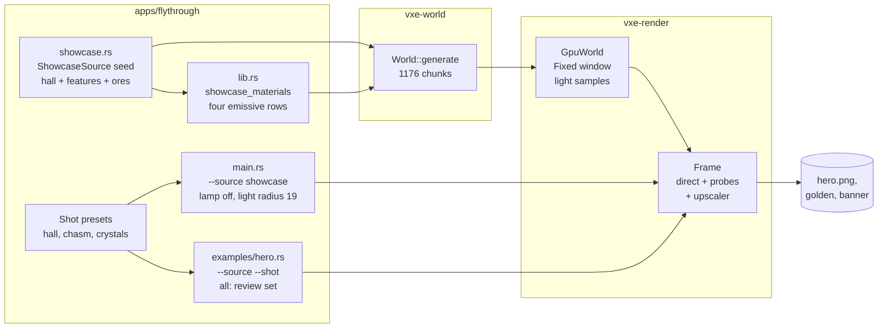

# 0038: A showcase cavern lit by four ores, and a hero still with named shots and no headlamp

> **Status:** in-progress (2026-10-27)
> **Decisions:** Owner, 2026-10-22: hall 72 x 58 x 24 m as planned with probe spacing settled from the review renders; ore palette as planned; shots hall, chasm and crystals with `hall` the default; everything stays diggable (no SHELL bridge or pillars).
> **Created:** 2026-10-22
> **Milestone:** M2 in `docs/roadmap.md` (testbed content: the hero and demos show M2's
> lighting; no engine work)
> **Related ADRs:** none. The plan uses what
> [ADR-0018](../adrs/0018-direct-light-per-pixel-one-sample-from-a-hit-buffer-with-svgf-history-killed-by-edits.md)
> (direct light from emissive samples),
> [ADR-0023](../adrs/0023-indirect-light-from-a-scrolling-probe-volume.md) (the probe volume)
> and [ADR-0024](../adrs/0024-own-temporal-upscaler-on-the-hit-buffer.md) (the upscaler)
> already decided.
> **Source:** Plan 0024's Followups ("A showcase cave for the hero and demos", owner,
> 2026-10-20); Plan 0029's Followups; the owner, 2026-10-22: "hero image is lame, we should
> make something more interesting and without a head lump [the headlamp], in a large cave."
> **Starts after:** Plans 0029 (indirect light) and 0030 (the upscaler and its default scale)
> merge into main. The cave reads by the veins' bounce light, so the hero is shot with both
> on. If Plan 0032 has merged first, this plan adds `showcase` to its `--source` list; if
> not, this plan adds `--source cave|level|showcase` in the shape Plan 0032 specifies
> (`--level` stays as `--source level`), and Plan 0032 adds `outdoor` to it. The names dev
> finds in the tree win over the names here.

## TL;DR

The testbed gains a third world source, `--source showcase`: one bounded hall about 72 m long,
58 m wide and 24 m tall under a domed roof. It has five pillars, stalactites and stalagmites,
two ledges, a 10 m deep chasm and a natural stone bridge over it. Four emissive ores light it
from four sides: warm amber veins in the west walls, cyan crystal clusters on the east floor,
dim violet veins in the dome, and deep red ember lining the chasm. All of it is integer and
hashed from the seed. The headlamp is off by default in this source and in the `hero` example.
`hero` gains named camera presets (`--shot hall|chasm|crystals`, or `all` for a review set).
The owner picks one, and `docs/images/hero.png` is re-shot from it at 1920x1080 with indirect
light and the upscaler at their defaults. The first thing a reader sees is the yellow banner
reading `source showcase ... lamp off` over a dark hall lit by four colours of ore.

## Context & problem

Today's hero (`docs/images/hero.png`, 1600x900) is a passage in the bounded level, lit mostly
by the headlamp's cone with one orange vein. The owner calls it lame. The headlamp makes a
bright lump in the middle of the frame, and a 3 m passage shows neither the engine's reach
(a large open volume, long rays) nor its lighting (several coloured emitters, bounce light,
soft shadows). The consumer's dark cave (`project-context.md`, Rendering: "dark scenes with few
lights; emissive voxels as runtime-changeable lights") is what M2 built. A still that shows it
needs a scene made for it. The noise cave cannot be framed reliably, because its caverns are
wherever the seed puts them.

The constraints that set the sizes:

- **The probe volume** (Plan 0029) is 32 probes at 1.6 m spacing, 51.2 m on a side and centred
  on the camera. Anything more than 25.6 m from the eye gets no indirect light at the default
  spacing. `--probe-spacing 32` (3.2 m) covers 102.4 m at the cost of leaking more.
- **The light radius** (`MirrorConfig::light_radius`, default 4 chunks, 25.6 m) limits which
  emitters light the frame. The cost of a larger radius is the samples held, not the samples
  drawn per pixel. The extent below is 14 x 12 x 7 chunks, so its farthest pair of chunks is
  `sqrt(13^2 + 11^2 + 6^2) = 18.06` chunks apart. A radius of 19 keeps every emitter of the
  hall in the buffer from any eye.
- **The light-sample buffer** reserves 1 048 576 samples, and one chunk keeps at most 8192
  (`DEFAULT_LIGHT_CHUNK_CAP`; above that it subsamples). The level holds 417 388 (`nfr.md`
  §2).
- **The bounded path's mirror** is sized from the world it loads (`level_mirror_budget`). The
  level's 383 608 `Full` bricks over 3200 chunks are the largest bounded world the testbed
  ships (207 681 088 B mirror before Plan 0028, `nfr.md` §3).
- **Time to first frame** is under 3 s on the dev reference (`nfr.md` §7). The level reads 1.1
  to 2.3 s.

## Decision

We add `apps/flythrough/src/showcase.rs` beside `cave.rs`. It holds `ShowcaseSource { seed }`,
a `WorldSource` over a fixed 14 x 12 x 7 chunk extent. Its geometry is an integer half-ellipsoid
hall over a noisy floor. Its features (pillars, cones, crystal capsules, ledges, the chasm and
the bridge) are a list built once from `hash3(seed, ...)` with rejection rules and bucketed by
the bricks their bounding boxes touch. A brick that no feature touches and whose corners prove
it uniform is emitted without per-voxel work, as `CaveSource::brick` does. The material table is
`look_materials()` with three emissive rows appended, and amber is the existing `ore` row.
Floats live in `lib.rs`, so `showcase.rs` stays integer-only like `cave.rs`. The fly-through
runs the showcase on the bounded path the level uses (digging, walking, the coarse grid and
collapse all apply) with the lamp off and the light radius at 19. The `hero` example takes
`--source`, `--shot`, `--indirect`, `--probe-spacing` and the upscaler's scale flag, and
defaults to the showcase with the lamp off.

We rejected re-framing the noise cave, because no seed is guaranteed to give a large hall, and
a tuned seed breaks when the noise changes. We rejected a `.vox` scene through `vxe-assets`,
because a hand-modelled hall at 10 cm is about 700 x 600 x 300 voxels: past MagicaVoxel's 256
edge, and not seeded. We rejected streaming the showcase unbounded, because the hall is one
fixed room and the bounded path already sizes its mirror from its world.

## Architecture diagram



## The hall, worked

The voxel unit is 10 cm. The extent is `ChunkExtent::new([0,0,0], [14,12,7])`, which is 896 x
768 x 448 voxels (89.6 x 76.8 x 44.8 m) and 1176 chunks. It is wrapped in the 2-voxel `SHELL`,
as the bounded cave is.

| Part | Rule (integer, `i64`) | Size |
|---|---|---|
| Hall | air where `z > floor(x,y)` and `q <= K + n(p)`, with `q = dx^2 K / a^2 + dy^2 K / b^2 + dz^2 K / c^2`, `K = 1 << 16`, centre `(448, 384)`, `dz = z - 128`, `a = 360`, `b = 288`, `c = 240`; `n` is value noise at cell 32 scaled to `±K/4` | 72 x 57.6 m footprint, dome apex at z 368 (24 m above the floor). The noise moves the wall by at most `sqrt(1.25) = 1.118` of the radius, so x lies in 46..850, y in 62..706 and the apex at most z 396: 50 voxels of rock under the shell |
| Floor | `floor(x,y) = 128 + f(x,y)`, `f` value noise at cell 64, `±16` voxels | ±1.6 m undulation |
| Chasm | air for `z >= 32` where `|x - 598 - w(y)| <= 25` inside the hall's footprint, `w` noise at cell 64, `±13`, so chasm air lies in x 560..636 | 5 m wide, 9.6 m deep, about 52 m long across the hall |
| Bridge | rock for `z <= 128` in `y` 364..404 and `|x - 598| <= 40`, above a half-ellipse underside with its crown at z 116 and its springing at z 86 | a 4 m wide natural arch at floor level, 8 m span |
| Pillars | 5, axis hashed with `q_xy <= 0.6 K`, at least 8 m apart and 3 m from the chasm; radius 20..40 voxels at the ends, 0.6 of that at mid-height (`dx^2 + dy^2 <= r(z)^2`) | 2 to 4 m thick, floor to roof |
| Cones | one per 64-voxel floor cell whose centre has `q_xy <= 0.8 K`: a stalactite with probability 1/2 (base radius 6..14, length 40..120 from the noiseless dome height), a stalagmite with probability 1/3 off the chasm (base 6..14, length 20..60); a cone keeps 1 m clear of every pillar; centre jittered in `[r, 64 - r]` so a cone stays in its cell | about 64 cells: about 32 stalactites and 21 stalagmites |
| Ledges | two shelves 12 voxels thick that project 30..50 voxels from the wall over a 90 degree arc: west at z 188, north at z 248 | 1.2 m slabs, 3 to 5 m deep |

Every feature keeps a 4 m clearance from each shot's eye, and crystal voxels keep 2 m. The
shots' eyes sit where `q <= 0.75 K`, so the wall noise (`n >= -K/4`) cannot reach them.

**The ores.** Each ore is a material in rock that borders air, inside its zone:

| Ore (id) | Where | Emission (radiance, linear) | Luma (Rec. 709) | Exposed voxels, projected | Bar |
|---|---|---|---|---|---|
| amber (`ORE`, 2, the existing row) | vein noise at cell 16 in rock of the west half (`dx < 0`) below the dome's top third | `ORE_EMISSION` `[1.6, 0.9, 0.35]` | 1.01 | dome 5475 m² (Thomsen's ellipsoid area, half), less the cap, over 2 = 1825 m², times 100 voxels per m², times 8 % coverage = 14 600 | >= 3000 |
| crystal (5) | 8 clusters of 3..6 capsules (radius 2..4, length 16..36, hashed tilt) on the floor at `x >= 690` and `q_xy <= 0.7 K`, at least 3 m apart | `[0.35, 1.6, 2.0]` | 1.36 | 8 x 4.5 x `2 pi 3 26` x 1.2 = 21 170 | >= 5000 |
| amethyst (6) | vein noise at cell 16 in the dome above `dz >= 2c/3` (the top third of a dome holds a third of its area) | `[0.6, 0.2, 1.1]` | 0.35 | 5475 / 3 = 1825 m², times 100 per m², times 8 % = 14 600 | >= 3000 |
| ember (7) | vein noise at cell 16, 25 % coverage, in rock within 3 voxels of chasm air below z 128 | `[2.4, 0.3, 0.08]` | 0.73 | walls 2 x 52 x 9.6 + floor 5 x 52 = 1258 m², times 100 per m², times 25 % = 31 450 | >= 7000 |

Each bar is a quarter of its projection rounded down to a thousand, because value noise's
coverage at a threshold is tuned, not derived. The four together
are about 81 800 samples, under a fifth of the level's 417 388 and 7.8 % of the buffer.

**Per chunk.** A crystal cluster reaches at most 4 m (40 voxels) from its centre, so a cluster
lies in `x >= 650` (chunk column 10 and up). The chasm's ember (3 voxels past air at x 636) lies in `x <= 639`
(chunk column 9 and down), so the two never share a chunk. A cluster's worst case is 6 x `2 pi 4 36` x 1.2 =
6514 voxels. Clusters at least 3 m apart can still share one chunk, so the placement allows at
most one cluster per chunk: 6514 < 8192. The densest ember chunk (a 6.4 m run of chasm: walls
2 x 6.4 x 6.4 plus floor 5 x 6.4 = 114 m², times 100 per m², times 25 %) holds about 2850. No
chunk subsamples.

**Shots.** Each preset is an eye voxel, a yaw and pitch in whole degrees and an exposure in
thousandths, all integer constants in `showcase.rs`. The spawn is `hall`'s eye and pose.

| Shot | Eye | Yaw, pitch | `q / K` at the eye | Frames |
|---|---|---|---|---|
| `hall` | (190, 384, 218): 9 m over the west floor | 0, -12 | 0.514 + 0.141 = 0.654 | the amber walls behind and beside, the pillars, the chasm's red line, the crystals, the violet dome |
| `chasm` | (598, 384, 144): 1.6 m over the bridge's deck | 90, -30 | 0.174 + 0.004 = 0.178 | down the chasm's ember walls, the bridge under the eye |
| `crystals` | (720, 300, 160): 3.2 m over the east floor | 160, 18 | 0.571 + 0.085 + 0.018 = 0.674 | crystal clusters near, pillars and stalactites against the dome |

## Implementation phases

Each phase ships as its own commit. `dev` implements the phases in order in one session.
Phases 6 and 7 follow the owner's Phase 6 choices. The architect reviews once at the end, in a
fresh session.

### Phase 1: The hall on screen with the lamp off (walking skeleton)
- **Owner skill:** dev
- **What:** `ShowcaseSource` with the shell, the hall, the floor and amber veins only;
  `showcase_materials()` in `lib.rs` (`look_materials()` plus the crystal, amethyst and ember
  rows, ids asserted at push as `cave_materials` does, acoustics copied from rock; if Plan
  0032's `grass` and `soil` are already appended to a shared table, the showcase rows follow
  them); `--source showcase` on the bounded path, with `--lamp` defaulting to off for this
  source (`--lamp on` and `F7` still turn it on), the light radius at 19 unless
  `--light-radius` is given, and `--save`, `--replay`, `--vault`, `--autopilot` and `--room`
  refused with it; the mode banner's line starts with the source (`source showcase`), unless
  Plan 0032's banner already names it.
- **Files touched:** new `apps/flythrough/src/showcase.rs`, `apps/flythrough/src/lib.rs`,
  `apps/flythrough/src/main.rs`, `apps/flythrough/src/hud.rs`.
- **Done when:** a unit test shows the hall is the worked shape: voxel (448, 384, 200) is air,
  (448, 384, 100) (under the floor's lowest point, 112) is rock, (40, 384, 200) and
  (448, 384, 400) (past the noise's reach) are rock, (0, 384, 200) is `SHELL`, and `hall`'s eye
  is air. The brick early-out equals per-voxel evaluation over a 12 x 12 x 12 brick sample
  spanning wall, floor and shell, the same test `cave.rs` has. The banner test shows that with
  `--source showcase` the line starts `source showcase` and contains `lamp off`, and that
  `F7` changes it to `lamp on`. The parse test pins `--source showcase` and each refusal.
  `flythrough --source showcase --headless --frames 60` exits 0 and prints its `frames:` line.

### Phase 2: The features
- **Owner skill:** dev
- **What:** the feature list (pillars, cones, ledges, the chasm, the bridge) built once from
  `hash3(seed, [kind, i, 0])` with the rejection rules above, sorted by kind and index, and
  bucketed by brick; a brick that no feature touches keeps the corner early-out, and a brick
  that one touches is evaluated per voxel against only its bucket.
- **Files touched:** `apps/flythrough/src/showcase.rs`.
- **Done when:** seed 1 places exactly 5 pillars, each pairwise at least 80 voxels apart. The
  voxel on each pillar's axis at mid-height is rock, and the voxel `r_mid + 1` off its axis at
  the same height is air. Seed 1 places at least 16 stalactites and
  at least 8 stalagmites, and every cone's tip voxel is rock with air one voxel past it. The
  chasm's bottom voxel (598 + w(384), 384, 32) is air, and the voxel under it is rock. The
  bridge's deck voxel (598, 384, 127) is rock with air at (598, 384, 129) and at the underside
  point (598, 384, 90). Each ledge's mid-arc voxel, 2 m in from the wall at its top height, is
  rock, with air one voxel above. No feature voxel lies within 4 m of a shot's eye. The early-out
  test from Phase 1 is extended to bricks that touch each feature kind and still finds no
  difference.

### Phase 3: The ores, the determinism vector and the open volume
- **Owner skill:** dev
- **What:** the crystal clusters, amethyst and ember zones; a determinism vector for the
  source; an open-volume and connectivity test; a light-sample census of the generated hall.
- **Files touched:** `apps/flythrough/src/showcase.rs`, `apps/flythrough/tests/determinism.rs`,
  new `apps/flythrough/tests/showcase.rs`.
- **Done when:**
  1. **Determinism.** `chunks_hash` over all 1176 chunks in extent order for seed 1 equals a
     pinned constant, blessed on Linux, which CI also asserts on Windows. Seed 2 gives a
     different hash. Generating the chunks one by one through `WorldSource::chunk` in reverse
     order gives the same voxels.
  2. **Open volume.** A 6-connected flood over bricks, starting from the brick of `hall`'s eye
     and moving through `Uniform(AIR)` bricks only, reaches at least 48 828 bricks. That is
     25 000 m³ at 0.512 m³ a brick, about half the dome's `(2/3) pi 36 x 28.8 x 24 = 52 111`
     m³. The projection is about 37 000 m³ once pillars (about 2500 m³), cones (about 500 m³)
     and the surface bricks (about 19 500 m² x 0.6 m) are taken off. The flood also reaches the
     other two shots' eye bricks and a brick at the chasm's bottom (brick z 4).
  3. **Ores.** Counting, for each material, the exposed emissive voxels of each chunk (an
     opaque emissive voxel with a non-opaque six-neighbour, by the mirror's rule in
     `gpu_world.rs`, counted on the CPU over the generated world), seed 1 gives amber >= 3000,
     crystal >= 5000, amethyst >= 3000 and ember >= 7000. No chunk holds more than 8192
     (`DEFAULT_LIGHT_CHUNK_CAP`, so none subsamples), and the total is at most 262 144 (a
     quarter of the buffer). The test prints each count. The exposure rule (each of the four
     zones holds only its own ore) is checked on the same scan: no amber at `dx >= 0`, no
     ember outside the chasm band, and so on.

### Phase 4: The hero's shots, the review set and the golden
- **Owner skill:** dev
- **What:** `hero` takes `--source level|showcase` (default `showcase`), `--shot NAME|all`
  (default `hall`; `all` writes `hero-<name>.png` for each preset into `--out-dir`, default
  `target/hero/`), `--indirect on|off`, `--probe-spacing N`, Plan 0030's scale flag and
  `--adapter` (Plan 0028 Phase 4's rule, or added here in that shape if it has not landed). It
  also takes `--lamp` (default off for both sources), `--size` (default 1920x1080) and the
  light radius of the source. `--at`, `--yaw`, `--pitch` and `--exposure` override the
  preset's fields. It syncs until the light-sample count stops changing (81 800 samples at
  16 384 a sync is 5 syncs or more) before the first frame. The fly-through takes `--shot NAME`
  with the showcase source to start at a preset's pose. Each preset's exposure is a constant,
  chosen once so the still's mean sRGB luma over its pixels lies between 40/255 and 80/255 (a
  dark cave, not a black one). The review set also renders `hall` at `--probe-spacing 32`, as
  `hero-hall-spacing32.png`. A golden `showcase_hall.png` is the `hall` shot at 320 x 180 after
  64 frames at the fly-through's defaults (indirect on, the upscaler at its default scale), lamp
  off, blessed on lavapipe.
- **Files touched:** `apps/flythrough/examples/hero.rs`, `apps/flythrough/src/showcase.rs`,
  `apps/flythrough/src/main.rs`, `apps/flythrough/tests/golden.rs` (or `tests/showcase.rs`),
  `apps/flythrough/tests/golden/showcase_hall.png`.
- **Done when:**
  1. `showcase_hall.png` is blessed, and a rerun differs from it in at most 0.1 % of pixels by
     more than 2/255 (`assert_golden`'s floor).
  2. The same view with the emission off has every pixel at most 2/255 in each channel: with
     no lamp, all of the light comes from the ores.
  3. Each pixel brighter than 24/255 is put in one hue class: amber (`r >= g >= b`,
     `r >= 1.5 b`, `r < 3 g`), ember (`r >= 3 g`), cyan (`g, b >= 1.3 r`) or violet
     (`b >= 1.5 g`, `r >= 1.2 g`). At least three of the four classes each cover at least
     0.5 % of the golden's 57 600 pixels (288), and the test prints all four shares.
  4. The golden's mean sRGB luma lies between 40/255 and 80/255.
  5. For every preset, the radius-10 ball around the eye is all air, and the view's centre ray
     meets rock no nearer than 10 m (100 voxels), so no shot looks into a wall.
  6. `hero --shot all` writes four files (three presets and `hall` at spacing 32) and prints
     each one's adapter, light-sample count and frames. The parse test pins `--shot`,
     `--source` and the refusal of an unknown shot name.

### Phase 5: The readings
- **Owner skill:** dev
- **What:** residency fit, time to first frame and the frame time at each shot, on both
  adapters, each labelled.
- **Files touched:** `docs/nfr.md` §2, §3 and §7 (readings only), this plan's log.
- **Done when:**
  - `world_budget --source showcase --census` prints the showcase's `Full` bricks, CPU brick
    bytes and the mirror budget `level_mirror_budget(full, 1176, true)`. Both are at most the
    level's on the same commit (`--chunks 20,20,8 --census`). The plan projects about 45 000
    `Full` bricks (19 500 m² of surface at about 2.3 bricks per m²), under 12 % of the level's
    383 608. If the property fails, the hall is shrunk, and that is recorded.
  - The light-sample extraction at the one upload (`SyncStats::light_us`) is read once on the
    dev box. Projected: the level's 25.9 ms for 417 388 samples, scaled to 81 800, is about
    5 ms.
  - The time to first frame of `flythrough --source showcase` (windowed, dev box, three cold
    and three warm runs) is under §7's 3 s line. This is the plan's one bar.
  - The frame time at each preset, `flythrough --source showcase --shot NAME --headless
    --render 1920x1080 --frames 300` (median of the last 30, three runs), with the per-pass GPU
    rows, is read on the RTX 3080 Laptop GPU and on the slow adapter (`--adapter`), each
    labelled. These are readings against §2's lines, with no new bar.

### Phase 6: The owner's pick and the cave on screen
- **Owner skill:** human
- **What:** the owner reviews `target/hero/*.png` and picks the hero shot (or asks for a
  re-framed one, which is the same phase again). They fly and walk the hall windowed with
  `flythrough --source showcase`, with `F7` (lamp) and the indirect key toggled. They judge the
  cave's size, the four colours and their balance, the spacing-32 candidate, and the
  stalactites, pillars, ledges and bridge.
- **Files touched:** this plan's log.
- **Done when:** the log records the chosen shot, a verdict on the palette and intensities (as
  shipped, or the changed emission values), on the hall's size, and on the probe spacing for
  the hero.

### Phase 7: The hero re-shot and the README
- **Owner skill:** dev
- **What:** apply Phase 6's choices (emission values, a preset's pose, the hero's default
  shot and spacing), and re-shoot `docs/images/hero.png` at 1920x1080 with the chosen shot and
  the defaults. Update the README: the image's alt text, the caption (source, seed, shot and
  pose, frames, exposure, indirect on, the upscaler's scale, lamp off, the adapter and size,
  and the one command that regenerates it), the flag table (`--source showcase`, `--shot`) and
  the hero's doc comment. If Phase 6 changed an emission value, re-bless the golden, and
  update Phase 3's bars if the projection moved.
- **Files touched:** `docs/images/hero.png`, the root `README.md`,
  `apps/flythrough/examples/hero.rs`, `apps/flythrough/src/lib.rs` (emission constants, if
  changed), `apps/flythrough/tests/golden/showcase_hall.png` (if re-blessed).
- **Done when:** `docs/images/hero.png` is 1920 x 1080. Running the caption's command (with the
  defaults written out) on the same adapter at the same commit writes the same file, at most
  0.1 % of pixels differing by more than 2/255. The caption names the shot, `lamp off`, and
  that indirect light and the upscaler are on. `node scripts/check-doc-links.mjs` passes.

## Data shapes

```rust
// illustrative: apps/flythrough/src/showcase.rs (integer only)
pub const SHOWCASE_CHUNKS: [i32; 3] = [14, 12, 7];
pub const CRYSTAL: MaterialId = 5;
pub const AMETHYST: MaterialId = 6;
pub const EMBER: MaterialId = 7;

pub struct ShowcaseSource {
    pub seed: u64,
    features: Vec<Feature>,               // sorted by kind then index
    buckets: BTreeMap<[i32; 3], Vec<u32>>, // brick min voxel -> feature indices
}

enum Feature {
    Pillar { axis: [i32; 2], r_end: i32, r_mid: i32 },
    Cone { tip: [i32; 3], base_z: i32, r_base: i32 },   // stalactite or stalagmite
    Capsule { a: [i32; 3], b: [i32; 3], r: i32 },       // a crystal prism
    Ledge { z_top: i32, arc: (i32, i32), depth: i32 },
}

pub struct Shot { pub name: &'static str, pub eye: VoxelCoord, pub yaw_deg: i32,
                  pub pitch_deg: i32, pub exposure_milli: u32 }
pub const SHOTS: [Shot; 3] = [/* hall, chasm, crystals */];
```

```rust
// illustrative: apps/flythrough/src/lib.rs
pub const CRYSTAL_EMISSION: [f32; 3] = [0.35, 1.6, 2.0];
pub const AMETHYST_EMISSION: [f32; 3] = [0.6, 0.2, 1.1];
pub const EMBER_EMISSION: [f32; 3] = [2.4, 0.3, 0.08];
pub fn showcase_materials() -> MaterialTable { /* look_materials() + three rows */ }
```

## Budgets

| `nfr.md` figure | Line | Expected | How the close reads it |
|---|---|---|---|
| §3 Memory: mirror and CPU bricks of a bounded world | the level's (the largest bounded world) | about 45 000 `Full` bricks, under 12 % of the level's 383 608; light samples about 81 800 of the 1 048 576 already reserved (no new VRAM); the probe volume unchanged | Phase 5's census, beside the level's on the same commit |
| §7 Time to first frame | under 3 s, dev reference | generation of 1176 chunks (a third of the level's 3200) plus a one-off extraction of about 5 ms | Phase 5, three cold and three warm windowed runs |
| §2 Frame | the existing lines, readings only | the light pass's cost does not grow with the samples held; the probe update is unchanged; long rays across a 72 m hall raise the march's steps against the level's | Phase 5 at each shot, 1080p, both adapters, labelled |

No new bar is set beyond the first-frame line. The plan's projections are guesses until Phase 5
reads them.

## Risks & open questions

- **The probe volume is smaller than the hall.** At 1.6 m spacing, indirect light reaches
  25.6 m from the eye, and `hall` looks 60 m down the hall. The far end gets direct light from
  its own veins but no bounce. `hero-hall-spacing32.png` shows the alternative (102 m of
  volume, coarser and leakier), and the owner picks in Phase 6. A probe-volume change is
  engine work and is out of scope.
- **Noise from many emitters.** About 81 800 samples are fewer than the level's 417 388, so the
  sampler is at a known operating point. The hero's 64 frames and the 32-frame emissive history
  settle it. A still that is still noisy gets more `--frames`, not engine work.
- **Colour balance.** Crystal's luma times its count (1.36 x 21 170) is about 2.7 times
  amber's, and violet is dim on purpose. The owner may want them closer. The emissions are
  constants in `lib.rs`, and Phase 7 applies the change.
- **Determinism.** The source is integer from end to end. The ellipsoid term `dx^2 K / a^2`
  floors in `i64`, and its largest value (`448^2 x 65 536`, about 1.3e10) fits. Feature placement uses
  `hash3` and a sorted list, never a `HashMap` order. The vector pins it on both OSes.
- **Plan 0032's `--source` and banner.** Whichever plan lands second adds its source to the
  other's list. Plan 0032's `Tab` source cycle would gain `showcase` with no extra work
  (`F8` is Plan 0029's indirect-light toggle; Plan 0032 moved to `Tab`, 2026-10-22).
- **Plan 0028's slot classes** change the mirror's bytes per brick. Phase 5 compares the
  showcase to the level on the same commit, so the property holds either way.
- **Digging the hall.** The bounded path's collapse can drop the bridge or a pillar. That is
  the engine working, not a defect, and the showcase does not protect them.

## What this plan does NOT do

- No water, sky or sun (Plans 0032 and 0034), and no fog or volumetrics (M8).
- No engine change: no new light-sample cap, probe-volume size or sampler. A limit that the
  hall exposes becomes a followup to the plan that owns it.
- No auto-exposure (Plan 0032 adds the testbed's). Each shot's exposure is a constant.
- No animated or flickering emission beyond the existing `M` pulse, and no gameplay meaning for
  the ores (their payloads stay 0).
- No streamed or unbounded showcase, no save and replay of it (its header would need a source
  tag), and no web demo (a separate app, later).
- No new acoustics work. The hall's reverb is whatever Plan 0020's tail makes of it.

## Implementation log

> Written by `dev`: one row per phase as its commit lands, then the close block. **The phases
> above are the contract. This section records what happened.** Observations, never conclusions:
> no pass list, no self-assessment. Deviations and unmet done-whens are **always** disclosed.
> Keep it shorter than `## Implementation phases`.

| phase | owner | state | commit |
|---|---|---|---|
| 1: The hall on screen with the lamp off | dev | done | 58abae3 |
| 2: The features | dev | done | dde5427 |
| 3: The ores, the determinism vector and the open volume | dev | done | 660a5bd |
| 4: The hero's shots, the review set and the golden | dev | done | 654d3c6 |
| 5: The readings | dev | done, the windowed first frame left to Phase 6 | committed with this row |
| 6: The owner's pick and the cave on screen | human | not started | |
| 7: The hero re-shot and the README | dev | not started | |

### Notes

- Phase 1: the tree had no `--source` (Plan 0032 not merged); `--source cave|level|showcase` was added in its shape, `--level` kept and equal to `--source level`. The castle stays `--castle`.
- Phase 1: the banner's `source showcase` prefix is on the modes line (`hud::Modes::with_source`), only for the showcase; the cave and level lines are unchanged.
- Phase 1: ore (amber here, every ore later) is rock in its zone above its vein threshold that has a six-neighbour of air. Without the last rule the zone's buried ore on chunk faces counted as exposed light samples (336 336 samples in the first headless run against 14 790 with it).
- Phase 1: the amber zone also excludes rock at or under the floor (`z > floor(x, y)`), so the veins are in the west walls and the dome's lower two thirds, not the floor.
- Phase 1: the workspace quick tier at the phase commit timed out two existing tests at 30 s (`castle::the_castle_stands_in_the_hall_with_its_gate_facing_the_spawn`, `replay::a_stamp_and_a_collapse_replay_from_the_save`) at a load average of 25 from the other lanes; rerun alone at load 17 both passed (14.8 s). The other 487 passed.
- Phase 1: `flythrough --source showcase --headless --frames 60` (release, RTX 3080 Laptop, exclusive perf lock, load 18): exit 0, `frames:` line printed; generation 103 ms, 64 560 `Full` bricks, 14 790 light samples.
- Phase 2: the chasm is part of the air before the features (with the hall's), not an entry of the feature list; the list holds pillars, stalactites, stalagmites, ledges and the bridge, built from `hash3(seed, [kind, i, attempt])` (attempt 0 for the plan's draw, further attempts only to re-place a rejected cone).
- Phase 2: a stalactite's length (40..120) is measured from the actual roof over its axis (a scan up from the floor), not the noiseless dome height, and continued 4 m into the rock as a cylinder; a stalagmite stands on the noisy floor, continued 3 m into it. Stalactite tips keep 5 m over the floor; a stalagmite's tip keeps 1 m under its cell's stalactite's.
- Phase 2: rejection rules added beyond the plan's: pillars and cones keep 2 voxels off the first 11 m of each shot's centre ray (`Shot::ray_milli`, an integer unit vector of the yaw and pitch) and off the ledges' 2 m probe points; stalagmites keep 3 m off the chasm's reach and off the crystal floor (`x >= 650`). Ledges are rock only in the hall's air within `depth` (30..50) of the wall outward from the centre, and drop any voxel within 4 m of an eye.
- Phase 2: the 4 m clearance is asserted for pillars, cones and ledges; the bridge's deck is 1.6 m under the `chasm` eye by the plan's own shot, so the bridge is excluded from it.
- Phase 2: seed 1 places 5 pillars, 28 stalactites, 12 stalagmites, 2 ledges and the bridge. Generation (release, `flythrough --source showcase --headless --frames 60`, RTX 3080 Laptop box, exclusive perf lock, load 7.2): 210 ms, 70 360 `Full` bricks, 16 416 light samples.
- Phase 3: crystal prisms are a sixth feature kind (`Kind::Crystal`, `Feature::Capsule`), `CRYSTAL` wherever they lie (rock or air); a brick a prism touches is always evaluated per voxel. Clusters keep 4 m from every pillar's reach and their prisms 2 voxels off the first 11 m of each shot's centre ray, beyond the plan's rules; "one cluster per chunk" is read as distinct chunks of the cluster centres (on the floor).
- Phase 3: the ember zone is rock within 3 voxels of the chasm's band and bottom (`|x - 598 - w(y)| <= 28`, `z` 29..127) under the footprint with `K/32` of slack, so the bridge's sides and underside carry ember too. Thresholds: amber and amethyst 14 800 and ember 7 300 on the vein noise (8 % and 25 % of its values, measured over a seed-1 sample).
- Phase 3: the generation-source float check (`generation_sources_contain_no_floating_point`) now covers `src/showcase.rs`; the reverse-order regeneration in `showcase_vector` runs in contiguous reverse runs over the machine's threads (single-threaded it took 15.5 s at load 24).
- Phase 3 readings (seed 1, `cargo nextest`, quick tier): light samples amber 27 142, crystal 13 498, amethyst 19 703, ember 35 945, total 96 288; the fullest chunk `[11, 6, 2]` holds 2 880; the flood reaches 89 568 air bricks (45 859 m^3), 351 of them at brick z 4. Vector `0x7ea7_b99b_eed4_2df0` blessed on Linux.
- Phase 3: the workspace quick tier timed out `determinism::showcase_vector` (before its reverse pass was threaded) and `replay::a_stamp_and_a_collapse_replay_from_the_save` at 30 s at load 31; after the change the flythrough quick tier passed 118 of 118 at load 27.
- Phase 4: the first review set (exposure 1, RTX 3080 Laptop) showed all five seed-1 pillars in the west half, one 5 m from the `hall` eye and two filling its frame; pillars now keep 12 m horizontally from each shot's eye (`PILLAR_EYE_CLEAR`), which moved the pillars and re-blessed the Phase 3 vector to `0x5435_c85f_74ee_5cc1` (`tests/determinism.rs`, outside Phase 4's files). Census after it: amber 30 558, crystal 13 498, amethyst 19 325, ember 35 945, total 99 326, fullest chunk 2 880; flood 88 620 bricks; 28 stalactites, 11 stalagmites.
- Phase 4: `apps/flythrough/Cargo.toml` gains `[[example]] name = "hero" test = true` (outside Phase 4's files) so the hero's parse test runs in the quick tier.
- Phase 4: the fly-through's `--shot` also starts at the shot's exposure (`exposure_milli`), and the golden renders at the `hall` shot's exposure; the plan's "fly-through's defaults" is read as the fly-through's lighting, probe and upscaler defaults with the shot's exposure.
- Phase 4: done-when 5 is a CPU test in `tests/showcase.rs` (`World::raycast`, which also checks `Shot::ray_milli` against the yaw and pitch): the centre rays meet rock at 43.2 m (`hall`), 22.5 m (`chasm`) and 38.1 m (`crystals`).
- Phase 4: each shot's exposure is 1500 milli. Mean sRGB luma (1920x1080, 64 frames, RTX 3080 Laptop, exclusive perf lock): exposure 1.0 gave hall 39.5, chasm 42.5, crystals 39.5; 1.5 gives hall 50.0, chasm 53.5, crystals 49.1, hall at spacing 32 52.9; 2.0 gave 59.3, 63.2, 57.4.
- Phase 4: `showcase_hall.png` blessed on lavapipe (llvmpipe, LLVM 23.1.3, Mesa 26.2.5) against the current default look; 99 326 light samples (0 with the emission off), hue shares amber 63.10 %, ember 1.81 %, cyan 2.91 %, violet 3.73 %, mean sRGB luma 51.3/255, 0 pixels over 2/255 with the emission off; a rerun differs in 0.0000 % of pixels. It took 18.3 s and 25.6 s, so it joins the slow list in `.config/nextest.toml` (outside Phase 4's files). Plan 0039 changes the fly-through's default look, so the golden is re-blessed after that merge.
- Phase 4: `hero --shot all` (RTX 3080 Laptop) wrote `target/hero/hero-{hall,chasm,crystals,hall-spacing32}.png`, each line naming the adapter, 99 326 light samples (7 syncs to settle) and 64 frames.
- Phase 4 gate: workspace quick tier 493 of 496 at load 33, the three over 30 s being existing tests (`castle::the_castle_stands_in_the_hall_with_its_gate_facing_the_spawn`, `determinism::castle_vector`, `replay::a_stamp_and_a_collapse_replay_from_the_save`), which passed alone at load 5.5; gpu tier 136 of 136 under the perf lock; clippy, fmt and doctests (7) clean.
- Phase 5: `world_budget` gains `--source showcase|level` and prints the bounded mirror budget (`apps/flythrough/examples/world_budget.rs`, outside Phase 5's files). Showcase 71 282 `Full` bricks (18.6 % of the level's 383 608, not the projected 12 %), CPU bytes 17 842 448 against 60 807 552, budget 134 604 544 B against 259 203 328 B: both at most the level's.
- Phase 5: done-when 3 (the windowed time to first frame, three cold and three warm) is not met here: lane rule 10 forbids windowed runs. Headless warm reading instead: first frame 664 to 700 ms (RTX 3080 Laptop, load 8.9). The windowed runs go to the owner with Phase 6.
- Phase 5: `SyncStats::light_us` is per sync; the one upload is seven syncs of the 16 384-sample budget, and the first reads 8.297 to 8.812 ms for 16 471 samples. The total over the seven was not read.
- Phase 5 gate: workspace quick tier 494 of 496 at load 28, the same two existing tests over 30 s as in Phase 1; clippy, fmt, comment hygiene and doc links clean.
- Phase 5: the 1-minute load never stayed under 2 inside the lock from 09:05 to 10:07 (the orchestrator's hour of retries; low point 2.10); every Phase 5 reading is labelled loaded (4.3 to 12.8). Frame medians, three runs each, 1080p: RTX 3080 Laptop hall 11.448 to 11.510, chasm 10.658 to 10.714, crystals 12.955 to 13.523 ms; RADV iGPU hall 79.551 to 79.861, chasm 75.706 to 100.301, crystals 89.861 to 90.413 ms (`docs/nfr.md` §2, with the passes).
- Phase 1: `level_mirror_budget` takes the world, not a `Full` count (`level_mirror_budget(&world, 1176, attrs)`).

### Resume notes (2026-10-27, delete when Phase 6 lands)

- Main merge committed: ae1090d (`merge: main into plan-0038 (0039 contour-sharp default)`). Conflicts in `.config/nextest.toml` (both slow-list entries kept, `flythrough::sharpness` in the gpu filter), `hud.rs` (`with_source` beside `show_look`/`set_refitting`), `main.rs` (source flags beside the look part flags), `examples/hero.rs` (takes `--look`, default `LookPreset::DEFAULT`; materials from `look.materials()`, `set_surface_fit` and the look's tuning). `scripts/build-guests.sh` run.
- Gate on ae1090d: clippy, fmt, doctests (7), test tiers, doc links, comment hygiene, index rows clean; quick tier 499 of 499. Full tier: the first run was killed at 575 of 654 (by its own timeout and to free the lock for the owner's session); the rerun (exclusive perf lock, load 6.33 to 6.72) passed 654 of 654, 9 skipped, with `showcase_vector` and `determinism_vector` unchanged.
- The golden passed on ae1090d only because `showcase_hall` hard-coded `NormalMode::Contour` at default tuning (the old `contour`, not the new default). The wip commit after this note points it at `LookPreset::DEFAULT` (fit and tuning); it is NOT re-blessed yet. Next: `VXE_BLESS=1` the one test `flythrough::golden showcase_hall_golden_is_lit_by_its_four_ores` on lavapipe under the perf lock, rerun it unblessed, commit test plus png as one `test(flythrough)` commit, and record the hue shares and luma it prints.
- Not done: the hero review stills (`hero --shot all` under the lock, in the new default look) are not regenerated; `target/hero/*.png` are still Phase 4's (old look).
- Runner: `live/flythrough-p6` is the release build of ae1090d (the wip commit changes only a test, so it stays valid). `live/session1.sh` is written, not launched: four look steps (`--source showcase`, `--shot chasm`, `--shot crystals`, `--probe-spacing 32`) then three cold (waits for `/sys/bus/pci/devices/0000:01:00.0/power/runtime_status` = suspended) and three warm `--source showcase` time-to-first-frame runs, each printing the `first frame after N ms` line against 3000 ms. Each run is under the perf lock and tee'd to `live/session1.log`.
- Left: the golden re-bless, the stills, then hand Phase 6 to the owner.

### Close triggers

_(Facts for the architect. No recommendations, and no suggested version bump.)_

- **What shipped:** feature / fix-only / docs-chore-only
- **Public API changed:** types, traits, functions, shader interfaces, config (list them, or none)
- **Budget readings:** each `nfr.md` figure touched, with its measured value, machine and commit
- **Gate at the tip:** the commands run (build, nextest, doctests, clippy, fmt, deny), exit codes, test counts
- **Outstanding `human` phases:** which, or none

## Followups
