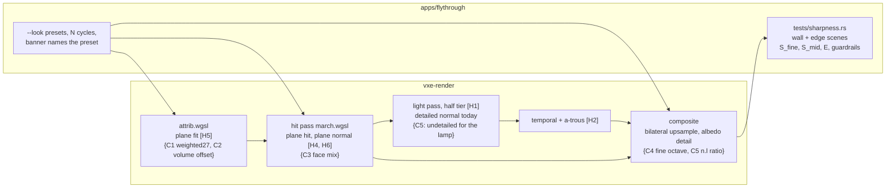

# 0039: The contour look at arm's length: a sharpness metric, the sources of its softness, and named presets the owner compares

> **Status:** approved (2026-10-22)
> **Decisions:** Owner, 2026-10-22: the pick becomes the default and `--look contour` keeps today's look; the comparison runs where the plan proposes first; the face-mix candidate (C3) enters a preset only if it passes the axis-fraction guardrail; if no preset wins, today's default stays and the presets are opt-in; the plan starts right after Plan 0028 closes, without waiting for Plan 0030.
> **Created:** 2026-10-22
> **Milestone:** M2 in `docs/roadmap.md` (the surface look that Plan 0005 measured, ADR-0011
> decided and Plan 0013 made the default, re-read under Plan 0024's frame)
> **Related ADRs:** [ADR-0011](../adrs/0011-contour-planes-in-attribute-pages-with-procedural-detail.md)
> (contour planes and procedural detail; its encoding stands, and the offset formula it calls
> crude is one of the candidates here),
> [ADR-0018](../adrs/0018-direct-light-per-pixel-one-sample-from-a-hit-buffer-with-svgf-history-killed-by-edits.md)
> (the hit buffer, the half lighting tier and the denoiser this plan's detail path runs
> through). This plan writes no ADR: the choice is the owner's on-screen call from the
> readings, as in Plan 0005; the close review decides whether that call needs an Outcome on
> ADR-0011 or a new ADR.
> **Source:** the owner's live session of 2026-10-22 (window about 2530 x 1378, Plan 0024's
> frame, no upscaler): the image "looks somewhat better, looks totally fine without
> contours"; the contour look reads soft or blurry at arm's length. The owner's choice: a
> followup plan that measures and sharpens it, with the default unchanged until then.
> **Starts after:** Plan 0028 closes. It rewrites `attrib.wgsl`'s addressing (surface-only
> attributes by popcount) and keeps the attribute's `u16` encoding and `NO_PLANE`; this plan
> changes only how the attribute's value is fitted and how the shading uses it, so it
> rebases on 0028's pass and never touches its storage. It is independent of Plans 0029 and
> 0030 (see Risks).

## TL;DR

Contour with detail is the fly-through's default, and with Plan 0024's lighting the owner
finds it soft at arm's length where face mode "looks totally fine". Nobody has measured
sharpness, so this plan first builds a headless sharpness harness: a rough rock wall and a
convex rock edge, each at 1 m under the headlamp, read with a band-passed contrast metric and
an edge-spread width, beside Plan 0005's normal and silhouette errors as guardrails against a
cube look. A source-isolation matrix (normal mode x lighting tier x denoiser x detail) says
where the softness comes from. Then the plan builds the cheap candidate fixes behind switches,
composes them into named presets (`--look contour-sharp`, `--look contour-grain`) that `N`
cycles with the preset's name on the banner, and the owner picks one in the window. The last
phase makes the pick the default. The first thing a reader sees is a test that prints the
wall's fine-band contrast in face mode and in contour mode, side by side, with both images
blessed as goldens.

## Context & problem

What the owner sees. At 2530 x 1378 with a 70-degree vertical field of view the focal length
is `689 / tan 35° = 984` px, so a 10 cm voxel at 1 m spans about 98 px and at 0.6 m about
164 px. At that scale each voxel is a large flat patch, and whatever the image has inside a
voxel decides whether the rock reads sharp. Face mode has a hard lighting step at every voxel
edge: free high-frequency contrast, and the cube look the spike was started to remove.
Contour removes those steps by design. What replaces them at arm's length is only the
procedural detail, and the detail is weak and runs through a lighting path that was built
after the owner tuned it.

What the code does today (main, after Plan 0024; read 2026-10-22):

- **The plane fit is already narrow.** `attrib.wgsl` takes the normal as `Gradient27` of
  occupancy over the 3 x 3 x 3 neighbourhood, uniformly weighted, and the offset as
  `(f - 0.5) * 3` voxels from the 27-voxel solid fraction `f`, clamped to `±7/8` and rounded to
  `1/8`. A 3^3 central difference is the narrowest such fit, so "fitted over too large a
  neighbourhood" is not the source. At a convex 90-degree edge only the edge column bevels: its
  normal is 45 degrees and its offset code 6 (`f = 12/27`), and the face voxels beside it
  read their axis normal exactly (`f = 18/27`, code 11). On a one-voxel stair the tilt spreads
  over two to three voxels. The offset formula is the one ADR-0011 calls crude.
- **Each voxel is one plane, so one normal.** Inside a voxel the shading normal is constant
  except for detail. The 6 + 6-bit octahedral normal steps about 3 degrees; that gives facets,
  not blur, and changing it is a storage change this plan does not make.
- **Detail is weak and low.** Rock is `[4.0, 0.1]` (scale 4 voxels, strength 0.1), the
  owner's pick in Plan 0013 Phase 6 on the single-pass march, before Plan 0024 split the
  frame. Two octaves at 40 cm and 20 cm: nothing at the 1 to 5 cm scale that arm's length
  shows. `DETAIL_TILT = 4`, and the albedo factor is `1 ± 0.1`.
- **Detail's lighting goes through the half tier and the denoiser.** The light pass
  (`light.wgsl`) shades with `surface_detail(rec).xyz`, the detailed normal, at the lighting
  resolution: by default half on each edge, one pixel of each 2 x 2 (the lower-left, every
  frame). The temporal pass and the a-trous filter (`atrous.wgsl`, edge weights on the
  undetailed normal, `SIGMA_LUM = 4`) then smooth it, and the composite upsamples it with
  bilinear weights times `max(n.n', 0)^32 exp(-plane distance)`, again on the undetailed
  normal. The detail's shading therefore reaches the screen point-sampled at half resolution
  and filtered as if it were noise; only its albedo factor, which the composite evaluates per
  full-resolution pixel, arrives intact.

So there are several plausible sources and no measurement that ranks them. The plausible
sources, each with the reading that isolates it in Phase 1:

| # | source | isolated by |
|---|---|---|
| H1 | lighting at half resolution point-samples the detail's shading | half against full tier, filter off |
| H2 | the temporal pass and the a-trous filter smooth detail as noise | filter on against off, full tier |
| H3 | detail too weak and too low in frequency for arm's length | detail on against off; Phase 2's sweep |
| H4 | contour removes the voxel-edge contrast face mode had, and nothing replaces it | contour against face, detail off, full tier, filter off |
| H5 | the plane fit (uniform weights, crude offset) rounds edges and stairs more than needed | edge spread; Phase 2's fit variants |
| H6 | shading normal against geometric normal: one flat plane per voxel | the normals view's fine-band contrast; read, not acted on |

Consumer requirement: `project-context.md`, Rendering P0 (a first-person image stable at arm's
length, the owner's look bar: smooth natural rock, not a Lego look). `nfr.md` figures touched:
§2 primary rays (the hit pass), lighting and the composite at 1080p, and the attribute pass
under motion; §3 world VRAM, which must not move by one byte.

## Decision

Measure first, then let the owner choose among named presets, as Plan 0005 did. Phase 1
defines an objective sharpness metric and two guardrails and reads them across a
source-isolation matrix. Phase 2 builds five cheap candidate mechanisms, each at today's
behaviour byte for byte when off: two plane fits computed in the existing attribute pass into
the existing `u16` (a distance-weighted gradient and a volume-matched offset), a partial mix of
the plane normal toward the face normal, a third sub-voxel detail octave, and **detail at full
resolution**, where the light pass shades the lamp with the undetailed normal and the composite
applies the detail's `n.l` ratio per full-resolution pixel. Phase 3 composes them into named
presets the window cycles and names on the banner. The owner picks in Phase 4; Phase 5 makes
the pick the default.

Rejected:

- **An image-space sharpening pass** (unsharp mask or contrast-adaptive sharpening on the
  composite): it sharpens the denoiser's residue and the shadow specks as readily as the rock,
  rings at silhouettes, and treats the symptom. Plan 0030 owns a sharpening pass for its
  upscaler; this plan does not add a second one.
- **Lighting at full resolution by default:** the half tier is the only one under the lighting
  line on the dev box (Plan 0024); the full tier is read here as a diagnostic (H1), not a fix.
- **More normal bits, a stored sub-voxel normal, or a stored detail map:** each changes the
  attribute's storage, which Plan 0028 is re-laying; a storage change is its own plan and ADR.
- **Face mode as the default again:** the owner's standing preference is smooth natural rock,
  not a Lego look, and ADR-0011's measurements stand.
- **`Gradient27` per hit in the shader** (ADR-0011 Alternative A): smoother, not sharper, and
  2.7 ms dearer at the level on the dev box.
- **Stored per-material textures** (triplanar texture arrays): an asset pipeline and VRAM for a
  question the procedural path has not yet been given a fair chance to answer. A later look
  plan if Phase 4 says the procedural path cannot carry arm's length.

## Architecture diagram

Where softness can enter, and the candidate switch at each stage (`[Hn]` the source,
`{Cn}` the candidate).



## Implementation phases

Each phase ships as its own commit. `dev` implements all phases in one session with no review
between phases. The architect reviews once at the end, in a fresh session. Phase 1 is the
walking skeleton: the harness printing face against contour.

Shared conventions for every phase:

- **Render conventions** as in Plans 0005 and 0024: lavapipe goldens under the 0.1 % / 2 per
  255 floor, the skip rule and `VXE_REQUIRE_SOFTWARE_ADAPTER`, 320 x 180 test renders with a
  70-degree vertical field of view (focal `90 / tan 35° = 128.5` px), camera in voxel units
  with z up. Every existing golden in `apps/flythrough/tests/` and `crates/vxe-render/tests/`
  stays byte for byte in Phases 1 to 4; Phase 5 re-blesses only the goldens of the default
  look, by name, if the pick changes it.
- **The sharpness scenes** live in `apps/flythrough/tests/support/mod.rs`, under the look
  table with no emissive material, lit by the headlamp alone (`Lighting::lamp` on, emissive
  sampling empty), so every light term is deterministic and the temporal history converges to
  the per-frame value. Each render runs 64 static frames and reads the last; a test asserts
  the last two frames differ by at most 1/255 per channel.
  - **Wall:** an air world over chunks `[0, 2)^3` with rock filled at `x >= 74`, roughened by
    24 spheres, half carved and half filled, radius 3 to 8 voxels, centres within 2 voxels of
    the face plane and `y, z` in `[44, 85)`, drawn from a test-local integer LCG seeded 39 (the
    list is printed so the scene is reproducible by eye). Camera at `(64.5, 64.5, 64.5)`
    looking `+x`: the mean face is 9.5 voxels away, about 1 m. One voxel there spans
    `128.5 / 9.5 = 13.5` px. The metric window is the central 160 x 90 pixels, inside the
    lamp's cone and 8 px clear of every box filter's reach.
  - **Edge:** an air world over chunks `[0, 2)^3` with a rock block at `x in [64, 96)`,
    `y in [64, 96)`, `z in [32, 96)`, whose vertical convex edge is the line `x = y = 64`.
    Camera 10 voxels from the edge at `(64 - 10 cos 30°, 64 - 10 sin 30°, 64.5)` =
    `(55.34, 59.0, 64.5)` looking along `(cos 30°, sin 30°, 0)`, so the edge is the centre
    column and the two faces take the lamp at `n.l = cos 30° = 0.866` (the `-x` face) and
    `sin 30° = 0.5` (the `-y` face): a clear luminance step.
- **The metrics** (`apps/flythrough/tests/support/sharpness.rs`), on the shaded output's
  luminance `Y = 0.2126 R + 0.7152 G + 0.0722 B` of the display-encoded bytes over 255:
  - **Fine-band contrast `S_fine`:** `HF = Y - box_a(Y)`, then
    `S_fine = sqrt(mean(HF^2)) / mean(Y)` over the metric window; `box_a` is a square box
    blur of width `a`, the odd pixel count nearest 0.4 voxel at the scene's distance (5 px at
    320 x 180: `0.4 x 13.5 = 5.4`). It reads detail finer than about 4 cm.
  - **Mid-band contrast `S_mid`:** the same with `box_a(Y) - box_b(Y)`, `b` the odd count
    nearest 1.3 voxel (17 px: `1.3 x 13.5 = 17.6`): features of 4 to 13 cm, the voxel scale.
  - **Edge spread `E`:** on the edge scene, for each of the central 60 rows, the plateau
    luminances are the means over columns 15 to 20 px left and right of the centre column, and
    the spread is the pixel width over which `Y` rises from 10 % to 90 % of the way between
    them; `E` is the median over the rows, printed in pixels and in voxels
    (pixels / 12.85, one voxel at 10 voxels). Face mode's edge is a one-pixel step, so it reads
    at most 1 px; a test asserts that as a sanity check of the metric.
  - **Detail survival `R`:** `S_fine` at the default tier (half, filter on) over `S_fine` at
    full tier with the filter off, same look. 1.0 means the lighting path loses nothing.
- **The guardrails** (the "not a Lego look" bar), on Plan 0005's scenes:
  - cavity normal error at most 12 degrees (Plan 0005's bar; contour reads 7.41 today);
  - pillar silhouette error at most half of face mode's (contour 32 px against face 172
    today);
  - **axis fraction `A`:** the share of the cavity scene's hit pixels whose undetailed
    shading normal lies within 5 degrees of a coordinate axis, at most 10 %. Face mode reads
    100 %. The analytic sphere reads 0.69 %: from the cavity camera only the `-x` normal of
    the six axes is in view (the horizontal half-angle is `atan(16/9 x tan 35°) = 51.2°`), and
    the pixels whose ray is within 5 degrees of `+x` form a disc of radius
    `128.5 x tan 5° = 11.24` px, `pi x 11.24^2 = 397` of the 57 600 pixels.
- **Timing** as Plan 0024 read it: timestamp queries, the median of the last 30 of 300 frames,
  `flythrough --level --headless --seed 1 --render 1920x1080 --frames 300 --look <look>` from
  the spawn pose, three runs of each binary alternated, under the exclusive perf lock with the
  1-minute load recorded; the attribute pass under motion from two
  `flythrough --autopilot --headless --seed 1` flights per look. Both adapters, by Plan
  0028's `--adapter`: the NVIDIA card (dev reference) and the AMD iGPU (the slow adapter,
  `nfr.md` §1), each reading labelled by its adapter. GPU work is serialized with the other
  lanes (the harness's lock), and cargo runs stay memory-capped.

### Phase 1: The sharpness harness, the baselines and the source-isolation matrix
- **Owner skill:** dev
- **What:** the two scenes, the four metrics and the axis-fraction guardrail, the face and
  contour baselines with goldens, the matrix that ranks H1 to H4 and H6, and today's pass
  timings on both adapters.
- **Files touched:** `apps/flythrough/tests/sharpness.rs` (new),
  `apps/flythrough/tests/support/{mod.rs, sharpness.rs}`,
  `apps/flythrough/tests/golden/{look_wall_face.png, look_wall_contour.png}`,
  `apps/flythrough/tests/look.rs` (the axis fraction beside the cavity normal error),
  `docs/nfr.md` §2 (dev-reference lines).
- **Done when:**
  - `sharpness.rs::face_against_contour_on_the_wall` prints `S_fine` and `S_mid` for face mode
    and for today's contour with detail at the default tier, and asserts each value is finite
    and above 0 and that face mode's `S_mid` exceeds contour's (the voxel-edge contrast
    contour removes by design; if it does not, the metric is wrong and the phase stops there).
  - `look_wall_face.png` and `look_wall_contour.png` are blessed on lavapipe and compared
    under the floor, and the test also writes the two side by side, with the metric values in
    the file name, to `target/look-sharpness/` for reading by eye (not a golden).
  - `sharpness.rs::edge_spread` asserts face mode's `E` is at most 1 px and prints contour's in
    pixels and voxels.
  - `look.rs` prints the axis fraction `A` for face (asserted 100 %) and contour (printed),
    and asserts contour's cavity normal error and silhouette error still meet the guardrails.
  - `sharpness.rs::source_matrix` renders the wall for {face, contour} x {half, full tier} x
    {filter on, off} x {detail on, off} (16 renders), prints one table of `S_fine` and `S_mid`
    and contour's `R`, and the log carries the table with a one-line reading per source H1
    to H4: the share of the face-to-contour `S_fine` gap that each switch recovers. H6 is read
    as `S_fine` of the normals view, face against contour, and recorded.
  - The log and `nfr.md` §2 record today's hit pass, light pass, composite and the attribute
    pass (the level's initial fill and the autopilot's p50 and p99 of frames with work) for
    face and contour on both adapters, each with machine, adapter, commit and load.

### Phase 2: The candidate mechanisms, each measured alone
- **Owner skill:** dev
- **What:** five switches, each exactly today's behaviour when off, and a sweep table of every
  candidate against the metrics and guardrails.
  - **C1 `PlaneFit::Weighted27`:** the gradient's 26 neighbours weighted by `1 / |o|^2`
    (face 1, edge 1/2, corner 1/3), a Sobel-like kernel that tilts less on stairs.
  - **C2 `PlaneOffset::VolumeMatched`:** the offset is the `d` at which the half-space
    `n.(x - c) <= d` cuts the 3 x 3 x 3 block (`[-1.5, 1.5]^3` about the voxel centre) into
    a solid volume equal to the solid count, found by 8 bisection steps on `[-1.5, 1.5]` over
    the exact slab volume, clamped and rounded to 1/8 as today. Combinable with C1.
  - **C3 face mix:** in the hit pass a plane hit's shading normal becomes
    `normalize(mix(plane_n, face_n, k))` for `k` in {0.25, 0.5}, the entry face's normal; the
    hit point and the shadow normal stay the plane's. It tests H4 directly and is the
    candidate most at risk of the axis-fraction guardrail.
  - **C4 fine octave:** a third value-noise octave at `scale / 4` with weight `w` (the
    material row's spare float; `w = 0` is today's two octaves exactly), in both the normal
    tilt and the albedo factor.
  - **C5 detail at full resolution:** with the lamp on, the light pass shades every term with
    the undetailed normal, and the composite multiplies the upsampled irradiance by
    `clamp(max(n_d.l, 0) / max(n.l, 1e-3), 0, 2)`, `n_d` the detailed normal it already
    evaluates for the albedo factor, `l` the unit vector from the hit to the lamp. With the
    lamp off the light pass keeps today's detailed normal and the composite applies no ratio.
- **Files touched:** `crates/vxe-render/src/{attrib.rs, gpu_world.rs, marcher.rs, light.rs, lib.rs}`,
  `crates/vxe-render/src/shaders/{attrib.wgsl, march.wgsl, light.wgsl, composite.wgsl}`,
  `crates/vxe-world/src/material.rs` (`Material::detail_fine: f32`, default 0),
  `crates/vxe-render/tests/mirror.rs`, `apps/flythrough/tests/{sharpness.rs, look.rs}`.
- **Done when:**
  - **Off is today.** With every switch off (C1 and C2 at `Uniform27` and the `(f - 0.5) * 3`
    offset, C3 `k = 0`, C4 `w = 0`, C5 off) every existing golden and Phase 1's two wall
    goldens match byte for byte.
  - **The fits agree where geometry is simple.** A readback test in `mirror.rs` on the `Floor`
    world: the top solid layer's voxel decodes to `+z` within 3 degrees and offset code 11
    under all four fit combinations (today's offset gives `(18/27 - 0.5) x 3 = 0.5`; the
    volume-matched plane of 18 solid voxels in the block lies at `z = +0.5`, so code
    `7 + 8 x 0.5 = 11`). On the edge scene's block, a voxel of the edge column (`f = 12/27`)
    decodes to `(-1, -1, 0) / sqrt 2` within 3 degrees and code 6 under all four (today's
    `(12/27 - 0.5) x 3 = -0.167`, rounded to `-1/8`; volume-matched, the line
    `x + y = c` leaving area 4 of the block's 3 x 3 cross-section solid has
    `(3 - c)^2 / 2 = 4`, `c = 3 - 2 sqrt 2 = 0.172`, so `d = -0.172 / sqrt 2 = -0.121`,
    rounded to `-1/8`). A one-voxel stair is the case where they differ; its codes are printed.
  - **C5 is exact for the lamp.** On the wall scene at the full tier with the filter off and
    C4 off, the C5 render matches today's render within 2/255 per channel at 99 % of the
    window's pixels (the ratio reproduces `n_d.l` wherever the clamp does not bind), and at
    the half tier its `R` is printed beside today's.
  - **Mirror bytes do not move.** For each fit combination, the level's `mirror_bytes` and
    `allocated_bytes` equal today's exactly (a test in `mirror.rs` on a small world, and the
    level's `--frames 1` line recorded).
  - `sharpness.rs::candidate_sweep` prints one table: rows today, C1, C2, C1+C2, C3 at 0.25
    and 0.5, C4 at `w` in {0.25, 0.5}, C5, C4 + C5, and rock's detail at strength
    {0.1, 0.2, 0.3} x scale {2, 4} with and without C5; columns `S_fine`, `S_mid`, `E`, `R`,
    cavity normal error, silhouette error, `A`, and whether the row meets the guardrails. The
    log carries the table.
  - The log records the attribute pass's level initial fill for C1, C2 and C1+C2, and the
    light pass and composite at 1080p with C4 and C5, on the NVIDIA card (the slow adapter's
    readings come with the presets in Phase 3).

### Phase 3: Named presets in the window
- **Owner skill:** dev
- **What:** `--look` takes preset names, `N` cycles them, the banner names the preset, a fit
  change refits the resident bricks through the existing capped pass, and the presets' timings
  on both adapters.
- **Presets:** `contour` (today, unchanged), `contour-sharp` (the geometry and lighting-path
  fixes: the best guardrail-passing fit of C1, C2 or C1+C2 by `S_mid` at the default tier, plus
  C5), `contour-grain` (today's fit, plus C5, plus the guardrail-passing C4 weight and rock
  detail pair with the highest `S_fine` at the default tier), and `face` and `plain` as today.
  C3 enters a preset only if a C3 row passed every guardrail in Phase 2; otherwise it stays a
  diagnostic switch. The values picked by these rules are recorded in the log with the sweep
  row they came from.
- **Files touched:** `apps/flythrough/src/{main.rs, hud.rs, lib.rs}`,
  `crates/vxe-render/src/{gpu_world.rs, attrib.rs}` (the refit queue),
  `apps/flythrough/tests/{sharpness.rs, hud_golden.rs}`,
  `apps/flythrough/tests/golden/{look_wall_contour_sharp.png, look_wall_contour_grain.png}`,
  the root `README.md` (the preset names), `docs/nfr.md` §2.
- **Done when:**
  - `--look contour-sharp` and `--look contour-grain` start in those presets, and the startup
    line prints the preset's name and its parts (fit, face mix, detail pair and fine weight,
    detail at full resolution on or off). A parse test pins each name; an unknown name lists
    the valid ones.
  - `N` cycles `face`, `contour`, `contour-sharp`, `contour-grain` (skipping the contour
    presets without attribute storage, as today), and `V` toggles detail. Each press shows the
    banner with `look <preset>` for the banner's 3 s, visible without the stats HUD; a test in
    the style of `the_banner_names_each_change_and_fades_after_three_seconds` asserts the
    banner's text names each preset in turn and the detail state after `V`.
  - A preset change that changes the fit re-queues every resident full-chunk brick through
    the attribute pass under its existing cap; until the queue drains, unrefit bricks keep
    their previous, valid attribute (no face-normal hole). The banner adds `refitting` until it
    drains. A headless test switches the fit and reads back a voxel of a far brick: after the
    drain its attribute equals the new fit's.
  - Switching presets changes neither `mirror_bytes` nor `allocated_bytes` (asserted on a
    small world, read at the level).
  - The wall goldens of both new presets are blessed on lavapipe, and the side-by-side image
    of Phase 1 gains the two presets.
  - The log and `nfr.md` §2 record, for `contour`, `contour-sharp` and `contour-grain` on both
    adapters: the hit pass, light pass and composite at 1080p, the attribute pass's level
    initial fill, and the autopilot's attribute pass p50 and p99.

### Phase 4: The owner's comparison
- **Owner skill:** human
- **What:** the owner, at the dev box's keyboard and the 2530 x 1378 window, flies the
  default streamed world (and `--level --seed 1` if wanted), cycles the presets with `N` at
  arm's length (0.5 to 1 m) from a carved wall and at 5 m from a cavern wall, with the lamp on
  and off (`F7`) and at both lighting tiers (`F6`) for the finalists, and writes the call into
  this plan's log. Agents prepare the binary and the command and ping when it is ready; they
  never close the window.
- **Files touched:** this plan's `## Implementation log`.
- **Done when:** the log carries one entry naming the preset to make the default (or
  "unchanged"), any rock detail pair the owner tuned with `--rock-detail`, and the on-screen
  reason in one or two sentences; or names two finalists and the reading that would separate
  them.

### Phase 5: The pick as the default
- **Owner skill:** dev
- **What:** the chosen preset's parts become the default look, the readings that defend it on
  both adapters, and the docs.
- **Files touched:** `apps/flythrough/src/{main.rs, lib.rs}` (the default look,
  `ROCK_DETAIL` and the fine weight if the pick changed them),
  `crates/vxe-render/src/{marcher.rs, attrib.rs}` (defaults, if the pick is a fit),
  `apps/flythrough/tests/` (the default-look goldens re-blessed by name if the pick changes
  them), the root `README.md`, `docs/nfr.md` §2 and §3.
- **Done when:**
  - With no flag, the fly-through starts in the picked preset and prints its name and parts;
    the parse test that pins today's default (`ROCK_DETAIL` and the startup line) pins the new
    one. `--look contour` still selects today's look (Open question 1 may change this).
  - The default-look goldens that change are re-blessed on lavapipe by name in the commit
    message, and every other golden is byte for byte.
  - The guardrails hold for the default: cavity normal error at most 12 degrees, silhouette
    error at most half of face mode's, `A` at most 10 %.
  - Budget readings on both adapters, paired with the pre-plan binary in the same session
    (see Budgets), in the log and `nfr.md` §2; §3 records that the level's and the streamed
    flight's mirror bytes equal the pre-plan binary's.
  - If the owner's call is "unchanged", this phase records that, keeps the presets as opt-in
    looks, and takes the same readings for the record.

## Data shapes

```rust
// illustrative: vxe-render
pub enum PlaneFit { Uniform27, Weighted27 }            // the attribute pass's gradient
pub enum PlaneOffset { Fraction, VolumeMatched }        // (f - 0.5) * 3, or the slab volume
pub struct SurfaceTuning {
    pub fit: PlaneFit,
    pub offset: PlaneOffset,
    pub face_mix: f32,                // C3, 0 = the plane normal
    pub detail_after_lighting: bool,  // C5
}
// LookParams gains `tuning: SurfaceTuning`; the fit and offset reach attrib.wgsl through its
// uniform's spare word (bits 0 and 1), face mix and C5 through Params (a free flag bit and a
// spare float). No new binding in any pass.

// vxe-world: Material gains `detail_fine: f32` (C4's third-octave weight, default 0), carried
// in the GPU material row's spare float; rows stay 64 B.

// apps/flythrough: a preset is a name plus (normal mode, SurfaceTuning, rock detail pair,
// fine weight).
```

## Budgets

| `nfr.md` figure | expected effect | how the close reads it |
|---|---|---|
| §3 world VRAM | none: the `u16` attribute, its addressing (Plan 0028's) and the material rows' 64 B are unchanged | `mirror_bytes` and `allocated_bytes` at the level and at the streamed flight's full residency equal the pre-plan binary's exactly, per preset |
| §2 primary rays (the hit pass, 3.0 ms line) | C3 adds one `mix` and a normalise per plane hit; nothing else in the hit pass changes | 1080p level spawn, both adapters, alternated with the pre-plan binary; bar: the default within 3 % of the pre-plan reading on each adapter |
| §2 the attribute pass under motion (already a recorded miss against its 1.0 ms proposal) | C1 costs the same loop with weights; C2 adds 8 bisection steps of a slab-volume formula per surface voxel, a guess of up to half again the pass's ALU | the level's initial fill and two autopilot flights per look, p50 and p99 GPU, both adapters; bar: the default's p99 within 10 % of the pre-plan reading on each adapter, a miss disclosed for the owner |
| §2 lighting and post (light pass plus composite at 1080p) | C5 moves the detail evaluation out of the light pass (fewer pixels at the half tier) and adds a ratio to the composite, which already evaluates detail; C4 adds one noise octave wherever detail is evaluated | both adapters, alternated with the pre-plan binary; bar: light plus composite within 5 % of the pre-plan sum on each adapter |

The bars are proposals for a look change on a frame that is not yet at its budget on the slow
adapter; the readings go into `nfr.md` §2 as dev-reference lines labelled by adapter.

## Risks & open questions

- **The metric may not be the owner's eye.** `S_fine` rewards any fine contrast, noise
  included; the guardrails stop a cube look but not a noisy one. Mitigation: the side-by-side
  images, the owner's Phase 4 call over the numbers, and no preset is made the default by
  metric alone.
- **C5 is exact for the headlamp only.** With the lamp on, emissive and (after Plan 0029)
  probe light are shaded with the undetailed normal and then take the lamp's ratio, which is
  wrong in direction for them. In the cave the lamp dominates near the player, where arm's
  length matters; with the lamp off the path is today's. Phase 4's lamp-off check is there to
  catch it.
- **Determinism.** Every change is in `vxe-render`; nothing reaches `vxe-world` but one
  material field the engine never reads. The attribute pass's fits are pure functions of
  occupancy, so a refit is reproducible on one adapter.
- **Plan 0029 (probe GI) and Plan 0030 (upscaler) may land first.** The harness lights with
  the lamp alone, so its metrics do not move with them. The owner's comparison uses whatever
  frame is on main; if the upscaler is merged, Phase 4 runs at scale 1 (native) first, then
  with the upscaler as a second check, and the log says which. Plan 0030's jittered lighting
  samples may recover part of H1; the matrix is re-read if it lands before Phase 4.
- **The refit under the cap** spreads a fit change over many frames on a streamed world;
  that is a testbed cost of comparison only, since the default never switches at runtime.
- **The slow adapter** may show a different ranking of costs (C2's ALU on the iGPU); its
  readings are taken per preset in Phase 3, before the owner chooses.

### Questions for the owner (answered before "go")

1. **Names after the pick.** (a) The default takes the picked preset and `--look contour`
   keeps today's look (recommended: the comparison stays reproducible). (b) `contour` is
   renamed to the pick and today's look becomes `contour-v0`.
2. **Where the comparison runs.** (a) The default streamed world, at the spawn and a carved
   wall (recommended). (b) `--level --seed 1`, as Plans 0005 and 0013 did. (c) Plan 0038's
   showcase cavern if it lands first.
3. **The face-mix candidate (C3).** (a) Measured, but in a preset only if it passes the
   axis-fraction guardrail (recommended). (b) Always in the cycle as `contour-faceted`,
   labelled as failing the guardrail, so the owner sees what the facets were worth.
4. **If no preset wins.** (a) Keep today's default and the presets as opt-in (recommended).
   (b) Ship C5 alone as a lighting-path fix, since it changes the look only where the half
   tier lost detail.
5. **Order against Plan 0030.** (a) Start right after Plan 0028 closes (recommended). (b)
   Wait for Plan 0030 so the comparison includes the upscaler.

## What this plan does NOT do

- **The upscaler's blur:** Plan 0030's rework and its sharpening pass.
- **New storage:** no attribute encoding, size, page or addressing change (Plan 0028's), no
  new binding, no stored detail. More normal bits or a sub-voxel normal is a later plan with
  its own ADR.
- **The LOD ring's look:** mip cells still hit as cubes (ADR-0011).
- **Textures:** no triplanar or stored per-material textures (see Decision).
- **Specular or roughness:** the shading stays Lambertian.
- **The attribute pass's recorded miss under motion:** this plan must not worsen it beyond
  its bar; making it cheaper is not in scope.

## Implementation log

> Written by `dev`: one row per phase as its commit lands, then the close block. **The phases
> above are the contract. This section records what happened.** Observations, never
> conclusions: no pass list, no self-assessment. Deviations and unmet done-whens are
> **always** disclosed. Keep it shorter than `## Implementation phases`.

| phase | owner | state | commit |
|---|---|---|---|
| 1: The sharpness harness, the baselines and the source-isolation matrix | dev | not started | |
| 2: The candidate mechanisms, each measured alone | dev | not started | |
| 3: Named presets in the window | dev | not started | |
| 4: The owner's comparison | human | not started | |
| 5: The pick as the default | dev | not started | |

### Notes

_(Deviations from the plan, with the commit, stated without justification. Done-whens not
satisfiable as stated, and what was done instead. Followups noticed and not acted on. One line
each. Empty is fine.)_

### Close triggers

_(Facts for the architect. No recommendations, and no suggested version bump.)_

- **What shipped:** feature / fix-only / docs-chore-only
- **Public API changed:** types, traits, functions, shader interfaces, config (list them, or none)
- **Budget readings:** each `nfr.md` figure touched, with its measured value, machine and commit
- **Gate at the tip:** the commands run (build, nextest, doctests, clippy, fmt, deny), exit codes, test counts
- **Outstanding `human` phases:** which, or none

## Followups

- If Phase 4 finds the procedural path cannot carry arm's length: a look plan for stored
  per-material textures or a sub-voxel normal, with its ADR.
