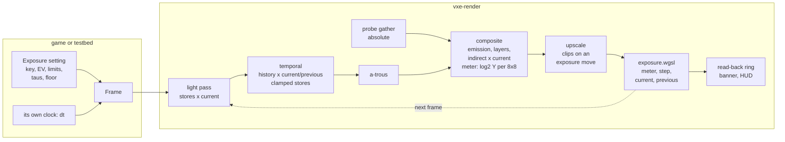

# 0040: Eye adaptation: an automatic exposure that is fast toward bright and slow toward dark, metered on the GPU, with pre-exposed HDR targets

> **Status:** approved (2026-10-22)
> **Decisions:** Owner, 2026-10-22: approved with the plan's recommended options: time constants 0.15 / 1 / 4 s (normal after about 10 s), max exposure 64 so the dark-adapted cave settles at the key, centre-weighted metering, the fly-through defaulting to auto eye.
> **Created:** 2026-10-22
> **Milestone:** M2 in [`docs/roadmap.md`](../roadmap.md) (the "exposure, tone mapping, and an
> upscaler" bullet)
> **Related ADRs:** [ADR-0033](../adrs/0033-eye-adaptation-as-an-asymmetric-two-stage-exposure-on-the-gpu.md)
> (proposed with this plan: the adaptation model, the meter on the GPU, pre-exposure),
> [ADR-0018](../adrs/0018-direct-light-per-pixel-one-sample-from-a-hit-buffer-with-svgf-history-killed-by-edits.md)
> (the light, temporal and filter passes whose stores become pre-exposed),
> [ADR-0023](../adrs/0023-indirect-light-from-a-scrolling-probe-volume.md) (the probe atlases,
> which stay in absolute units), [ADR-0024](../adrs/0024-own-temporal-upscaler-on-the-hit-buffer.md)
> (the upscaler, whose still pixels must follow a moving exposure)
> **Source:** the owner at Plan 0029's Phase 7 check (2026-10-22): "in real situation I would
> be blinded at first seconds when high light is turned off, and gradually my eyes would be
> accustomed to darkness and I would see normally again". The owner's choice: a small plan of
> its own, before the outdoor work, as an engine exposure setting the game controls. Plan 0032
> then builds on it.
> **Starts after:** [Plan 0029](0029-indirect-light-probe-volume.md) closes, so the owner's
> check sees Phase 8's faster bounce fade and not the old lingering light. It is drafted
> against main at 3b690bb (Plan 0024 merged: `Lighting::exposure: f32`, `composite.wgsl`'s
> `display`, `temporal.wgsl`, `atrous.wgsl`, `gradient.wgsl`) and Plan 0029's branch at b51538a
> (`probe_gather.wgsl`, the composite's `indirect_in`). The names dev finds in the tree win. It
> is independent of [Plan 0030](done/0030-temporal-upscaler.md). If Plan 0030 has merged when this
> plan starts, Phase 3 also adds the upscaler's exposure rule. If not, Plan 0030's lane adds it
> on rebase (the rule is in Phase 3).
> **Plan 0032 needs an amendment** (the orchestrator makes it). Its Phase 4 shrinks to using
> this plan's mechanism; "Plan 0032 Phase 4 after this plan" below lists exactly what moves.

## TL;DR

The exposure becomes an engine setting the game controls: `Exposure::Manual(f32)`, the
default at 1.0, or `Exposure::Auto(AutoExposure)`. In auto, the composite meters its radiance
before exposure as a centre-weighted mean of log2 luminance, per 8 x 8 tile. A one-workgroup
pass at the end of the frame steps an adapted level toward that meter, and the next frame
uses it. The step is asymmetric, like an eye. It is fast toward bright (`tau_light` 0.15 s),
and slow toward dark in two stages: `tau_cone` 1 s down to a cone floor, then `tau_rod` 4 s
below it. The caller gives `dt`, and the game sets the key, a compensation in EV, the limits,
the time constants and the floor. Every HDR value a pass stores is pre-exposed, history is
rescaled by the exposure's ratio, and stores are clamped, so the targets stay finite from a
dark-adapted cave to Plan 0032's noon. With the lamp turned off in the cave, the image drops
to near black. The ore's light comes back over about 10 s: 2 EV under at 0.7 s, under 0.5 EV
by 6.2 s. The first thing a reader sees is Phase 1's banner naming the metered scene in EV.
After that comes Phase 3's headless trajectory, which matches the analytic curve frame by
frame, and then the owner's lamp toggle in the window.

## Context & problem

Today the composite multiplies the frame's radiance by `Lighting::exposure` (a fixed `f32`,
1.0) in `display` before the ACES tone map. The lighting targets (`irradiance`, `accum`,
`moments`, `filter`: `rgba16float`) hold absolute radiance. Nothing adapts. When the lamp
goes off, the image falls straight to the ore's glow at the lamp's exposure and stays there.
When it comes on, the image is the same at any moment. The owner wants the eye's time course
(above), and wants the game to control it (owner, 2026-10-22).

Consumer requirement: `project-context.md`, Rendering, P0 "dark scenes with few lights;
emissive voxels as runtime-changeable lights". A horror delve lives on how dark the dark is
and how a light changes it. `nfr.md` figures touched: §2 "Upscale, tone map, post" (1.5 ms:
the meter and the step) and §3 "Everything else in VRAM" (the meter's tiles and the state).

Facts the design rests on:

- **The fly-through's units.** The ore emits `[1.6, 0.9, 0.35]`, which is Rec. 709 luminance
  `0.2126 x 1.6 + 0.7152 x 0.9 + 0.0722 x 0.35 = 1.01`. The headlamp's `intensity` 1200 is
  radiance on its axis at one voxel, so its irradiance is `1200 / d^2` at `d` voxels: 12 at
  1 m, 3 at 2 m, 133 at 3 voxels. Rock's albedo luminance is 0.386, so a rock wall 2 m down the
  lamp's axis reads `0.386 x 3 / pi = 0.37`.
- **The cave's two meters, assumed for the worked numbers.** Phase 4 reads the real values.
  With the lamp on, the centre-weighted log mean is about `2^-4 = 0.0625` (a lamp-lit centre
  near 0.3, a dark rim). With the lamp off it is about `2^-8 = 0.0039` (walls near a vein about
  0.015, far rock 0.001 to 0.005). The step is 4 EV.
- **Range.** The largest finite half is 65 504, and its square root is 255.9. A dark-adapted
  exposure of 64 with the lamp 3 voxels from a wall stores `133 x 64 = 8533` pre-exposed, and
  its second moment is 72.8 million, which is not finite. A sun of 3000 at exposure 1 (Plan
  0032) has a second moment of 9 million, also not finite. So pre-exposure alone does not keep
  the moments finite. The clamp of the second moment's luminance at 255 (`255^2 = 65 025`)
  does. A stored value is clamped at 60 000.
- **The eye.** Dark adaptation runs in two branches: cones first, then a break, then rods
  (Hecht, Haig and Chase 1937, "The influence of light adaptation on subsequent dark
  adaptation of the eye"). Light adaptation is much faster. The real curves take minutes. The
  real-time models compress them to seconds: Ferwerda et al. 1996, "A model of visual
  adaptation for realistic image synthesis"; Pattanaik et al. 2000, "Time-dependent visual
  adaptation for fast realistic image display"; Durand and Dorsey 2000, "Interactive tone
  mapping"; Krawczyk et al. 2005, "Perceptual effects in real-time tone mapping". The key of
  0.18 and the log-average meter are Reinhard et al. 2002, "Photographic tone reproduction for
  digital images". The time constants here are guesses that Phase 5 judges.

## Decision

We build ADR-0033 in `vxe-render`.

1. **The setting.** `Lighting::exposure: Exposure`, either `Manual(f32)` (the default, 1.0)
   or `Auto(AutoExposure)`. `AutoExposure` holds `key` (0.18), `compensation_ev` (0),
   `min` and `max` (2^-6 and 2^6), `tau_light` (0.15 s), `tau_cone` (1.0 s), `tau_rod`
   (4.0 s), `cone_floor` (2^-6 = 0.0156 frame luminance) and `metering`. `AutoExposure::eye()`
   is those defaults, and `AutoExposure::symmetric(speed)` sets all three constants to
   `1 / speed` and the floor to 0, which is Plan 0032's model. A constant of 0 adapts at once.
   `AutoExposure::step(a, t, dt) -> a'` and `exposure(a) -> e` are public pure functions, the
   CPU reference the tests and a game use. `Frame::set_dt(seconds)` sets the frame's step (a
   negative or non-finite `dt` is 0). `Frame::reset_exposure()` makes the next step jump to
   the meter. `Frame::exposure_readout()` returns the latest read-back state.
2. **The model** (ADR-0033). In log2 luminance, with `k(tau) = 1 - exp(-dt / tau)`: toward
   bright, `a += (t - a) k(tau_light)`. Toward dark, `a` decays toward `t` at `tau_cone` while
   `a > f` (`f = log2 cone_floor`), and at `tau_rod` once `a <= f`. A step that crosses `f`
   spends `tau_cone ln((a - t) / (f - t))` of its `dt` reaching `f` and the rest at
   `tau_rod`. Then `e = clamp(key 2^compensation_ev / 2^a, min, max)`. Because the update is
   exact, the trajectory at frame `n` after a luminance step is the closed form at `n dt`.
3. **The meter.** In the shaded view, the composite takes each pixel's final radiance before
   exposure and before the tone map, after the translucent layers and the probes' indirect
   light. It adds `clamp(log2(max(Y, 2^-16)), -16, 16)` and a count of 1 into its 8 x 8
   workgroup's tile, and writes `ceil(w / 8) x ceil(h / 8)` pairs. `exposure.wgsl`, one
   workgroup of 256, weights tile `i` by `w_i = 1 + strength exp(-r_i^2 / (2 sigma^2))`. `r_i`
   is the tile centre's distance from its view's centre in units of half the view's height.
   The meter is `t = sum(w_i S_i) / sum(w_i n_i)`. The default is centre-weighted, `strength`
   3 and `sigma` 0.5, and `Metering::Average` is `strength` 0. **Why centre-weighted:** in
   first person, the headlamp lights what the player looks at. A vein at the rim of an average
   meter dims the lamp's spot, and an eye fixating the spot does not. The other views
   (normals, hitmask, steps, albedo) write no tiles, and the pass holds the state.
4. **The state** is a storage buffer of 32 bytes: `current` (this frame's exposure),
   `previous`, `adapted_log2`, `metered_log2`, a frame counter and flags. Every frame pass
   reads it read-only through group 0. `exposure.wgsl` runs last in the frame, after the
   composite and any upscale pass and before the HUD. It sets `previous = current`, meters,
   steps (in auto) or takes the manual value, and writes `current`. A ring of three 256-byte
   `MAP_READ` buffers copies the state each frame. The CPU maps whichever has finished,
   without waiting, for `exposure_readout()`.
5. **Pre-exposure.** Lighting math stays in absolute units. The light pass multiplies by
   `current` only where it stores into `irradiance`. The temporal pass multiplies the history
   it reads by `current / previous` and the second moment by the square. The gradient pass
   compares in one unit: any value it reads from an earlier frame is rescaled the same way. The a-trous filter's and the gradient's
   epsilons (`1e-4`) stay as they are: they act in pre-exposed units, that is, on what the
   screen shows. Every store into an `rgba16float` HDR target is `min(v, 60000)`, and the
   second moment is of `min(Y, 255)`. The probe atlases, the reservoirs and the light
   samples stay absolute. The composite multiplies emission, the translucent layers and the
   gathered indirect light by `current` where they join the pre-exposed irradiance, and
   `display` no longer multiplies. With `Manual(1.0)` every multiply is by exactly 1.0 and
   every ratio exactly 1.0, so every image is byte for byte the same.
6. **The upscaler** (Plan 0030, if merged). Its history is display-encoded, so it cannot be
   rescaled. `upscale.wgsl` reads the state and, when `|log2(current / previous)| > 1/64`,
   treats every pixel as one whose light changed: a still pixel is clipped as a moving one.
   Light adaptation runs at up to 0.42 EV per frame and gets clipped. The rod stage's 0.008
   EV per frame lags about 10 frames, about 0.08 EV, which is invisible.
7. **The fly-through.** `--exposure auto|<value>` (default `auto`), `--adaptation
   eye|symmetric|instant` (default `eye`), `--adapt LIGHT,CONE,ROD,FLOOR` for the owner to
   tune live, `--metering centre|average`, and `Q` (proposed, free in the tree at 3b690bb)
   cycling `auto eye`, `auto symmetric` and `manual` (manual holds the current exposure). The
   banner names the mode on start and on change, with the exposure in EV (`log2 e`). The stats
   HUD gains an `exposure` row: the mode, `log2 e`, the metered scene in EV and the settled
   target. While the exposure moves by more than 0.01 EV per half second, stdout prints that
   line every half second. The window passes the measured frame interval as `dt`, clamped to
   `[0, 0.1]` s. Headless `--frames` runs pass exactly 1/60, and the testbed calls
   `reset_exposure()` at start and on a source switch.

We rejected a symmetric rate (Plan 0032 Phase 4 as approved), a perceptual model of the eye
with its own tone reproduction (Ferwerda 1996, Pattanaik 2000), stepping the model on the CPU
from a read-back meter, and exposure at display only (ADR-0033). We rejected a histogram
meter for Plan 0032's reason: its 0.5 EV bins quantize a uniform scene by up to 0.25 EV.
We rejected Krawczyk's smooth level-dependent time constant because it has no closed form for
the trajectory test. It is the change to try if the owner sees the kink at the cone floor.

### The cave's curve, worked

The defaults above, and the assumed meters `t = -4` with the lamp on and `-8` with it off
(log2). Light-adapted, `a = -4` and `log2 e = log2 0.18 + 4 = -2.474 + 4 = 1.526` (`e` =
2.88). Dark-adapted, `log2 e = -2.474 + 8 = 5.526` (`e` = 46.1, inside `max` 64).

**Lamp off** at `t = 0`. In the cone stage, `a = -8 + 4 exp(-t)`, which reaches the floor
`-6` at `t = ln 2 = 0.693` s. In the rod stage, `a = -8 + 2 exp(-(t - 0.693) / 4)`. The
scene's shortfall under the key, `a + 8` in EV:

| t (s) | 0 | 0.25 | 0.5 | 0.693 | 1 | 2 | 4 | 6 | 8 | 10 | 12 |
|---|---|---|---|---|---|---|---|---|---|---|---|
| EV under | 4.00 | 3.12 | 2.43 | 2.00 | 1.85 | 1.44 | 0.87 | 0.53 | 0.32 | 0.20 | 0.12 |
| `log2 e` | 1.53 | 2.41 | 3.10 | 3.53 | 3.67 | 4.08 | 4.65 | 5.00 | 5.20 | 5.33 | 5.41 |

On screen, through ACES and the 1/2.2 encode, a surface at the meter reads about 22/255 at
`t = 0` (exposed `2^-8 x 2.88 = 0.0112`). A wall beside a vein (0.015) reads about 56/255, the
far rock (0.002) about 14/255, and the ore itself (1.01 x 2.88) about 249/255. The meter
settles at 140/255 (the key, 0.18). So the first moment is near black around bright ore, and
the scene is 2 EV under at 0.7 s, 1 EV under at 3.5 s and half an EV under at 6.2 s.

**Lamp on** from dark-adapted: `a = -4 - 4 exp(-t / 0.15)`. The scene is 4 EV over on the
first frame: a wall 2 m down the axis is exposed to `0.37 x 46.1 = 17`, white. It is 1.47 EV
over at 0.15 s, 0.14 at 0.5 s and 0.005 at 1 s.

**The glare moment.** Dark-adapted at `-8`, a flash to `-4` for 0.25 s brings `a` to
`-4 - 4 exp(-0.25 / 0.15) = -4.756`. When the flash ends, the scene is 3.24 EV under (a
surface at the meter about 31/255). The cone stage reaches the floor after
`ln(3.244 / 2) = 0.484` s, and the rod stage leaves 0.65 EV at 5 s and 0.19 EV at 10 s.

## Architecture diagram



## Implementation phases

Each phase ships as its own commit. `dev` implements all phases in one session with no review
between phases. The architect reviews once at the end, in a fresh session. The test scenes are
closed boxes whose walls have albedo 0 and emit a grey radiance `L` (so every pixel's
luminance is `L` times the emission scale exactly), with the lamp off, indirect off and the
ACES tone map, unless a bar says otherwise. Every existing golden must stay byte-identical
under `Manual(1.0)` except where a bar names it.

### Phase 1: The meter, the read-back and the banner
- **Owner skill:** dev
- **What:** the walking skeleton. Decision 3's tiles in the composite, `exposure.wgsl`
  metering into the state buffer (`metered_log2`, with `current` and `previous` written as
  the manual value), the read-back ring, `Frame::exposure_readout()`, `Metering`, and the
  fly-through's banner text and HUD row showing `exposure manual +0.00 EV  scene -7.9 EV`. No
  image changes: the exposure still multiplies in `display` as today.
- **Files touched:** new `crates/vxe-render/src/exposure.rs`, new
  `crates/vxe-render/src/shaders/exposure.wgsl`, `composite.wgsl`, `march.wgsl` (the group 0
  binding), `marcher.rs`, `readback.rs`, `lib.rs`, new `crates/vxe-render/tests/exposure.rs`,
  `apps/flythrough/src/hud.rs`, `apps/flythrough/src/main.rs`,
  `apps/flythrough/tests/hud_golden.rs`.
- **Done when:**
  1. **A known image.** The camera sits at x = 0 inside a box, 10 voxels from a wall that
     fills the view. The wall's half at x < 0 emits `L_A = 2^-3` and the half at x >= 0 emits
     `L_B = 2^-9`. Each holds exactly half the columns of an even-width target, because no
     pixel centre lies on x = 0. At 256 x 144, `metered_log2` reads `(-3 - 9) / 2 = -6.000`
     within 1e-3 under both `Average` and the centre weight, which is symmetric about the
     split.
  2. **The weights are the documented ones.** On a wall with a central square of `2^-3`, half
     the view's height on a side, in a field of `2^-9`, the test reads the tile buffer back
     and computes `sum(w S) / sum(w n)` on the CPU with decision 3's formula. It matches
     `metered_log2` within 1e-3 under both meterings. The two differ by more than 0.5 EV:
     the square is 14.1 % of a 16:9 view's area (`1 / 7.11` in half-heights squared), so
     `Average` reads about `-9 + 6 x 0.141 = -8.16`, and the centre weight gives it about
     27.5 % of the weight (`(1 + 4.71 x 0.683^2) / 11.6`), about -7.35. The figures are
     approximate because the tiles cut the square's edge.
  3. **No image changes.** Every golden is byte-identical to the base commit, except
     `mode_banner.png`, whose text gains the exposure. It is re-blessed on lavapipe, and the
     log names it. The banner test asserts the new text.
  4. `exposure_readout()` returns `Some` within 4 frames of the first and never blocks (a
     non-blocking poll only).

### Phase 2: Pre-exposure
- **Owner skill:** dev
- **What:** decision 5. `current` and `previous` drive every store, the rescale and the
  clamps, and the gradient's rescaled old value. The composite multiplies
  the absolute terms (emission, layers, indirect), and `display` no longer multiplies. The
  manual value reaches the state through the exposure pass, so a manual change also sets
  `previous`.
- **Files touched:** `light.wgsl`, `temporal.wgsl`, `atrous.wgsl` (its store's clamp),
  `gradient.wgsl`,
  `composite.wgsl`, `probe_gather.wgsl` only if the add lives there, `exposure.wgsl`,
  `marcher.rs`, `crates/vxe-render/tests/exposure.rs`, `apps/flythrough/tests/golden.rs`.
- **Done when:**
  1. **Manual 1.0 changes nothing.** Every golden is byte-identical to Phase 1's commit,
     including Plan 0029's `indirect.png`.
  2. **The targets are scale-free.** On the level at the spawn pose, with the lamp on and the
     emissive ore, render 64 frames three times: lamp intensity and every emission scaled by
     `s` with `Manual(1 / s)`, for `s` in {1, 1/64, 64}. Every pixel of the `s` = 1/64 and 64
     images lies within 1/255 of the `s` = 1 image. Before this phase, `s` = 64 overflows the
     moments wherever the lamp's irradiance passes 4 (`(4 x 64)^2 > 65504`).
  3. **History survives an exposure step.** This is Plan 0032 Phase 4's bar 4. On Plan
     0024's emissive-ceiling box (filter off, lamp off), a manual step from 1.0 to 4.0 at
     frame 64 kills no history: at frame 65 every hit pixel's age is its frame-64 age plus
     one, or the cap. The floor-centre pixel at frame 65 is within 2/255 of a run that started
     at 4.0.
  4. **No overflow at the glare.** In a rock box with the lamp on, `Manual(64)`, and the
     camera 3 voxels from a wall on the lamp's axis (irradiance 133, pre-exposed 8533), every
     texel of `irradiance`, `accum`, `moments` and `filter` read back after 64 frames is
     finite.

### Phase 3: Adaptation
- **Owner skill:** dev
- **What:** decisions 1 and 2. `Exposure::Auto`, `AutoExposure` with `eye()`, `symmetric()`
  and the pure `step` and `exposure`, the step in `exposure.wgsl` (in f32, with the split at
  the floor), `Frame::set_dt`, `Frame::reset_exposure`. If Plan 0030 has merged, decision 6
  in `upscale.wgsl`. `--exposure auto|<value>` replaces `hero.rs`'s float.
- **Files touched:** `exposure.rs`, `exposure.wgsl`, `marcher.rs`, `lib.rs`,
  `crates/vxe-render/tests/exposure.rs`, `apps/flythrough/examples/hero.rs`, and if merged
  `crates/vxe-render/src/shaders/upscale.wgsl` and `apps/flythrough/tests/upscale.rs`.
- **Done when** (defaults `eye()`, `dt` = 1/60 exactly, the box emitting `B = 2^-4` or
  `D = 2^-8`). Frame `s` is the first frame rendered at the new luminance, and the exposure
  that frame `s + k` uses is compared with the closed form at `k / 60` s. Every trajectory
  bar holds within 0.01 EV at every listed frame. The test prints the whole series, and the
  log keeps it.
  1. **Finds the key.** After `reset_exposure()`, a box at `L = 0.05` uses `e = 0.18 / 0.05
     = 3.6` within 1 % on the second frame.
  2. **Dark adaptation in two stages.** Settled at `B` (`log2 e` = 1.526), stepped to `D`:
     `log2 e` reads 2.411 at `k` 15, 3.674 at 60, 4.084 at 120, 4.651 at 240 and 5.204 at
     480. The floor crossing lies between `k` 41 and 42 (0.693 s), and the per-frame slope
     falls there fourfold, from 0.033 EV per frame to 0.0083 (`2 / 60` against
     `2 / (4 x 60)`). The displayed box pixel is at most 26/255 at `k` 1 (computed 22) and at
     least 120/255 at `k` 600 (computed 0.20 EV under, about 130).
  3. **Light adaptation.** Settled at `D`, stepped to `B`: `log2 e` reads `-2.474 + 4 + 4
     exp(-k / 9)`, which is 2.997 at `k` 9, 1.669 at 30 and 1.531 at 60.
  4. **The glare moment.** Settled at `D`, with `B` for exactly 15 frames and then `D` again:
     the first `D` frame uses `log2 e` = 2.282 (3.24 EV under), and its pixel is at most
     36/255 (computed 31). Then `log2 e` reaches 3.526 (the floor) between frames 29 and 30
     of the dark, and reads 4.879 at 300 (`5.526 - 2 exp(-(5 - 0.484) / 4)`, 0.65 EV under).
     At 600 it is at least 120/255.
  5. **The symmetric preset is Plan 0032's model.** This is Plan 0032 Phase 4's bar 3.
     `symmetric(2.0)` settled at 0.36 (`L` = 0.5), stepped to `L` = 0.05: `log2 e` at `k` 60
     reads `-1.474 + 0.865 x 3.32 = 1.399` within 0.05 EV.
  6. **Limits, compensation, dt.** A box at `2^-12` settles at exactly `max` 64. With
     `compensation_ev` 1, the settled `e` doubles within 1 %. `set_dt(0)` holds `current`
     bit for bit for 30 frames. `instant()` (all constants 0) settles in one step.
  7. **The GPU matches the reference.** The test also steps `AutoExposure::step` in f64 over
     each series. Every frame's GPU `adapted_log2` lies within 1e-3 of it.
  8. **Manual is untouched.** With `Manual(1.0)` every golden is byte-identical to Phase 2's
     commit.
  9. **The upscaler follows** (only if Plan 0030 has merged). On Plan 0030's still-camera
     level pose at scale 1.5, a `B` to `D` style step by emission scale (all ores 1 to 1/16)
     under `eye()`: the upscaled output's mean luminance at each of frames 1 to 30 lies
     within 2/255 of the same run with the upscale pass's history disabled. Without the rule it lags; the test
     prints both series.

### Phase 4: The fly-through, the cave's own curve, and the readings
- **Owner skill:** dev
- **What:** decision 7, and the readings.
- **Files touched:** `apps/flythrough/src/main.rs`, `apps/flythrough/src/hud.rs`,
  `apps/flythrough/tests/hud_golden.rs`, new `apps/flythrough/tests/exposure.rs`,
  `docs/nfr.md` (§2 and §3 readings).
- **Done when:**
  1. **The toggle shows its mode.** Pressing `Q` three times changes the banner's text
     through `exposure auto eye`, `exposure auto symmetric` and `exposure manual`, each with
     its EV. The parse test pins `--exposure`, `--adaptation`, `--adapt`, `--metering` and
     their refusals (`--adapt` with three numbers, a negative constant, a negative floor).
  2. **The cave's curve, measured.** Headless, on the level at its spawn pose, 600 frames
     with the lamp on, then the lamp off through `Frame::set_lighting`, then 900 frames. The
     test prints the metered EV before and after (these replace the worked example's assumed
     -4 and -8 in the log), and `log2 e` at 0, 0.25, 0.5, 1, 2, 4, 8, 12 and 15 s. It asserts
     that `log2 e` falls by no more than 0.01 EV between any two frames after the switch,
     that it is within 0.25 EV of its settled value (target or `max`) by 15 s, and that from
     1 s on it is within 0.1 EV of the closed form for the measured meters. The probes' fading bounce moves the meter for
     about the first 24 frames (Plan 0029 Phase 8).
  3. **The readings.** On the dev box's NVIDIA card and on the slow adapter (the Cezanne iGPU
     on RADV), labelled, at 1920 x 1080 on the level's spawn: the composite with the meter
     against the composite without it (the delta) and `exposure.wgsl`, per-pass timestamps,
     the median of the last 30 of 3000 frames. Also `Frame::frame_bytes` before and after.
     These go to `nfr.md` §2 and §3 with the commit.

### Phase 5: The owner's windowed check
- **Owner skill:** human
- **What:** the owner flies the level (after Plan 0029's merge) to a dark room near a vein,
  with `--hud`, and toggles the lamp (`F7`) a few times: settled with it on, then off, and
  back on after 2 s and after 10 s. Then `Q` to `auto symmetric` for comparison. If asked,
  `--adapt` with other constants and `--metering average`. Verdicts on: how dark the first
  moment is, how long until the ore-lit room reads "normal", the lamp-on dazzle, the kink at
  the cone floor, any pumping when turning toward or away from a vein, and noise during
  adaptation. The question list below goes with the session.
- **Files touched:** this plan's log.
- **Done when:** the owner has recorded the verdicts and the chosen constants (or the
  defaults) in the log. Any change to a default is a one-line amendment for dev before the
  close.

## Data shapes

```rust
// illustrative: crates/vxe-render/src/exposure.rs
pub enum Exposure { Manual(f32), Auto(AutoExposure) }          // Lighting::exposure
pub enum Metering { CentreWeighted { strength: f32, sigma: f32 }, Average }
pub struct AutoExposure {
    pub key: f32,              // 0.18
    pub compensation_ev: f32,  // 0.0; the game's bias
    pub min: f32, pub max: f32,                                // 2^-6, 2^6
    pub tau_light: f32, pub tau_cone: f32, pub tau_rod: f32,   // seconds: 0.15, 1.0, 4.0
    pub cone_floor: f32,       // frame luminance, 2^-6; 0 means one dark stage at tau_cone
    pub metering: Metering,    // CentreWeighted { 3.0, 0.5 }
}
impl AutoExposure {
    pub fn eye() -> Self; pub fn symmetric(speed: f32) -> Self; pub fn instant() -> Self;
    pub fn step(&self, adapted_log2: f64, metered_log2: f64, dt: f64) -> f64;
    pub fn exposure(&self, adapted_log2: f64) -> f64;
}
pub struct ExposureReadout {
    pub exposure: f32, pub adapted_log2: f32, pub metered_log2: f32, pub frame: u32, pub held: bool,
}
// Frame::set_dt(f32), Frame::reset_exposure(), Frame::exposure_readout() -> Option<ExposureReadout>
```

GPU resources, sizes worked out:

| resource | format | size | bytes |
|---|---|---|---|
| meter tiles, 1080p internal | `vec2<f32>` per 8 x 8 tile | 240 x 135 | 259 200 |
| meter tiles, 1280 x 720 internal (Plan 0030 at 1.5) | the same | 160 x 90 | 115 200 |
| state | storage, 8 words | 1 | 32 |
| read-back ring | `MAP_READ \| COPY_DST` | 3 x 256 | 768 |
| exposure parameters | uniform block beside `Params` | one | under 256 |

That is about 0.26 MB at 1080p. No frame target is added or resized. With Plan 0032's sky
the meter sees misses through the same composite path, with no extra work.

## Budgets

| `nfr.md` figure | line | projection | how the close measures it |
|---|---|---|---|
| §2 Upscale, tone map, post | 1.5 ms | the meter in the composite (one `log2` per pixel and a workgroup reduction): 0.02 to 0.05 ms at 1080p on the dev box, a guess; `exposure.wgsl` (256 threads over 32 400 tiles, about 127 reads each, then a tree reduction): 0.01 to 0.03 ms, a guess; the slow adapter two to four times both | Phase 4 bar 3, both adapters, labelled |
| §2 Lighting | 6.0 ms | the multiplies and clamps in the light, temporal and filter passes: within the run-to-run spread (a guess) | Phase 4 bar 3's light, temporal and a-trous timestamps against Phase 1's commit |
| §3 Everything else in VRAM | 1.5 GB | +0.26 MB (table above) | `Frame::frame_bytes`, Phase 4 bar 3 |

No baseline reading exists; the card is not on hand. The slow adapter's reading is the
projection's floor.

## Plan 0032 Phase 4 after this plan

The orchestrator amends Plan 0032. **These items of its Phase 4 move here**, and 0032 uses
them as built:

- `Exposure` with `Manual(f32)` (default 1.0) and `Auto`, and `Lighting::exposure` becoming
  it. Here `Auto` holds `AutoExposure`, not `{ key, min, max, speed }`; 0032's `speed`
  becomes `AutoExposure::symmetric(speed)`.
- The state buffer `[current, previous]`, here with the adapted and metered levels.
- Pre-exposure: the light pass's stores times `current`, the temporal pass's history times
  `current / previous` and the moments times its square, the composite's emission and the
  probes' indirect times `current` at the add. Here this also covers the clamps, the
  gradient's old value and the translucent layers.
- The meter: per 8 x 8 workgroup sums of `clamp(log2(max(Y / current, ...)), -16, 16)` with
  pixel counts, in a `ceil(w / 8) x ceil(h / 8)` buffer. This plan meters before the exposure
  multiply instead of dividing it back out, which is the same value, and adds the centre
  weight.
- `exposure.wgsl`, one workgroup of 256, with its formula; here it is the asymmetric step.
- `Frame::set_dt(seconds)`, with a constant of 0 (0032's `speed` infinity) adapting at once.
- `--exposure auto|<value>` and the banner naming the exposure mode.
- Its done-whens 1 (manual 1.0 byte-identical: this plan's Phase 2 bar 1 and Phase 3 bar 8),
  3 (the curve: Phase 3 bar 5, with the same numbers) and 4 (history survives a step: Phase
  2 bar 3).
- Its Data shapes rows "exposure partial sums" and "exposure state", and its §2 "Upscale,
  tone map, post" projection for the exposure.

**What stays in Plan 0032 Phase 4**, which shrinks to using the mechanism:

- The sky's radiance and the sun's and moon's discs times `current` in the composite, and the
  directional and sky-ray terms stored through the light pass's pre-exposed path (Phases 5 and
  6 use it).
- The outdoor source's exposure settings: `auto` by default, and `min` 1e-4, `max` 4.0, key
  0.18. Plan 0032 picks the preset: `eye()` with its own floor, or `symmetric(1.5)`. This
  plan recommends `eye()`, because a cave mouth at noon is the lamp's case at a larger scale.
- Its bar 2 (a uniform test sky of 0.5 settles at 0.36), now with `Sky::uniform` against this
  plan's meter.
- Its bar 5 (a sun of 3000 overflows nothing), which this plan's clamp guarantees and 0032's
  scene proves.
- `--exposure` on the outdoor source, and the banner's time and source beside this plan's
  exposure text.

Plan 0037's references to "the exposure metering of Plan 0032 Phase 4" become this plan's
meter, with no change to their bars: the tint still runs after the meter and before the
exposure multiply, so the settled exposure ignores it.

## Risks & open questions

- **Pumping.** A centre-weighted meter in a cave with a bright vein swings the exposure as
  the player turns toward or away from it. Toward the vein it adapts in 0.15 s, which can read
  as a flicker on a fast turn. Away from it the scene darkens slowly, which reads as an eye.
  The knobs are `--metering average`, a lower `strength`, or a longer `tau_light`. Phase 5
  judges.
- **The kink at the cone floor** (ADR-0033, Negative). The rate falls by `tau_rod / tau_cone`
  at the floor, four times at the defaults. If the
  eye sees it, the change to try is Krawczyk's smooth constant, which loses the closed form.
- **The floor is in the game's units.** The fly-through's 2^-6 is a guess fitted to the
  worked meters. Phase 4 bar 2's measured meters may move it, and the log says where they
  fall against it.
- **History under a moving exposure.** The rescale is exact for the stored values, but a
  half's rounding is relative. After 4 EV of dark adaptation, a history value stored near the
  bottom of the half range is scaled up 16 times with its rounding. The emissive history's 32
  frames replace it in about half a second, inside the cone stage. Phase 2 bar 3 is the
  guard, and Phase 3's series shows any step in the image.
- **A forgotten store.** A later pass that stores HDR history without the rescale (Plan 0034
  liquids, Plan 0035 clouds) pulses on every exposure change. Plan 0035 already says its
  buffers store radiance before exposure and multiply in at the composite, which is this
  plan's rule for absolute terms. The rule is documented once in `exposure.rs`, and each such
  plan names its choice.
- **Plan 0037's night tint** is driven by pre-exposure luminance, not by the adapted state.
  So a dark-adapted eye in a dim cave sees the tint's blue shift only where the scene is
  absolutely dark, not because the eye is on its rods. Driving the tint's weight from
  `adapted_log2` below the cone floor is the more physical link (Pattanaik 2000's rod and
  cone mix) and is a followup, not built.
- **Views.** With several views (VR later), each tile is weighted from its own view's centre
  and all views share one exposure. A per-eye exposure is not wanted.
- **Determinism.** Nothing touches `vxe-world` or the server. The exposure is client state.
  A game that needs "how blinded is the player" for gameplay runs `AutoExposure::step` on its
  own ticks, or reads the lagging readout for cosmetic use only.
- **Adapter features.** The meter uses workgroup memory and a storage buffer, with no atomics
  and no subgroups. The read-back uses `MAP_READ` buffers, which every adapter has.
- **Frame time under a hitch.** The window clamps `dt` at 0.1 s, so a 0.5 s hitch adapts by
  0.1 s, not 0.5. That is a testbed choice; a game may pass the real interval.

## What this plan does NOT do

- **A perceptual tone reproduction** (Ferwerda 1996, Pattanaik 2000): no threshold-versus-
  intensity curves, no loss of acuity, no scotopic colour here (Plan 0037's tint does the
  colour). ACES stays the tone map.
- **Bloom, glare halos or lens flare.** "Glare" here is the adaptation's time course only.
  Veiling glare around a bright source is a post effect for a later plan.
- **Pigment bleaching** (recovery time that grows with how long and how bright the light
  was). The model recovers from a 0.25 s flash and from 10 minutes of daylight in the same
  time. It is a followup if the owner asks.
- **A level-dependent key** (Krawczyk 2005's darker key for dark scenes, Plan 0037's open
  question 1 option b). The game sets `key` and `compensation_ev` instead.
- **A histogram or percentile meter.** Plan 0032 rejected it, and this plan keeps it out.
- **The sky's exposure terms and the outdoor defaults** (Plan 0032 Phase 4, as amended).
- **Baseline-GPU readings.** The card is not on hand.

## Owner questions (for the Phase 5 session)

1. **The time constants.** (a) `0.15 / 1.0 / 4.0 s`, normal in about 10 s (the worked table;
   recommended). (b) Slower, more dread: `0.15 / 2.0 / 10.0 s`, normal in about 25 s. (c)
   Faster: `0.1 / 0.5 / 2.0 s`, normal in about 5 s. `--adapt` tries each live.
2. **How bright the dark-adapted cave ends.** (a) `max` 64: the ore-lit room settles at the
   key and you "see normally again" (recommended, the owner's words). (b) `max` 16: it
   settles 1.53 EV under (`log2(46.1 / 16)`) and stays dim. (c) Keep 64 and set
   `compensation_ev` -1 in the testbed's cave.
3. **Metering.** (a) Centre-weighted (recommended for the headlamp). (b) Average.
4. **The fly-through's default.** (a) `auto eye` in the window and in `--frames` runs,
   `--exposure 1` for the old look (recommended; the goldens set `Manual(1.0)` explicitly).
   (b) Manual 1.0 until the owner flips it after Phase 5.
5. **Plan 0032's outdoor preset** (decided at 0032's own check): (a) `eye()` with an outdoor
   floor (recommended). (b) 0032's `symmetric(1.5)`.

## Implementation log

> Written by `dev`: one row per phase as its commit lands, then the close block. **The phases
> above are the contract. This section records what happened.** Observations, never
> conclusions: no pass list, no self-assessment. Deviations and unmet done-whens are
> **always** disclosed. Keep it shorter than `## Implementation phases`.

| phase | owner | state | commit |
|---|---|---|---|
| 1: The meter, the read-back and the banner | dev | not started | |
| 2: Pre-exposure | dev | not started | |
| 3: Adaptation | dev | not started | |
| 4: The fly-through, the cave's own curve, and the readings | dev | not started | |
| 5: The owner's windowed check | human | not started | |

### Notes

_(Deviations from the plan, with the commit, stated without justification. Done-whens not
satisfiable as stated, and what was done instead. Followups noticed and not acted on. One line
each. Empty is fine.)_

### Close triggers

_(Facts for the architect. No recommendations, and no suggested version bump.)_

- **What shipped:** feature / fix-only / docs-chore-only
- **Public API changed:** types, traits, functions, shader interfaces, config (list them, or none)
- **Budget readings:** each `nfr.md` figure touched, with its measured value, machine and commit
- **Gate at the tip:** the commands run (build, nextest, doctests, clippy, fmt, deny), exit codes, test counts
- **Outstanding `human` phases:** which, or none

## Followups

- Plan 0037's night tint weighted by the adapted state below the cone floor (Risks).
- Pigment bleaching: dark recovery that lengthens with the light's dose.
- Krawczyk's smooth time constant, if Phase 5 sees the kink.
