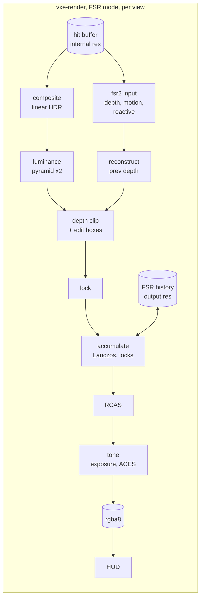

# 0041: AMD FSR 2.2.1 ported to WGSL: its six passes fed from the hit buffer, compared against our upscaler and the native frame

> **Status:** in-progress
> **Decisions:** Owner, 2026-10-22: approved with the plan's recommended options: Plan 0040 owns exposure and FSR reads it; behavioural bars with careful source reading, no SPIR-V harness; the motion bar beats our upscaler at both scales; if FSR misses it at Phase 4, stop and ask; FSR at scale 1 is in the comparison. Owner, 2026-10-27 (after Phase 4's investigation found no port defect): option (a), window it; the algorithm's misses become readings judged in Phase 7 (Phases 4 to 7 amended).
> **Created:** 2026-10-22
> **Milestone:** M2 in `docs/roadmap.md` (the upscaler; the roadmap's risk "No WGSL port of FSR 2
> exists", which this plan sizes)
> **Related ADRs:** [ADR-0034](../adrs/0034-fsr-2-ported-to-wgsl-as-the-default-upscaler-candidate.md)
> (proposed with this plan: FSR 2.2.1's port is the default candidate, and our upscaler stays
> opt-in). [ADR-0024](../adrs/0024-own-temporal-upscaler-on-the-hit-buffer.md) (superseded in
> part: its jitter, internal resolution and RCAS stand). [ADR-0001](../adrs/0001-rust-library-workspace-wgpu-compute-ray-marching.md)
> (wgpu and WGSL, no vendor path, no backend branch).
> [ADR-0018](../adrs/0018-direct-light-per-pixel-one-sample-from-a-hit-buffer-with-svgf-history-killed-by-edits.md)
> (the hit buffer and the edit boxes).
> **Source:** the owner's decision of 2026-10-22, after [Plan 0030](done/0030-temporal-upscaler.md)'s
> Phase 9 check: Plan 0030 closes with Plan 0024's frame as the default and its upscaler
> opt-in, and the FSR 2 port (ADR-0024's Alternative A) is the next plan.
> **Starts after:** Plan 0030 merges. This plan builds on its internal size, jitter,
> `reproject_centred`, light-change signal, `Upscaler` settings and the rigs in
> `apps/flythrough/tests/upscale.rs`. It was drafted against the plan-0030 branch at 0c3a82d;
> where the tree names things differently, the names in the tree win. It is independent of
> Plan 0040 (eye adaptation, ADR-0033, drafted in parallel) except for the exposure seam (Phase 2).

## TL;DR

We port the upscaling path of AMD FidelityFX Super Resolution 2, release v2.2.1 of
`GPUOpen-Effects/FidelityFX-FSR2` (MIT, "Copyright (c) 2022-2023 Advanced Micro Devices,
Inc."), to WGSL in `vxe-render`. That is six passes: luminance pyramid, reconstruct previous
depth, depth clip, lock, accumulate and RCAS. Two passes of ours feed and finish it. An input
pass writes depth, motion vectors and the reactive mask from the hit buffer, and a tone pass
applies exposure and ACES after the upscaler. The port is FP32 only, uses no wave operations,
no image atomics and no non-core storage formats, and has no vendor path.

`--upscaler off|own|fsr2`, with a key that cycles it and a banner in the window, puts Plan
0024's frame, Plan 0030's upscaler and FSR 2 side by side. Plan 0030's rigs measure all three in
the same test run. The bar is to beat our upscaler in motion while keeping its still, lamp,
flicker and ghost bars. The first thing anyone sees is FSR 2's accumulate pass upscaling the
stripe wall at scale 1.5 on lavapipe, sharper than a bilinear blit. The owner's comparison in a
window decides the default.

## Context & problem

Plan 0030's upscaler halves the frame. On the RTX 3080 Laptop it reads 2.73 to 2.78 ms at scale
1.5 against 5.29 to 5.55 ms at scale 1, and on the RADV iGPU 18.8 against 38.0 ms at 1080p. Its
still image is sharp. In motion it is soft: on its stripe wall at arm's length, edge spread (ES)
reads 1.436 px at scale 1 and 1.780 at 1.5 while panning, against native's 0.798. The jitter
moves the shadow rays. The owner's verdicts (ADR-0034, Context) close it as opt-in. `nfr.md` §2
still budgets the floor's 16.6 ms "with the upscaler allowed", and every lighting projection
lands under its line only at the internal resolution. M2 still needs an upscaler that the owner
accepts as the default.

FSR 2 is what Plan 0030's two rework rounds were approaching. It adds locks on thin features, a
Lanczos upsample with a bias table, history weighted by disocclusion and luminance stability,
and a shading-change term. Its inputs map onto the engine as follows:

| FSR 2 input (v2.2.1 `FfxFsr2DispatchDescription`) | from the engine |
|---|---|
| `color`, render size, HDR | the composite's linear radiance before the tone map (today it tone maps and encodes; Phase 2 splits it), as stored: pre-exposed once Plan 0040 lands (ADR-0033) |
| `depth`, `ENABLE_DEPTH_INVERTED \| ENABLE_DEPTH_INFINITE` | `near / z_view` from the hit's distance `t` and the view's forward axis; a miss writes 0 (infinitely far) |
| `motionVectors`, render size, without jitter | `reproject_centred` (Plan 0030 Phase 3), current to previous, in UV; a miss reprojects its ray direction (rotation only) |
| `exposure` (1x1), `preExposure` | `exposure`: the frame's display exposure, `params.exposure` (manual today) or Plan 0040's adapted value on the GPU once it lands. `preExposure`: the exposure the colour already carries, 1 until Plan 0040 lands and the frame's exposure after it (ADR-0033's pre-exposure; FSR rescales its history by the ratio to last frame's, which is ADR-0033's rescale rule) |
| `reactive` | translucent layers (1 - transmittance), the frame's edit boxes dilated by one voxel, Plan 0030 Phase 7's light-change signal |
| `transparencyAndComposition` | zero. Liquid surfaces (Plan 0034) write it later |
| `jitterOffset`, phase count | FSR's own sequence: Halton (2, 3) at index `i + 1`, `int(8 (display / render)^2)` phases (8 at scale 1, 18 at 1.5, 32 at 2) |
| `cameraNear`, `cameraFar`, `cameraFovAngleVertical`, `viewSpaceToMetersFactor` | a near plane below any hit (dev picks it and logs it), far infinite, `2 atan` of the view's up tangent, the world's voxel size in metres |
| `reset` | a view-mode change, an upscaler switch, a teleport: where Plan 0030 clears `Params.history` bit 1 |

How FSR 2's GPU habits map onto the portable WGSL set (wgpu 30.0.1, no added feature; every
choice below takes the portable fallback and is logged in Phase 1):

| FSR 2 uses | portable WGSL form here | non-portable option, as a followup |
|---|---|---|
| FP16 (`FFX_HALF`, `min16float`) | the FP32 path only | `Features::SHADER_F16`, checked at device creation, measured |
| wave operations (SPD's optional path) | the LDS path (`FFX_SPD_NO_WAVE_OPERATIONS`) | `Features::SUBGROUP` |
| `InterlockedMax` on an `R32_UINT` texture (previous depth) | `atomicMax` on `array<atomic<u32>>`, a storage buffer indexed by pixel | texture atomics |
| `globallycoherent` texture plus a last-workgroup tail (SPD) | two dispatches: the mips the first pass writes, then the tail and the exposure | none needed |
| `R16G16_FLOAT`, `R16_FLOAT`, `R8_UNORM`, `R8G8_UNORM`, `R11G11B10_FLOAT` storage | `rg32float`, `r32float`, `rgba8unorm`; read-write resources (`NEW_LOCKS`) as storage buffers | the tier-1 storage formats where offered |
| `R16_SNORM` LUTs (Lanczos, upsample bias) | `r32float` sampled textures (`R16Snorm` is a native-only format in wgpu) | none needed |
| barriers under a branch | WGSL's uniformity rules: SPD's tail moves into its own dispatch, `workgroupUniformLoad` where a branch stays | none needed |

The consumer requirement is `project-context.md`'s Rendering row: stable at arm's length, and
60 fps at 1080p on a mid-range card with an upscaler allowed. The `nfr.md` figures touched are
§2's upscale, tone map and post line (1.5 ms), §2's primary-ray and lighting lines at the
internal resolution (unchanged from Plan 0030), and §3's "everything else" (the FSR resources).

## Decision

We build ADR-0034. `vxe-render` gains an `fsr2` module, one context per view, holding FSR 2's
resources and pipelines, and `crates/vxe-render/src/shaders/fsr2/` holds the WGSL. That is one
file per AMD pass, a shared common file that ports the parts of `ffx_core*.h`, `ffx_fsr2_*.h`
and `ffx_spd.h` that the passes call, our input pass and our tone pass. Each ported file
carries AMD's MIT notice and names the tag and the files it translates. `Frame` selects the
upscaler (`off`, `own`, `fsr2`). The FSR path runs: composite (HDR) → input → luminance pyramid
(two dispatches) → reconstruct previous depth → depth clip → lock → accumulate → RCAS → tone →
rgba8 → HUD.

Plan 0024's lighting stays jitter-aware through Plan 0030 Phase 3's `reproject_centred`. That
mechanism does not depend on the jitter sequence, so FSR's 18 phases replace Plan 0030's 16
only in FSR mode. Edit boxes force history off through the depth-clip term. That is the one
place the port adds an engine rule to AMD's pass, and the source marks it. FSR's reactive
autogen and auto-exposure are not ported.

We rejected a third round of tuning our own upscaler, FSR 3 or 4, DLSS and XeSS, another
engine's TAAU, and spatial-only FSR 1 (ADR-0034).

## Architecture diagram



## Implementation phases

Each phase ships as its own commit. `dev` implements all phases in one session with no review
between phases. The architect reviews once at the end, in a fresh session.

The rigs are Plan 0030's, in `apps/flythrough/tests/upscale.rs`. The shared rig helpers move to
`apps/flythrough/tests/support/` so that `fsr2.rs` and `upscale.rs` measure through the same
code. Every comparison with "our upscaler" reads Plan 0030's upscaler on the same tree in the
same test run, with Plan 0030's logged numbers next to it as the expectation. Output 384 x 216
unless stated. "Scale 1.5" means 256 x 144 internal. Readings are on lavapipe unless an adapter
is named.

### Phase 1: The walking skeleton: FSR 2's accumulate pass end to end on lavapipe
- **Owner skill:** dev
- **What:** the source is pinned and its size is counted. The input pass and the accumulate pass
  are ported, with the other FSR inputs held neutral, and the upscaled stripe wall reaches the
  presenter.
  1. **The source.** The tag `v2.2.1` of `GPUOpen-Effects/FidelityFX-FSR2` is read, not
     vendored. The log records the tag's commit hash, its `LICENSE.txt` copyright line, and
     `wc -l` of each `ffx_fsr2_*.h`, `ffx_core*.h`, `ffx_spd.h` and pass file the path uses: the
     sizing reading the roadmap asked for. The log also records which of the table's portable
     forms (Context) each pass needs. The GLSL pass files are the primary text and the HLSL is
     the tie-breaker.
  2. **The input pass** (`fsr2/input.wgsl`, ours) writes depth (`r32float`) and motion vectors
     (`rg32float`) at the internal size, from the hit buffer, as the Context table says. The
     reactive mask is 0 here.
  3. **FSR's jitter sequence** in FSR mode: `jitter_at` gains a phase count, and `View.jitter`
     carries FSR's offset in our pixel convention (the y sign follows our row order; the log
     states it).
  4. **The accumulate pass** (`fsr2/accumulate.wgsl`, with the Lanczos and bias LUTs it reads)
     consumes, for this phase only, the composite's display-encoded colour as LDR input
     (`ENABLE_HIGH_DYNAMIC_RANGE` off), and FSR's other inputs held neutral: no locks, no
     disocclusion, exposure 1, a luminance mip of constant 0.5. Its output goes through the
     existing `rgba8` target. Phases 2 and 3 replace each neutral input.
  5. **`--upscaler off|own|fsr2`** on the fly-through, plus a key that cycles the three modes,
     with the mode on screen (a brief banner on change, visible without the stats HUD).
     `Frame::set_upscaler_kind` in the library. `--upscaler off` is scale 1 with the jitter off.
     Plan 0030's flags (`--internal-scale`, `--jitter`, `--sharpen`) stay.
- **Files touched:** new `crates/vxe-render/src/fsr2.rs`,
  `crates/vxe-render/src/shaders/fsr2/{common,input,accumulate}.wgsl`, `marcher.rs`,
  `camera.rs` (the phase count), `lib.rs` (re-exports),
  `crates/vxe-render/tests/shader_portability.rs` (each new shader, plus Plan 0030's
  `upscale.wgsl` and `sharpen.wgsl`, which its log left out), `apps/flythrough/src/main.rs`,
  `hud.rs` (the banner), new `apps/flythrough/tests/fsr2.rs`, `tests/support/`.
- **Done when** (headless, lavapipe):
  1. On the stripe wall at arm's length, a still camera, scale 1.5, 32 frames, FSR mode's GE
     is above the bilinear blit's (B), and its ES is below B's, both read in the same run. This
     shows that sub-pixel detail is recovered, which a blit cannot do. Plan 0030 logged B at
     1.718 px and 0.00435.
  2. On the level, after a camera step of one voxel sideways, the motion vector at every hit
     pixel equals the analytic reprojection of its hit through the two views, within 1e-3
     internal pixels. On a still camera it is 0 at every pixel, misses included.
  3. FSR's sequence: 8 phases at scale 1, 18 at 1.5 and 32 at 2. The first four offsets are
     (0, -1/6), (-1/4, 1/6), (1/4, -7/18), (-3/8, -1/18) internal pixels before the y
     convention (Halton (2, 3) at index `i + 1`, minus 0.5).
  4. `--upscaler off` renders every Plan 0024 golden byte for byte (the FSR path is not
     dispatched). A HUD test shows the banner's text changing through `off`, `own` and `fsr2`.
     Every new shader validates under naga in `shader_portability.rs`.

### Phase 2: HDR in, tone after, the exposure seam and the masks
- **Owner skill:** dev
- **What:** FSR gets the inputs it was designed for.
  1. **HDR colour.** In FSR mode the composite writes linear radiance (pre-exposure) to an
     `rgba16float` target at the internal size, instead of exposure, ACES and the 1/2.2 encode.
     A new tone pass (`fsr2/tone.wgsl`, ours) applies those three, unchanged, to FSR's output
     at the output size, and writes the `rgba8` target the HUD draws on. Accumulate runs with
     `ENABLE_HIGH_DYNAMIC_RANGE`.
  2. **The exposure seam.** FSR reads a 1x1 `rg32float` exposure texture that the frame writes
     from `params.exposure` each frame, with `preExposure` 1. If Plan 0040 has landed, its
     adapted exposure on the GPU is copied into the texture instead, `preExposure` is the
     exposure the composite stored with (ADR-0033), and the tone pass applies only what the
     colour does not already carry. The log says which case it built. FSR's auto-exposure flag
     stays off: Plan 0040 is the engine's one meter.
  3. **The reactive mask** (`rgba8unorm`, the input pass) is the largest of three terms:
     - the translucent layers' `1 - transmittance` (Plan 0015's layer target), scaled by a
       constant that dev tunes;
     - 1.0 where the pixel's hit lies in one of the frame's edit boxes dilated by one voxel;
     - Plan 0030 Phase 7's light-change signal (the lamp's unshadowed term at the hit, changed
       by more than 10 % of the larger value and 0.01 against `change_frames` frames before, or
       an emission scale changed), at a weight that dev tunes in Phase 5.

     The transparency-and-composition mask is written as zero. It is the seam for Plan 0034.
- **Files touched:** `crates/vxe-render/src/shaders/composite.wgsl` (the HDR target in FSR
  mode), new `fsr2/tone.wgsl`, `fsr2/input.wgsl`, `fsr2/accumulate.wgsl`, `fsr2.rs`,
  `marcher.rs`, `apps/flythrough/tests/fsr2.rs`.
- **Done when** (headless, lavapipe):
  1. **The tone move is lossless.** On every Plan 0024 golden pose at scale 1 with the jitter
     off, the composite's HDR target put through the tone pass equals the composite's direct
     `rgba8` output byte for byte. Same function, same inputs: the test dispatches the tone pass
     on the HDR target with the upscaler bypassed.
  2. **The mask, pixel by pixel.** On the level with a radius-6 carve, every pixel whose hit
     lies in the carve's dilated box reads reactive 1.0 on the carve's frame, and an untouched
     opaque pixel reads 0. A pixel behind a translucent layer reads its formula within 1/255.
     With the lamp switched on a settled still camera, every lit pixel reads the light-change
     term on that frame.
  3. **Exposure.** Doubling `params.exposure` changes the exposure texel the same frame (read
     back). After the history settles, the tone pass's output equals Plan 0024's frame's at the
     new exposure within 2/255 mean on the stripe wall at scale 1.
  4. Phase 1's bars still hold, read on the HDR path.

### Phase 3: The remaining passes: luminance pyramid, previous depth, depth clip, lock
- **Owner skill:** dev
- **What:** each neutral input of Phase 1 is replaced by its ported pass, in AMD's order:
  1. `fsr2/luminance_pyramid.wgsl`: SPD on the LDS path, in two dispatches (the tail and the
     exposure mip in the second). It writes the shading-change mip and mip 5 that accumulate
     and lock read.
  2. `fsr2/reconstruct_previous_depth.wgsl`: dilated depth, dilated motion and lock input luma.
     The reconstructed previous depth goes through `atomicMax` on a storage buffer.
  3. `fsr2/depth_clip.wgsl`: disocclusion, and the dilated reactive masks. The frame's edit
     boxes (dilated by one voxel) force full disocclusion here, the one engine rule added to
     AMD's pass, marked in the source.
  4. `fsr2/lock.wgsl`: new locks into a storage buffer that accumulate reads and clears.

  The log records each pass's bindings against the adapter's per-stage limits. The port stays
  within wgpu's defaults: at most 4 storage textures per stage, with buffers where a pass would
  exceed that, and `limits_for`'s storage-buffer count.
- **Files touched:** new `fsr2/{luminance_pyramid,reconstruct_previous_depth,depth_clip,lock}.wgsl`,
  `fsr2/accumulate.wgsl`, `fsr2/common.wgsl`, `fsr2.rs`, `crates/vxe-render/src/lib.rs`
  (`limits_for`, if a limit moves), `shader_portability.rs`, `apps/flythrough/tests/fsr2.rs`.
- **Done when** (headless, lavapipe, scale 1.5):
  1. **No ghost after a carve** (Plan 0030 Phase 2's rig: the level, a radius-6 carve at t =
     30.5 voxels, 32 still frames before). On the first frame after the carve, over the output
     pixels whose nearest internal hit lies in the dilated box (Plan 0030 counted 4749), FSR's
     output differs from the same pipeline's `reset` frame at that pose and jitter phase by at
     most 2/255 mean. The reset frame is what full disocclusion should give. The log records
     the count over 8/255, and the same two figures on the fourth frame.
  2. **History survives a sideways step.** After a one-voxel step, the history weight that the
     accumulate pass computes (a debug readback of the port's variable, named in the log) is
     above zero in at least 95 % of the output pixels whose hit surface did not change. Plan
     0030 read 99.95 %.
  3. **Still means no disocclusion.** On a still camera after 2 frames, the depth clip's
     disocclusion is 0 at every hit pixel that is not within one internal pixel of a
     silhouette.
  4. **Locks form on thin features.** On the stripe wall at the far distance (1.753 px per
     voxel in Plan 0030's rig), the share of stripe-edge output pixels holding a lock after 32
     frames is a reading above zero. On a flat single-material patch, the share is a reading.
  5. Phase 1's and Phase 2's bars still hold.

### Phase 4: RCAS, and the sharpness bars still and panning
- **Owner skill:** dev
- **What:** FSR 2's RCAS pass (`ffx_fsr2_rcas.h`) runs after accumulate when sharpening is on,
  and `--sharpen` drives FSR's `sharpness` in FSR mode. FSR 2's RCAS is FSR 1's `FsrRcasF`
  with exposure handling. If dev reuses `sharpen.wgsl` with that handling added, the log says
  so. The bars are read at sharpening 0 on the accumulate output, as in Plan 0030 Phase 6, and
  at the default sharpening as readings.
- **Files touched:** new `fsr2/rcas.wgsl` (or `sharpen.wgsl`), `fsr2.rs`, `marcher.rs`,
  `apps/flythrough/tests/fsr2.rs`, `tests/golden.rs` (a new golden `fsr2.png`: the cavity, 256
  x 144 to 384 x 216, 32 frames, FSR mode at the default sharpening).
- **Done when** (headless, lavapipe, the stripe wall; N, R and B as in Plan 0030 Phase 6, read
  in the same run):
  1. **Still, at least Plan 0030's bars.** At scale 1, ES at arm's length is at most N's plus
     0.53 px, and GE at both distances is at least 0.85 of R's. At scale 1.5, GE at both
     distances is at least `(GE(R) + GE(B)) / 2`, and ES at arm's length is at most
     `(ES(R) + ES(B)) / 2`. From Plan 0030's logged N, R and B these are 1.328 px and 0.00558 /
     0.08998 at scale 1, and 1.452 px and 0.00546 / 0.07825 at 1.5. The bars are computed from
     this run's readings.
  2. **Panning, better than our upscaler.** The camera translates parallel to the wall at 0.37
     output pixels per frame for 64 frames after 32 still ones, at arm's length, at scale 1 and
     at 1.5. On the last frame, FSR's ES is below our upscaler's and its GE is at least our
     upscaler's, both read in this run. Plan 0030 read ES 1.436 and 1.780 px, and GE 0.00494
     and 0.00454. The far-distance pan is a reading.
  3. **The still camera nearer the truth than a blit** (Plan 0030 Phase 3 bar 1's rig: the
     level, Plan 0024's defaults, 32 frames). FSR's output is nearer the 2 x 2 supersampled
     render than the bilinear blit is, in mean absolute difference per channel. Plan 0030
     read 2.840 against 3.044. Ours is read beside it.
  4. `fsr2.png` is blessed. At sharpening 0 the RCAS pass is bypassed (the accumulate output
     is unchanged), and at the default no pixel exceeds its 3 x 3 neighbourhood's maximum by
     more than 1/255.
  5. Readings, no bar: ES, GE and Plan 0030 Phase 4's rim gradient for N, R, B, ours and FSR, at
     sharpening 0 and the default, both distances, still and panning.
- **Amended 2026-10-22 (owner): investigate the motion softness before the bars are re-read.**
  The first reading missed bar 2 at both scales (panning ES 1.653 px against ours 1.436 at
  scale 1, 1.792 against 1.780 at 1.5, GE lower at both), and the far pan at 1.5 collapsed to
  GE 0.00688 against ours 0.04773. That collapse reads as a port defect, not a limit of the
  algorithm. Before Phase 5:
  1. **Find the cause.** Compare the port pass by pass against `ffx_fsr2_*.h` at v2.2.1 for
     the panning rig: the motion vector's sign, units and the jitter it carries; the
     reprojection's sample position and its Lanczos or bilinear history fetch; the lock's
     lifetime and its reprojection; the luma-stability and the new-sample weight in
     accumulate; the depth-clip dilation. A per-pass readback on a 64-frame pan (history
     colour, lock, disocclusion, the accumulate weight) shows where the detail goes. The log
     names the cause with a before/after reading.
  2. **Re-read bars 1 to 4** after any fix, in one run, as written.
  3. **If no defect is found**, or the fix still misses bar 2, stop and report the readings
     with options; the owner decides between the window (Phases 5 to 7) and closing.
  The architect settles two secondary questions with the post-investigation readings: whether
  bar 3's supersampled reference is averaged in linear light (FSR resolves in linear light;
  the test prints both), and whether bar 4's neighbourhood bound holds for AMD's unclamped
  RCAS or RCAS takes `sharpen.wgsl`'s clamp. Until then, both stay as written, and their
  readings are printed.
- **Amended 2026-10-27 (owner): window it. The bars FSR 2's algorithm misses become readings
  the owner judges in Phase 7; the bars that hold stay asserted.** Step 1 found no port defect
  (the log's Phase 4 amendment block). The 1.0 px a frame pan at 88 voxels holds GE at the still
  value (0.06239 against 0.06283), so motion and alignment are right. The 0.37 to 0.5 px pans
  collapse to GE 0.007, which matches FSR's own arithmetic (a 1/11 new-sample weight in motion
  and an off-centre Lanczos-2 history fetch). This replaces step 3's stop. The remaining steps:
  4. **Split each failing test into what it asserts and what it prints.** A test's name states
     the claim its assertions defend. A missed bar is printed on a line that starts
     `reading:` and gives the reading, the bar as written above, and "owner judges, Phase 7".
     No bar is loosened in place: an assertion either holds the bar as written or moves to a
     `reading:` line that this amendment names. Asserted, each computed in the run:
     - **Bar 1, the part that held:** at scale 1, at arm's length, ES at most N's plus 0.53
       px, and GE at least 0.85 of R's. Printed: scale 1.5 at arm's length (ES and GE), and the
       88-voxel GE at both scales.
     - **Bar 2, alignment in motion (new, a regression bar):** at 88 voxels, scale 1.5,
       sharpening 0, a 1.0 output px a frame pan of 64 frames after 32 still ones: GE on the
       last frame is at least 0.85 of the same run's still GE at frame 32. Step 1 read 0.993 of
       it. 0.85 leaves room for lavapipe's noise and catches a motion-vector or jitter
       regression, which drops it toward the slow pans' 0.11. Printed: both 7-voxel pans at
       0.37 px (ES and GE against ours), and the 88-voxel pans at 0.37 and 0.5 px for ours and
       FSR at both scales.
     - **Bar 3:** the reference becomes the 2 x 2 supersampled render averaged in linear
       light (decision below). Asserted: our upscaler is nearer it than the bilinear blit (step
       1 read 2.835 against 3.014; it guards the rig and the reference). Printed: FSR's
       distance (3.195), and the display-byte distances beside all three.
     - **Bar 4:** RCAS stays AMD's, unclamped (decision below). Asserted: `fsr2.png` matches,
       and at sharpening 0 the RCAS pass is not dispatched and the output equals the
       accumulate output texel for texel. Printed: the count of sharpened pixels over their
       unsharpened 3 x 3 maximum by more than 1/255 (step 1: 1 527 of 26 705), and the
       largest excess.
     - Bar 5 stays readings.
  5. **Re-read every Phase 4 test in one run**, record each assertion and `reading:` line in
     the log, and go on to Phase 5. Phase 1's bar (FSR at 1.5 sharper than the blit, still)
     and the bars of Phases 2 and 3 are unchanged and stay asserted.

  **Decisions on the two secondary questions:**
  - **Bar 3's reference is averaged in linear light:** FSR and a real pixel both integrate
    radiance, so a box filter of display bytes is a biased truth (the encode alone shifts it
    against FSR), and the linear figure is the honest one even though FSR still misses it.
  - **RCAS takes no clamp:** the plan measures FSR 2 as AMD ships it, and `sharpen.wgsl`'s
    clamp would make the comparison partly ours. The overshoot is RCAS's design, so it is
    printed and the owner judges its halos on screen in Phase 7.

### Phase 5: Lights, flicker and shadow motion
- **Owner skill:** dev
- **What:** the reactive mask's light-change weight and the translucent scale are tuned against
  Plan 0030's lamp, flicker and wobble rigs. Each value tried, and its readings, go in the log.
  The shadow motion the owner saw (scale 1.5, face look) is split by cause: the jitter at the
  lighting passes' input, against the upscaler's history.
- **Files touched:** `fsr2/input.wgsl`, `fsr2.rs`, `apps/flythrough/tests/fsr2.rs`.
- **Done when** (headless, lavapipe, scale 1 and 1.5, jitter on; the reference is Plan 0024's
  frame, as in Plan 0030 Phase 7):
  1. **A sweeping headlamp lags at most 2 frames more than the reference.** This is Plan 0030
     Phase 7 bar 1's rig: 0.013 rad a frame, the lag behind the ideal over the last 16 frames.
     Plan 0030 read 5.38 for the reference and 5.82 / 5.92 for ours.
  2. **A lamp step settles within 2 frames of the reference.** Plan 0030 read 18 frames for the
     reference and for ours.
  3. **Flicker within Plan 0030 Phase 3 bar 2's margins.** On the dark cave rig at 320 x 180
     output and scale 1.5, jitter on reads a mean at most 0.40/255 above jitter off's, and a
     share over 4/255 at most 1.15 points above it. Plan 0030's on-reading was 0.2752/255 and
     0.6377 %.
  4. **Shadow wobble no worse than ours.** On Plan 0030 Phase 7's rig, over one jitter cycle at
     both scales, the per-phase wobble of a still pixel is at most our upscaler's in this run.
     Plan 0030 read 0.858 and 1.711/255, and 0.099 for the reference. The same is read in the
     face look over the pixels within 2 output pixels of a lamp-shadow boundary, with the same
     bar. The log splits that wobble into the composite's input (the jittered lighting before
     any upscaler) and FSR's output.
  5. Phase 3's and Phase 4's bars still hold.
  6. Readings, no bar: the sweep's trail (Plan 0030 read 1.121 % and 2.605 %), and Plan 0024
     Phase 13's emission step on FSR's output.
- **Amended 2026-10-27 (owner): Phase 4's split carries over; a miss here does not stop the
  lane.** Bar 5 reads "Phase 3's bars and Phase 4's amended assertions still hold"; Phase 4's
  `reading:` lines are re-printed, not asserted. Bars 1 to 4 stay gates as written. If one
  misses after the tuning, dev does what Phase 4 did before moving it: compare the passes the
  rig exercises against v2.2.1 and log a per-pass reading. A defect found is fixed. If none is
  found, the bar becomes a `reading:` line (the reading, the bar, "owner judges, Phase 7"), the
  log names the evidence, and Phase 7 lists that rig as something to look at. Dev does not pick
  a new threshold.

### Phase 6: The readings on both adapters
- **Owner skill:** dev
- **What:** Plan 0030 Phase 8's protocol: 1080p output, the level's spawn, release headless,
  the median of the last 30 of 300 frames, three runs, under the perf lock and the memory cap,
  on the RTX 3080 Laptop and on the RADV iGPU (`--adapter`, Plan 0028). Each mode is read:
  `off`, `own` at 1.5, and `fsr2` at 1 and 1.5. Each FSR pass gets its own entry in
  `FRAME_PASSES`, timed by timestamp queries. `frame_bytes` per mode. `docs/nfr.md` §2 and §3
  are updated.
- **Files touched:** `marcher.rs` (`FRAME_PASSES`), `apps/flythrough/src/main.rs`, `hud.rs`
  (the upscale row lists the FSR passes' total), `docs/nfr.md` §2 and §3, the root `README.md`
  (the flag), this plan's log.
- **Done when:**
  1. On the RTX 3080 Laptop at scale 1.5, input + luminance pyramid + reconstruct + depth clip
     + lock + accumulate + RCAS + tone read at most 1.2 ms. The arithmetic: §2's 1.5 ms line,
     less the composite's 0.136 to 0.138 ms (Plan 0030 Phase 8), less about 0.15 ms for the HUD
     and a margin. AMD quotes under 0.6 ms on an RX 5700 XT for its FP16 and wave path. The
     hit pass and the sum of light, temporal and a-trous stay at most 55 % of their
     scale-1 times (Plan 0030 Phase 5's bar).
  2. On the RADV iGPU, the whole frame and the FSR passes at both scales are read beside Plan
     0030's 18.797 to 18.865 ms frame and 3.216 to 3.232 ms upscale at 1.5. No bar: this is the
     owner's evidence for the default.
  3. `frame_bytes` in FSR mode at scale 1.5 is Plan 0030's 124 621 440 B, less its two
     histories (33 177 600 B, not allocated in FSR mode), plus the FSR inventory in Data shapes
     as the log lists it, and no more.
- **Amended 2026-10-27 (owner): the readings are the owner's evidence; one bar adjusts to the
  tree.** Bar 3's inventory is the log's, including Phase 2's rgba32float colour input (14.75
  MB at 1280 x 720, not the table's 7.37 MB) and the target RCAS writes. Bar 1 stays a gate
  against §2. If it misses, the reading is logged as it stands, `docs/nfr.md` gets the
  measured figure with machine and commit, and Phase 7 weighs it. The FP16 and subgroup
  variants stay followups, not a fix inside this plan.

### Phase 7: The owner's windowed comparison and the default
- **Owner skill:** human
- **What:** in a window of about 2530 x 1378 on the RTX 3080 Laptop, with the headlamp on, the
  owner flies, digs, sweeps the headlamp, holds still in front of a vein and reads edges at
  arm's length. The runs: Plan 0024's frame (`off`), our upscaler at 1.5 (`own`, as Plan 0030
  ships it), FSR 2 at 1.5, and FSR 2 at 1 (native anti-aliasing). Each run is done in the
  contour look and in the face look. The key that cycles the upscaler lets each pair be
  compared at one pose. The owner gives a verdict on sharpness in motion, ghosting after digs,
  the lamp's smear, shadow motion, and flicker. The owner then names the default: the
  upscaler and its scale, or `off`.
- **Files touched:** this plan's log; ADR-0034's Outcome at the close.
- **Done when:** the verdict for each run and the default are in the log. A default other than
  Plan 0024's frame lands as a dev fix before the close (the fly-through's `DEFAULT_SCALE` and
  upscaler, and the README's flags).
- **Amended 2026-10-27 (owner): this is where FSR 2 is judged against ours.** The headless
  misses of Phases 4 to 6 are the owner's to judge here, and each gets its own verdict in the
  log beside its reading. The owner looks at, in each look, cycling `own` and `fsr2` at one
  pose:
  1. **The slow pan at a distance:** strafing at about 0.37 to 0.5 output pixels a frame
     past a striped or veined wall about 88 voxels away, at scale 1.5 and at scale 1. This is
     where FSR read GE 0.007 against ours 0.048. A faster strafe (about 1 px a frame) at the
     same distance is the contrast: FSR held its still value there.
  2. **The slow pan at arm's length** (about 7 voxels, the same speed): both scales missed
     bar 2 headlessly.
  3. **The still image at scale 1.5**, at arm's length and at 88 voxels: Phase 4 bar 1 missed
     there.
  4. **RCAS halos** at the default sharpening on high-contrast edges: AMD's RCAS overshoots its
     neighbourhood (Phase 4 bar 4's reading), and ours clamps.
  5. Any Phase 5 or 6 bar the log turned into a reading.

## Data shapes

```rust
// illustrative
pub enum UpscalerKind { Off, Own(Upscaler), Fsr2(Fsr2Settings) }
pub struct Fsr2Settings { pub sharpness: f32, pub reactive_translucent: f32, pub reactive_light: f32 }
pub struct Fsr2Context {           // one per view
    // FSR 2.2.1's internal resources (table below), the input pass's targets, and the
    // pipelines; resized with Frame::set_sizes, never per frame.
}
```

FSR 2.2.1's internal resources on this path at 1080p output and 1280 x 720 internal: 2 073 600
output and 921 600 internal pixels. The bytes are arithmetic, not readings. Phase 6 reads
`frame_bytes`.

| resource (AMD's format) | here | size | bytes |
|---|---|---|---|
| prepared input colour (rgba16f) | rgba16float | internal | 7.37 MB |
| reconstructed previous depth (r32uint, atomics) | `atomic<u32>` buffer | internal | 3.69 MB |
| dilated motion x2 (rg16f) | rg32float | internal | 14.75 MB |
| dilated depth (r32f) | r32float | internal | 3.69 MB |
| lock status x2 (rg16f) | rg32float | output | 33.18 MB |
| lock input luma (r16f) | r32float | internal | 3.69 MB |
| new locks (r8, read-write) | `f32` buffer | output | 8.29 MB |
| internal upscaled x2 (rgba16f) | rgba16float | output | 33.18 MB |
| scene luminance mips (r16f, half internal) | r32float | 640 x 360, mipped | about 1.23 MB |
| luma history x2 (rgba8) | rgba8unorm | output | 16.59 MB |
| dilated reactive masks (rg8) | rgba8unorm | internal | 3.69 MB |
| LUTs, exposure, SPD counter | r32float, rg32float, `atomic<u32>` | tiny | under 0.01 MB |
| **FSR total** | | | **about 129.4 MB** |
| ours: HDR colour (rgba16float), depth (r32float), motion (rg32float), masks (rgba8unorm) | | internal | 22.12 MB |

That is about 151.5 MB in FSR mode, against Plan 0030's 33.2 MB of history. The widening costs
about 30 MB of it: lock status 16.59, dilated motion 7.37, new locks 6.22 and lock luma 1.84. The
reactive-autogen and pre/post-alpha resources are not allocated.

## Budgets

| `nfr.md` figure | line | projection | how the close measures it |
|---|---|---|---|
| §2 Upscale, tone map, post | 1.5 ms | FSR passes plus tone 0.6 to 1.2 ms on the dev box at 1080p and scale 1.5 (a guess: AMD's 0.6 ms on a 5700 XT with FP16 and waves, and our FP32 LDS path is slower), plus the composite's 0.14 ms | Phase 6, three runs, both adapters |
| §2 Primary rays, Lighting, Denoise | 3.0, 6.0, 3.0 ms | unchanged from Plan 0030 at scale 1.5 (43 to 47 % of scale 1). The input pass reads the hit buffer once | Phase 6 |
| §3 Everything else in VRAM | 1.5 GB | `frame_bytes` about 243 MB in FSR mode at 1.5 (124.6 - 33.2 + 151.5; arithmetic) | Phase 6 |

The slow adapter has no projection. Plan 0030's upscale pass reads 3.2 ms there, and FSR's
passes read more texels per output pixel, so the iGPU's halving may shrink. Phase 6 reads it,
and the owner weighs it in Phase 7.

## Risks & open questions

- **Transcription errors.** No test of AMD's checks the port bit for bit. The bars are
  behavioural, and a mistake can pass them while looking wrong. Mitigations: the GLSL is the
  primary text; each ported function names its source function in a comment; Phase 3 bar 3 and
  Phase 1 bar 2 test the parts with exact answers. A differential harness (AMD's GLSL compiled
  offline to SPIR-V and run through wgpu's `spirv` input, test-only) is an owner question below.
- **The motion bar may not be met.** If FSR does not beat our upscaler while panning, dev stops
  at Phase 4 with the readings, and the owner decides between continuing to Phase 7 (his eye
  as the bar) and stopping.
- **Edit boxes through depth clip.** If forcing disocclusion does not take history to zero in
  AMD's accumulate (Phase 3 bar 1), the reactive term and the transparency-and-composition mask
  are the next levers, each logged. Changing accumulate's arithmetic is the last resort, and
  the source marks it.
- **Jittered lighting is not the upscaler's to fix.** If Phase 5's split puts the shadow
  wobble in the composite's input, FSR cannot remove it. The lever is Plan 0024's light pass
  (a shadow ray from the pixel's centre rather than the jittered hit), which is a followup for
  a lighting plan, not this one.
- **Storage limits.** The accumulate pass binds the most resources. If it cannot fit in 4
  storage textures per stage with buffers, `limits_for` requests more, up to what the adapter
  offers, and the log records the request. The floor's class (Vulkan 1.2) offers far more than
  4. This is a check, not a branch.
- **Asymmetric views.** FSR assumes a symmetric frustum. The flat screen has one; a VR view
  (the VR-readiness decision) would need its own vertical FOV and centre offset in the depth
  clip's reconstruction. This is recorded here, and it is out of scope.
- **Translucent layers and liquids** reach FSR only through the masks. Plan 0034's Phase 7
  "upscaler half" was drafted against `upscale.wgsl`. Under FSR it becomes the surface point's
  depth and motion, plus the transparency-and-composition mask. That plan is amended when it
  is picked up, not here.
- **Determinism** per adapter, as Plan 0024: FSR's sequence is fixed per frame index, and no
  atomics affect a result's order (the maximum is order-free).
- **Threading:** none. Compute passes run on the frame's encoder.
- **No new dependency.** The port is source we write. The licence is AMD's notice in each file.

## What this plan does NOT do

- **FP16 and subgroup builds** (feature-checked variants): followups, measured against Phase 6.
- **FSR 3.x's upscaler revisions, frame generation, FSR 4, DLSS, XeSS**: ADR-0034.
- **Removing Plan 0030's upscaler**: a later plan, once the default has held.
- **Dynamic resolution** (FSR's `ENABLE_DYNAMIC_RESOLUTION`): Plan 0030's followup stands.
- **Eye adaptation**: Plan 0040. This plan only reads its value.
- **Motion vectors for entities** (M6) and **liquid surfaces' masks** (Plan 0034).
- **The contour look's own softness**: Plan 0039.

## Owner questions

1. **Exposure ownership with Plan 0040.** (a) Plan 0040 owns exposure for every upscaler mode,
   and FSR reads its exposure and its pre-exposure (recommended: eye adaptation must work with
   the upscaler off, and ADR-0033's pre-exposure is FSR's `preExposure` input as designed). (b)
   FSR's luminance pyramid becomes Plan 0040's meter in FSR mode. (c) FSR takes the manual
   exposure only, until a later plan.
2. **Checking the port's fidelity.** (a) Behavioural bars plus source-reading discipline
   (recommended: no new tool, and the bars defend what the owner sees). (b) Add a test-only
   per-pass differential harness against AMD's GLSL compiled to SPIR-V: about one more phase,
   a dev-only glslang step, and it may fail where naga's SPIR-V front end rejects AMD's
   extensions.
3. **The motion bar.** (a) Beat our upscaler's pan readings at both scales (recommended). (b)
   Pan ES within 0.3 px of FSR's own still ES. (c) Readings only, with the owner's eye in
   Phase 7.
4. **If FSR misses the motion bar at Phase 4.** (a) Stop and ask (recommended). (b) Continue to
   Phases 5 to 7 and let the window decide.
5. **Scale 1 FSR in the comparison.** (a) Include it, as native anti-aliasing at Plan 0024's
   ray count (recommended: it answers "scale 1 jitter on: meh" with a better accumulator). (b)
   Scale 1.5 only.

## Implementation log

> Written by `dev`: one row per phase as its commit lands, then the close block. **The phases
> above are the contract. This section records what happened.** Observations, never conclusions:
> no pass list, no self-assessment. Deviations and unmet done-whens are **always** disclosed.
> Keep it shorter than `## Implementation phases`.

| phase | owner | state | commit |
|---|---|---|---|
| 1: The walking skeleton: FSR 2's accumulate pass end to end on lavapipe | dev | done | 80aed60 |
| 2: HDR in, tone after, the exposure seam and the masks | dev | done | 80085f8 |
| 3: The remaining passes: luminance pyramid, previous depth, depth clip, lock | dev | done | d3b8ddb |
| 4: RCAS, and the sharpness bars still and panning | dev | done | dab579b, dd272de, 66cd9d0, be59e30 |
| 5: Lights, flicker and shadow motion | dev | done: bar 4 at scale 1 a reading | 09c7a6c |
| 6: The readings on both adapters | dev | done: bar 1 a reading (1.894 to 1.913 ms) | 4f1fe72 |
| 7: The owner's windowed comparison and the default | human | done: default `own` at 1.5 | 92f19b3, 0428d39 |

**Phase 1** (lavapipe, llvmpipe LLVM 23.1.3, Mesa 26.2.5; exclusive perf lock; 1-min load 8.3
to 15.7 from the other lanes, so no timing is taken here).

- Source: tag `v2.2.1` of GPUOpen-Effects/FidelityFX-FSR2 is commit
  `1680d1edd5c034f88ebbbb793d8b88f8842cf804`, read under the untracked `live/fsr2-src/`
  (sparse checkout of `src/ffx-fsr2-api/{shaders,vk}` and `LICENSE.txt`; no build script
  run). `LICENSE.txt`: "Copyright (c) 2022-2023 Advanced Micro Devices, Inc. All rights
  reserved."
- Sizing, `wc -l` of the files the upscaling path reads: `ffx_fsr2_accumulate.h` 295,
  `ffx_fsr2_upsample.h` 194, `ffx_fsr2_reproject.h` 136, `ffx_fsr2_postprocess_lock_status.h`
  106, `ffx_fsr2_sample.h` 605, `ffx_fsr2_common.h` 565, `ffx_fsr2_depth_clip.h` 257,
  `ffx_fsr2_lock.h` 115, `ffx_fsr2_reconstruct_dilated_velocity_and_previous_depth.h` 145,
  `ffx_fsr2_compute_luminance_pyramid.h` 188, `ffx_fsr2_rcas.h` 67, `ffx_fsr2_callbacks_glsl.h`
  681 (the `ffx_fsr2_*.h` total 3354); `ffx_spd.h` 936; `ffx_fsr1.h` 1250 (RCAS only);
  `ffx_core.h` 51, `ffx_core_glsl.h` 1669, `ffx_core_gpu_common.h` 2784,
  `ffx_core_portability.h` 50, `ffx_common_types.h` 429; pass files
  `ffx_fsr2_accumulate_pass.glsl` 86, `..._compute_luminance_pyramid_pass.glsl` 133,
  `..._depth_clip_pass.glsl` 67, `..._lock_pass.glsl` 56, `..._reconstruct_previous_depth_pass.glsl`
  65, `..._rcas_pass.glsl` 79. Not on the path: `ffx_fsr2_tcr_autogen*` and
  `ffx_fsr2_autogen_reactive_pass.*` (reactive autogen), the FP16 core
  (`ffx_core_gpu_common_half.h` 2978).
- Portable forms the accumulate pass needed: the FP32 path; AMD's read-write r8 new-locks
  image as an `f32` storage buffer; rg16f lock status as rg32float; every `s_LinearClamp`
  sample as four `textureLoad`s (`bilinear` in `common.wgsl`: the r32float and rg32float
  targets are not filterable in core); no Lanczos LUT, since the upsample's Lanczos type 2
  (approximate) and the reprojection's type 0 (reference) read none (AMD's Vulkan backend picks
  the LUT type only on wave-64 hardware); the GLSL group-row flip of the accumulate pass's
  `main` (dispatch order only) is not ported. Input pass: ours.
- Jitter: `jitter_at(frame, phases)`; under FSR `View::jitter` is FSR's offset negated on both
  axes and FSR's `Jitter()` is the offset: FSR's sample of render pixel `p` lies at
  `p + 0.5 - offset` in the same y-down pixel space our rays use (`p + 0.5 + View::jitter`).
- Near plane `fsr2::NEAR` = 0.01 voxels; device depth `near / z_view`, a miss 0;
  `deviceToViewDepth` = (-FLT_EPSILON, near, tan_h, tan_v) of the first view.
- Done-when 1 (stripe wall, arm's length, scale 1.5, 32 still frames, the 5-phase mean, same
  run): B ES 1.718 px, GE 0.00435; FSR (LDR, neutral inputs) ES 1.480 px, GE 0.00515.
- Done-when 2 (level spawn, scale 1.5): still camera, 0 motion components not 0 (every pixel);
  after a one-voxel sideways step, 36 864 hit pixels, largest motion error 2.94e-5 internal
  pixels.
- Done-when 3: `fsr2::tests::the_jitter_sequence_is_fsrs` (8, 18, 32 phases; the four
  offsets within 1e-6).
- Done-when 4: a frame switched to FSR and back to off renders `primary.png` and
  `headlamp.png` byte for byte as a never-switched frame (and 0.0000 % over the golden
  tolerance); `the_upscaler_banner_names_each_mode_it_cycles_through` steps through
  `upscaler own, scale 1.5`, `upscaler fsr2, scale 1.5`, `upscaler off, scale 1`; every new
  shader (plus `upscale.wgsl` and `sharpen.wgsl`) validates in `shader_portability.rs`.
- Gate: build, clippy `-D warnings`, fmt clean; full `cargo nextest run --workspace
  --test-threads 2` 605 passed, 7 skipped (taken with this phase's tree plus the next
  phase's `composite.wgsl` line, which was being written; the phase's tree alone then re-ran
  `fsr2`, `golden`, `upscale` and `vxe-render`: 30 passed, 4 skipped); doctests 7 passed.

**Phase 2** (lavapipe; exclusive perf lock; 1-min load 11.0, loaded).

- The composite's FSR variant (`marcher::composite_hdr_source`: `HDR_TARGET` true, the target
  rgba32float) stores linear radiance before exposure; the tone pass (`fsr2/tone.wgsl`) applies
  `display`'s arithmetic, copied; accumulate runs with `HDR`. The input pass writes the
  reactive mask (rgba8unorm: x reactive, y the transparency-and-composition mask, 0), and
  accumulate reads it undilated until Phase 3.
- Exposure seam, the manual case (Plan 0040 has not landed): FSR's 1x1 exposure texel is
  `params.exposure` each frame, `preExposure` 1, the tone pass applies the full exposure.
- Done-when 1 (scale 1, jitter off, the upscaler bypassed with `Fsr2::set_bypass`): 0 bytes
  differ on the primary, headlamp, translucent and LOD golden poses (34 486, 34 906, 34 635,
  34 527 lit pixels). With an rgba16float colour target instead, primary differs in 1 492
  bytes (measured, then reverted).
- Done-when 2 (level, scale 1.5, reactive_light 0.6, reactive_translucent 0.8): lamp switched
  on over a settled still camera, 20 604 hits whose lamp term exceeds 0.0105 read 153/255,
  16 203 below 0.0095 read 0, none off; radius-6 carve at t = 30.5, 2 112 hits in the dilated
  box read 255 and 34 752 outside read 0; behind the glass slab of `translucent.png`'s scene,
  4 900 pixels, largest error 1/255.
- Done-when 3 (stripe wall, arm's length, scale 1): the exposure texel reads the doubled
  exposure on the frame of the change; settled, FSR's image against Plan 0024's frame at the
  doubled exposure: mean 1.115/255.
- Done-when 4: Phase 1's bars on the HDR path: B ES 1.718 px, GE 0.00435; FSR at 1.5 ES 1.479
  px, GE 0.00530; motion error 2.94e-5 internal pixels; `off` byte for byte.
- Gate: clippy, fmt clean; `cargo nextest run -p flythrough -p vxe-render --test-threads 2`
  252 passed, 7 skipped.

**Phase 3** (lavapipe; exclusive perf lock; 1-min load 7.8 to 18.9, loaded).

- Passes in AMD's order in the `upscale` slot: input, `spd_mips` (one 256-thread workgroup
  per 64 x 64 render pixels; the shading-change mip 4 and mip 5 stored), `spd_tail` (one
  workgroup: mip 5 to the last mip and the exposure, which no pass reads since FSR's exposure
  is ours), reconstruct previous depth (`atomicMax` on a `u32` buffer), depth clip (the edit
  boxes force a clip of 1 through the input pass's flag in the masks' z), lock (new locks into
  the `f32` buffer; clears the reconstructed depth), accumulate. SPD keeps one channel of its
  LDS intermediate (the pyramid is single-channel).
- Bindings per stage (wgpu defaults: 4 storage textures, 16 sampled, 8 storage buffers,
  `limits_for` 9; no limit moved): input 3 sampled, 3 uniform, 3 storage textures (plus the
  world's group); `spd_mips` 1 sampled, 2 storage textures; `spd_tail` 2 sampled, 1 storage
  texture; reconstruct 4 sampled, 1 storage buffer, 3 storage textures; depth clip 8 sampled, 1
  read-only storage buffer, 2 storage textures; lock 1 sampled, 2 storage buffers; accumulate 8
  sampled, 1 storage buffer, 4 storage textures (the fourth the debug history weight); tone 1
  sampled, 1 storage texture.
- Done-when 1 (level, radius-6 carve at t = 30.5, 32 still frames, scale 1.5, against a twin
  frame whose FSR history alone is reset each frame, `Frame::reset_upscaler_history`): frame 1
  after, 4 822 output pixels in the dilated box, mean 0.001/255, 0 over 8/255; frame 4, 4 749
  pixels, mean 5.127/255, 625 over 8/255.
- Done-when 2 (cavity, scale 1.5, still 4 frames then one voxel sideways; the variable is
  `1 - fAlpha` of `Accumulate`, written by `Fsr2::set_debug`): 70 877 of 70 878 unchanged output
  pixels keep history (100.00 %). With the light-change term applied to moving pixels too
  (Phase 2's mask) it read 51 605 of 70 878 (72.81 %): the headlamp moves with the camera, so
  the term is now gated on stillness (see Notes); with the term's weight 0 it read 100.00 %.
- Done-when 3 (level, still, 2 frames): 36 864 hit pixels checked, none beside a silhouette by
  the test's 5 % depth step, 0 with a depth clip.
- Done-when 4 (stripe wall at 88 voxels, 32 still frames, scale 1.5): 20 736 of 20 736
  stripe-edge output pixels hold a lock (100.00 %); the flat single-material patch 0 of 20 736.
- Done-when 5: Phase 1's and 2's bars re-read: B ES 1.718 / GE 0.00435, FSR 1.479 / 0.00530;
  motion error 2.94e-5; tone 0 bytes on four poses; masks 0 wrong; exposure mean 1.114/255.
- Gate: clippy, fmt clean; `cargo nextest run -p flythrough -p vxe-render --test-threads 2`
  256 passed, 7 skipped.

**Phase 4** (lavapipe; exclusive perf lock; 1-min load 8.3 to 10.5, loaded). Stopped here:
the motion bar is missed (the plan's stop rule), and so are three still bars and two others.

- RCAS (`fsr2/rcas.wgsl`, FSR 2's `FsrRcasF` with `FSR_RCAS_DENOISE`, on the exposed colour)
  runs when `Fsr2Settings::sharpness > 0` (`2 - 2 sharpness` stops) and writes into last
  frame's copy of the internal upscaled colour, which the tone pass then reads; at 0 it is not
  dispatched. `fsr2.png` is blessed (the cavity, 256 x 144 to 384 x 216, 32 frames, 0.5).
- Stripe wall, one run, sharpening 0 unless named, 5-phase means (ES px, GE):
  - 7 voxels, still: N 0.798 / 0.00867, R 1.186 / 0.00656, B 1.718 / 0.00435; ours 1 1.192 /
    0.00621, ours 1.5 1.252 / 0.00612; FSR 1 1.321 / 0.00571 (0.5: 1.243 / 0.00627), FSR 1.5
    1.479 / 0.00530 (0.5: 1.393 / 0.00580). Bars: FSR 1 ES <= 1.328, GE >= 0.00558 (met); FSR 1.5
    GE >= 0.00546, ES <= 1.452 (missed).
  - 7 voxels, panning 64 frames: ours 1 ES 1.436 GE 0.00494 (0.5: 1.225, 0.00553); FSR 1 ES
    1.653 GE 0.00416 (0.5: 1.573, 0.00454); ours 1.5 ES 1.780 GE 0.00454 (0.5: 1.659, 0.00518);
    FSR 1.5 ES 1.792 GE 0.00394 (0.5: 1.699, 0.00430); N panning ES 0.802 GE 0.00867.
  - 88 voxels, still GE: N 0.14138, R 0.10586, B 0.05063, ours 1 0.09951, FSR 1 0.08736 (bar
    0.08998), ours 1.5 0.10024, FSR 1.5 0.06348 (bar 0.07825).
  - 88 voxels, panning GE (reading): ours 1 0.05150, FSR 1 0.02716, ours 1.5 0.04773, FSR 1.5
    0.00688 (0.5: 0.01056); N 0.14114.
  - Over a bar: FSR 1.5 still at 7 voxels (GE, ES); both pans at 7 voxels (ES and GE); FSR 1
    and 1.5 GE still at 88 voxels. Full output: `live/p4.log` (untracked).
- Done-when 3 (level, still, 32 frames, MAD from the 2 x 2 supersampled render): FSR 3.312,
  ours 2.840, bilinear 3.044: not met. FSR's image is brighter than that render by +1.29 to
  +1.37/255 per channel on average (ours -0.06 to +0.09): FSR resolves in linear light, the
  supersampled render and the blit average display-encoded bytes. The test also prints the
  distances from the supersampled render averaged in linear light (a reading; not yet run).
- Done-when 4: `fsr2.png` blessed and matching; the accumulate output is the same texel for
  texel at sharpening 0 and 0.5; 26 705 pixels sharpened, 1 527 exceed their unsharpened 3 x 3
  maximum by more than 1/255: not met (AMD's RCAS has no clamp to the taps' range; Plan 0030's
  `sharpen.wgsl` added one).
- The three failing tests are committed active: `fsr2_keeps_stripe_edges_sharp_still_and_beats_ours_panning`,
  `a_still_camera_under_fsr2_is_nearer_the_supersampled_render_than_a_blit`,
  `fsr2_golden_sharpens_within_the_neighbourhood`.

**Phase 4 amendment, step 1** (lavapipe; exclusive perf lock; 1-min load 4.6 to 6.2, loaded).
No defect found; stopped at step 3.

- Source compared line by line against v2.2.1: `ffx_fsr2_accumulate.h`, `_upsample.h`,
  `_reproject.h`, `_postprocess_lock_status.h`, `_depth_clip.h`, `_lock.h`,
  `_reconstruct_dilated_velocity_and_previous_depth.h`, the history sample macros of
  `_sample.h` (Lanczos-2 reference, 4-texel deringing, `ClampCoord`) and
  `setupDeviceDepthToViewSpaceDepthParams`: no transcription difference found. Motion is
  `S_prev(P) - S_cur(P)` in unjittered pixels (FSR's convention).
- Diagnostic `fsr2_pan_per_pass_readings` (accessors `Fsr2::dilated_reactive`,
  `Fsr2::dilated_motion`; 32 still + 64 panning frames, scale 1.5, sharpening 0, middle half;
  `live/p4-diag1.log`, `live/p4-diag2.log`). At 88 voxels, at every pan speed: depth clip 0,
  dilated reactive 0, accumulation mask 0, locks 94 to 100 %, history share 0.976 still and
  0.90 to 0.92 panning. GE at frame 32 (still) 0.06283; at frame 96:
  - 0.37 output px a frame: 0.00701 (0.00903 at frame 40);
  - 0.5 px a frame: 0.00642 (0.00778 at frame 40);
  - 1.0 px a frame: 0.06239 (0.05800 to 0.06478 over frames 33 to 96).
  - 7 voxels, 0.37 px: GE 0.00498 at 32, 0.00388 at 96; locks 2 to 10 %.
- Arithmetic beside it: GE is a squared gradient, so the 0.37 px pan's 0.00701 / 0.06283 is an
  amplitude ratio of 0.33. With the new sample weighted 1/11 in motion
  (`ComputeBaseAccumulationWeight`) and the Lanczos-2 history fetch passing about 0.81 to 0.84
  of the far stripes' 3.5 px period at fractions 0.37 and 0.5, the steady amplitude is
  0.09 / (1 - 0.91 x 0.84) ~ 0.34 to 0.38. At 1.0 px the fetch lands on texel centres and GE
  holds at the still value.
- Bar 3 in linear light (reading, same rig): FSR 3.195, ours 2.835, bilinear 3.014 (display
  bytes: 3.312, 2.840, 3.044; mean signed differences +1.332, +0.013, +0.721).
- Bars 1 to 4 not re-read: no code changed since the Phase 4 reading.

**Phase 4 amendment, steps 4 and 5** (lavapipe; exclusive perf lock; 1-min load 28.9 at the
start, 8.7 at the end, loaded; one run of the `fsr2` binary plus the golden, `--profile full
--test-threads 2`, 15 passed; `live/p4-reread.log`).

- Tests after the split: `fsr2_at_scale_1_keeps_stripe_edges_sharp_at_arms_length` (bar 1's
  asserted part, every other bar 1 and 2 figure a `reading:` line, 347 s),
  `fsr2_keeps_its_still_sharpness_on_a_whole_pixel_pan` (new; `fsr2_pan_ge`, the 5-phase mean
  of one run's frame 32 and frame 96),
  `a_still_camera_under_our_upscaler_is_nearer_the_linear_supersampled_render_than_a_blit`,
  `fsr2_golden_matches_and_rcas_is_bypassed_at_zero` (golden.rs). `Fsr2::sharpens` (sharpness
  above 0 and not bypassed) is the predicate the bind builder dispatches RCAS on and the golden
  test asserts. `support::rigs` gains `stripe_image_at` and `stripe_sharpness_at` (a pan speed);
  the slow list in `.config/nextest.toml` carries the renamed test.
- Asserted, read: bar 1, 7 voxels, scale 1: FSR ES 1.321 px (bar 1.328), GE 0.00571 (bar
  0.00558; N 0.798 / 0.00867, R 1.186 / 0.00656, B 1.718 / 0.00435). Bar 2 (1.0 px a frame, 88
  voxels, 1.5): still GE 0.06348, last 0.06280, 0.989 of still (bar 0.85). Bar 3 (linear
  light): ours 2.835, bilinear 3.014. Bar 4: `fsr2.png` 0.0000 % over 2/255; RCAS not
  dispatched at 0, dispatched at 0.5; 0 accumulated texels moved; 0 of 82 944 pixels at
  sharpening 0 differ from the accumulate output through the tone arithmetic (CPU).
- `reading:` lines (the reading; the bar):
  - 7 voxels still, FSR 1.5: ES 1.479 px (at most 1.452); GE 0.00530 (at least 0.00546).
  - 88 voxels still: FSR 1 GE 0.08736 (at least 0.08998); FSR 1.5 GE 0.06348 (at least 0.07825).
  - 7 voxels, 0.37 px pan: FSR 1 ES 1.653 against ours 1.436, GE 0.00416 against 0.00494; FSR
    1.5 ES 1.792 against 1.780, GE 0.00394 against 0.00454.
  - 88 voxels pans, GE, FSR against ours: 0.37 px, scale 1 0.02716 / 0.05150, scale 1.5 0.00688
    / 0.04773; 0.5 px, scale 1 0.03133 / 0.04837, scale 1.5 0.00645 / 0.04367.
  - Bar 3: FSR 3.195 against the blit's 3.014 (display bytes FSR 3.312, ours 2.840, bilinear
    3.044; signed +1.332, +0.013, +0.721).
  - Bar 4: 1 527 of 26 705 sharpened pixels over their unsharpened 3 x 3 maximum by more than
    1/255; largest excess 5/255.
- Phases 1 to 3 bars in the same run: B ES 1.718 / GE 0.00435, FSR 1.5 1.479 / 0.00530; tone 0
  bytes on four poses; carve frame 1 mean 0.001/255, 0 over 8/255; the rest passed.

**Phase 5** (lavapipe; exclusive perf lock; 1-min load 7.0 to 27.3, loaded; level spawn, still
camera, 384 x 216 output; `live/p5-run1.log`, `live/p5-tune.log`, `live/p5-diag.log`,
`live/p5-gate.log`).

- The lamp and flicker rigs moved from `upscale.rs` into `support::rigs`, taking an
  `UpscalerKind` (`Pipe::frame`, `Pipe::phases`: FSR's own cycle, 8 at scale 1 and 18 at 1.5,
  ours 16); `upscale.rs` calls them with `UpscalerKind::Own`.
- Tuning (`fsr2_reactive_tuning_readings`, ignored), light-change value / translucent weight,
  lag U1 / U1.5 frames, trail U1 / U1.5: 1.0 / 1.0: 5.43 / 5.42, 0.605 / 2.228 %; 0.6 / 1.0: 5.58
  / 6.02, 0.719 / 3.075 %; 0.3 / 1.0: 5.60 / 6.29, 0.728 / 3.549 %; 0.0 / 1.0: 5.84 / 6.76,
  1.053 / 4.318 %; 1.0 / 0.6: as 1.0 / 1.0. Every tuning: lamp step 18 frames, flicker
  0.1819/255 and 0.4113 %, wobble U1 1.353 and U1.5 1.403/255 (the same to the third
  decimal). Kept: the defaults, 1.0 and 1.0; the level has no translucent voxel in view.
- Bar 1 (sweep 0.013 rad a frame, ideal centroid 1.811 px a frame): lag reference 5.38, FSR U1
  5.43, U1.5 5.42 frames. Bar 2: lamp step reference 18, FSR U1 18, U1.5 18 frames.
- Bar 3 (dark cave, 320 x 180, scale 1.5): FSR 2 always jitters, so the jitter-off reading is
  our upscaler's with the jitter off: 0.1016/255, 0.0029 %; FSR 2 0.1819/255, 0.4113 % (ours
  jittered 0.2752/255, 0.6377 %).
- Bar 4, wobble over each pipeline's own jitter cycle (ours 16 frames, FSR 8 / 18), mean luma
  range: reference 0.099/255; U1 ours 0.858, FSR 1.353; U1.5 ours 1.711, FSR 1.403. Face look,
  the 3 306 of 82 944 pixels within 2 px of a lamp-shadow boundary (the test's definition: in
  the settled reference, 4-neighbours on one surface, same entry axis and `t` within 5 %,
  whose lamp contribution differs by more than 16/255): reference 0.102; U1 ours 4.190, FSR
  4.996; U1.5 ours 8.126, FSR 4.829. The split: FSR's colour input (the composite, before the
  upscaler, toned on the CPU) wobbles 22.663 (U1) and 33.820/255 (U1.5) at those pixels.
- Bar 4 missed at scale 1 (whole image and boundary). Passes the rig exercises compared
  against v2.2.1 (input jitter, depth clip, lock, accumulate's `ComputeBaseAccumulationWeight`,
  `ComputeLumaInstabilityFactor`, `RectifyHistory`, `ComputeTemporalReactiveFactor`): no
  difference found. Per-pass reading at the boundary pixels (`fsr2_wobble_per_pass_readings`),
  frame by frame over the cycle: U1 history share 0.710 to 0.813, locks 8.44 %, temporal
  reactive 0, dilated reactive 0, accumulation mask 0, depth clip 0; U1.5 history share 0.902
  to 0.923, locks 16.4 to 16.6 %, the rest 0. Our upscaler's still alpha is 0.1 (history 0.9).
  Scale 1 is a `reading:` line in `fsr2_at_scale_1_5_moves_shadows_no_more_than_ours_on_a_still_camera`;
  Phase 7 lists the rig.
- Readings: trail U1 0.605 %, U1.5 2.228 % (Plan 0030: 1.121, 2.605); emission step (ore 1.0
  to 0.25) settles in none of 64 frames on any pipeline, first and last difference reference
  0.306 / 0.237, FSR U1 0.328 / 0.134, U1.5 0.275 / 0.223.
- Bar 5, the same run as the gate: the `fsr2` binary and the golden, 20 passed (the Phase 4
  readings unchanged to the third decimal).
- `fsr2.rs` also carries Phase 6's `frame_bytes_under_fsr2_swap_the_histories_for_fsr2s_inventory`
  (written while the GPU lock was held by the owner's session, passed in the same run).

**Phase 6** (release `flythrough` of 6e64744's tree plus this commit's banner change, copied
to `live/flythrough-p6`; exclusive perf lock and memory cap per run; every run waited for a
1-minute load under 2 inside the lock and after 60 min ran loaded: load 2.4 to 6.5 at the
starts, loaded, indicative; `live/p6/*.log`, `live/p6/runs.sh`).

- Main (v0.31.1, dedd83c: Plans 0042, 0046, 0029) merged at 6e64744. `FRAME_PASSES` is 19
  slots (probes and gather before composite; FSR 2's nine last). The composite's FSR variant
  binds the gather's indirect texture; `composite.wgsl` adds it before `display`, so FSR's
  colour input carries it.
- Indirect check (lavapipe, `live/p6-indirect.log`; the render crate's `Lighting::default`
  has indirect off, so the earlier FSR tests ran without it): new
  `fsr2_carries_the_indirect_golden_s_bounce_light` (golden.rs), `indirect.png`'s view 64
  frames: FSR bypassed through the tone pass 0 bytes differ from the plain frame; FSR at scale
  1 with indirect against without, 100.0 % of hits over 8/255; against the plain indirect image
  0.0 % over 8/255, mean 0.039/255. The reactive mask test now runs the lamp step with
  indirect on and off: 20 604 lit, 16 203 unlit, 0 wrong in both. `fsr2.png` matched unchanged
  (0.0000 % over 2/255), not re-blessed. 39 passed, 2 skipped (fsr2 and golden binaries).
- Adapters by `--adapter NVIDIA` (NVIDIA GeForce RTX 3080 Laptop GPU, Vulkan, 615.78.08) and
  `--adapter RADV` (AMD Radeon Graphics, RADV RENOIR); level spawn, 1920 x 1080, 300 frames,
  median of the last 30, the fly-through defaults (indirect on). Per-run figures in
  `docs/nfr.md` §2's table.
- Bar 1, NVIDIA scale 1.5: the nine FSR passes 1.913, 1.904, 1.894 ms (at most 1.2): missed;
  accumulate 0.728 to 0.743, depth clip 0.600 to 0.601, reconstruct 0.132, input 0.109, rcas
  0.100, lock 0.086 to 0.088, tone 0.072, spd 0.060, spd tail 0.007 to 0.008. Hit 0.626 to
  0.634 against `off 1`'s 1.390 to 1.403 (44.6 to 45.6 %); light + temporal + a-trous 1.571 to
  1.593 against 3.427 to 3.460 (45.4 to 46.5 %). Frames: off 1 6.789 to 6.878, own 1.5 4.389
  to 4.514, fsr2 1 10.077 to 10.167 (FSR 3.115 to 3.127), fsr2 1.5 5.709 to 5.805.
- Bar 2, RADV: fsr2 1.5 frame 34.652 to 34.998, FSR 10.045 to 10.085 (accumulate 4.240 to
  4.260); fsr2 1 frame 61.327 to 61.384, FSR 16.393 to 16.446; own 1.5 frame 28.120 to 28.780,
  upscale 3.232 to 3.335, sharpen 0.653 to 0.681; off 1 frame 43.733 to 43.938. Every mode
  carries the probe update, 7.80 to 8.22 ms, and the gather, 0.60 (1.5) or 1.34 (1) ms, which
  Plan 0030's 18.797 to 18.865 ms frame did not.
- Bar 3: `frame_bytes` at 1.5, ours 181 154 464 B (Plan 0030's 124 621 440 plus the probe
  volume and gather target, 56 533 024), FSR 305 574 892 B = ours - 33 177 600 + 157 598 028
  (render size 66 355 200, output size 91 238 400, the rest 4 428); fsr2 1 494 763 692 B, off
  1 254 216 224 B (the run logs).
- The upscaler banner now shows for 3 s from the start as the lighting modes' banner does
  (`hud::UpscalerBanner::shown_from`), so the window names the upscaler, its scale and the
  indirect mode at the start; stdout prints `upscaler fsr2, scale 1.5` and `lighting half,
  ..., indirect on at 64 rays 1/8, ...` (the run logs).
- Phase 7 runner: `live/session1.sh` (untracked) runs `live/flythrough-p6` (md5 b44ed270...,
  the binary the readings used); `bash -n` clean; not started.
- Gate: clippy `-D warnings`, fmt clean; quick 490 passed, 3 skipped (a first quick run at
  load 33 timed one castle test out at 30 s; re-run at `--test-threads 4`, all passed);
  doctests 7 passed; the merge's full tier 654 passed, 9 skipped.

**Phase 7** (owner, 2026-10-27, `live/session1.sh` on `live/flythrough-p6`, RTX 3080 Laptop,
windowed; runs at 17:25:54, 17:29:07, 17:32:15 and 17:33:46, each exit 0, 1-minute load 1.98,
6.07, 23.28 and 8.77 at their starts; `live/session1.log`; the owner's words, relayed by the
orchestrator, in `live/owner-notes.md` with times).

- Run 1 (`own` 1.5, contour): "with upscaler own flicker seems to be minimal when I turn off
  the lamp".
- Run 1, `F10` to `fsr2` at 1.5: "fsr 2 seems to be a bit softer, but not much difference with
  own" (noted at 17:32:15, the start time of run 3).
- Run 2 (`own` 1.5, face) and run 3 (`fsr2` 1, contour): no separate verdict.
- Run 4 (`fsr2` 1, face): "too much details on fsr i guess".
- Sharpness in motion, ghosting after digs, the lamp's smear, shadow motion, flicker (beyond
  run 1's): no separate verdict. Items 1 to 5 (slow pan far, slow pan at arm's length, still
  at 1.5, RCAS halos, the Phase 4 to 6 readings): no separate verdict.
- Default: "I'm for own 1.5 - there is not much difference with fsr anyways". Lands as the dev
  fix below.

### Notes

- Names: the plan's names match the merged tree (`jitter_at`, `reproject_centred`,
  `Upscaler`, `upscale_history`, `apps/flythrough/tests/upscale.rs`); `Frame::set_upscaler`
  keeps the own upscaler's tuning beside the new `Frame::set_upscaler_kind`.
- Plan 0040 has not landed: the exposure seam is the manual case (Phase 2).
- Keys and flags taken: `F10` cycles the upscaler (off, own, fsr2); `--upscaler
  off|own|fsr2`. The banner is a line of its own (`hud::UpscalerBanner`), shown for 3 s after
  each change beside the lighting modes' banner, not at the start.
- `--upscaler own` (or `F10` to own) jitters unless `--jitter off`; without `--upscaler` the
  old flags decide as before (`own` when the scale is above 1 or `--jitter on`).
- One FSR context per `Frame` (the frame's first view supplies FOV and depth constants; a
  split frame's second view gets per-pixel motion but view 0's constants).
- Until Phase 6 the FSR dispatches run inside the `upscale` slot of `FRAME_PASSES`.
- Phase 1's prepared input colour is written by the input pass (exposure 1, depth clip 0);
  the depth-clip pass takes it over in Phase 3.
- The upscaler rigs moved from `upscale.rs` to `apps/flythrough/tests/support/rigs.rs`;
  `Shot::upscaler` became `Shot::kind` (`UpscalerKind`).
- FSR's colour input is rgba32float, not the plan's rgba16float (Phase 2): the lossless bar
  holds only with f32 radiance (1 280 x 720: 14.75 MB, not 7.37 MB).
- Phase 2 also touched `shader_portability.rs` (the tone pass and the composite's variant)
  and `tests/support/rigs.rs` (the carve, lamp-term and glass-scene helpers), outside its list.
- In FSR mode every view but the shaded one reaches FSR in display values and the tone pass
  stores it clamped, unchanged.
- The reactive mask's light-change term applies to still pixels alone (motion under 0.01 output
  pixels, upscale.wgsl's `CLIP_STILL`), as Plan 0030's signal does there (Phase 3, this
  commit); the plan's term list does not say still.
- `Frame::reset_upscaler_history` and `Fsr2::set_debug` were added for the tests.
- Main (Plan 0043, v0.29.1) was merged at 8fe03b9 on the orchestrator's request; the
  `flythrough::fsr2` binary is in the gpu filter, and the stripe-bar test on the slow list.
- The input pass reads the light-change thresholds and the older lamp from the upscale pass's
  uniform (`UpscaleUniform`, `Upscaler::change_frames` 24 by default).
- Phase 4's split also touched `apps/flythrough/tests/support/rigs.rs` (the pan-speed
  variants) and `.config/nextest.toml` (the renamed slow test), outside its list.
- Phase 5 touched `apps/flythrough/tests/upscale.rs`, `support/rigs.rs`, `golden.rs` (the CPU
  tone moved to `rigs::tone_bytes`) and `.config/nextest.toml` (two slow tests), outside its
  list; `fsr2/input.wgsl` and `fsr2.rs` were not changed by it.
- Main (Plan 0029 and others, v0.31.1) was merged at 6e64744 on the orchestrator's request;
  main's lamp-step settle measure (10 % of the settled lamp contribution) was applied to the
  shared rigs in `support/rigs.rs`, which the FSR lamp test uses too.
- Phase 6 touched `apps/flythrough/tests/golden.rs` and `tests/fsr2.rs` (the indirect check
  after the merge), outside its list; the upscaler banner showing at the start is this
  phase's change, not the plan's.
- Phase 6's readings were all taken loaded (1-minute load 2.4 to 6.5).
- Phase 7's default landed as a dev fix at 0428d39: `DEFAULT_SCALE` 1.5, our upscaler, which
  jitters unless `--jitter off`; `--upscaler off` or `--internal-scale 1` is Plan 0024's frame;
  the README's flag rows. No golden renders the fly-through's default, so none was re-blessed.
- Main (Plan 0039, v0.32.0) was merged at e7679c0 (conflicts only in `.config/nextest.toml` and
  `tests/support/mod.rs`; FSR's composite variant is the same `composite.wgsl` with `HDR_TARGET`
  set) and main (d54823f, `.claude/skills/orchestrate` only) at 338e61a, both on the
  orchestrator's request.
- Unmet as stated, now readings (the 2026-10-27 amendment): Phase 4's still bars at scale 1.5
  and at 88 voxels, the pan bars against ours, bar 3 (linear light) and bar 4 (RCAS overshoot);
  Phase 5 bar 4 at scale 1; Phase 6 bar 1 (1.894 to 1.913 ms against at most 1.2). The values
  are in the phase entries above.
- Owed to the close ceremony, not done here: ADR-0034's Outcome (Phase 7's files), and the
  CHANGELOG's fly-through flag defaults (Plan 0030's entry says default scale 1, jitter off).

### Close triggers

_(Facts for the architect. No recommendations, and no suggested version bump.)_

- **What shipped:** feature. FSR 2.2.1's upscaling path ported to WGSL under
  `crates/vxe-render/src/shaders/fsr2/` (input, luminance pyramid, reconstruct previous depth,
  depth clip, lock, accumulate, RCAS, tone; FP32, no wave operations) beside our upscaler.
  Phase 1 80aed60 (accumulate end to end), Phase 2 80085f8 (HDR in, tone after, exposure seam,
  masks), Phase 3 d3b8ddb (the remaining passes), Phase 4 dab579b, dd272de, 66cd9d0, be59e30
  (RCAS, the sharpness bars split into asserts and readings), Phase 5 09c7a6c (lamp, flicker,
  wobble rigs), Phase 6 78197ff, 4f1fe72 (per-pass timer slots, readings on both adapters,
  `docs/nfr.md` §2 and §3), Phase 7 92f19b3 (owner verdict), 0428d39 (the default: `own` at 1.5).
- **Public API changed:** `vxe_render::fsr2` (`Fsr2`, `Fsr2Settings`, `UpscalerKind`);
  `jitter_at`; `Frame::set_upscaler_kind`, `upscaler_kind`, `fsr2`, `fsr2_mut`,
  `reset_upscaler_history`, `current_copy`, `layers`; `composite_hdr_source`; `FRAME_PASSES`
  is 19 slots (FSR 2's nine last). Fly-through: `--upscaler off|own|fsr2`, `F10` cycles it,
  `hud::UpscalerBanner`; the default is now scale 1.5 with our upscaler, jittered.
- **Budget readings** (level spawn, 1920 x 1080, 300 frames, median of the last 30, three runs,
  release binary of 6e64744's tree plus Phase 6's banner change, exclusive perf lock, memory
  cap, 1-minute load 2.4 to 6.5: loaded, indicative; adapter by `--adapter NVIDIA` / `--adapter
  RADV`; full table in `docs/nfr.md` §2):
  - RTX 3080 Laptop (Vulkan, 615.78.08), `fsr2` 1.5: FSR's nine passes 1.894 to 1.913 ms
    (bar at most 1.2: missed); frame 5.709 to 5.805; hit 44.6 to 45.6 % and light + temporal +
    a-trous 45.4 to 46.5 % of `off` 1 (bar at most 55 %). `own` 1.5 frame 4.389 to 4.514;
    `fsr2` 1 frame 10.077 to 10.167 (FSR 3.115 to 3.127); `off` 1 6.789 to 6.878.
  - Radeon Cezanne iGPU (RADV RENOIR): `fsr2` 1.5 frame 34.652 to 34.998 (FSR 10.045 to
    10.085); `fsr2` 1 61.327 to 61.384 (FSR 16.393 to 16.446); `own` 1.5 28.120 to 28.780
    (upscale 3.232 to 3.335, sharpen 0.653 to 0.681); `off` 1 43.733 to 43.938. Every mode
    carries the probe update (7.80 to 8.22 ms) and the gather, which Plan 0030's readings did not.
  - `frame_bytes` at 1.5: ours 181 154 464 B; FSR 305 574 892 B = ours - 33 177 600 + 157 598 028
    (bar 3's inventory); `fsr2` 1 494 763 692 B; `off` 1 254 216 224 B.
- **Gate at the tip:** at 0428d39's tree (code unchanged since): `cargo nextest run --workspace
  --profile full --test-threads 2` under the perf lock, exit 0, 668 passed, 10 skipped;
  `cargo test --doc` 7 passed; `cargo clippy --workspace --all-targets -- -D warnings` and
  `cargo fmt --all --check` clean; `cargo deny check` ok (advisories, bans, licenses, sources);
  `check-doc-links` (309 links), `check-comment-hygiene`, `check-index-rows`, `check-test-tiers`
  (58 files) clean. After the 338e61a merge (docs only): `--profile quick` exit 0, 493 passed,
  3 skipped (1-minute load 22.8).
- **Outstanding `human` phases:** none. Phase 7's verdict: default `own` at 1.5 ("I'm for own
  1.5 - there is not much difference with fsr anyways").

## Followups

- `docs/references/voxel-optimizations.md`: the FSR 2 entry gains the tag, the pass list and
  this port, and an FSR 1 entry for `sharpen.wgsl` (Plan 0030's log flagged it). Architect.
- FP16 and subgroup variants, feature-checked at device creation, measured on both adapters.
- The tier-1 storage formats where the adapter offers them (about 30 MB back at 1080p).
