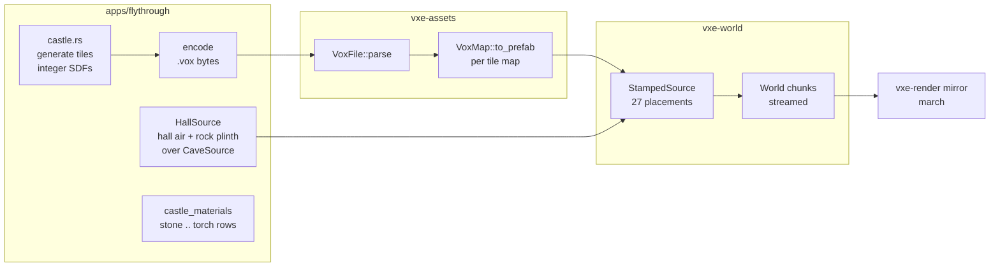

# 0042: A generated gothic castle with a dungeon, imported as a .vox scene and stamped at generation

> **Status:** draft
> **Created:** 2026-10-22
> **Milestone:** M7 in `docs/roadmap.md` (prefab stamping at authored-building scale; testbed
> content plus a `.vox` writer in `vxe-assets`)
> **Related ADRs:** none. The plan uses what Plan 0008 (import and stamping) and Plan 0018
> (stamp as an op) already built. Whether castle-sized prefabs need sparse storage is the
> question this plan measures, not one it decides.
> **Source:** the owner, 2026-10-22: "I'm interested just in one of a kind building, that you
> can create for example on game start. something like a gothic castle with a dungeon."
> Owner's answers the same day: the castle is generated by a script, it stands in a carved
> hall in the cave, about 60 x 60 x 40 m, judged by the owner's eye plus a golden.

## TL;DR

`flythrough --castle` builds a gothic castle with a dungeon at startup. The castle is about
60 x 60 x 40 m: curtain walls, four round towers, a gatehouse with a pointed arch, and a chapel
keep with buttresses, lancet windows, a stained-glass rose window, a rib vault and a spire. A
spiral stair goes down 10 m to a barrel-vaulted corridor, eight barred cells and a pillared
crypt. Testbed code generates it as a multi-model MagicaVoxel scene in memory (27 tiles of at
most 256 per axis) and encodes it with a new `.vox` writer in `vxe-assets`. The importer
parses that file back and maps its palette to castle materials, and the castle is placed into
the unbounded cave through `StampedSource`, inside a hall the testbed's source carves for it.
This is the path a game would take with an authored building, at the size a real one has.
The plan records what that costs (build time, prefab RAM, chunk generation time, census,
frame time). The owner then flies through it and judges whether 10 cm voxels carry gothic
detail. The first thing anyone sees: the spawn camera facing the gate across a dark hall,
torches burning on either side of the arch, and the banner reading `castle gate`.

## Context & problem

Plan 0008 shipped import and stamping. Plan 0018 made a stamp a logged op. The largest prefab
anything has run is the 16-voxel `--vault`. A building a game would put down at game start is
hundreds of voxels on each axis. That size reaches three limits that nothing has measured
yet:

- **A `.vox` model is capped at 256 per axis** (`MAX_MODEL_EDGE`, 25.6 m at 10 cm). A castle
  is therefore a scene of models. The importer reads scenes (`VoxFile::placements`), but no
  test feeds it one of this size.
- **A `Prefab` is dense**: 2 B of material and one mask bit per voxel, air included
  (`docs/nfr.md` §3, "Prefabs"). Because the castle's boxes are mostly air, its RAM grows
  with its bounding volume, not with its stone.
- **`StampedSource` writes every placement that meets a chunk into it.** The cost per chunk at
  27 placements, each up to 256³, has not been read.

None of the readings has a line in `nfr.md` yet. The plan reads them against the RAM line
(§3, 4 GB world in RAM; the packed brick's reading is about 1 GB `VmHWM`), time to first frame
(§7) and the frame budget (§2). The consumer requirement is prefab stamping with masks
(`project-context.md`, the roadmap's P1 row "prefab stamping with masks").

## Decision

The testbed generates the castle with integer-only code, voxel by voxel, into a `.vox` scene,
and stamps it through the real importer. Every piece of the path a game's authored building
would take is then exercised at that building's size. The `.vox` writer lives in `vxe-assets`
because it is general (any tool that bakes `.vox` scenes needs it), and a parse round trip
tests it. The hall is carved by a wrapper source around the cave, not by the prefab, because
air in a dense prefab costs the same RAM as stone.

We rejected building `Prefab`s directly in Rust, because that skips the importer, the 256 cap
and the scene graph, which are what an authored building goes through. We rejected a
procedural castle `WorldSource`, because a game with a modelled building would not write one,
and it measures nothing about stamping. We rejected carving the hall with the prefab's own air
voxels, because the hall's 80 x 80 x 48 m box (307 M voxels, 614 MB of dense material alone)
would cost more than the castle. We rejected sparse prefab storage for now: it is an engine
change with a real tradeoff, and this plan's readings decide whether it is needed (see
Followups).

## Architecture diagram



## The castle, worked

Coordinates are absolute voxels in the unbounded cave. Its spawn is `s = (32, 32, 32)`
(`UNBOUNDED_SPAWN`). The castle's local frame is `u = x - 132`, `v = y + 268`, `w = z - 12`,
with `w = 0` on the hall floor. Everything is integer: squared distances in `i64`, and a
pointed arch is the intersection of two circles whose centres are offset by the span (the
two-centred arch).

| Part | Where | Note |
|---|---|---|
| Hall (wrapper source) | air for x in [-18, 782), y in [-368, 432), z in [12, 492); the walls and ceiling pushed outward by 0 to 16 voxels of value noise | 80 x 80 x 48 m. Outward noise only, so the clearances below hold: 10 m from the spawn to the gate face, 10 m on each side, 5 m behind, 8 m above the spire |
| Plinth (wrapper source) | solid rock for z in [-138, 12) under the hall's footprint | The dungeon sits in solid rock, not in the cave's noise voids. The spawn pocket's lower half falls in the plinth and stays rock, so the floor has no dimple |
| Castle box | x [132, 732), y [-268, 332), z [12, 412) above the floor, z [-88, 12) for the dungeon | 600 x 600 x 400 plus 600 x 600 x 100 voxels |
| Tiles | x and y split at 256, 256, 88; z above at 256, 144; dungeon at 100 | 3 x 3 x 2 above plus 3 x 3 x 1 below = 27 models, each at most 256 per axis |
| Curtain wall | outer face 60 in from the box on each side, 20 thick (2 m), 120 tall (12 m), merlons 6 wide and 8 tall at a 12 pitch, a wall walk | |
| Corner towers | four cylinders of radius 50 centred 60 in from each corner, walls 15 thick, 200 tall, conical slate roofs to `w = 280` | |
| Gatehouse | on the `u = 60` face at `v = 300`: two towers of radius 35, 160 tall; a pointed arch 40 wide and 60 tall through the wall; an iron portcullis half raised | The gate faces the spawn |
| Chapel keep | nave `u` 260..500, `v` 220..380, walls 12 thick and 200 tall, pitched slate roof to `w = 300`; buttresses every 40 along the long walls; lancets 20 wide and 80 tall between them; a west door 30 x 50; a rose window of radius 30 with tracery in trim and glass between it; a square west tower 40 x 40 to `w = 280` and an octagonal spire to `w = 380` | Interior: a quadripartite rib vault per 40-voxel bay, ribs 3 voxels thick, springing at `w = 140`, apex at `w = 190` |
| Stair | a spiral of radius 25 at `(u, v) = (200, 450)`, from `w = 0` to `w = -100`, a 2-voxel rise per sixteenth of a turn (50 steps, about three turns), in a round stair house 40 tall with a doorway | |
| Dungeon | a corridor 20 wide and 30 tall with a barrel vault, from the stair foot along `u` 200..520 at `v = 450`, then a cross corridor; eight cells 30 x 30 x 30, four on each side, fronted by iron bars 1 voxel thick at a 3-voxel pitch with a door gap; a crypt `u` 300..420, `v` 240..360, 50 tall, nine pillars of radius 6 under a groin vault | The dungeon's air and a 4-voxel stone lining around it are written explicitly; everything else in the dungeon tiles leaves the plinth's rock alone |
| Torches | blocks of torch material 2 x 2 x 3 on both sides of the gate, one per nave bay, one every 80 voxels in the dungeon | Lit through Plan 0024's emissive samples |

**Palette and map.** Indices 1 to 7 are stone, trim (darker stone for ribs, tracery and
merlons), slate, wood, iron, glass and torch. Index 8 is explicit air. Each tile is converted
with one of two `VoxMap`s:

- **Above-ground tiles:** index 0 is `Skip`. The wrapper has already carved the hall, so the
  castle writes only its solids.
- **Dungeon tiles:** index 0 is `Skip` and index 8 is `Air`. Corridors carve, and rock that the
  dungeon does not touch stays.

`castle_materials` appends seven rows to the cave table: stone, trim, slate, wood and iron are
opaque, glass is translucent (Plan 0015's class) and tinted, and torch emits a warm colour. All
of them are diggable, so a dig into the castle is an ordinary edit.

**Prefab RAM, worked.** The kept tiles hold 600 x 600 x 500 = 180 000 000 voxels. Material is
2 B each, 360 000 000 B. The mask is one bit each, and every tile's voxel count is a multiple
of 64 (88 x 88 = 7744 = 64 x 121), so the mask is exactly 22 500 000 B. That makes
382 500 000 B (about 365 MiB) when all 27 tiles are kept, and a dropped tile (one with no
masked voxel) takes off its own share. On top of that come the parsed `VoxFile`, at 4 B per
listed voxel (a guess: 15 to 25 M listed voxels, 60 to 100 MB), and `to_prefab`'s index
buffer, one tile at a time (16.8 MB at most). `StampedSource::new` clones each prefab at the
identity rotation. The testbed must drop each `Arc` as it goes, so that at the peak there is
one copy plus one tile.

**Chunks the castle meets.** Chunks are 64 voxels on an edge. x 132..731 covers chunks 2..11
(10), y -268..331 covers chunks -5..5 (11), and z -88..411 covers chunks -2..6 (9): 990 chunks.

## Implementation phases

### Phase 1: A wall, a tower and the gate on screen through the whole path (walking skeleton)
- **Owner skill:** dev
- **What:** `vxe-assets` gains a `.vox` encoder that writes a scene with `PACK` (when there is
  more than one model), the `SIZE`/`XYZI` pairs, `RGBA` and an `nTRN`/`nGRP`/`nSHP` scene
  graph with frame-0 translations and rotations. `apps/flythrough/src/castle.rs` generates
  only the gate-side curtain wall, one corner tower and the gatehouse, tiled as above, through
  encode, parse, map and `StampedSource` over `HallSource`. `--castle` turns it on in the
  unbounded cave, and the banner shows `castle`. `--castle` refuses `--level` (the 51.2 m
  bounded level is too short for the castle) and `--vault` (the vault's origin falls inside
  the castle's box). `--castle-out PATH` writes the generated `.vox` to disk.
- **Files touched:** `crates/vxe-assets/src/vox.rs` (or a new `write.rs`),
  `crates/vxe-assets/src/lib.rs`, `crates/vxe-assets/tests/vox.rs`,
  `apps/flythrough/src/castle.rs`, `apps/flythrough/src/cave.rs`, `apps/flythrough/src/lib.rs`,
  `apps/flythrough/src/main.rs`, `apps/flythrough/tests/castle.rs`.
- **Done when:**
  - A three-model scene (two translations, one rotation from `Rot::all`, a custom palette)
    round-trips: parsing the encoder's output gives back the same `VoxFile`.
  - `castle.rs` encoding twice gives identical bytes.
  - In a headless world built from `HallSource` plus the skeleton's placements:
    - the voxel at the gate arch's centre, `(132 + 60 + 10, 32, 12 + 30)`, is air;
    - the voxel in the curtain wall 120 voxels to the side, `(202, 152, 42)`, is stone (clear
      of the gatehouse towers, which reach `y = 127`);
    - the voxel at the spawn is air;
    - the voxel at `(32, 32, 0)`, under the hall floor, is rock.
  - The number of stone voxels in the stamped world equals the generator's count of index 1
    across the tiles.
  - In a window, `--castle` shows the wall and gate from the spawn pose.
  - The camera convention is read from the code. If yaw 0 does not look along +x, the layout is
    turned (one `Rot` applied to every placement and the generator's frame) so that the gate
    faces the spawn camera. The plan's coordinates are then read in that turned frame.

### Phase 2: The whole castle, the dungeon, the materials and the determinism vector
- **Owner skill:** dev
- **What:** every part in "The castle, worked", the seven material rows and the two maps. A
  determinism vector pins the castle's FNV-1a 64 over the encoded `.vox` bytes and the existing
  voxel hash over the castle's chunks, on Linux and Windows CI.
- **Files touched:** `apps/flythrough/src/castle.rs`, `apps/flythrough/src/lib.rs`,
  `apps/flythrough/tests/castle.rs`, `apps/flythrough/tests/determinism.rs`.
- **Done when:**
  - `castle.rs` holds no `f32` or `f64`.
  - The two hashes are pinned constants, asserted in `determinism.rs` on both CI platforms.
  - Headless voxel probes defend the parts:
    - air at the nave's centre under the vault, a rib voxel of trim at a bay's springing
      line, glass inside the rose window's ring, iron in a cell's bars and air between two
      bars;
    - air on the stair's axis at `w = -50` and a step of stone beside it;
    - air at the crypt's centre and stone in a pillar;
    - rock 10 voxels outside the dungeon's lining;
    - torch material at each gate torch.
  - The kept tiles' summed `Prefab::len` matches the generator's tile sizes, and the testbed's
    prefab bytes, computed as the sum of `2n + 8 * ceil(n / 64)` over the kept tiles, are
    printed and equal 382 500 000 when all 27 are kept.
  - In a window the whole castle is visible from the spawn, and a dig into the curtain wall
    removes stone and prints its counts as any dig does.

### Phase 3: Named shots, the banner and the golden
- **Owner skill:** dev
- **What:** four camera poses in `castle.rs`:
  - `gate`: the spawn pose, facing the arch;
  - `nave`: inside the keep, looking west along the vault at the rose window;
  - `window`: outside, 6 m from a lancet and its buttresses;
  - `dungeon`: in the corridor, looking along the cells.

  `--castle-shot NAME` starts at a shot, and a free key (dev picks one; `K` is taken) cycles
  them. The banner reads `castle <shot>`. A golden of `gate` renders on lavapipe from a bounded
  world around that view, built only from the tiles that meet its extent.
- **Files touched:** `apps/flythrough/src/castle.rs`, `apps/flythrough/src/main.rs`,
  `apps/flythrough/tests/golden.rs` (or `castle.rs`), `apps/flythrough/tests/golden/castle_gate.png`.
- **Done when:**
  - Every shot's eye voxel is air and has at least 10 voxels of air in every axis direction
    (headless).
  - The golden `castle_gate.png` matches at the floor the existing goldens use.
  - The golden test builds only the tiles that meet its extent, and its process peak RSS
    stays under 1 GB on the CI runner.
  - Pressing the shot key in a window moves the camera to the next shot, and the banner names
    it.

### Phase 4: The readings
- **Owner skill:** dev
- **What:** the figures in Budgets, with the dev box named and the commit given. One addition
  is `apps/flythrough/examples/castle_gen.rs`, which times `StampedSource::chunk` over the 990
  castle chunks against the base alone over the same chunks.
- **Files touched:** `apps/flythrough/examples/castle_gen.rs`, `docs/nfr.md` (readings under
  §3 "Prefabs" and §7), the plan's Implementation log.
- **Done when:** every Budgets row has a value, the machine and the commit, read from release
  builds over three runs.

### Phase 5: The owner flies the castle
- **Owner skill:** human
- **What:** the owner runs `cargo run --release -p flythrough -- --castle`, visits each shot,
  digs into a wall, and opens `--castle-out castle.vox` in MagicaVoxel.
- **Done when:** the owner's verdict for each shot (does 10 cm read as gothic? what breaks
  first: tracery, ribs, the spire, the bars?) and whether MagicaVoxel opens the file are
  recorded in this plan's header as Decisions, along with the followup the owner picks.

## Data shapes

```rust
// illustrative
pub fn encode(file: &VoxFile) -> Vec<u8>;            // vxe-assets, the inverse of VoxFile::parse

pub struct HallSource { cave: CaveSource }           // flythrough: hall air, rock plinth, else cave
pub enum CastleShot { Gate, Nave, Window, Dungeon }
pub fn castle_vox() -> VoxFile;                      // the 27 tiles and their scene graph
pub fn castle_source(file: &VoxFile) -> StampedSource<HallSource>;
```

## Budgets

| Figure | `nfr.md` | Expected | How the close reads it |
|---|---|---|---|
| Prefab RAM | §3 Prefabs (arithmetic) | 382 500 000 B with all 27 tiles kept (worked above) | Printed by `--castle` and asserted in Phase 2 |
| `.vox` size | none | 60 to 100 MB (guess) | Printed by `--castle-out` |
| Castle build time (generate, encode, parse, map, `StampedSource::new`), each stage | §7 time to first frame | Unknown. The generator alone evaluates 180 M voxels, so about a few seconds single-threaded (guess) | `flythrough --castle --headless --frames 300`, printed per stage, three runs |
| Process peak RSS | §3 world in RAM, 4 GB | About 1.0 GB today plus the prefabs and the parsed file, so roughly 1.5 GB (guess) | `VmHWM` at `--frames 3000` with and without `--castle`, seed 1, headless |
| Chunk generation, castle chunks | §5 streaming | Unknown | `castle_gen`: mean and p99 per chunk, with and without placements, over the 990 chunks |
| Time to full residency | §7 | Unknown | The existing residency line with and without `--castle` |
| Brick census and mirror live bytes | §3 world in VRAM, 3 GB | Up, since the castle's surfaces make non-uniform bricks | `--census` and `GpuWorld::mirror_bytes` with and without `--castle` |
| Frame time at each shot | §2, the 3.0 ms line | Reading, not a gate | `--castle-shot NAME --headless --render 1920x1080 --frames 300`, median of the last 30, RTX 3080 Laptop, and the iGPU for `gate` |

## Risks & open questions

- **Startup cost.** The generator, the parse and the map run before the first chunk. If build
  time dominates time to first frame, Phase 4 says so. The generator may run its tiles on the
  testbed's existing threads (no new dependency). A parallel generator must give the same
  bytes, and the determinism vector checks that.
- **Prefab RAM over the stone.** The castle's boxes are mostly air, and that air costs 2 B a
  voxel. If the reading shows prefab RAM larger than the world bricks the castle makes, that is
  the case for sparse prefab storage (Followups). This plan does not answer it.
- **A runtime stamp of this castle is a different cost.** A logged stamp names its prefab, and
  the save carries every prefab it names (ADR-0014). A castle stamped at runtime would put
  about 365 MiB of prefabs into the save. At generation time it is not an op and is not saved,
  so like `--vault` a session saved with `--castle` replays only with `--castle`.
- **Collapse.** The fly-through's dig logic may run the support query after a dig. Digging out
  a tower's base may drop it. That is the engine working as built, not a defect; the owner's
  live check notes it.
- **Detail at 10 cm.** A 3-voxel rib, 1-voxel bars and tracery in a 60-voxel rose are at the
  limit of what the contour look resolves. The verdict is the owner's in Phase 5.
- **Determinism.** The generator is pure integer math over the voxel coordinate. `HallSource`
  is pure like `CaveSource`. The `.vox` bytes depend on the order tiles and voxels are listed,
  so the encoder writes them in a fixed order (tile index, then x fastest).
- **Plan 0038 overlap.** Plan 0038 adds `--source` and `--shot` for `hero`. This plan keeps
  `--castle` as a flag like `--vault`, and its shots as `--castle-shot`. A later plan may fold
  them into `--source castle` and `--shot`.

## What this plan does NOT do

- Sparse or brick-compressed prefab storage (Followups, decided by Phase 4's readings).
- Placing the castle outdoors under the sky (after Plan 0032; Followups).
- Stamping the castle at runtime through the server, or saving it in a log.
- Procedural layout of buildings in general, modular tile sets or sockets. The castle is one
  fixed design, written as testbed code.
- Walk mode in the castle, doors that open, or any gameplay. The engine stays game-agnostic,
  and the castle is testbed content.
- A MagicaVoxel material import (`MATL`): materials come from the palette map only.

## Implementation log

> Written by `dev`: one row per phase as its commit lands, then the close block. **The phases
> above are the contract. This section records what happened.** Observations, never
> conclusions: no pass list, no self-assessment. Deviations and unmet done-whens are
> **always** disclosed. Keep it shorter than `## Implementation phases`.

| phase | owner | state | commit |
|---|---|---|---|
| 1: A wall, a tower and the gate through the whole path | dev | not started | |
| 2: The whole castle, the dungeon, the materials and the determinism vector | dev | not started | |
| 3: Named shots, the banner and the golden | dev | not started | |
| 4: The readings | dev | not started | |
| 5: The owner flies the castle | human | not started | |

### Notes

### Close triggers

- **What shipped:**
- **Public API changed:**
- **Budget readings:**
- **Gate at the tip:**
- **Outstanding `human` phases:**

## Followups

- Sparse prefab storage (uniform bricks stored once, or a brick map per prefab) if Phase 4
  shows the castle's prefab RAM is mostly air. That is an ADR, with dense storage as the
  rejected or kept alternative.
- The castle on open terrain once Plan 0032's outdoor source exists.
