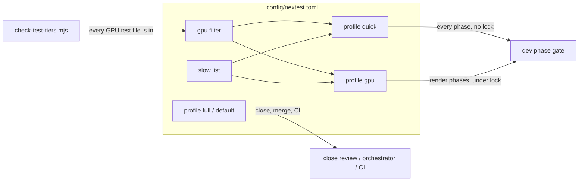

# 0043: Test tiers: a quick gate per phase, a GPU tier under the lock, the full suite at close

> **Status:** in-progress
> **Created:** 2026-10-22
> **Milestone:** M7 in `docs/roadmap.md` (tooling: the gate every lane runs)
> **Related ADRs:** none. The rejected options are recorded under Decision. None of them is a
> revisitable engine tradeoff.
> **Source:** the owner, 2026-10-22: "it feels like its way larger than it was before and takes
> enormous time to run, we should optimize runs - eg run only subset of tests at any moment".
> The owner's answers the same day: this plan lands **now**, ahead of the active lanes, and the
> slow tests keep computing their references (tier only, no blessed references).

## TL;DR

`cargo nextest run --profile quick` becomes the gate after every dev phase. It runs every
CPU-only test (the suite at `87e4b67` has about 465 of them) in tens of seconds, takes no
perf lock and touches no GPU. `--profile gpu` adds the lavapipe tests except the slow
convergence ones, and it runs under the lock only in phases that touch rendering.
`--profile full` runs everything once, at a plan's close, at an orchestrator merge and in CI.
The three tiers split the full suite with nothing left over and nothing counted twice. A
script fails the build when a new GPU test file lands outside the gpu list. The quick tier
kills any test that runs past 30 s, so a slow test cannot hide in it. The first thing anyone
sees: a dev phase gate that used to hold the perf lock for 4 to 7 minutes finishes in under a
minute and holds no lock.

## Context & problem

These numbers were read at `87e4b67` on the owner's dev box (Ryzen 9 5900HS, RTX 3080 Laptop
GPU). They come from eight full-run logs the lanes wrote on 2026-10-22, at `--test-threads 2`
under the perf lock and with other lanes loading the box, so they are loaded readings:

- **The suite:** 62 test binaries and 606 tests (`cargo nextest list --workspace`).
- **Wall time went from 176 s to 419 s** while the test count went only from 604 to 613.
  The growth is a handful of lavapipe convergence tests. Plan 0029's `indirect.rs` adds
  255 s of summed test time, `upscale.rs` 148 s and `lights.rs` 97 s.
- **Where the time goes:** in the 613-test run, 36 tests at 5 s or more account for 78% of the
  summed time. The 465 CPU-only tests under 5 s sum to 39 s.
- **Lavapipe's share is 74 to 88%** of the summed time. No Rust `opt-level` reaches it,
  because Mesa is already an optimised system library. `[profile.dev.package.*]` sets
  opt-level 2 for every dependency already.
- **Build is not the cost.** A rebuild after touching `vxe-world/src/lib.rs` takes 28 s, and
  after touching one test file 2 s.

Nothing tiers the suite. There is no `.config/nextest.toml`. The dev skill's Step 3 names plain
`cargo nextest run` as the gate after **every** phase. Lane rule 6 then puts a full-workspace
run under the exclusive GPU lock, so each phase gate blocks every other lane's GPU work, and the
owner's windowed checks, for 4 to 7 minutes. CI reruns all 173 fly-through tests a second time
with `--features wasm` (414 s of the 981 s Linux job), although only `tests/component.rs`
needs that feature.

## Decision

Add three nextest profiles over one shared classification, kept honest by two mechanical
checks.

**The classification:**
- A **gpu** filter: every test in `vxe-render` except its lib unit tests, plus a named list of
  fly-through test binaries.
- A **slow** list: the tests measured at 20 s or more, by full name.
- A `lavapipe` test group with `max-threads = 1`. One lavapipe process already spreads over
  every core, so two at once only contend.

**The profiles:**
- `quick` = not gpu, not slow.
- `gpu` = gpu, not slow.
- `full` = everything. The `default` profile stays the full suite, so a bare
  `cargo nextest run` never silently means less than it does today.

**The two checks:**
- `scripts/check-test-tiers.mjs` fails when a test file that reaches a GPU device is not
  covered by the gpu filter.
- The quick profile terminates any test at 30 s. A newly slow CPU test fails the quick gate
  until it is added to the slow list.

**Rejected options:**
- We rejected **blessing the convergence references as images**: the owner's call, and it adds
  baselines to re-bless whenever the lighting changes.
- We rejected **tagging slow tests by wrapping them in a `mod slow`**: re-indenting whole test
  bodies in files the active lanes are editing guarantees merge conflicts. A name list in
  config changes no source line.
- We rejected **folding the 51 integration binaries into one per crate**: it saves an
  estimated 10 to 20 s of a 28 s rebuild, which is not where the time is.
- We rejected **raising `vxe-render` to opt-level 2 for speed**: it is estimated at a few
  seconds and reaches none of lavapipe's share.

## Architecture diagram



## Implementation phases

### Phase 1: three profiles that split the suite exactly
- **Owner skill:** dev
- **What:** `.config/nextest.toml` with the gpu filter, the slow list, the `lavapipe` group,
  and the `quick`, `gpu`, `full` and `default` profiles.
- **Files touched:** `.config/nextest.toml` (new).
- **The gpu filter.** It starts from the binaries that build a wgpu device at `87e4b67`:
  - all of `package(vxe-render)` except `kind(lib)`;
  - `flythrough`'s `golden`, `hud_golden`, `level_mirror`, `lights`, `look` and `upscale`;
  - any other fly-through binary whose tests pull a device through `tests/support`.
    `cutaway`, `shutdown` and `audio_sides` are candidates to check, not assumptions.

  The final list is whatever the Phase 2 script classifies as GPU.
- **The slow list.** It starts from every test that took 20 s or more in the 613-test lane log:
  - `upscale`: `the_upscaler_keeps_stripe_edges_sharp_still_and_panning` and
    `a_sweeping_headlamp_and_a_lamp_step_keep_pace_with_plan_0024s_frame`;
  - `lights`: `reservoir_reuse_lowers_one_frames_error` and
    `the_lamp_light_that_left_the_cone_drops_in_each_history_mode`;
  - `vxe-world`'s `stamp_tally_agrees_with_apply_on_random_boxes`.

  Plan 0029's `indirect.rs` tests are not on `main` yet. Its lane adds them when it merges `main`.
- **Timeouts.** `quick` sets `slow-timeout = { period = "10s", terminate-after = 3 }`. `gpu`
  and `full` set a `period` of 30 s that reports and never terminates.
- **Done when:**
  - The tiers partition the full suite. With `N(p)` the number of tests
    `cargo nextest list --profile p` reports (ignored tests excluded the same way in each),
    `N(quick) + N(gpu) + N(slow) = N(full)`, where `N(slow)` is the slow list filtered
    alone. The intersection of the quick and gpu name lists is empty.
  - `N(full)` equals `cargo nextest list --workspace` on the same tree.
  - No test in `--profile quick`'s list belongs to a binary in the gpu filter.
  - `cargo nextest run --profile quick --test-threads 2` exits 0 and its wall time is recorded
    with the 1-minute load. Under 60 s is expected from the 39 s summed (estimate). A higher
    reading is reported, not hidden.
  - `cargo nextest run --profile gpu` is read once under the lock, with its wall time and load
    recorded. The estimate is about 130 s serial.

### Phase 2: a gate that keeps the gpu list true
- **Owner skill:** dev
- **What:** `scripts/check-test-tiers.mjs`. It lists the test sources with `git ls-files`
  (`crates/*/tests/*.rs`, `apps/*/tests/*.rs`) and classifies a file as GPU when it, or a
  `support` module it declares, names a device entry point: `software_device`,
  `wgpu::Instance`, `request_adapter`, or a `device()` helper from that crate's tests. It
  exits 1 with `file -> not in the gpu filter` for each GPU file whose binary the
  `.config/nextest.toml` gpu filter does not match, and for each filter entry with no file.
  The script follows the house gate pattern: an optional `root` argument and a seeded fixture
  tree.
- **Files touched:** `scripts/check-test-tiers.mjs` (new), `scripts/fixtures/test-tiers/`
  (new), `scripts/fixtures/README.md`.
- **Done when:**
  - `node scripts/check-test-tiers.mjs` exits 0 on the tree.
  - On the fixture it exits 1 with exactly the findings its README row names:
    - one GPU test file missing from the filter;
    - one filter entry with no file;
    - one file that reaches a device only through `support`.
  - A CPU-only fixture file produces no finding.

### Phase 3: CI runs the full tier and the wasm step runs only what needs wasm
- **Owner skill:** dev
- **What:**
  - The workspace nextest step becomes `cargo nextest run --workspace --profile full`.
  - The wasm step becomes
    `cargo nextest run -p flythrough --features wasm --profile full -E 'binary(component)'`.
  - A `Test tiers` step runs the Phase 2 script beside the other doc gates.
- **Files touched:** `.github/workflows/ci.yml`.
- **Done when:**
  - The first CI run after the commit is green on Linux.
  - Its wasm step lists exactly the tests of `tests/component.rs` (the same count
    `cargo nextest list -p flythrough --features wasm -E 'binary(component)'` gives locally).
  - The Linux job's wall time is recorded against the 981 s of run 39808788735. About 400 s
    less is expected.

### Phase 4: the skills and lane rules name the tiers
- **Owner skill:** dev
- **What:** the gate text changes in every place that names it:
  - **The dev skill's Step 3:** `--profile quick` after every phase, plus `--profile gpu` for a
    phase whose `Files touched` include `crates/vxe-render/`, a shader, or a fly-through render
    test. Its close step runs `--profile full`.
  - **Lane rules 4 and 6:** a quick run takes no lock. A gpu or full run takes it.
    `--test-threads 2` stays for full.
  - **The orchestrate skill's merge gate:** `--profile full --no-fail-fast`.
  - **The architect skill's Mode 4:** the close reviewer runs `--profile full`.
  - **`CLAUDE.md`'s canonical commands** list the three profiles in one line.
  - **Lane rule 4's build-jobs note:** nextest's `-j` is `--test-threads`, not build jobs,
    and `CARGO_BUILD_JOBS` caps the build.
- **Files touched:** `.claude/skills/dev/SKILL.md`, `.claude/skills/orchestrate/SKILL.md`,
  `.claude/skills/orchestrate/references/lane-rules.md`, `.claude/skills/architect/SKILL.md`,
  `CLAUDE.md`.
- **Done when:**
  - `grep -n 'nextest run' .claude/skills CLAUDE.md -r` shows no gate instruction without a
    `--profile`, except where the text says the default is the full suite.
  - The hook bite tests (`node --test ".claude/hooks/*.test.mjs"`) and the three doc gates
    exit 0.

## Data shapes

```toml
# illustrative: the shape of .config/nextest.toml, not its final lists
[test-groups]
lavapipe = { max-threads = 1 }

[[profile.default.overrides]]
filter = 'package(vxe-render) - kind(lib) | binary_id(/^flythrough::(golden|look|...)$/)'
test-group = 'lavapipe'

[profile.quick]
default-filter = 'not (<gpu>) and not (<slow>)'
slow-timeout = { period = "10s", terminate-after = 3 }

[profile.gpu]
default-filter = '(<gpu>) and not (<slow>)'

[profile.full]
default-filter = 'all()'
```

## Budgets

This plan changes no `docs/nfr.md` engine figure. It moves the cost of the gate, and the close
reads that cost:

- the quick wall time and the gpu wall time, each with its 1-minute load and whether it held
  the lock;
- the full wall time on the same tree;
- the CI Linux job time before and after.

All on the dev box, named with its commit. `docs/nfr.md` section 7 (startup and build) gains a
"test gate" reading at the close.

## Risks & open questions

- **The 30 s quick timeout under load.** A CPU test near the line could fail under a loaded box.
  The slowest CPU-only test outside the slow list is 14.7 s (`replay`, loaded), so the margin is
  2x. If a lane hits it, the fix is the slow list, not a longer timeout.
- **A quick gate is a weaker gate per phase.** A render regression is caught at the phase only
  if the phase touched render paths and ran `gpu`. Otherwise it is caught at the close. That is
  the trade the owner chose. The close always runs full.
- **Lanes in flight** do not see the tiers until they merge `main`. Plan 0029's lane adds its
  `indirect.rs` slow tests to the list then. The 30 s quick timeout cannot catch them, because
  they are gpu, so the lane has to add them by hand.
- **Windows CI** has no lavapipe, so its gpu tests print-and-skip as today. The tiers change
  nothing there.

## What this plan does NOT do

- **Make any test faster.** Blessed references for the convergence tests are the owner's "not
  now". Plan 0045 shares the test fixtures, which makes the suite cleaner, not quicker.
- **Change test sources.** Every tier decision lives in `.config/nextest.toml`.
- **Run tests selected by the changed paths.** `-E 'rdeps(<crate>)'` composes with `quick` and
  the dev skill mentions it. Automating the choice is a followup.
- **Fold the integration binaries together** (the disk cost of `target/`, about 101 GB on the
  main checkout, is a followup, not a speed problem).

## Implementation log

| phase | owner | state | commit |
|---|---|---|---|
| 1: three profiles that split the suite exactly | dev | done | 28da8b7 |
| 2: a gate that keeps the gpu list true | dev | done | committed with this row |
| 3: CI runs the full tier and the wasm step runs only what needs wasm | dev | not started | |
| 4: the skills and lane rules name the tiers | dev | not started | |

### Notes

- Phase 1: the gpu filter adds `flythrough::cutaway` (its tests open a device through
  `support::LookRig`) and `flythrough::shutdown` (one of its three tests spawns
  `flythrough --headless --render 64x36`, which opens a device; the whole binary is gpu, so its
  two CPU-only drop tests run in the gpu tier). `flythrough::audio_sides` uses
  `vxe_render::Camera` only and stays quick.
- Phase 1: the slow list's override sets `slow-timeout = { period = "60s" }`, so the slow list
  has one canonical copy in the default profile's overrides that `quick` and `gpu` repeat.
- Phase 1: every count and run is `--workspace` (the non-default member `vxe-script-wasm` is
  in the suite CI runs); a run without `--workspace` covers the default members only.
- Phase 2: the script's device entry points add a fifth to the plan's four: the string
  `"--headless"`, a test spawning a headless render of an app binary (how
  `flythrough::shutdown` reaches a device). `fn device(` / `device()` covers the `device()`
  helper. Comments are stripped before matching.
- Phase 2: the script also fails when the `quick` or `gpu` default-filter is not exactly
  `not (<gpu>) and not (<slow>)` / `(<gpu>) and not (<slow>)` with the lavapipe override's
  filter and another default override's filter, so the three copies cannot drift. Verified by
  hand on scratch edits of the tree's config (one gpu entry dropped from `gpu`, one slow test
  dropped from `quick`): one finding each. Not seeded in the fixture.

### Close triggers

- Phase 1 partition at `5989620` + `.config/nextest.toml`, `cargo nextest list --workspace
  --profile p -T oneline` (ignored tests excluded alike): quick 470, gpu 124, slow list
  (`-E '<slow>'`) 5, full 599, default 599, plain `cargo nextest list --workspace` 599.
  470 + 124 + 5 = 599. Pairwise intersections quick/gpu, quick/slow, gpu/slow: 0, 0, 0. The
  sorted union equals full's list. No quick test is in a gpu-filter binary (the 16
  `vxe-render` tests in quick are its lib unit tests).
- Phase 1 quick, dev box (Ryzen 9 5900HS, RTX 3080 Laptop), no lock, built tree,
  `cargo nextest run --workspace --profile quick --test-threads 2`: exit 0, 470 passed,
  3 skipped, 1 slow (`flythrough::replay a_stamp_and_a_collapse_replay_from_the_save`,
  > 10 s, under 30 s). Wall 44.8 s (nextest 43.9 s), 1-minute load 2.93 at start and 9.12 at
  end: loaded. An earlier run the same hour: nextest 36.6 s at load 7.66.
- Phase 1 gpu, same box, exclusive perf lock, built tree,
  `cargo nextest run --workspace --profile gpu --test-threads 2`: exit 0, 124 passed,
  9 skipped. Wall 205.2 s (nextest 204.7 s), 1-minute load 4.18 at start, 2.80 at end:
  loaded. The plan's estimate was about 130 s.
- Phase 2: `node scripts/check-test-tiers.mjs`: exit 0, `test tiers: 52 test files, gpu
  filter 8 binaries + 1 package(s), all agree`. `node scripts/check-test-tiers.mjs
  scripts/fixtures/test-tiers`: exit 1, the three findings of the fixture README's row
  (missing.rs, via_support.rs, binary_id(app::gone)), `3 finding(s) across 5 test files`.
  With `binary_id(flythrough::cutaway)` and `binary_id(flythrough::shutdown)` removed from
  a scratch copy of the tree's config: exit 1 naming `apps/flythrough/tests/cutaway.rs` and
  `apps/flythrough/tests/shutdown.rs`.

## Followups

1. Path-driven test selection (`rdeps` from `git diff --name-only`) as a script, if the quick
   tier is still too slow.
2. Blessed references for the convergence tests, if the full tier at close still hurts.
3. `target/` disk use: one integration binary per crate, or `debug = "line-tables-only"` for
   test builds.
