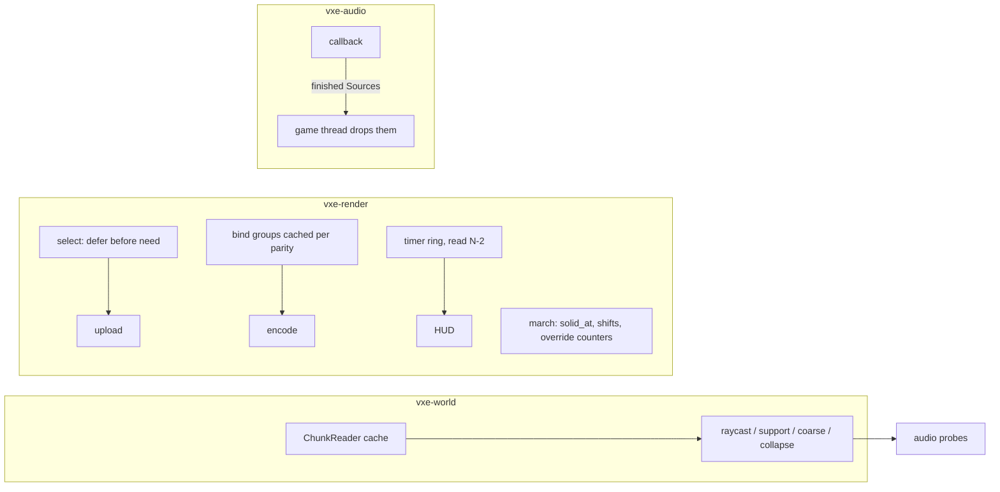

# 0044: The hot-path and defect pass: what the frame, the sync, the walk, the edits and the audio callback do for nothing

> **Status:** in-progress (2026-11-10, side lane: Phases 1, 6, 7); approved 2026-10-22, amended
> 2026-11-10 (review pass)
> **Created:** 2026-10-22
> **Milestone:** cross-cutting (code health). No milestone owns it: it serves the M1 to M4
> figures in `docs/nfr.md` that the plans so far have already shipped.
> **Related ADRs:** none. Each fix keeps the mechanism and removes waste or a defect, so no
> design choice is revisited. A fix that turns out to need one stops and goes back to the
> architect.
> **Source:** the owner, 2026-10-22: "review the code - look for any performance bottlenecks,
> violation of clean code principles, duplications, mega files ... a plan addressing issues
> that goes after all plans that are active are finished". The review ran at `87e4b67`; its
> structural findings are Plan 0045.
>
> **Order (owner, 2026-11-10):** Plan 0060, Plan 0061, Plan 0058, this plan, Plan 0045, then
> M10. It replaces every earlier order, and the "set at Plan 0059's Phase 3 verdict" note,
> which no document ever recorded.
> - **Phases 2, 3, 4, 5 and 8 start after Plan 0058 closes.** They claim byte-identical
>   goldens on the frame, the shaders and the render tests that Plans 0058, 0060 and 0061
>   rewrite.
> - **Phases 1, 6 and 7 (audio, world, sim and net) touch no file those three plans name**, so
>   they may run as a side lane at any time, beside them.
>
> **What the tree did to the review since `87e4b67`** (amended flat, 2026-11-10; the findings
> below are the ones still in the tree at `82ea836`):
> - Gone, and struck: the attribute pass and its scheduler (Plan 0054), the screen reservoirs
>   with defect 4 and the reservoir clamp (Plan 0057), the per-face table and its `cache_*`
>   passes (Plan 0059). Plan 0052 fixed no item of this plan.
> - Arrived, and not in the review: the bake (`bake.rs`, `bake.wgsl`, Plan 0059), the lamp
>   channel (`probes.rs`) and `light.rs`, and FSR 2 as the default upscaler. Phase 0 inventories
>   them.
> - The tiers select by marks (2026-11-10): a GPU test file is `tests/gpu_*.rs`, a long series
>   is `#[ignore = "soak"]`, a hand-run measurement is `#[ignore]`d inside a `mod reading`.
>   `scripts/check-test-tiers.mjs` enforces all three.

## TL;DR

A whole-tree review at `87e4b67` found work done for nothing on every hot path, and six real
defects, five of which are still in the tree. This plan removes both and changes no behaviour:
- the same pixels (goldens byte-identical);
- the same voxels and results (pinned hashes unchanged);
- the same audio, sample for sample.

The work:
- **The audio callback** stops freeing memory and stops zeroing megabytes.
- **The HUD** stops serialising CPU and GPU, which today makes it measure a frame it caused.
- **The frame** stops rebuilding its bind groups and texture views every frame.
- **The mirror sync** stops sizing chunks it has already deferred.
- **The march's inner loop** stops reading a material it throws away, and stops dividing in
  floating point.
- **The world's raycast** stops taking two locks and a hash per voxel step.

The first thing anyone sees: `crates/vxe-audio/tests/mixer.rs` counts frees as well as
allocations, and a voice whose sound the game has dropped finishes with zero frees on the
callback.

## Context & problem

**The findings are named by function, not by line.** Each was read in the source at
`82ea836` (2026-11-10). The plans ahead of this one edit the same files, so `dev` re-reads
each finding at the phase's start commit. A finding an earlier plan already resolved is struck
in the readings log (`docs/plans/logs/0044.md`) with the commit that resolved it, and is not
reworked. Phase 0 does the same for the code the review never saw.

**Waste on hot paths:**

- **Audio callback** (`crates/vxe-audio/src`).
  - `Mixer` `swap_remove`s a finished or stopped `Voice` on the device thread. That drops its
    `Source`: `Arc<[f32]>` or `Arc<Ring>`. When the game has dropped its clone, the free runs
    on the callback. Only the voice's buffers are recycled.
  - The "allocates nothing" tests cannot see this. The `Counting` allocator in
    `tests/mixer.rs`, copied into `balance.rs`, `stream.rs` and `reverb.rs`, counts `alloc`
    and `realloc`, never `dealloc`.
  - `Voice::new` clears its whole echo ring per `Play` (`voice.rs`).
  - `Network::clear` zeroes every delay line inside `render` (`reverb.rs`).
  - `Network::render` recomputes its `line_filter`s (two `powf` each) every block, settled or
    not.
  - `set_room`, which the mixer calls while it renders, runs a trial-division prime search
    (`nearest_prime`) per delay line.
- **Timer readback.** `PassTimer::read_all_ms` (`crates/vxe-render/src/marcher.rs`) maps and
  then `poll(wait_indefinitely())`. The fly-through calls it once a frame whenever the HUD
  shows, and `read_ms` on the field timer and the HUD timer right after it
  (`apps/flythrough/src/main.rs`). The HUD's frame time is therefore the time of a frame with
  no CPU/GPU overlap.
- **Frame encode.**
  - `Frame::encode_with` rebuilds every group-2 and group-3 bind group, plus a `create_view`
    per texture binding, every frame.
  - It builds them even for passes that are off: the downsample, variance and gradient groups
    are built before the test that skips those passes.
  - `bind_io` allocates three `Vec`s per call.
  - `light_table` collects and sorts every light chunk per frame.
  - `Fsr2::prepare` (`fsr2.rs`), called from `encode_with`, builds its pass groups and a view
    per texture binding each frame, in the same style. FSR 2 is the default upscaler.
  - `present.rs` builds a view and a bind group per frame; so do `exposure.rs` and `field.rs`.
- **Mirror sync** (`crates/vxe-render/src/gpu_world.rs`).
  - `GpuWorld::select` calls `need()`, which takes a read lock, allocates an `upload_set`
    `Vec<bool>` and runs `chunk_surface` per brick. Only then does it reach
    `if short.is_some() && !demotion { continue }`. Under pool pressure, every sync sizes the
    whole pending set and uploads none of it.
  - `need()` runs again for each uploaded chunk under the write lock.
  - `place_lights` rescans every light chunk on each sync and allocates its `Vec`s each time.
- **March inner loop** (`crates/vxe-render/src/shaders`).
  - `lookup_walk` calls `voxel_material` on every solid voxel (`march.wgsl`). That includes
    the full-walk shadow rays, which keep only `found`, `occupancy()` under
    `gradient27_normal` (the far normal runs it on default pixels), and the cutaway passing
    steps.
  - `floor_div` converts to `f32` and divides on every step, in `march.wgsl` and in its copy
    in `field.wgsl`, although every divisor is a power of two.
  - The step-view counters `loads`, `pool_reads` and `walk_steps` are incremented in every
    build.
  - `lod_level` recomputes the camera chunk at every chunk entry.
- **World reads** (`crates/vxe-world/src`).
  - `Raycast::cell` and `material_cell` (`raycast.rs`) call `store.get()` per step: the map
    lock, a SipHash, an `Arc` clone and the chunk lock. `vxe-audio`'s occlusion and room
    probes go through it.
  - `collapse.rs` already has a chunk-caching `Reader` that nothing else uses.
  - `Snapshot::take` stores each brick twice (`bricks` and `packed`), counts voxel by voxel,
    and writes rubble one `set_voxel` at a time.
  - `CoarseGrid`'s update loops every chunk of the aabb, ignoring `result.touched`
    (`coarse.rs`).
  - `StampedSource::chunk` walks every placement for every generated chunk (`source.rs`).
    Plan 0042's castle puts its placements on that path.
- **Sim and net.**
  - `vxe-sim` collects the solid boxes again for each sweep of a `Controller::tick`, and for
    each `depenetrate` probe (`sweep.rs`).
  - `TickHost::apply_seq` clones the op and its result into a `Message` before `broadcast`
    returns early with no clients (`crates/vxe-net/src/server.rs`).

**Defects** (numbered as the review numbered them):

1. **Render tests ignore `VXE_REQUIRE_SOFTWARE_ADAPTER`.** The `device()` copies in
   `crates/vxe-render/tests/gpu_{mirror,walk,translucent,frame,exposure}.rs` skip when the
   software adapter is missing; only `gpu_hud.rs` reads the variable. CI's lavapipe promise
   therefore holds for the fly-through's tests and not for the renderer's.
2. **`gpu_golden.rs` shadows its support module.** `apps/flythrough/tests/gpu_golden.rs`
   redefines `carved_world`, `make_lod` and `lod_scene` over the `support::*` it imports. An
   edit to the support fixture silently misses the goldens.
3. **The HUD's "allocates nothing" test is green while the claim is false.**
   `a_shown_hud_allocates_nothing_after_its_first_frame` calls only `format_rows` and skips
   `refresh_hud_stats`, where a `LightingRow` is collected per frame. Its fixture has
   `lighting: None`. The banner functions (`hud.rs`, `Run::banner`) build `String`s per frame.
4. **Struck.** The 8-bit reservoir count went with the screen reservoirs (Plan 0057).
5. **The portability test keeps a hand list.** `crates/vxe-render/tests/gpu_shader_portability.rs`,
   which rejects runtime vector-index stores (an FXC failure), names its shaders. A new shader
   can be missed, and one is: `bake.wgsl` is not on the list.
6. **Rust and WGSL layouts are matched by hand.**
   - The uniform structs (`Params`, `View`, `Edits`, `UpTuning`) and the bit constants (entry
     bits, `FLAG_*`, `LIGHTING_*`) exist on both sides, kept in step by comments.
   - `MAX_EDITS` in Rust is hard-coded as an array length in three shaders (`temporal.wgsl`,
     `upscale.wgsl`, `fsr2/input.wgsl`).
   - `HEADER_TRANSLUCENT_WORD` is 24 in WGSL (slot-relative) and 8 in Rust (header-relative).
   - No test compares either side.

## Decision

Fix each item where it stands, keeping its algorithm. Every phase proves "no behaviour change"
with the tests that already pin behaviour:
- the goldens, byte for byte;
- the pinned hashes in `vxe-world/tests/collapse.rs`, `log.rs` and the replay tests;
- the controller courses;
- the mixer's output samples.

Every perf fix is read against its `docs/nfr.md` figure. A fix that reads no better is still
kept when it removes a defect or an allocation the tests now count. Otherwise it is reverted and
noted.

- We rejected a **faster hasher dependency** for the SipHash lookups. The dense `table_cpu`
  index already exists, and a dependency is a cost.
- We rejected **workgroup-tiled post passes** (upscale, a-trous). They change memory traffic
  enough to want their own measured plan. They are a followup, not a waste fix.
- We rejected **a single blue-noise load per pixel** for `rand`. It changes the noise and so
  every golden. That is a look decision for the owner, and it is a followup.

## Architecture diagram



## Implementation phases

Every phase:
- re-verifies its findings at its start commit first and strikes the resolved ones in the
  readings log;
- states "byte-identical" against its own start commit: the goldens, the slot words and the
  hashes are the ones the tree holds when the phase begins, never `87e4b67`'s;
- gates on `node scripts/test-changed.mjs --profile quick`, plus `--profile gpu` under the perf
  lock when it touches `vxe-render`; the plan's tip gates on `cargo nextest run --profile gate`;
- runs a soak-marked golden it claims byte-identical by name, with
  `cargo nextest run --profile soak --run-ignored only -E 'test(=<name>)'`;
- runs every reading under the perf lock, labelled with the machine, the commit and the
  1-minute load. A reading written as a test is `#[ignore]`d inside a `mod reading`; a bench or
  a fly-through run is not a test and needs no mark;
- names a new render test file `tests/gpu_<name>.rs`. A new test over 30 s on lavapipe is
  born `#[ignore = "soak"]` and is not the phase's gate.

**Expected wall times on lavapipe** (estimates, none measured; `docs/nfr.md` section 7 sets
the 30 s line). The audio, world, sim and net tests open no device and run in the quick tier:
under 2 s each. Phase 2's timer test (five small frames): about 5 s. Phase 3's counter test
(a fixed small size, each mode once): about 20 s, the one nearest the line. Phase 4's mirror
test: about 5 s. Phase 5's shift test is CPU-only, under 1 s; the portability walk over every
shader: about 10 s. Phase 8's layout test parses shaders and opens no device, about 5 s, so
it lives outside the `gpu_` binaries.

### Phase 0: the inventory at the start commit
- **Owner skill:** dev
- **What:** before any fix, re-read the tree and write the result to
  `docs/plans/logs/0044.md`. The pass strikes and it adds.
  - **Strike** each finding of "Context & problem" that an earlier plan resolved, with the
    commit.
  - **Add** the same kinds of waste in the code the review never saw: `bake.rs` (a bind group
    built per call, a blocking poll), `bake.wgsl`, `probes.rs` and `light.rs`. For each, say
    whether it runs on the frame path. One that does joins Phase 3 (groups and views) or
    Phase 5 (the walk); one that runs only at load or in a bake job is listed as out, with
    the reason.
  - `bake.wgsl` joins Phase 5's portability walk whatever the answer: it is a live instance
    of defect 5.
  - Read every "before" figure of "Budgets" here, at this commit.
- **Files touched:** `docs/plans/logs/0044.md`.
- **Done when:**
  - The log holds one row per finding: kept, struck with a commit, or added with its phase.
  - It names, for `bake.rs`, `bake.wgsl`, `probes.rs` and `light.rs`, each per-frame bind
    group, view, blocking poll or discarded read found, or says none was found.
  - Every row of "Budgets" has a "before" reading with machine, commit, lock and load.
  - Phases 1, 6 and 7 run as a side lane take only their own rows and readings; the rest of
    this phase runs when Phases 2 to 5 and 8 start.

### Phase 1: the audio callback frees nothing and zeroes nothing large
- **Owner skill:** dev
- **What:**
  - `Counting` counts `dealloc`. Make it one shared copy in a new
    `crates/vxe-audio/tests/support/mod.rs`, used by the test files that copy it today.
  - Finished and stopped `Source`s go back to the game thread over a bounded channel beside
    `finished_tx` and are dropped there.
  - Echo rings are cleared on the game side before they return to the spare pool.
  - The FDN clear is spread over blocks, or swapped for a pre-cleared spare network.
  - `Network::render` caches its input gains and coefficients while `t60`, the lengths and the
    energy are settled.
  - `set_room` takes its delay lengths from a `const` prime table up to
    `REVERB_MAX_DELAY_FRAMES`.
- **Files touched:** `crates/vxe-audio/src/{mixer.rs,voice.rs,reverb.rs,output.rs}`,
  `crates/vxe-audio/tests/{support/mod.rs,mixer.rs,stream.rs,reverb.rs,balance.rs}`.
- **Done when:**
  - A new test plays a sound, drops the game's last `Arc`, renders until the voice finishes,
    and reads **0 allocations and 0 frees** on the callback. Before the fix it reads at least
    1 free.
  - A `Play` under the counting allocator does 0 allocations and 0 frees. A ring-out that
    resets the network does no single zeroing of more than one block's worth of lines, which
    is asserted on a counter the mixer exposes to tests.
  - The existing mixer, reverb and balance tests produce the same samples. Where a test compares
    output, it compares exactly, or within the tolerance it already uses.
  - `cargo bench -p vxe-audio --bench mixer` is read before and after, with the machine and
    load.

### Phase 2: the HUD measures without stalling, and its allocation test covers the HUD
- **Owner skill:** dev
- **What:**
  - `PassTimer` gets a ring of 3 query and readback sets and a `try_read_all_ms` that never
    waits and returns the newest finished set (frame N-2 when the GPU keeps up).
    `read_all_ms` stays for tests that need a blocking read.
  - The fly-through's HUD path uses `try_read_all_ms` only. The field timer's and the HUD
    timer's `read_ms`, called beside it, get the same non-blocking form.
  - `LightingRow` is reused. `Modes` writes into a caller's `String`.
  - The HUD allocation test runs `refresh_hud_stats` with a lighting row present and the
    banner showing.
- **Files touched:** `crates/vxe-render/src/marcher.rs`, `apps/flythrough/src/{main.rs,hud.rs}`.
- **Done when:**
  - `a_shown_hud_allocates_nothing_after_its_first_frame` covers `refresh_hud_stats`, a lighting
    row and the banner, and reads 0 allocations after the first frame. Before the fix the
    same test reads at least 1.
  - A headless test in a `tests/gpu_*.rs` file submits 5 frames and calls `try_read_all_ms`
    after each. It reads `None` until a set has resolved, then per-pass values, and never calls
    a blocking poll. The blocking poll is asserted by a counter on `PassTimer`, which also
    counts the two `read_ms` timers.
  - On both adapters of "Budgets", `flythrough --autopilot --headless` with the HUD on and the
    same flags reads a p50 frame time no worse than with the HUD off, within the run-to-run
    spread of three runs each.

### Phase 3: the frame builds its bind groups once per size
- **Owner skill:** dev
- **What:**
  - `Targets` holds its views.
  - The group-2 and group-3 bind groups are built per history parity (two sets) in
    `set_sizes`, and the world group is rebuilt only when a bound buffer changes.
  - `Fsr2::prepare`'s groups and views get the same treatment, per its history parity.
  - Groups for passes that are off are not built.
  - The dispatch `Vec`s become fixed arrays.
  - `light_table` is rebuilt only when `GpuWorld`'s light ranges or the focus chunk change.
  - `present.rs`, `exposure.rs` and `field.rs` get the same treatment, and so does whatever
    Phase 0 added to this phase.
- **Files touched:** `crates/vxe-render/src/{marcher.rs,fsr2.rs,present.rs,exposure.rs,field.rs,gpu_world.rs}`,
  `crates/vxe-render/tests/gpu_frame.rs` or a new `tests/gpu_*.rs` file.
- **Done when:**
  - A counter on `Frame` (bind groups and views created) reads **0 after the second frame** of
    a fixed-size headless run with every lighting mode the tree has at the start commit cycled
    once, under every upscaler the tree has at the start commit. A `set_upscaler` or
    debug-view change may build its groups once.
  - A resize to a new size reads exactly the groups of both parities, once.
  - Every golden is byte-identical to the phase's start commit.
  - The CPU time of `encode` is read before and after on both adapters of "Budgets".

### Phase 4: the sync sizes only what it uploads
- **Owner skill:** dev
- **What:**
  - In `select`, the deferral check moves ahead of `need()`. The cheap stale checks stay first.
  - `need()` computes the chunk's 512 solid masks once and derives the surfaces from them. Its
    result is carried to `upload`, not recomputed.
  - `upload_set` returns a `[u64; 8]` bitset.
  - `place_lights` and `write_chunk_lights` reuse scratch `Vec`s, and `place_lights` rescans
    only when a light chunk changed.
- **Files touched:** `crates/vxe-render/src/gpu_world.rs`,
  `crates/vxe-render/tests/gpu_mirror.rs`.
- **Done when:**
  - A new mirror test fills the pool, queues 64 new full chunks that cannot fit (no
    demotion among them), and syncs. `SyncStats` reads `deferred_chunks = 64` and
    **`sized_chunks = 1`**, a new counter of `need` calls. The one is the first chunk: `select`
    learns the pool is short only when `Fit::place` refuses a chunk it has sized, and the
    other 63 are deferred unsized. Before the fix the counter reads 64.
  - Every existing mirror test passes unchanged. The slot words a chunk receives are
    byte-identical to the phase's start commit, through the existing
    `a_slot_holds_the_packed_brick_s_own_words`.
  - The streamed default (`r_full` 16) `sync` p50 and p99 are read on both adapters, before
    (Phase 0) and after, on the same scene and flags. Plan 0028's 3.1 ms reading in
    `docs/nfr/02-frame-budget.md` is context, not the base: the frame changed since.

### Phase 5: the march walks without reading what it discards
- **Owner skill:** dev
- **What:**
  - `lookup_walk` returns the entry and the index. The material is resolved once, for the final
    hit, in the entry points that use it.
  - A `solid_at(v)` serves `occupancy()`, the shadow rays and the cutaway steps.
  - `floor_div` by a power of two becomes an arithmetic shift, and `cell_min` becomes a mask,
    in `march.wgsl` and `field.wgsl`.
  - The step counters sit behind `override COUNT_STEPS: bool`, true only in the steps-view
    pipeline.
  - The camera chunk moves into `Params`. The bake replaces the walk's camera chunk with its
    job's chunk, and keeps doing so through the same field.
  - The portability test walks every shader file.
- **Files touched:** `crates/vxe-render/src/shaders/{march.wgsl,field.wgsl,light.wgsl}`,
  `crates/vxe-render/src/{marcher.rs,bake.rs}`,
  `crates/vxe-render/tests/gpu_shader_portability.rs`.
- **Done when:**
  - **Every golden is byte-identical** to the phase's start commit, the steps view included.
    A shift equals a floor division for every `i32`. The float path is exact only below 2^24,
    so this is a property, not a tolerance.
  - `march.wgsl` is part of the bake's source, so a stored bake re-bakes once after this
    phase. A baked face is byte-equal before and after, asserted through the bake's existing
    tests in `apps/flythrough/tests/gpu_bake.rs`.
  - A unit test asserts that the shift-and-mask forms equal `div_euclid` and the floor-division
    `cell_min` for `v` in -4096..=4096 at every cell size the walk uses.
  - `gpu_shader_portability.rs` iterates `src/shaders/**/*.wgsl`, `fsr2/` and `bake.wgsl`
    included, instead of a list, so a new shader cannot be missed. A shader composed with a
    prelude keeps it.
  - The hit pass, the light pass and the frame are read on both adapters, at the default look
    of the start commit, before (Phase 0) and after.

### Phase 6: the world reads a chunk once per run of steps
- **Owner skill:** dev
- **What:**
  - Collapse's `Reader` moves to `store.rs` as a `pub(crate)` `ChunkReader` that caches the last
    chunk's guard. `raycast`, `support::measure`, `coarse::update` and collapse use it.
    `support::measure` sorts its cells by chunk first.
  - `Snapshot` keeps only the `Brick`. It counts and bounds with the word operations
    (`counts_under`, `bounds_of`) and extracts a brick's 64 columns in one pass.
  - Rubble and crush write one `Fill` kernel call per brick.
  - `CoarseGrid::update` skips chunks not in `result.touched`.
  - `StampedSource` indexes its placements by chunk.
- **Files touched:** `crates/vxe-world/src/{store.rs,raycast.rs,collapse.rs,support.rs,coarse.rs,source.rs,stamp.rs}`,
  `crates/vxe-world/benches/` (a `raycast` bench if none covers the path).
- **Done when:**
  - Every pinned hash and result in `vxe-world/tests` is unchanged, including
    `the_collapse_course_hashes_to_its_pinned_constant`, the replay tests and the stamp
    tallies.
  - A test counts store lookups through a `cfg(test)` counter: a ray crossing 3 resident chunks
    makes exactly 3.
  - A `StampedSource` with 27 placements over a 3 x 3 x 3 chunk block visits, per generated
    chunk, only the placements whose bounds meet that chunk. This is asserted with a counter
    on a chunk that meets none.
  - The collapse, coarse and stamp benches and a new raycast bench (none covers the path) are
    read before and after.

### Phase 7: the controller and the server stop repeating work
- **Owner skill:** dev
- **What:**
  - `Controller::tick` collects the solid boxes once, over the union of its reach, into a
    reused scratch. `sweep_in` and `overlaps_in` take them.
  - `TickHost::apply_seq` builds and encodes the message only when there are clients.
  - Inputs are moved into the log, not cloned.
- **Files touched:** `crates/vxe-sim/src/{controller.rs,sweep.rs,body.rs}`,
  `crates/vxe-net/src/{server.rs,message.rs}`.
- **Done when:**
  - Every controller course in `vxe-sim/tests/controller.rs` ends bit-identical (positions and
    states).
  - A test counts box collections: one per tick on a flat course.
  - The `vxe-net` resimulation tests give equal bytes.
  - `cargo bench -p vxe-net --bench tick` is read before and after, beside the tick-overhead
    reading in `docs/nfr.md` section 4.

### Phase 8: the guards that were missing
- **Owner skill:** dev
- **What:**
  - **A `test-support` feature in `vxe-render`** with `software_device`, `any_device` and
    `high_performance_device`. All three follow the same skip-or-require rule for
    `VXE_REQUIRE_SOFTWARE_ADAPTER` (the vxe-net `test-logic` feature is the precedent). Every
    render test, and the fly-through's support module, uses it; the support module's
    reading-only `VXE_TEST_ADAPTER` switch stays, on top of it.
  - **`gpu_golden.rs` loses its three shadow copies.**
  - **A layout test** parses each shader under `src/shaders/` with naga (found by walking the
    directory, as Phase 5's portability test does) and runs `naga::proc::Layouter`. It asserts
    that every uniform struct's span and member offsets equal the Rust struct's `size_of` and
    `offset_of!`, and that every same-named constant has the same value on both sides. It
    opens no device, so it is a unit test or a file without the `gpu_` prefix.
  - **The constant-naming problems** the test exposes are fixed: `HEADER_TRANSLUCENT_WORD`,
    and the `MAX_EDITS` array lengths.
- **Files touched:** `crates/vxe-render/{Cargo.toml,src/lib.rs,src/test_support.rs (new)}`,
  `crates/vxe-render/tests/gpu_*.rs` and one new layout test file, every shader that
  hard-codes the `MAX_EDITS` array length (`temporal.wgsl`, `upscale.wgsl`, `fsr2/input.wgsl`
  at `82ea836`) and `march.wgsl`,
  `apps/flythrough/tests/{support/mod.rs,gpu_golden.rs}`, `apps/flythrough/Cargo.toml`,
  `.github/workflows/ci.yml` if the feature needs naming there.
- **Order:** this phase edits every render test file. Run it first of the render phases, or
  alone, so no other lane holds those files.
- **Done when:**
  - With `VXE_REQUIRE_SOFTWARE_ADAPTER=1` and no lavapipe (simulated by an adapter-name filter
    that matches nothing), every render test binary fails rather than passes. This is shown
    once and recorded.
  - `grep -c 'fn carved_world' apps/flythrough/tests/*.rs` finds only `support/mod.rs`.
  - The layout test fails when one Rust field is reordered (shown once on a scratch change)
    and passes on the tree. Every golden is byte-identical to the phase's start commit.

## Data shapes

```rust
// illustrative
pub struct PassTimer { sets: [TimerSet; 3], next: usize, /* … */ }
impl PassTimer {
    /// The newest resolved set's per-pass milliseconds; never waits.
    pub fn try_read_all_ms(&mut self, device: &wgpu::Device) -> Option<&[f64]>;
}

pub(crate) struct ChunkReader<'a> { store: &'a ChunkStore, last: Option<(ChunkCoord, Guard)> }
```

## Budgets

Both adapters are named: the dev reference (RTX 3080 Laptop GPU) and the slow adapter (the
Cezanne Radeon under RADV), as `docs/nfr.md` section 1 names them. Every "before" is read in
Phase 0 at the plan's start commit, and every "after" at the phase's commit, on the same scene
and flags, under the perf lock. Older readings (Plan 0028's, Plan 0055's, Plan 0059's close)
are context only: the frame changed under each.

| `docs/nfr.md` figure (readings in `docs/nfr/0N-*.md`) | Phase | Expected | How the close reads it |
|---|---|---|---|
| Section 2, frame time at the defaults | 2, 3, 5 | lower or equal (guess: encode CPU down by the bind-group work; the march by the material reads in shadow and normal paths) | `flythrough --autopilot --headless`, the defaults, both adapters |
| Section 2, the hit pass and the light pass | 5 | lower or equal | the per-pass timer, same runs, both adapters |
| Section 2, the mirror `sync` p50/p99 at `r_full` 16 | 4 | p99 under pressure lower; p50 unchanged or lower | the streamed default run, both adapters |
| Section 4, edit cost (collapse, stamp) and tick overhead | 6, 7 | lower or equal | the `vxe-world` benches and `vxe-net`'s `tick` bench, dev reference CPU |
| Section 6, determinism | all | unchanged: every pinned hash equal | the existing tests |
| Section 9, audio callback time per block | 1 | lower or equal, and no frees | `cargo bench -p vxe-audio --bench mixer`, paired as section 9 prescribes |

Every reading names the machine, the commit, the lock and the load, and goes to the readings
log; the close moves the figures to `docs/nfr/`. The expectations are guesses until read. Section 2's
upscale line is already over under the FSR 2 default; this plan reads deltas and does not
claim that line.

## Risks & open questions

- **Drift.** Many plans landed before this one, in the same files, and three more land
  before its render phases. Phase 0 and the "re-verify first" rule are what keep the plan
  honest. A phase whose findings are all gone closes with a note.
- **Shared test files.** Phase 8 edits every render test file and the fly-through's support
  module, which Plans 0058, 0060 and 0061 also edit. It runs after Plan 0058 closes, as the
  order says.
- **The bake.** `march.wgsl` and `light.wgsl` are compiled into the bake's module, so Phase 5
  changes its source and every stored bake re-bakes once. Its values must not move.
- **Determinism.** Phase 6 changes how collapse counts and writes. The pinned hashes are the
  guard, and a changed hash is a stop, not a re-bless.
- **Real-time audio.** Phase 1's returned `Source`s need a channel that never blocks the
  callback. When it is full, the callback keeps the source and retries next block. The test
  fills the channel.
- **GPU.** Phase 3 caching must survive a device-lost or resize path. Phase 5's `override`
  needs pipeline constants, which wgpu supports on every backend in use. The steps-view golden
  is the proof.

## What this plan does NOT do

- **Split files or structs.** That is Plan 0045.
- **Remove the `own` upscaler.** That is its own small plan (`docs/backlog.md`); Phase 3
  treats whatever upscalers the tree has.
- **Tile the post passes in workgroup memory, or cut `rand`'s texture loads.** These are
  followups with their own measurements. The second also needs the owner's eye.
- **Move the residency pressure rule out of the testbed into an engine crate.** That is an
  architect question, recorded as a followup.
- **Change any default, tier or look.**

## Owner answers

1. **The order (owner, 2026-11-03).** "the main thing that I care about for now is a stable image without any flicker or aliasing artiacts. we move towards this image by any means possible, considering performance of course. all other things doesnt really matter as of now, so just go with recommended" So the
   recommended option: Plan 0051, its verdict plan, this plan, Plan 0045, Plan 0048 if it stands,
   then M10.
2. **The order again (owner, 2026-11-10).** Asked which order the plans carry, since none was
   recorded at Plan 0059's verdict: "Drafts first". Plans 0060, 0061 and 0058, then this plan,
   then Plan 0045 re-cut against the tree at its start. Phases 1, 6 and 7 may run as a side
   lane at any time. This replaces answer 1's order.

## Implementation log

Readings, attempts and resume notes go to `docs/plans/logs/0044.md`, not here.

| phase | owner | state | commit |
|---|---|---|---|
| 0: the inventory at the start commit | dev | side-lane rows only (Phases 1, 6, 7); the render rows wait for Phases 2-5, 8 | e1388e1 |
| 1: the audio callback frees nothing and zeroes nothing large | dev | done; deviations: `lib.rs` exports `Recycler` and `ReverbClears` (not in Files touched); the FDN clear swaps with a third spare set of lines (+1.8 MB); the paired mixer bench reads +0.2 to +0.8 % (kept: it removes the counted frees) | ab366e7 |
| 2: the HUD measures without stalling, and its allocation test covers the HUD | dev | not started | |
| 3: the frame builds its bind groups once per size | dev | not started | |
| 4: the sync sizes only what it uploads | dev | not started | |
| 5: the march walks without reading what it discards | dev | not started | |
| 6: the world reads a chunk once per run of steps | dev | done; deviations: `support::measure` by chunk reverted (read +2.4 %); the crush clears with a `Carve` kernel call, not a `Fill`; `Cargo.toml` gains the `raycast` bench entry | ebd54e3 |
| 7: the controller and the server stop repeating work | dev | done; deviations: the box list is per-thread scratch with a recollect past its region, and covers the usual sweeps only; the counting test is in `vxe-sim/tests/controller.rs`; inputs are logged after the logic's tick | committed with this row |
| 8: the guards that were missing | dev | not started | |

### Notes

### Close triggers

## Followups

1. Workgroup-tiled upscale and a-trous with a decoded guide texture. This needs a measured plan.
2. One blue-noise load per pixel for `rand`. It changes the noise, so it needs the owner's eye.
3. Whether the residency pressure rule (`RadiusRule`, `Deferrals`, the thresholds now in three
   files) becomes an engine type. This needs an architect interview.
4. A per-update ray budget for the audio probes, whose ray count per update while walking
   nothing caps.
