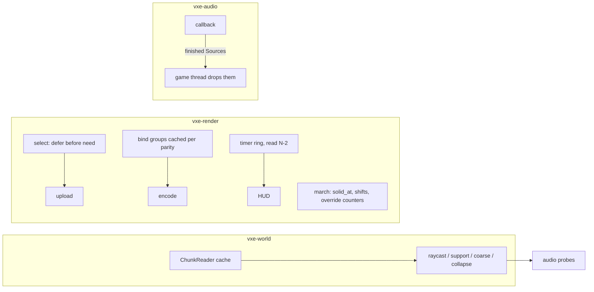

# 0044: The hot-path and defect pass: what the frame, the sync, the walk, the edits and the audio callback do for nothing

> **Status:** approved (2026-10-22)
> **Created:** 2026-10-22
> **Milestone:** cross-cutting (code health). No milestone owns it: it serves the M1 to M4
> figures in `docs/nfr.md` that the plans so far have already shipped.
> **Related ADRs:** none. Each fix keeps the mechanism and removes waste or a defect, so no
> design choice is revisited. A fix that turns out to need one stops and goes back to the
> architect.
> **Source:** the owner, 2026-10-22: "review the code - look for any performance bottlenecks,
> violation of clean code principles, duplications, mega files ... a plan addressing issues
> that goes after all plans that are active are finished". The review ran at `87e4b67`; its
> structural findings are Plan 0045.
> **After:** Plan 0051, and before the M10 batch (owner, 2026-10-29; it was "every plan
> active on 2026-10-22", which would have parked it behind Plans 0032 to 0037). Plan 0052,
> the second review, runs first and strikes what it already fixed.

## TL;DR

A whole-tree review at `87e4b67` found work done for nothing on every hot path, and six real
defects. This plan removes both and changes no behaviour:
- the same pixels (goldens byte-identical);
- the same voxels and results (pinned hashes unchanged);
- the same audio, sample for sample.

The work:
- **The audio callback** stops freeing memory and stops zeroing megabytes.
- **The HUD** stops serialising CPU and GPU, which today makes it measure a frame it caused.
- **The frame** stops rebuilding about 14 bind groups and 66 texture views every frame.
- **The mirror sync** stops sizing chunks it has already deferred.
- **The march's inner loop** stops reading a material it throws away, and stops dividing in
  floating point.
- **The world's raycast** stops taking two locks and a hash per voxel step.

The first thing anyone sees: `tests/mixer.rs` counts frees as well as allocations, and a
voice whose sound the game has dropped finishes with zero frees on the callback.

## Context & problem

**Line numbers below are at `87e4b67`.** The ten plans ahead of this one edit the same files.
`dev` re-reads each finding at the tip before its phase. A finding an earlier plan already
resolved is struck in `### Notes` with the commit that resolved it, and is not reworked.

**Waste on hot paths (each one verified in the source):**

- **Audio callback.** `Mixer` (`vxe-audio/src/mixer.rs:322`, `:535`) `swap_remove`s a
  finished or stopped `Voice` on the device thread.
  - That drops its `Source`: `Arc<[f32]>` or `Arc<Ring>`. When the game has dropped its clone,
    the free runs on the callback.
  - The "allocates nothing" tests cannot see this. The `Counting` allocator (`tests/mixer.rs:31`,
    copied into three more files) counts `alloc` and `realloc`, never `dealloc`.
  - `Voice::new` clears a 29 056-float echo ring per `Play` (`voice.rs:205`).
  - `Network::clear` zeroes 16 x 28 256 floats inside `render` (`reverb.rs:309`, `:515`, `:696`).
  - `Network::render` recomputes 32 `line_filter`s (2 `powf` each) and a 64 x 16 division loop
    every block, settled or not.
  - `set_room` runs a trial-division prime search 16 times on the callback (`reverb.rs:173`).
- **Timer readback.** `PassTimer::read_all_ms` (`vxe-render/src/marcher.rs:2449`) maps and then
  `poll(wait_indefinitely())`. The fly-through calls it up to twice a frame whenever the HUD
  shows (`apps/flythrough/src/main.rs:3667`, `:3670`). The HUD's frame time is therefore the
  time of a frame with no CPU/GPU overlap.
- **Frame encode.** `Frame::encode_with` (`marcher.rs:1791`, 299 lines) rebuilds every group-2
  and group-3 bind group, plus a `create_view` per texture binding, every frame. It builds them
  even for passes that are off (downsample, variance, gradient). It allocates three `Vec`s per
  `bind_io` call. `light_table` (`:967`) collects and sorts every light chunk per frame.
- **Mirror sync.**
  - `GpuWorld::select` (`gpu_world.rs:1959`) calls `need()`, which takes a read lock, allocates
    an `upload_set` `Vec<bool>` and runs `chunk_surface` per brick. Only then does it reach
    `if short.is_some() && !demotion { continue }` (`:2017`). Under pool pressure, every sync
    sizes the whole pending set and uploads none of it.
  - `need()` runs again for each uploaded chunk under the write lock (`:2074`).
  - `full_slot` hashes `mirrored` with SipHash per brick, although `table_cpu` already holds
    the record for every in-window chunk.
  - `prepare_attrs` throws away three `HashSet` capacities per frame (`:1501`).
  - `place_lights` rescans every light chunk on each sync and on each eviction (`:2448`,
    `:2516`).
- **March inner loop.**
  - `lookup_walk` calls `voxel_material` (up to five words) on every solid voxel
    (`march.wgsl:640`). That includes the full-walk shadow rays (`light.wgsl:155` keeps only
    `found`), `occupancy()` (26 calls per `gradient27_normal`) and the cutaway passing steps.
  - `floor_div` converts to `f32` and divides on every step (`march.wgsl:373`, copied at
    `attrib.wgsl:120`), although every divisor is a power of two.
  - The step-view counters `loads`, `pool_reads` and `walk_steps` are incremented in every
    build.
  - `lod_level` recomputes the camera chunk at every chunk entry.
- **World reads.**
  - `Raycast::cell` and `material_cell` (`vxe-world/src/raycast.rs:246`, `:267`) call
    `store.get()` per step: the map lock, a SipHash, an `Arc` clone and the chunk lock.
    `vxe-audio`'s occlusion and room probes go through it.
  - `collapse.rs` already has a chunk-caching `Reader` (`:136`) that nothing else uses.
  - `Snapshot::take` stores each brick twice (`:192`), counts voxel by voxel (`:949`, `:1078`),
    and writes rubble one `set_voxel` at a time (`:697`).
  - `CoarseGrid::update_aabb_with_stats` recomputes every brick in the aabb, ignoring
    `result.touched` (`coarse.rs:251`).
  - `StampedSource::chunk` walks every placement for every generated chunk (`source.rs:79`).
    Plan 0042's castle puts 27 placements on that path.
- **Sim and net.**
  - `vxe-sim` collects the solid boxes again for each of about 12 sweeps per
    `Controller::tick`, plus one per `depenetrate` probe (`sweep.rs:132`).
  - `TickHost::apply_seq` clones the op and its result into a `Message` before `broadcast`
    returns early with no clients (`vxe-net/src/server.rs:126`, `:234`).

**Defects (each one verified):**

1. **Render tests ignore `VXE_REQUIRE_SOFTWARE_ADAPTER`.** The `device()` copies in
   `vxe-render/tests/{mirror,walk,translucent}.rs` fall back to any adapter. CI's lavapipe
   promise therefore holds for the fly-through's tests and not for the renderer's.
2. **`golden.rs` shadows its support module.** `apps/flythrough/tests/golden.rs:55`, `:400`
   and `:519` redefine `carved_world`, `make_lod` and `lod_scene` byte for byte, over the
   `support::*` it imports. An edit to the support fixture silently misses the goldens.
3. **The HUD's "allocates nothing" test is green while the claim is false.**
   `a_shown_hud_allocates_nothing_after_its_first_frame` skips `refresh_hud_stats`, which
   builds a `LightingRow` (a `Vec` and a `String`) per frame. Its fixture has `lighting: None`.
   `Modes::banner` allocates 3 `String`s per frame.
4. **The reservoir count saturates silently.** The reuse cap is `REUSE_M_CAP * candidates`,
   but the count is stored in 8 bits (`light.wgsl:370`, `:383`). Reuse is under-weighted when
   `candidates >= 13`, which the public `u32` allows.
5. **The portability test misses two shaders.** `upscale.wgsl` and `sharpen.wgsl` are not in
   `tests/shader_portability.rs`, which rejects runtime vector-index stores (an FXC failure).
6. **Rust and WGSL layouts are matched by hand.**
   - The uniform structs (`Params`, `View`, `Edits`, `UpTuning`) and the bit constants (entry
     bits, `FLAG_*`, `LIGHTING_*`) exist on both sides, kept in step by comments.
   - `MAX_EDITS = 64` in Rust is hard-coded as `array<vec4<i32>, 128>` in two shaders.
   - `HEADER_TRANSLUCENT_WORD` is 24 in WGSL (slot-relative) and 8 in Rust (header-relative).
   - No test compares either side.

## Decision

Fix each item where it stands, keeping its algorithm. Every phase proves "no behaviour change"
with the tests that already pin behaviour:
- the goldens, byte for byte;
- the pinned hashes in `vxe-world/tests/collapse.rs`, `log.rs` and the replay tests;
- the controller courses;
- the mixer's output samples.

Every perf fix is read against its `docs/nfr.md` figure. A fix that reads no better is still
kept when it removes a defect or an allocation the tests now count. Otherwise it is reverted and
noted.

- We rejected a **faster hasher dependency** for the SipHash lookups. The dense `table_cpu`
  index already exists, and a dependency is a cost.
- We rejected **workgroup-tiled post passes** (upscale, a-trous). They change memory traffic
  enough to want their own measured plan. They are a followup, not a waste fix.
- We rejected **a single blue-noise load per pixel** for `rand`. It changes the noise and so
  every golden. That is a look decision for the owner, and it is a followup.

## Architecture diagram



## Implementation phases

Every phase:
- re-verifies its findings at the tip first and strikes the resolved ones in `### Notes`;
- gates on `--profile quick`, plus `--profile gpu` when it touches `vxe-render` (Plan 0043);
- runs every reading under the perf lock, labelled with the 1-minute load.

### Phase 1: the audio callback frees nothing and zeroes nothing large
- **Owner skill:** dev
- **What:**
  - `Counting` counts `dealloc`. Make it one shared copy in a new
    `crates/vxe-audio/tests/support/mod.rs`, used by the four test files that copy it today.
  - Finished and stopped `Source`s go back to the game thread over a bounded channel beside
    `finished_tx` and are dropped there.
  - Echo rings are cleared on the game side before they return to the spare pool.
  - The FDN clear is spread over blocks, or swapped for a pre-cleared spare network.
  - `Network::render` caches its input gains and coefficients while `t60`, the lengths and the
    energy are settled.
  - `set_room` takes its delay lengths from a `const` prime table up to
    `REVERB_MAX_DELAY_FRAMES`.
- **Files touched:** `crates/vxe-audio/src/{mixer.rs,voice.rs,reverb.rs,output.rs}`,
  `crates/vxe-audio/tests/{support/mod.rs,mixer.rs,stream.rs,reverb.rs,balance.rs}`.
- **Done when:**
  - A new test plays a sound, drops the game's last `Arc`, renders until the voice finishes,
    and reads **0 allocations and 0 frees** on the callback. Before the fix it reads at least
    1 free.
  - A `Play` under the counting allocator does 0 allocations and 0 frees. A ring-out that
    resets the network does no single zeroing of more than one block's worth of lines, which
    is asserted on a counter the mixer exposes to tests.
  - The existing mixer, reverb and balance tests produce the same samples. Where a test compares
    output, it compares exactly, or within the tolerance it already uses.
  - `cargo bench -p vxe-audio --bench mixer` is read before and after, with the machine and
    load.

### Phase 2: the HUD measures without stalling, and its allocation test covers the HUD
- **Owner skill:** dev
- **What:**
  - `PassTimer` gets a ring of 3 query and readback sets and a `try_read_all_ms` that never
    waits and returns the newest finished set (frame N-2 when the GPU keeps up).
    `read_all_ms` stays for tests that need a blocking read.
  - The fly-through's HUD path uses `try_read_all_ms` only.
  - `LightingRow` is reused. `Modes` writes into a caller's `String`.
  - The HUD allocation test runs `refresh_hud_stats` with a lighting row present and the
    banner showing.
- **Files touched:** `crates/vxe-render/src/marcher.rs`, `apps/flythrough/src/{main.rs,hud.rs}`.
- **Done when:**
  - `a_shown_hud_allocates_nothing_after_its_first_frame` covers `refresh_hud_stats`, a lighting
    row and the banner, and reads 0 allocations after the first frame. Before the fix the
    same test reads at least 1.
  - A headless test submits 5 frames and calls `try_read_all_ms` after each. It reads `None`
    until a set has resolved, then per-pass values, and never calls a blocking poll. The
    blocking poll is asserted by a counter on `PassTimer`.
  - On the dev box, `flythrough --autopilot --headless` with the HUD on and the same flags reads
    a p50 frame time no worse than with the HUD off, within the run-to-run spread of three runs
    each.

### Phase 3: the frame builds its bind groups once per size
- **Owner skill:** dev
- **What:**
  - `Targets` holds its views.
  - The group-2 and group-3 bind groups are built per history parity (two sets) in
    `set_sizes`, and the world group is rebuilt only when a bound buffer changes (the
    `AttribPass` pattern, `attrib.rs:191`).
  - Groups for passes that are off are not built.
  - The dispatch `Vec`s become fixed arrays.
  - `light_table` is rebuilt only when `GpuWorld`'s light ranges or the focus chunk change.
  - `present.rs` gets the same treatment.
- **Files touched:** `crates/vxe-render/src/{marcher.rs,present.rs,gpu_world.rs}`,
  `crates/vxe-render/tests/` (one new test file or an existing one).
- **Done when:**
  - A counter on `Frame` (bind groups and views created) reads **0 after the second frame** of
    a fixed-size headless run with every lighting mode cycled once.
  - A resize to a new size reads exactly the groups of both parities, once.
  - Every golden is byte-identical.
  - The CPU time of `encode` is read before and after on the dev box.

### Phase 4: the sync sizes only what it uploads
- **Owner skill:** dev
- **What:**
  - In `select`, the deferral check moves ahead of `need()`. The cheap stale checks stay first.
  - `need()` computes the chunk's 512 solid masks once and derives the surfaces from them. Its
    result is carried to `upload`, not recomputed.
  - `upload_set` returns a `[u64; 8]` bitset.
  - `full_slot` and `is_full_chunk` go through `in_window` and `table_cpu`.
  - `prepare_attrs` drains its sets in place and keeps `front` and `rest` as fields.
  - `place_lights` and `write_chunk_lights` reuse scratch `Vec`s and stop rescanning on each
    eviction.
- **Files touched:** `crates/vxe-render/src/{gpu_world.rs,attr_work.rs}`,
  `crates/vxe-render/tests/mirror.rs`.
- **Done when:**
  - A new mirror test fills the pool, queues 64 chunks that cannot fit, and syncs. `SyncStats`
    reads `deferred_chunks = 64` and **0 `need` calls**, through a new `sized_chunks` counter.
    Before the fix it reads 64.
  - Every existing mirror test passes unchanged. The slot words a chunk receives are
    byte-identical to `87e4b67`'s, through the existing `a_slot_holds_the_packed_brick_s_own_words`.
  - The streamed default (`r_full` 16) `sync` p50 and p99 are read on both adapters against
    Plan 0028's 3.1 ms reading in `docs/nfr.md` section 2.

### Phase 5: the march walks without reading what it discards
- **Owner skill:** dev
- **What:**
  - `lookup_walk` returns the entry and the index. The material is resolved once, for the final
    hit, in the entry points that use it.
  - A `solid_at(v)` serves `occupancy()`, the shadow rays and the cutaway steps.
  - `floor_div` by a power of two becomes an arithmetic shift, and `cell_min` becomes a mask,
    in `march.wgsl` and `attrib.wgsl`.
  - The step counters sit behind `override COUNT_STEPS: bool`, true only in the steps-view
    pipeline.
  - The camera chunk moves into `Params`.
  - The reservoir cap is clamped to 255 on the CPU and in WGSL.
  - The portability test lists every shader file.
- **Files touched:** `crates/vxe-render/src/shaders/{march.wgsl,attrib.wgsl,light.wgsl}`,
  `crates/vxe-render/src/marcher.rs`, `crates/vxe-render/tests/shader_portability.rs`.
- **Done when:**
  - **Every golden is byte-identical**, the steps view included. A shift equals a floor
    division for every `i32`. The float path is exact only below 2^24, so this is a property,
    not a tolerance.
  - A unit test asserts that the shift-and-mask forms equal `div_euclid` and the floor-division
    `cell_min` for `v` in -4096..=4096 at every cell size the walk uses.
  - `candidates = 16` gives a stored count of at most 255, asserted on a readback of the
    reservoir.
  - `shader_portability.rs` iterates `src/shaders/*.wgsl` instead of a list, so a new shader
    cannot be missed.
  - The hit pass, the light pass and the frame are read on both adapters (the dev box and the
    slow adapter, lane rule 8) against their latest `docs/nfr.md` section 2 readings.

### Phase 6: the world reads a chunk once per run of steps
- **Owner skill:** dev
- **What:**
  - Collapse's `Reader` moves to `store.rs` as a `pub(crate)` `ChunkReader` that caches the last
    chunk's guard. `raycast`, `support::measure`, `coarse::update` and collapse use it.
    `support::measure` sorts its cells by chunk first.
  - `Snapshot` keeps only the `Brick`. It counts and bounds with the word operations
    (`counts_under`, `bounds_of`) and extracts a brick's 64 columns in one pass.
  - Rubble and crush write one `Fill` kernel call per brick.
  - `CoarseGrid::update` skips chunks not in `result.touched`.
  - `StampedSource` indexes its placements by chunk.
- **Files touched:** `crates/vxe-world/src/{store.rs,raycast.rs,collapse.rs,support.rs,coarse.rs,source.rs,stamp.rs}`,
  `crates/vxe-world/benches/` (a `raycast` bench if none covers the path).
- **Done when:**
  - Every pinned hash and result in `vxe-world/tests` is unchanged, including
    `the_collapse_course_hashes_to_its_pinned_constant`, the replay tests and the stamp
    tallies.
  - A test counts store lookups through a `cfg(test)` counter: a ray crossing 3 resident chunks
    makes exactly 3.
  - A `StampedSource` with 27 placements over a 3 x 3 x 3 chunk block visits, per generated
    chunk, only the placements whose bounds meet that chunk. This is asserted with a counter
    on a chunk that meets none.
  - The collapse, coarse and stamp benches and the new raycast bench are read before and after.

### Phase 7: the controller and the server stop repeating work
- **Owner skill:** dev
- **What:**
  - `Controller::tick` collects the solid boxes once, over the union of its reach, into a
    reused scratch. `sweep_in` and `overlaps_in` take them.
  - `TickHost::apply_seq` builds and encodes the message only when there are clients.
  - Inputs are moved into the log, not cloned.
- **Files touched:** `crates/vxe-sim/src/{controller.rs,sweep.rs,body.rs}`,
  `crates/vxe-net/src/{server.rs,message.rs}`.
- **Done when:**
  - Every controller course in `vxe-sim/tests/controller.rs` ends bit-identical (positions and
    states).
  - A test counts box collections: one per tick on a flat course.
  - The `vxe-net` resimulation tests give equal bytes.
  - `cargo bench -p vxe-net --bench tick` is read against its `docs/nfr.md` reading.

### Phase 8: the guards that were missing
- **Owner skill:** dev
- **What:**
  - **A `test-support` feature in `vxe-render`** with `software_device`, `any_device` and
    `high_performance_device`. All three follow the same skip-or-require rule for
    `VXE_REQUIRE_SOFTWARE_ADAPTER` (the vxe-net `test-logic` feature is the precedent). Every
    render test, and the fly-through's support module, uses it.
  - **`golden.rs` loses its three shadow copies.**
  - **A layout test** parses each shader with naga and runs `naga::proc::Layouter`. It asserts
    that every uniform struct's span and member offsets equal the Rust struct's `size_of` and
    `offset_of!`, and that every same-named constant has the same value on both sides.
  - **The constant-naming problems** the test exposes are fixed: `HEADER_TRANSLUCENT_WORD`,
    and the `MAX_EDITS` array lengths.
- **Files touched:** `crates/vxe-render/{Cargo.toml,src/lib.rs,src/test_support.rs}`,
  `crates/vxe-render/tests/*.rs`, `crates/vxe-render/src/shaders/{temporal.wgsl,upscale.wgsl,march.wgsl}`,
  `apps/flythrough/tests/{support/mod.rs,golden.rs}`, `apps/flythrough/Cargo.toml`,
  `.github/workflows/ci.yml` if the feature needs naming there.
- **Done when:**
  - With `VXE_REQUIRE_SOFTWARE_ADAPTER=1` and no lavapipe (simulated by an adapter-name filter
    that matches nothing), every render test binary fails rather than passes. This is shown
    once and recorded.
  - `grep -c 'fn carved_world' apps/flythrough/tests/*.rs` finds only `support/mod.rs`.
  - The layout test fails when one Rust field is reordered (shown once on a scratch change)
    and passes on the tree. Every golden is byte-identical.

## Data shapes

```rust
// illustrative
pub struct PassTimer { sets: [TimerSet; 3], next: usize, /* … */ }
impl PassTimer {
    /// The newest resolved set's per-pass milliseconds; never waits.
    pub fn try_read_all_ms(&mut self, device: &wgpu::Device) -> Option<&[f64]>;
}

pub(crate) struct ChunkReader<'a> { store: &'a ChunkStore, last: Option<(ChunkCoord, Guard)> }
```

## Budgets

| `docs/nfr.md` figure | Phase | Expected | How the close reads it |
|---|---|---|---|
| Section 2, frame time at the lighting defaults | 2, 3, 5 | lower or equal (guess: encode CPU down by the bind-group work; the march by the material reads in shadow and normal paths) | `flythrough --autopilot --headless`, the defaults, both adapters, quiet box |
| Section 2, the hit pass and the light pass | 5 | lower or equal | the per-pass timer, same runs |
| Section 2/5, `sync` p50/p99 at `r_full` 16 | 4 | p99 under pressure lower; p50 unchanged or lower | the Plan 0028 Phase 4 scene and flags |
| Section 4, edit cost (collapse, stamp) | 6 | lower or equal | the vxe-world benches |
| Section 6, determinism | all | unchanged: every pinned hash equal | the existing tests |
| Audio callback time per block | 1 | lower or equal, and no frees | `cargo bench -p vxe-audio --bench mixer` |

Every reading names the machine, the commit, the lock and the load. The expectations are
guesses until read.

## Risks & open questions

- **Drift.** Ten plans land before this one, in the same files. The "re-verify first" rule is
  what keeps the plan honest. A phase whose findings are all gone closes with a note.
- **Determinism.** Phase 6 changes how collapse counts and writes. The pinned hashes are the
  guard, and a changed hash is a stop, not a re-bless.
- **Real-time audio.** Phase 1's returned `Source`s need a channel that never blocks the
  callback. When it is full, the callback keeps the source and retries next block. The test
  fills the channel.
- **GPU.** Phase 3 caching must survive a device-lost or resize path. Phase 5's `override`
  needs pipeline constants, which wgpu supports on every backend in use. The steps-view golden
  is the proof.

## What this plan does NOT do

- **Split files or structs.** That is Plan 0045.
- **Tile the post passes in workgroup memory, or cut `rand`'s texture loads.** These are
  followups with their own measurements. The second also needs the owner's eye.
- **Move the residency pressure rule out of the testbed into an engine crate.** That is an
  architect question, recorded as a followup.
- **Change any default, tier or look.**

## Implementation log

| phase | owner | state | commit |
|---|---|---|---|
| 1: the audio callback frees nothing and zeroes nothing large | dev | not started | |
| 2: the HUD measures without stalling, and its allocation test covers the HUD | dev | not started | |
| 3: the frame builds its bind groups once per size | dev | not started | |
| 4: the sync sizes only what it uploads | dev | not started | |
| 5: the march walks without reading what it discards | dev | not started | |
| 6: the world reads a chunk once per run of steps | dev | not started | |
| 7: the controller and the server stop repeating work | dev | not started | |
| 8: the guards that were missing | dev | not started | |

### Notes

### Close triggers

## Followups

1. Workgroup-tiled upscale and a-trous with a decoded guide texture. This needs a measured plan.
2. One blue-noise load per pixel for `rand`. It changes the noise, so it needs the owner's eye.
3. Whether the residency pressure rule (`RadiusRule`, `Deferrals`, the thresholds now in three
   files) becomes an engine type. This needs an architect interview.
4. A per-update ray budget for the audio probes. Up to 448 rays per update while walking.
