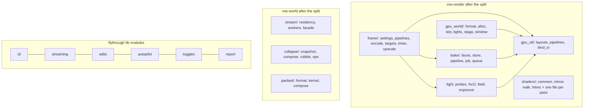

# 0045: The structure pass: split the mega files, share the fixtures, and gate their regrowth

> **Status:** approved (2026-10-22), amended 2026-11-10 (review pass) and 2026-11-11 (order)
> **Created:** 2026-10-22
> **Amended 2026-11-11 (owner, the order):** this plan moves ahead of Plan 0058 and of Plan
> 0044's remaining phases (3, 4, 5 and 8; its side lane, Phases 0, 1, 6 and 7, merged to main
> at `d6d2dfa`). It starts once Plans 0061, 0067 and 0068 have merged, while no lane edits a
> file it splits. Plan 0058 then starts on the split tree, then 0044's render phases, then Plan
> 0069. What moves with it:
> - **The render device helper is not there yet.** It is Plan 0044's Phase 8, which now runs
>   after this plan. Here the render tests keep their device setup as found and Phase 8's test
>   splits move it unchanged; 0044's Phase 8 lands the helper in the split files.
> - **Fewer plans rewrite the seams first:** Plans 0060, 0061 and 0067 have edited the files;
>   0058 and 0044's render phases have not. Phase 0 still re-measures, and the architect
>   still confirms the seams before Phase 2. The 2026-11-10 order below is superseded.
> **Amended 2026-11-10 (architect, review pass; this header replaces the amendments of
> 2026-11-03 and 2026-11-04):**
> - **Order (owner, 2026-11-10; superseded 2026-11-11, above):** Plans 0060, 0061, 0058, 0044,
>   then this plan, then M10.
> - **The seams below are provisional.** They are cut against main at `82ea836` and marked
>   so. Phase 0 re-measures at this plan's start commit, and the architect confirms or amends
>   the seams from that inventory before Phase 2 starts.
> - **No size or copy count is restated here.** The review of 2026-10-22 was read at
>   `87e4b67`; every file it named has grown or moved since. The figures live in Phase 0's
>   inventory, in `docs/plans/logs/0045.md`.
> - **This plan does not remove `own`.** Removing the engine's own upscaler deletes tests and
>   goldens, which is a behaviour change. It is another plan's (the backlog carries it);
>   Phase 3 moves `Upscaler` as it finds it.
> - **Gone since the draft, so struck:** the attribute scheduler and `attrib.*` (Plan 0054),
>   `detail.wgsl` (Plan 0055), the reservoir and its unpack (Plan 0057), the per-face table
>   and its `cache_*` passes (Plan 0059). **New since the draft, so placed:** `bake.rs`,
>   `bake.wgsl`, `light.rs`, `probes.rs`, `fsr2.rs` and `fsr2/`, `field.rs`.
> - **Tests select their tier by marks** (2026-11-10): a GPU test file is `tests/gpu_*.rs`, a
>   long series is `#[ignore = "soak"]`, a hand-run measurement sits in a `mod reading`. No
>   phase edits a filter in `.config/nextest.toml`.
> **Milestone:** cross-cutting (code health)
> **Related ADRs:** none. The splits move code and keep every mechanism. Promoting `FnSource`
> and `SplitMix64` into `vxe-world` adds public items but no decision. The rejected option, a
> separate dev-only `vxe-testkit` crate, is recorded under Decision.
> **Source:** the owner, 2026-10-22, the same review as Plan 0044. The owner's answers: two
> plans, performance first; full splits, engine crates included.
> **After:** Plans 0061, 0067 and 0068 merged (amended 2026-11-11; was 0060, 0061, 0058 and
> 0044). **Before:** Plan 0070 (owner, 2026-11-12: "70 after 45"), Plan 0058, Plan 0044's
> Phases 3, 5 and 8, Plan 0069 (render settings) and M10.

## TL;DR

The review of 2026-10-22 found a handful of files and types that hold several jobs each, and
the same test fixtures copied from crate to crate. Both have grown since. As of `82ea836` the
mega files are `apps/flythrough/src/main.rs`, and `marcher.rs`, `bake.rs`, `gpu_world.rs` and
`march.wgsl` in `vxe-render`; Phase 0's inventory holds the sizes at the start commit.

This plan splits each along a named seam and moves the shared fixtures to one home. It then
adds two gates so the files cannot regrow unnoticed: a file-size cap script and clippy's
`too_many_lines`. Behaviour does not change: the goldens stay byte-identical, every pinned
hash stays equal, and the public API changes only where this plan lists it. One thing the
owner will see is that every fly-through toggle shows its mode in the window, under the
owner's standing rule. The modes come out of one table that feeds the HUD, the banner and the
printed line.

## Context & problem

The sizes and copy counts are Phase 0's to read; this section names what is wrong, as of
`82ea836`.

**Mega files and god types:**
- **`apps/flythrough/src/main.rs`** mixes CLI parsing (`Args` and `parse_args_from`), audio,
  streaming pressure policy, autopilot benchmarking, input bindings in several dispatch
  styles, edit-event routing, the bake queue's run state, reports, setup and the frame loop.
  Everything in it is private to the binary, so its tests live inside it. `impl Run` is split
  across two blocks. A library half already exists (`src/lib.rs` with `castle`, `cave`,
  `hud`, `showcase` and `thin_rig`), and `lib.rs` itself holds poses, materials, the look
  presets, the census, replay and `percentile` in one file. `fly.rs` and `pad.rs` are private
  modules of the binary.
- **`vxe-render/src/gpu_world.rs`.** `GpuWorld` holds the window and its pending queue, the
  page and slot allocator, record staging and the belt, light extraction and its range
  allocator, and several per-material `Vec`s. Every `vxe-render` module is `pub mod`, so the
  layout internals are public API.
- **`vxe-render/src/marcher.rs`** holds the settings enums with hand-written
  `name`/`from_name` pairs, the upscaler, the targets, the pipeline and bind-group helpers,
  the pass timer and `Frame`. `Frame` owns every pass's layout and pipeline, the uniforms,
  the bake store and queue, the probe channel, the upscaler state and the exposure, and its
  one `impl` is most of the file. The layout and pipeline helpers are written again in other
  render modules (`fsr2.rs` confirmed; the others are Phase 0's to check). `readback.rs`
  holds three copies of one padded copy-and-depad.
- **`vxe-render/src/bake.rs`** (Plan 0059) holds the CPU face masks, the store, the bake
  pipeline and its shader composition, the per-face job state, the job loop and the live
  queue in one file.
- **`march.wgsl`** holds bindings, mirror decode, DDA traversal, normals, the hit record and
  reprojection, and rand. Each frame pass is `format!("{MARCH_WGSL}\n{source}")`, so
  `sharpen.wgsl`, which needs `params.output_size` only, compiles all of it. Helpers are
  written more than once: the octahedral pair (`march.wgsl`, `probe_gather.wgsl`), the lamp
  cone term (`march.wgsl`, `light.wgsl`, `upscale.wgsl`, `fsr2/input.wgsl`), the edit-box
  test (`temporal.wgsl`, `upscale.wgsl`, `fsr2/input.wgsl`), and the mirror decode
  (`floor_div`, `payload_units`, `pool_word` in `march.wgsl` and `field.wgsl`). The bake
  composes its own source from `march.wgsl` and `light.wgsl` with two text substitutions
  (`bake_source` in `bake.rs`).
- **`vxe-world`:**
  - `Streamer` mixes residency policy, the worker pool and spill scheduling.
  - `collapse.rs` mixes the snapshot, the composition, rubble and three ops.
  - `packed.rs` mixes format, edit kernel and composition.
  - `edit.rs` carries bench-only reference writers (`Target`, `RowWriter`, `PlanarWriter`)
    and `#[doc(hidden)] pub` `*_decoded` ops in the production module.
  - Several separate count and bound accumulators exist.
  - The chunk clip `[0,1,2].map(|k| (c[k]*e).max(lo[k]))` is written out more than once.
- **`vxe-audio`:** `Mixer::render_block` is one long function with the HRTF-or-pan branch
  copied between voices and buses; `reverb.rs` mixes the FDN and the handover; `acoustics.rs`
  mixes occlusion, reflections, the room fan and cadence.
- **`vxe-net` and `vxe-script-wasm`:** the support-query host in `vxe-net/src/server.rs` is
  copied into `vxe-script-wasm/tests/determinism.rs`.

**Duplicated fixtures** (each kind confirmed present at `82ea836`; Phase 0 counts the copies):

| Fixture | Where |
|---|---|
| closure `WorldSource` | `vxe-audio/tests`, `vxe-render/tests`, `vxe-world/tests/support`, `vxe-sim/tests/support` |
| `SplitMix64` | `vxe-world/tests/support`, `vxe-net/src/test_logic.rs`, `vxe-audio/tests/hrtf.rs`, the fly-through's `gpu_level_mirror.rs`, and inline forms |
| `Fnv1a` and `world_hash` | `vxe-world/tests/support`; duplicate the public `hash::Fnv1a` and `World::voxel_hash` |
| `hash_result` | the fly-through's `determinism.rs` and `replay.rs` |
| bench clocks and `solid_world` | across `vxe-world/benches` |
| squared chunk distance `d2` | `stream.rs`, `gpu_world.rs` (a function and inline forms), `marcher.rs` |

The wgpu test device helper is Plan 0044's (its Phase 8), which runs after this plan since
2026-11-11; the tests keep their device setup as found here.

**The testbed's protocol and CLI:**
- The dig logic talks to the client in `"op <verb>"` text lines. They are paired with events in
  FIFO order, and a mismatch is dropped silently.
- `examples/hero.rs` has its own lighting-flag parser beside `main.rs`'s.
- `run_headless` copies `vxe-app`'s shell setup and hand-rolls `pollster_block_on`.
- `median` (`main.rs`) and `percentile` (`lib.rs`) use different rank conventions, so F1's
  "median" and the exit line's "p50" disagree.

## Decision

Split along the seams below, keeping every type's behaviour. Promote the fixtures that are
general and deterministic into the engine: `vxe_world::FnSource`, `vxe_world::hash::SplitMix64`
and `ChunkCoord::distance2`. Keep the test-only helpers in per-crate `tests/support` modules
and behind `test-support` features, following `vxe-net`'s `test-logic` precedent (Plan
0044's render device helper follows this plan, 2026-11-11). Narrow `vxe-render`'s public surface to its curated re-exports.
Finish with two mechanical gates, because a size rule written in prose is the kind
`CLAUDE.md` says needs a gate.

**One set of caps, and the gates enforce all of it:**

| Cap | Figure | Enforced by |
|---|---|---|
| a `.rs` or `.wgsl` file under `src/` | 1200 lines | `scripts/check-file-size.mjs` |
| a file under `tests/` (its `support/` included), `benches/` or `examples/` | 2000 lines | `scripts/check-file-size.mjs` |
| a function | 150 lines | clippy's `too_many_lines` |

The figures are choices, not measurements. 1200 is the size at which the 2026-10-22 review
began calling a module a mega file (the smallest it named were just over it); 2000 gives a
test file room for its rigs; 150 is clippy's `too_many_lines` set above its default of 100, so
a long `match` passes. No phase states a tighter number of its own.

- We rejected **a dev-only `vxe-testkit` crate**. It adds a workspace member, and features
  plus promotion cover every duplicate except a few cross-crate test statistics, which are
  small enough to copy once into the crate that uses them.
- We rejected **leaving the engine crates alone and splitting only the testbed**. That was the
  owner's call.
- We rejected **a WGSL preprocessor dependency** (naga_oil or similar). `concat!` over
  `include_str!` composes modules with no dependency.

## Architecture diagram



## Implementation phases

Every phase from 1 on does three things:
- reads its files' rows in Phase 0's inventory, and re-reads the files if a commit has landed
  on them since;
- gates on `node scripts/test-changed.mjs --profile quick`, plus `--profile gpu` under the
  perf lock when it touches `vxe-render` or the shaders; the tip gates on
  `cargo nextest run --profile gate`. A golden test marked `#[ignore = "soak"]` that a phase
  claims byte-identical runs by name with `--run-ignored only`;
- proves no behaviour change: goldens byte-identical, pinned hashes equal, bench readings
  within the spread of Phase 0's three runs.

A public item that moves keeps a re-export at its old path unless this plan names its removal.
A test file that opens a GPU device keeps the `gpu_` prefix through every split and rename, a
`#[ignore = "soak"]` mark travels with its test, and a `mod reading` stays a `mod reading` in
the file its tests land in.

**Wall times.** Every new test this plan names is CPU-only and is expected to run in under
1 s (an estimate; nothing here has been run). None renders, so none is a soak candidate.
Existing tests move without change, and their times with them.

### Phase 0: the inventory at the start commit
- **Owner skill:** dev
- **What:** measure, at this plan's start commit, what the phases below cut, and take the
  "before" readings. All of it goes to `docs/plans/logs/0045.md`:
  - **Files:** `wc -l` of every `.rs` and `.wgsl` under `crates/` and `apps/`, with the files
    over each cap of the Decision listed.
  - **Functions:** every function over 150 lines, from one clippy run with
    `too-many-lines-threshold = 150` set locally and not committed.
  - **Types:** the field counts of `GpuWorld`, `Frame`, `Streamer` and the fly-through's `Run`
    and `Args`, and the line span of each `impl`.
  - **Copies:** each fixture of the Context table and each duplicated WGSL helper, by file.
  - **Public surface:** each `pub` item of `vxe-render` outside the curated `pub use` list in
    `lib.rs`, with its in-repo users. As of `82ea836` `readback::read_texels_u32` has none.
  - **The first consumer:** a grep of `~/Work/voxel-roguelite` for `vxe_render::` module
    paths (`gpu_world::`, `marcher::`, `bake::`, `readback::`) and for `vxe-world`'s
    `#[doc(hidden)]` `*_decoded` ops. Each use is listed.
  - **Readings ("before"):** the figures of `## Budgets`, three runs each.
  - **Drift:** each place where a seam below no longer matches the tree, in one line each.
- **Files touched:** `docs/plans/logs/0045.md`.
- **Done when:**
  - The log holds every list above, with the start commit named.
  - Every use the first-consumer grep found is marked "kept as a re-export" in the log, or
    the log says the grep found none.
  - **The architect has read the inventory and written, in this plan's header, either "seams
    confirmed at `<commit>`" or an amendment to Phases 2 to 4 and 7.** Phase 1 may run before
    that line; Phase 2 does not start without it.

### Phase 1: one home for each shared fixture
- **Owner skill:** dev
- **What:**
  - **New public items in `vxe-world`:** `pub struct FnSource<F>(pub F)` in `source.rs`,
    `pub struct SplitMix64` in `hash.rs` (built on `mix64`), and `ChunkCoord::distance2`.
  - **Copies deleted:** the closure sources, the SplitMix64 streams and every `d2`, as Phase 0
    listed them.
  - **`vxe-world/tests/support`** uses `hash::Fnv1a` and `World::voxel_hash`, or keeps them as
    an oracle with a test asserting equality. Which one it is is stated in its doc comment.
  - **`vxe-audio/tests/support/mod.rs`** (Plan 0044 creates it for its allocator) gains the
    `table`, `world`, `cube` and `ShellCube` fixtures, `tone`, `tail_rms`, `peak`, `energy`,
    and `db_power` / `db_amplitude`. These replace the two different `db`s.
  - **New `vxe-world/benches/support.rs`:** one allowed `now` and `timed`, `solid_world`,
    `box_op` and `slab_cells`. The `vxe-net` and `vxe-script-wasm` benches take a `#[path]`
    copy of the clock.
  - **Fly-through tests:** `hash_result`, the shared op vectors, `dig_inputs` and
    `differing_bytes` move into `apps/flythrough/tests/support`. `assert_golden_exact` joins
    `assert_golden`.
  - **`vxe_net::WorldHost`:** the world-backed `Host` that `TickHost` wraps and that
    `vxe-script-wasm`'s tests use.
- **Files touched:** `crates/vxe-world/src/{source.rs,hash.rs,coords.rs,lib.rs,stream.rs}`,
  `crates/vxe-world/{tests,benches}/`, `crates/vxe-audio/{tests,benches}/`,
  `crates/vxe-render/{src/gpu_world.rs,src/marcher.rs,tests}`, `crates/vxe-sim/tests/`,
  `crates/vxe-net/{src,benches}/`, `crates/vxe-script-wasm/{tests,benches}/`,
  `apps/flythrough/tests/`.
- **Done when:**
  - Over `crates/` and `apps/`, `struct SplitMix64` and `fn hash_result` are each defined in
    exactly one file. A `WorldSource` impl for a closure-backed type appears only in
    `vxe-world/src/source.rs`. `fn unsupported_with_steps` is defined only in `vxe-net/src`.
  - Every pinned hash and every audio test's expected value is unchanged.
  - `cargo test --doc -p vxe-world` covers a `FnSource` doctest.

### Phase 2: `GpuWorld` becomes a directory of owned parts
- **Owner skill:** dev
- **What (seams as of `82ea836`):** `gpu_world.rs` becomes `gpu_world/`:
  - `format.rs`: the GPU contract constants, `class_code`, `payload_units`,
    `slot_units`, `bin_of`, `ShardLayout` and `budget_for`.
  - `alloc.rs`: a `PoolAlloc` owning the bins (`BinAlloc`), page state and `Fit`.
  - `slot.rs`: `fill_slot`, `materials_of`, `upload_set` and `chunk_surface`. All pure CPU,
    unit-tested without a device.
  - `lights.rs`: a `LightMirror` owning `LightSample`, `ChunkLights` and the `light_*` fields.
  - `stage.rs`: an `Uploader` with `Band`, the `Belt` and the `flush_*` functions.
  - `window.rs`: a `WindowQueue`.
  - `mod.rs`: `GpuWorld` as the composition.

  Two smaller changes go with the split:
  - A `MaterialFlags` struct replaces the per-material `Vec`s.
  - The `lod: bool` parameters become `Bricks::is_lod()`.

  `vxe-render`'s modules become private behind the existing curated `pub use` list, and
  layout items become `pub(crate)`. `readback::read_texels_u32` is deleted if Phase 0 still
  finds no user. `OPAQUE_WORDS` (used inside `gpu_world`) becomes `pub(crate)`.
  `GpuWorld::free_pages()` stays public: the fly-through prints its length, and the mirror
  tests read it.
- **Files touched:** `crates/vxe-render/src/{gpu_world/,lib.rs,readback.rs,marcher.rs,bake.rs}`,
  `crates/vxe-render/tests/`, `apps/flythrough/` (imports only), `apps/flythrough/examples/`.
- **Done when:**
  - `GpuWorld` has at most 15 fields, each a part or a scalar.
  - `node scripts/check-file-size.mjs crates/vxe-render/src/gpu_world` would pass: no file in
    `gpu_world/` is over the source cap. (The script lands in Phase 8; until then `wc -l`.)
  - Every mirror test passes unchanged, and slot words are byte-identical to the phase's start
    commit.
  - Every golden is byte-identical.
  - The public items removed from `vxe-render` are listed in the log's close triggers, and
    every in-repo user and every first-consumer use from Phase 0 compiles against the curated
    surface.

### Phase 3: `marcher.rs`, `bake.rs` and `fsr2.rs` become directories
- **Owner skill:** dev
- **What (seams as of `82ea836`; Plans 0060, 0061 and 0067 edit these files first, Plan
  0058 after this plan since 2026-11-11):**
  - **`marcher.rs` becomes `frame/`:**
    - `settings.rs`: `Params`, the enums and flags, `Lighting`, `LookParams`, `LodParams`.
      A `macro_rules!` generates `ALL`, `name` and `from_name`; `light.rs` and `bake/` use
      it for their pairs too.
    - `targets.rs`: `Targets`. `timer.rs`: `PassTimer`. `marcher.rs` keeps `Marcher`, the hit
      pass, alone.
    - `upscale.rs`: `Upscaler`, `halton`, `jitter_at`, and an `UpscaleState` that owns the
      upscaler's uniforms, the sharpen parameters, the history, the jitter, the kind and the
      FSR 2 handle.
    - `pipelines.rs`: a `Pipelines` struct that owns every pass's layout and pipeline, built
      from a `const PASSES: [PassSpec; N]` table instead of the hand-written pairs in
      `Frame::with_sizes`.
    - `state.rs`: a `FrameState` that owns the uniforms and what they are built from (the
      params and edits buffers, the look, the LOD, the lighting, the emission scale, the
      blue noise, the frame counter, the `LightKey` and `LampKey` change keys).
    - `baked.rs`: a `BakeLink` that owns the store, the bake pipeline, the dig boxes and the
      bake queue, with `Frame`'s bake methods.
    - `probe_channel.rs`: a `ProbeChannel` that owns the probe volume, its layouts and
      pipelines and its counters, with `Frame`'s probe methods.
    - `encode.rs`: `encode_with` split into `write_uniforms`, `bind_groups` and `record`,
      with `Dispatch`. Its `keep_history: bool` becomes an enum.
    - `mod.rs`: `Frame` as the composition (the device, the targets, the output, the
      exposure and the parts above) and its public setters.
  - **`bake.rs` becomes `bake/`:**
    - `faces.rs`: `ChunkFaces`, `ChunkMasks`, `FacePrep`, `PreparedMasks`. Pure CPU.
    - `store.rs`: `Store`, `StoreStats`.
    - `pipeline.rs`: `BakeSettings`, `BakePipeline`, `bake_source` and its substitutions.
    - `face_state.rs`: `FaceState`. `job.rs`: `JobLoop`, `Budget`, `OpenJob`, `JobCtx`,
      `DigReport`.
    - `queue.rs`: `BakeQueue`, `QueueView`, `QueueStats`, and whatever order and withdrawal
      Plan 0060 leaves there; a second file for the opening order if `queue.rs` is over the
      cap.
    - `mod.rs`: `BakeReport`, `BakeProgress`, `BakeError` and the re-exports.
  - **`fsr2.rs` becomes `fsr2/`** along its own sections (settings and tuning, the pipelines,
    the per-frame `prepare`), if Phase 0 still reads it over the source cap.
  - **`gpu_util.rs`** takes the layout, bind-group and pipeline helpers. `frame/`, `bake/`,
    `fsr2/`, `field.rs`, `exposure.rs`, `probes.rs`, `hud.rs` and `present.rs` use it.
    `light.rs` and `probes.rs` stay single files.
  - **`readback.rs`'s three copies** become one `read_texels` and thin wrappers.
- **Files touched:** `crates/vxe-render/src/{frame/,bake/,fsr2/,gpu_util.rs,marcher.rs,bake.rs,fsr2.rs,light.rs,probes.rs,field.rs,exposure.rs,hud.rs,present.rs,readback.rs,lib.rs}`.
- **Done when:**
  - `Frame` has at most 20 fields, each a part or a scalar.
  - No file under `frame/`, `bake/` or `fsr2/` is over the source cap, and no function in
    them is over 150 lines (the clippy run of Phase 0, repeated).
  - `readback.rs` has one `copy_texture_to_buffer` call.
  - Every golden is byte-identical, and `gpu_bake.rs`'s and `gpu_queue.rs`'s tests pass
    unchanged.
  - The CPU `encode` time and the queue step's p50 are within the spread of Phase 0's
    readings.

### Phase 4: the shaders become modules a pass picks
- **Owner skill:** dev
- **What (seams as of `82ea836`):** `march.wgsl` splits into four modules:
  - `common.wgsl`: Params, View, flags, luminance, hash and rand.
  - `mirror.wgsl`: the layout constants and pure decode over words.
  - `walk.wgsl`: the walk, `descend`, `lookup` and the DDA, with `enter_window` and
    `exit_cell` extracted.
  - `hitrec.wgsl`: the octahedral encoding, the hit record and reprojection.

  Each pass is composed with `concat!(include_str!(…), …)` of only what it uses. Each helper
  Phase 0 found in more than one file collapses to one definition: the octahedral pair, the
  lamp term, the edit-box test, the mirror decode, and any "same surface" test, which takes
  its threshold as a parameter so each caller passes its current constant and no output
  changes.

  `field.wgsl` uses `mirror.wgsl` instead of its own decode, and `fsr2/`'s passes that prepend
  `march.wgsl` take only what they use. **The bake** (`bake.wgsl`) composes after the walk
  and `light.wgsl` with two text substitutions; each substituted line stays in exactly one
  module, and `bake_source` names that module. The bit constants come from a WGSL prelude that
  Rust generates from the `gpu_world/format.rs` and `frame/settings.rs` consts. Plan 0044's
  layout test keeps guarding the structs.
- **Files touched:** `crates/vxe-render/src/shaders/`, `crates/vxe-render/src/{frame/,bake/pipeline.rs,field.rs,fsr2/,probes.rs,gpu_world/format.rs,lib.rs}`,
  `crates/vxe-render/tests/gpu_shader_portability.rs`.
- **Done when:**
  - Every golden is byte-identical.
  - A baked chunk's store bytes are equal before and after the phase
    (`gpu_bake.rs`'s tests unchanged). If a `--bake-file` store is keyed on the bake's shader
    source, the log says that saved stores re-bake once (not verified at the draft).
  - `the_composed_sharpen_and_present_sources_hold_no_walk`, a unit test over the composed
    strings in `vxe-render/src`, finds no `fn descend` in either.
  - `no_wgsl_function_is_defined_in_two_shader_files`, a unit test that scans
    `src/shaders/`, passes.
  - `gpu_shader_portability.rs` validates every composed pass, the bake's included, from one
    list that the `PASSES` table and `bake_source` generate, not from a hand list.
  - No bit constant that Rust defines is written as a literal in WGSL. This is checked by the
    layout test.
  - The hit, light and post pass times are read on both adapters and are within the spread of
    Phase 0's readings.

### Phase 5: the world crate's three big modules split
- **Owner skill:** dev
- **What:**
  - **`stream.rs`** becomes `stream/`: `residency.rs`, a pure `ResidencyPlan` unit-tested
    without threads; `workers.rs`, the pool and loaders; and a thin `Streamer` facade. `apply`
    splits into `absorb_done`, `commit_residency` and `schedule_io`. The `oracle` sits behind
    `cfg(any(test, feature = "stream-oracle"))`.
  - **`collapse.rs`** becomes `collapse/`: `snapshot.rs`, `compose.rs`, `rubble.rs` and the
    ops. `drop_region_with` splits into gap scan, crush and move.
  - **`packed.rs`** becomes `packed/`: `format.rs`, `kernel.rs` and `compose.rs`.
  - **The bench-only reference writers and the `*_decoded` ops** move behind a
    `bench-internals` feature. The Uniform fast path uses `kernel_mode().target`.
  - **One `Tally`** replaces the count and bound accumulators Phase 0 listed.
  - **New helpers:** `coords::clip_box` and `coords::local_of_index`, plus a `wire::Writer`
    that mirrors `Reader`.
- **Files touched:** `crates/vxe-world/src/`, `crates/vxe-world/{Cargo.toml,benches,tests}/`.
- **Done when:**
  - Every pinned hash, wire round trip and replay test is unchanged.
  - `World`'s public API without the feature loses only the `#[doc(hidden)]` items, and they
    are listed in the log; a first-consumer use from Phase 0 keeps its item public.
  - The chunk-clip expression appears only in `coords.rs`.
  - The edit and collapse benches are within the spread of Phase 0's readings.

### Phase 6: audio, net, wasm and assets split their long functions
- **Owner skill:** dev
- **What:**
  - **`Mixer::render_block`** splits into `write_echo`, `advance_direct_delay`,
    `render_direct`, `lowpass` and `reap_finished`.
  - **A `Spatialiser`** serves both voices and buses.
  - **`reverb.rs`** becomes `reverb/{network.rs,handover.rs}`.
  - **`acoustics.rs`** becomes `occlusion.rs`, `reflections.rs` and `room.rs` under an
    `Acoustics` scheduler. One `fibonacci_sphere::<N>()` replaces the two direction tables.
  - **The `#[doc(hidden)]` audio test hooks** move behind a `test-hooks` feature.
  - **`VoxFile::parse`** splits per chunk kind, and its graph walk is cached for
    `placements`.
  - **`add_host`** becomes one function per import.
  - **`Output::open` and `Input::open`** share `format_error`.
- **Files touched:** `crates/vxe-audio/src/`, `crates/vxe-audio/{Cargo.toml,tests}/`,
  `crates/vxe-assets/src/vox.rs`, `crates/vxe-script-wasm/src/host.rs`.
- **Done when:**
  - The mixer and reverb tests produce the same samples.
  - The no-allocation and no-free tests from Plan 0044 still read 0.
  - No function in these crates' `src/` is over 150 lines.
  - The mixer bench is within the spread of Phase 0's reading.

### Phase 7: the testbed's library takes the binary's contents
- **Owner skill:** dev
- **What (seams as of `82ea836`):** `apps/flythrough/src/lib.rs` already exports `castle`,
  `cave`, `hud`, `showcase` and `thin_rig`. This phase moves `main.rs` into that library and
  splits what is over the cap in it.
  - **`main.rs`'s contents become lib modules:**
    - `cli.rs`: `Args` grouped into `AudioArgs`, `LightingArgs`, `LookArgs`, `BakeArgs` and a
      `RunMode` enum; one flag table; shared on/off and enum helpers; and a `--help`
      generated from the table. `examples/hero.rs` uses the table too.
    - `streaming.rs`: `RadiusRule`, `Deferrals`, `Stream`, with one `stats()` read per frame.
    - `edits.rs`: `Net`, `BenchSum`, event routing.
    - `autopilot.rs`: `Autopilot`, `Leg`, `NearRing`, `SettleClock`.
    - `audio.rs`: `Audio`, `Mix`, `Mic`, `RoomProbe`.
    - `setup.rs`: `build_world` and `Gfx`.
    - `toggles.rs`: one table of key, name, getter and flip over `hud::Modes`, which owns no
      GPU object. It feeds the HUD rows, the banner and the printed line.
    - `run/`: `Run` in one `impl` per file: `mod.rs` (the struct and its construction),
      `frame.rs` (the per-frame update), `keys.rs` (key dispatch through the toggle table),
      `queue.rs` (`QueueRun`, `DigWatch`), `hud_feed.rs` (the HUD's rows and samples).
    - `app.rs`: `Flythrough` and its `App` impl.
  - **`fly.rs` and `pad.rs`** become modules of the library, unchanged.
  - **`lib.rs`'s own contents** move to `scene.rs` (poses, cameras, material tables),
    `look.rs` (`LookPreset`), `census.rs`, `replay.rs` and `report.rs`. `report.rs` holds the
    one `percentile` (already in `lib.rs`); `median` is deleted for it, with one procfs
    reader and capped per-frame series. `lib.rs` keeps the module list and re-exports every
    item at its present path.
  - **`hud.rs` and `showcase.rs`** split along their sections if Phase 0 reads them over the
    source cap.
  - **A typed `DigEvent`** with `encode`/`decode` and the op index replaces the `"op <verb>"`
    text lines and their FIFO pairing.
  - **`vxe_app::run_headless(app, HeadlessConfig)`** replaces the testbed's copy and its
    hand-rolled `pollster_block_on`.
  - **The in-binary tests** move to `tests/` or into the lib modules they test. One that
    opens a device lands in a `tests/gpu_*.rs` file.
- **Files touched:** `apps/flythrough/src/`, `apps/flythrough/logic/src/lib.rs`,
  `apps/flythrough/{examples,tests}/`, `crates/vxe-app/src/{shell.rs,lib.rs}`.
- **Done when:**
  - `main.rs` is under 200 lines, and no file under `apps/flythrough/src/` is over the source
    cap.
  - Every key the testbed binds is in the toggle table, or is listed in the log as a one-shot
    action with no mode.
  - `every_toggle_shows_its_mode_in_the_hud_grid` (`apps/flythrough/tests/toggles.rs`, CPU,
    no device) flips each table toggle once and asserts that the HUD's text grid shows the
    new mode in the row the table names. That includes `off` for the cutaway and the shadow
    ray, and the dig radius.
  - `an_event_with_no_matching_op_is_an_error` (the logic's unit tests): a logic event whose
    op index matches no applied op is a test-visible error, not a silent `continue`.
  - `help_lists_every_flag_the_parser_accepts` (`cli.rs`'s unit tests) diffs the flags in
    `--help` against the table the parser reads.
  - `the_median_and_the_p50_agree` (`report.rs`'s unit tests): one series gives one value on
    both the F1 line and the exit line.
  - The replay, determinism and component tests give equal bytes.
  - The fly-through's frame goldens are byte-identical. The HUD goldens
    (`tests/gpu_hud_golden.rs`) change only by the new mode rows. They are re-blessed on
    lavapipe, and the change is shown to the owner in Phase 9.

### Phase 8: the mega test files split, and two gates keep everything small
- **Owner skill:** dev
- **What:**
  - **`vxe-render/tests/gpu_mirror.rs`** splits into `gpu_mirror_alloc.rs`,
    `gpu_mirror_tiers.rs` and `gpu_mirror_budget.rs`.
  - **Any other file over the test cap** in Phase 0's list splits along its sections, a
    `tests/support/` file included. As of `82ea836` that names the fly-through's
    `tests/support/settle.rs`, `tests/gpu_bake.rs` and `tests/gpu_look.rs`.
  - **Any source file still over the source cap** after Phases 2 to 7 splits along its
    sections too.
  - **`scripts/check-file-size.mjs`** enforces the two file caps of the Decision. It has an
    optional `root` argument and a seeded fixture tree, like the other gates, and joins CI.
  - **`clippy.toml`** sets `too-many-lines-threshold = 150`, and `[workspace.lints.clippy]`
    denies `too_many_lines`. A test function still over 150 lines carries
    `#[expect(clippy::too_many_lines, reason = "...")]`, and the close lists each one.
  - **Tiers.** No profile lists a test, so `.config/nextest.toml` is not edited. Each new
    file that opens a device is named `gpu_*.rs`; each moved soak test keeps its
    `#[ignore = "soak"]`; each moved reading stays in a `mod reading`.
- **Files touched:** `crates/vxe-render/tests/`, `apps/flythrough/tests/`, any file over a
  cap, `scripts/check-file-size.mjs`, `scripts/fixtures/file-size/`,
  `scripts/fixtures/README.md`, `clippy.toml`, `Cargo.toml`, `.github/workflows/ci.yml`,
  `CLAUDE.md` (the `scripts/` list).
- **Done when:**
  - `node scripts/check-file-size.mjs` exits 0 on the tree. On its fixture it exits 1 with
    exactly the findings its README row names: one source file over, one test file over, one
    `tests/support/` file over, and one file exactly at the cap that passes.
  - `cargo clippy --workspace --all-targets -- -D warnings` exits 0 with the lint denied, and
    no `src/` function carries the `expect`. Test functions may carry it, and they are listed.
  - The tier partition holds, read with `cargo nextest list` before and after the phase:
    `N(quick) + N(gpu) = N(gate)`; `N(gate) + N(soak)` (`--profile soak --run-ignored only`)
    `= N(full)` (`--profile full --run-ignored all`); and each of the four counts is equal
    before and after. `node scripts/check-test-tiers.mjs` exits 0.

### Phase 9: the owner reads every toggle on screen
- **Owner skill:** human
- **What:** the owner flies `flythrough` and presses every key in the toggle table once, with
  stdout visible. `dev` prepares the run script and sends a push notification when it is ready.
- **Done when:** the owner confirms that each toggle's mode shows in the window as it changes,
  and that the frame looks as it did before the plan. Anything they reject is a line in
  `### Notes` and goes back to `dev`.

## Data shapes

```rust
// illustrative
pub struct FnSource<F>(pub F);
impl<F: Fn([i32; 3]) -> MaterialId + Sync> WorldSource for FnSource<F> { /* … */ }

struct PassSpec { label: &'static str, modules: &'static [&'static str], entry: &'static str, io: &'static [Io] }

struct Toggle { key: Key, name: &'static str, row: HudRow, get: fn(&Modes) -> &'static str, flip: fn(&mut Modes) }
```

## Budgets

No `docs/nfr.md` figure should move. Phase 0 takes the "before" at this plan's start commit
and the close takes the "after", three runs each, under the perf lock and labelled with the
load. The GPU figures are read on both adapters of `docs/nfr.md` section 1: the dev reference
(RTX 3080 Laptop) and the slow adapter (the Cezanne iGPU on RADV).

| Figure | `docs/nfr.md` | How it is read |
|---|---|---|
| frame time and per-pass times at the fly-through's defaults | section 2 (readings in `docs/nfr/02-frame-budget.md`) | the autopilot's headless run, both adapters |
| `sync` p50 and p99 at `r_full` 16 | section 2, the streaming and upload line | the same run |
| the bake queue's step p50 | section 2 | the same run |
| edit and collapse benches | section 4 | `cargo bench -p vxe-world`, CPU |
| mixer bench | section 9 | `cargo bench -p vxe-audio`, CPU |
| clean `cargo build`, and a rebuild after touching `vxe-world/src/lib.rs` | section 7 | wall time, dev reference |

A reading outside the spread of its three "before" runs is a finding, not noise. The build
times are read because module splits can change them. The comparison is against this plan's
own start commit, not against Plan 0044's close: other commits may land between the two.

## Risks & open questions

- **The seams will be stale at the start.** Plans 0060, 0061, 0067 and 0068 rewrite
  `bake.rs`, `marcher.rs`, the shaders and `main.rs` before this plan starts. Phase 0 and the
  architect's confirmation exist for that; `dev` does not re-cut a seam alone.
- **Size of the diff.** Phases 2 to 7 move thousands of lines. A move commit is kept apart from
  a change commit within a phase where `git` would otherwise lose the history (`git mv`, then
  edit), so the reviewer can diff moves with `--color-moved`.
- **Public API.** Phase 2 narrows `vxe-render`, and Phase 5 hides `World`'s reference ops.
  Phase 0 greps the first consumer (`~/Work/voxel-roguelite`), and Phases 2 and 5 keep each
  use it found as a re-export.
- **Shader composition.** `concat!` of shared modules means a module's identifiers are global to
  every pass that includes it. Name clashes surface as naga errors at pipeline build, which the
  existing validation tests catch headlessly. The bake's text substitutions fail loudly if
  their target line moves (`replace_once`).
- **Determinism.** Phase 5's `Tally` and `Writer` touch result and wire bytes. The pinned hashes
  and the round-trip tests guard them, and a change is a stop.

## What this plan does NOT do

- **Change behaviour, defaults or the look.** The one visible change is toggles reaching the
  window, under the owner's standing rule.
- **Remove `own`, the engine's own upscaler.** FSR 2 is the default (Plan 0056), and the
  removal deletes tests and goldens. It is its own plan (`docs/backlog.md`); here `Upscaler`
  moves to `frame/upscale.rs` unchanged.
- **Move the residency pressure rule into an engine crate.** That is Plan 0044's followup 3.
- **Move the fly-through's render tests into `vxe-render`.** They need the cave scene builders.
  A shared scene crate is a followup if the owner wants the renderer testable alone.
- **Add a `vxe-testkit` crate** (rejected above).

## Owner answers

1. **The order (owner, 2026-11-03).** "the main thing that I care about for now is a stable image without any flicker or aliasing artiacts. we move towards this image by any means possible, considering performance of course. all other things doesnt really matter as of now, so just go with recommended"
2. **The order, restated (owner, 2026-11-10).** The drafts first: Plans 0060, 0061, 0058, then
   Plan 0044, then this plan, re-cut against the tree at its start.
3. **`own` (owner, 2026-11-10).** Its removal is its own small plan; this plan stays a pure
   structure move.
4. **The order, amended (owner, 2026-11-11).** This plan moves ahead of Plan 0058 and the rest
   of Plan 0044. It starts once Plans 0061, 0067 and 0068 have merged, while no lane edits the
   files it splits. Plan 0069 stays after it. This replaces answer 2's order.

## Implementation log

| phase | owner | state | commit |
|---|---|---|---|
| 0: the inventory at the start commit | dev | not started | |
| 1: one home for each shared fixture | dev | not started | |
| 2: `GpuWorld` becomes a directory of owned parts | dev | not started | |
| 3: `marcher.rs`, `bake.rs` and `fsr2.rs` become directories | dev | not started | |
| 4: the shaders become modules a pass picks | dev | not started | |
| 5: the world crate's three big modules split | dev | not started | |
| 6: audio, net, wasm and assets split their long functions | dev | not started | |
| 7: the testbed's library takes the binary's contents | dev | not started | |
| 8: the mega test files split, and two gates keep everything small | dev | not started | |
| 9: the owner reads every toggle on screen | human | not started | |

### Notes

### Close triggers

## Followups

1. A shared cave-scene crate so `vxe-render`'s behaviour can be tested from `vxe-render` alone.
2. `CellCoord::from(chunk, slot)` renamed so it does not read as the `From` trait. This is an
   API rename and needs a consumer check.
