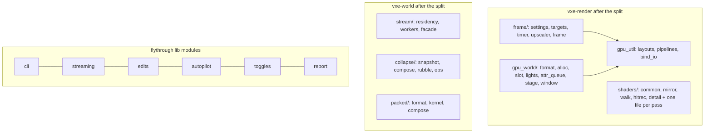

# 0045: The structure pass: split the mega files, share the fixtures, and gate their regrowth

> **Status:** approved (2026-10-22)
> **Created:** 2026-10-22
> **Milestone:** cross-cutting (code health)
> **Related ADRs:** none. The splits move code and keep every mechanism. Promoting `FnSource`
> and `SplitMix64` into `vxe-world` adds public items but no decision. The rejected option, a
> separate dev-only `vxe-testkit` crate, is recorded under Decision.
> **Source:** the owner, 2026-10-22, the same review as Plan 0044. The owner's answers: two
> plans, performance first; full splits, engine crates included.
> **After:** Plan 0044, and with it every plan active on 2026-10-22.

## TL;DR

The review at `87e4b67` found:

| What | Size at `87e4b67` |
|---|---|
| `apps/flythrough/src/main.rs` | 5771 lines; 1375 of them are tests that `tests/` cannot reach |
| `vxe-render`'s `GpuWorld` | 62 fields, 98 methods in one `impl` |
| `vxe-render`'s `Frame` | 42 fields; its two longest functions are 299 and 290 lines |
| `march.wgsl` | 1383 lines, prepended to all ten frame passes |
| `vxe-world`'s `Streamer` | 21 fields |
| `collapse.rs`, `packed.rs` | over 1200 lines each |

The review also found the same fixture copied across the tests:

| Fixture | Copies |
|---|---|
| a closure-backed `WorldSource` | 12 |
| `SplitMix64` | 7 |
| a wgpu test device | 8 |

This plan splits each of these along the seams the review named and moves the shared fixtures
to one home. It then adds two gates so the files cannot regrow unnoticed: a file-size cap
script and clippy's `too_many_lines`. Behaviour does not change: the goldens stay
byte-identical, every pinned hash stays equal, and the public API changes only where this plan
lists it. One thing the owner will see is that every fly-through toggle shows its mode in the
window. Today eleven show only on stdout, against the owner's standing rule. They come out of
one table that feeds both the HUD and the printed line.

## Context & problem

All figures are at `87e4b67`. The plans ahead edit these same files and grow most of them, so
`dev` re-inventories each one at the tip before its phase.

**Mega files and god types:**
- **`apps/flythrough/src/main.rs`** mixes CLI parsing (`Args`: 45 fields, 17 bools;
  `parse_args_from`: 277 lines), audio, streaming pressure policy, autopilot benchmarking,
  input bindings (about 30 keys in three dispatch styles), edit-event routing, reports, setup
  and the frame loop. Everything in it is private to the binary, so its 36 tests live inside
  it. `impl Run` and `impl AttrSamples` are each split across two blocks.
- **`vxe-render/src/gpu_world.rs`** (3126 lines). `GpuWorld` holds:
  - the window and its pending queue;
  - the page and slot allocator;
  - record staging and the belt;
  - light extraction and its range allocator;
  - the attribute scheduler;
  - four per-material `Vec`s.

  The file has 118 `pub` items, and every `vxe-render` module is `pub mod`, so about 60
  layout internals are public API.
- **`vxe-render/src/marcher.rs`** (2531 lines) holds:
  - the settings enums, with six hand-written `name`/`from_name` pairs;
  - the upscaler;
  - the targets;
  - the pipeline and bind-group helpers;
  - the pass timer;
  - `Frame`.

  The layout and pipeline helpers are re-implemented in `attrib.rs`, `hud.rs` and `present.rs`.
  `readback.rs` holds three copies of one padded copy-and-depad.
- **`march.wgsl`** holds bindings, mirror decode, DDA traversal, normals, detail noise, the hit
  record and reprojection, and rand. Each frame pass is `format!("{MARCH_WGSL}\n{source}")`, so
  `sharpen.wgsl`, which needs `params.output_size` only, compiles all of it. Duplicated helpers:

  | Helper | Copies |
  |---|---|
  | octahedral encode/decode | 4 |
  | lamp cone term | 3 |
  | "same surface" test, with different thresholds | 4 |
  | edit-box test | 2 |
  | reservoir unpack | 2 |

  `attrib.wgsl` re-implements the mirror decode.
- **`vxe-world`:**
  - `Streamer` mixes residency policy, the worker pool and spill scheduling (`apply`: 155
    lines).
  - `collapse.rs` mixes the snapshot, the composition, rubble and three ops
    (`drop_region_with`: 170 lines).
  - `packed.rs` mixes format, edit kernel and composition.
  - `edit.rs` carries bench-only reference writers (`Target`, `RowWriter`, `PlanarWriter`)
    and `#[doc(hidden)] pub` `*_decoded` ops in the production module.
  - Five separate count and bound accumulators exist.
  - The chunk clip `[0,1,2].map(|k| (c[k]*e).max(lo[k]))` is written out seven times.
- **`vxe-audio`:**
  - `Mixer::render_block` is 159 lines, and the HRTF-or-pan branch is copied between voices
    and buses.
  - `reverb.rs` mixes the FDN and the handover.
  - `acoustics.rs` mixes occlusion, reflections, the room fan and cadence.
- **`vxe-net` and `vxe-script-wasm`:** the support-query host is copied verbatim from
  `server.rs:189` into `vxe-script-wasm/tests/determinism.rs:677`.

**Duplicated fixtures** (each copy confirmed by reading):

| Fixture | Where |
|---|---|
| closure `WorldSource` | 8 identical copies in `vxe-audio/tests`, 2 in `vxe-render/tests`, plus `vxe-world` and `vxe-sim` support |
| `SplitMix64` | 7 copies, each re-deriving `vxe_world::hash::mix64` |
| `Fnv1a` and `world_hash` | in `vxe-world/tests/support`; duplicate the public `hash::Fnv1a` and `World::voxel_hash` |
| `hash_result` | identical in the fly-through's `determinism.rs` and `replay.rs` |
| bench clocks and `solid_world` | copied across `vxe-world/benches` |
| squared chunk distance `d2` | identical in `stream.rs` and `gpu_world.rs` |

**The testbed's protocol and CLI:**
- The dig logic talks to the client in `"op <verb>"` text lines. They are paired with events in
  FIFO order, and a mismatch is dropped silently (`main.rs:2397`).
- The lighting flags are parsed twice, in `main.rs` and `examples/hero.rs`, and the two copies
  have drifted (`--emissive-history`).
- `run_headless` copies `vxe-app`'s shell setup.
- `median` and `percentile` use different rank conventions, so F1's "median" and the exit
  line's "p50" disagree.

## Decision

Split along the seams below, keeping every type's behaviour. Promote the fixtures that are
general and deterministic into the engine: `vxe_world::FnSource`, `vxe_world::hash::SplitMix64`
and `ChunkCoord::distance2`. Keep the test-only helpers in per-crate `tests/support` modules
and behind `test-support` features, following `vxe-net`'s `test-logic` precedent and Plan
0044's render device helper. Narrow `vxe-render`'s public surface to its curated re-exports.
Finish with two mechanical gates, because a size rule written in prose is the kind
`CLAUDE.md` says needs a gate.

- We rejected **a dev-only `vxe-testkit` crate**. It adds a workspace member, and features
  plus promotion cover every duplicate except a few cross-crate test statistics, which are
  small enough to copy once into the crate that uses them.
- We rejected **leaving the engine crates alone and splitting only the testbed**. That was the
  owner's call.
- We rejected **a WGSL preprocessor dependency** (naga_oil or similar). `concat!` over
  `include_str!` composes modules with no dependency.

## Architecture diagram



## Implementation phases

Every phase does three things:
- re-inventories its files at the tip first;
- gates on `--profile quick`, plus `--profile gpu` when it touches `vxe-render` or the
  shaders (Plan 0043);
- proves no behaviour change: goldens byte-identical, pinned hashes equal, bench readings
  within the spread of three runs each before and after.

A public item that moves keeps a re-export at its old path unless this plan names its removal.

### Phase 1: one home for each shared fixture
- **Owner skill:** dev
- **What:**
  - **New public items in `vxe-world`:** `pub struct FnSource<F>(pub F)` in `source.rs`,
    `pub struct SplitMix64` in `hash.rs` (built on `mix64`), and `ChunkCoord::distance2`.
  - **Copies deleted:** the 12 closure sources, the 7 SplitMix64 streams and both `d2`s.
  - **`vxe-world/tests/support`** uses `hash::Fnv1a` and `World::voxel_hash`, or keeps them as
    an oracle with a test asserting equality. Which one it is is stated in its doc comment.
  - **New `vxe-audio/tests/support/mod.rs`:** the `table`, `world`, `cube` and `ShellCube`
    fixtures, `tone`, `tail_rms`, `peak`, `energy`, and `db_power` / `db_amplitude`. These
    replace the two different `db`s.
  - **New `vxe-world/benches/support.rs`:** one allowed `now` and `timed`, `solid_world`,
    `box_op` and `slab_cells`. The `vxe-net` and `vxe-script-wasm` benches take a `#[path]`
    copy of the clock.
  - **Fly-through tests:** `hash_result`, the shared op vectors, `dig_inputs` and
    `differing_bytes` move into `apps/flythrough/tests/support`. `assert_golden_exact` joins
    `assert_golden`.
  - **`vxe_net::WorldHost`:** the world-backed `Host` that `TickHost` wraps and that
    `vxe-script-wasm`'s tests use.
- **Files touched:** `crates/vxe-world/src/{source.rs,hash.rs,coords.rs,lib.rs}`,
  `crates/vxe-world/{tests,benches}/`, `crates/vxe-audio/{tests,benches,src/mixer.rs}`,
  `crates/vxe-render/{src/gpu_world.rs,tests}`, `crates/vxe-sim/tests/`,
  `crates/vxe-net/{src,benches}/`, `crates/vxe-script-wasm/{tests,benches}/`,
  `crates/vxe-assets/tests/vox.rs`, `apps/flythrough/tests/`.
- **Done when:**
  - Over `crates/` and `apps/`, `struct FnSource`, `struct SplitMix64` and `fn hash_result` are
    each defined in exactly one file. The `WorldSource` impls for closure-backed types appear
    only in `vxe-world/src/source.rs`. `fn unsupported_with_steps` is defined only in
    `vxe-net/src`.
  - Every pinned hash and every audio test's expected value is unchanged.
  - `cargo test --doc -p vxe-world` covers a `FnSource` doctest.

### Phase 2: `GpuWorld` becomes a directory of owned parts
- **Owner skill:** dev
- **What:** `gpu_world.rs` becomes `gpu_world/`:
  - `format.rs`: the GPU contract constants, `class_code`, `payload_units`, `attr_offset`,
    `slot_units`, `bin_of`, `ShardLayout` and `budget_for`.
  - `alloc.rs`: a `PoolAlloc` owning the bins, page state and `Fit`.
  - `slot.rs`: `fill_slot`, `materials_of`, `upload_set` and `chunk_surface`. All pure CPU,
    unit-tested without a device.
  - `lights.rs`: a `LightMirror` owning the `light_*` fields.
  - `attr_queue.rs`: an `AttrScheduler` owning the `attr_*` and queue fields.
  - `stage.rs`: an `Uploader` with the belt and the `flush_*` functions.
  - `window.rs`: a `WindowQueue`.
  - `mod.rs`: `GpuWorld` as the composition.

  Two smaller changes go with the split:
  - A `MaterialFlags` struct replaces the four per-material `Vec`s.
  - The `lod: bool` parameters become `Bricks::is_lod()`.

  `vxe-render`'s modules become private behind the existing curated `pub use` list. Layout
  items become `pub(crate)`. Unused `pub` items are deleted: `OPAQUE_WORDS`,
  `read_texels_u32`, and the test-only `free_pages()` `Vec`.
- **Files touched:** `crates/vxe-render/src/{gpu_world/,lib.rs,readback.rs,attr_work.rs,marcher.rs}`,
  `crates/vxe-render/tests/`, `apps/flythrough/` (imports only), `apps/flythrough/examples/`.
- **Done when:**
  - `GpuWorld` has at most 15 fields, each a part or a scalar.
  - No file in `gpu_world/` exceeds 900 lines.
  - Every mirror test passes unchanged, and slot words are byte-identical.
  - Every golden is byte-identical.
  - The public items removed from `vxe-render` are listed in the log's close triggers, and
    every in-repo user compiles against the curated surface.

### Phase 3: `marcher.rs` becomes the frame and its helpers
- **Owner skill:** dev
- **What:** `marcher.rs` becomes `frame/`:
  - `settings.rs`: the enums and flags. A `macro_rules!` generates `ALL`, `name` and
    `from_name`.
  - `targets.rs`: `Targets`.
  - `timer.rs`: `PassTimer`.
  - `upscale.rs`: `Upscaler`, `halton` and `jitter_at`.
  - `frame.rs`: `Frame`.

  The layout, bind-group and pipeline helpers go to `gpu_util.rs`, which `attrib.rs`, `hud.rs`
  and `present.rs` then use.

  `Frame::with_sizes` reads a `const PASSES: [PassSpec; N]` table instead of nine hand-written
  pairs. `encode_with` splits into `write_uniforms`, `bind_groups` and `record`, and its
  `keep_history: bool` becomes an enum. `readback.rs`'s three copies become one `read_texels`
  and two thin wrappers.
- **Files touched:** `crates/vxe-render/src/{frame/,gpu_util.rs,marcher.rs,attrib.rs,hud.rs,present.rs,readback.rs,lib.rs}`.
- **Done when:**
  - No function in `frame/` exceeds 150 lines.
  - `Frame` has at most 20 fields.
  - `readback.rs` has one `copy_texture_to_buffer` call.
  - Every golden is byte-identical.
  - The CPU `encode` time is within the spread of the Plan 0044 close reading.

### Phase 4: the shaders become modules a pass picks
- **Owner skill:** dev
- **What:** `march.wgsl` splits into five modules:
  - `common.wgsl`: Params, View, flags, luminance, hash and rand.
  - `mirror.wgsl`: the layout constants and pure decode over words.
  - `walk.wgsl`: the walk, `descend`, `lookup` and the DDA, with `enter_window` and
    `exit_cell` extracted.
  - `hitrec.wgsl`: the octahedral encoding, the hit record and reprojection.
  - `detail.wgsl`.

  Each pass is composed with `concat!(include_str!(…), …)` of only what it uses. The
  duplicates collapse:
  - one octahedral pair;
  - one lamp term;
  - one edit-box test;
  - one reservoir unpack;
  - one "same surface" function taking its threshold. Each caller passes its current constant,
    so no output changes.

  `attrib.wgsl` uses `mirror.wgsl` instead of its own decode. The bit constants come from a
  WGSL prelude that Rust generates from the `gpu_world/format.rs` and `frame/settings.rs`
  consts. Plan 0044's layout test keeps guarding the structs.
- **Files touched:** `crates/vxe-render/src/shaders/`, `crates/vxe-render/src/{frame/,attrib.rs,gpu_world/format.rs}`,
  `crates/vxe-render/tests/shader_portability.rs`.
- **Done when:**
  - Every golden is byte-identical.
  - The composed source of `sharpen` and `present` contains no `fn descend`.
  - No WGSL function name is defined in two shader files.
  - No bit constant that Rust defines is written as a literal in WGSL. This is checked by the
    layout test.
  - The hit, light and post pass times are read on both adapters and are within the spread of
    the Plan 0044 close readings.

### Phase 5: the world crate's three big modules split
- **Owner skill:** dev
- **What:**
  - **`stream.rs`** becomes `stream/`: `residency.rs`, a pure `ResidencyPlan` unit-tested
    without threads; `workers.rs`, the pool and loaders; and a thin `Streamer` facade. `apply`
    splits into `absorb_done`, `commit_residency` and `schedule_io`. The `oracle` sits behind
    `cfg(any(test, feature = "stream-oracle"))`.
  - **`collapse.rs`** becomes `collapse/`: `snapshot.rs`, `compose.rs`, `rubble.rs` and the
    ops. `drop_region_with` splits into gap scan, crush and move.
  - **`packed.rs`** becomes `packed/`: `format.rs`, `kernel.rs` and `compose.rs`.
  - **The bench-only reference writers and the `*_decoded` ops** move behind a
    `bench-internals` feature. The Uniform fast path uses `kernel_mode().target`.
  - **One `Tally`** replaces the five accumulators.
  - **New helpers:** `coords::clip_box` and `coords::local_of_index`, plus a `wire::Writer`
    that mirrors `Reader`.
- **Files touched:** `crates/vxe-world/src/`, `crates/vxe-world/{Cargo.toml,benches,tests}/`.
- **Done when:**
  - Every pinned hash, wire round trip and replay test is unchanged.
  - `World`'s public API without the feature loses only the `#[doc(hidden)]` items, and they
    are listed in the log.
  - The chunk-clip expression appears only in `coords.rs`.
  - The edit and collapse benches are within the spread of the Plan 0044 close readings.

### Phase 6: audio, net, wasm and assets split their long functions
- **Owner skill:** dev
- **What:**
  - **`Mixer::render_block`** splits into `write_echo`, `advance_direct_delay`,
    `render_direct`, `lowpass` and `reap_finished`.
  - **A `Spatialiser`** serves both voices and buses.
  - **`reverb.rs`** becomes `reverb/{network.rs,handover.rs}`.
  - **`acoustics.rs`** becomes `occlusion.rs`, `reflections.rs` and `room.rs` under an
    `Acoustics` scheduler. One `fibonacci_sphere::<N>()` replaces the two direction tables.
  - **The `#[doc(hidden)]` audio test hooks** move behind a `test-hooks` feature.
  - **`VoxFile::parse`** splits per chunk kind, and its graph walk is cached for
    `placements`.
  - **`add_host`** becomes one function per import.
  - **`Output::open` and `Input::open`** share `format_error`.
- **Files touched:** `crates/vxe-audio/src/`, `crates/vxe-audio/{Cargo.toml,tests}/`,
  `crates/vxe-assets/src/vox.rs`, `crates/vxe-script-wasm/src/host.rs`.
- **Done when:**
  - The mixer and reverb tests produce the same samples.
  - The no-allocation and no-free tests from Plan 0044 still read 0.
  - No function in these crates' `src/` exceeds 120 lines.
  - The mixer bench is within the spread of the Plan 0044 close reading.

### Phase 7: the testbed becomes a library with a thin binary
- **Owner skill:** dev
- **What:**
  - **`main.rs`'s contents move into `apps/flythrough/src/` lib modules:**
    - `cli.rs`: `Args` grouped into `AudioArgs`, `LightingArgs`, `LookArgs` and a `RunMode`
      enum; one flag table; shared on/off and enum helpers; and a `--help` generated from the
      table. `examples/hero.rs` uses the table too.
    - `streaming.rs`: `RadiusRule`, `Deferrals`, `Stream`, with one `stats()` read per frame.
    - `edits.rs`: `Net`, `BenchSum`, event routing.
    - `autopilot.rs`.
    - `report.rs`: one `percentile`, one procfs reader, capped per-frame series.
    - `audio.rs`.
    - `setup.rs`: `build_world`.
    - `toggles.rs`: one table of key, name, getter and flip. It feeds the HUD rows, the banner
      and the printed line.
    - `run.rs`: `Run` in one `impl`.
  - **A typed `DigEvent`** with `encode`/`decode` and the op index replaces the `"op <verb>"`
    text lines and their FIFO pairing.
  - **`vxe_app::run_headless(app, HeadlessConfig)`** replaces the testbed's copy and its
    hand-rolled `pollster_block_on`.
  - **The 36 in-binary tests** move to `tests/` or into the lib modules they test.
- **Files touched:** `apps/flythrough/src/`, `apps/flythrough/logic/src/lib.rs`,
  `apps/flythrough/{examples,tests}/`, `crates/vxe-app/src/{shell.rs,lib.rs}`.
- **Done when:**
  - `main.rs` is under 200 lines.
  - Every key the testbed binds is in the toggle table, or is listed in the log as a one-shot
    action with no mode.
  - A headless test cycles each table toggle once and asserts that the HUD's text grid shows
    the new mode in the row the table names. That includes `off` for the cutaway and the shadow
    ray, and the dig radius.
  - A logic event whose op index matches no applied op is a test-visible error, not a silent
    `continue`.
  - `flythrough --help` lists every flag the parser accepts. A test diffs the two.
  - The replay, determinism and component tests give equal bytes.
  - The fly-through's frame goldens are byte-identical. The HUD goldens
    (`tests/hud_golden.rs`) change only by the new mode rows. They are re-blessed on lavapipe,
    and the change is shown to the owner in Phase 9.

### Phase 8: the mega test files split, and two gates keep everything small
- **Owner skill:** dev
- **What:**
  - **`vxe-render/tests/mirror.rs`** splits into `mirror_alloc.rs`, `mirror_tiers.rs`,
    `mirror_budget.rs` and `mirror_attrs.rs`.
  - **Any other test file over the cap** at the tip splits along its sections.
  - **`scripts/check-file-size.mjs`** has two caps: 1200 lines for a `.rs` or `.wgsl` under
    `src/`, and 2000 for a file under `tests/`, `benches/` or `examples/`. It has an optional
    `root` argument and a seeded fixture tree, like the other gates, and joins CI.
  - **`clippy.toml`** sets `too-many-lines-threshold = 150`, and `[workspace.lints.clippy]`
    denies `too_many_lines`. Every function still over 150 lines carries
    `#[expect(clippy::too_many_lines, reason = "...")]`, and the close lists each one.
  - **The Plan 0043 tier lists** are updated for any test binary renamed here.
- **Files touched:** `crates/vxe-render/tests/`, any test file over the cap, `scripts/check-file-size.mjs`,
  `scripts/fixtures/file-size/`, `scripts/fixtures/README.md`, `clippy.toml`, `Cargo.toml`,
  `.github/workflows/ci.yml`, `.config/nextest.toml`.
- **Done when:**
  - `node scripts/check-file-size.mjs` exits 0 on the tree. On its fixture it exits 1 with
    exactly the findings its README row names: one source file over, one test file over, and
    one file exactly at the cap that passes.
  - `cargo clippy --workspace --all-targets -- -D warnings` exits 0 with the lint denied, and
    no `src/` function carries the `expect`. Test functions may carry it, and they are listed.
  - The Plan 0043 partition check (`N(quick) + N(gpu) + N(slow) = N(full)`) still holds, and
    `check-test-tiers.mjs` exits 0.

### Phase 9: the owner reads every toggle on screen
- **Owner skill:** human
- **What:** the owner flies `flythrough` and presses every key in the toggle table once, with
  stdout visible. `dev` prepares the run script and sends a push notification when it is ready.
- **Done when:** the owner confirms that each toggle's mode shows in the window as it changes,
  and that the frame looks as it did before the plan. Anything they reject is a line in
  `### Notes` and goes back to `dev`.

## Data shapes

```rust
// illustrative
pub struct FnSource<F>(pub F);
impl<F: Fn([i32; 3]) -> MaterialId + Sync> WorldSource for FnSource<F> { /* … */ }

struct PassSpec { label: &'static str, modules: &'static [&'static str], entry: &'static str, io: &'static [Io] }

struct Toggle { key: Key, name: &'static str, row: HudRow, get: fn(&Run) -> &'static str, flip: fn(&mut Run) }
```

## Budgets

No `docs/nfr.md` figure should move. The close reads, on the dev box, both adapters where the
GPU is involved, under the lock and labelled with the load:
- the frame time at the lighting defaults;
- the `sync` p50/p99 at `r_full` 16;
- the edit and collapse benches;
- the mixer bench.

Each is compared against Plan 0044's close readings. A reading outside the spread of three runs
is a finding, not noise. Build time (`docs/nfr.md` section 7) is read too: a clean
`cargo build` and a rebuild after touching `vxe-world/src/lib.rs`, before and after, since
module splits can change it.

## Risks & open questions

- **Size of the diff.** Phases 2 to 7 move thousands of lines. A move commit is kept apart from
  a change commit within a phase where `git` would otherwise lose the history (`git mv`, then
  edit), so the reviewer can diff moves with `--color-moved`.
- **Public API.** Phase 2 narrows `vxe-render`, and Phase 5 hides `World`'s reference ops. The
  first consumer (`~/Work/voxel-roguelite`) is checked for uses before the phase, and any use is
  kept as a re-export and listed.
- **Shader composition.** `concat!` of shared modules means a module's identifiers are global to
  every pass that includes it. Name clashes surface as naga errors at pipeline build, which the
  existing validation tests catch headlessly.
- **Determinism.** Phase 5's `Tally` and `Writer` touch result and wire bytes. The pinned hashes
  and the round-trip tests guard them, and a change is a stop.

## What this plan does NOT do

- **Change behaviour, defaults or the look.** The one visible change is toggles reaching the
  window, under the owner's standing rule.
- **Move the residency pressure rule into an engine crate.** That is Plan 0044's followup 3.
- **Move the fly-through's render tests into `vxe-render`.** They need the cave scene builders.
  A shared scene crate is a followup if the owner wants the renderer testable alone.
- **Add a `vxe-testkit` crate** (rejected above).

## Implementation log

| phase | owner | state | commit |
|---|---|---|---|
| 1: one home for each shared fixture | dev | not started | |
| 2: `GpuWorld` becomes a directory of owned parts | dev | not started | |
| 3: `marcher.rs` becomes the frame and its helpers | dev | not started | |
| 4: the shaders become modules a pass picks | dev | not started | |
| 5: the world crate's three big modules split | dev | not started | |
| 6: audio, net, wasm and assets split their long functions | dev | not started | |
| 7: the testbed becomes a library with a thin binary | dev | not started | |
| 8: the mega test files split, and two gates keep everything small | dev | not started | |
| 9: the owner reads every toggle on screen | human | not started | |

### Notes

### Close triggers

## Followups

1. A shared cave-scene crate so `vxe-render`'s behaviour can be tested from `vxe-render` alone.
2. `CellCoord::from(chunk, slot)` renamed so it does not read as the `From` trait. This is an
   API rename and needs a consumer check.
