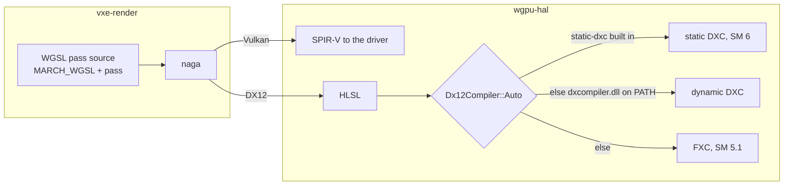

# 0046: DX12 shaders through wgpu's bundled static DXC: pipeline times measured per pass under FXC and DXC, the feature on for every consumer, the shutdown workaround reverted

> **Status:** in-progress
> **Created:** 2026-10-22
> **Milestone:** none; platform health (the Windows arm of ADR-0001's Linux + Windows stack)
> **Related ADRs:** [ADR-0035](../adrs/0035-dx12-shaders-compile-with-wgpus-bundled-static-dxc.md)
> (proposed): DX12 compiles with the bundled static DXC, never FXC

## TL;DR

We turn on `wgpu`'s `static-dxc` feature in the workspace dependency table, so the DX12
backend of every `vxe-render` consumer compiles its pipelines with a statically linked DXC
instead of falling back to the system's FXC. Before that, a headless example times pipeline
creation for each of our compute passes on whatever adapter it is given, so the cost of FXC
and the saving of DXC are read, not assumed. The first thing anyone sees is that example's
table on the `windows-latest` CI arm, run once with `WGPU_DX12_COMPILER=fxc` and once with the
default, beside the attribute tests of `vxe-render`'s `mirror` binary falling back from about
150 s toward their 15.3 s, and the fly-through's shutdown test passing its 120 s bound without
the `--look plain` workaround.

## Context & problem

ADR-0035's context carries the evidence; in short: on `windows-latest` (DX12 on WARP, no
Vulkan) the `mirror` binary's attribute tests went from 15.3 s (run 39737094500 at 578c8d3) to
152.8 to 158.2 s (runs 39808788735 and 39823877459) after Plan 0028's `attrib.wgsl` rewrite
(1a163a9, f0b8650, merged at 81810d3); Linux stayed at 0.33 to 0.50 s. The headless
fly-through's shutdown test (`apps/flythrough/tests/shutdown.rs`, `RUN_BOUND` 120 s) now runs
past its bound there. The workspace builds `wgpu` without `static-dxc`, so `Dx12Compiler::Auto`
finds no bundled DXC and no `dxcompiler.dll` and uses FXC. **That FXC is the cause is an
inference from CI logs: nobody has run FXC on these shaders by hand.**

Two shapes are the suspects. `attrib.wgsl`'s 1000-cell occupancy loop has a `switch` that
inlines `solid()`, itself three 4-way pool-shard switches plus the `NB_MIP` default branch, and
`voxel_attr`'s 27-tap nest is unrolled twice. And every pass the marcher builds in
`crates/vxe-render/src/marcher.rs` (`pass`, the light, composite, atrous, upscale and sharpen
pipelines) prepends the whole of `MARCH_WGSL` (1383 lines), so each compiles the march once
more; Plan 0030's upscale and sharpen pipelines are built even at render scale 1.

This touches `docs/nfr.md` section 7 (startup and build): time to first frame, and the build
itself. The only Windows reading in this plan is the CI arm's, on WARP, a software rasterizer;
every dev-box reading (RTX 3080 Laptop GPU, the Radeon iGPU, lavapipe) is Linux on Vulkan, where
naga emits SPIR-V and neither FXC nor DXC runs.

`wgpu` 30.0.1 facts the plan rests on (read in `~/.cargo/registry`): `static-dxc` forwards
through `wgpu-core` to `wgpu-hal`, which declares `mach-dxcompiler-rs` `^0.1.4` with
`default-features = false` only under `cfg(all(windows, not(target_arch = "aarch64"),
target_env = "msvc"))`; `wgpu-hal`'s `build.rs` sets `cfg(static_dxc)` under the same condition;
`Auto` prefers static DXC when that cfg is on; `wgpu-hal` logs `Using static DXC for shader
compilation` (or `Using FXC ...`, `Using dynamic DXC ...`) at debug when the DX12 instance is
made. `mach-dxcompiler-rs` 0.1.4's build script downloads a prebuilt
`x86_64-windows-msvc_ReleaseFast_*` tarball from `github.com/DouglasDwyer/mach-dxcompiler`
with `curl` and unpacks it with `tar`; its crate license is MIT, the library inside is DXC.

## Decision

Build `wgpu` with `static-dxc` for every consumer (ADR-0035) and keep `Dx12Compiler::Auto`, so
the bundled DXC is used and `WGPU_DX12_COMPILER=fxc` still selects FXC where the instance reads
the environment. Measure first, per pass, on every adapter we have. We rejected rewriting the
shaders for FXC because it makes FXC's unroll heuristics a standing constraint and the next
rewrite regresses the same way; we rejected making consumers ship `dxcompiler.dll` because
`Auto` falls back to FXC silently when it is missing; we rejected parking the cost behind the
test workaround because a consumer's first DX12 start pays the same compiles.

## Architecture diagram



## Implementation phases

Each phase ships as its own commit. `dev` implements all phases in one session with no review
between phases. The architect reviews once at the end, in a fresh session.

### Phase 1: a per-pass pipeline-time table, read on every adapter we have
- **Owner skill:** dev
- **What:** A headless example, `pipeline_times`, creates the compute pipeline of each pass we
  build (attrib, the march hit pass, light, composite, atrous, temporal, upscale, sharpen) from
  the same concatenated source the renderer uses, times each creation, and prints one row per
  pass; it runs on the Linux adapters here and on the Windows CI arm under FXC.
- **Detail:**
  - The instance comes from `wgpu::InstanceDescriptor::new_without_display_handle_from_env()`,
    so `WGPU_BACKEND`, `WGPU_ADAPTER_NAME` and `WGPU_DX12_COMPILER` apply. Each pass is a
    shader module plus a compute pipeline with an automatic layout (`layout: None`) and the
    renderer's entry point; the timed span is `create_shader_module` through
    `create_compute_pipeline` plus a `device.poll` wait, read with `std::time::Instant` (the
    example is outside `vxe-world`, so the clock lint does not apply). Each pass is created
    three times on a fresh device and the table prints the first (cold) and the minimum.
  - The header line names the adapter, its backend, and the `WGPU_DX12_COMPILER` value (or
    `auto`). Rows: pass name, source lines, cold ms, min ms.
  - Where a pass source is private to `marcher.rs` (`UPSCALE_WGSL`, `SHARPEN_WGSL`), it is
    made public beside `ATTRIB_WGSL` and `MARCH_WGSL` in `crates/vxe-render/src/lib.rs`, with
    no other API change. The example builds each source exactly as the renderer concatenates
    it; a comment says the list mirrors `marcher.rs` and `attrib.rs`.
  - A `--hlsl <dir>` flag also writes naga's HLSL for each pass (`wgpu::naga::back::hlsl`,
    Shader Model 5.1 and 6.0) so the real compilers can be timed outside wgpu. Best effort on
    Linux: time Microsoft's Linux `dxc` release on the 6.0 files natively, and `fxc.exe` under
    `wine` with Microsoft's `d3dcompiler_47.dll` (wine's built-in one is a different compiler
    and its time says nothing). If either cannot be set up here, the log says so in one line
    and the Windows CI table is the FXC reading.
  - CI: the `windows-latest` job gains a step that runs the example in release with
    `WGPU_DX12_COMPILER=fxc` and prints the size of `target/debug/flythrough.exe` (the
    before-figure for Phase 2's size reading). The Linux job runs it once on lavapipe. Lanes
    cannot push, so the Windows reading comes from the first CI run on `main` after the
    orchestrator pushes the merge; the log records the run id when it exists, and the close
    review reads it if the lane could not.
- **Files touched:** `crates/vxe-render/examples/pipeline_times.rs` (new),
  `crates/vxe-render/src/lib.rs` (two source consts public), `crates/vxe-render/src/marcher.rs`
  (the consts move or re-export), `.github/workflows/ci.yml`, `docs/nfr.md` (section 7 readings).
- **Done when:** `cargo run -p vxe-render --release --example pipeline_times` on lavapipe, the
  RTX 3080 Laptop GPU and the Radeon iGPU (Vulkan, perf lock held, one run each) prints eight
  rows, one per pass named above, each with a positive cold and min time and the source line
  count the renderer compiles (for the march-prefixed passes, at least `MARCH_WGSL`'s 1383
  lines); the three tables are in the log with machine and commit; the `--hlsl` files exist for
  all eight passes in both Shader Models, and the log holds either the local `dxc` and `fxc`
  times per pass or a line saying which of them could not be run here; the Windows CI step
  prints the FXC table (read now or by the close review after the merge).

### Phase 2: `static-dxc` on, in the deny gate, and named at startup
- **Owner skill:** dev
- **What:** The workspace `wgpu` line gains `static-dxc`; the lockfile gains
  `mach-dxcompiler-rs`; `deny.toml` names DXC's license; a Windows-only test proves wgpu chose
  static DXC; the fly-through's startup line names the DX12 compiler.
- **Detail:**
  - `Cargo.toml`: `"static-dxc"` joins the `wgpu` features, with a comment that it is inert
    off `x86_64`/`i686` Windows MSVC and why it is there (ADR-0035). The lockfile records
    whichever `mach-dxcompiler-rs` 0.1.x cargo resolves; the log names the version and the
    release tarball URL its build script fetches. No direct dependency is added to pin it.
  - `deny.toml`: a `[[licenses.clarify]]` entry gives `mach-dxcompiler-rs` the expression
    `MIT AND NCSA` against the crate's `LICENSE` file hash, with a comment that the static
    library it downloads is DXC under the University of Illinois/NCSA license; `NCSA` joins the
    allow list. The `[graph] targets` already include `x86_64-pc-windows-msvc`, so the crate is
    in the graph `cargo deny` checks.
  - `crates/vxe-render/tests/dx12_compiler.rs`, compiled only under `cfg(all(windows,
    target_env = "msvc", not(target_arch = "aarch64")))`: installs a capturing `log` logger at
    debug, makes an instance with `Backends::DX12` and the default options (no environment),
    and asserts that `wgpu_hal` logged `Using static DXC for shader compilation`. `log` is
    already pinned in the workspace table; it becomes a dev-dependency of `vxe-render`. The
    binary joins the gpu filter in `.config/nextest.toml` if it needs the lavapipe group.
  - The fly-through's startup line (`headless on <adapter>` and the windowed equivalent in
    `vxe-app`'s shell or the testbed) gains the backend, and on DX12 `shader compiler: static
    DXC` when the build condition above holds, or the `WGPU_DX12_COMPILER` value when the
    environment set one. It reports what the build and the environment request; the test above
    is the proof of what wgpu did.
  - CI: the Windows step from Phase 1 runs the example a second time with no
    `WGPU_DX12_COMPILER`, and prints `flythrough.exe`'s size again.
- **Files touched:** `Cargo.toml`, `Cargo.lock`, `deny.toml`, `crates/vxe-render/Cargo.toml`,
  `crates/vxe-render/tests/dx12_compiler.rs` (new), `apps/flythrough/src/main.rs`,
  `crates/vxe-app/src/shell.rs` (if the windowed start line lives there),
  `.config/nextest.toml` (if needed), `.github/workflows/ci.yml`.
- **Done when:** on Linux, `cargo build --workspace --offline` succeeds after a
  `cargo clean -p wgpu-hal` (the feature fetches and compiles nothing new off Windows), and
  `cargo tree -i mach-dxcompiler-rs --target x86_64-unknown-linux-gnu` finds no path while
  `--target x86_64-pc-windows-msvc` shows it under `wgpu-hal`; `cargo deny check` exits 0 and
  `cargo deny list` shows `mach-dxcompiler-rs` under `MIT AND NCSA`; the headless fly-through on
  Linux prints its backend as Vulkan and no DX12 compiler; on the Windows CI arm (after the
  merge) `dx12_compiler` passes, the second table's header reads `auto`, and every row's cold
  time is printed beside Phase 1's FXC row for the same pass.

### Phase 3: the workaround reverted and the Windows bars set
- **Owner skill:** dev
- **What:** The shutdown test runs the fly-through's default look again, and the Windows CI
  readings that decide the plan are written down with their bars.
- **Detail:**
  - Remove the `--look plain` argument the fix branch (`fix-ci-windows`) added to the headless
    run in `apps/flythrough/tests/shutdown.rs`, with its comment. If that workaround has not
    reached `main` when this phase runs, the log says so and the phase changes nothing there.
  - Bars, all read on the `windows-latest` arm from the first CI run on `main` after the merge
    (the orchestrator pushes; the close review reads them if the lane could not):
    1. `flythrough::shutdown` passes with the default look inside `RUN_BOUND` (120 s), and the
       nextest time of that test is recorded.
    2. The attribute tests of the `vxe-render` `mirror` binary (the tests that build the
       attribute pipeline: `the_attribute_pass_fills_the_floor_and_reaches_a_carve_s_neighbours`,
       `surface_attributes_are_indexed_by_popcount`,
       `full_chunks_bricks_carry_their_surface_and_mip_bricks_no_attributes`) sum to at most
       30 s, about twice their 15.3 s at 578c8d3. The factor of two is a chosen margin for
       Plan 0028's larger shader and WARP's run-to-run spread, not a derived figure; the reading
       is reported beside 15.3 s and 152.8 to 158.2 s whatever it is.
    3. Phase 2's `auto` table shows the attrib row's cold time below Phase 1's FXC attrib row.
       If it does not, ADR-0035's premise is false: the plan stops and goes back to the
       architect rather than closing.
  - `docs/nfr.md` section 7 gains the Windows DX12 readings (both tables, the binary size
    before and after, the two test times), each labelled as the CI arm on WARP with run id and
    commit, and the build-time delta of the Windows job's build step as CI reports it.
- **Files touched:** `apps/flythrough/tests/shutdown.rs`, `docs/nfr.md`.
- **Done when:** on Linux the shutdown test passes with no `--look` argument (`cargo nextest
  run -p flythrough --profile gpu -E 'binary(shutdown)'` under the perf lock) and still asserts
  every traced teardown stage; and bars 1 to 3 above are read on the Windows arm, with run id,
  in the log or (if the lane could not see them) in the close review.

## Data shapes

None in the engine's API. The example's output, illustrative:

```text
adapter: Microsoft Basic Render Driver (Dx12), WGPU_DX12_COMPILER=fxc
pass       lines   cold ms    min ms
attrib       415    ...        ...
march       1383    ...        ...
upscale     1778    ...        ...
```

## Budgets

- **`nfr.md` section 7, time to first frame (under 3 s on the dev reference):** the dev
  reference is Linux on Vulkan, which this plan does not change; the reading stays. Windows has
  no first-frame figure yet; this plan's per-pass tables are the first Windows startup reading,
  on WARP on CI, which is a software rasterizer and not a player's GPU. No Windows budget is
  proposed until a Windows machine with a GPU is read.
- **`nfr.md` section 7, build:** the Linux everyday build is unchanged (Phase 2's offline build
  proves no fetch); the Windows clean build adds a download and a link of the static library,
  read from the Windows job's step times. Binary size on Windows: a guess of tens of MB per
  executable that links `vxe-render`, read in Phases 1 and 2 from `flythrough.exe`.
- **The test gate (Plan 0043):** the Windows arm's `full` tier gets faster by the attribute and
  shutdown readings above; the Linux tiers are unchanged.

## Risks & open questions

- **The download.** `mach-dxcompiler-rs`'s build script fetches an unchecksummed tarball from a
  third party's GitHub release at build time; offline and vendored Windows builds fail, and a
  deleted release breaks fresh Windows builds. Accepted by ADR-0035. If it bites, the fallback
  is a vendored copy of the library behind the same crate interface, which is its own ADR.
- **DXC changes results on Windows.** Precision and naga's per-Shader-Model HLSL differ from
  FXC's path; a Windows test that passed under FXC may fail under DXC. That is a finding fixed in
  the shader or the test inside this plan if small, or a followup with the failing test named;
  falling back to FXC is not a fix.
- **The example's automatic layouts differ from the renderer's explicit ones.** Binding
  numbering in the generated HLSL can differ, which should not move compile time much; if the
  example's attrib row and the `mirror` tests disagree by a lot, the dev builds that pass
  through the renderer's own constructor instead.
- **WARP is the only Windows reading.** A hardware DX12 driver may compile DXIL faster or
  slower; FXC and DXC time is front-end time and mostly independent of the device, but the
  driver's own DXIL compile is not. A reading on a Windows machine with a GPU is a followup.
- **The `mach-dxcompiler-rs` version cargo resolves** (0.1.4 or a later 0.1.x) decides which DXC
  release we link; the lockfile holds it, and a bump is its own commit.

## What this plan does NOT do

- Rewrite `attrib.wgsl`, `voxel_attr` or any shader for FXC (ADR-0035, Alternative A).
- Create the upscale and sharpen pipelines lazily. It is cheap and removes two march-prefixed
  compiles from every start on every backend, but Plan 0041's lane is reworking the upscaler's
  construction in `marcher.rs` and Plan 0045 splits that file; it goes to a followup after both,
  sized by Phase 1's upscale and sharpen rows.
- Pick the DX12 compiler at runtime through a `vxe-render` setting, or set
  `Dx12Compiler::StaticDxc` explicitly so a missing DXC fails loudly.
- Add a Windows machine with a GPU, or a Windows time-to-first-frame budget.
- Write a third-party notice for consumers' Windows packages; the obligation is recorded in
  ADR-0035 and in `deny.toml`.

## Implementation log

> Written by `dev`: one row per phase as its commit lands, then the close block. **The phases
> above are the contract. This section records what happened.** Observations, never conclusions:
> no pass list, no self-assessment. Deviations and unmet done-whens are **always** disclosed.
> Keep it shorter than `## Implementation phases`.

| phase | owner | state | commit |
|---|---|---|---|
| 1: a per-pass pipeline-time table | dev | done | 622dcf3 |
| 2: `static-dxc` on, in the deny gate, named at startup | dev | done | c3b32b4 |
| 3: the workaround reverted and the Windows bars set | dev | done (Windows bars owed to CI) | committed with this row |

**Phase 1.** `crates/vxe-render/examples/pipeline_times.rs`; `UPSCALE_WGSL` and `SHARPEN_WGSL`
are re-exported from `lib.rs` (`pub use marcher::{...}`), `marcher.rs` unchanged. The table has
eleven rows, not eight: gradient, downsample and variance are compute pipelines `Frame` also
builds. The timing fn carries `#[allow(clippy::disallowed_methods, reason = ...)]`, since
`clippy.toml`'s clock ban is workspace-wide. Readings on ce62f0c plus this phase's tree,
release, Vulkan, `MESA_SHADER_CACHE_DISABLE=true __GL_SHADER_DISK_CACHE=0`, adapter by
`WGPU_ADAPTER_NAME`, exclusive perf lock, 1-minute load 10.4 to 11.1 (loaded). Cold / min ms:

| pass | lines | lavapipe | RTX 3080 Laptop | Radeon iGPU (RADV) |
|---|---|---|---|---|
| attrib | 415 | 32.4 / 29.2 | 75.3 / 68.3 | 54.2 / 49.7 |
| march | 1383 | 53.9 / 48.6 | 312.3 / 305.3 | 90.9 / 86.0 |
| light | 1788 | 96.3 / 93.0 | 522.6 / 522.6 | 152.7 / 149.1 |
| temporal | 1586 | 18.6 / 18.1 | 42.0 / 39.5 | 21.2 / 20.5 |
| gradient | 1868 | 41.0 / 40.3 | 265.1 / 262.5 | 70.8 / 68.4 |
| downsample | 1555 | 3.9 / 3.6 | 9.7 / 6.9 | 4.3 / 4.0 |
| variance | 1552 | 8.9 / 8.9 | 18.8 / 14.3 | 10.5 / 10.4 |
| atrous | 1552 | 11.2 / 11.2 | 25.2 / 22.7 | 13.7 / 13.7 |
| upscale | 1779 | 18.9 / 18.3 | 76.7 / 76.2 | 23.1 / 22.7 |
| sharpen | 1469 | 3.7 / 3.6 | 10.8 / 8.8 | 4.4 / 4.2 |
| composite | 1555 | 10.3 / 10.3 | 37.6 / 35.5 | 12.6 / 12.4 |
| total | | 299.0 / 285.0 | 1396.1 / 1362.5 | 458.4 / 441.0 |

`--hlsl live/hlsl` wrote `<pass>.sm51.hlsl` and `<pass>.sm60.hlsl` for all eleven passes plus
`entries.txt`. Microsoft's Linux `dxc` (release v1.9.2609, `libdxcompiler.so` 1.9.2609.5),
`-T cs_6_0 -E <entry> -HV 2018 -no-warnings -Ges`, wall time per process including its start,
load 8.95, every exit 0: attrib 437 ms, march 283, light 517, temporal 71, gradient 390,
downsample 46, variance 49, atrous 81, upscale 111, sharpen 59, composite 72. FXC was not run:
no Microsoft `fxc.exe` or `d3dcompiler_47.dll` was obtainable here (the
`Microsoft.Windows.SDK.BuildTools` NuGet packages 10.0.22621.756, 10.0.26100.1742 and
10.0.28000.2705 carry neither), so the Windows CI table is the FXC reading. CI gains
`Pipeline times on DX12 under FXC` (Windows only, `WGPU_DX12_COMPILER=fxc`, then the byte size
of `target/debug/flythrough.exe`) and `Pipeline times on lavapipe` (Linux only); the Windows
FXC table is owed by the first CI run on main after the merge. Gate: build, quick 470 passed
(3 skipped), doctests, clippy, fmt, test tiers, comment hygiene, doc links. The gpu tier was not
run at this commit: a live-session runner was up (lane rule 6); it is owed before the close.

**Merge.** 405be8e merges main at 93cce0c (the `ci` nextest profile, `--look plain` in
`shutdown.rs`); the one conflict was ci.yml beside the new steps. Its full-tier gate was not
run at the merge (live-session runner up); the full run at the close covers that tree plus
Phases 2 and 3.

**Phase 2.** The lockfile adds `mach-dxcompiler-rs` 0.1.4+2024.11.22-df583a3.1; its build
script fetches
`https://github.com/DouglasDwyer/mach-dxcompiler/releases/download/2024.11.22+284d956.1/x86_64-windows-msvc_ReleaseFast_Dynamic_lib.tar.gz`
(`_lib` with a static CRT). `deny.toml`'s clarify hash is cargo-deny's XxHash32 of the
normalised `LICENSE` (0xc9d1a063); the CRC32 tried first never matched and cargo-deny said
nothing about it. `cargo deny check` exit 0; `cargo deny list` prints
`NCSA (1): mach-dxcompiler-rs@0.1.4+2024.11.22-df583a3.1` and the crate under MIT too.
`cargo clean -p wgpu-hal` then `cargo build --workspace --offline`: compiled wgpu-hal, wgpu-core,
wgpu and the three workspace crates over them, no fetch. `cargo tree -i mach-dxcompiler-rs
--target x86_64-unknown-linux-gnu`: nothing to print; `--target x86_64-pc-windows-msvc`: under
`wgpu-hal v30.0.1`. `dx12_compiler.rs` is cfg'd out on Linux; a copy without the `cfg` passed
clippy here, and on Vulkan it captured `wgpu_hal`'s log lines. The startup label is
`vxe_app::backend_label` (new public fn in `shell.rs`, used by the shell's `adapter:` info line
and the headless line; re-exported from `crates/vxe-app/src/lib.rs`, outside Files touched). Deviation: the headless instance now comes from
`new_without_display_handle_from_env()` as the windowed shell's does, so the
`WGPU_DX12_COMPILER` the line names is the one the instance reads. Headless at 3 frames:
`headless on NVIDIA GeForce RTX 3080 Laptop GPU (Vulkan)`; with `WGPU_DX12_COMPILER=fxc
--adapter llvmpipe`: `headless on llvmpipe (LLVM 23.1.3, 256 bits) (Vulkan)`. The Windows CI step
now runs the example under `WGPU_DX12_COMPILER=fxc`, then with no variable, then prints the
fly-through's size and the size of the static DXC `.lib` under `target/debug/build`. Finding:
no CI run can print `flythrough.exe` without `static-dxc`, since Phase 1 and Phase 2 reach CI in
the same push; the `.lib` size bounds what the feature adds. Owed to Windows CI after the merge:
`dx12_compiler` passing, the `auto` table beside the FXC one. Gate: build, quick 470 passed
(3 skipped), doctests 7, clippy, fmt, test tiers, comment hygiene, `cargo deny check`.

**Phase 3.** `shutdown.rs`'s headless run has no `--look` again; the file is byte-identical to
ce62f0c's. `cargo nextest run -p flythrough --profile gpu -E 'binary(shutdown)'`, exclusive perf
lock, load 6.55: 3 passed, the trace test 3.235 s (RTX 3080 Laptop, the default adapter), its
16 expected teardown stages asserted in order. `docs/nfr.md` section 7 names the Windows
readings owed and where they go; no Windows figure is in it. Bars 1 to 3 are not read: lanes
do not push, so they come from the first `windows-latest` run on main after the merge.


### Notes

### Close triggers

- **What shipped:** feature / fix-only / docs-chore-only
- **Public API changed:**
- **Budget readings:**
- **Gate at the tip:**
- **Outstanding `human` phases:**

## Followups

- Lazy upscale and sharpen pipelines, created on the first frame whose render scale needs them,
  after Plans 0041 and 0045 land.
- A Windows CI gate on Phase 1's table: fail the arm when any pass's cold time passes a bar set
  from the DXC readings, so a shader that regresses compile time is caught at its commit.
- A reading on a Windows machine with a hardware DX12 driver.
