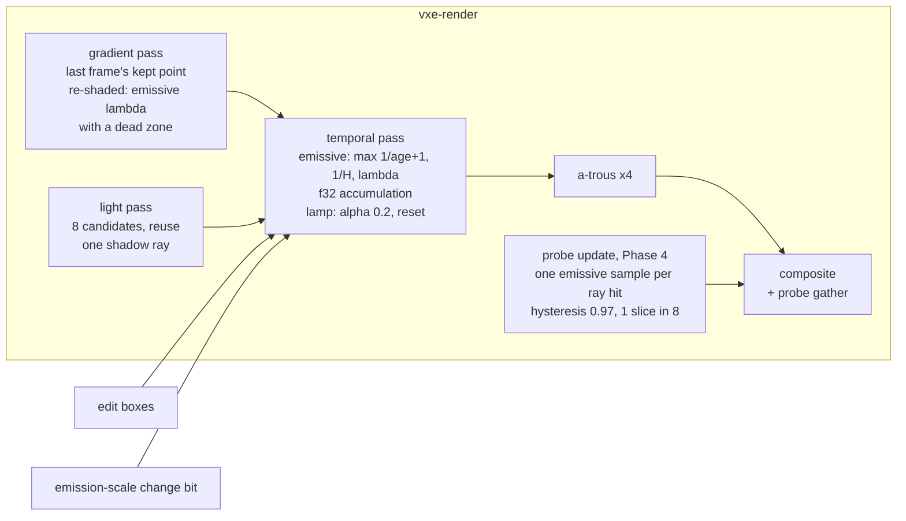

# 0047: Emissive light holds still: a patch bar, a long full-precision emissive history, and an emissive-only gradient that guards it

> **Status:** in-progress
> **Decisions:** Owner, 2026-10-27: the long f32 history guarded by an emissive-only gradient (option a); after Plan 0040, before Plan 0032; the strict bar (at most 3 patches a step, 1 sudden step a second, flicker 0.002 log2 a frame); a lag bounded by H is acceptable for changes the guard cannot see.
> **Created:** 2026-10-27
> **Amended:** 2026-10-28 (owner, option a, after Phase 1's done-when 4 tripped at `VEIN_POSE`):
> a new dev Phase 4, "The probe gather holds still", runs before the bar, so the bar measures
> what the owner sees. It starts by attributing the gather's whole-screen steps with new rig
> keys, then picks the mechanism by a decision rule. The old Phases 4, 5 and 6 become 5, 6 and
> 7; dev relabels the log's rows. The diagram, Budgets, Risks, "What this plan does NOT do" and
> the TL;DR follow, and ADR-0036's Consequences gain a scope line.
> **Milestone:** M2 in [`docs/roadmap.md`](../roadmap.md) (the "one-sample path tracing ...
> temporal accumulation" bullet: static light in a dark cave)
> **Related ADRs:** [ADR-0036](../adrs/0036-static-emissive-light-on-a-long-full-precision-history-guarded-by-an-emissive-gradient.md)
> (proposed with this plan), [ADR-0018](../adrs/0018-direct-light-per-pixel-one-sample-from-a-hit-buffer-with-svgf-history-killed-by-edits.md)
> (the light, temporal and filter passes this plan changes),
> [ADR-0025](../adrs/0025-light-candidates-from-a-power-over-distance-table-of-near-emitter-chunks.md)
> (the candidate table, unchanged), [ADR-0033](../adrs/0033-eye-adaptation-as-an-asymmetric-two-stage-exposure-on-the-gpu.md)
> (pre-exposure: the history this plan stores is rescaled by it)
> **Source:** the owner, 2026-10-27, after Plan 0040's second Phase 5 session. With the lamp
> off near a vein, "multiple lights are opening on walls one after another", each fairly
> suddenly, plus low-frequency flicker. Emissive history 64 is "better, but still visible". The
> owner asked for a separate plan. Plan 0040 leaves `DEFAULT_EMISSIVE_HISTORY` at 32, and this
> plan owns that default.
> **Starts after:** [Plan 0040](done/0040-eye-adaptation-asymmetric-auto-exposure-and-pre-exposure.md)
> merges. Its branch changes `light.wgsl`, `temporal.wgsl`, `gradient.wgsl` and `atrous.wgsl`
> (pre-exposed stores, a history rescale, the moment clamp), and this plan's harness reads its
> meter tiles (`Frame::exposure_tiles`). **Before [Plan 0032](0032-sun-and-sky-hillaire-atmosphere-time-of-day-and-an-outdoor-testbed.md)**:
> 0032 adds the sun's directional sample and sky light into this same long-history part
> (its Decision 3 and 4) and reads its history bars against it. Settling the part's length,
> precision and guard first means 0032 builds on them once, and does not re-read its bars
> after a later change. 0032 then needs a small amendment, listed under Followups. Drafted
> against main at 3af203a and Plan 0040's branch at b05accc. The names dev finds in the tree
> win. Plans 0044 and 0045 also touch `marcher.rs` and `tests/lights.rs`, and whichever lands
> second rebases.

## TL;DR

The lamp-off vein patches come from the emissive direct-light estimator. Its per-frame sample
is a rare-event signal. The temporal pass averages it over about 32 frames, reservoir reuse
correlates neighbouring pixels' errors, and the a-trous filter shapes what is left into
tile-sized blobs that move when the reservoirs change. Plan 0040 measured it under `Manual`:
about 70 of 312 tiles step per half second. This plan makes static light still. It commits
Plan 0040's tile method as a headless patch-and-flicker test. It moves the emissive
accumulation to `f32`, so a long history keeps its mean. It runs the gradient pass for emissive
light on its own, so a long history still follows a dig that opens a vein onto a far wall. Phase 1
found a second source: at `VEIN_POSE` the probe gather makes 83 % of the patches, in
whole-screen steps that ignore the emissive history. So a phase then finds what drives the
probe volume's steps (ray count, slice cadence, the shared rotation, or a light-change window
firing in a still scene) and fixes the cause it measures. Only then does the plan pick the
history length and the reuse cap by sweeping them against the bar, and set the default. The
first thing anyone sees is the Phase 1 test printing today's patch counts on the two vein
poses: about 78 per step at the patch pose and 36 at `VEIN_POSE` under default, 0 with the
candidates off.

## Context & problem

`project-context.md` (Rendering, P0): "dark scenes with few lights; emissive voxels as
runtime-changeable lights", with a smooth, natural look. In the consumer's cave, ore veins
are the light while the lamp is off. Light that blotches and steps reads as a rendering fault,
not as the scene.

**What was measured** (Plan 0040's log, step 4; `live/zz_patches.rs` and
`live/patches-*.log` in its worktree, not committed). The scene is the level (`CaveSource`
seed 1, `with_emissive_ore`), at the patch pose (676.2, 514.8, 193.1), yaw 59, pitch -9.7.
The frame is 192 x 108 with `Lighting::default()` and indirect on, 600 frames lamp on, then
900 off. The tiles are the exposure meter's 8 x 8 output tiles. A tile is "full" when all 64
pixels are hits and its mean log2 luminance is above -15. A patch is a full tile whose mean
moves by more than `log2 1.1` between frames 30 apart (0.5 s at 60 fps). Steady-state patches
per step, under `Manual(10.9624)`:

| variant (one change from the default) | patches per step | single-frame steps > 10 % per s |
|---|---|---|
| default (history 32, reuse, 8 candidates) | about 70 | 3 to 16 |
| emissive candidates 0 | 0 | 0 |
| indirect off | about 140 | 30 to 100 |
| emissive history 1, or the filter off (raw irradiance) | about 178 | about 3 900 |
| sampler `list` | about 48 | 35 to 67 |
| candidates 32 | about 43 | 0 to 4 |
| emissive history 64 | about 32 | 0 to 2 |

Flicker, as the tiles' mean |d log2| per frame and the display luma's mean |d| in /255, read
over off frames 24 to 300 and then 600 to 900: default 0.0104 and 0.303, then 0.0064 and
0.218. With history 64: 0.0077 and 0.211, then 0.0041 and 0.128. Auto eye and `Manual` at the
same exposure give 2298 and 2286 patches over the run, so the eye is not the cause. The owner's
windowed session used Plan 0040's `VEIN_POSE` (727.5, 644.3, 208.5), yaw 153.4, pitch 0
(`apps/flythrough/tests/exposure.rs` on its branch). Its patch count is not yet read.

**The mechanism** (ADR-0036 Context has the long form):

1. *A rare-event sample.* `light.wgsl`'s `candidate` draws a chunk from the camera's table
   (ADR-0025) and a voxel face in it. The resampling target leaves visibility out, so
   `resolve_emissive`'s one shadow ray usually finds rock. The pixel's estimate is mostly 0,
   with an occasional value up to `FIREFLY_CLAMP * PI * lum(Le)`.
2. *A short window.* `temporal.wgsl` blends the emissive part at
   `max(1 / (age + 1), 1 / 32)`. That is a running mean to age 32, then an EMA of about 63
   frames' effective weight.
3. *Correlated errors.* Reuse (`REUSE_M_CAP` 20, so M is up to 160 at 8 candidates, plus
   `SPATIAL_TAPS` 5 within `SPATIAL_RADIUS` 30 lighting pixels) holds a kept point for tens of
   frames and spreads it to neighbours. The EMA's samples are therefore not independent. The
   flat list has more per-frame noise (more single-frame steps) but fewer half-second patches.
4. *Blobs.* The a-trous filter (4 iterations, strides 1 to 8, the variance from moments that
   blend at the same emissive rate) turns the remaining error into blobs about a tile wide.
5. *Precision.* The accumulation is `rgba16float`. A blend of `1/H` stores nothing while a
   sample lies within about `H x 2^-11` of the history (1.6 % at 32, 12.5 % at 256). Plan
   0040 also multiplies the history by the exposure ratio every frame. So a longer history in
   half precision stalls.

The 32-frame cap exists for light that changes outside an edit box with no emission-scale
flag, such as a dig that opens a vein onto a far wall. At 32 that light reaches 90 % in 73
frames (`ln 0.1 / ln(31/32)` = 72.5). At 256 it would take 589 (`ln 0.1 / ln(255/256)` =
588.3). Nothing but the cap catches it today: `HistoryKill::Edits` is the default, and the
gradient mode's lambda mixes the lamp in, so a moving lamp shortens the emissive history too.

Figures touched: `nfr.md` §2 Lighting (6.0 ms) and Denoise (3.0 ms) lines on both adapters,
and §3's "everything else in VRAM" line through `Frame::frame_bytes`.

## Decision

ADR-0036. The emissive part blends at `max(1 / (age + 1), 1 / H)` into an `f32` accumulation,
with `H` long. The gradient pass runs whenever emissive candidates are above 0 in the shaded
view, and writes an emissive-only lambda with a dead zone. The temporal pass raises the
emissive blend to that lambda. The lamp's part keeps its own alpha and reset. `H` and
`REUSE_M_CAP` are chosen together by sweeping them against the Phase 1 bar, and the chosen `H`
becomes `DEFAULT_EMISSIVE_HISTORY`.

The probe volume's emissive steps (amended 2026-10-28) are outside ADR-0036. Phase 4 fixes
them within ADR-0023's design (a few rays per probe per frame, a hysteresis blend, a round
robin), choosing the mechanism by measurement. A mechanism outside that design stops for an
ADR (Phase 4's decision rule).

We rejected a world-space emissive cache because it needs a new VRAM structure, fixed-point
atomics and a cell size matched to the contour surface, and its invalidation is the same
visibility question the gradient answers today. The measured fault is a still-camera one, and
the long history reaches it. We rejected variance reduction at the source (more candidates,
per-region tables) as the fix because 4x the candidates bought less than 2x the history, at
4x the candidate cost. We rejected a global history kill on edits near emitters because every
dig would make the whole screen boil.

## Architecture diagram



## Implementation phases

### Phase 1: The patch bar as a headless test, with today's readings
- **Owner skill:** dev
- **What:** commit Plan 0040's tile method as a test that prints today's patch counts at both
  vein poses, attributes them to the direct and indirect parts, and asserts only that it sees
  patches where they exist. It also adds an ignored sweep that later phases run.
  - A new test binary, `apps/flythrough/tests/emissive_stillness.rs`, plus a shared helper in
    `apps/flythrough/tests/support/`. The helper builds the level as `zz_patches.rs` did:
    `CaveSource` seed 1, `with_emissive_ore`, the mirror synced whole before the run, so
    there are no uploads in the window. It renders 192 x 108 with `Lighting::default()` and
    indirect on, under `Manual` exposure at a fixed value. The value is 0040's adapted
    exposure at that pose: 10.9624 at the patch pose, and its equivalent at `VEIN_POSE`, read
    once and pinned in the test. The run is 120 frames lamp on, then 720 off.
  - Per off frame, the helper reads the meter's 8 x 8 tiles (`Frame::exposure_tiles`), and on
    the lighting grid it reads the emissive accumulation (`Frame::accumulated`, rgb) and the
    probe gather target, each averaged over the same tiles mapped to the lighting grid.
  - The **patch statistics** are counted from off frame 120 (2 s, past the first three steps
    of 0040's series) to 720, which is 20 steps of 30 frames. They are: patches per step,
    single-frame steps over 10 % per second, the tiles' mean |d log2| per frame, and the
    display luma's mean |d| per frame (/255). "Full tile" and "patch" mean what they meant in
    0040's log (Context above). Each is printed for the composite, the emissive accumulation
    alone and the gather alone.
  - `the_vein_wall_patches_are_counted` asserts the harness, not the fix. With emissive
    candidates 0 there are 0 patches on every step at both poses. With emissive history 1
    there are at least 100 patches per step on average at the patch pose (0040 read about
    178). The default's readings are printed as `reading:` lines.
  - `emissive_patch_sweep` (`#[ignore]`) prints the statistics for a list of `Lighting`
    variants and reuse caps, given by an environment variable. Its variants are `H` in 32,
    64, 128, 256 and 512, the sampler, and candidates 8 and 16. `REUSE_M_CAP` becomes a
    `Lighting` field (default 20, today's value), so the sweep can set it at 20, 8 and 4.
  - It also prints one reading at 384 x 216 of the default at the patch pose, because
    `SPATIAL_RADIUS` and the a-trous strides are in lighting pixels and so cover a larger
    share of a small frame.
  - The new binary joins the gpu filter in `.config/nextest.toml` (checked by
    `node scripts/check-test-tiers.mjs`), and both tests join the slow list.
- **Files touched:** `apps/flythrough/tests/emissive_stillness.rs` (new),
  `apps/flythrough/tests/support/mod.rs` (or a new support module),
  `crates/vxe-render/src/marcher.rs` (`Lighting::reuse_m_cap` into `Params`),
  `crates/vxe-render/src/shaders/light.wgsl` and `march.wgsl` (the cap from `Params`),
  `.config/nextest.toml`, this plan's log.
- **Done when:**
  1. `the_vein_wall_patches_are_counted` passes on lavapipe. With candidates 0 every step at
     both poses reads 0 patches. With history 1 the patch pose averages at least 100 patches
     per step.
  2. The log records the default's statistics at both poses, split into composite, emissive
     and gather parts, and the 384 x 216 reading. At the patch pose the composite's average
     lies within 50 to 95 patches per step: 0040's about 70, allowing for the shorter window
     and the merge. Outside that range, the log says so and the harness is checked against
     0040's scratch before Phase 2 starts.
  3. With `reuse_m_cap` 20 every existing test in `flythrough::lights` and `flythrough::golden`
     passes unchanged: the field is today's constant.
  4. **The probes' share.** If the gather alone shows more than a third of the composite's
     steady-state patches at either pose, dev stops after this phase and the architect
     amends the plan, since the probes' emissive estimate (`probe_update.wgsl`'s
     `emissive_estimate`) is outside this plan's fix. (Tripped at `VEIN_POSE`, 83 %; the
     amendment of 2026-10-28 adds Phase 4.)

### Phase 2: A full-precision emissive accumulation
- **Owner skill:** dev
- **What:** the temporal pass's accumulation pair becomes a format that stores the emissive
  rgb in `f32`. Dev chooses `rgba32float` for the pair, or a separate `f32` emissive target,
  within the byte bar below. Every reader follows: `atrous.wgsl`'s `variance`,
  `Frame::accumulated` and its readback helper, and Plan 0040's rescale by
  `exposure_ratio()`. The lamp's part and the moments may stay `f16`. `H` stays 32.
- **Files touched:** `crates/vxe-render/src/marcher.rs` (the targets, `frame_bytes`),
  `crates/vxe-render/src/shaders/temporal.wgsl`, `atrous.wgsl`,
  `crates/vxe-render/src/readback.rs` (an `f32` texture read if needed),
  `apps/flythrough/tests/lights.rs`, `docs/nfr.md` (the frame-bytes reading).
- **Done when:**
  1. **The history keeps its mean.** On `lights.rs`'s emissive-ceiling box (1 x 1 target,
     lamp off, filter on, full-resolution lighting, the list sampler, `Manual(1)`), with
     `emissive_history` 512, the temporal pass's emissive accumulation is compared with a
     CPU replay in `f64` of the blend rule. The replay applies
     `max(1 / (age + 1), 1 / 512)` to the light pass's irradiance, read back every frame.
     Over frames 1 to 2048 the two agree within 0.1 % at every frame. The log also records the
     same comparison on the base commit's `f16` accumulation (its largest gap), as the
     before reading.
  2. At `H` 32 the goldens `dark_cave.png`, `dark_cave_half.png` and `indirect.png` pass
     `assert_golden` unchanged (at most 0.1 % of pixels over 2/255). Their settling frames lie
     under age 32, where the blend is a running mean, so only rounding can move them.
  3. `Frame::frame_bytes` grows by at most 16 B per lighting pixel: 3 686 400 B at the
     default (scale 1.5, half: 640 x 360) and 8 294 400 B at scale 1, half (960 x 540). The log
     prints both readings.

### Phase 3: The emissive-only gradient guard
- **Owner skill:** dev
- **What:** ADR-0036's guard.
  - `gradient.wgsl` writes an emissive-only lambda beside today's combined one, in the spare
    channel of `strata_out` or a layout dev chooses. It is the re-shade of last frame's kept
    point against `luminance(prev_light.xyz)`, through a dead zone:
    `max(lambda - LAMBDA_FLOOR, 0) / (1 - LAMBDA_FLOOR)`. `LAMBDA_FLOOR` (proposed 0.05) sits
    above the bfloat16 W rounding of about 0.004, so a still scene reads 0, while a 10 % or
    larger change still registers.
  - The pass runs in the shaded view whenever emissive candidates are above 0. In
    `HistoryKill::Edits` it skips the lamp's re-shade and its shadow ray.
  - `temporal.wgsl` raises `a_emissive` to `clamp(GRADIENT_GAIN * emissive lambda)`, averaged
    over the 3 x 3 strata, and lowers the emissive history's age by the same fraction. The
    lamp's part reads the combined lambda only in `HistoryKill::Gradient`, as today.
  - A `Lighting::emissive_guard: bool` (default on) and a fly-through flag
    `--emissive-guard on|off` switch it, for the sweep and the owner's comparison. The HUD's
    lighting row shows its state (the testbed rule: a toggle shows its mode in the window).
- **Files touched:** `crates/vxe-render/src/shaders/gradient.wgsl`, `temporal.wgsl`,
  `crates/vxe-render/src/marcher.rs`, `apps/flythrough/src/main.rs`, `apps/flythrough/src/hud.rs`,
  `apps/flythrough/examples/hero.rs`, `apps/flythrough/tests/lights.rs`,
  `apps/flythrough/tests/hud_golden.rs` and its golden if the row changes.
- **Done when:**
  1. **A reveal follows.** A new `lights.rs` scene has an emissive face in a closed cell and a
     far wall in a second cell, joined by a one-voxel-thick rock plug. The camera faces the
     far wall, which lies more than 8 voxels from the plug, so it is outside the dilated edit
     box. The lamp is off, the filter on and `H` 256. After 256 settled frames the plug is
     carved. The far wall's centre-region mean emissive accumulation then reaches 90 % of its
     value at 600 frames after the carve within 73 frames with the guard on: no slower than
     today's 32-frame history. The log also prints the frame count with the guard off.
  2. **Still light keeps its history.** `the_gradient_keeps_history_where_nothing_changed`
     gains an emissive case. On the dark cave pose, lamp off, guard on and `H` 256, at least
     99 % of hit pixels read age 63 after 64 still frames, the age they read without the
     guard.
  3. **A moving lamp leaves static light alone.** On a cone turn of the lamp (`lamp_cave`'s,
     with an emissive vein in view, or a scene of dev's choice that has both), the guard on
     and `HistoryKill::Edits`, the emissive part's age at the vein's
     wall pixels keeps rising through the turn. At least 95 % read their pre-turn age plus the
     frames elapsed.
  4. `an_emission_step_settles_within_eleven_frames` and
     `history_dies_in_the_edit_box_and_ages_elsewhere` pass unchanged with the guard on.
  5. The HUD shows `guard on` or `guard off` in its lighting row in the fly-through, with
     `hud_golden` re-blessed if the row's text changed.

### Phase 4: The probe gather holds still (amended 2026-10-28, owner)
- **Owner skill:** dev
- **What:** find what makes the probe gather step across the whole screen at `VEIN_POSE`, and
  fix that cause. Phase 1 read the gather at `0 0 0 0 0 0 277 0 0 0 40 54 0 217 ...` per step
  (29.40 of the composite's 35.50 patches per step, 83 %), with no single-frame steps, so each
  step spreads over many frames. It reads the same at emissive history 1 and 32, so the
  temporal pass does not drive it. The mechanism stays open until step A has measured it.
  - **Step A: attribution, no shader change committed.**
    - `emissive_patch_sweep` gains the keys `probe_rays=N` and `probe_slices=N` (the existing
      `Lighting::probe_rays` and `Lighting::probe_slices`). Dev runs both poses at rays 64, 32
      and 16 (slices 8), and at slices 8, 16 and 32 (rays 64), and prints the gather's
      statistics and per-step patches for each.
    - The rig gains a per-off-frame trace for one run at `VEIN_POSE`, printed for the frames
      around each gather step over 8 patches: `Frame::probe_light_window()`, the number of
      probes whose age restarted that frame (read from the state words, as `indirect.rs`'s
      `probe_bytes` reads the atlas), and the gather's tile mean |d log2|. It tells a
      window or a young re-blend from a drift of settled probes.
    - Only if those readings do not separate the suspects: a scratch run with one fixed
      rotation for the whole run, and one with a rotation per probe (seeded by slot and
      frame), as an uncommitted patch under `live/`.
    - The log records every reading before the mechanism's commit, and names the row of the
      rule below that it selects.
  - **Step B: the decision rule.** The first row whose observation holds picks the mechanism.
    "Changes" means the gather's mean or largest step at `VEIN_POSE` moves by a factor of 1.5
    or more.

    | observation in step A | suspect | mechanism dev builds and measures |
    |---|---|---|
    | the light window is open, or probe ages restart, within 30 frames before a step over 8 patches | a window or young re-blend firing in a still scene | find what changes the light key or restarts the ages. If no light changed, fix the trigger, and give `no_light_change_opens_no_window` this case. If a light really changed (an emission scale in the level), **stop**: the window's design goes back to the architect |
    | rays 64 to 16 changes the steps, slices do not | the probe rays' rare-event emissive sample | try in this order, keeping the first that meets the bars: a rotation per probe; a settled hysteresis above 0.97 with an `f32` irradiance atlas (in `f16` a 3 % blend already stores nothing within 1.6 %, so a longer one stalls); a clamp on one ray's emissive term relative to the probe's current irradiance. Each tried mechanism's readings go in the log |
    | the fixed or per-probe rotation run changes the steps, rays do not | the frame's shared rotation correlates a visit's rays | a rotation per probe, seeded by slot and frame |
    | slices 8 to 32 moves the steps' timing or size | the slice cadence (slice `frame % slices` takes the slots with the same `slot mod slices`, which is the probe's x in the wrapped volume, so near probes in a column update together) | spread the slices by a hash of the probe, not by `slot mod slices` |
    | none of the above | unknown | **stop** with the readings: the architect amends |

    These mechanisms tune ADR-0023's design and need no ADR. A mechanism outside it (a
    separate emissive probe channel with its own history or guard, the emissive term moved
    out of the probe rays, or a world-space cache, ADR-0036's Alternative A) **stops** for
    the architect, who writes ADR-0037 before any code.
  - If the chosen mechanism adds a `Lighting` switch, the fly-through gets its flag and the
    HUD's lighting row shows its state (the testbed rule), and Phase 6's old-look run turns it
    off.
  - The phase starts by re-reading the default's gather at both poses with Phases 2 and 3 in,
    as its before reading. The guard should not move the gather (Phase 1 found it identical
    at history 1 and 32), and the log says whether it did.
- **Files touched:** `apps/flythrough/tests/emissive_stillness.rs`,
  `apps/flythrough/tests/support/stillness.rs` (the keys and the trace), and, by the row
  chosen, `crates/vxe-render/src/shaders/probe_update.wgsl`, `crates/vxe-render/src/probes.rs`,
  `crates/vxe-render/src/marcher.rs` (the light key, `Params` or a `Lighting` field, the
  atlas bytes in `frame_bytes`), `crates/vxe-render/src/shaders/probe_gather.wgsl` (only for
  an `f32` atlas), `apps/flythrough/tests/indirect.rs`, `apps/flythrough/src/main.rs` and
  `apps/flythrough/src/hud.rs` (only for a new switch), this plan's log.
- **Done when** (the Phase 1 rig: lavapipe, 192 x 108, `Lighting::default()` with indirect on,
  off frames 120 to 720, the pinned `Manual` exposures, `H` 32, the gather's own tiles):
  1. **Attributed.** The log has step A's readings for every key variant at both poses and the
     `VEIN_POSE` trace, and names the rule's row and the mechanism it picked, before the
     mechanism's commit.
  2. **The gather's share falls at `VEIN_POSE`.** The gather averages at most a third of the
     composite's patches per step, read in the same run (Phase 1's rule; 83 % today).
  3. **No whole-screen gather step.** At both poses the gather averages at most 1 patch per
     step, no step exceeds 3 (277 at `VEIN_POSE` today, 165 at the patch pose), and it has at
     most 1 single-frame step over 10 % per second (53.6 at the patch pose today). That leaves
     Phase 5's composite bar (mean 3, max 8) to the direct light.
  4. **No regression at the patch pose.** The composite's mean patches per step there is no
     higher than this phase's before reading, and the gather's tile flicker is no higher than
     Phase 1's at either pose (0.00430 at the patch pose, 0.00341 at `VEIN_POSE`).
  5. **Indirect light still works and follows changes.** Every test in `flythrough::indirect`,
     `flythrough::lights` and `flythrough::golden` passes unchanged, among them
     `switching_the_lamp_off_drops_the_probe_history`, `an_emission_step_drops_the_probe_history`,
     `a_hole_in_the_wall_lights_the_dark_box_and_filling_it_darkens_it_again` and
     `a_pulse_at_its_mean_leaves_the_probes_still`. If the mechanism moves `indirect.png`
     past `assert_golden`, the log names the moved share and its mean luminance change, Phase
     6 re-blesses it only if that mean is within 1 %, and otherwise dev stops.
  6. **Cost.** The probe update pass at the defaults costs at most 5 % more than before on each
     adapter, read in Phase 6's budget run. `Frame::frame_bytes` grows by at most 16 777 216 B
     (an `f32` rgba irradiance atlas: 32 768 probes x 64 texels x 8 B more), and by 0 for any
     other row.

### Phase 5: The sweep, the defaults and the bar
- **Owner skill:** dev
- **What:** run `emissive_patch_sweep` with the f32 accumulation, the guard and Phase 4's
  probe fix over `H`
  (64, 128, 256, 512) by `reuse_m_cap` (20, 8, 4), with reuse, at both poses. Pick the
  shortest `H`, and at it the highest cap, that meets the bar below. Set
  `DEFAULT_EMISSIVE_HISTORY` and `Lighting::default().reuse_m_cap` to them, and turn
  `the_vein_wall_patches_are_counted`'s default readings into assertions
  (`the_vein_wall_holds_still_with_the_lamp_off`). If no swept pair meets the bar, set the
  best pair, record its readings and stop for an owner amendment rather than loosen the bar.
- **Files touched:** `crates/vxe-render/src/marcher.rs`, `apps/flythrough/src/main.rs`
  (the fly-through's default follows `DEFAULT_EMISSIVE_HISTORY`),
  `apps/flythrough/tests/emissive_stillness.rs`, `apps/flythrough/tests/lights.rs` (any
  existing test whose arithmetic named 32, re-derived from the same formula, not loosened),
  this plan's log.
- **Done when** (headless, lavapipe, 192 x 108, both poses, off frames 120 to 720 under the
  pinned `Manual` exposure, the composite's tiles):
  1. **No patches.** The mean over the 20 steps is at most 3 patches per step (1 % of the
     patch pose's 312 full tiles), and no step exceeds 8.
  2. **No sudden steps.** At most 1 single-frame step over 10 % per second, averaged over the
     window.
  3. **No flicker.** The tiles' mean |d log2| per frame is at most 0.002: 0.0064 today, 0.0041
     at history 64. The display luma's mean |d| per frame is at most 0.06/255: 0.218 today,
     0.128 at history 64.
  4. The 384 x 216 reading of the chosen defaults is logged at the patch pose, as a reading
     and not a bar.
  5. Every test in `flythrough::lights`, `flythrough::indirect` and `flythrough::golden` passes
     at the new defaults. In particular `static_emissive_light_holds_still`,
     `reservoir_reuse_lowers_one_frames_error` and
     `the_lamp_light_that_left_the_cone_drops_in_each_history_mode` hold as they assert today.

### Phase 6: Goldens, readings and the fly-through
- **Owner skill:** dev
- **What:** re-bless any golden the new defaults moved, at lavapipe, and say which in the log
  with the pixel share that moved. Read the budgets (below) on both adapters, and record them
  in `nfr.md`. Prepare the owner's session: a script under the plan's `live/` scratch that
  launches the release fly-through at `VEIN_POSE`, lamp off, auto eye, in two runs. One run
  uses the new defaults. The other uses the old look, `--emissive-history 32 --emissive-guard
  off --reuse-m-cap 20`, which is today's except for the f32 store. The script also adds a
  third run at the reveal: a dig through a wall beside a vein, guard on and then off. If Phase
  4 added a switch, the old-look run also turns it off. Stdout stays visible.
- **Files touched:** `apps/flythrough/tests/golden/*.png` (only those that moved),
  `apps/flythrough/src/main.rs` (`--reuse-m-cap`), `docs/nfr.md`, this plan's log.
- **Done when:**
  1. Every golden the change moved is re-blessed. Each is named in the log with the share of
     pixels over 2/255 against its old bytes. `dark_cave.png` still passes its own assertions
     (lit pixels, sample count).
  2. The budget readings below are in `nfr.md` with machine, commit and load, the probe update
     and gather passes among them (Phase 4's cost bar).
  3. The fly-through's banner or HUD shows the emissive history, the guard and the reuse cap
     in effect.

### Phase 7: The owner's windowed check
- **Owner skill:** human
- **What:** the owner runs Phase 6's script on the dev box. At the vein with the lamp off and
  the eye adapting, the owner watches for 15 s with the new defaults and then the old look.
  Then the dig reveal, guard on and off. Then a short flight past the vein.
- **Files touched:** this plan's log.
- **Done when:** the owner records one of three outcomes. (a) The patches and flicker are gone,
  and the defaults stand. (b) Another `H` or cap from the sweep is wanted, and the default
  changes to it with Phase 5's bars re-read. (c) Something is still visible (for example in
  motion), and the architect amends the plan or opens ADR-0036's Alternative A.

## Data shapes

```rust
// illustrative
pub struct Lighting {
    // ...
    /// Frames of history the emissive part blends over at least; Phase 5 sets the default.
    pub emissive_history: u32,
    /// Temporal and spatial reuse cap on a reservoir's M, in units of the frame's candidates
    /// (today's REUSE_M_CAP, 20).
    pub reuse_m_cap: u32,
    /// The emissive-only gradient shortens the emissive history where the light changed.
    pub emissive_guard: bool,
}
```

- **Accumulation:** the emissive rgb in `f32`. The pair is at most 16 B per lighting pixel more
  than today's two `rgba16float` targets.
- **Strata:** an emissive lambda per 3 x 3 stratum, in the spare channel of today's
  `rgba16float` strata, or a layout of dev's choice, recorded in `frame_bytes`.
- **`Params`:** the cap and the guard bit. The guard can take `Params::lighting` bit 10 or 11
  if they are free on the tree dev finds, else whichever bit is free.

## Budgets

| `nfr.md` figure | Base (read) | Expected | How the close measures it |
|---|---|---|---|
| §2 Lighting 6.0 ms and Denoise 3.0 ms | `own` 1.5 has no lighting column in the FSR 2 table. `fsr2` 1.5 at the same internal size reads light + temporal + a-trous 1.571 to 1.593 ms on the RTX 3080 Laptop and 9.915 to 9.930 ms on the Radeon (Cezanne, RADV), level spawn (`nfr.md` §2, "FSR 2.2.1 ported to WGSL") | The gradient pass at about one ninth of the light pass's shadow work (25 600 strata at 640 x 360). **A guess:** at most 0.15 ms on the dev box and 1.2 ms on the iGPU. The f32 store costs the temporal and variance passes a few percent. | The release fly-through, `--level --headless --render 1920x1080 --frames 300` at the defaults (`own` 1.5), from the spawn and from `VEIN_POSE` lamp off. Light, gradient, temporal and a-trous are timed per pass, median of the last 30 frames, three runs, exclusive perf lock, memory cap, both adapters (`--adapter`). Bar: the gradient pass at most 0.15 ms on the dev box. The light + gradient + temporal sum stays under 6.0 ms and the a-trous under 3.0 ms there. The iGPU's figures are recorded as readings. |
| §2 Lighting 6.0 ms: the probe passes | `nfr.md` §2's probe volume tables (update and gather per adapter, Plan 0029 Phase 4 and the slow-adapter settings) | Phase 4's mechanism. **A guess:** a per-probe rotation or a clamp costs nothing measurable; an `f32` atlas costs the blend and gather a few percent of their atlas traffic | The same runs, the probe update and gather passes timed per pass. Bar: the update at most 5 % over its before reading on each adapter (Phase 4 done-when 6) |
| §3 everything else in VRAM, 1.5 GB | `Frame::frame_bytes` 181 154 464 B at `own` 1.5 with the probe volume (`nfr.md` §3, the FSR 2 entry) | At most +3 686 400 B at the default, +8 294 400 B at scale 1 half (Phase 2's bar), plus at most 16 777 216 B if Phase 4 picks an `f32` irradiance atlas (independent of the resolution) | `Frame::frame_bytes` printed by the fly-through's autopilot at 1080p, both scales |

Determinism is not touched: everything here is in `vxe-render`, a client-side view.

## Risks & open questions

- **The guard misses changes no reservoir sees.** It re-shades only last frame's kept points.
  An emitter appearing where no pixel's reservoir held a point (streamed in, or stamped by
  another client) is caught only by `H`. Phase 3's reveal test exercises the common case, a
  vein behind rock that reservoirs already favour, because the target leaves visibility out.
  If that test misses its 73 frames, the fallback is to raise the "static light changed" bit
  for `EMISSION_CHANGE_FRAMES` when an edit lands within the light radius, measured against
  the same bar. That fallback is ADR-0036's Alternative C, which gives the guard up only for
  edits.
- **Motion is not improved.** Disocclusions and newly seen walls converge at `1 / (age + 1)`
  as today. If the owner's flight finds that the remaining fault, Phase 7 (c) opens the
  world-space cache.
- **The small frame exaggerates spatial reuse.** `SPATIAL_RADIUS` 30 lighting pixels covers
  most of a 96 x 54 lighting grid, but 8 % of the default's 640 x 360. The 384 x 216 reading
  says how far the bar transfers. If it diverges, the radius may need to scale with the grid,
  which would be a later change.
- **The bar may be out of reach** at an affordable `H`. Phase 5 stops for an owner amendment
  rather than loosening it. Extrapolating 0040's 32 and 64 figures geometrically (70 to 32,
  a factor of 0.46 per doubling) predicts about 7 patches per step at 256 and 3 at 512 with
  the cap unchanged, which is why the cap is swept with `H`. The extrapolation is a guess:
  the f32 store and the guard change what it extrapolates.
- **The probe steps may have no cheap cause** (amended 2026-10-28). If step A finds the
  rare-event emissive sample and neither a per-probe rotation, a longer `f32` hysteresis nor
  a per-ray clamp meets Phase 4's bars, the remaining options (a separate emissive probe
  channel with its own guard, or ADR-0036's Alternative A) are new decisions. Phase 4 stops
  for ADR-0037 rather than loosen its bars. A longer probe hysteresis also lags a probe's
  response to a dig by more visits; the indirect tests in its done-when 5 hold that.
- **Plan 0038's hero shots** are lamp-off and ore-lit. If they are judged before this plan
  lands, they are judged with today's patches.
- **The gradient's per-frame hash** picks one pixel per stratum, so a small change is found in
  a few frames rather than one. Phase 3's 73-frame reveal bar allows for that.

## What this plan does NOT do

- No world-space light cache, no new candidate table, no light tree (ADR-0036 Alternatives A
  and B; a later plan if Phase 7 asks).
- No new probe structure or estimator (amended 2026-10-28). Phase 4 changes the probe update
  only within ADR-0023's design (rays, rotation, hysteresis and its precision, slices, the
  light-window trigger, a per-ray clamp); anything beyond stops for ADR-0037. No change to
  the probe spacing, the volume's size or the gather's visibility weights.
- No change to the lamp's history, the upscaler or FSR 2. The upscalers' light-change clip
  still reads the existing bits.
- No consumer-facing quality profile. The new `Lighting` fields join the render-settings work
  the owner parked (M2's list).
- No change to the sun or sky. Plan 0032 adds them into this long-history part.

## Implementation log

| phase | owner | state | commit |
|---|---|---|---|
| 1: The patch bar as a headless test | dev | done; stopped at done-when 4 | committed with this row |
| 2: A full-precision emissive accumulation | dev | not started | |
| 3: The emissive-only gradient guard | dev | not started | |
| 4: The sweep, the defaults and the bar | dev | not started | |
| 5: Goldens, readings and the fly-through | dev | not started | |
| 6: The owner's windowed check | human | not started | |

Phase 1 (lavapipe, llvmpipe LLVM 23.1.3; exclusive perf lock; 1-minute load 1.8 at the start and
9.0 at the end of the readings run, so loaded and indicative for timing; the counts are
deterministic on the adapter). Pinned exposures, read once with a scratch test (`Auto(eye)`, 600
frames lamp on then 900 off at 192 x 108, the last frame's `current`): patch pose 10.9624
(metered -5.935, 0040's value reproduced), `VEIN_POSE` 5.3720 (metered -4.899). Statistics over
off frames 120 to 720 (20 steps), 192 x 108, `Lighting::default()` with indirect on, `Manual` at
the pinned value. Patches per step mean / max, single-frame steps per s, tile |d log2| per frame,
display luma |d| per frame /255, full tiles:

| run | part | patches mean / max | sudden /s | flicker | luma | full tiles |
|---|---|---|---|---|---|---|
| patch, default | composite | 77.55 / 92 | 12.90 | 0.00673 | 0.230 | 312 |
| patch, default | emissive | 210.10 / 221 | 348.0 | 0.02530 | | 267 |
| patch, default | gather | 22.75 / 165 | 53.6 | 0.00430 | | 312 |
| vein, default | composite | 35.50 / 120 | 0.00 | 0.00403 | 0.125 | 312 |
| vein, default | emissive | 223.05 / 251 | 400.5 | 0.02829 | | 302 |
| vein, default | gather | 29.40 / 277 | 0.00 | 0.00341 | | 312 |
| patch, 384 x 216, default | composite | 242.40 / 387 | 73.0 | 0.00599 | 0.175 | 1296 |
| patch, 384 x 216, default | emissive | 740.65 / 767 | 1247.6 | 0.02608 | | 1062 |
| patch, 384 x 216, default | gather | 104.05 / 617 | 256.1 | 0.00449 | | 1296 |
| patch, candidates 0 | all three | 0 on every step | 0 | 0 | 0.001 | 85 |
| vein, candidates 0 | all three | 0 on every step | 0 | 0 | 0.000 | 105 |
| patch, history 1 | composite | 180.10 / 215 | 3988.1 | 0.09967 | 3.981 | 312 |

Per-step composite patches, patch pose: 85 79 72 68 87 81 77 87 73 85 92 92 79 86 60 74 64 67 80
63. Vein pose: 25 27 29 25 20 35 120 23 23 34 38 38 30 94 35 35 19 16 20 24; its gather: 0 0 0 0 0
0 277 0 0 0 40 54 0 217 0 0 0 0 0 0 (whole-screen gather steps at off frames 300-330 and 510-540,
where the composite reads 120 and 94). The patch pose's gather: 41 165 44 24 6 0 0 11 2 0 16 51
26 0 32 0 37 0 0 0. The gather's readings are identical between the default and history 1 at the
patch pose. The emissive part is the temporal pass's accumulation before the a-trous filter.
Done-when 1: candidates 0 reads 0 patches on every step at both poses; history 1 averages 180.10
at the patch pose. Done-when 2: the patch pose's composite average, 77.55, lies within 50 to 95.
Done-when 4: the gather alone reads 22.75 against the composite's 77.55 at the patch pose
(29 %) and 29.40 against 35.50 at `VEIN_POSE` (83 %), over a third at `VEIN_POSE`: dev stops
after this phase for the architect's amendment. Phase 2's replay test, run once on this tree's
`rgba16float` accumulation as the before reading (not committed with this phase; saved in
`live/phase2-wip.patch`): largest gap 13.92 % at frame 2021 (1.50000 against the replay's
1.74258). Gates: `cargo build`, clippy `-D warnings`, `fmt --check`, doc tests,
`check-test-tiers.mjs` clean; `--profile quick` 499 of 499 (a first run at load 28 had
`replay::a_stamp_and_a_collapse_replay_from_the_save` hit the 30 s kill; it passed alone in
14.7 s); `--profile gpu` 176 run, 176 passed, 705.8 s; `flythrough::lights` and `flythrough::golden` whole (the slow list included, default profile): 33 run, 33 passed, 1 skipped (load 6.4).

### Resume notes (2026-10-28, delete when Phase 2 lands)

- **State:** Phase 1 done at 031ab3b (its row's commit cell still reads `committed with this
  row`: backfill 031ab3b). Stopped at Phase 1 done-when 4; the owner chose option (a), a new phase
  for the probe gather's emissive steps before Phase 4's bar (architect amendment pending).
  Phase 2 not started. Gates at 031ab3b: quick 499/499, gpu 176/176, lights + golden whole 33/33.
- **Pinned exposures** (in `apps/flythrough/tests/support/stillness.rs`): `PATCH_POSE` 10.9624,
  `VEIN_POSE` 5.3720 (`VEIN_EXPOSURE`), each `Auto(eye)` 600 on / 900 off at 192 x 108, the last
  frame's `current`.
- **Vein pose gather, per step (off frames 120 to 720):** 0 0 0 0 0 0 277 0 0 0 40 54 0 217 0 0 0
  0 0 0 (312 full tiles), against the composite's 25 27 29 25 20 35 120 23 23 34 38 38 30 94 35 35
  19 16 20 24. Patch pose gather: 41 165 44 24 6 0 0 11 2 0 16 51 26 0 32 0 37 0 0 0. The gather is
  identical with emissive history 1 and 32, so the temporal pass does not drive it.
- **Where the gather's light comes from (read, not yet tested):** `probe_update.wgsl`
  `probe_trace` adds `emissive_estimate` (`light.wgsl`, line ~423: one candidate draw and one
  shadow ray per probe-ray hit) into each ray's radiance; `probe_blend` blends at `HYSTERESIS`
  0.97 (`YOUNG_HYSTERESIS` 0.5 for young or touched probes); one slice in `Lighting::slices()`
  (default 8) of the 32^3 probes updates a frame (`probes.rs` `SLICES`, `SLICE_PROBES`); the
  gather (`probe_gather.wgsl`) writes `Frame::indirect_irradiance`. `probe_rotation()` is one
  random rotation per frame shared by every probe (`rand(vec2(0), PROBE_ROTATION_DIMS)`).
- **Suspects (unverified):** (1) the rare-event emissive sample in the probe rays: a probe whose
  rays catch an unoccluded emitter point in one visit jumps by 3 % of a firefly-sized value, and
  the few probes that light the view (spacing 16 voxels) move the whole screen at once, which
  matches the 277- and 217-tile steps; (2) the shared per-frame rotation correlating all of a
  slice's rays in a visit; (3) the slice cadence putting every near probe's update on the same
  frame. A first probe: count the gather's per-frame |d log2| on single frames (the rig's
  sudden steps read 0/s at the vein pose, so each step is spread over frames, not one jump), and
  rerun the vein pose with `probe_rays` 64 vs 16 and `probe_slices` 8 vs 32
  (`emissive_patch_sweep` has no key for them yet).
- **Phase 2 work in progress:** `live/phase2-wip.patch` in this worktree (untracked; `git apply`
  it): `temporal.wgsl`'s `accum_out` to `rgba32float` with its doc, `atrous.wgsl`'s doc, and
  `lights.rs`'s `the_emissive_history_keeps_its_mean_over_a_long_window` (uses
  `readback::read_float`). Still to do there: `marcher.rs` (the temporal layout's binding 7 to
  `Io::Store(Rgba32Float)`, `Targets::accum` to `Rgba32Float`, `Targets::bytes` +16 B per
  lighting pixel, `Frame::accumulated`'s doc), the other `accumulated()` readers switched to
  `read_float` (`lights.rs` 863 and 1108, `indirect.rs` 816 and 903,
  `crates/vxe-render/tests/exposure.rs` 441: outside Phase 2's Files touched, a deviation to
  log), `nfr.md`'s frame-bytes reading. The before reading is already in the log above.
- **Gotchas:** the rig takes about 70 s a run at 192 x 108 on lavapipe (counted test 289 s, the
  default sweep 225 s); a fresh worktree needs `scripts/build-guests.sh` before the quick tier;
  `check-test-tiers.mjs` reads tracked files only, so `git add` a new test file before it.

### Notes

- Phase 1: `readback::read_float` (an `rgba16float` or `rgba32float` read by the texture's
  format) is added in this phase's commit, in `crates/vxe-render/src/readback.rs`, which Phase 1's
  Files touched does not list; the stillness rig reads the accumulation through it so Phase 2's
  format change needs no edit there. The rig is `apps/flythrough/tests/support/stillness.rs`.
- Phase 1: the window is off frames 120 to 720 numbered from 1 (the first lamp-off frame), so a
  run is 120 frames lamp on and 720 off. A part's tile is its lighting-grid pixels under the
  meter's tile, each `clamp(log2(max(Y / exposure, 2^-16)), -16, 16)`; it counts where the
  composite's tile is full and the part's own mean is above -15.
- Phase 1: `the_vein_wall_patches_are_counted` also runs the default at both poses (the
  `reading:` lines); the 384 x 216 reading is `emissive_patch_sweep`'s run with `STILL_SWEEP`
  unset (the default at both poses, then `pose=patch,size=384x216`).

### Close triggers

## Followups

- Plan 0032 amendment (when this plan merges): its directional sample and sky ray land in the
  emissive part at this plan's `H`. The gradient's emissive re-shade then has to include the
  directional sample, or the sun's turn bit must keep shortening the part as 0032 already
  plans. 0032's history bars are read at the new default.
- If the 384 x 216 reading diverges from the bar: a spatial reuse radius that scales with the
  lighting grid.
