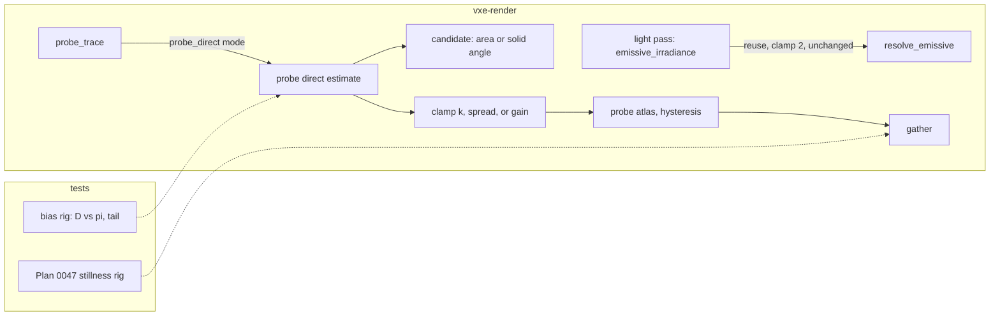

# 0048: The probe rays' direct light without the clamp's bias: candidate schemes measured, and the furnace back at pi

> **Status:** draft
> **Created:** 2026-10-28
> **Milestone:** M2 in [`docs/roadmap.md`](../roadmap.md) (the "one-sample path tracing ...
> temporal accumulation" bullet, and its headless proof: "irradiance in a closed test box
> matches an analytic value within a stated tolerance")
> **Related ADRs:** [ADR-0037](../adrs/0037-probe-rays-direct-light-keeps-its-energy-apart-from-the-screen-firefly-clamp.md)
> (proposed with this plan), [ADR-0018](../adrs/0018-direct-light-per-pixel-one-sample-from-a-hit-buffer-with-svgf-history-killed-by-edits.md)
> (the estimator and its clamp, unchanged on screen), [ADR-0023](../adrs/0023-indirect-light-from-a-scrolling-probe-volume.md)
> (the probe update this plan changes), [ADR-0025](../adrs/0025-light-candidates-from-a-power-over-distance-table-of-near-emitter-chunks.md)
> (the candidate table, unchanged), [ADR-0036](../adrs/0036-static-emissive-light-on-a-long-full-precision-history-guarded-by-an-emissive-gradient.md)
> (Plan 0047's stillness, which this plan must not regress)
> **Source:** Plan 0047's Implementation log, Phase 4 step C, and its Followups ("The firefly
> clamp biases the probe rays' direct light low"). Plan 0047's step C scratch is in that
> plan's worktree under `live/` (`stepc-diag.log`, `stepc-donly.patch`, `stepc-noclamp.patch`).
> **Starts after:** [Plan 0047](0047-emissive-light-holds-still-long-guarded-history.md)
> merges. It changes the same probe and lighting code (`probe_update.wgsl`, `probes.rs`,
> `light.wgsl`, `marcher.rs`), and its stillness rig, its slice hash, its furnace test form
> and its Phase 5 defaults are this plan's "before". **Before [Plan 0032](0032-sun-and-sky-hillaire-atmosphere-time-of-day-and-an-outdoor-testbed.md)**,
> or alongside it if 0032 has started: 0032 adds the sun's sample and sky light to the probe
> rays and reads its bars on the probes, so it should read them once, on an unbiased probe
> direct term. If 0032 lands first, this plan's Phase 1 re-reads its "before" on 0032's tree
> and the two plans' probe tests are re-read together. Plans 0044 and 0045 also touch
> `marcher.rs` and the flythrough tests, and whichever lands second rebases. Drafted against
> main at bc1e7a5 and Plan 0047's branch at c27891f. The names dev finds in the tree win.

## TL;DR

The probe rays light their hits with the screen's emissive estimator, and its firefly clamp
(`FIREFLY_CLAMP` 2 in `resolve_emissive`) cuts their direct light about 8.5 % low in the
furnace box. The screen pixels barely feel it, because their reservoirs average up to 160
candidates through reuse, while a probe ray has 8 fresh ones. Removing the clamp is no fix:
the estimator's variance near a wall's edge is unbounded, and one rare sample moved the
furnace's 256-frame mean to +6.3 %. This plan gives the probe rays a direct-light scheme of
their own (ADR-0037), with the screen path bit-identical. It builds a bias rig first. The rig
reads the probe rays' direct mean D against pi in two closed furnaces, whose answer is
exactly pi, with the tail of the samples and the gather's stillness in Plan 0047's rig.
It then measures five candidates: a separate probe clamp, the clipped energy spread over the
update, a per-probe running gain, solid-angle sampling of the kept face, and more candidates
at probe hits. Multiple importance sampling with a short cosine ray is built only if all five
miss. A decision rule picks the cheapest scheme that meets every bar, the furnace test judges
against pi again, and the owner sees the brighter bounce light in a windowed check. The
first thing anyone sees is Phase 1's test printing today's D = 2.87 (-8.5 % of pi) beside the
narrow furnace's D and the share of probe samples the clamp cuts.

## Context & problem

`project-context.md` (Rendering, P0): dark scenes with few lights, emissive voxels as the
light, and a smooth, natural look. Indirect light makes a lamp-off cave readable (ADR-0023).
A bias that darkens it by an amount set by the geometry near each probe ray's hit is a
rendering fault, and it hides in every test that judges the probes against their own mean.

**What was measured** (Plan 0047's log, Phase 4 step C and step D; lavapipe):

- *The bias.* In the furnace box (24 x 24 x 12 interior voxels, six walls emitting `[1, 1, 1]`
  at albedo 0.5, lamp off), with the probes' own irradiance left out of the probe rays
  (`stepc-donly.patch`), the centre probe's texel mean converges to `0.5 D`. It read 1.43703,
  so D = 2.874, -8.5 % of pi. The box's fixed point is `E = 0.5 (D + E) = D`, and the long
  texel mean read +0.8 % (base) and +1.1 % (hash) against D. Plan 0047's furnace test now
  measures D itself, by zeroing the centre probe's tile before each frame, at 256 visits
  (`furnace_direct_mean`): D 2.8788, standard error 0.386 %, -8.36 % of pi on the base probe
  code, and 2.9010 (-7.66 %) with the hash.
- *The screen does not see it.* The light pass's floor-centre direct mean read 3.14079 over
  2048 frames, -0.025 % of pi. The floor centre is far from every edge, and the pixel's
  reservoir carries reuse. No edge pixel has been read.
- *No clamp.* With `FIREFLY_CLAMP` at 1e6 (`stepc-noclamp.patch`) the texel mean over frames
  1793 to 2048 read 3.33840, +6.3 % of pi. The series every 64 frames sat at 3.04 to 3.15
  (-3.2 to +0.3 % of pi) up to frame 1794, then 3.44, 3.40 and 3.41. One event made the long
  reading. The replay's mean sample over the same frames read +14.4 % of pi.
- *A relative clamp.* Step D's per-ray clamp at `k` times the probe's own irradiance stilled
  the gather but cut its mean luminance by 38 to 53 % at the two cave poses. Much of the
  probe rays' direct light in a cave arrives in the tail.

**Why the tail is heavy** (the architect's analysis; Phase 1 reads it). `candidate` picks a
point uniformly on a unit emitter face, so a candidate's weight is
`lum(Le) cos_hit cos_face / d^2` over an area density. A probe ray's hit can lie arbitrarily
close to the edge where its wall meets an emitting wall. There `d` reaches 0 over part of the
face, and the weight's second moment is unbounded. Resampling over 8 candidates divides the
spike by 8 but does not bound it. The clamp at `2 PI lum(Le)` is what keeps the variance
finite, and the shortfall it leaves is the energy above that line.

**The ground truth is exact.** Every point on an inner wall of a closed box whose walls all
emit radiance L sees emitting walls over its whole hemisphere, at the edges and the corners
too. So its direct irradiance is exactly `PI L`. The probes store bounce light only, so with
albedo a their fixed point is `E = a (PI L + E)`, which gives `E = PI L` at a = 0.5. Any closed box of emitting walls gives pi, so a narrower box is a stronger test of
the same claim: more of its hits lie near an edge.

**The `nfr.md` figures touched:** §2, the probe volume's two passes (update plus gather at
most 1.7 ms on the dev box at the streamed spawn, read 1.63 to 1.66 ms), and the lighting line
(at most 6.0 ms at the half tier). §3 the frame's bytes (`Frame::frame_bytes`), only if the
running gain is kept.

## Decision

The probe update passes its own direct-light setting to the emissive estimator, and the light
pass keeps today's code path bit for bit (ADR-0037). The scheme is chosen by measurement. A
bias rig reads the probe rays' direct mean against pi in two closed furnaces, with its
standard error and its tail, beside the gather's stillness in Plan 0047's rig and the
update pass's cost. Five schemes are built as modes of one setting:
- **A, the probe clamp:** a separate `k` for probe rays.
- **B1, spread:** clip at `k` and spread the update's clipped energy evenly over its rays.
- **B2, the running gain:** clip at `k` and keep a per-probe gain that returns the clipped
  share in the mean.
- **C, solid angle:** sample the kept face's point by solid angle, which bounds the weight,
  under a safety clamp.
- **D, more candidates:** 16 or 32 candidates at probe hits.

A sixth, **E, multiple importance sampling** of the light pick with a short cosine ray at the
hit, is built only if none of the five meets the bars. A decision rule picks the cheapest
setting that meets them all. The setting stays selectable in the fly-through until the owner's
windowed check.

We rejected keeping the clamp and judging the furnace against D, because the bias depends on
the geometry and a test against D cannot see it grow. We rejected a constant gain, because it
is right for one box only. We rejected raising the clamp for screen and probes together,
because the screen gains nothing and a pixel's spike would sit in Plan 0047's long emissive
history. We rejected a clamp relative to the probe's irradiance, because Plan 0047 measured
38 to 53 % less light from it (ADR-0037, Alternatives).

## Architecture diagram



## Implementation phases

### Phase 1: The bias rig, with today's bias printed
- **Owner skill:** dev
- **What:** a headless rig that reads, for any `Lighting`, the probe rays' direct mean D
  against pi in two furnaces, its standard error, the sample tail, and the light pass's direct
  mean at an edge pixel. It also takes this plan's "before" readings in Plan 0047's stillness
  rig and the probe passes' cost. Today's tree prints its bias.
- **Files touched:** `apps/flythrough/tests/probe_direct.rs` (new; it joins the gpu filter in
  `.config/nextest.toml` and the slow list), `apps/flythrough/tests/support/furnace.rs` (new:
  `furnace_world`, the floor probe and `furnace_direct_mean`, moved from `indirect.rs` with
  the box size a parameter), `apps/flythrough/tests/indirect.rs` (uses the moved helpers),
  `crates/vxe-render/src/probes.rs` (a test-only readback of one probe's ray words, if the
  tree has none).
- **The rig:**
  - *The furnaces.* The standard box, 24 x 24 x 12 (`BOX_MIN` [20, 20, 26], `BOX_MAX`
    [44, 44, 38]), and a narrow box, 8 x 8 x 8 ([28, 28, 28] to [36, 36, 36]), both centred on
    voxel corner (32, 32, 32), so world probe (2, 2, 2) is the live centre probe in each. The
    rig asserts that probe is live (not flagged inside) in the narrow box after its first
    update, and stops if it is not.
  - *D and its error.* D is the method of Plan 0047's `furnace_direct_mean`: the centre
    probe's tile is zeroed before each frame, and a settled visit leaves `(1 - HYSTERESIS) x
    0.5 x D_t` in texel t. The rig reads visits until the standard error is at most 0.5 % of
    D, up to 1024 visits (8192 frames), and prints the count used. It also prints D over four
    disjoint quarters of the visits, and their max minus min, because a heavy tail shows as
    one quarter far from the others.
  - *The tail.* Per ray, in the same zeroed-tile runs (with the tile zeroed and the lamp off, a
    ray's stored radiance is `albedo / PI` times its direct estimate), the rig reads the
    share of samples above `2 PI lum(Le)` (today's clamp line) and above `8 PI lum(Le)`, the
    largest sample, and the share of the mean carried by samples above the clamp line. It
    reads these over the first 64 visits, from the ray words before the blend.
  - *The screen's edge.* The light pass's direct mean over 2048 frames at a pixel whose hit
    lies one voxel from the floor's edge in each furnace, against pi. This is a reading only:
    the screen path does not change in this plan.
  - *Stillness.* `stillness::run` at `PATCH_POSE` and `VEIN_POSE` with Plan 0047's merged
    defaults: each part's patches per step (mean and max), sudden steps per second and tile
    flicker, and the gather's mean linear luminance over the lighting grid and window (the
    bias proxy in a real cave, as Plan 0047's step D printed it).
  - *Cost.* The probe update and gather passes, from Plan 0047's method: release
    `flythrough --level --headless --render 1920x1080 --frames 300 --adapter NVIDIA|AMD`,
    `--lamp on` and `--lamp off`, the spawn pose, median of the last 30 frames, three runs
    each, interleaved. Quiet means a 1-minute load under 1.0 at each run's start, on AC, with
    the power state logged. Also `Frame::frame_bytes`.
  - A sweep entry point that takes the setting from an environment variable
    (`PROBE_DIRECT_SWEEP`, as Plan 0047's `STILL_SWEEP`) and prints one row per setting. With
    the variable unset it reads the default only.
- **Done when:**
  1. On the merged tree, the rig's standard-box D lies within 1 % of Plan 0047's committed
     reading at the same probe code (2.9010 with the hash) and under pi by more than 5 %. If
     it lies within 1.5 % of pi, the bias is gone from the tree and dev stops for the
     architect.
  2. The rig prints, for the default, both furnaces' D with its error, visits and quarters,
     the tail figures, the edge pixels' direct means, and the stillness and cost rows. The log
     has them as this plan's "before". They are not committed as bars except as below.
  3. One unbiased-but-unbounded reading is logged: the default with the probe rays' clamp
     raised to the radiance range's top (see Risks: `k` at most `65504 / (albedo lum(Le))`,
     131 008 here, applied as a `min` before `pack2x16float`), as a scratch patch. It is
     logged, with its quarters, as the variance a scheme must beat.
  4. `the_furnace_box_reads_pi_of_indirect_irradiance` passes unchanged on the helpers'
     new home, and `check-test-tiers.mjs` passes.

### Phase 2: The candidate schemes as modes of one setting
- **Owner skill:** dev
- **What:** `Lighting::probe_direct` selects the probe rays' direct scheme. The default is
  today's (clamp 2), so every image and test is unchanged. Schemes A, B1, B2, C and D are built.
  The fly-through can select each by a flag and cycle them with a key, and the HUD shows the
  mode.
- **Files touched:** `crates/vxe-render/src/marcher.rs` (the setting, its uniform word or
  words, `Lighting::default`; a change of the setting opens the probe light-change window,
  as a candidate-count change does), `crates/vxe-render/src/probes.rs` (the probe uniform; the
  per-probe gain buffer for B2), `crates/vxe-render/src/shaders/probe_update.wgsl`
  (`probe_trace` calls the probe estimate; B1's spread in the blend), `crates/vxe-render/src/shaders/light.wgsl`
  (a probe entry beside `emissive_estimate`; `candidate` gains a solid-angle path that the
  light pass never takes; `resolve_emissive` takes the clamp as an argument, which the light
  pass passes as `FIREFLY_CLAMP`), `crates/vxe-render/src/lib.rs` (re-export),
  `apps/flythrough/src/main.rs` (`--probe-direct`, a cycling key that dev picks from the free
  keys and names in the README), `apps/flythrough/src/hud.rs` (the mode line),
  `README.md` (the flag and key rows), `apps/flythrough/tests/probe_direct.rs`,
  `crates/vxe-render/tests/` (where the tree tests probe uniforms).
- **The schemes** (illustrative shapes; dev names them):
  - **A, `Clamp { k }`.** `resolve_emissive`'s clamp line at `k PI lum(Le)` for probe rays.
    `k` 2 is today.
  - **B1, `Spread { k }`.** Each ray clips at `k`. The update sums its rays' clipped excess
    (rgb, as `Le / lum(Le)` times the excess luminance) and adds the mean to every ray's
    radiance before the blend, times the hit's `albedo / PI` of each ray. One visit keeps its
    energy, and the excess loses its direction. No storage.
  - **B2, `Gain { k }`.** Each ray clips at `k`. The probe keeps one `f32` gain `g`, blended
    at the probe's hysteresis schedule from the visit's ratio
    `(sum of unclipped luminance) / (sum of clipped luminance)` over its rays' direct
    estimates. Each ray's clipped direct estimate is multiplied by the gain before the blend.
    The mean is returned over the probe's history, and one spike moves `g` by
    `(1 - h)` of its ratio. Storage: 32 768 slots x 4 B = 131 072 B. A new or edit-touched
    probe starts its gain at 1 with the young schedule.
  - **C, `SolidAngle { k }`.** At probe hits each candidate's point is drawn by solid angle
    over its unit face (Urena, Fajardo and King 2013, "An Area-Preserving Parametrization for
    Spherical Rectangles"), and its source density is converted to area for the resampling
    weight. A candidate's weight is then bounded by `lum(Le) cos_hit Omega_face` over the
    chunk and voxel pick's probability. The clamp at `k` stays as a safety net. The light
    pass keeps area sampling.
  - **D, `Candidates { n, k }`.** `n` candidates at probe hits (16 or 32), with the clamp at
    `k`. The light pass keeps `Lighting::candidates`.
- **Done when:**
  1. With the default, every test in `flythrough::indirect`, `flythrough::lights`,
     `flythrough::golden` and `flythrough::emissive_stillness` passes with no golden
     re-blessed. The centre probe's 36 interior texels after 256 frames in the standard
     furnace are byte-identical to Phase 1's on lavapipe. The light pass's irradiance target
     at `PATCH_POSE` after 120 frames is byte-identical under every mode, because the screen
     path is untouched.
  2. Each mode runs the rig to the end with finite texels (no NaN or infinity in any texel
     or gain), in both furnaces.
  3. B1 conserves the update's energy: in one standard-furnace visit at `k` 2, the sum over the
     probe's rays of the stored direct luminance equals the sum of the unclipped estimates
     within 0.1 % (`f16` storage), read through the test-only ray readback.
  4. B2's gain is 1 on a probe whose rays never reach `k`: in the furnace at `k` 1e5 every
     live probe's gain reads 1 within `f32` rounding after 256 frames.
  5. C's sampler bounds the weight. In the narrow furnace with `k` set to the radiance
     range's top, the four quarters read D within 3 % of each other at the visits that bring
     its error to 0.5 %. That is the bounded variance the change exists for, read
     as a property. If the error does not reach 0.5 % by 1024 visits, dev stops: the sampler
     or its density is wrong.
  6. `flythrough --probe-direct <mode>` and the key select each mode, the HUD shows it in the
     window (a headless HUD test reads the mode line for two modes), and a mode change opens
     the probe light-change window (`Frame::probe_light_window` reads open on the next frame).

### Phase 3: The sweep, the decision rule, and the default chosen
- **Owner skill:** dev
- **What:** the rig runs every setting below. The log holds one table, and the rule picks the
  default. E is built only if the rule finds nothing.
- **Files touched:** `apps/flythrough/tests/probe_direct.rs` (the sweep's setting list), the
  plan's log; for E only, `light.wgsl`, `probe_update.wgsl` and the setting.
- **The grid:** A at `k` 2, 4, 8, 16, 64 and the range top; B1 and B2 at `k` 2, 4, 8; C at `k`
  2, 8 and the range top; D at `n` 16 and 32, each at `k` 2 and 8. Each setting gets both
  furnaces' D, error, visits and quarters, the tail figures, and stillness at both poses
  (every part, and the gather's mean luminance). The cost rows are read only for the settings
  that meet bars 1 to 4 below, plus the cheapest A setting for reference.
- **The bars** (a setting "passes" when it meets all six):
  1. **The standard furnace returns to pi.** D lies within 1.5 % of pi, at a standard error of
     at most 0.5 % of D, within 1024 visits. *Where 1.5 % comes from:* three times the largest
     admitted error, so an unbiased scheme fails it by chance about 0.3 % of the time.
  2. **So does the narrow furnace,** with the same bar. A scheme whose error does not reach
     0.5 % by 1024 visits fails: its variance is too high to verify, which is the variance
     cost this bar holds.
  3. **No stillness regression** in Plan 0047's rig, against Phase 1's "before", at both poses.
     The gather's mean patches per step, its max per step and its sudden steps per second are
     each at most `max(1.10 x before, before + 1)`. Its tile flicker is at most 1.10 x before.
     The composite's mean patches per step are at most 1.05 x before. The emissive part's
     readings equal the before's exactly, because the screen path is unchanged. *The margins*
     are Plan 0047's 10 % for a new random pattern at the same mean. The `+ 1` admits one patch
     where the before is 0, as `VEIN_POSE`'s gather is.
  4. **The gather does not get darker** at either pose: its mean luminance is at least the
     before's less 1 %. A scheme that returns the furnace's energy should not lose a cave's.
  5. **The hole and leak tests hold** with the setting as default:
     `a_hole_in_the_wall_lights_the_dark_box_and_filling_it_darkens_it_again` at Plan 0047's
     bars (frame 32 at least 52 % of the box's value 2048 frames after the carve, at least 10
     times the pre-carve value, under 5 % of the lit box within 64 frames of the fill), and
     `no_light_leaks_through_a_two_voxel_wall` (dark box under 2 % of the lit box). The other
     tests of `flythrough::indirect` and `flythrough::lights` pass. Goldens may move (Phase 4).
  6. **Cost.** The probe update pass at the setting costs at most 5 % more than the before on
     each adapter, lamp on and lamp off, as the median of three quiet runs. The dev box's update
     plus gather at the streamed spawn stays within 1.7 ms, and the lighting line within
     6.0 ms. `frame_bytes` grows by 0 B, or by 131 072 B for B2.
- **The decision rule:** the first row that holds decides.

  | observation | next |
  |---|---|
  | one or more settings pass | the default is the passing setting with the lowest slow-adapter update time. Settings within 1 % of it are tied, and the tie goes to the lower patch-pose gather flicker. Every passing setting stays selectable for Phase 5 |
  | settings meet bars 1 to 5, and every one of them misses only bar 6 | **stop** for the owner with the table: the cost bar is not widened by dev |
  | no setting meets bars 1 to 5 | build E (below), sweep it, and re-enter the table once. If E also meets nothing, **stop** for the architect with the table |

  - **E, `Mis { range, k }`** (only by the third row). At a probe ray's hit, one cosine-sampled
    ray up to `range` voxels (4 and 8) through the coarse walk is combined with the light
    pick by the balance heuristic (Veach 1997, "Robust Monte Carlo Methods for Light
    Transport Simulation", chapter 9). A cosine ray that hits an emitting face contributes
    `PI Le` times its weight, which is bounded. A light candidate's MIS weight needs the cosine
    density of its direction, which is closed form. Far emitters stay with the light pick.
    Its cost is one more short walk per probe ray hit.
- **Done when:** the log has the full table and the row that decided. This phase commits the
  sweep's code and the log. If the first row holds, the chosen setting becomes
  `Lighting::default`'s `probe_direct` in Phase 4's commit, together with the re-blessed
  goldens, so every commit's gate passes. If a stop row holds, dev stops after this commit.

### Phase 4: The furnace judges against pi, the goldens, the readings
- **Owner skill:** dev
- **What:** Phase 3's setting becomes the default, the furnace test asserts against pi again, the narrow furnace joins it, the goldens
  with the probes on are re-blessed at the new default, and the budget readings land in
  `docs/nfr.md`.
- **Files touched:** `crates/vxe-render/src/marcher.rs` (the default, by Phase 3's rule),
  `apps/flythrough/tests/indirect.rs`, `apps/flythrough/tests/golden/*.png`
  (those whose test runs with indirect light on: `indirect.png`, `showcase_hall.png`, and
  any other dev finds), `.config/nextest.toml` (slow list), `docs/nfr.md` (§2 readings and
  §3 if B2), `apps/flythrough/tests/probe_direct.rs`.
- **Done when:**
  1. `the_furnace_box_reads_pi_of_indirect_irradiance` asserts bar 1 (D within 1.5 % of pi,
     error at most 0.5 %). It keeps Plan 0047's bars against D at 256 frames: every
     centre-probe texel and the floor's gather within 7 % of D, and the texel mean within 4 %.
     It adds the same readings against pi: texels and floor within 8.5 %, and the texel mean
     within 5.5 %. *Where 8.5 and 5.5 come from:* Plan 0047's bars, which allow for the probes'
     lag at 256 frames, plus bar 1's 1.5 % allowance for D's offset from pi. The doc comment
     says so. Plan 0029's old 10 % of pi then holds as a consequence. A new test,
     `the_narrow_furnace_reads_pi`, asserts bar 2 and the same texel bars against D and pi.
     Its run time is logged, and it joins the slow list.
  2. Each re-blessed golden is named in the log with its moved share, its mean luminance change
     and its gather's mean change, read against Plan 0047's golden on the same view. The
     gather's mean rises or stays (bar 4's direction). A golden whose mean falls by more than
     1 % stops dev for the architect. The before and after images of every re-blessed golden
     go under the plan's scratch for Phase 5.
  3. `docs/nfr.md` §2 gets the update and gather readings at the new default on both adapters,
     beside Plan 0047's, with machine, commit, load and power state, and §3 gets the
     `frame_bytes` change if B2 is kept.
  4. The full gate: build, `cargo nextest run --workspace --profile full` under the perf lock,
     doctests, clippy with `-D warnings`, fmt, deny, and the doc and tier gates. Exit codes and
     counts are in the log.

### Phase 5: The owner's windowed check
- **Owner skill:** human
- **What:** the owner flies the showcase hall (`--source showcase --shot hall`) and the level
  near the vein wall with the lamp off, indirect on, at the new default. The owner cycles the
  probe-direct key through today's clamp, the default and every other passing setting. The
  HUD names each mode. The owner also sees Plan 0047's filmstrips (`STILL_FILMSTRIP`) at both
  poses for today's clamp and the default, and the before and after goldens. Dev prepares the
  commands and the images and pings the owner when they are ready.
- **Done when:** the owner's call is in the log, dated, in the owner's words. It names the kept
  default (Phase 3's or another passing setting) and says whether the bounce light's new
  brightness reads naturally, whether the gather pops or flickers more than under today's
  clamp at either place, and which schemes stay selectable (owner question 5).

### Phase 6: The owner's pick
- **Owner skill:** dev
- **What:** only if Phase 5 picks a different default, or asks to remove schemes. Otherwise the
  log says "not needed" and the phase is done.
- **Files touched:** as Phases 2 and 4.
- **Done when:** the owner's default is `Lighting::default`'s, Phase 4's done-whens 1 to 4 are
  re-read and met at it, and the removed schemes (if any) are gone with their flag values and
  tests. The log has the re-read readings.

## Data shapes

```rust
// illustrative; dev names the variants
pub enum ProbeDirect {
    Clamp { k: f32 },                 // A; Clamp { k: 2.0 } is today
    Spread { k: f32 },                // B1
    Gain { k: f32 },                  // B2, one f32 per probe slot
    SolidAngle { k: f32 },            // C
    Candidates { n: u32, k: f32 },    // D
    // Mis { range: u32, k: f32 },    // E, only by Phase 3's third row
}
pub struct Lighting { /* ... */ pub probe_direct: ProbeDirect }
```

The probe uniform gains a mode word and two parameter words. B2 adds a storage buffer of
32 768 `f32`. The light pass's uniform and bindings do not change.

## Budgets

| figure (`docs/nfr.md`) | expected | how the close measures it |
|---|---|---|
| §2 probe update pass | A, B1: +0 to 1 %; B2: +1 to 2 %; C: +3 to 10 %, from a sampler of about 40 ALU ops and two inverse-trig calls per candidate, 8 a ray; D: +10 to 25 % at 16 candidates. All guesses. The emissive sample and its shadow ray are about a third of the update (ADR-0023 Outcome) | Phase 1's method: release fly-through, `--level`, spawn, 1080p, lamp on and off, both adapters, three quiet interleaved runs, median of the last 30 frames; bar 6, at most +5 % |
| §2 update plus gather, dev box, streamed spawn | stays under 1.7 ms if bar 6 holds (1.63 to 1.66 ms read at Plan 0029; Plan 0047's hash added 1.9 to 3.9 % to the update) | the nfr's own command at the close, dev box |
| §2 lighting line, half tier | under 6.0 ms; the light pass does not change | the same run's light, temporal, update and gather |
| §3 `Frame::frame_bytes` | +0 B, or +131 072 B for B2 | `frame_bytes` printed by the rig, against Phase 1 |
| test time | the furnace test takes about 90 s at 256 visits; a scheme needing 1024 visits takes about 6 minutes per furnace (a guess scaled from 90 s) | logged per test; Phase 4 holds the committed tests to the visits bar 1 needs |

No figure touches `vxe-world`, determinism or the streaming line.

## Risks & open questions

- **The `f16` ray words overflow.** `probe_trace` stores a ray's radiance through
  `pack2x16float`, whose result is undefined in WGSL for a value beyond the `f16` range
  (65504). A ray's radiance is at most `albedo k lum(Le)` (from `albedo / PI` times
  `k PI lum(Le)`), so any `k` above `65504 / (albedo lum(Le))` must `min` before the pack.
  That is 131 008 in the furnace. A cave's brightest emitter sets a lower top, and dev reads
  it from the material table. The irradiance atlas is `f16` as well: a texel's blend is
  bounded by its inputs, so it does not overflow if the rays do not.
- **The tail may be heavier than the bars can verify.** If no scheme reaches a 0.5 % error by
  1024 visits in the narrow furnace, the rule's third row runs E, and then stops. The narrow
  box may be stricter than any cave: the architect may then drop bar 2 to a reading, with the
  owner's approval, never silently.
- **B2 moves energy across directions.** Its gain lifts every texel of a probe by the share
  the clipped samples had, so a probe beside a vein brightens its texels that face away from
  it. The leak test and the hole test are its bars, and the owner's eye is the last word. B1
  has the same risk within one visit.
- **C's sampler near a face's own plane.** A hit in the plane of an emitter face sees it at a
  solid angle of 0, which the parametrization must return as weight 0, not NaN. Phase 2's
  done-when 2 catches a NaN. The conversion back to an area density must cancel the `cos_face
  / d^2` the target holds, or the weight double-counts. Bar 1 catches a wrong density.
- **Brighter indirect light everywhere.** A scheme that meets bar 1 raises the gather wherever
  probe rays hit near emitters. The change is meant, but every probe golden moves and the
  hero shot (`docs/images/hero.png`) is no longer what the engine renders. Owner question 4.
- **The stillness bars may fight bar 1.** Every unbiased scheme puts more of the tail into
  the probes. If none meets bar 3, the rule's third row runs E, and E is costly. The stop rows
  exist so no bar is loosened by dev.
- **Plan 0047's defaults are not known yet.** Its Phase 5 chooses the emissive history and
  the reuse cap, and its Phase 7 may lead to a further ADR on probe popping. This plan's
  before readings are taken on whatever merges. If that ADR changes the probe structure
  (a separate emissive probe channel, for example), this plan's schemes apply to it
  unchanged, but its Phase 1 has to be re-read.
- **No GPU feature risk:** the schemes use ALU, the existing walk and one storage buffer for
  B2. Nothing branches on the backend.

## What this plan does NOT do

- No change to the screen's estimator, its clamp, its reuse or its histories. If Phase 1's
  edge-pixel reading shows a screen bias, it is a Followup (owner question 1).
- No change to the probe structure, spacing, rays, slices, hysteresis or the gather's weights.
  Plan 0047 owns those.
- No change to the candidate table (ADR-0025) or to the light samples the mirror extracts.
- No per-source switch on feeding the probes (M2's list, Plan 0029's Followups).
- No sun or sky light in the probes. Plan 0032 adds them, after this plan.
- No hero shot re-shoot unless the owner asks at Phase 5.

## Owner questions

1. **The screen's clamp.** This plan changes the probe rays only. If Phase 1 reads a screen
   bias at the edge pixels (for example more than 2 % under pi), should a later plan take the
   screen's estimator too, or does the screen's look stand as it is?
2. **The cost ceiling.** Bar 6 caps the probe update at +5 % on each adapter (Plan 0047's
   bar). Would you pay more for an unbiased scheme, up to the dev box's 1.7 ms line for
   update plus gather, with the slow adapter carrying no bar as `docs/nfr.md` §2 has it?
3. **"Back at pi."** Is D within 1.5 % of pi, with a 0.5 % standard error, the claim you want
   the furnace test to defend? Or should it be tighter, at the cost of more visits and a
   longer test?
4. **Brighter bounce light.** The goldens with the probes on will be re-blessed brighter.
   Should this plan also re-shoot `docs/images/hero.png` from the showcase hall after
   Phase 5, or leave it for the next look pass?
5. **After your pick.** Should the schemes that lose in Phase 5 be removed, or stay
   selectable as modes, as ADR-0018's pairs did?

## Implementation log

| phase | owner | state | commit |
|---|---|---|---|
| 1: The bias rig, with today's bias printed | dev | not started | |
| 2: The candidate schemes as modes of one setting | dev | not started | |
| 3: The sweep, the decision rule, and the default chosen | dev | not started | |
| 4: The furnace judges against pi, the goldens, the readings | dev | not started | |
| 5: The owner's windowed check | human | not started | |
| 6: The owner's pick | dev | not started | |

### Notes

### Close triggers

## Followups

- Plan 0047's Followups name this plan's work ("That plan decides whether the furnace test
  judges against pi again"). At this plan's close, the line is answered by Phase 4's test.
- Plan 0032's probe tests, if it lands after this plan, read at the new default.
