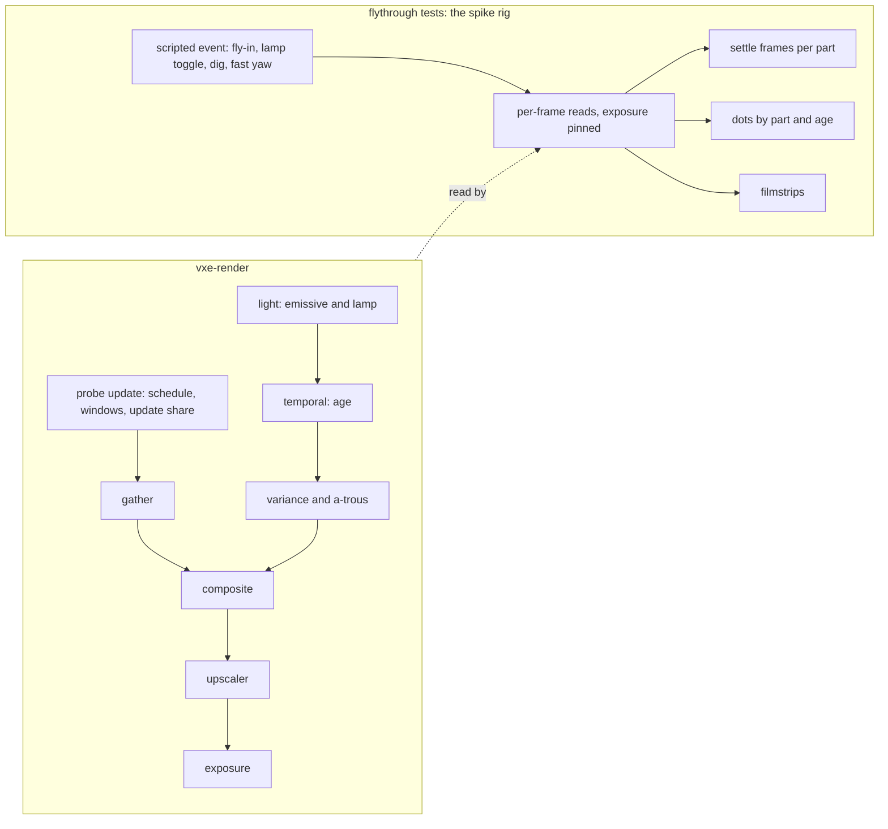

# 0049: Light settles fast and young pixels hold no dots: a settle-and-dot spike, then the probe response and the young pixels' filter chosen by measurement

> **Status:** approved (2026-10-28)
> **Created:** 2026-10-28
> **Approved:** 2026-10-28 (owner), with the answers under "Owner answers". The spike runs
> beside Plan 0048, and the mechanisms run after it. Plan 0032 waits for this plan, so the
> order is 0047, 0048, 0049, 0032. Bars B1 and B2 are not fixed at approval: Phase 1 proposes
> them from its readings, and the owner sets them in a new `human` Phase 2 before any
> mechanism. Old Phases 2 to 6 become Phases 3 to 7. Exposure stays out of scope, and its
> reading and filmstrip go to the owner. The adapter switch lands in Phase 1 as
> `VXE_TEST_ADAPTER`, for reading-only tests. The gain question waits for Plan 0048's pick,
> as a conditional in Phase 3.
> **Milestone:** M2 in [`docs/roadmap.md`](../roadmap.md) (the "one-sample path tracing ...
> temporal accumulation" bullet, and the probe volume's indirect light)
> **Related ADRs:** [ADR-0023](../adrs/0023-indirect-light-from-a-scrolling-probe-volume.md)
> (the probe update whose response this plan may change),
> [ADR-0018](../adrs/0018-direct-light-per-pixel-one-sample-from-a-hit-buffer-with-svgf-history-killed-by-edits.md)
> (the estimator, its firefly clamp, the temporal and a-trous passes),
> [ADR-0036](../adrs/0036-static-emissive-light-on-a-long-full-precision-history-guarded-by-an-emissive-gradient.md)
> (Plan 0047's stillness, which this plan must not regress),
> [ADR-0033](../adrs/0033-eye-adaptation-as-an-asymmetric-two-stage-exposure-on-the-gpu.md)
> (the eye adaptation the spike separates from the light),
> [ADR-0037](../adrs/0037-probe-rays-direct-light-keeps-its-energy-apart-from-the-screen-firefly-clamp.md)
> (Plan 0048's probe direct light, which lands first). No ADR at draft: see Decision.
> **Source:** the owner at Plan 0047's Phase 7 windowed check, 2026-10-28, on branch
> `plan-0047` at e1cfe53 (emissive history 256, the guard on, reuse cap 20, probe slices
> spread by a hash): (1) "When indirect lights are on, I have to wait several seconds until
> the light settles; it's very unnatural. With indirect off it is fine", when flying into new
> areas and after the lamp toggle (`F7`). (2) "When I turn the camera fast to another angle I
> see light artifacts, like small light dots. Same thing when I dig." The dots were the same
> in the old look (history 32), so they predate Plan 0047.
> **Starts after:** [Plan 0047](0047-emissive-light-holds-still-long-guarded-history.md)
> merges: its stillness rig (`apps/flythrough/tests/support/stillness.rs`), its filmstrips,
> its asserted bars and its defaults are this plan's "before". **Phase 1 may run beside
> [Plan 0048](0048-probe-rays-direct-light-without-the-clamp-bias.md)**: it adds rig code and
> test-only accessors, no shader or default change. Phase 2, the owner setting the bars,
> follows Phase 1's readings. **Phases 3 onward, the mechanisms, start after Plan 0048
> merges**, and Phase 3 re-reads the spike on 0048's tree first. **Before
> [Plan 0032](0032-sun-and-sky-hillaire-atmosphere-time-of-day-and-an-outdoor-testbed.md)**,
> which waits for this plan (owner, 2026-10-28). Drafted against main at cb7b70b and Plan
> 0047's branch at e1cfe53. The names dev finds in the tree win.

## TL;DR

Two defects the owner sees in motion, not at rest. With indirect light on, the light takes
seconds to settle after flying into a new area, a lamp toggle or a dig. A fast turn or a dig
leaves small bright dots. The tree has several mechanisms that could cause each, and this
plan does not pick one yet (the measure-first rule, cb7b70b). **Phase 1 is a spike.** It
scripts four kinds of runs: a flight into a new area, a lamp toggle, a dig, and a fast yaw. It
reads each part of the light frame by frame with the exposure pinned: the composite, the
emissive part, the lamp's part, the a-trous output, the probe gather and the eye's exposure
on its own. From those it gives a **settle time** per part, the frame after which 90 % of the
view's tiles stay within 10 % of their settled value. It also counts **dots**, bright outlier
pixels, by the part that carries them and by the pixel's history age. Filmstrips show the
owner each run. The mechanism phases are candidates, each with a decision rule on the
spike's readings. On the settle side: a running-mean probe schedule in place of the fixed
young blend, an update share for young probes, and a window when the lamp's pose moves. On
the dot side: an age-aware clamp or filter for young pixels in the a-trous, and the
reprojection's acceptance on a turn. Bars in frames and pixel counts close it. Phase 1
proposes those bars from its readings, and the owner sets them after seeing the readings and
the filmstrips, before any mechanism is built (owner, 2026-10-28). The owner checks the result
in the window. The first thing anyone sees is Phase 1's test printing, per
event, the settle frames of each part with indirect on and off, and the dot counts by part
and age.

## Context & problem

`project-context.md` (Rendering, P0): dark scenes, emissive voxels and a headlamp as the
light, with a smooth, natural look. Light that drifts for seconds after the camera arrives,
and sparkles where the camera turns or digs, reads as a rendering fault.

**What the tree does today** (Plan 0047's branch at e1cfe53; read, not measured):

- *The probe schedule* (`probes.rs`, `probe_update.wgsl`). One slice in 8 updates per frame,
  so a probe is visited every 8 frames. A slot holding a new probe (age 0) blends at
  hysteresis 0. It then blends at `YOUNG_HYSTERESIS` 0.5 for its next `YOUNG_UPDATES` 8
  visits (64 frames), then at `HYSTERESIS` 0.97. A step in a settled probe's input is 90 %
  done after `ln 0.1 / ln 0.97` = 75.6, so 76 visits: **608 frames, 10.1 s at 60 fps.**
- *Noise after a restart* (the architect's arithmetic). A blend at hysteresis h keeps
  `(1 - h) / (1 + h)` of one visit's variance in the limit: 1/3 at 0.5, 1/65.7 at 0.97. A
  probe leaving its young visits carries about `sqrt(65.7 / 3)` = 4.7 times the settled noise,
  and the excess drains at 0.97 a visit, on the same 76-visit scale. Its bounce term also
  reads neighbours that are themselves young.
- *The scroll.* The volume follows the camera in whole probe steps (16 voxels). A slot whose
  tag names another probe gathers with weight 0 until its first visit, at most 8 frames
  later. It then runs the young schedule above.
- *The light-change window* (`marcher.rs`, `LightKey`). A change of the lamp's switch or
  parameters, the shadow walk, the candidate count or an emission scale opens 16 frames
  that visit one probe in 4 at hysteresis 0. Each probe gets 4 visits, and its age restarts
  at 1. **`F7` changes `Lighting::lamp`, which is in the key, so the toggle opens the
  window** (to be confirmed by Phase 1's reading). After it, every probe runs the young
  visits (64 frames) and then the 0.97 drain. The window's own visits are single 64-ray
  estimates, so the gather is at its noisiest just after a toggle.
- *The lamp in the probes.* The probe rays light their hits with the headlamp
  (`probe_update.wgsl`, `lamp_lit`). The lamp's pose follows the camera, and **the pose is
  not in `LightKey`**. So with the lamp on, every turn or move changes the probes' input
  with no window, and the bounce follows at 0.97: about 608 frames to 90 %.
- *Edits.* A dig flags the probes within one spacing of its box as touched (age restarts at
  1, young blend). The temporal pass resets the pixels inside the dilated edit box to age 0,
  and Plan 0047's guard shortens the emissive history where the gradient sees a change.
- *Eye adaptation* (Plan 0040, ADR-0033). The owner chose 0.15 / 2 / 10 s and max 16. After
  the lamp goes off, the slow stage's dark adaptation takes about 10 s. Indirect light raises
  the meter's target, so exposure can lengthen a settle that the owner reads as the light's.
  The owner's "with indirect off it is fine" argues against exposure alone, but no reading
  separates them.
- *Young pixels* (`temporal.wgsl`, `atrous.wgsl`). A pixel whose history is rejected
  (reprojection taps fail on material, normal or distance, or the pixel is in an edit box)
  restarts at age 0. Its emissive part is then one sample of a rare-event estimator, clamped
  only at `FIREFLY_CLAMP` 2 times `PI lum(Le)`. Under `VARIANCE_AGE` 4 the variance comes
  from a 7 x 7 neighbourhood. The a-trous luminance weight `exp(-|l - l'| / (SIGMA_LUM
  sqrt(var)))` can keep an outlier apart from its neighbours. The gather goes straight to the
  composite with no screen history. Our upscaler at 1.5 (the default) has its own history and
  RCAS.

**Suspects, not conclusions:**

- *Settling:* the 0.97 drain after the young visits; new probes after a scroll; the window's
  noise; the lamp's pose missing from the window; and dark adaptation.
- *Dots:* raw emissive samples at age-0 pixels with too little spatial filtering; reprojection
  rejects on a fast turn; the firefly clamp's level; young probes' gather noise; and the
  upscaler's own history and sharpening.

Plan 0047 found that 83 % of a defect came from a part nobody had suspected. So nothing here
is fixed before a reading attributes it.

**The `nfr.md` figures touched:** §2 the probe volume's two passes (at most 1.7 ms outside a
light-change window and 3.2 ms inside one, on the dev box), the lighting line (6.0 ms) and
the denoise line (3.0 ms). §3 the frame's bytes, only if a candidate adds state.

## Decision

Measure first. The spike reads the settle and the dots by part and by pixel age under pinned
exposure, with indirect light on and off, on scripted camera runs. Each mechanism phase then
builds the cheapest candidate the readings point to, keeps it only if its bar holds with no
regression, and stops for an architect amendment when no candidate fits. The candidates stay
selectable in the fly-through until the owner's windowed check.

**No ADR at draft.** No alternative is rejected yet. ADR-0038 is written in an amendment, before
any code, if the spike points to a change of ADR-0023's update model beyond its constants: a
separate lamp channel in the probes, an update order that is no longer a round robin, or a
world-space cache. The next free ADR number is in `docs/adrs/README.md`.

## Architecture diagram



## Implementation phases

Each phase ships as its own commit. `dev` implements all phases in one session with no review
between phases. The architect reviews once at the end, in a fresh session. Lane rule 9c
applies throughout: exploratory runs (sweeps, attribution runs, long series) go on the RTX
3080 Laptop, labelled with the adapter, and every done-when reading, golden and gate stays on
lavapipe. A sweep's winner is re-read on lavapipe before its commit.

### Phase 1: The settle-and-dot spike
- **Owner skill:** dev
- **What:** a rig that scripts the four runs, reads every part per frame under pinned
  exposure, and prints settle frames and dot counts with their attribution. Filmstrips show
  the owner what the numbers count. No shader, default or engine behaviour changes.
- **The rig** (`apps/flythrough/tests/support/settle.rs`, beside `stillness.rs` and reusing its
  `VeinLevel`, poses, tile reduction and `filmstrip`):
  - **Parts read per frame:**
    - the composite's meter tiles;
    - the display image;
    - the emissive accumulation (`Frame::accumulated`);
    - the lamp's part;
    - the a-trous output (`Frame::filtered`);
    - the gather (`Frame::indirect_irradiance`);
    - the pixel age (`Frame::moments`, its `z`);
    - the exposure value.

    A part with no accessor today (the lamp's part, the exposure value if none exists) gets
    a test-only read in `vxe-render`.
  - **Runs.** Each run is at both poses (`PATCH_POSE`, `VEIN_POSE`), lamp on and lamp off,
    indirect on and off, at the rig's 192 x 108 and the defaults. Exposure is
    `Manual(pose.exposure)`, plus one `Auto` run per event that reads the exposure's own
    settle.
    - **(i) Fly-in.** A straight path of 160 voxels (10 probe spacings, so 10 scrolls) at 40
      voxels a second (4 m/s, 2/3 voxel a frame at 60 fps), ending at the pose, then still.
      Dev picks a path clear of rock and records it as a constant. Run it twice: with the
      volume following the camera, and with the origin pinned at the end pose's
      (`ProbeVolume::set_origin`). The difference is the scroll's share.
    - **(ii) Lamp toggle.** Still camera, settled 1024 frames, then the lamp on to off and off
      to on, as `F7` does. The rig asserts the window's state on each frame
      (`Frame::probe_light_window`).
    - **(iii) Dig.** Still camera, settled 1024 frames, then a radius-10 carve into the wall in
      view, applied as Plan 0047's hole test applies its edit.
    - **(iv) Fast yaw.** Still camera, settled 1024 frames, then a yaw of 90 degrees over 10
      frames (540 deg/s), and again over 30 frames (180 deg/s), then held still.
  - **The settle time** of part p after an event (the stop, the toggle, the carve):
    - The reference is part p's tile mean (the rig's log2 transform) over frames 2048 to
      2111 after the event, camera still. This follows Plan 0047's fifth amendment: a
      256-frame "settled" value can be a transient.
    - A tile is settled at frame f when it is within `log2 1.1` of its reference, the patch
      threshold.
    - `S_p` is the first frame after which at least 90 % of p's full tiles are settled in
      every later frame up to 2048.
    - The rig also prints the frame at which the mean luminance has made 90 % of its change,
      and the curve every 8 frames.
    - `S_off` is the composite's `S` with indirect off; `S_on` is the same with it on.
  - **The dots** in a frame of the display image:
    - A **dot** is a pixel whose luma is over its 5 x 5 median by more than 24/255 and more
      than twice that median.
    - The **excess** is the count minus the same pose's count settled and still, which is
      the floor of real sparkle on crystal edges.
    - Each dot is attributed to every lighting-grid part that shows an outlier under it by
      the same rule on that part's own luminance. A dot with no part under it is the
      upscaler's.
    - Each dot is also bucketed by its pixel's age: 0, 1 to 3 (under `VARIANCE_AGE`), 4 to
      15, 16 to 63, 64 and over.
    - Read frames 1 to 60 after the yaw stops or the carve lands. For the yaw, the rig also
      prints the share of age-0 pixels whose hit was in view the frame before
      (reprojection rejects on a visible surface).
  - **Sweeps by scratch patch.** Constants the spike needs to vary are swept by patches under
    the worktree's `live/` (not committed, as Plan 0047 did). These are `FIREFLY_CLAMP` at 1,
    2 and 8, `YOUNG_UPDATES` and `HYSTERESIS`, and the upscaler off (scale 1).
  - **The adapter switch, `VXE_TEST_ADAPTER`** (owner, 2026-10-28). Rule 9c anticipates a
    test-support switch, and this phase builds it for later lanes to reuse.
    - **Where it lives.** One function in `apps/flythrough/tests/support/mod.rs`,
      `reading_device(pool_bytes)`, beside `software_device`. Its doc comment names the
      variable and the rule. Any reading-only render test in the workspace calls it, and
      `crates/vxe-render/tests` can copy it.
    - **Values.**
      - Unset, empty or `fallback`: lavapipe through `force_fallback_adapter: true`, as
        today.
      - Any other value: the first adapter whose name contains it, ignoring case (`rtx`,
        `radeon`). With no match, the test panics and lists the adapters.
    - **What may call it.** Only reading tests: `#[ignore]`d or env-gated, printing readings,
      asserting nothing that a gate runs. Every reading they print names the adapter.
    - **What may not.** Asserted tests and goldens keep `software_device` and stay forced to
      lavapipe. A test in Plan 0043's quick or gpu tiers that calls `reading_device` is a
      review finding.
  - **Filmstrips.** With `STILL_FILMSTRIP` set, each event writes contact sheets of the
    composite, the gather and the age image under `live/filmstrip/<tag>/`. Dots are marked on
    the composite's sheet. Each event's `Auto` run also writes a strip of the composite beside
    the pinned run's, with the exposure value printed per frame. That shows the owner what the
    eye adds to the settle (owner, 2026-10-28).
- **Files touched:** `apps/flythrough/tests/support/settle.rs` (new),
  `apps/flythrough/tests/support/stillness.rs` (shared helpers made public),
  `apps/flythrough/tests/support/mod.rs` (`reading_device` and `VXE_TEST_ADAPTER`),
  `apps/flythrough/tests/settle.rs` (new), `.config/nextest.toml` (the new file on the gpu
  and slow lists; `scripts/check-test-tiers.mjs` checks it), `crates/vxe-render/src/marcher.rs`
  (test-only reads, if a part has none), this plan's log.
- **Done when:**
  1. `the_lamp_toggle_opens_the_light_window` asserts on lavapipe that on the first encoded
     frame with a probe update after the lamp switches, `probe_light_window()` is true, and
     that it stays true for exactly 16 such frames. Today's code says so. If it fails, that
     reading is the finding.
  2. `a_turn_with_the_lamp_on_opens_no_window` asserts that a 90-degree yaw with the lamp on
     leaves the window closed. This records the gap the suspects name, as a reading. It
     becomes a bar only if Phase 3 keeps the lamp-pose window.
  3. `settle_readings` prints for each event, pose and lamp state: `S` per part with indirect
     on and off, the `Auto` run's exposure settle, the pinned-origin fly-in beside the
     following one, and the mean-luminance 90 % frame. The log carries the table, RTX and
     lavapipe columns, with at least `VEIN_POSE` lamp off re-read on lavapipe.
  4. `dot_readings` prints for the fast yaws and the dig: the excess dots summed over frames
     1 to 60, the excess at frames 1, 8 and 16, the split by part and by age bucket, and the
     reject share. The scratch sweeps' readings are in the log, labelled.
  5. **The attribution table** in the log. For each symptom (the settle at each event, the
     dots at each event), it names the share each source owns:
     - *settle:* exposure (the `Auto` run minus the pinned one); the scroll (following minus
       pinned); the lamp's pose (lamp-on fly-in and yaw against lamp-off); the drain after a
       restart (the gather's `S` against the 64 + 608 frame schedule); the window's noise;
       and the emissive history;
     - *dots:* the parts and age buckets above, the reject share, and the clamp's and the
       upscaler's sweeps.

     Shares that cannot be separated are named as joint. The log states, per symptom, the
     dominant source and its share. If exposure owns a share, that share and its `Auto`
     filmstrip go to the owner. No mechanism here is built for it (owner, 2026-10-28).
  6. The filmstrips exist for every event at both poses, and the log lists their paths.
  7. `VXE_TEST_ADAPTER` works:
     - unset, a reading test reports lavapipe;
     - set to `rtx` on the dev box, it reports the RTX 3080 Laptop;
     - `rg software_device` and `rg reading_device` show that no asserted test calls
       `reading_device`.
  8. **The proposed bars**, in the log under "Proposed B1 and B2", derived from the readings
     and labelled as a proposal:
     - **B1:** the composite's settle with indirect on against `S_off` at each event, as a
       margin in frames, a ratio, or both.
     - **B2:** the excess dots as a share of today's sum over frames 1 to 60, and a later
       frame by which the excess falls under a share of frame 1's.

     Each number cites the reading it comes from. The hand-off to the owner lists the
     filmstrips beside it. **The lane stops here** until Phase 2 records the owner's bars.

### Phase 2: The owner sets B1 and B2
- **Owner skill:** human
- **What:** the owner reads Phase 1's settle and dot tables, the attribution table, the
  proposed B1 and B2, and the filmstrips, the `Auto` strips among them. The owner then sets
  the two bars (owner, 2026-10-28). It needs no window, and it can happen while Plan 0048 is
  still in flight.
- **Files touched:** this plan's log, and "The bars" with the owner's numbers. The architect
  makes that edit as a dated amendment, since dev edits only the Status line and the log.
- **Done when:**
  - The log records B1 and B2 as the owner set them: numbers in frames and dot counts, per
    event where they differ, marked `(owner, <date>)`.
  - "The bars" carries the same numbers.
  - The owner states whether exposure's share, if any, changes ADR-0033's constants. That
    change, if wanted, is another plan.

### Phase 3: The light settles with indirect on about as fast as with it off
- **Owner skill:** dev
- **What:** re-read Phase 1's `settle_readings` on Plan 0048's merged tree, then build the
  candidates the decision rule names, in its order, and keep the first that meets bar B1
  with B3 and B4 held.
- **Candidates** (each a value of one `Lighting` setting, old behaviour selectable, the banner
  naming it):
  - **R, a running-mean schedule.** A probe's n-th visit after a restart blends at
    `h = min(HYSTERESIS, n / (n + 1))`, so it holds the plain mean of its visits until that
    mean is as quiet as 0.97's limit (n = 32), with no young-noise drain after it. The
    window keeps its first visit at 0, so stale bounce still goes, and runs the mean after.
    No memory; the age bits already count visits up to 127. Sources: the drain after a
    restart, the window's noise, and the scroll's new probes.
  - **P, an update share for young probes.** Probes of age at most `Y` whose cells lie within
    the view's near box join the frame's list beyond its slice, as touched probes do, up to
    `MAX_TOUCHED`. Sources: the scroll and the drain. Cost: the update pass, against the
    1.7 ms line.
  - **L, a window when the lamp's pose moves.** The lamp's pose enters the window's trigger
    when it has moved more than one probe spacing or turned more than `T` degrees since the
    last window. At most one window per `W` frames. Source: the lamp's pose. Cost: windows
    while flying, against the 3.2 ms line inside a window and the 1.7 ms line on average.
    `T` and `W` are swept.
- **The decision rule:**
  1. A source owning at least 25 % of `S_on - S_off` at any event gets its candidates,
     cheapest first: R, then P, then L.
  2. Keep the first candidate, or the first pair, that meets B1 at every event it serves.
  3. If the dominant source has no candidate here, stop for an architect amendment: a
     separate lamp channel in the probes, which needs ADR-0038; the emissive history, which
     is ADR-0036's ground. Exposure is out of scope (owner, 2026-10-28). Its reading and
     filmstrip went to the owner in Phase 2, and B1 is read with exposure pinned.
  4. If B1 already holds at every event on 0048's tree, the phase records "not needed" and
     builds nothing.
- **Files touched:** `crates/vxe-render/src/probes.rs`, `crates/vxe-render/src/shaders/probe_update.wgsl`,
  `crates/vxe-render/src/marcher.rs`, `crates/vxe-render/src/lib.rs` (the setting),
  `apps/flythrough/src/main.rs` and `apps/flythrough/src/hud.rs` (the flag and the banner),
  `apps/flythrough/tests/settle.rs`, this plan's log.
- **Done when:**
  1. B1 holds at every event, pose and lamp state on lavapipe at the kept setting (the
     candidate's readings beside the before's in the log).
  2. B3 and B4 hold.
  3. With the kept setting off, every image and test reads as before: the old path is
     bit-identical, asserted on one golden.
  4. **Conditional, open until Plan 0048 picks its scheme** (owner, 2026-10-28). If 0048 kept
     per-probe state blended on the hysteresis schedule (its scheme B2, the running gain),
     the log records whether that state follows the kept schedule or keeps 0048's. The
     owner decides this when 0048 picks. Either way 0048's furnace bar still holds. If 0048
     kept another scheme, the log says "not applicable".

### Phase 4: No dots on a fast turn or a dig
- **Owner skill:** dev
- **What:** build the dot candidates the decision rule names, in its order, and keep the
  first that meets bar B2 with B3 and B4 held.
- **Candidates:**
  - **Y1, an age-aware clamp for young pixels.** In the variance pass, a pixel of age under
    `VARIANCE_AGE` has its emissive luminance clamped to `k` times the largest of its
    geometric neighbours' in the 3 x 3. It is biased only while the pixel is young. Source:
    dots at age 0 to 3 in the emissive accumulation.
  - **Y2, a filter that blurs young pixels.** The a-trous luminance weight is relaxed for
    young pixels, scaled by `1 / (age + 1)` or off under `VARIANCE_AGE`, so the filter
    averages a young outlier into its plane. Source: dots that survive the filter at young
    ages.
  - **Y3, the reprojection's acceptance on a turn.** If the reject share on visible surfaces
    is high, the tap test (`HISTORY_COS`, the distance tolerance at depth t) is fixed where it
    rejects valid history on rotation. Source: age-0 dots on surfaces in view the frame before.
  - **Y4, the upscaler's young pixels.** If the upscaler owns the dots, its clip or RCAS is
    limited where the lighting history is young. Source: the upscaler's dots.
- Dots carried by the gather go to Phase 3's candidates. The clamp's level is a reading only:
  the screen's clamp stays, as the owner ruled for Plan 0048.
- **The decision rule:** a source owning at least 25 % of the excess dots at either event
  gets its candidate, in the order Y1, Y2, Y3, Y4 within its source. Keep the first that meets
  B2. If the dominant source is none of these, stop for an architect amendment. Plan 0047's
  reveal bar is the test that a young-pixel filter must not slow: frame 32 of the hole test at
  least 52 %, and the plug reveal's frames.
- **Files touched:** `crates/vxe-render/src/shaders/atrous.wgsl`, `crates/vxe-render/src/shaders/temporal.wgsl`,
  `crates/vxe-render/src/shaders/upscale.wgsl` (Y4 only), `crates/vxe-render/src/marcher.rs`,
  `crates/vxe-render/src/lib.rs`, `apps/flythrough/src/main.rs`, `apps/flythrough/src/hud.rs`,
  `apps/flythrough/tests/settle.rs`, this plan's log.
- **Done when:**
  1. B2 holds at both yaws and the dig, at both poses, on lavapipe at the kept setting.
  2. B3 and B4 hold.
  3. The kept setting off is bit-identical to the before on one golden.

### Phase 5: The bars as tests, the goldens, the readings, the owner's commands
- **Owner skill:** dev
- **What:** turn B1 and B2 into asserted tests on lavapipe, re-bless the goldens the kept
  settings moved by Plan 0047's 1 % rule, read B4 on both adapters into `nfr.md`, and prepare
  the owner's check.
- **The fly-through:**
  - `--pose patch|vein|x,y,z,yaw,pitch` starts the camera at a pose. Plan 0047 had none, so
    its owner flew to the vein by hand.
  - A free key dev picks runs the rig's fast yaw (90 degrees over 10 frames), and the banner
    names the key.
  - Each kept candidate has a flag and a banner mode, `old` or the kept value.
  - The owner's commands go in the hand-off, with stdout visible.
  - The four runs' filmstrips at the before and the kept settings are listed with their
    paths.
- **Files touched:** `apps/flythrough/tests/settle.rs`, `apps/flythrough/tests/golden/*.png`
  (only those that moved), `apps/flythrough/src/main.rs`, `apps/flythrough/src/hud.rs`,
  `.config/nextest.toml`, `docs/nfr.md`, this plan's log.
- **Done when:**
  1. `indirect_light_settles_about_as_fast_as_direct_light` asserts B1 at `VEIN_POSE` and
     `PATCH_POSE` for the fly-in, the lamp toggle (both ways) and the dig, lamp off. The lamp-on
     fly-in is asserted too if Phase 3 kept L.
  2. `a_fast_turn_and_a_dig_leave_no_dots` asserts B2.
  3. Every moved golden is named in the log with its share over 2/255.
  4. B4's readings are in `nfr.md` with machine, commit and load.
  5. The banner test reads the new modes.

### Phase 6: The owner's windowed check
- **Owner skill:** human
- **What:** the owner runs the four kinds of runs in the release fly-through on the dev box,
  each with the kept settings and with `old`, indirect on and off, auto exposure:
  - a flight into a new area;
  - the lamp toggle (`F7`) both ways at the vein;
  - a dig beside the vein;
  - fast turns, by hand and by the yaw key.

  Beside the window, the owner looks at the filmstrips.
- **Files touched:** this plan's log.
- **Done when:** the owner records one of three outcomes:
  - (a) the settle and the dots are gone, and the defaults stand;
  - (b) another swept value is wanted, the default changes to it, and Phase 5's bars are
    re-read;
  - (c) something is still visible. The owner names which of the four runs, and Phase 7 or
    an architect amendment follows.

### Phase 7: The owner's findings, if any
- **Owner skill:** dev
- **What:** if Phase 6 recorded (b), set the chosen value as the default and re-read Phase 5's
  bars and goldens. If it recorded (c) for a source a kept candidate covers, sweep that
  candidate's parameter against the owner's run and re-read the bars. If it recorded (a), log
  "not needed" and change nothing. A source outside the kept candidates stops for an
  architect amendment. After the owner's pick, the losing candidates are removed with their
  flags, banner modes and tests, as Plan 0048 does, unless the owner keeps one for
  comparison.
- **Files touched:** as Phases 3 to 5 for the candidate in question, this plan's log.
- **Done when:** the log records the owner's outcome and either "not needed" or the new
  default with Phase 5's tests passing at it, and no losing candidate's flag remains in
  `--help` or the banner.

## The bars

**B1 and B2 are not fixed at approval** (owner, 2026-10-28). Phase 1 proposes them from its
readings, and the owner sets them in Phase 2. Their form is fixed here, and their numbers come
from Phase 2. **B3 and B4 stand as drafted.** All four are read on lavapipe at 192 x 108,
both poses. B1 and B2 are read under `Manual(pose.exposure)`.

- **B1, the settle.** At each event and lamp state, the composite's `S_on` against `S_off`:
  the margin or ratio the owner sets in Phase 2. The architect's starting point at draft was
  `S_on <= max(S_off + 30, 1.25 S_off)` frames, and Phase 1's proposal replaces it.
- **B2, the dots.** At each yaw and at the dig, the excess dots summed over frames 1 to 60 as a
  share of Phase 1's reading at the same run, and a frame by which the excess falls under a
  share of the before's frame 1. The owner sets both numbers in Phase 2. The draft's starting
  point was 25 % and 10 % by frame 16.
- **B3, no regression.** Every asserted test in `apps/flythrough/tests/emissive_stillness.rs`,
  `apps/flythrough/tests/indirect.rs` (the furnace, the hole and the window tests) and
  `apps/flythrough/tests/lights.rs` (the reveal behind a plug) passes with its bars unchanged.
  This includes Plan 0048's furnace against pi. Loosening a bar stops the lane (lane rules).
  Moving a reference to where its quantity has settled follows cb7b70b's rule, with base and
  tip readings logged.
- **B4, the costs** (`nfr.md` §2), on the dev box at the streamed spawn, release binary, three
  quiet runs:
  - the probe update and gather at most 1.7 ms outside a window and 3.2 ms inside one;
  - light plus gradient plus temporal under 6.0 ms, and the a-trous under 3.0 ms;
  - the frame's bytes changed by an amount stated exactly.

  The Radeon's figures are recorded as readings. With L kept, the same flight's mean probe
  cost with the lamp on is read against the 1.7 ms line.

## Data shapes

```rust
// illustrative: the rig's readings
pub struct Settle {
    pub event: Event,               // FlyIn { pinned }, LampToggle { to_on }, Dig, Yaw { frames }
    pub part: Part,                 // Composite, Emissive, Lamp, Filtered, Gather, Exposure
    pub frames_to_90: Option<u32>,  // S: None if not settled by frame 2048
    pub mean_90: Option<u32>,       // the mean luminance's 90 % frame
}
pub struct Dots {
    pub excess_sum: u32,            // frames 1..=60
    pub excess_at: [u32; 3],        // frames 1, 8, 16
    pub by_part: [u32; 6],          // emissive, lamp, filtered, gather, upscaler, joint
    pub by_age: [u32; 5],           // 0, 1-3, 4-15, 16-63, 64+
    pub reject_share: f32,          // age-0 pixels whose hit was in view last frame
}
```

Candidate R needs no new state. P reuses the touched path's list room. L adds a lamp pose to
the history's light key. Y1 and Y2 read the age already in the moments. Any added buffer is
stated in `frame_bytes`.

## Budgets

| `nfr.md` figure | Base (read) | Expected | How the close measures it |
|---|---|---|---|
| §2 the probe volume's two passes | outside a window 1.567 ms, inside 2.701 ms (RTX, Plan 0029 Phase 10); Plan 0047's hash +1.9 to 3.9 % on the update | R: 0. P: the update grows with the young probes in view, **a guess** of +10 to 30 % while flying, 0 at rest. L: more frames inside a window while flying with the lamp on | `flythrough --level --headless --render 1920x1080 --frames 3000` at the defaults, plus `--lamp-toggle 64`, plus the fly-in path, per-pass timestamps, median of the last 30 frames, three quiet runs, exclusive perf lock, memory cap, both adapters. Bar B4 |
| §2 lighting 6.0 ms and denoise 3.0 ms | Plan 0047 Phase 6's readings | Y1, Y2: a few ALU ops a pixel in the variance and a-trous passes, **a guess** under 0.05 ms on the RTX. Y3: 0. Y4: under 0.05 ms | The same runs, the light, gradient, temporal, variance and a-trous passes timed |
| §3 `Frame::frame_bytes` | Plan 0047's close reading | 0 B for R, P, Y1 to Y4; L a few words of uniform | `frame_bytes` printed by the rig and the autopilot |

Determinism is not touched: everything is in `vxe-render`, a client-side view.

## Risks & open questions

- **A faster probe response is a noisier one.** R holds the plain mean, so it is never
  noisier than today's young blend, and after 32 visits it is today's 0.97. P and L spend
  more rays. Plan 0047's stillness tests (B3) are the guard. Its patch pose's gather bar
  carries a 10 % margin.
- **The lamp-pose window can fire constantly while flying.** `W` bounds it. If L is the only
  fix and it misses B4, a separate lamp channel in the probes is the next option. At
  32 768 probes times 64 texels times 8 B, that is 16 777 216 B. It is ADR-0038's
  alternative, not built here.
- **A young-pixel filter can blur a real reveal.** Plan 0047's reveal and hole tests are in B3
  for that reason.
- **The dot rule could count real detail.** The settled count is subtracted for this reason,
  and the filmstrips let the owner judge whether a counted dot is one he sees.
- **Exposure may own part of the settle.** It stays out of scope (owner, 2026-10-28). The
  spike's reading and an `Auto` filmstrip go to the owner, who decides on ADR-0033's
  constants.
- **Plan 0048 moves the probe rays' variance.** Its schemes C and D change the per-visit noise,
  which sets how fast a probe can respond quietly. That is why Phases 3 onward wait for it,
  and Phase 3 re-reads the spike first.
- **The fly-in on lavapipe is slow** (per-frame readbacks over 2048 frames after the stop). The
  asserted tests read at 192 x 108 and may stop reading at 1024 frames if every part has
  settled by then (logged).

## What this plan does NOT do

- Change the screen's firefly clamp, which stays as the owner ruled for Plan 0048, or the
  probe rays' direct estimator, which is Plan 0048's.
- Change the eye adaptation's constants (ADR-0033, the owner's 0.15 / 2 / 10 s). The spike
  only reads its share.
- Build a separate lamp or emissive probe channel or a world-space cache. Each is ADR-0038
  and a plan of its own if the spike points there.
- Change Plan 0047's emissive history, guard or reuse cap.
- The sun and sky's probe input (Plan 0032).

## Owner answers

1. **Order (owner, 2026-10-28).**
   - Phase 1, the spike, starts once Plan 0047 merges and runs beside Plan 0048.
   - Phases 3 onward, the mechanisms, start after 0048 merges. Phase 3 re-reads the spike
     there first.
   - Phase 2, the owner's bars, follows Phase 1.
   - The owner's answer used the draft's numbering, under which the mechanisms began at
     Phase 2.
2. **Plan 0032 waits for this plan (owner, 2026-10-28).** The order is 0047, 0048, 0049, then
   0032. 0032's "Starts after", its index row and the roadmap say so.
3. **Plan 0048's gain under this plan's schedule: open.** It is decided when 0048 picks its
   scheme, and is carried as Phase 3's conditional done-when 4.
4. **Bars B1 and B2 are not fixed now (owner, 2026-10-28).** Phase 1 produces the readings,
   the filmstrips and a proposed B1 and B2 derived from them. The owner sets the bars in
   Phase 2, before any mechanism. B3 and B4 stand as drafted.
5. **Exposure (owner, 2026-10-28).** If exposure owns part of the settle, it stays out of
   scope. The reading and a filmstrip go to the owner, who decides on ADR-0033's constants.
6. **The test-support adapter switch (owner, 2026-10-28)** lands in Phase 1 as
   `VXE_TEST_ADAPTER`, through `reading_device` in `apps/flythrough/tests/support/mod.rs`.
   - It is for reading-only tests, and later lanes reuse it.
   - Asserted tests and goldens stay forced to lavapipe.

## Implementation log

> Written by `dev`: one row per phase as its commit lands, then the close block. **The phases
> above are the contract. This section records what happened.** Observations, never conclusions:
> no pass list, no self-assessment. Deviations and unmet done-whens are **always** disclosed.
> Keep it shorter than `## Implementation phases`.

| phase | owner | state | commit |
|---|---|---|---|
| 1: The settle-and-dot spike | dev | not started | |
| 2: The owner sets B1 and B2 | human | not started | |
| 3: The light settles with indirect on about as fast as with it off | dev | not started | |
| 4: No dots on a fast turn or a dig | dev | not started | |
| 5: The bars as tests, the goldens, the readings, the owner's commands | dev | not started | |
| 6: The owner's windowed check | human | not started | |
| 7: The owner's findings, if any | dev | not started | |

### Notes

### Close triggers

- **What shipped:**
- **Public API changed:**
- **Budget readings:**
- **Gate at the tip:**
- **Outstanding `human` phases:**

## Followups
