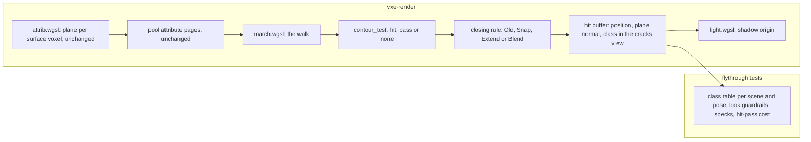

# 0050: A watertight contour surface: a crack spike that names the wedges and triangles, then the closing rule chosen by measurement

> **Status:** approved (2026-10-29)
> **Created:** 2026-10-29
> **Approved:** 2026-10-29 (owner), with the answers under "Owner answers": alone on main
> with the light spike after its Phase 4 check; the contour goldens re-blessed by name; the
> shadow origin in scope as sub-candidate O; the losing rules and `closing old` removed after
> the pick.
> **Milestone:** M2 in [`docs/roadmap.md`](../roadmap.md) (the surface-look decision: "smooth
> and natural rock, not visible cubes")
> **Related ADRs:** [ADR-0011](../adrs/0011-contour-planes-in-attribute-pages-with-procedural-detail.md)
> (the per-voxel plane and its hit rule, which this plan closes the cracks of; its Negative
> consequences name the crude offset and the shadow-ray artifacts). No ADR at draft: see
> Decision.
> **Source:** the owner at Plan 0049's live session 2, 2026-10-29 (`LIGHT-FEEDBACK.md`,
> finding 5; screenshots `wedges`, `step3` and `step5` in
> `.git/lane-archive/plan-0049/session2/`): dark triangular wedges where a ledge meets the wall
> below it, small bright triangles exactly where the facets of the smoothed floor meet, and
> thin dark and light slivers along ledge edges inside the lamp's cone. They do not flicker,
> and they are the same with indirect light off. At Plan 0039's Phase 4 the owner had seen
> "artifacts with sharp corners of voxels on some smooth walls".
> **Starts after:** nothing; it runs on main at f0dd17a, alone. Plan 0049 stays parked at its
> Phase 2 (its worktree at 121737f keeps its uncommitted `live/` files). The light spike the
> architect proposed on 2026-10-29 follows this plan's Phase 4 check (owner, 2026-10-29).

## TL;DR

The contour surface is not watertight. Every surface voxel carries its own plane, and the walk
hits a voxel only where the ray enters that plane's solid half-space inside the voxel's own
cube. Two neighbours' planes do not meet at their shared cube face, so a ray can pass between
them. It then either reaches an interior voxel a voxel deeper, which hits as a dark cube face,
or enters the next surface voxel already inside its half-space and shades with that voxel's
normal, which can face the lamp. Those are the owner's wedges and triangles (read from the
code, not yet measured: Phase 1 measures it). The plan is a short spike that classifies every
primary ray by how it reached its hit and shows the owner the classes as a view, then three
candidate closing rules behind one setting, each measured on analytic scenes and on the two
rig poses, with the cheapest that closes the cracks and holds the look guardrails kept as the
default. Nothing in storage changes: every candidate lives in the walk. The first thing anyone
sees is a `cracks` view in the fly-through that paints each pixel by its class, and a test that
prints the class table at the vein and the patch.

## Context & problem

`project-context.md` (Rendering, P0): first person, stable at arm's length, smooth natural
rock. A dark wedge at every ledge corner and a bright speck at every facet vertex read as a
rendering fault, and they would survive any lighting fix.

**What the tree does today** (ADR-0011; `march.wgsl` `contour_test`, `attrib.wgsl`
`voxel_attr`; read, not measured):

- The attribute pass gives each surface voxel (a solid voxel with an air face neighbour) a
  plane: the normal from the 27-voxel occupancy gradient (weighted, the default since Plan
  0039), the offset `(count / 27 - 0.5) * 3` voxels along the normal from the voxel centre,
  clamped to `[-0.875, 0.875]` and coded in eighths. A solid voxel whose six face neighbours
  are solid, or whose gradient vanishes, has no plane and hits as a cube.
- The walk tests a solid voxel that has a plane against the ray's segment through the voxel's
  cube alone. Signed distance `s_in` at the entry and `s_out` at the exit: `s_in <= 0` is a
  hit at the entry with the plane's normal; `s_in > 0` and `s_out <= 0` is a hit at the
  crossing; `s_out > 0` passes the voxel as air.
- The shadow ray of a plane hit leaves `SHADOW_OFFSET` 0.5 voxel along the plane normal
  (Plan 0013), from a point that lies inside the voxel's cube.

**The three ways a ray reaches a wrong hit**, all after passing at least one surface voxel
outside its half-space (the plan calls them classes; Phase 1 counts them):

- **(i) pass, then an interior voxel.** The next solid cell has no plane (an interior voxel,
  a uniform brick) and hits as a cube face about a voxel below the surface. Its face normal
  points along an axis, its shadow origin sits in the crack, so it is dark. At a concave corner
  the surface voxels have diagonal normals and a high solid fraction, so their offsets push the
  planes toward the air and the half-space can miss the cube entirely: the corner voxel acts as
  air, and the ray sees the voxel behind it. That is the wedge where a ledge meets a wall.
- **(ii) pass, then an entry already inside.** The next surface voxel's `s_in` is already
  negative at its cube face, so the hit is on the shared face with that voxel's normal. The
  ray crossed that plane inside the passed voxel, where the passed voxel's plane said air.
  The normal belongs to a different facet and can face the lamp while the point lies in a
  crevice: the bright triangles at the vertices where three or more facets meet, and the
  slivers along convex edges, whose voxels have a low solid fraction and an inward offset.
- **(iii) pass, then a plane crossing** inside the next voxel. The hit is on a plane, a little
  late. It is a step in the surface, not an artifact on its own.

The shadow ray adds a fourth: a plane hit's origin, 0.5 voxel along its normal, can lie inside
a neighbouring voxel's solid half-space, so the ray reports rock at once. Plan 0013 took the
contour scene's only-with-shadows specks from 372 to 52 with the plane-normal origin and did
not take them to 0. The dark slivers in the lamp's cone may be these.

**The `nfr.md` figures touched:** §2 the primary rays (the hit pass, 3.0 ms line; the level's
spawn reads 1.378 ms contour on the RTX 3080 Laptop and 9.908 ms on the Radeon, Plan 0039),
and nothing in §3: no candidate adds storage.

## Decision

Measure first, then close the cracks in the walk, not in the attribute. Phase 1 builds the
classification and the view, reads the classes on analytic scenes and the two rig poses, and
shows the owner that the classes land where the wedges and triangles are. Phase 2 builds the
three candidates under one `SurfaceTuning` setting and keeps the cheapest that brings classes
(i) and (ii) to zero on the analytic scenes, holds Plan 0039's look guardrails and the speck
bar, and stays within its cost bar on both adapters. The attribute's encoding, size, pages and
pass do not change (Plan 0028's addressing stands), so no golden outside the contour look
moves and no VRAM figure moves.

**No ADR at draft.** The closing rule is a revisitable tradeoff with named alternatives, so
the architect writes the next free ADR as an amendment before Phase 3 lands the pick as the
default, naming the kept rule and the two rejected ones with Phase 2's readings. `docs/adrs/README.md`
has the number.

## Architecture diagram



## Implementation phases

Each phase ships as its own commit. `dev` implements all phases in one session with no review
between phases. The architect reviews once at the end, in a fresh session. Lane rule 9c
applies: exploratory sweeps may run on the RTX 3080 Laptop through `VXE_TEST_ADAPTER` once
Plan 0049's `reading_device` is on main (it is on branch `plan-0049` today; until it merges,
dev may copy the function into `tests/support/mod.rs` and the merge keeps one), labelled with
the adapter; every asserted reading, golden and gate stays on lavapipe.

### Phase 1: The crack spike: classes, the view, and where they land
- **Owner skill:** dev
- **What:** the walk records how each primary ray reached its hit, a `cracks` view paints it,
  and a test prints the class table on analytic scenes and at the rig poses. No hit, shader
  default or look changes.
- **The classification** (`march.wgsl`): the walk counts the surface voxels it passed outside
  their half-space (`contour_test` kind 2) since the last cell it entered through air, and at
  the hit records the class: `0` clean (no pass, or a plane crossing with no pass), `1` class
  (i) (a pass, then a cell with no plane: an interior voxel, a uniform brick, a mip cell), `2`
  class (ii) (a pass, then `s_in <= 0` at the next voxel's entry), `3` class (iii) (a pass,
  then a crossing inside the next voxel). It goes out through the hit pass's layer texture in
  the new view only, as the steps view carries its counters, so the hit record does not change.
- **The shadow self-hit** (`light.wgsl`): in the `cracks` view the light pass writes, per
  lighting pixel, whether the lamp's shadow ray found rock within `SELF_HIT` 1.5 voxels of its
  origin, beside the class. The threshold is three times `SHADOW_OFFSET`: a true occluder that
  close is a neighbouring voxel's own plane.
- **The view:** `ViewMode::Cracks` in the fly-through's view cycle, after `steps`. The
  composite paints class 0 as the shaded image at half brightness, class 1 red, class 2
  yellow, class 3 blue, and a self-hit as a magenta dot. The banner names the view, and the
  HUD prints the four classes' shares of hit pixels and the self-hit share each frame.
- **The scenes** (`tests/look.rs` and `tests/support/rigs.rs`, reusing the look rigs):
  - the cavity (a sphere) and the pillar of Plan 0005, as they are;
  - **a tilted slab:** solid below the plane with normal `normalize(1, 2, 3)` through the
    box's centre, so neighbouring surface voxels see different 27-neighbourhoods and their
    offsets disagree (an axis-aligned 45-degree slab gives every voxel the same neighbourhood
    and no crack, which is why it is not the scene);
  - **a concave corner:** two solid slabs meeting at 90 degrees, seen from inside the corner
    at a pitch of about -30 degrees, the wedge case;
  - the level at `VEIN_POSE` and `PATCH_POSE` (`flythrough::VEIN_POSE`, `PATCH_POSE` on
    branch `plan-0049`; until that branch merges, the poses are copied as constants and the
    merge keeps one).
- **The readings** per scene, lamp on, at the look rigs' size and at 384 x 216 for the level:
  the share of hit pixels in each class; the share of class 1 and 2 pixels whose display luma
  is under 32/255 (dark) or over the 5 x 5 median by more than 48/255 (bright); the self-hit
  share; and for the level poses a 24 x 24-tile map of the class 1 and 2 density beside the
  display image, written as a side-by-side under `live/cracks/`, so the owner can see that the
  wedges and the triangles are where the classes are.
- **Sweeps by scratch patch** (readings only): `PlaneOffset::VolumeMatched` against
  `Fraction`, `PlaneFit::Uniform27` against `Weighted27`, and the offset clamp at 0.5 against
  0.875. The question each answers: does an existing knob remove a class?
- **Files touched:** `crates/vxe-render/src/shaders/march.wgsl` (the count and the class),
  `crates/vxe-render/src/shaders/light.wgsl` (the self-hit in the view),
  `crates/vxe-render/src/shaders/composite.wgsl` (the view), `crates/vxe-render/src/marcher.rs`
  (`ViewMode::Cracks`), `apps/flythrough/src/main.rs` and `apps/flythrough/src/hud.rs` (the
  cycle, the banner, the shares), `apps/flythrough/tests/support/rigs.rs` (the two scenes),
  `apps/flythrough/tests/look.rs` (the readings), this plan's log.
- **Done when:**
  1. `a_tilted_slab_has_cracks_today` asserts on lavapipe that the tilted slab in today's
     contour look has at least one pixel in class 1 or 2 (the reading is printed). If it has
     none, that is the finding and dev stops for the architect: the mechanism named above is
     not the one.
  2. `an_axis_aligned_slab_has_none` asserts that a 45-degree axis-aligned slab reads 0 in
     classes 1 and 2 today. It pins that the classification does not count a clean surface.
  3. `crack_classes` prints the table for every scene and pose above, today's look and each
     sweep, with the dark and bright shares and the self-hit share. The log carries it.
  4. The side-by-sides exist for both poses, and the log says in one line per pose whether the
     class map lands on the owner's wedges and triangles, or where it does not.
  5. The fly-through cycles into the `cracks` view, the banner names it, and the HUD prints
     the shares; the banner test reads the new mode.
  6. The attribution in the log names the class that owns the wedges and the class that owns
     the triangles and slivers, and whether the self-hit owns any dark sliver inside the
     lamp's cone.

### Phase 2: The closing rules, each measured
- **Owner skill:** dev
- **What:** three candidates behind `SurfaceTuning::closing`, old behaviour selectable; keep
  the one the decision rule names.
- **Candidates** (all in `contour_test` and the walk's step; the attribute is read as today):
  - **S, snap.** The walk keeps the last passed voxel's plane and its exit point. When the
    next solid cell would be class 1, the hit is at the passed voxel's exit point with the
    passed plane's normal. When it would be class 2, the hit is at the shared face with the
    normalised mean of the two planes' normals. Class 3 is unchanged. No extra reads; a few
    registers. It removes the depth and the foreign normal and keeps a normal step at the
    crack, which is the faceting the surface has anyway.
  - **E, extend.** The plane is tested against the ray's segment through the cube dilated by
    `e` voxels on every side (swept at 0.25 and 0.5), and a crossing found in the dilation hits
    at the cube's exit point. It closes cracks narrower than `e`; wider ones stay. It can fatten
    a silhouette by up to `e`, which the pillar's silhouette error reads.
  - **B, blend.** Inside a surface voxel the signed distance at a point is the trilinear blend
    over the eight voxel centres around it of each voxel's plane distance there, with an air
    voxel counting `+1` and a solid voxel with no plane `-1` (a cube hit for a voxel whose
    neighbours are all no-plane, as today). The surface is the blend's zero set, continuous
    across cube faces, so it is watertight by construction. The crossing is bracketed by the
    entry and exit values and refined by two secant steps; the normal is the blend of the
    planes' normals at the crossing. Up to eight attribute reads per surface voxel stepped,
    which is the cost reading.
  - **O, the shadow origin,** a sub-candidate for the self-hit: the origin is pushed along the
    normal, in steps of 0.25 voxel up to 1.0, until it leaves every neighbouring plane's
    half-space, read with the kept rule's distance.
- **The decision rule:**
  1. Candidates are read in the order S, E, B. The first that meets all of the following is
     kept:
     - classes 1 and 2 read 0 on the tilted slab, the concave corner and the cavity;
     - at both level poses classes 1 and 2 together read at most 2 % of Phase 1's count (a
       guess at draft, to be replaced by the owner's call in Phase 4 if the eye asks for
       less);
     - Plan 0039's guardrails hold: cavity normal error at most 12 degrees, pillar silhouette
       error at most half of face mode's, axis fraction `A` at most 10 %;
     - the speck test's asserted bar holds, and its reading is at most today's 52;
     - the hit pass at the level's spawn, 1080p, release, exclusive perf lock, is within +5 %
       of the pre-plan binary on the RTX 3080 Laptop and within +10 % on the Radeon, alternated
       in one session, three quiet runs each.
  2. If S or E meets every bar but the two-percent one and B meets it, B is kept and its cost
     reading goes to the owner as a recorded miss only if it misses the cost bar.
  3. O is kept beside the kept rule if the self-hit share falls and the speck reading does
     not rise.
  4. If no candidate meets the bars, dev stops for an architect amendment.
- **Files touched:** `crates/vxe-render/src/shaders/march.wgsl`,
  `crates/vxe-render/src/shaders/light.wgsl` (O), `crates/vxe-render/src/marcher.rs`
  (`CrackClosing`, the flag bits), `apps/flythrough/src/lib.rs` and `main.rs` (`--closing`,
  the banner), `apps/flythrough/tests/look.rs`, this plan's log.
- **Done when:**
  1. The class table of Phase 1 is in the log for every candidate beside today's, with the
     guardrails, the speck reading and the hit-pass cost on both adapters, the pre-plan binary
     in the same session.
  2. The log names the kept rule and the readings that kept it, or the stop.
  3. With `closing old`, every golden and every look test reads byte for byte as before.

### Phase 3: The pick as the default
- **Owner skill:** dev
- **What:** the kept rule becomes the default, the contour goldens that moved are re-blessed
  by name, and the readings go to `nfr.md`. The old rule and the losing candidates stay
  selectable until Phase 4, each named in the banner.
- **Files touched:** `apps/flythrough/src/lib.rs` (the default), `apps/flythrough/tests/golden/*.png`
  (only those that moved), `apps/flythrough/tests/look.rs`, `docs/nfr.md` §2, this plan's log.
- **Done when:**
  1. `the_closing_rule_leaves_no_crack` asserts classes 1 and 2 at 0 on the tilted slab, the
     concave corner and the cavity, and at or under the kept count at both level poses, on
     lavapipe.
  2. Every moved golden is named in the log with its share of pixels over 2/255, and no golden
     outside the contour look moved.
  3. The hit-pass readings on both adapters are in `nfr.md` §2 with machine, commit and load.

### Phase 4: The owner's windowed check
- **Owner skill:** human
- **What:** the owner runs the release fly-through at `--pose vein` and `--pose patch`, lamp
  on and off, in the kept rule and in `closing old`, and in the `cracks` view, looking at the
  ledge corners, the floor's facet vertices and the ledge edges inside the lamp's cone.
- **Files touched:** this plan's log.
- **Done when:** the owner records one of three outcomes: (a) the wedges, triangles and
  slivers are gone and the default stands; (b) another candidate or sweep value looks better,
  and it becomes the default; (c) something remains, named by pose and place.

### Phase 5: The owner's findings, and the losers removed
- **Owner skill:** dev
- **What:** on (b), set the owner's pick as the default and re-read Phase 3's test and
  goldens. On (c) for a class a candidate covers, sweep that candidate and re-read; a remaining
  fault outside the classes stops for an architect amendment. On (a), log "not needed". Then
  the losing candidates and `closing old` are removed with their flags and banner modes, as
  Plan 0048's rule says (owner, 2026-10-28), unless the owner keeps one for comparison.
- **Files touched:** as Phases 2 and 3, this plan's log.
- **Done when:** the log records the outcome, Phase 3's test passes at the default, and no
  losing candidate's flag remains in `--help` or the banner.

## Data shapes

```rust
// illustrative: vxe-render
pub enum CrackClosing { Old, Snap, Extend, Blend }
pub struct SurfaceTuning {
    pub fit: SurfaceFit,          // unchanged
    pub face_mix: f32,            // unchanged
    pub closing: CrackClosing,    // new; reaches march.wgsl through two spare Params flag bits
    pub shadow_push: bool,        // O
}
// `Params` gains no word: the closing rule and O take spare flag bits. The hit record, the
// attribute encoding and the pool layout do not change. The cracks view writes its class and
// self-hit through the layer texture, as the steps view writes its counters.
```

## Budgets

| `nfr.md` figure | Base (read) | Expected | How the close measures it |
|---|---|---|---|
| §2 primary rays, the hit pass (3.0 ms line) | level spawn 1080p contour: RTX 3080 Laptop 1.378 ms, Radeon (RADV) 9.908 ms (Plan 0039) | S: a few registers, **a guess** under 1 %. E: one more plane evaluation per passed voxel, under 2 %. B: up to 8 attribute reads per surface voxel stepped, **a guess** of +5 to +20 % on the Radeon, less on the RTX; this is the reading that decides B | `flythrough --level --seed 1 --headless --render 1920x1080 --frames 300` per rule and the pre-plan binary, alternated, release, exclusive perf lock, memory cap, three quiet runs, both adapters; bar in Phase 2's rule |
| §2 the attribute pass | Plan 0039's | 0: the attribute does not change | the level's initial fill equals the pre-plan reading to its noise |
| §3 mirror bytes | Plan 0028's | 0 | `mirror_bytes` and `allocated_bytes` equal the pre-plan binary's |

Determinism is not touched: everything is in `vxe-render`, a client-side view.

## Risks & open questions

- **The mechanism named here may not be the one.** Phase 1's first done-when is the check:
  a tilted slab must show classes 1 and 2 today. If it does not, dev stops and the architect
  re-reads the hit rule with the class map in hand.
- **S keeps a normal step at every crack.** It is the same faceting the surface shows
  everywhere else, and the owner's Phase 4 eye decides whether it reads as a line.
- **B's cost on the slow adapter.** Eight attribute reads are eight pool words through the
  shard addressing. The cost bar and the alternated reading are there for it; if B is the only
  rule that closes the cracks and misses the bar, the owner decides between the look and the
  cost, and the candidate stays selectable.
- **A watertight surface moves silhouettes a little,** so every contour golden moves. They are
  re-blessed by name under Plan 0047's 1 % rule, and the face goldens must not move at all.
- **Plan 0039's sharpness metric may fall.** `S_fine` counts any fine contrast, cracks
  included. It is read, not barred; the guardrails are the bar.
- **The cracks are not the only surface fault.** The LOD ring is cubic (ADR-0011), the offset
  formula is crude, and the gather's normal bias of 2 voxels (`PROBE_NORMAL_BIAS`) reads the
  probes off the surface. None of these is this plan's.

## What this plan does NOT do

- Change the attribute's encoding, size, pages, pass or fit beyond what Phase 1 sweeps as
  readings. A least-squares plane fit or a per-corner density is a later plan with its own ADR.
- Give the LOD ring's mip cells a plane.
- Touch the lighting: the light spike proposed on 2026-10-29 follows this plan's Phase 4.
- Change the procedural detail or the face mix.

## Owner answers

1. **Order (owner, 2026-10-29).** This plan runs alone on main to its Phase 4 check. The light
   spike the architect proposed the same day starts after that check. Plan 0049 stays parked
   at its Phase 2.
2. **Goldens (owner, 2026-10-29).** A watertight surface may move silhouettes, so the contour
   goldens that move are re-blessed by name with their changed-pixel share in the log. The
   face goldens must not move.
3. **The shadow origin (owner, 2026-10-29).** In scope as sub-candidate O. Phase 1 reads the
   self-hit share; Phase 2 keeps the push if it lowers self-hits without raising the speck
   reading.
4. **The losers (owner, 2026-10-29).** After the Phase 4 pick, the losing rules and
   `closing old` are removed with their flags and banner modes, as Plan 0048's rule says. Their
   readings stay in the log.

## Implementation log

> Written by `dev`: one row per phase as its commit lands, then the close block. **The phases
> above are the contract. This section records what happened.** Observations, never conclusions:
> no pass list, no self-assessment. Deviations and unmet done-whens are **always** disclosed.
> Keep it shorter than `## Implementation phases`.

| phase | owner | state | commit |
|---|---|---|---|
| 1: The crack spike: classes, the view, and where they land | dev | not started | |
| 2: The closing rules, each measured | dev | not started | |
| 3: The pick as the default | dev | not started | |
| 4: The owner's windowed check | human | not started | |
| 5: The owner's findings, and the losers removed | dev | not started | |

### Notes

### Close triggers

- **What shipped:**
- **Public API changed:**
- **Budget readings:**
- **Gate at the tip:**
- **Outstanding `human` phases:**

## Followups
