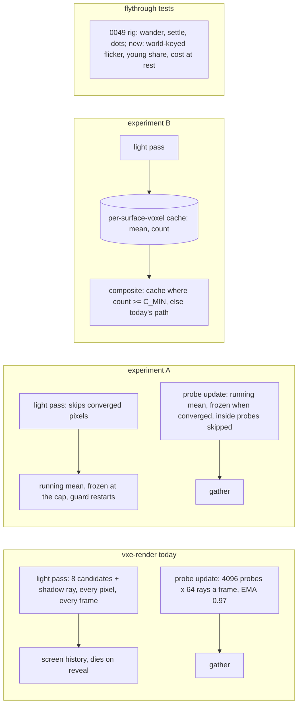

# 0051: The steady-light spike: static light that converges and freezes, and a world-space emissive cache, each read against the wander, the dots and the shimmer

> **Status:** draft
> **Created:** 2026-10-29
> **Milestone:** M2 in [`docs/roadmap.md`](../roadmap.md) (the "one-sample path tracing ...
> temporal accumulation" bullet and the probe volume's indirect light)
> **Related ADRs:** [ADR-0036](../adrs/0036-static-emissive-light-on-a-long-full-precision-history-guarded-by-an-emissive-gradient.md)
> (its Alternative A, the world-space cache, is this spike's second experiment; its Outcome
> names Plan 0049 and "any mechanism beyond this decision or ADR-0023 is a new ADR"),
> [ADR-0023](../adrs/0023-indirect-light-from-a-scrolling-probe-volume.md) (the probe update
> whose blend the first experiment changes), [ADR-0018](../adrs/0018-direct-light-per-pixel-one-sample-from-a-hit-buffer-with-svgf-history-killed-by-edits.md)
> (the estimator, the screen history, the firefly clamp), [ADR-0037](../adrs/0037-probe-rays-direct-light-keeps-its-energy-apart-from-the-screen-firefly-clamp.md)
> (proposed; Plan 0048, which waits for this spike's answer). No ADR at draft: see Decision.
> **Source:** the architect's assessment of 2026-10-29, after Plan 0049's live session 2
> (`LIGHT-FEEDBACK.md`; Plan 0049's Implementation log on branch `plan-0049`, the Phase 1
> readings). The owner: "clearly something is wrong and we need to understand why", and,
> agreeing with the assessment "mostly", a lean toward "simplification of lights, but
> steadiness".
> **Starts after:** [Plan 0050](0050-watertight-contour-surface-crack-spike-and-closing-rule.md)'s
> Phase 4 check (owner, 2026-10-29). It runs alone. Plan 0049 stays parked at its Phase 2;
> its rig (`apps/flythrough/tests/support/settle.rs` on branch `plan-0049` at 121737f) is
> this spike's instrument, merged or copied as Phase 1 says. Plans 0048 and 0032 wait for
> Phase 3's call.

## TL;DR

The flicker is structural. Everything on screen except the headlamp is static light, and the
renderer re-estimates it with fresh random numbers every frame, then stores the estimate where
it cannot hold still: in screen pixels, which lose it on every turn, and in probes blended by
an exponential average, which never converges. "Still at rest" and "fast after a change" are
the two ends of one knob, the history length, and every plan since 0024 turned that knob.
This spike tests the way out in two steps, simplest first, each a scratch build read with Plan
0049's rig and shown to the owner in the window. **Experiment A, converge and freeze:** the
probes and the emissive screen history become running means that converge and then stop
updating until something changes, inside-rock probes stop tracing, and the light pass stops
drawing emissive samples for converged pixels. **Experiment B, a world-space cache:** the
emissive direct irradiance accumulates per surface voxel, keyed like the contour attribute, so
a turn or a flight reads values that already converged. The readings are the still-camera
wander, the settle after a toggle and a dig, the dots after a fast yaw, a world-keyed flicker
along a flight, the young-cell share in motion, and the frame's cost at rest on both adapters.
Each experiment also lists what it lets us delete. Phase 3 is the owner's call in the window,
and the ADR and the real plan follow it. Nothing changes by default. The first thing anyone
sees is a table: today, A and B side by side, wander and cost at rest at the vein.

## Context & problem

`project-context.md` (Rendering, P0): dark scenes, emissive voxels as the light, stable at
arm's length. The owner's words at Plan 0049's session 2: nothing may change while nothing
moves; no bright dots in motion; the light settles quickly after a change; the cost matches
what is on screen.

**What the readings say** (Plan 0049 Phase 1, RTX 3080 Laptop and lavapipe, 192 x 108, the
level at `VEIN_POSE` and `PATCH_POSE`, exposure pinned):

- At a still camera the light never settles. The probe gather wanders 0.10 to 0.17 log2 std
  over frames 1025 to 8192 and owns 0.65 to 0.90 of the composite's view-mean variance at the
  vein. The emissive part wanders 0.038 to 0.053 at every setting. Hysteresis 0.99 halves the
  gather's wander and lagged about 30 s on a toggle in Plan 0047.
- A dig leaves up to about 6400 excess dots over 60 frames, in pixels 1 to 63 frames old,
  in the emissive part and the a-trous output, with indirect on or off alike.
- The rig's fast yaw showed no excess at the two poses, while the owner sees dots on every
  camera move. The owner's eye is the judge this spike must satisfy.
- Exposure follows the light: with it fixed the flicker stayed (session 2, step 10).

**Why the design cannot meet the owner's four demands at once** (read from `temporal.wgsl`,
`probe_update.wgsl`, `light.wgsl`, `probes.rs`):

- The emissive sample is a rare-event estimator: most of its 8 candidates lie behind rock, and
  the kept one returns zero or up to the firefly clamp. One sample is a dot. The screen history
  that averages it dies wherever the camera reveals a surface, so every turn restarts from one
  sample, and `1 / (age + 1)` takes seconds to quiet it.
- The probe blend `h old + (1 - h) new` at `h` 0.97 keeps `(1 - h) / (1 + h)`, about 1.5 %,
  of one visit's variance forever, so a probe boils by about 12 % of a visit's std with no
  end. A running mean over `n` visits keeps `1 / n`: it matches 0.97's steady noise at `n` 66
  and then keeps falling.
- The update list (`probes::update_list`) carries every slot of the frame's slice, inside
  rock or not, and `probe_trace` traces 64 rays for each; a probe known to be inside solid
  re-traces every 8 frames forever. Nothing stops a converged probe or a converged pixel from
  re-sampling. The frame's cost at rest is the cost of re-doing last frame's work.
- The random numbers (`rand`) mix `params.frame`, so a still frame is a new frame to every
  estimator.

**The `nfr.md` figures touched:** §2 the probe volume's two passes (1.7 ms line; 1.567 ms
outside a window on the RTX, Plan 0029), the lighting line (6.0 ms) and the denoise line
(3.0 ms); §3 the frame's bytes, for B's cache. Readings only: no default moves.

## Decision

Two experiments, read in order, nothing kept by default. **A** changes the blend rules and
the update lists inside ADR-0018's and ADR-0023's design: probes and emissive pixels converge
as running means and then freeze until a restart; inside probes and converged work are
skipped. **B** adds a per-surface-voxel cache of the emissive direct irradiance, read where it
has converged and falling back to today's path where it has not, with no invalidation (digs
are out of its runs). Phase 3 shows the owner today, A, B and B with the probes off, and the
owner's verdict decides the ADR.

We rejected finishing Plan 0049's candidate list (R, P, L, G, Y1 to Y5) as the next step
because each is another position of the same knob. We rejected a heavier denoiser (ReBLUR or
ReLAX) because it treats the symptoms of the same storage choice. We rejected freezing the
random sequence at rest because it stills the image and changes nothing in motion.

**No ADR at draft.** The spike decides between directions. The architect writes the next free
ADR after Phase 3 (`docs/adrs/README.md` has the number), naming the kept direction, what it
deletes, and the rejected ones with this spike's readings; the plan that builds it follows.

## Architecture diagram



## Implementation phases

Each phase ships as its own commit. `dev` implements all phases in one session with no review
between phases. The architect reviews once at the end, in a fresh session. Lane rule 9c
applies: exploratory runs on the RTX 3080 Laptop through `VXE_TEST_ADAPTER=rtx`, labelled;
every asserted reading on lavapipe. Plan 0049's rig and `reading_device` come from branch
`plan-0049` at 121737f: dev cherry-picks or copies `tests/support/settle.rs`,
`tests/support/stillness.rs`'s public helpers, `reading_device` and `--pose`, and the log
names which. That worktree's uncommitted `live/` files are not touched.

### Phase 1: Experiment A, converge and freeze
- **Owner skill:** dev
- **What:** four changes behind `Lighting` settings, old behaviour the default, and their
  readings.
- **The changes:**
  - **A1, probes as a running mean that freezes.** A probe's `n`-th visit since its restart
    blends at `h = n / (n + 1)` until `n` reaches `PROBE_FREEZE` 64 visits, after which the
    probe is converged and `probe_trace` and `probe_blend` return at once for it, until a
    restart: a light window, an edit touching it, or a scroll bringing a new probe into the
    slot (each restarts `n` at 0, as the age does today). The window keeps its first visit at
    0. The age bits count to 127, enough. 64 is where the running mean's noise equals 0.97's
    steady noise (`1 / 64` against `0.03 / 1.97`); a sweep reads 32 and 128.
  - **A2, inside probes skipped.** A probe whose state word says inside rock, with age above
    0 and no touch or window, returns at once from both entry points. The list is unchanged;
    the workgroup exits.
  - **A3, the emissive history uncapped.** `emissive_history` at `AGE_MAX` 2047, so the
    emissive blend is `1 / (age + 1)` until the cap. The guard (ADR-0036) and the edit boxes
    restart it as today.
  - **A4, converged pixels skip the draw.** The light pass draws no emissive candidates and
    casts no emissive shadow ray for a pixel whose history age is at `AGE_MAX` with a valid
    reservoir; it stores the reservoir and the history's value as the sample. The gradient
    pass keeps re-shading one pixel per stratum, so a change still registers and the guard
    lowers the age below the cap, which resumes the draw.
- **The readings,** with the 0049 rig at both poses, lamp on and off, indirect on and off,
  `Manual(pose.exposure)`, today and A (A1 to A4 together, then each alone):
  - the wander table (run vi: frames 1025 to 8192 after a settled start) per part;
  - the toggle and the dig settle (`S90` of the composite and the gather, the curve every 8
    frames), and for A the frames until the probes in view have frozen;
  - the share of probes inside rock, and the share frozen, per frame over 1024 frames at rest;
  - **cost at rest:** per-pass GPU time at the level's spawn and at `VEIN_POSE`, 1080p,
    release, frames 1024 to 1324 after a still start, both adapters, today and A, alternated,
    three quiet runs, exclusive perf lock, memory cap.
- **The new metric, built here for Phase 2 as well:** the **world-keyed flicker** of a run.
  For each frame, each lighting pixel's display luma is keyed by its hit voxel (the integer
  voxel of `rec.p - 0.5 n`) and its entry face; a voxel seen in two consecutive frames
  contributes `|log2 mean_f - log2 mean_f-1|` of its pixels' mean luma, under the rig's log2
  floor. The run's flicker `K` is the mean over frames 64 to 359 and voxels, and its p95. It
  needs no warp and does not depend on the camera's motion; the lamp's own motion sets its
  floor, read with the lamp off. Runs: the fast yaw (iv) and a **flight** (v-a): a straight
  path along the passage at `fly.rs`'s speed for 360 frames, ending near `VEIN_POSE` and one
  near `PATCH_POSE`, which dev picks and records as constants, from a start settled 1024 frames.
- **Files touched:** `crates/vxe-render/src/shaders/probe_update.wgsl`,
  `crates/vxe-render/src/shaders/light.wgsl`, `crates/vxe-render/src/shaders/temporal.wgsl`,
  `crates/vxe-render/src/marcher.rs` and `lib.rs` (the settings), `crates/vxe-render/src/probes.rs`,
  `apps/flythrough/src/main.rs` and `hud.rs` (flags, banner), `apps/flythrough/tests/support/settle.rs`
  (the flicker metric, the flight), `apps/flythrough/tests/settle.rs`, this plan's log.
- **Done when:**
  1. `a_frozen_probe_is_not_traced` asserts on lavapipe that after `PROBE_FREEZE` visits with
     no restart, a probe's irradiance texels are bit-identical across the next 64 encoded
     frames, and that a lamp toggle restarts it (its texels change on the first visit after).
  2. `an_inside_probe_is_not_traced` asserts that a probe inside rock keeps its texels and
     state bit-identical over 64 frames with A2 on.
  3. `a_converged_pixel_keeps_its_sample` asserts that with A3 and A4 on, a still pixel at
     `AGE_MAX` writes the same emissive value for 64 frames, and that a `Replace` of an
     emitter in its reservoir's kept point lowers its age within 9 frames (the guard's strata
     cadence) and resumes the draw.
  4. The wander table for today and A is in the log, both poses, all four settings. The
     prediction to read against: with A the gather's `sigma_view` falls below the
     indirect-off composite's at every row, and the composite's with indirect off falls below
     today's by at least half. A miss is a reading.
  5. The settle table and the frozen-share curve are in the log. The prediction: after the
     toggle the gather's mean is within 10 % of its reference by the end of the window plus 8
     visits (80 frames), while its noise keeps falling to frame 512.
  6. The cost-at-rest table is in the log, both adapters. The prediction: with A the probe
     passes read under 0.2 ms and the light pass under 0.6 ms on the RTX at rest, against
     about 1.6 and 1.9 ms today.
  7. `K` for today and A at the yaw and the flight, lamp on and off, both poses, is in the
     log beside the yaw's excess dots.
  8. With every A setting off, one golden is bit-identical to main's.
  9. The log's "What A deletes" names the constants and mechanisms A makes redundant if kept:
     `YOUNG_UPDATES`, `YOUNG_HYSTERESIS`, `HYSTERESIS`'s value debate, Plan 0049's R and P,
     and the emissive history cap.

### Phase 2: Experiment B, the world-space emissive cache
- **Owner skill:** dev
- **What:** a throwaway cache of the emissive direct irradiance per surface voxel, behind
  `Lighting::emissive_cache` (off by default; nothing is allocated when off), and its readings.
- **The cache:**
  - **Key.** The surface voxel's index as the contour attribute has it: the brick slot's
    attribute offset plus the popcount index (`contour_attr`'s `k`). The cache is a storage
    buffer parallel to the attribute area, one entry per surface voxel of every brick with
    attributes, `max_storage_buffers_per_shader_stage` raised by one in `limits_for`. For the
    spike it is sized for the whole level's surface voxels (dev prints the count and the
    bytes; the arithmetic at draft is 20 to 30 million voxels and 160 to 240 MB at 8 B, dev
    box only). The shipping size, the light radius's share, is the ADR's question.
  - **Entry.** Three fixed-point sums of the absolute (not pre-exposed) emissive irradiance,
    `u32` each, and a count `u32`, 16 B; or rgb in 16.16 plus a count in one `u32`, 8 B, if
    the range allows. Dev computes the count cap at which the sum of samples at the clamp's
    maximum (`FIREFLY_CLAMP PI lum(Le)` of the brightest material) still fits, and the cell
    stops adding at that cap. Atomics: `atomicAdd` on the sums and the count.
  - **Write.** The light pass adds each lighting pixel's emissive sample (today's estimate,
    clamp included) to its hit voxel's cell, divided by `exposure_now()`.
  - **Read.** The composite (or the temporal pass, dev's call, logged) takes the cell's mean
    times `exposure_now()` as the emissive part where `count >= C_MIN` (16; swept 8 and 32),
    and today's screen-history value below it. The lamp's part, the a-trous and the gather are
    unchanged. The probe rays keep today's estimator (B2 below is optional).
  - **No invalidation.** Edits are not supported: the dig run is skipped for B and the log
    says so. The cache is cleared on a lamp toggle? No: the lamp is not in it, so a toggle
    leaves it alone, and the rig reads that the emissive part does not move at a toggle.
  - **B2, optional, if Phase 2 is under two days:** the probe rays read the cell's mean at
    their hits where `count >= C_MIN` instead of drawing candidates. Its reading is the
    gather's wander and the probe update's cost.
- **The readings,** today, A, and B (and A plus B), both poses, lamp on and off,
  `Manual(pose.exposure)`:
  - the wander table (run vi) and the composite's `S90` at the toggle;
  - the fast yaw's excess dots (frames 1 to 60) and the **young share:** the share of hit
    pixels per frame whose cell has `count < C_MIN`, over frames 1 to 60 after the yaw and
    over the flight;
  - `K` at the yaw and the flight;
  - the cache's bytes and the surface-voxel count; the light and composite pass times at rest
    and in the flight, both adapters.
- **Files touched:** `crates/vxe-render/src/shaders/light.wgsl`,
  `crates/vxe-render/src/shaders/composite.wgsl` or `temporal.wgsl`,
  `crates/vxe-render/src/shaders/probe_update.wgsl` (B2), `crates/vxe-render/src/marcher.rs`,
  `crates/vxe-render/src/lib.rs` (`limits_for`), `crates/vxe-render/src/gpu_world.rs` (the
  surface-voxel count), `apps/flythrough/src/main.rs` and `hud.rs`,
  `apps/flythrough/tests/settle.rs`, this plan's log.
- **Done when:**
  1. `a_converged_cell_does_not_move` asserts on lavapipe that at a still camera, once every
     cell in view has `count >= C_MIN`, the composite's emissive part is bit-identical frame to
     frame with the lamp off and the probes off.
  2. `a_turn_reads_converged_cells` asserts that after 1024 still frames at `VEIN_POSE`, a
     90-degree yaw over 10 frames back and forth leaves the excess dots at frames 1 to 60 at
     most 10 % of today's reading at the same run, or at most the floor's spread where today
     reads none, and prints the young share per frame.
  3. The wander, settle, dots, young-share and `K` tables for today, A, B and A plus B are in
     the log. The prediction: with B the emissive part's `sigma_view` reads 0 where the cells
     have converged, and `K` with the lamp off in the flight falls to the young share's
     contribution alone.
  4. The cache's bytes and the surface-voxel count are in the log with the light-radius share
     (the count of surface voxels in the chunks within `light_radius` of `VEIN_POSE`).
  5. The pass costs at rest and in the flight are in the log, both adapters.
  6. With `emissive_cache` off, one golden is bit-identical to main's; `frame_bytes` is
     unchanged.
  7. The log's "What B deletes" names what the cache makes redundant if kept: the emissive
     screen history and its f32 store, the emissive guard's screen-space form (its
     world-space form replaces it), reservoir reuse for the emissive part, the a-trous for
     the emissive part, Plan 0048's clamp question in its present form, and Plan 0049's G
     and Y1 to Y4.

### Phase 3: The owner's call in the window
- **Owner skill:** human
- **What:** the owner runs the release fly-through at `--pose vein` and `--pose patch`, auto
  exposure, four builds or flag sets: today, A, B, and B with `--indirect off` (the simplest
  light: the lamp exact, the emissive from the cache, no probes). In each: a still minute, the
  lamp toggle both ways, a fast turn by hand, a flight down the passage and back, and for
  today and A only, a dig. Beside the window, the rig's filmstrips and tables. The owner also
  states whether exposure's own settle should change (ADR-0033's constants; another plan).
- **Files touched:** this plan's log.
- **Done when:** the log records the owner's verdict: which of A, B, both or neither is the
  direction; whether the probes stay, shrink to a lamp-bounce channel, or go; which of the
  "deletes" lists the ADR should carry; and what remained visible, by run and pose. The
  architect writes the ADR and the plan from it. This plan closes with that record, as Plan
  0005 did.

## Data shapes

```rust
// illustrative: vxe-render
pub struct Lighting {
    // ... today's fields ...
    pub probe_freeze: Option<u32>,   // A1: visits to converge, None = today's schedule
    pub skip_inside_probes: bool,    // A2
    pub skip_converged_draw: bool,   // A4 (A3 is emissive_history = AGE_MAX)
    pub emissive_cache: Option<u32>, // B: Some(C_MIN), None = off, nothing allocated
}
// B's cell, 16 B: sums r, g, b as fixed point u32, count u32; or 8 B if the range allows.
// Indexed as the contour attribute: brick attribute offset + popcount index.
```

## Budgets

| `nfr.md` figure | Base (read) | Expected | How the close measures it |
|---|---|---|---|
| §2 probe update and gather (1.7 ms line) | RTX 1.567 ms outside a window (Plan 0029); Radeon about 8 ms | A: **a prediction** under 0.2 ms at rest on the RTX once the volume has converged, near today's during a window; in flight, the new probes only | `flythrough --level --headless --render 1920x1080`, frames 1024 to 1324 still at the spawn and at `VEIN_POSE`, and the flight, both adapters, today and A alternated, three quiet runs |
| §2 lighting (6.0 ms): light + gradient + temporal | RTX light 1.89 ms at rest (session 2 HUD) | A4: **a prediction** under 0.6 ms at rest (the lamp's ray and the gradient's re-shade remain). B: one atomic add per lighting pixel, **a guess** under 0.1 ms on the RTX | the same runs |
| §2 denoise (3.0 ms) | RTX a-trous 0.89 ms | unchanged in this spike | the same runs |
| §3 `Frame::frame_bytes` | Plan 0047's close reading | A: 0. B: the cache, 160 to 240 MB for the whole level on the dev box, **arithmetic**; the light-radius share is read | `frame_bytes` and the printed cache bytes |

Determinism is not touched: everything is in `vxe-render`.

## Risks & open questions

- **A's running mean is noisiest right after a restart.** For the first visits after a toggle
  it is as noisy as today's young phase, and the window's single estimates stay. The settle
  reading and the filmstrip show it; a floor on the blend for the first visits is a sweep if
  the owner sees it.
- **A4 can hold a stale value** where the guard's one re-shade per stratum misses a change
  that the kept point does not see. That is ADR-0036's known bound, now without the 256-frame
  cap behind it. The `Replace` test above is the check; the window and the edit boxes still
  restart.
- **B without invalidation is not a renderer.** It answers one question: does a converged
  world-space value remove the dots and the shimmer? The dig is out of its runs, and the ADR
  owns invalidation (edit boxes plus a world-space guard that re-verifies a stored kept point
  per cell).
- **B's young share in flight may be high** in a cave of walls never seen. The reading says
  how much pre-warming (probe rays writing the cache, a background fill around the camera)
  the real design needs.
- **Atomic contention.** About ten lighting pixels per voxel at half resolution hit the same
  cell; the pass cost reading covers it.
- **B stores the clamped estimator's mean,** so ADR-0037's bias question changes shape but
  does not vanish.
- **Two scratch builds and a rig on lavapipe are slow.** The asserted tests read at 192 x 108;
  the sweeps run on the RTX under rule 9c.

## What this plan does NOT do

- Change any default. Every setting is off unless the flag says otherwise.
- Build invalidation for the cache, the light-radius sizing, pre-warming, or a lamp-bounce
  channel for the probes. Each belongs to the ADR and the plan after Phase 3.
- Touch the eye adaptation's constants (ADR-0033), the upscaler, or the contour surface
  (Plan 0050).
- Decide Plan 0048 or Plan 0032. Both wait for Phase 3.

## Owner answers

_(Recorded before "go". The order is set: after Plan 0050's Phase 4 check, alone.)_

## Implementation log

> Written by `dev`: one row per phase as its commit lands, then the close block. **The phases
> above are the contract. This section records what happened.** Observations, never conclusions:
> no pass list, no self-assessment. Deviations and unmet done-whens are **always** disclosed.
> Keep it shorter than `## Implementation phases`.

| phase | owner | state | commit |
|---|---|---|---|
| 1: Experiment A, converge and freeze | dev | not started | |
| 2: Experiment B, the world-space emissive cache | dev | not started | |
| 3: The owner's call in the window | human | not started | |

### Notes

### Close triggers

- **What shipped:**
- **Public API changed:**
- **Budget readings:**
- **Gate at the tip:**
- **Outstanding `human` phases:**

## Followups
