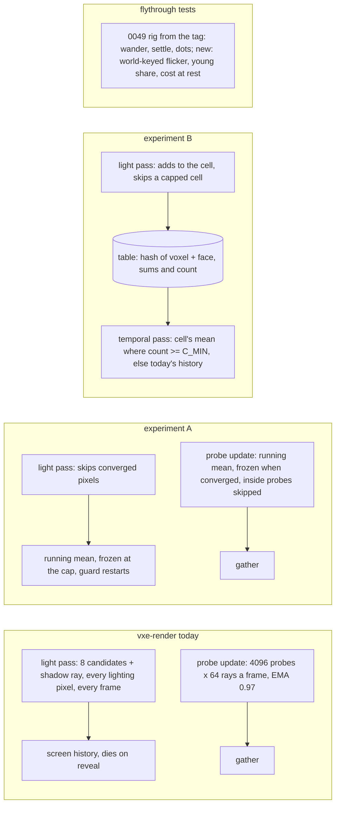

# 0051: The steady-light spike: static light that converges and freezes, and a world-space emissive cache, each read against the wander, the dots and the shimmer

> **Status:** approved (2026-10-29), amended 2026-11-03
> **Created:** 2026-10-29
> **Amended 2026-11-03 (owner):** "amend". The plan as drafted could not start: its cache keyed
> on `contour_attr`'s popcount index, which Plans 0053 and 0054 removed (v0.39.0), and its rig
> sat on branch `plan-0049`, dropped the same day. What changed:
> 1. **The cache keys on the cube face:** a hash of the hit voxel and its entry face in a table
>    of fixed size. Nothing joins the mirror, and streaming cannot invalidate a key.
> 2. **A new Phase 1 takes the rig onto main and reads today on the default look.** The old
>    Phases 1 to 3 become 2 to 4. The rig never set a look, so Plan 0049's readings are of face
>    normals with no detail (see Context); the fly-through's default adds rock detail.
> 3. **Three drafting faults fixed against the tree.** A frozen probe would keep the lamp's old
>    bounce in flight (A1's lamp rule). The cost-at-rest window ended before a pixel can reach
>    `AGE_MAX` (it now runs past frame 2047). B's "bit-identical" done-when read at `C_MIN`
>    while cells still add (it now reads at the cap, unjittered).
> 4. **B gains its own skip and a smooth read.** A pixel on a capped cell draws nothing, in
>    motion as well as at rest. One value a face is a new look on cubes, so the eye compares
>    nearest and a coplanar bilinear read in Phase 4.
> 5. **Budgets, gates and test times** follow `docs/nfr/02-frame-budget.md`'s ledger and the `gate` tier.
> **Amended 2026-11-03, evening (owner: "agreed"):** the baseline's window checks and the
> headless strips that followed them (`renders/baseline-2026-11-03/HANDOFF.md`,
> `renders/strips/NOTES.md`, local) changed what this spike must read. What changed:
> 1. **It starts after Plan 0055**, the clarity pass (no procedural detail, FSR 2 at 1.5 the
>    default, a far normal if the owner keeps it); Phase 1 reads on that default look and the
>    rig takes it.
> 2. **The lamp-off settle is the probe volume.** Under a fixed exposure at the level's patch
>    pose the mean luma settles over 1.5 to 2 s with a non-monotonic wander with indirect on,
>    and in one frame with it off; the emissive screen history plays no part, and the eye is
>    refuted (the showcase runs at a manual exposure and flickered). The toggle readings are
>    probe readings; B is not read on the toggle.
> 3. **A third arm, C: the headlamp does not feed the probes** (Phase 2). The probe rays shade
>    their hits without the lamp, so a lamp switch, move or turn leaves the probes untouched by
>    construction, and the lamp's bounce is lost. It is the owner's parked idea of 2026-10-22
>    (bounce only for certain sources), the simplest steady answer, and it makes A1's lamp
>    rule moot where it is on.
> 4. **B gains an edit-box reset, and the dig joins its runs** (Phase 3): the cells of the
>    voxels in a dilated edit box are cleared when the box lands, so the dig's dots and settle
>    are read under B; invalidation proper stays the ADR's.
> 5. **The rig must reproduce the owner's dots** before a pass means anything (Phase 1): a
>    faster yaw and a flight join the runs, and if none shows them the log says so and Phase 4
>    reads them by eye.
> 6. The far-wall blotches of the showcase are converged direct light, a look item the owner
>    keeps open outside this plan.
> **Approved:** 2026-10-29 (owner): "we will start as soon as 50 is done". The lane runs alone.
> The amendment keeps the plan's question and its two experiments; dev starts it on the owner's
> "go" as usual.
> **Milestone:** M2 in [`docs/roadmap.md`](../roadmap.md) (the "one-sample path tracing ...
> temporal accumulation" bullet and the probe volume's indirect light)
> **Related ADRs:** [ADR-0036](../adrs/0036-static-emissive-light-on-a-long-full-precision-history-guarded-by-an-emissive-gradient.md)
> (its Alternative A, the world-space cache, is this spike's second experiment; its Outcome
> names Plan 0049, dropped, and "any mechanism beyond this decision or ADR-0023 is a new ADR",
> which is this spike's),
> [ADR-0023](../adrs/0023-indirect-light-from-a-scrolling-probe-volume.md) (the probe update
> whose blend the first experiment changes), [ADR-0018](../adrs/0018-direct-light-per-pixel-one-sample-from-a-hit-buffer-with-svgf-history-killed-by-edits.md)
> (the estimator, the screen history, the firefly clamp), [ADR-0037](../adrs/0037-probe-rays-direct-light-keeps-its-energy-apart-from-the-screen-firefly-clamp.md)
> (proposed; Plan 0048, which waits for this spike's answer),
> [ADR-0041](../adrs/0041-the-surface-is-the-trilinear-zero-set-of-the-27-count-field.md) (honest
> cubes the default, the attribute gone). No ADR at draft: see Decision.
> **Source:** the architect's assessment of 2026-10-29, after Plan 0049's live session 2
> ([`LIGHT-FEEDBACK.md`](../../LIGHT-FEEDBACK.md); the Phase 1 readings in
> [Plan 0049](done/0049-light-settles-fast-and-young-pixels-hold-no-dots.md)'s Implementation
> log). The owner: "clearly something is wrong and we need to understand why", and, agreeing with
> the assessment "mostly", a lean toward "simplification of lights, but steadiness".
> **Starts after:** [Plan 0055](done/0055-clarity-pass-no-detail-fsr2-default-and-a-far-normal-spike.md)
> closes (amended 2026-11-03, evening). It runs alone on main. The next
> light plans wait for Phase 4's call: the plan the ADR names, if any, then
> [Plan 0048](0048-probe-rays-direct-light-without-the-clamp-bias.md), then
> [Plan 0032](0032-sun-and-sky-hillaire-atmosphere-time-of-day-and-an-outdoor-testbed.md).

## TL;DR

The flicker is structural. Everything on screen except the headlamp is static light, and the
renderer re-estimates it with fresh random numbers every frame, then stores the estimate where
it cannot hold still: in screen pixels, which lose it on every turn, and in probes blended by
an exponential average, which never converges. "Still at rest" and "fast after a change" are
the two ends of one knob, the history length, and every plan since 0024 turned that knob.
This spike tests the way out in two steps, simplest first, each a scratch build read with Plan
0049's rig and shown to the owner in the window. **Experiment A, converge and freeze:** the
probes and the emissive screen history become running means that converge and then stop
updating until something changes, inside-rock probes stop tracing, and the light pass stops
drawing emissive samples for converged pixels. **Experiment B, a world-space cache:** the
emissive direct irradiance accumulates per cube face, in a hash table keyed by voxel and face,
so a turn or a flight reads values that already converged and a capped face costs no samples.
Cubes make B simple: the face is the cell, so nothing is added to the mirror. The readings are
the still-camera wander, the settle after a toggle and a dig, the dots after a fast yaw, a
world-keyed flicker along a flight, the young-cell share in motion, and the frame's cost at
rest and in flight on both adapters. Each experiment lists what it lets us delete. Phase 4 is
the owner's call in the window, and the ADR and the real plan follow it. Nothing changes by
default. The first thing anyone sees is a table: today on the default look, then A and B beside
it, wander and cost at rest at the vein.

## Context & problem

`project-context.md` (Rendering, P0): dark scenes, emissive voxels as the light, stable at
arm's length. The owner's words at Plan 0049's session 2: nothing may change while nothing
moves; no bright dots in motion; the light settles quickly after a change; the cost matches
what is on screen.

**What the readings say** (Plan 0049 Phase 1, RTX 3080 Laptop and lavapipe, 192 x 108, the
level at `VEIN_POSE` and `PATCH_POSE`, exposure pinned):

- At a still camera the light never settles. The probe gather wanders 0.10 to 0.17 log2 std
  over frames 1025 to 8192 and owns 0.65 to 0.90 of the composite's view-mean variance at the
  vein. The emissive part wanders 0.038 to 0.053 at every setting. Hysteresis 0.99 halves the
  gather's wander and lagged about 30 s on a toggle in Plan 0047.
- A dig leaves up to about 6400 excess dots over 60 frames, in pixels 1 to 63 frames old,
  in the emissive part and the a-trous output, with indirect on or off alike.
- The rig's fast yaw showed no excess at the two poses, while the owner sees dots on every
  camera move. The owner's eye is the judge this spike must satisfy.
- Exposure follows the light: with it fixed the flicker stayed (session 2, step 10).

**Which look those readings are of.** The rig (`make_frame` at tag `archive/plan-0049`) calls no
`set_look`, and `LookParams::default()` was and is `NormalMode::Face` with `detail: false`, over
`with_emissive_ore(&cave_materials())`, which carries no rock detail. So the wander, settle and
dot tables are already honest cubes, without the detail; the owner's window in session 2 was the
contour look. The surface's own faults that session (wedges, triangles, slivers) are gone with
the planes. The structural argument below does not depend on the look. Today's fly-through
default is `LookPreset::DEFAULT` (`face`) with detail on and `ROCK_DETAIL` on rock, which tilts
the normal the light pass shades with (`lighting_normal`), so Phase 1 re-reads today on it.

**Why the design cannot meet the owner's four demands at once** (read from `temporal.wgsl`,
`probe_update.wgsl`, `light.wgsl`, `probes.rs`):

- The emissive sample is a rare-event estimator: most of its 8 candidates lie behind rock, and
  the kept one returns zero or up to the firefly clamp. One sample is a dot. The screen history
  that averages it dies wherever the camera reveals a surface, so every turn restarts from one
  sample, and `1 / (age + 1)` takes seconds to quiet it.
- The probe blend `h old + (1 - h) new` at `h` 0.97 keeps `(1 - h) / (1 + h)`, about 1.5 %,
  of one visit's variance forever, so a probe boils by about 12 % of a visit's std with no
  end. A running mean over `n` visits keeps `1 / n`: it matches 0.97's steady noise at `n` 66
  and then keeps falling.
- The update list (`probes::update_list`) carries every slot of the frame's slice, inside
  rock or not, and `probe_trace` traces 64 rays for each; a probe known to be inside solid
  re-traces every 8 frames forever. Nothing stops a converged probe or a converged pixel from
  re-sampling. The frame's cost at rest is the cost of re-doing last frame's work.
- The random numbers (`rand`) mix `params.frame`, so a still frame is a new frame to every
  estimator.

**What cubes change.**

- **The key is exact and free.** The hit buffer holds the entry face's axis (`hit_info` flags,
  bits 3..5) and an exact axis normal, so a hit's cell is `floor(rec.p - 0.5 rec.nf)` plus its
  face. ADR-0036 rejected this cache partly because "it needs a cell size that agrees with the
  contour surfaces"; on cubes the objection is gone.
- **The hit buffer needs no mirror partner.** The old key indexed a parallel area beside the
  brick slots. A world-coordinate hash has no slots to follow, which keeps ADR-0041's mirror
  saving (the level 62 846 720 B against 157 872 640 B).
- **The world-keyed flicker metric needs no warp**, and voxel and face are the same key as the
  cache's, so the metric reads what the cache stores.
- **A new visual cost.** One value a face is a step at every voxel edge. At arm's length a face
  is about 54 lighting pixels (see Phase 3), so the step can show. Rock's per-pixel detail also
  drops out of the emissive part when it comes from a face's mean. Phase 4's eye judges both,
  which is why B has two read modes.

**The `nfr.md` figures touched:** §2's lighting line (6.0 ms) with its probes and light passes,
§2's denoise line (3.0 ms), and §3 the frame's bytes, for B's table. Readings only: no default
moves.

## Decision

Two experiments, read in order after a re-read of today, nothing kept by default. **A** changes
the blend rules and the update lists inside ADR-0018's and ADR-0023's design: probes and
emissive pixels converge as running means and then freeze until a restart; inside probes and
converged work are skipped. **B** adds a table of the emissive direct irradiance per cube face,
read where it has converged and falling back to today's path where it has not, with no
invalidation (digs are out of its runs). Phase 4 shows the owner today, A, A plus B and B with
the probes off, and the owner's verdict decides the ADR.

**The key: hash of voxel and face, fixed table, no eviction.** The spike needs a key that works
on cubes and reads a young share, and is thrown away after the ADR. We rejected restoring a
per-brick surface index for it (`layer_prefix` exists only for the field's band bricks): it
would put back the mirror term ADR-0041 just removed and tie the cache to slots that streaming
moves. We rejected per-voxel cells on the attribute's old scale because one voxel's faces see
different light. The shipping form (table size, eviction, the light radius's share) is the ADR's
question, with this spike's occupancy as its input.

We rejected finishing Plan 0049's candidate list (R, P, L, G, Y1 to Y5) as the next step
because each is another position of the same knob; Plan 0049 is dropped. We rejected a heavier
denoiser (ReBLUR or ReLAX) because it treats the symptoms of the same storage choice. We
rejected freezing the random sequence at rest because it stills the image and changes nothing
in motion.

**No ADR at draft.** The spike decides between directions. The architect writes the next free
ADR after Phase 4 (`docs/adrs/README.md` has the number), naming the kept direction, what it
deletes, and the rejected ones with this spike's readings; the plan that builds it follows.

## Architecture diagram



## Implementation phases

Each phase ships as its own commit. `dev` implements all dev phases in one session with no
review between phases. The architect reviews once at the end, in a fresh session. Lane rule 9c
applies: exploratory runs on the RTX 3080 Laptop through `VXE_TEST_ADAPTER=rtx`, labelled; every
asserted reading on lavapipe.

**The gates.** Per phase: `node scripts/test-changed.mjs --profile quick`, then, because every
phase here touches rendering, `node scripts/test-changed.mjs --profile gpu` under the perf lock,
and clippy and fmt. At the tip: `cargo nextest run --workspace --profile gate` under the perf
lock, doctests, clippy, fmt, deny, and the doc and tier gates. `soak` and `full` run only when
the owner asks. **Tables, sweeps and attempts go to `docs/plans/logs/0051.md`**, started from
the readings-log template, and the Implementation log below keeps one row per phase.

**Test times.** Every named test states its expected wall time on lavapipe, from the rig's rates
at Plan 0049 (release, 192 x 108: 12.6 frames a second with indirect on, 110 with it off) plus a
guessed 5 s for `vein_level`. A test that reads over 30 s quiet moves to the soak list, named in
the log, and stops being a gate.

### Phase 1: The rig on main, and today's light on the default look
- **Owner skill:** dev
- **What:** Plan 0049's rig from tag `archive/plan-0049` (121737f) onto main, pointed at the
  default look; the new flicker metric; today's tables. This phase changes no shader.
- **What main has already, and what comes from the tag.** `flythrough::Pose`, `VEIN_POSE`,
  `PATCH_POSE`, `--pose`, `pose_banner` and `support::reading_device` are on main (Plan 0050
  copied them), so dev does not take them. From the tag, by
  `git show archive/plan-0049:<path>`:
  - `apps/flythrough/tests/support/settle.rs` and `apps/flythrough/tests/settle.rs`, whole, then
    trimmed of whatever no reading here uses, with `pub mod settle` in `support/mod.rs`;
  - `stillness.rs`'s helpers: `vein_level_on`, `VeinLevel`'s `world` and `adapter`, public
    `Tiles` and `meter_log2`, and its re-export of the poses in place of main's second copy;
  - `Frame::set_composite_capture`, `Frame::composite_capture` and
    `composite_capture_texture` in `marcher.rs`;
  - `flythrough::settle` joins the gpu filter in every copy in `.config/nextest.toml`.
  Copy these by hand; do not merge or cherry-pick the tag's commits. A trial merge conflicts in
  `marcher.rs`, `main.rs`, `support/mod.rs`, `.config/nextest.toml` and the plans index, and
  `main.rs` holds nothing to take. The log names what was taken. The tag's logs stay in
  `renders/plan-0049-live/` (gitignored, local).
- **The base look (amended 2026-11-03, evening).** `make_frame` and `vein_level_on` take the
  fly-through's start after Plan 0055: `LookPreset::DEFAULT`'s `LookParams` (no detail; the
  far normal if Plan 0055 kept it), shaded, FSR 2 at scale 1.5 with sharpening 0.5, over its
  table with the ore emissive. A `Setting` field `bridge` renders face under our upscaler at
  1.5 jittered (Plan 0049's setting) for the bridge below. Poses unchanged: `VEIN_POSE`, `PATCH_POSE`, and the rig's `VEIN_FLIGHT`,
  `PATCH_FLIGHT` and fly-in starts, all on the same voxels.
- **The new metric, the world-keyed flicker.** For each frame, each internal pixel of the
  composite capture with a hit is keyed by its voxel `floor(p - 0.5 nf)` and its entry face. A
  key seen in two consecutive frames contributes `|log2 mean_f - log2 mean_f-1|` of its pixels'
  mean luma, under the rig's log2 floor. The run's flicker `K` is the mean over frames
  `SHIMMER_FROM` to `FLIGHT_FRAMES - 1` (64 to 359) and keys, and its p95. It needs no warp and
  does not depend on the camera's motion; the lamp's own motion sets its floor, read with the
  lamp off. Runs: the fast yaw (rig event `yaw 10 f`) and the rig's `Flight::Path` from a start
  settled 1024 frames.
- **The readings, today on main, in the readings log.** Both poses, lamp on and off, indirect on
  and off, `Manual(pose.exposure)`, at `up1.5` unless named:
  - the wander table (`wander_readings`, frames 1025 to 8192, 448 blocks of 16) per part, and the
    gather's share of the view-mean variance;
  - the toggle and dig settle (`S90` of the composite and the gather, the curve every 8 frames);
  - the dots (`dot_readings`: dig, yaw 10 f, yaw 30 f; excess by part and age);
  - `K` at the yaw and the flight;
  - the share of probes inside rock over 1024 frames at rest;
  - **the owner's dots, reproduced (added 2026-11-03, evening):** beside `yaw 10 f` and
    `yaw 30 f`, a 180-degree yaw over 20 frames and the strip tool's flight (40 voxels a
    second with a 12 degree a second yaw, 180 frames; `apps/flythrough/tests/strip.rs`) at
    both poses and the level's spawn, excess dots by frame and by part; if no run shows an
    excess over its floor the log says so, and Phase 4 counts them by eye;
  - **cost at rest:** `flythrough --level --seed 1 --headless --render 1920x1080 --frames 2700
    --adapter NVIDIA|AMD [--pose vein]`, the spawn and `VEIN_POSE`, each run's frame line (the
    median of its last 30 frames), three quiet rounds, exclusive perf lock, memory cap. It runs
    past frame 2047 so that A's pixels can reach `AGE_MAX` in the same conditions;
  - **the same frame in flight:** the rig's flight, per pass, RTX and Radeon;
  - the bridge: the vein's wander under `bridge` against Plan 0049's table on lavapipe, and the
    eye's settled exposure at each pose against `pose.exposure` (the constants stay; the
    difference is a reading).
- **Files touched:** `apps/flythrough/tests/settle.rs` (new), `apps/flythrough/tests/support/settle.rs`
  (new), `apps/flythrough/tests/support/stillness.rs`, `apps/flythrough/tests/support/mod.rs`,
  `crates/vxe-render/src/marcher.rs`, `.config/nextest.toml`, `docs/plans/logs/0051.md` (new).
- **Done when:**
  1. `the_rig_reads_the_default_look` asserts that `make_frame`'s look and upscaler equal the
     fly-through's start after Plan 0055 (`LookPreset::DEFAULT`, FSR 2 at 1.5), and that the
     rig's ore row carries `ORE_EMISSION` (no frames; under 10 s with `vein_level`).
  2. The tag's `the_lamp_toggle_opens_the_light_window` and
     `a_turn_with_the_lamp_on_opens_no_window` pass on lavapipe on main, each with its time in
     the log (a guess: under 30 s, 64 frames at 12.6 a second plus the level), and
     `node scripts/check-test-tiers.mjs` exits 0 with `flythrough::settle` in its filter.
  3. `the_flicker_metric_reads_zero_on_a_still_image` asserts `K` 0 over a run of repeated
     frames and a positive `K` when one key's luma steps, on a hand-built series (no GPU; under 1 s).
  4. The tables above are in the readings log, with the bridge. No reading is asserted.
  5. **The stop rule.** If the gather is no longer the largest share of the view-mean variance
     at the vein with the lamp on, or the emissive part's `sigma_view` differs from Plan 0049's
     0.038 to 0.053 by more than a factor of two on the default look, dev stops for an architect
     amendment before Phase 2: the mechanism phases below are written from those readings.
  6. With the rig added, the goldens are bit-identical to main's and `frame_bytes` is
     unchanged while the capture is off.

### Phase 2: Experiments A, converge and freeze, and C, the lamp out of the probes
- **Owner skill:** dev
- **What:** four changes behind `Lighting` settings, old behaviour the default, and their
  readings, with `--steady a` on the fly-through.
- **The changes:**
  - **A1, probes as a running mean that freezes.** A probe's `n`-th visit since its restart
    blends at `h = n / (n + 1)` until `n` reaches `probe_freeze` (64 visits), after which the
    probe is converged and `probe_trace` and `probe_blend` return at once for it, until a
    restart: a light window, an edit touching it, or a scroll bringing a new probe into the slot
    (each restarts `n` as the age does today). The window keeps its first visit at 0. The age
    bits count to 127 (`probes::MAX_AGE`), enough. 64 is where the running mean's noise roughly
    equals 0.97's steady noise (`1 / 64` against `0.03 / 1.97`); a sweep reads 32 and 128.
    **The lamp's rule:** the probe rays shade their hits with the headlamp, so a probe frozen
    with the lamp on would keep the lamp's old bounce through a flight. While the lamp is on and
    its position or direction changed this frame, a probe within `LAMP_REACH` of it is not
    frozen: its age is capped at 32 and it blends at today's 0.97, and it freezes again after
    the lamp has been still for the remaining visits (at most 32 visits, 256 frames). Dev fixes
    `LAMP_REACH` from `LightParams::intensity` at the radius where `intensity / d^2` falls under
    `1 / 256` and records the value. The lamp's off state needs no rule.
  - **A2, inside probes skipped.** A probe whose state word says inside rock, with age above
    0 and no touch or window, returns at once from both entry points. The list is unchanged;
    the workgroup exits.
  - **A3, the emissive history uncapped.** `emissive_history` at `AGE_MAX` 2047, so the
    emissive blend is `1 / (age + 1)` until the cap. The guard (ADR-0036) and the edit boxes
    restart it as today.
  - **A4, converged pixels skip the draw.** The light pass draws no emissive candidates and
    casts no emissive shadow ray for a pixel whose history age is at the setting's threshold
    (`AGE_MAX` by default) with a valid reservoir; it copies last frame's reservoir through and
    marks the pixel, and the temporal pass keeps the `f32` history's value for it. (Passing the
    history back as a sample through the irradiance target would round it and move it.) The
    gradient pass keeps re-shading one pixel per stratum, so a change still registers and the
    guard lowers the age below the cap, which resumes the draw.
  - **C, the headlamp does not feed the probes (added 2026-11-03, evening).** Behind
    `Lighting::probe_lamp` (on today; `--steady c` turns it off): the probe rays' hit shading
    omits the headlamp term, so the volume holds static light alone and a lamp switch, move or
    turn leaves every probe as it was; the lamp's bounce is lost. Under C a lamp switch opens
    no light-change window (ADR-0023; an emission change still does), and A1's lamp rule is
    moot. Its readings: the toggle settle at both poses (the prediction: the composite's
    `S90` at the frame of the switch, as with indirect off, and the gather bit-identical
    across it), the still wander with the lamp on (the prediction: the gather's `sigma_view`
    falls to its lamp-off value), `K` in the flight with the lamp on, and the probe update's
    cost. The eye judges the lost bounce in Phase 4.
- **The readings,** Phase 1's tables and runs for A (A1 to A4 together, then each alone), today's
  from Phase 1, plus: for A the frames until the probes in view have frozen, the share frozen per
  frame over 1024 frames at rest, and the sweeps of `probe_freeze`.
- **Files touched:** `crates/vxe-render/src/shaders/probe_update.wgsl`,
  `crates/vxe-render/src/shaders/light.wgsl`, `crates/vxe-render/src/shaders/temporal.wgsl`,
  `crates/vxe-render/src/marcher.rs` and `lib.rs` (the settings), `crates/vxe-render/src/probes.rs`,
  `apps/flythrough/src/main.rs` and `hud.rs` (`--steady`, the banner), `apps/flythrough/tests/settle.rs`,
  `docs/plans/logs/0051.md`.
- **Done when:**
  1. `a_frozen_probe_is_not_traced` asserts on lavapipe, at `probe_freeze` `Some(8)` and 8 slices,
     that after 8 visits (64 frames) with no restart a probe's irradiance texels are bit-identical
     across the next 64 encoded frames, and that a lamp toggle restarts it (its texels change on
     the first visit after). About 150 frames: about 16 s.
  2. `a_moving_lamp_unfreezes_the_probes_it_reaches` asserts, at the same setting and with the
     lamp on, that after the freeze a lamp moved each frame changes the texels of a probe inside
     `LAMP_REACH` within 8 frames, keeps a probe beyond it bit-identical, and that the near probe
     freezes again once the lamp holds still. About 150 frames: about 16 s.
  3. `an_inside_probe_is_not_traced` asserts that a probe inside rock keeps its texels and
     state bit-identical over 64 frames with A2 on. About 72 frames: about 11 s.
  4. `a_converged_pixel_keeps_its_sample` asserts, with A3 and A4 on, the threshold set to 64 and
     indirect off, that a still pixel at the threshold writes the same emissive value for 64
     frames, and that a `Replace` of an emitter in its reservoir's kept point lowers its age
     within 9 frames (the guard's strata cadence) and resumes the draw. About 140 frames: about
     7 s.
  5. The wander table for today and A is in the readings log, both poses, all four settings. The
     prediction to read against: with A the gather's `sigma_view` falls below the indirect-off
     composite's at every row, and the composite's with indirect off falls below today's by at
     least half. A miss is a reading.
  6. The settle table and the frozen-share curve are in the readings log. The prediction: after
     the toggle the gather's mean is within 10 % of its reference by the end of the window plus 8
     visits (16 + 64 = 80 frames), while its noise keeps falling to frame 512.
  7. The cost table is in the readings log, both adapters, at rest and in flight. The prediction
     at rest on the RTX at the spawn, against `docs/nfr/02-frame-budget.md`'s `face` ledger: the probe update
     under 0.2 ms against 1.207, and light plus gradient plus temporal under 0.6 ms against 1.077.
     The prediction in flight: under today's, and by how much is the reading.
  8. `K` for today and A at the yaw and the flight, lamp on and off, both poses, is in the
     readings log beside the yaw's excess dots.
  9. With every A setting off, one golden is bit-identical to main's.
  10. `--steady a` and every later preset show in the fly-through's banner:
     `the_steady_presets_show_in_the_banner`, in `hud.rs`'s tests (no GPU, under 1 s).
  11. The log's "What A deletes" names the constants and mechanisms A makes redundant if kept:
     `YOUNG_UPDATES`, `YOUNG_HYSTERESIS`, `HYSTERESIS`'s value debate (it stays for the lamp's
     rule), and the emissive history cap.
  12. `the_lamp_leaves_the_probes_alone_under_c` asserts on lavapipe that with C on a lamp
     toggle both ways and a lamp moved each frame leave every probe's texels and state
     bit-identical over 64 frames, and that an emission scale change still restarts them.
     About 150 frames: about 16 s.
  13. The toggle settle, wander and `K` tables for C and for A with C are in the readings log
     beside A's. The prediction: under C the composite's `S90` after the toggle is 0 at both
     poses, and the toggle's flicker map (the strip tool's) is blank but for the lamp's own
     pixels.

### Phase 3: Experiment B, the world-space emissive cache
- **Owner skill:** dev
- **What:** a throwaway table of the emissive direct irradiance per cube face, behind
  `Lighting::emissive_cache` (off by default; nothing but a placeholder binding when off), and
  its readings, with `--steady b` and `--steady ab`, and `--cache-read nearest|smooth`.
- **The table:**
  - **Key.** The hit's voxel `floor(rec.p - 0.5 rec.nf)` and its entry face (axis and sign, six
    values). A hit with `rec.axis < 0` (the ray started in rock), a field hit (`rec.field`) or a
    translucent one keeps today's path, so `--look field` runs with the cache idle and B is read
    on `face` only. A 32-bit mix of the key gives the slot and a second mix gives a non-zero check
    word.
  - **Size.** A storage buffer of `2^22` cells, linear probing over at most 4 slots, no eviction.
    A key that finds neither its check nor a free slot takes today's path and counts as young.
    `83 886 080 B` at 20 B a cell, under the 128 MiB default binding limit, so `limits_within`
    needs only `STORAGE_BUFFERS_NEEDED` raised by one. A frame touches at most 230 400 cells (640
    x 360 lighting pixels at 720p internal), so dev reads the table's occupancy after the poses
    and the flight (a test read-back) instead of counting the level's surface.
  - **Entry.** `check`, `count` and three sums, `atomic<u32>` each, 20 B. The sums are Q17.15
    of the absolute emissive irradiance.
  - **The range, by arithmetic.** A sample's channel is at most `FIREFLY_CLAMP PI Le`, which for
    the brightest emitter in the testbed tables (`3.0`, the castle torch; the ore's is 1.6) is
    `18.85`. At the cap `C_CAP` 4096: `18.85 x 2^15 x 4096 = 2.53e9`, under `2^32`. Doubling the
    cap overflows.
  - **Write.** The light pass takes its `emissive` before the frame's exposure, so it is already
    absolute. `atomicAdd` on the count returns the previous count, and the sums add only if that
    is under `C_CAP`, so a face that fills the screen cannot overshoot. A check word is claimed
    with `atomicCompareExchangeWeak`.
  - **Skip.** A lighting pixel whose cell has reached `C_CAP` draws no emissive candidates and
    casts no emissive shadow ray (B's form of A4, which holds in motion, since the cell outlives
    the view). Its reservoir is empty, so the guard does not re-shade it; B has no invalidation.
  - **Read, in the temporal pass.** The a-trous output and the composite carry emissive and lamp
    summed, so the composite cannot replace one part. Where `count >= C_MIN` (16; swept 8 and
    32), the temporal pass writes the cell's mean times `exposure_now()` as the emissive part in
    `accum` and in the moments' luminance, and takes today's history below it. The lamp's part
    and the gather are unchanged. `C_MIN` and `C_CAP` are settings, for the test below.
  - **Two read modes, for the eye.** `nearest` reads the pixel's own cell. `smooth` blends the
    four coplanar cells around the hit, bilinear on the hit's in-face position, weighting a
    missing or young cell 0 and renormalising. The default is `nearest`.
  - **How fast a cell fills, by arithmetic** (from Plan 0030's 22 px a voxel at arm's length and
    1.75 at 88 voxels, taken as 1080p output, a guess; 720p internal; half tier): arm's length is about 7.3
    lighting pixels a voxel, 54 a face, so `C_CAP` in about 76 frames. At 88 voxels it is 0.58 a
    voxel, 0.34 a face: `C_MIN` in about 48 frames and `C_CAP` in about 200 s at 60 frames a
    second. Those samples are correlated (reservoir reuse), so the count overstates convergence.
  - **Edit-box reset (added 2026-11-03, evening), the spike's only invalidation.** When an
    edit box lands, a compute dispatch over the box dilated by one voxel clears the cells of
    every face of every voxel in it (a dig of radius 3 is under 2 100 keys), so the dug
    surface and its rim re-fill from young. The dig run is in B's readings (its dots and its
    settle); invalidation proper, a world-space guard that re-verifies a stored kept point,
    stays the ADR's. The lamp is not in the table, so a toggle leaves it alone, and the rig reads that the
    emissive part does not move at a toggle. An emission scale change is not followed either; the
    level's runs have none. The table clears on `Frame::reset_history`.
  - **B2, optional:** the probe rays read the cell's mean at their hits where `count >= C_MIN`
    instead of drawing candidates. Their hits carry the same voxel and face, so it costs little
    to build. Its reading is the gather's wander and the probe update's cost.
- **The readings,** today, A, B and A plus B, both poses, lamp on and off, `Manual(pose.exposure)`,
  `nearest` and `smooth`:
  - the wander table and the composite's `S90` at the toggle;
  - the fast yaw's and the dig's excess dots (frames 1 to 60) and the **young share:** the share of hit
    pixels per frame whose cell has `count < C_MIN` or none, over frames 1 to 60 after the yaw and
    over the flight;
  - `K` at the yaw and the flight;
  - the table's occupancy, and the full-table share, at each pose and after the flight; the light
    and temporal pass times at rest and in the flight, both adapters.
- **Files touched:** `crates/vxe-render/src/shaders/light.wgsl`,
  `crates/vxe-render/src/shaders/temporal.wgsl`, `crates/vxe-render/src/shaders/probe_update.wgsl`
  (B2), `crates/vxe-render/src/marcher.rs`, `crates/vxe-render/src/lib.rs`
  (`STORAGE_BUFFERS_NEEDED`), `apps/flythrough/src/main.rs` and `hud.rs`,
  `apps/flythrough/tests/settle.rs`, `docs/plans/logs/0051.md`.
- **Done when:**
  1. `a_capped_cell_does_not_move` asserts on lavapipe, at `C_MIN` 16, `C_CAP` 64, scale 1 with no
     jitter, lamp off, probes off, that once every cell in view has reached the cap the emissive
     part of `accum` is bit-identical frame to frame, and that those pixels' reservoirs are empty.
     Every in-view cell gains at least one sample a frame, so 64 frames reach it: about 130 frames
     in all, about 7 s.
  2. `a_turn_reads_converged_cells` asserts, indirect off, that after 256 still frames at
     `VEIN_POSE`, a 90-degree yaw over 10 frames and back leaves the excess dots at frames 1 to 60
     after the return at most 10 % of today's reading at the same run, or at most the floor's
     spread where today reads none, and prints the young share per frame. Two runs of about 340
     frames: about 11 s.
  3. `a_key_is_its_voxel_and_face` asserts, on a hand-built box, that two pixels on one face write
     one cell, that the voxel's other face writes another, and that the occupancy counts both.
     Under 5 s.
  4. The wander, settle, dots, young-share and `K` tables for today, A, B and A plus B are in the
     readings log. The prediction: at scale 1 the emissive part's `sigma_view` reads 0 once the
     cells in view are capped and at `up1.5` it stays small but above 0 (jitter moves a pixel
     across a face edge), and `K` with the lamp off in the flight falls to the young share's
     contribution alone.
  5. The table's occupancy, full-table share and bytes are in the readings log, with the share of
     cells in the chunks within `light_radius` of `VEIN_POSE`.
  6. The pass costs at rest and in the flight are in the readings log, both adapters. The
     prediction: with the skip, a capped view's light pass reads under A4's, and B's added work is
     a guess of under 0.1 ms on the RTX.
  7. With `emissive_cache` off, one golden is bit-identical to main's; `frame_bytes` reads main's.
  8. The log's "What B deletes" names what the table makes redundant if kept: the emissive screen
     history and its f32 store, the emissive guard's screen-space form (its world-space form
     replaces it), reservoir reuse for the emissive part, the a-trous for the emissive part,
     Plan 0048's clamp question in its present form, and A3 and A4.
  9. `a_dig_clears_its_cells` asserts, on the hand-built box of item 3, that an edit box over
     one voxel clears that voxel's six cells and leaves a neighbour two voxels away capped, and
     that the cleared cells refill to `C_MIN` within `C_MIN` frames at scale 1. Under 10 s.

### Phase 4: The owner's call in the window
- **Owner skill:** human
- **What:** the owner runs the release fly-through, `flythrough --level --seed 1 --pose vein` and
  `--pose patch`, auto exposure, six flag sets: `--steady off` (today), `--steady c`, `--steady a`, `--steady ac`,
  `--steady abc`, and `--steady b --indirect off` (the simplest light: the lamp exact, the emissive from the
  table, no probes). B alone stays in the tables, since the gather would still wander in the
  window. In each: a still minute, the lamp toggle both ways, a fast turn by hand, a flight down
  the passage and back, and for today, A, B and C, a dig. At arm's length of a lit wall, `ab` with
  `--cache-read nearest` and with `smooth`, to judge the step at a voxel edge and the missing
  detail. Beside the window, the rig's filmstrips and tables. The owner also states whether
  exposure's own settle should change (ADR-0033's constants; another plan).
- **Files touched:** this plan's log.
- **Done when:** the log records the owner's verdict: which of A, B, C, a combination or none is the
  direction; which read mode, if B; whether the probes stay, shrink to a lamp-bounce channel, or
  go; which of the "deletes" lists the ADR should carry; and what remained visible, by run and
  pose. The architect writes the ADR and the plan from it. This plan closes with that record, as
  Plan 0005 did.

## Data shapes

```rust
// illustrative: vxe-render
pub struct Lighting {
    // ... today's fields ...
    pub probe_freeze: Option<u32>,           // A1: visits to converge, None = today's schedule
    pub skip_inside_probes: bool,            // A2
    pub skip_converged_draw: Option<u32>,    // A4: age threshold, AGE_MAX in the preset
                                             // (A3 is emissive_history = AGE_MAX)
    pub emissive_cache: Option<EmissiveCache>, // B, None = off, a placeholder binding
}
pub struct EmissiveCache {
    pub c_min: u32,         // 16
    pub c_cap: u32,         // 4096
    pub read: CacheRead,    // Nearest | Smooth
}
```

```wgsl
// illustrative: a cell is 5 u32s, table[slot * 5 + i]; 0 check, 1 count, 2..4 sums in Q17.15
fn cell_key(rec: HitRecord) -> vec4<i32> {
    let v = vec3<i32>(floor(rec.p - 0.5 * rec.nf));
    let sign_bit = select(0, 1, rec.nf[rec.axis] > 0.0);
    return vec4<i32>(v, rec.axis * 2 + sign_bit);
}
```

## Budgets

Base figures are `docs/nfr/02-frame-budget.md`'s frame ledger for `face` at the level's spawn: 1080p from 720p,
half tier, lamp on. Its Radeon column is the old default at `811b37e`, an upper bound on `face`
(`face`'s light at Plan 0054's close reads 6.732 ms there). None is read at rest past frame 2047;
Phase 1 reads those.

| `nfr.md` figure | Base (read) | Expected | How the close measures it |
|---|---|---|---|
| §2 probes (in the 6.0 ms lighting line) | RTX 1.207 ms, Radeon 8.229 ms | A at rest: **a prediction** under 0.2 ms on the RTX, **a guess** under 1.5 ms on the Radeon. In flight: the new probes and those in the lamp's reach only | Phase 1's cost runs, today and A alternated, three quiet rounds, both adapters |
| §2 light + gradient + temporal (6.0 and 3.0 ms lines) | RTX 0.905 + 0.092 + 0.080 = 1.077 ms; Radeon 7.021 + 0.486 + 0.623 = 8.130 ms | A4 at rest: **a prediction** under 0.6 ms on the RTX (the lamp's ray and the gradient's re-shade remain). B's cell work: **a guess** under 0.1 ms on the RTX. B's skip also holds in flight where cells are capped | the same runs, and the flight |
| §2 a-trous (3.0 ms line) | RTX 0.538 ms, Radeon 2.347 ms | unchanged in this spike | the same runs |
| §2's GPU frame | RTX 4.388 ms; Radeon 28.688 ms, its lighting line 2.7x the budget | Readings. Rest is not the worst case: a flight keeps most of the pixel cost under A, so no line is claimed met | the same runs |
| §3 `Frame::frame_bytes` | 130 267 216 B | A: 0. B: +83 886 080 B, **arithmetic**, dev box only, 214 153 296 B in all. The shipping size is the ADR's | `frame_bytes` at the off and on settings, and the table's occupancy |

Determinism is not touched: everything is in `vxe-render`.

## Risks & open questions

- **A's running mean is noisiest right after a restart.** For the first visits after a toggle
  it is as noisy as today's young phase, and the window's single estimates stay. The settle
  reading and the filmstrip show it; a floor on the blend for the first visits is a sweep if
  the owner sees it.
- **A freezes a stale value wherever nothing restarts it.** A dig that opens a vein onto a far
  wall touches only the probes in its box, so a frozen probe beyond it keeps the old light until
  something else restarts it. Today's blend would follow in seconds. Plan 0047's reveal runs read
  it for the pixels (with A4, ADR-0036's bound now without the 256-frame cap behind it; the
  `Replace` test is the check). The dig run's gather `S90` reads it for the probes.
- **A's lamp rule costs in flight.** The probes in the lamp's reach keep tracing, and the lamp's
  bounce keeps 0.97's noise there while it moves. The flight's cost and `K` read it. A separate
  lamp-bounce channel is the ADR's option, not this spike's.
- **One value a face.** Steps at voxel edges and no rock detail in the emissive part: Phase 4's
  `nearest` against `smooth` judges them. `smooth` still has no per-pixel detail; a detail ratio
  like the lamp's (`detail_lamp_ratio`) is the ADR's if the owner misses it.
- **Jitter crosses face edges.** With the upscaler a pixel near an edge reads two cells on
  alternate frames, which the upscaler averages. `K` and the `up1.5` wander read it against scale
  1.
- **B without invalidation is not a renderer.** It answers one question: does a converged
  world-space value remove the dots and the shimmer? The dig reaches its runs only through the box reset, and the ADR
  owns invalidation proper (edit boxes plus a world-space guard that re-verifies a stored kept point
  per cell). The cubes' face key makes an edit box's cells countable, which the ADR can use.
- **B's young share in flight may be high** in a cave of walls never seen, and far faces fill
  slowly. The reading says how much pre-warming (probe rays writing the table, a background fill
  around the camera) or coarser cells the real design needs.
- **Atomic contention.** About 54 lighting pixels on one cell at arm's length; the pass cost
  reading covers it. The capped cell's skip removes the writes.
- **B stores the clamped estimator's mean,** so ADR-0037's bias question changes shape but
  does not vanish.
- **`face`'s dark specks.** Plan 0054's close accepted 2083 dark specks at the golden scene as
  `face`'s shading. The dots metric marks bright outliers, so they should not count. Phase 1's
  `dig` floor would show it if they do.
- **The tag's rig was written against older names.** Whatever fails to compile is fixed to the
  tree's names and logged. Trust the tree.

## What this plan does NOT do

- Change any default. Every setting is off unless the flag says otherwise.
- The far-wall blotches of the showcase: converged direct light (the strips of 2026-11-03),
  a look item the owner keeps open, outside this plan.
- Build invalidation for the table, eviction, the light-radius sizing, pre-warming, coarser
  cells, or a lamp-bounce channel for the probes. Each belongs to the ADR and the plan after
  Phase 4.
- Touch the eye adaptation's constants (ADR-0033), the upscaler, or the surface. The opt-in
  `--look field` keeps today's light path.
- Decide Plan 0048 or Plan 0032. Both wait for Phase 4.
- Set Plan 0049's proposed bars B0, B1 and B2. They were never set, and the owner's eye in Phase 4
  is this spike's judge; the plan that builds the kept direction sets its own.

## Owner answers

1. **Approval and order (owner, 2026-10-29).** Approved as drafted. The lane starts as soon
   as Plan 0050 is done (its Phase 4 check), and runs alone. No question was open at approval.
2. **Amend and drop (owner, 2026-11-03).** "Amend" this plan onto cubes, and "drop" Plan 0049,
   its rig kept under tag `archive/plan-0049`. The key, the phases and the read modes above are
   the architect's amendment under that instruction.
3. **Agreed (owner, 2026-11-03, evening).** The strips' finding changes the shape: the lamp-off
   settle is the probes, so a third arm C (the headlamp does not feed the probes) joins the
   spike, B is read on turns, flights and digs and gains the edit-box reset, and the rig must
   reproduce the owner's dots. The blotches "stay" a look item. The plan starts after Plan 0055.

## Implementation log

> Written by `dev`: one row per phase as its commit lands, then the close block. **The phases
> above are the contract. This section records what happened.** Observations, never conclusions:
> no pass list, no self-assessment. Deviations and unmet done-whens are **always** disclosed.
> Keep it shorter than `## Implementation phases`. Readings, gate counts, attempts, sweeps and
> resume notes go to `docs/plans/logs/0051.md`.

| phase | owner | state | commit |
|---|---|---|---|
| 1: The rig on main, and today's light on the default look | dev | not started | |
| 2: Experiment A, converge and freeze | dev | not started | |
| 3: Experiment B, the world-space emissive cache | dev | not started | |
| 4: The owner's call in the window | human | not started | |

### Notes

### Close triggers

- **What shipped:**
- **Public API changed:**
- **Budget readings:**
- **Gate at the tip:**
- **Outstanding `human` phases:**

## Followups
