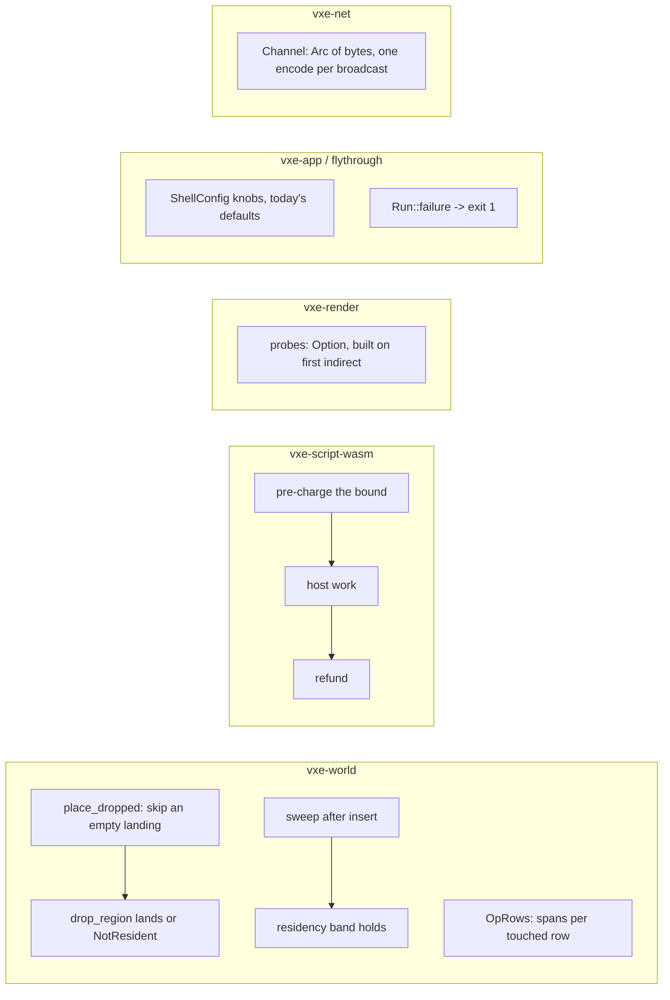

# 0052: The second review: five defects, the waste the first pass missed, and the testbed's failure semantics

> **Status:** in-progress (2026-10-29)
> **Created:** 2026-10-29
> **Milestone:** cross-cutting (code health), like Plans 0044 and 0045. It serves the M2 to M5
> figures already shipped and the determinism and headless promises in `docs/nfr.md`
> section 6.
> **Related ADRs:** none. Every fix keeps its mechanism. The one API shape that changes, the
> channel's byte type, stays inside ADR-0007's decision (a trait of two byte queues).
> **Source:** the owner, 2026-10-29: "review this codebase for actual problems, mega classes,
> complications where it doesn't needed, best practices violations, performance problems."
> The review ran at `fa38340` with four readers (world, render, testbed, the six smaller
> crates). Its report is in the architect session; the findings that matter are restated
> below with their anchors.
> **After:** nothing. It runs now as a lane beside Plan 0050 (owner, 2026-10-29). Plans 0044
> and 0045 re-verify every finding at their tip, so an item this plan fixes first is struck
> there, not reworked.

## TL;DR

A second whole-tree review found most of what it found already owned by Plans 0044 and 0045
(the timer stall, the bind groups, the light table, the audio `Arc`, the raycast locks, the
golden copies, the `main.rs` split). What it found that those plans do not own:

- **Five defects.** `drop_region` panics on a drop that lands wholly inside a resident chunk
  when the chunk below is absent. A full chunk that arrives outside its band is swept before
  it is inserted and then never demoted. The wasm host does the world's work first and charges
  fuel afterwards, so fuel bounds what a guest sees, not what the server spends. A mirror
  failure makes the fly-through exit 0. The dig logic's `unreachable!` is a trap under wasm
  and a process-killing panic natively.
- **Waste the first pass did not name.** Every `Frame` carries 54.7 MB of probe atlases with
  indirect light off, which is the default. A dig capsule allocates spans for its whole
  bounding box, up to 16 MiB per op. The voice-level audio smoothers decay into subnormals
  and stay there. Two slow-list goldens settle a control render for 1 600 frames it does not
  need.
- **Three shapes that hide a decision.** The shell bakes "as fast as possible, no vsync" into
  a library. The channel sends an owned `Vec` so a broadcast clones per client. The renderer
  ships test-only and already-rejected alternatives as public API and as uniform branches in
  the march loop; those are inventoried for the owner and removed on their pick.

The first thing anyone sees: a `vxe-world` test drops a four-layer piece four voxels with the
chunk below missing, and it lands instead of panicking.

## Context & problem

**Line numbers are at `fa38340`.** Plan 0050 runs beside this one and Plan 0051 after it;
`dev` re-reads each anchor at the tip before its phase.

**Defects, each confirmed by reading the path:**

1. **`collapse.rs:577-589`, `Compose::place_dropped`.** A drop of `dropped` voxels resolves
   two destination cells, `cz - q` for source layers `r..8` and `cz - q - 1` for layers
   `0..r`, with `r = dropped mod 8`. It resolves the lower cell whenever `r > 0`, even when
   the source's bottom `r` layers are air and nothing lands there. `Compose::brick`
   (`:566-571`) reads it with `.expect("scanned resident")`. The gap scan (`gap_below`,
   `:240`) guarantees residency only for the cells it read, which stop at the first solid
   voxel or at `max_drop`. So a piece on local layers 4..8 of a cell in brick row 0 of chunk
   z = 0, with air under it inside the chunk and chunk z = -1 absent, dropped by 4
   (`drop_region(cells, 4)`, the tick-by-tick use the doc at `:742-758` describes) panics
   where it should land. The existing test
   `a_drop_scanning_into_a_non_resident_chunk_changes_nothing` (`tests/collapse.rs:438`)
   uses whole cells and multiples of 8 and cannot reach it. The panic is reachable from a
   replayed log or a network op.
2. **`stream.rs:674-677` and `:733-749`.** A `Done` for a full chunk past `keep_full2` sets
   `self.sweep = true` and pushes the coord to `outside`. The same `apply` consumes the flag
   at `:733` and runs `sweep_lists()` before the insert at `:745-749`, while the chunk is not
   in `self.resident`. `recheck` is extended after (`:738`). The next `poll` has
   `sweep == false`, so with a still focus the chunk stays `Full` indefinitely, against the
   field doc at `:239-241` and the band invariant at `:800-803`. The incremental oracle
   agrees with the full scan at sweep time, so it cannot catch this.
3. **`vxe-script-wasm/src/host.rs:339-384`.** `count-in-box` calls `host.count_in_box` and
   then `charge(count_cost)`; `raycast` walks and then charges `steps_cost`; `unsupported`
   pre-charges only its bytes, floods, then charges. The module comment (`:63-76`) says so.
   `tests/determinism.rs:730` shows it: a `1 024^3` count over a resident world completes on
   the host (2^30 voxels, every chunk and brick in the box) and only then traps on fuel.
   After the trap the logic restarts up to `max_restarts = 8` times (`:57`, `:554-570`), each
   free to do it again in `init`.
4. **`apps/flythrough/src/main.rs:4293`, `:4308`.** `Run::draw` prints "mirror sync failed"
   and returns `Flow::Exit`, which is also the normal end of `--frames`. `run_headless`
   (`:4883`) and `vxe_app::run` return `Ok`, so the process exits 0 with the error on stderr.
   `tests/shutdown.rs:158` asserts `status.success()` and would not see it. Separately,
   `main` calls `std::process::exit(1)` from the generation thread (`:5117`, `:5143`) when a
   replay log fails to read, while the main thread is in device creation; no `Drop` runs.
5. **`apps/flythrough/logic/src/lib.rs:360`, `:416`.** `unreachable!` on an `OpResult`
   variant the host should not return. Under `--logic wasm` that is a trap, caught by
   `catch_unwind` (`vxe-script-wasm/src/host.rs:276`), and the testbed prints "the session
   continues without it" (`main.rs:2720`). Natively `Logic::take_error` documents "a native
   logic never fails" (`vxe-net/src/logic.rs:137-141`): the panic unwinds out of
   `Server::tick` with the logic mutex held. One source, two failure semantics. A smaller
   asymmetry beside it: when the hosted logic traps, `Run::tick` (`:3074`) parks the
   `Applied` events the logic produced that tick in `ops` and drops them at the end of the
   tick without `self.edited()`, so the frame history and the coarse grid are not told about
   those edits.

**Two entry points skip `WorldLimits`:** `raycast.rs:179` `trace_materials` never calls
`check_ray` (`raycast_with_stats` at `:101` does), so a caller's `max_t` and `dir` drive an
unbounded walk; `vxe-audio` passes bounded values today. `stamp.rs:221` `World::stamp`
checks neither its origin against `coord_max` nor its size against `edit_axis_max`, and it is
a wire-decoded op kind (`log.rs:102-110`).

**Waste Plan 0044 does not list:**

- **`marcher.rs:1666`** constructs `ProbeVolume::new` for every `Frame`. `probes.rs:82-85`
  size it at `DATA_WORDS` = 12 615 680 words and `SCRATCH_WORDS` = 1 056 768 words, which is
  54 689 792 bytes. `Lighting::indirect` defaults to `false` (`:879`), so the default frame
  holds 54.7 MB it never reads, and every lavapipe test that builds a `Frame` holds it in
  host RAM. `set_probe_spacing` (`:1763`) builds a second volume before dropping the first.
- **`edit.rs:818-834`, `OpRows::new`.** `span` is `vec![(1, 0); ny * nz]` over the shape's
  bounding box plus a `solved` bitmap. A capsule along a diagonal ray under the default
  `edit_axis_max = 1024` allocates up to 1 024 x 1 024 x 16 B = 16 MiB per op, almost all of
  it rows the capsule never crosses; a radius-32 sphere pays 64 KiB. Capsule rows are solved
  lazily anyway (`solved` exists for that).
- **`mixer.rs:429-436`, `:469-475`, `:490-503`.** `own_gain`, `send`, `gain`, `dist_gain`
  and the low-pass state are per-sample geometric decays with no flush. With a zero target
  (`SetGain(0)`, a fully occluded send, a silent stream such as the testbed's mic at
  `main.rs:1924`) the state falls under `f32::MIN_POSITIVE` after about 4 s and every later
  multiply is subnormal until the target changes. `reverb.rs:229-248` documents why that
  costs and guards the tail with `FLUSH_BELOW`; `render_tap` (`:791`) and the bus echo
  (`:592`) snap within `1e-7`. The voice path has neither.
- **`apps/flythrough/tests/golden.rs:1374`, `:1428`, `:1725`.**
  `indirect_golden_shows_the_vein_s_bounce_light` renders `INDIRECT_FRAMES = 1600` frames
  twice, once with indirect light off, where no probe is updated and the frame converges
  as it does in `fsr2_carries_the_indirect_golden_s_bounce_light` at 64.
  `showcase_hall_golden_is_lit_by_its_four_ores` runs its dark pass (asserting
  `lit_off == 0`) through the same generation and settle as the lit one. Both are on the
  slow list.

**Shapes that hide a decision:**

- **`vxe-app/src/shell.rs:98`, `:219`, `:241`, `:250-254`, `:373`.** `ControlFlow::Poll`,
  `request_redraw` on every `about_to_wait`, `PresentMode::AutoNoVsync`,
  `PowerPreference::HighPerformance` and a forced non-sRGB format, none of them in
  `ShellConfig` (`:63-69`). A consumer gets "spin a core and the GPU" with no opt-out short
  of sleeping in `App::frame`. The owner keeps today's behaviour as the default
  (2026-10-29); the plan adds the knobs.
- **`vxe-net/src/channel.rs:10-12`, `server.rs:227-235`.** `Channel::send` takes `Vec<u8>`,
  so `broadcast` encodes once and clones once per client. ADR-0007 says the trait is the
  seam for M9's transport; the trait stays, the bytes become shared.
- **The renderer's lab modes.** `march.wgsl` keeps the comparison walks behind `FLAG_SKIPS`
  and `FLAG_MASKS` (uniform branches in `descend` and `lookup_walk` at `:539-702`),
  `light.wgsl` a `LIGHTING_UNIFORM_DRAW`, `composite.wgsl` a `LIGHTING_IDENTITY_TONE_MAP`,
  `upscale.wgsl` an `UpTuning` of 4 reconstructions x 4 fetches x 3 blends x 3 clips where
  ADR-0024's Outcome picked one of each. On the Rust side `CandidateDraw::Uniform`,
  `ToneMap::Identity`, `LodParams::forced_level`, `Upscaler::lanczos`, `Sampler::List`,
  `ShadowWalk::Full`, `LightingResolution::Full` and `HistoryKill::Gradient` are `pub`.
  Some are test instruments (`LightingResolution::Full` appears in eleven test files,
  `ToneMap::Identity` in six); some are measured losers (Lanczos-2, ADR-0024 Outcome); the
  comparison walks have no caller outside their definitions. Plan 0048's rule (owner,
  2026-10-28) removes a loser with its flags once the pick is made. Which of these are losers
  and which are instruments is the owner's call, from an inventory, not a grep.

**Small corrections the review anchored** (one phase, no decision in any of them):
`SyncStats::buffers_created` and `copies` (`gpu_world.rs:551-554`) are never assigned, and
`apps/flythrough/tests/level_mirror.rs:89` asserts them 0 while `write_materials` can create a
buffer; `Frame::dt` exists while `fsr2.rs:930` hard-codes `delta_time: 1.0 / 60.0`;
`Frame::params_for(&self)` writes `history.built_lamp` through the mutex (`marcher.rs:2184`),
so a second `Params` built between encodes changes which lamp the next `LightKey` compares;
`limits_for` (`lib.rs:67-71`) raises the storage-buffer limit to 11 without `.min(offered)`,
and the shaders bind four shards always, so `ShardLayout::shards < 4` (`gpu_world.rs:653`) is
a fallback that cannot run; `scripts/check-test-tiers.mjs:166-185` scans `tests/*.rs` only,
so `examples/hero.rs` (`test = true`, opens a `wgpu::Instance` at `:405`) and the binary's own
test module are outside the gate; `apps/flythrough/Cargo.toml` names the engine crates by
`path =` where every other crate uses the workspace table.

**What this review found and Plans 0044 or 0045 already own** (not reworked here):
the blocking timer readback and the HUD's allocations (0044 Phase 2); bind groups, views
and the light table per frame (0044 Phase 3); `place_lights` rescans (0044 Phase 4); the
walk counters and `floor_div` (0044 Phase 5); raycast locks, collapse's per-column `Vec`s,
whole-brick decodes and per-voxel rubble writes (0044 Phase 6); the sim's per-sweep
collection and the server's op clones (0044 Phase 7); `golden.rs`'s shadow copies and the
render tests' adapter rule (0044 Phase 8); the `GpuWorld`, `Frame`, `Streamer`, `main.rs`
and `hud.rs` splits, the per-frame series caps, `run_headless` into `vxe-app`, `--help`,
the bench-only reference writers behind a feature, the dead `pub` items (0045).

## Decision

Fix each defect where it stands with a regression test that fails at `fa38340` and passes
after. Remove the four wastes with the pinned tests as the guard: goldens byte-identical,
pinned hashes equal, audio within the tolerances the tests already use. Add the shell knobs
with today's values as defaults. Make the channel's bytes shared. Inventory the lab modes
for the owner, remove the ones with no user and an ADR rejection at once, and the rest on
the owner's pick.

- We rejected **folding the new items into Plans 0044 and 0045**. Those plans now run after
  Plan 0051 (owner, 2026-10-29) and the panics should not wait for the light spikes.
- We rejected **making the wasm imports stop early on a step budget** as the only mechanism.
  It needs every world walk to take a budget. Pre-charging an upper bound and refunding the
  difference needs no world change and gives the same final charge for a call that completes.
  `dev` may use a budgeted walk where a bound is loose, as long as the property in Phase 2
  holds.
- We rejected **deleting the `Channel` trait until QUIC**. ADR-0007 names it as the seam;
  a trait with one impl costs nothing once its bytes are shared.
- We rejected **defaulting the shell to vsync**. The owner keeps the testbed's readings
  comparable; a consumer sets `present_mode`.
- We rejected **deleting the lab modes by grep**. Several are test instruments. The owner
  picks from an inventory (Phase 8).

## Architecture diagram



## Implementation phases

Every phase:
- re-reads its anchors at the tip and strikes any Plan 0050 already moved in `### Notes`;
- gates on `--profile quick`, plus `--profile gpu` under the perf lock when it touches
  `vxe-render`, the shaders or a fly-through render test (Plan 0043);
- proves no behaviour change beyond the one it names: goldens byte-identical, every pinned
  hash equal, the audio tests within their tolerances.

### Phase 1: the world's two defects and its two unchecked doors
- **Owner skill:** dev
- **What:**
  - `Compose::place_dropped` writes to a destination cell only when the source layers that
    land there hold a solid voxel (`Brick::solid_bits()` over `layers`). After `dropped` is
    known and before anything is composed, every destination chunk is checked for residency
    and a missing one returns `EditError::NotResident`. `Compose::brick`'s `expect` becomes
    unreachable by construction and says so.
  - `Streamer::apply` sets `self.sweep` for an out-of-band arrival after the sweep block, or
    runs the sweep after the insert block, so the arrival is swept by the next poll as the
    field doc says.
  - `World::trace_materials` returns `Result<Vec<Run>, EditError>` and calls `check_ray`.
    `vxe-audio`'s caller (`acoustics.rs:245`) handles the error by tracing nothing.
  - `World::stamp` checks its origin against `coord_max` and the prefab's size against
    `edit_axis_max`, returning `OutOfRange` like the other op kinds.
- **Files touched:** `crates/vxe-world/src/{collapse.rs,stream.rs,raycast.rs,stamp.rs}`,
  `crates/vxe-world/tests/{collapse.rs,stream.rs,queries.rs,stamp.rs}`,
  `crates/vxe-audio/src/acoustics.rs`.
- **Done when:**
  - A new collapse test builds a 1 x 1 x 1 chunk world at z = 0 holding one piece on local
    layers 4..8 of a cell in brick row 0, air below it, chunk z = -1 absent. `drop_region` of
    that cell with `max_drop = 4` returns `Ok` with `dropped = 4`, the piece's voxels sit on
    layers 0..4 of the same cell, the voxel count of the world is unchanged, and chunk z = -1
    is still not resident. At `fa38340` this call panics with "scanned resident".
  - A second case drops the same piece with `max_drop = 8` and the floor of the cell air: it
    returns `Err(NotResident(c))` with `c` the chunk at z = -1 and the world's voxel hash
    equal to before the call.
  - A new stream test loads a radius with one worker, jumps the focus far away while a chunk
    is in flight, and polls until that chunk lands as `Full` outside the full band. Within
    two further polls with the focus still, the events list it as demoted or evicted. At
    `fa38340` it is still `Full` after any number of polls. The incremental oracle stays on
    for the test.
  - `trace_materials` with `max_t` past `ray_reach_max` returns `Err(OutOfRange)`;
    `stamp` with an origin past `coord_max`, and with a prefab wider than `edit_axis_max`,
    each return `Err(OutOfRange)` and change nothing.
  - `the_collapse_course_hashes_to_its_pinned_constant`, every replay test and every stamp
    tally are unchanged.

### Phase 2: the wasm host charges before it works
- **Owner skill:** dev
- **What:** each world-walking import pays before the walk and settles after.
  - `count-in-box`: the volume `(hi - lo + 1)` per axis is known before counting and the
    count cannot exceed it. Charge `count_cost` of the volume first, refund the difference
    after.
  - `raycast`: charge `steps_cost` of a bound from `max` and `dir` (a DDA takes at most one
    step per axis crossing, plus the chunk-sized steps through missing chunks), refund after;
    or pass `fuel_left / per_step` into the walk as a step budget and trap when it runs out.
  - `unsupported`: charge `steps_cost` of `SupportParams::max_region` times the cells first,
    refund after.
  - A call whose bound exceeds the fuel left traps with `LogicError::Fuel` before any host
    work, with the import named in the trap's message. The module comment at `host.rs:63-76`
    is rewritten to say "before".
- **Files touched:** `crates/vxe-script-wasm/src/host.rs`,
  `crates/vxe-script-wasm/tests/determinism.rs`.
- **Done when:**
  - `a_greedy_count_in_box_runs_out_of_fuel` additionally asserts, through a call counter on
    the test `Host`, that `count_in_box` was entered **0 times** for the `1 024^3` request,
    and that the trap arrives within the fuel-check path, not after a walk. At `fa38340` the
    counter reads 1.
  - Every call that completed at `fa38340` completes with the same fuel left:
    `rays_are_charged_by_their_steps`, the `64^3` count and the `unsupported` charges in
    `charged`/`charged_under` read the same numbers as before. The restart tests are
    unchanged.
  - A new test gives the guest fuel for a `64^3` count and asks for `65^3`: it traps on
    fuel, the host counter reads 0, and the next tick's `init` under `max_restarts` traps
    again without a walk.

### Phase 3: the testbed fails out loud, and the logic fails the same way twice
- **Owner skill:** dev
- **What:**
  - `Run` gets a `failure: Option<String>`. Every error path that returns `Flow::Exit` sets
    it first. `main` checks it after `run` and `run_headless` and exits 1 with the message.
    `Flow::Exit` from `--frames`, the autopilot's report and a clean replay leave it `None`.
  - The generation thread returns `Result<World, String>`; `read_log_file` and
    `replay_log_on` failures are printed and set `failure` on the main thread, which then
    runs the normal teardown. No `process::exit` is called from a thread other than main.
  - Both `unreachable!`s in `flythrough-logic` become a refused-style line through the `Err`
    path that already exists. Natively, `Server::tick` wraps the logic call in `catch_unwind`
    and reports a `LogicError::Trap`, so a native and a hosted logic fail the same way; or,
    if that is judged out of scope for the native path, `Logic::take_error`'s doc and the
    testbed's module doc say plainly that a native logic is fail-stop. `dev` picks one and
    logs it.
  - `Run::tick` drains the `ops` it parked through `self.edited()` at the end of the tick
    whether or not a logic line matched them.
  - `Leg::Settle` gets a bound: when `full_residency` has not arrived within a stated number
    of ticks (from the pending count and the sync budget, or a flat cap), the autopilot
    prints `autopilot: settle timed out at tick N, pending P`, sets `failure` and exits.
- **Files touched:** `apps/flythrough/src/main.rs`, `apps/flythrough/logic/src/lib.rs`,
  `apps/flythrough/tests/{shutdown.rs,component.rs}`, `crates/vxe-net/src/{server.rs,logic.rs}`
  (only if the `catch_unwind` option is taken).
- **Done when:**
  - `flythrough --headless --replay <missing file>` exits with status 1, prints the read
    error once, and `tests/shutdown.rs`'s trace shows every teardown stage, as the clean
    run's does. At `fa38340` it exits 1 from the generation thread with no teardown trace.
  - A unit test on `Run` drives `draw` through the "mirror sync failed" path with a mirror
    whose sync returns an error, and reads `failure.is_some()` and `Flow::Exit`. The headless
    runner then returns `Err`.
  - A unit test in `flythrough-logic` feeds a `Host` whose `apply` returns `OpResult::Pile`
    for a drop: the logic emits a refused-style line and no panic, in the native build and
    in `tests/component.rs`.
  - A unit test on `Run::tick` applies an op whose logic line never arrives and asserts that
    the coarse grid reflects the edit at the end of the tick.
  - A unit test on the pilot's settle step with synthetic stream stats that never reach full
    residency returns `Flow::Exit` with `failure` set at the bound and `Continue` below it.

### Phase 4: the frame's idle probe volume, and the small corrections
- **Owner skill:** dev
- **What:**
  - `Frame::probes` becomes `Option<ProbeVolume>`, built on the first encode with
    `Lighting::indirect` on, on `probes_mut()`, or on `set_probe_spacing`. `set_probe_spacing`
    drops the old volume before building the new one. `frame_bytes()` reports what is held.
    The gather bind group is built only when the volume exists (Plan 0044 Phase 3 then
    caches it).
  - `SyncStats::buffers_created` and `copies` are either assigned where buffers are created
    and copies recorded, or removed with the `level_mirror.rs` assertion. `dev` logs which.
  - `Fsr2` takes the frame's `dt` instead of `1.0 / 60.0`, or `Frame::dt` is removed if no
    pass reads it. `dev` logs which.
  - `params_for` stops writing `built_lamp`; `encode` takes the lamp from the `Params` it is
    given.
  - `limits_for` caps every raised limit at what the adapter offers and the request fails
    with a named reason when the floor is not met; `ShardLayout` either loses `shards < 4`
    or the shaders bind what the layout says. `dev` logs which.
  - `scripts/check-test-tiers.mjs` also scans `examples/*.rs` that a manifest marks
    `test = true` and the `src/` of a binary crate, and its fixture gains one case of each.
  - `apps/flythrough/Cargo.toml` takes the engine crates from the workspace table.
- **Files touched:** `crates/vxe-render/src/{marcher.rs,probes.rs,gpu_world.rs,fsr2.rs,lib.rs}`,
  `crates/vxe-render/tests/`, `apps/flythrough/tests/level_mirror.rs`,
  `scripts/check-test-tiers.mjs`, `scripts/fixtures/`, `apps/flythrough/Cargo.toml`.
- **Done when:**
  - A headless test builds a `Frame` with the default `Lighting` and reads `frame_bytes()`
    smaller by exactly **54 689 792 bytes** than the same frame after `indirect` is switched
    on and one frame is encoded. The probe tests, `indirect.png` and
    `fsr2_carries_the_indirect_golden_s_bounce_light` are byte-identical.
  - Building a `Frame` with indirect off under the counting allocator used by the HUD test
    allocates no buffer the size of the atlases; this is asserted by `frame_bytes()` before
    any encode.
  - Two `params_for` calls between encodes with different lamps do not change the
    `LIGHTING_LAMP_CHANGED` decision of the next encode, asserted on the flag the encode
    reports.
  - `node scripts/check-test-tiers.mjs` exits 1 on its fixture's new example case and new
    binary-test-module case, and 0 on the tree.
  - Every golden is byte-identical; `frame_bytes` at the default is recorded in
    `docs/nfr.md` section 3 as a reading.

### Phase 5: spans for the rows a shape touches, and smoothers that settle
- **Owner skill:** dev
- **What:**
  - `OpRows` allocates its spans per brick row on first use (64 entries per `(by, bz)`
    slab) or per z-slab, not for the whole bounding box. The sphere keeps its up-front walk,
    sized per slab.
  - At the end of each block the voice smoothers snap within `1e-7` of their targets
    (`own_gain`, `send`, `gain`, `dist_gain`) and the low-pass state flushes under
    `FLUSH_BELOW`, the same rule the taps and the bus echo already use. `flush` moves to a
    shared place so `reverb.rs` and `mixer.rs` use one definition.
- **Files touched:** `crates/vxe-world/src/edit.rs`, `crates/vxe-world/tests/edits.rs`,
  `crates/vxe-world/benches/edits.rs`, `crates/vxe-audio/src/{mixer.rs,reverb.rs}`,
  `crates/vxe-audio/tests/mixer.rs`, `crates/vxe-audio/benches/mixer.rs`.
- **Done when:**
  - A test applies a diagonal capsule of length 1 000 voxels and radius 2 through a solid
    world and asserts, through a `cfg(test)` counter on `OpRows`, that the span entries
    allocated are at most 64 times the number of brick rows the capsule's bounds meet, and
    well under the `1 024 x 1 024` of the bounding box (state the measured number in the
    log). Its `EditResult` is byte-identical to `fa38340`'s, as is every pinned edit test.
  - `cargo bench -p vxe-world --bench edits` `tool_ops` is read before and after on the dev
    box under the lock.
  - A new mixer test plays a looping tone, sets its gain to 0, renders 10 s, and reads
    `own_gain == 0.0` and `gain == 0.0` exactly, and a low-pass state of exactly 0 for a
    silent stream voice after 10 s. At `fa38340` they are subnormal and non-zero.
  - The mixer bench gains a case of 64 voices at gain 0 after 10 s of rendering; after the
    fix it is within the spread of the 64-fresh-voices case. Every existing mixer, reverb and
    balance test holds within its tolerance.

### Phase 6: the shell's knobs, shared channel bytes, and cheaper control renders
- **Owner skill:** dev
- **What:**
  - `ShellConfig` gains `present_mode: wgpu::PresentMode`,
    `power_preference: wgpu::PowerPreference`, `prefer_srgb: bool` and
    `pacing: Pacing` (`Unthrottled`, or `Cap { hz }` served with `ControlFlow::WaitUntil`).
    `ShellConfig::default()` and the testbed's config reproduce today's values.
  - `Channel::send` takes `Arc<[u8]>` and `try_recv` returns it; `broadcast` encodes once
    and hands the same bytes to every client. Clients decode from the slice.
  - The control passes of the two goldens take a `frames` argument: 64 for the indirect
    control, 8 for the dark showcase pass. The lit passes are untouched.
- **Files touched:** `crates/vxe-app/src/{shell.rs,lib.rs}`, `crates/vxe-net/src/{channel.rs,server.rs,client.rs}`,
  `crates/vxe-net/tests/`, `apps/flythrough/src/main.rs` (config only),
  `apps/flythrough/tests/golden.rs`, `.config/nextest.toml` (the slow list, if a test drops
  under 20 s).
- **Done when:**
  - A unit test asserts `ShellConfig::default()` is `AutoNoVsync`, `HighPerformance`,
    `prefer_srgb: false`, `Unthrottled`; a unit test on `Pacing::Cap { hz: 60 }` gives a
    next deadline 16 666 us after the last frame start, and `Unthrottled` none.
  - A `vxe-net` test broadcasts one applied op to four clients under a counting allocator:
    one encode allocation, no per-client copy. Every resimulation test gives equal bytes.
  - `indirect_golden_shows_the_vein_s_bounce_light` and
    `showcase_hall_golden_is_lit_by_its_four_ores` keep their assertions and their blessed
    images, and their wall time on lavapipe under the lock is read before and after; each
    is expected to fall by about half (a guess until read). The slow list reflects the
    readings.

### Phase 7: the lab-mode inventory, and the removals that need no pick
- **Owner skill:** dev
- **What:** a table in this plan's log, one row per shader flag, enum variant, field or
  method named under "The renderer's lab modes" above, plus any `dev` finds beside them:
  what it is, where it lives, the ADR that decided for or against it (or none), its users in
  `src/`, `tests/` and `examples/` by file, and what it costs when off (a uniform branch in
  the march loop, a larger uniform, nothing). Items with **no user outside their definition
  and an ADR that rejected them** are removed in this phase with their flags and banner
  modes. The rest wait for the owner.
- **Files touched:** `crates/vxe-render/src/`, `crates/vxe-render/src/shaders/`,
  `apps/flythrough/src/`, this plan's log. Shader edits that collide with Plan 0050's
  `march.wgsl` wait for its merge.
- **Done when:** the table is in the log; every removal is listed with its commit; every
  golden is byte-identical; `cargo clippy --workspace --all-targets -- -D warnings` is
  clean with no new `allow`.

### Phase 8: the owner picks what else goes
- **Owner skill:** human
- **What:** the owner reads Phase 7's table and marks each remaining row *keep as an
  instrument*, *remove*, or *ask the architect* (for anything that wants a profile or a
  settings type, which is the parked render-settings question).
- **Done when:** every row carries one of the three marks, written under `## Owner answers`.

### Phase 9: the owner's removals
- **Owner skill:** dev
- **What:** remove every row marked *remove* with its flags, banner modes, shader branches
  and tests that existed only for it. Rows marked *ask the architect* are listed under
  `## Followups` and left in place.
- **Files touched:** as Phase 7.
- **Done when:** no removed item's name appears under `crates/` or `apps/`; every golden is
  byte-identical; the hit and light pass times are read on both adapters against their
  latest `docs/nfr.md` section 2 readings and are within the spread (a removed uniform
  branch in `descend` may read lower; that is recorded, not required).

## Data shapes

```rust
// illustrative
pub struct ShellConfig {
    pub title: String,
    pub size: [u32; 2],
    pub lock_cursor: bool,
    pub present_mode: wgpu::PresentMode,          // AutoNoVsync
    pub power_preference: wgpu::PowerPreference,  // HighPerformance
    pub prefer_srgb: bool,                        // false
    pub pacing: Pacing,                           // Unthrottled
}
pub enum Pacing { Unthrottled, Cap { hz: u32 } }

pub trait Channel {
    fn send(&self, bytes: Arc<[u8]>);
    fn try_recv(&self) -> Option<Arc<[u8]>>;
}

struct Frame { probes: Option<ProbeVolume>, /* … */ }
struct Run { failure: Option<String>, /* … */ }
```

## Budgets

| `docs/nfr.md` figure | Phase | Expected | How the close reads it |
|---|---|---|---|
| Section 3, `frame_bytes` at the default | 4 | lower by 54 689 792 B with indirect off; unchanged with it on | the headless `frame_bytes` test, recorded as a reading |
| Section 4, edit cost (`tool_ops`) | 5 | lower or equal (a guess: the 16 MiB fill was most of a long capsule's cost) | `cargo bench -p vxe-world --bench edits`, dev box, lock, load |
| Section 9, audio callback per block | 5 | the 64-silent-voices case within the spread of 64 fresh voices | `cargo bench -p vxe-audio --bench mixer` |
| Section 2, frame time, hit and light passes | 9 | within the spread; lower if a march branch goes | the per-pass timer, both adapters |
| Section 6, determinism | 1, 2, 5 | unchanged: every pinned hash equal; replay bytes equal | the existing tests |
| Section 7, CI time | 6 | the two goldens' wall time about halved (a guess) | nextest's per-test times on lavapipe, before and after |

Every reading names the machine, the commit, the lock and the load.

## Risks & open questions

- **A lane beside Plan 0050.** Plan 0050 edits `march.wgsl`, `apps/flythrough/src/lib.rs`
  and the goldens. This plan's Phases 1 to 6 touch none of those. Phases 7 and 9 may touch
  `march.wgsl`; those edits wait for 0050's merge and rebase on it, and a golden that 0050
  re-blessed is compared against its new bless.
- **Determinism.** Phase 1 changes what `drop_region` does on a path that panicked, and
  Phase 5 changes how spans are allocated, not what they hold. The pinned course hash and
  the edit results are the guard; a changed hash is a stop, not a re-bless.
- **Fuel semantics.** Phase 2's pre-charge can trap a call that would have completed under
  the exact charge when the bound is loose and the fuel is nearly gone. That is the price of
  the bound; the property that a completed call's charge is unchanged keeps every existing
  number. A guest near its budget sees a trap one call earlier.
- **Audio tolerance.** Phase 5's snap changes a sample by under `1e-7` of its gain. Tests
  that compare exactly are inspected; one that depends on a subnormal tail is a finding.
- **Native `catch_unwind`.** Phase 3's native trap path crosses a mutex; `dev` either uses
  `AssertUnwindSafe` with the state reset the hosted path already does, or documents
  fail-stop. Either is acceptable; silence is not.

## What this plan does NOT do

- **Anything Plans 0044 or 0045 own.** Listed above under "already own". Those plans now
  run after Plan 0051 and before the M10 batch (owner, 2026-10-29).
- **A render settings or profile type.** The parked owner question; Phase 8 may route rows
  to it.
- **Camera-relative world coordinates.** The march's f32 world math is exact to 2^24 voxels
  (1.7 km at 10 cm); a following window past that is a future plan's concern. The architect
  adds the line to `docs/nfr.md` section 10 at the close.
- **A faster HRTF convolution.** The direct form is about 1 GMAC/s at 64 voices; it is a
  ceiling to record in section 9, not a defect.
- **Default or look changes.** The shell's defaults are today's; the testbed is unchanged.

## Owner answers

1. **Packaging and order (owner, 2026-10-29).** One new plan for every new item; a lane now
   beside Plan 0050. Plans 0044 and 0045 re-gated to after Plan 0051, before M10. The shell
   keeps `AutoNoVsync` as its default.

## Implementation log

| phase | owner | state | commit |
|---|---|---|---|
| 1: the world's two defects and its two unchecked doors | dev | done | 47eda2e |
| 2: the wasm host charges before it works | dev | done | b0640c9 |
| 3: the testbed fails out loud, and the logic fails the same way twice | dev | done | a392e47 |
| 4: the frame's idle probe volume, and the small corrections | dev | not started | |
| 5: spans for the rows a shape touches, and smoothers that settle | dev | done (tip bench readings owed, see resume notes) | 14f3841 |
| 6: the shell's knobs, shared channel bytes, and cheaper control renders | dev | done (golden wall-time readings owed) | committed with this row |
| 7: the lab-mode inventory, and the removals that need no pick | dev | not started | |
| 8: the owner picks what else goes | human | not started | |
| 9: the owner's removals | dev | not started | |

### Resume notes (2026-10-29, delete when Phase 7 lands)

- **Done:** Phase 1 `47eda2e`, Phase 2 `b0640c9`, Phase 3 `a392e47`, Phase 5 `14f3841`
  (committed ahead of Phase 4 by the orchestrator's order: CPU phases first). Status is
  `in-progress`. Left: Phase 4, then 6, then 7; stop at Phase 8 (human). Do not edit
  `march.wgsl` until the orchestrator says Plan 0050 merged; in Phase 7 inventory everything
  and remove only what lives outside it.
- **Readings owed for Phase 5** (each under the exclusive perf lock, with the load):
  the edits bench at the tip, `cargo bench -p vxe-world --bench edits -q -- "^tool"`
  (compare `tool`, `tool_warm`, `tool_long` with the base numbers in the Notes); and the
  mixer bench `mixer_block_silent` at the base and the tip. Two bench binaries are built for
  the mixer: `live/mixer-bench-base` (the base's smoothers, the new bench case) and
  `live/mixer-bench-tip`; run each from `crates/vxe-audio` as `../../live/mixer-bench-<b>
  --bench "64 HRTF"`. At checkpoint both were queued on the lock behind Plan 0050's full
  tier, writing to `live/bench-edits-tip.log` and `live/bench-mixer.log`; read those first,
  and rerun if they are empty. Record them in the Notes and set Phase 5's row to `done`.
- **Owner-facing findings so far** (repeat in the final message):
  1. Phase 2: a `1 024^3` `count_in_box` over a world with nothing resident completed at the
     base and now traps on fuel (its volume bound is past the default `10^10`); the test
     asserts the new behaviour. The plan's Risks name this kind of case; the owner may want
     a residency-aware bound instead.
  2. Phase 2: the unsupported bound is `7 d (max_region + 2)` over distinct cells, not the
     plan's `max_region x cells` (that product does not bound the flood, and it would trap
     the duplicated over-cap list `charged_under` pins at `100 + 12 (cap + 1)`).
  3. Phase 3: the Run-level tests drive extracted pieces (`mirror_failed`, `tick_server`,
     `SettleClock`), not `draw`/`tick`, which need a device; `draw`'s path is covered end to
     end in `tests/shutdown.rs` (gpu tier).
- **Phase 4 notes:** `crates/vxe-render` and `apps/flythrough/tests/level_mirror.rs` are
  untouched so far. `scripts/check-test-tiers.mjs` must learn binary `src/` (the
  flythrough binary's test module is CPU-only today; keep it so). The new
  `shutdown.rs` tests are already in the gpu filter (whole binary). Budget reading for
  `frame_bytes` goes into `docs/nfr.md` section 3 (`Files touched` does not list
  `docs/nfr.md`; the done-when names it, so log it as a deviation).
- **Phase 6 notes:** `apps/flythrough/src/main.rs`'s `ShellConfig` literal is at the end of
  `main`; the goldens' control passes are in `apps/flythrough/tests/golden.rs`; the slow
  list is in `.config/nextest.toml`.
- **Gate state at `14f3841`:** quick 529 run, 527 passed, 2 timed out at 30 s under load
  (`castle::the_castle_stands_in_the_hall_with_its_gate_facing_the_spawn`,
  `replay::a_stamp_and_a_collapse_replay_from_the_save`; both pass alone, 10 s and 15 s);
  clippy and fmt clean; gpu tier run only for `binary(shutdown)` (5 of 5); no full tier yet.
- **Gotchas:** `scripts/build-guests.sh` must rerun after any `flythrough-logic` change (the
  component test loads `target/guests/flythrough-logic.wasm`; run it inside the memory
  scope). `tests/component.rs` needs `-p flythrough --features wasm`. While another lane
  holds the lock, build in `CARGO_TARGET_DIR=target/alt` so a lock holder's cargo is not
  blocked on the shared target dir. `live/` is untracked scratch.

### Notes

- Phase 1: `place_dropped` names a landing cell only when its source layers hold a solid voxel
  (`landings`), and `check_landings` reads every landing cell (region cells ascending by
  `(x, y)`, then `z`) before anything is composed. The new collapse test panics at the base
  (`collapse.rs:570`, "scanned resident") and passes at the tip.
- Phase 1: the out-of-band arrival sets `sweep` after the sweep block. The stream test's
  first further poll removes the chunk from the store and the full tier (demotion queued);
  the `demoted` event itself arrives when the worker returns the mips, read through
  `wait_idle` as the second further poll. At the base the first further poll still reads
  `Tier::Full` (assertion `left != right` at `tests/stream.rs:592`).
- Phase 1: `stamp` checks `edit_axis_max` against the prefab's size before turning it, and
  `coord_max` against both corners of the rotated volume (the plan names the origin only).
- Phase 1 deviation: `crates/vxe-audio/tests/reflections.rs` (outside `Files touched`) takes
  one `.unwrap()` for `trace_materials`' new `Result`.
- Phase 1 gate: `--profile quick` ran 519 tests at load 12.3 (Plan 0050's lane building);
  517 passed and two timed out at 30 s (`castle::the_castle_stands_in_the_hall_...`,
  `replay::a_stamp_and_a_collapse_replay_from_the_save`); both pass alone (15.3 s, load 8.8).
  Doctests, clippy `-D warnings` and fmt clean.
- Phase 2: `raycast`, `count-in-box` and `unsupported` pre-charge a bound and settle after
  (refund, or charge the excess of a host past the bound). Bounds: `count_bound` is the box
  volume; `ray_bound` is `1 + sum_k (ceil(|dir[k]| x max / 2^16) + 1)` steps (each walk step
  crosses a voxel plane); `support_bound` is `7 d (max_region + 2)` steps over the `d`
  distinct cells (the plan names `max_region x cells`; that product does not bound a
  flood that starts from each of a cell's six neighbours, and it pre-charges a duplicated
  list past `max_changed_cells` past the default fuel, where `charged_under` reads
  `100 + 12 (cap + 1)`). `WasmConfig` gains `support_max_region` (default
  `DEFAULT_SUPPORT.max_region`, 4 096) for it. The trap's message names the import
  (unit test `a_bound_past_the_fuel_left_is_a_fuel_trap_naming_the_import`);
  `LogicError::Fuel` carries no message, so the name is visible only on the
  `wasmtime::Error`.
- Phase 2 finding: `a_greedy_count_in_box_runs_out_of_fuel`'s last case, a `1 024^3` count
  over a world with nothing resident, completed at the base (count 0, charge 100) and now
  traps on fuel: its volume bound, `10 x 2^30 + 100`, is past the default `10^10`. The test
  now asserts the trap and a host counter of 0, and adds a refused `1 025 x 1 x 1` box that
  completes refunded to 100. This is the loose-bound case under the plan's Risks; flagged
  for the owner.
- Phase 2: the ray bound is loose through missing chunks (16 388 steps bounded against 257
  walked for a `2^22` ray through an empty world), so `rays_are_charged_by_their_steps`'s
  tight case traps on the first ray rather than about the fiftieth; the test asserts only
  the trap.
- Phase 2 deviation: the new restart case cannot trap in `init`, because `greedy`'s `init`
  does nothing (the guest is outside `Files touched`). The restarted instance's next tick,
  given the same `65^3` input, traps on fuel with the host counter still 0.
- Phase 2 readings at the base: the host counter reads 1 for the `1 024^3` request and for
  the `65^3` request (both new assertions fail at `left: 1, right: 0`); at the tip, 0.
- Phase 2 gate: quick 522 run, 521 passed, 1 timed out (`replay::a_stamp_and_a_collapse_
  replay_from_the_save` at 30 s, 1-minute load 20.8 from the other lane); it passed alone
  after Phase 1. Clippy and fmt clean.
- Phase 3 pick: the native logic is documented fail-stop (`Logic::take_error`'s doc and the
  testbed's module doc); `Server::tick` gets no `catch_unwind`. The doc edit is in
  `crates/vxe-net/src/logic.rs`, which `Files touched` lists only for the other option.
- Phase 3: `Run::failure` is a `Failure`, a shared `Arc<Mutex<Option<String>>>` that keeps
  the first message, held by the app, the run and `main` (the shell consumes the app, so a
  plain `Option<String>` on `Run` cannot reach `main`). `main` prints it once after the
  teardown and the `teardown: done` line, then exits 1. The two init-time sync failures
  (level and streaming) also set it, so the first frame exits instead of drawing on.
- Phase 3: a replay log that does not read builds no `Run` (`Pending::Failed`), so its
  trace shows the app, queue, device and adapter stages and not the run's mirror and world
  stages; a re-simulation failure on the generation thread does the same. At the base the
  read failure called `process::exit(1)` on the main thread before device creation.
- Phase 3 deviation: the Run-level tests drive the extracted pieces, not `draw` and `tick`,
  which need a device: `Run::mirror_failed` (what both `draw` sync paths return through) and
  `session_outcome` (the headless runner's result) in
  `a_failed_mirror_sync_ends_the_session_as_a_failure`; `Run::tick_server` (the GPU-free
  part of `tick`) in `an_applied_op_no_logic_line_names_still_updates_the_coarse_grid`,
  which reads `solid` 0 without the drain and 512 with it; `SettleClock::step` in
  `the_settle_step_times_out_at_its_bound`. `draw`'s path itself is covered end to end by
  `shutdown::a_mirror_that_cannot_sync_exits_1_after_the_teardown` (`--level
  --mirror-budget 1`: status 1, one "mirror sync failed", the level's full trace), and the
  replay case by `shutdown::a_replay_log_that_does_not_read_exits_1_after_the_teardown`
  (with `--level`, which `--replay` requires).
- Phase 3: the settle bound is a flat `SETTLE_FRAMES_MAX` = 36 000 frames (10 min at 60
  fps); `pending` is the streamer's in-flight plus queued chunks plus the mirror's pending
  chunks.
- Phase 3: both `unreachable!`s answer with `not_the_result`, a refused-style line ("the
  host answered a drop with a pile result"). Unit tests in `flythrough-logic` and
  `tests/component.rs` drive a host whose drop answers a pile and whose pile answers a drop.
- Phase 3 gate: quick 527 run, 525 passed, 2 timed out at 30 s under load 14.9 (`castle`,
  `replay`, as in Phase 1); alone they pass at 10.1 s and 15.0 s (load 11.5). GPU tier,
  `binary(shutdown)`, under the exclusive perf lock on lavapipe at load 6.0: 5 of 5 passed.
  `-p flythrough --features wasm` `binary(component)`: 3 of 3. Clippy (workspace, and
  `-p flythrough --features wasm`) and fmt clean.
- Phase 5 (committed before Phase 4, which needs the GPU lock): `OpRows` keeps spans in
  slabs, one per brick row `(by, bz)` of the bounds (64 entries and one solved word each),
  allocated on first use; the sphere's slabs are all walked up front, each by
  `sphere_row_spans` over its own rows. The counter is `World::apply_counting_spans`
  (`#[doc(hidden)] pub`, beside `apply_capturing`), not a `cfg(test)` field: the test is in
  `tests/edits.rs`, an integration test, which `cfg(test)` on the library does not reach.
- Phase 5 reading: the capsule from voxel centre `(4, 4, 4)` along `(577, 577, 577)` (999.4
  voxels), radius 2, through solid rock over chunks `[0, 10)^3`: 13 888 span entries
  (217 brick rows x 64; 217 is also the test's loose count of reachable brick rows) against
  338 724 rows in its bounds, which the base allocated at 16 B each (5.4 MB) plus the
  solved bitmap. Its result is pinned from the base: `changed_from [(3, 10996)]`, 64 touched
  chunks, aabb `[2, 2, 2]..[583, 583, 583]`, voxel hash `0x2b8d1391b1a80d45`.
- Phase 5: the edits bench gains `tool_long` (eight capsules of radius 2 along the space
  diagonals, about 430 voxels long, bounds 253 voxels per axis); the mixer bench gains
  `mixer_block_silent` (64 voices fresh, and 64 at gain 0 after 10 s).
- Phase 5: the voice smoothers settle with `settle` (`SETTLE_WITHIN = 1e-7`, now also used
  by the bus echo gain and `render_tap`), and the low-pass state flushes with reverb's
  `flush`, made `pub(crate)` there (one definition, no new module: `Files touched` names
  only `mixer.rs` and `reverb.rs`). `Mixer::voice_smoothers` (`#[doc(hidden)]`, an array, so
  `lib.rs` needs no new export) reads them. At the base the new test reads own gain and
  gain `1.682e-42` and the stream voice's low-pass state `-1e-44` after 10 s; at the tip
  exactly 0. Every existing vxe-audio test passes unchanged (78 of 78).
- Phase 5 readings at the base (dev box, the RTX 3080 laptop, CPU bench, exclusive perf
  lock, `a392e47` plus the new bench case, 1-minute load 2.11 before and 2.20 after, loaded
  (indicative)): `tool` 4.7714 ms, `tool_warm` 4.7716 ms, `tool_long` 5.8768 ms (criterion
  medians; raw in `live/bench-edits-base.log`). The tip's edits reading and both mixer
  readings were queued on the lock behind Plan 0050's full tier at checkpoint time; see the
  resume notes.
- Phase 5 gate: quick 529 run, 527 passed, 2 timed out at 30 s under load (`castle`,
  `replay`, as in Phases 1 and 3). Doctests, clippy and fmt clean. Built in
  `target/alt` so the lock holder's cargo was never blocked on the target dir.
- Phase 6: `ShellConfig` gains `present_mode`, `power_preference`, `prefer_srgb` and `pacing`
  (`Pacing::Unthrottled | Cap { hz }`, exported from `vxe-app`) and a `Default` (title `vxe`,
  1280 x 720, cursor free, `AutoNoVsync`, `HighPerformance`, non-sRGB, `Unthrottled`); the
  testbed sets title, size and `lock_cursor` and takes the rest from `default()`. `Cap`
  starts the loop on `ControlFlow::Wait` and `about_to_wait` sets `WaitUntil` the deadline
  (`Pacing::next_deadline`, `1 000 000 / hz` us after the last frame start; `hz` 0 counts as
  1) or requests the redraw once it has passed. `Unthrottled` is `Poll` plus a redraw on
  every `about_to_wait`, as before.
- Phase 6: `Channel::send` takes and `try_recv` returns `Arc<[u8]>`; `broadcast` converts
  the encoded `Vec` once and sends an `Arc` clone per client. The counting test
  (`server::tests::a_broadcast_encodes_once_and_copies_nothing_per_client`, a thread-local
  allocation counter as the library's test allocator) reads 6 allocations for a 4-client
  broadcast, equal to `Arc::<[u8]>::from(msg.encode())` alone (the `Vec`'s growth plus the
  `Arc`), and the four received `Arc`s are `ptr_eq` and decode to the message. With a copy
  per client in `broadcast` it reads 10 against 6. The channels are warmed with one
  broadcast first, since `mpsc`'s first send on a queue allocates its block. The plan's
  "one encode allocation" is read as "one encode's allocations".
- Phase 6: the indirect golden's control pass renders `INDIRECT_CONTROL_FRAMES` = 64, the
  showcase's dark pass `SHOWCASE_DARK_FRAMES` = 8; `vein_cavity_render` and `showcase_hall`
  take `frames`. The lit passes are unchanged (1 600 and 64).
- Phase 6 gate: quick 533 run, 531 passed, 2 timed out at 30 s under load (`castle`,
  `replay`, 1-minute load 4.1 at the start); alone they pass at 7.9 s and 15.0 s (load 20.5
  from the other lane). Doctests, clippy `-D warnings` and fmt clean. The golden wall-time
  readings (base binary and tip binary, lavapipe, exclusive perf lock) were queued behind the
  lock at commit time, to `live/golden-times.log`.

### Close triggers

## Followups

1. The HRTF convolution's ceiling (about 1 GMAC/s at 64 voices, 2 while sources move) as a
   section 9 line; a partitioned FFT when a consumer needs more voices.
2. Camera-relative march coordinates before any world wider than 2^24 voxels.
3. `Streamer::update`'s unused `_world` parameter and the four-name `CoarseGrid::update*`
   fan-out, for Plan 0045's split.
