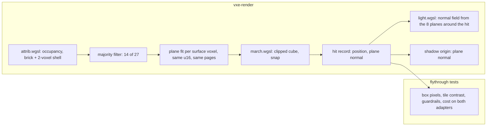

# 0053: One-voxel features on the contour surface: a box metric, a majority-filtered plane fit, a normal field, and the owner's call

> **Status:** approved
> **Approved:** 2026-10-30 (owner, as drafted; the order against Plan 0051 and the two cost bars stay the owner's to set)
> **Created:** 2026-10-30
> **Milestone:** M2 in [`docs/roadmap.md`](../roadmap.md) (the surface-look decision: "smooth
> and natural rock, not visible cubes")
> **Related ADRs:** [ADR-0011](../adrs/0011-contour-planes-in-attribute-pages-with-procedural-detail.md)
> (the per-voxel plane, whose one-clipped-cube shape this plan measures the limits of);
> [ADR-0039](../adrs/0039-the-contour-walk-closes-a-crack-at-the-passed-voxels-exit.md)
> (snap, the closing rule this plan builds on);
> [ADR-0040](../adrs/0040-one-voxel-features-melt-into-the-contour-surface-by-a-majority-fit-and-a-normal-field.md)
> (proposed: the majority fit and the normal field; Phase 4 accepts or supersedes it).
> **Source:** the owner at Plan 0050's Phase 5 (2026-10-30, screenshots in that worktree's
> untracked `live/p5/`): voxel-sized flat-faced boxes at the vein and the patch, in `old` and
> in snap alike, reading class 0 in the cracks view. "We are not able to proceed with this bug
> forward. Either we fix it, or if it is unfixable, we will not use contours."
> **Starts after:** Plan 0050 merges (its Phase 6 deletes the losing rules this plan would
> otherwise carry, and its pose rigs, cracks records and snap default are this plan's base).
> Alone on main. Its order against Plan 0051 is the owner's call; the architect's proposal is
> before it, since Phase 4 decides whether the contour look stays, which Plan 0051's look
> readings assume.

## TL;DR

The boxes are not cracks: ADR-0011's surface is one cube per solid voxel clipped by one
plane, and the plane of a one-voxel feature is fit from a neighbourhood its base surface
dominates, so a rod keeps a flat top and cube-face sides, and the normals around it tilt in
three hard-edged tiles. This plan first measures that (a box metric and a tile-contrast
metric on six one-voxel scenes and at the two poses, with the owner's neighbour-clipping
hypothesis read as a scratch), then builds two changes behind settings: the plane fit on a
majority-filtered occupancy, which melts one-voxel features into the surface under them with
no walk or storage change, and a shading normal that is a trilinear field over the planes,
which removes the tile edges everywhere. The owner compares today's look, each change and
both at the two poses, beside a cubes-shaded-by-the-field preset that is the fallback if
contours go. The pick lands as the default and ADR-0040 is accepted; if the eye still refuses,
the next plan is the field surface or the fallback, the owner's call. The first thing anyone
sees is a test that prints how many pixels at each pose land on an exposed cube face of a
voxel with two or more air faces, and a rod on a floor that reads hundreds of them.

## Context & problem

`project-context.md` (Rendering, P0): first person, stable at arm's length, smooth natural
rock. A 10 cm box with three flat tones on a smooth wall reads as a rendering fault and
survives every lighting fix. The owner will not ship the contour look with it.

**What the tree does (ADR-0011, `attrib.wgsl` `voxel_attr`, `march.wgsl` `contour_test`;
read from the code and the formula, measured only as Phase 1 says):**

- The attribute pass fits each surface voxel a plane: the normal from the 27-voxel occupancy
  gradient (weighted, Plan 0039), the offset `(count / 27 - 0.5) * 3` voxels along it,
  clamped to `[-0.875, 0.875]`. The surface mask (the voxels that get an attribute) is the
  CPU's: solid voxels with an air face neighbour.
- The walk clips the voxel's cube by its plane. A ray entering the cube already inside the
  half-space hits the cube face (kind 1); one crossing the plane inside hits the plane
  (kind 3); one staying outside passes (kind 2), and snap closes the crack at the passed
  voxel's exit.
- **A rod on a flat floor:** the rod voxel reads count 12, offset -0.167, normal straight up:
  a slab a third of a voxel high with cube-face sides. The floor voxels beside it read count
  21, offset 0.833 (beyond the cube) and normals tilted about 20 degrees toward the rod.
  Three flat tiles, three tones. **A one-voxel groove:** its bottom voxel reads count 24
  (a flat cube face), its side voxels count 15 with normals tilted 25 degrees into it,
  opposite ways. **A lone cube on a flat floor** reads count 10: a plate a ninth of a voxel
  high; the owner's lone cubes stand where the count leaves the whole cube. **A free pillar
  or a sheet** has a vanishing gradient and no plane: full cubes.
- Plan 0050's Phase 5 scratch (not committed) found 2 of 82 944 hits at the vein and 0 at
  the patch on a voxel without a plane: the boxes are planed voxels hit on their cube faces.

**Why no closing rule reaches them:** the cube faces are hit directly from air, with no pass
before them. The clipped cube removes material from the feature voxel's own cube; a smooth
rod flares onto the floor beside it and a smooth groove is a fillet, and both lie in the
neighbouring air cells.

**The `nfr.md` figures touched:** §2 the hit pass (snap alone: RTX 3080 Laptop 0.604 ms,
Radeon RENOIR 4.364 ms at the level's spawn, 1080p from 720p) and the light pass (0.913 and
7.026 ms), the attribute pass (the level's fill 17.0 ms under the weighted fit, Plan 0039;
the flight's p50 and p99 of Plan 0013); §3 mirror bytes (157 872 640 B live at the level),
which no phase here moves.

## Decision

Measure, then two cheap changes, then the owner's call. Phase 1 defines the box and
tile-contrast metrics, reads them on six one-voxel scenes and at the poses, and reads the
owner's neighbour-clipping hypothesis and the existing offset knobs as scratches, so the
mechanism is named by a number before anything is built. Phase 2 fits the plane on a
majority-filtered occupancy inside the attribute pass (ADR-0040): one-voxel features melt into
the surface under them, with the mask, the attribute, the walk and the storage unchanged.
Phase 3 shades with a normal field, the trilinear blend of the eight surrounding planes'
normals at the hit point, and builds the cubes-shaded-by-the-field preset. Phase 4 is the
owner's windowed check of five looks at both poses. Phase 5 lands the pick, removes the
losers and re-blesses by name.

We rejected neighbour clipping because it only removes material from the feature's cube
(worked in ADR-0040, read in Phase 1). We deferred the field surface (the trilinear zero set
of the 27-fraction, watertight and corner-filleting) because it needs attributes on air voxels
and a walk cost no one has measured; it is the next plan if Phase 4 refuses. We deferred
dilation for the same storage. We rejected a wider per-voxel normal fit because it keeps one
constant per voxel. Dropping contours for cubes shaded by the field is built as the fallback,
not chosen.

**The analytic window rule** of Plan 0050 holds: analytic bars count hits at least 2 voxels
inside the mirror window and print what they left out.

## Architecture diagram



## Implementation phases

Each phase ships as its own commit. `dev` implements all phases in one session with no review
between phases. The architect reviews once at the end, in a fresh session. Lane rule 9c
applies: exploratory sweeps may run on the RTX 3080 Laptop through `VXE_TEST_ADAPTER`,
labelled with the adapter; every asserted reading, golden and gate stays on lavapipe.

### Phase 1: The box spike: two metrics, six scenes, the poses, and the hypotheses read
- **Owner skill:** dev
- **What:** two metrics over the hit records and the CPU world, six one-voxel scenes on a
  flat floor, the readings at the poses, and the hypotheses as scratches. No default, hit or
  shader change.
- **The box metric** (`tests/look.rs`, from the hit positions, the hit records and the CPU
  world): a *box pixel* is a hit pixel whose hit point lies on a cube face (a coordinate
  within 1e-3 of an integer, as Plan 0050's scratch read it) of a solid voxel with two or more
  air face neighbours in the world. A flat floor's face hits have one air face and do not
  count; a convex edge voxel whose exposed faces its plane cuts away has no face hit and does
  not count. Each box pixel is also sorted by the voxel's 27-count: under 14 (a protrusion the
  majority filter melts) or 14 and over (a groove, a corner, a two-voxel feature: what the
  filter leaves), and by the voxel's air faces (2, 3, 4 or more).
- **The tile-contrast metric:** over horizontally and vertically adjacent hit-pixel pairs
  whose hit points lie within 1.5 voxels of each other (one surface, no depth edge), the share
  whose shading normals differ by more than 15 degrees, read in the normals view with detail
  off. It reads the hard tile edges; a smooth curved wall's neighbours differ by a few
  degrees and do not count.
- **The scenes** (`tests/support/rigs.rs`, each `floor_world` with a feature on its top
  layer at `z = 64`, seen from about 1 m at the floor camera's pitch, or `wall_world` with
  the feature on its face): `rod` (one voxel high and wide, 12 long along x, on the floor);
  `lone cube`; `groove` (one wide, one deep, 12 long, cut into the floor's top layer); `wall
  pillar` (a one-voxel column 6 high standing against the wall, the owner's pillars); `ridge`
  (two wide, one high, 12 long: the two-voxel feature the filter keeps, a reading of what
  remains); `free pillar` (a one-voxel column 6 high on the floor, touching nothing) and
  `sheet` (one thick, 8 high, 12 long, on the floor): the two hazards ADR-0040 names, whose
  upper rows keep an empty filtered neighbourhood and stay cubes. The bare floor is the
  control.
- **The readings:** box pixels by count class and air faces, the tile-contrast share, and
  the crack classes, per scene and at `VEIN_POSE` and `PATCH_POSE` (384 x 216, the pose's
  exposure, indirect off, lamp on and off), in the start look (snap). A side-by-side per pose
  under `live/boxes/`: the shaded image, the normals view, and the shaded image with box
  pixels painted red, so the owner can see the metric lands on the boxes they photographed.
- **The hypotheses, as scratches** (readings only, reverted, as Plan 0050's clamp sweep):
  - **neighbour clipping** (ADR-0040 Alternative A): a kind 1 hit on an exposed cube face
    also requires the entry point inside the solid half-spaces of the planes of the voxel's
    face neighbours that carry one; else the walk advances along the segment to the first
    point inside all of them, or passes. The prediction to confirm or refute: the rod's side
    face shrinks (box pixels fall by about a third on `rod`), the groove's do not move;
  - `PlaneOffset::VolumeMatched` and the offset clamp at 0.5 (the knobs Plan 0050 swept), on
    the six scenes: the prediction is no change on `rod` (both give -0.167 for an axis
    normal).
- **Files touched:** `apps/flythrough/tests/look.rs` (the metrics, the table, the
  side-by-sides), `apps/flythrough/tests/support/rigs.rs` (the six scenes), this plan's log.
- **Done when:**
  1. `one_voxel_features_render_as_boxes_today` asserts on lavapipe, under the analytic window
     rule, that `rod`, `lone cube`, `groove` and `wall pillar` each read at least 1 box pixel
     in the start look and the bare floor reads 0 (the readings are printed). If `rod` reads
     0, dev stops for the architect: the metric or the mechanism is wrong.
  2. `box_readings` (ignored, a reading) prints the table for every scene and pose, today's
     look and each scratch, with the count-class and air-face splits and the tile-contrast
     share; the log carries it.
  3. The side-by-sides exist for both poses and the log says in one line per pose whether
     the red pixels land on the owner's rods, pillars and cubes, or where they do not.
  4. The log states, per scratch, the prediction and the reading.

### Phase 2: The plane fit on a majority-filtered occupancy
- **Owner skill:** dev
- **What:** behind `SurfaceFit::filter` (`OccupancyFilter::None | Majority`, reaching the
  attribute pass through its fit bits, `--fit-filter none|majority` and the banner), the
  attribute pass loads the brick's occupancy with a two-voxel shell (a 12-cube), computes
  each inner cell's 27-count, and fits every attributed voxel's plane on the filtered
  occupancy (solid when the count is at least 14). A voxel whose filtered neighbourhood is
  all solid keeps a plane whose normal is the unfiltered fit's and whose offset is the clamp
  (a cube face with the hull's normal); one whose filtered neighbourhood is empty has no
  plane (a cube, as today). The surface mask, the attribute's encoding, the walk and the
  storage do not change. The work list's 26 neighbours cover the two-voxel reach.
- **Files touched:** `crates/vxe-render/src/shaders/attrib.wgsl` (the 12-cube, the counts,
  the filtered fit), `crates/vxe-render/src/marcher.rs` and `gpu_world.rs` (the setting and
  its bit), `apps/flythrough/src/lib.rs`, `main.rs`, `hud.rs` (the flag, the banner),
  `apps/flythrough/tests/look.rs`, `crates/vxe-render/tests/mirror.rs` (a filtered
  attribute pinned), this plan's log.
- **Done when:**
  1. `the_majority_fit_melts_one_voxel_features` asserts on lavapipe that `rod`, `lone cube`
     and `wall pillar` read 0 box pixels under the filter and that the bare floor and the
     floor and wall scenes of Plan 0050 read the same hit mask and normals view byte for byte
     with and without it (every voxel next to their surfaces counts 18: nothing is filtered).
     The tilted and 45-degree slabs are readings: a slab voxel whose centre lies just inside
     the plane counts under 14 and melts, so their images move a little, and their crack
     classes 1 and 2 must stay 0. `groove` and `ridge` are readings in the table.
  2. A mirror test pins the rod voxel's attribute under the filter: normal `(0, 0, 1)`, offset
     code 3 (offset -0.5, its bottom face), and the floor voxel beside it the flat floor's
     attribute (offset code 11), bit-exact.
  3. `free pillar` and `sheet` under the filter are read, not barred: the log records their
     hit counts against today's and where their lower rows thin and their upper rows stay
     cubes (ADR-0040's hazard, stated as the reading).
  4. The box and tile-contrast tables of Phase 1 are re-read at both poses under the filter,
     with the crack classes (classes 1 and 2 stay 0 under snap: the filter must open no crack)
     and Plan 0039's guardrails (cavity normal error at most 12 degrees, pillar silhouette at
     most half of face mode's, `A` at most 10 %).
  5. The attribute pass's cost: the level's initial fill and the autopilot flight's p50 and
     p99 on both adapters, filter off and on, three alternated runs, release, perf lock; the
     bar is 1.8x (a guess from 1728 against 1000 cells loaded; the owner may move it).
     `mirror_bytes` and `allocated_bytes` equal the pre-plan binary's.

### Phase 3: The normal field, and the cubes-shaded-by-the-field preset
- **Owner skill:** dev
- **What:** behind `SurfaceTuning::normal_field` (a flag bit, `--normal-field on|off`, the
  banner), the light pass shades a contour hit with the normalised trilinear blend, over the
  eight voxel centres around the hit point, of the plane normals of the voxels that carry one
  (air, no-plane and eroded-to-no-plane voxels contribute nothing; where nothing contributes,
  the hit's own normal). The hit record and the shadow origin keep the plane normal; the
  normals view and the detail tilt take the field. Where the eight reads happen (the hit pass
  writing a second normal, or the light pass reading the attributes at the hit position) is
  dev's call under the cost bar; the hit record's layout is not grown. A look preset
  `cubes-field` hits every voxel as a cube (the plane test off) and shades with the field:
  ADR-0040's Alternative D, the fallback the owner compares.
- **Files touched:** `crates/vxe-render/src/shaders/light.wgsl` (the field), `march.wgsl`
  (the plane test off for the preset, the field if it lives in the hit pass),
  `composite.wgsl` (the normals view), `crates/vxe-render/src/marcher.rs`,
  `apps/flythrough/src/lib.rs` (`LookPreset::CUBES_FIELD`), `main.rs`, `hud.rs`,
  `apps/flythrough/tests/look.rs`, `sharpness.rs`, this plan's log.
- **Done when:**
  1. `the_normal_field_has_no_tile_edges` asserts on lavapipe that `rod`, `lone cube`,
     `groove` and `ridge` read 0 tile-contrast pairs under the field (filter off and on) and
     that the hit mask of every scene is byte for byte the same with the field on and off (the
     field moves no hit).
  2. Plan 0039's guardrails under the field: cavity normal error at most today's 7.13 degrees
     (the blend rule read 5.81 with a related normal), `A` at most 10 %, the silhouette
     unchanged; the speck test's reading at most today's.
  3. `cubes-field` reads the face silhouette (172 px against the pillar) and a cavity normal
     error at most 12 degrees; the banner names it.
  4. The cost: the hit and light passes at the level's spawn on both adapters, field off and
     on, filter on, three alternated runs against the Plan 0050 close binary, release, perf
     lock, 1080p from 720p. The bar: hit plus light within +10 % (RTX) and +20 % (Radeon), a
     guess the owner may move; the reading goes to the log either way, and a miss does not
     stop the phase, since Phase 4 weighs the look against the cost.
  5. The box and tile-contrast tables at both poses under each of the four combinations
     (filter off/on, field off/on) and under `cubes-field`, with the crack classes.

### Phase 4: The owner's windowed check
- **Owner skill:** human
- **What:** the owner runs the release fly-through at `--pose vein` and `--pose patch`, lamp
  on and off, shaded and normals views, in five looks: today's (snap), `--fit-filter
  majority`, `--normal-field on`, both, and `--look cubes-field`, looking at the rods and
  pillars along walls and ledge edges and the lone cubes on floors and ceilings from the Phase
  5 screenshots of Plan 0050, and at the steps that remain at ledge corners.
- **Files touched:** this plan's log.
- **Done when:** the owner records one of: (a) a pick among the first four becomes the
  default, with the cost reading of Phase 3 accepted or a bar set; (b) the boxes or the steps
  still fail the eye, and the owner chooses between the field surface (ADR-0040 Alternative B,
  the next plan, drafted after this check with the cost spike as its Phase 1) and
  `cubes-field` as the default (contours dropped, ADR-0011 superseded). Either way Phase 5
  runs.

### Phase 5: The pick as the default, the losers removed
- **Owner skill:** dev
- **What:** the owner's pick becomes the contour looks' default (or `cubes-field` the
  fly-through's), the goldens that move are re-blessed by name under Plan 0050's owner answer
  2 (the face goldens must not move), the readings go to `nfr.md` §2, and the losing settings
  are removed with their flags and banner modes as Plan 0048's rule says, unless the owner
  keeps one for comparison. ADR-0040 is accepted at the close on (a), or marked superseded
  with the owner's choice on (b).
- **Files touched:** `apps/flythrough/src/lib.rs` (the default), the moved goldens,
  `apps/flythrough/tests/look.rs`, `docs/nfr.md` §2, the files of Phases 2 and 3 for the
  removals, this plan's log.
- **Done when:**
  1. `the_contour_surface_has_no_one_voxel_boxes` asserts on lavapipe, at the default, 0 box
     pixels on `rod`, `lone cube` and `wall pillar` under the analytic window rule, 0 tile-contrast
     pairs on `rod`, `lone cube`, `groove` and `ridge`, and at both poses box pixels at most
     the pick's Phase 3 reading and classes 1 and 2 at 0. On (b) with `cubes-field` the test
     asserts the tile-contrast bars and the face silhouette instead, and says so.
  2. Every moved golden is named in the log with its share of pixels over 2/255; no face
     golden moved.
  3. The hit, light and attribute pass readings on both adapters are in `nfr.md` §2 with
     machine, commit and load; mirror bytes are unchanged.
  4. No losing setting's flag remains in `--help` or the banner.

## Data shapes

```rust
// illustrative: vxe-render
pub enum OccupancyFilter { None, Majority }   // the fit's occupancy; a bit in the attribute pass's fit word
pub struct SurfaceFit {
    pub fit: PlaneFit,                // unchanged
    pub offset: PlaneOffset,          // unchanged
    pub filter: OccupancyFilter,      // new; lives in the mirror like `fit`
}
pub struct SurfaceTuning {
    pub fit: SurfaceFit,
    pub face_mix: f32,                // unchanged
    pub closing: CrackClosing,        // Plan 0050's
    pub shadow_push: bool,            // Plan 0050's
    pub normal_field: bool,           // new; a spare Params flag bit
}
// The attribute's u16, its pages, the surface mask, the hit record and the pool layout do not
// change. `cubes-field` is a LookPreset, not a new NormalMode.
```

## Budgets

| `nfr.md` figure | Base (read) | Expected | How the close measures it |
|---|---|---|---|
| §2 the hit pass and the light pass | level spawn, 1080p from 720p, snap alone: RTX 0.604 + 0.913 ms, Radeon 4.364 + 7.026 ms (Plan 0050) | filter: 0 (the walk is unchanged). Field: eight attribute reads per shaded pixel, **a guess** of +5 to +10 % RTX, +10 to +20 % Radeon on hit plus light | `flythrough --level --seed 1 --headless --render 1920x1080 --frames 300 --adapter NVIDIA\|AMD` per setting and the Plan 0050 close binary, alternated, release, perf lock, memory cap, three quiet runs; bar in Phase 3 |
| §2 the attribute pass | the level's fill 17.0 ms (weighted fit, dev box, Plan 0039); the flight's p50 2.0 / p99 4.3 ms GPU (Plan 0013, dev box) | filter: a 12-cube loaded and 1000 counts of 27 before 512 fits of 27, **a guess** of 1.5 to 1.8x | the initial fill and `--autopilot --headless --seed 1` p50 and p99 on both adapters, filter off and on, three alternated runs; bar 1.8x in Phase 2 |
| §3 mirror bytes | 157 872 640 B live, 259 203 264 B allocated at the level (Plan 0050) | 0 | `mirror_bytes` and `allocated_bytes` equal the pre-plan binary's in every run |

Determinism is not touched: everything is in `vxe-render`, a client-side view.

## Risks & open questions

- **The metric may not land on the owner's boxes.** Phase 1's side-by-sides are the check;
  if the red pixels miss the photographed rods, dev stops and the architect re-reads the hit
  records with the owner's screenshots in hand.
- **Features under the filter change while they still collide.** A rod, a lone cube or a
  one-voxel bump on a surface melts into it; a free pillar or a sheet keeps its upper rows as
  cubes over a thinned base (ADR-0040's negative consequence). Phase 2 reads both and the
  owner sees them at Phase 4. A per-material opt-out of the filter is a followup if the
  consumer asks.
- **Two-voxel features keep flat sides and concave corners stay cubes.** The field normal
  shades them smoothly; the geometric step stays. Phase 4's outcome (b) names the field
  surface for them.
- **The field's cost on the slow adapter.** Eight attribute reads per shaded pixel through
  the popcount addressing. The bar is a guess; the reading, the look and the owner decide.
- **The attribute pass under flight.** A 12-cube in workgroup memory and 1000 extra counts
  per brick: Plan 0023's hitch budget is on the render thread's CPU, which this does not
  touch, but the GPU pass under the autopilot is read on both adapters.
- **Snap and the filter.** An eroded voxel's plane is at or beyond its cube on the air side,
  so rays pass it or cross onto the hull: classes 1 and 2 must stay 0. Phase 2's done-when 4
  reads it.

## What this plan does NOT do

- Build the field surface (ADR-0040 Alternative B) or dilation (Alternative C): the next plan
  on Phase 4's outcome (b), with its own storage and walk cost spike.
- Change the attribute's encoding, the surface mask, the pages, the hit rule or the closing
  rule.
- Give the LOD ring's mip cells a plane, or touch the lighting beyond which normal it shades
  with (Plan 0051 is the light spike).
- A per-material opt-out of the filter.

## Implementation log

> Written by `dev`: one row per phase as its commit lands, then the close block. **The phases
> above are the contract. This section records what happened.** Observations, never conclusions:
> no pass list, no self-assessment. Deviations and unmet done-whens are **always** disclosed.
> Keep it shorter than `## Implementation phases`.

| phase | owner | state | commit |
|---|---|---|---|
| 1: The box spike: two metrics, six scenes, the poses, and the hypotheses read | dev | not started | |
| 2: The plane fit on a majority-filtered occupancy | dev | not started | |
| 3: The normal field, and the cubes-shaded-by-the-field preset | dev | not started | |
| 4: The owner's windowed check | human | not started | |
| 5: The pick as the default, the losers removed | dev | not started | |

### Notes

_(Deviations from the plan, with the commit, stated without justification. Done-whens not
satisfiable as stated, and what was done instead. Followups noticed and not acted on. One line
each. Empty is fine.)_

### Close triggers

_(Facts for the architect. No recommendations, and no suggested version bump.)_

- **What shipped:**
- **Public API changed:**
- **Budget readings:**
- **Gate at the tip:**
- **Outstanding `human` phases:**

## Followups
