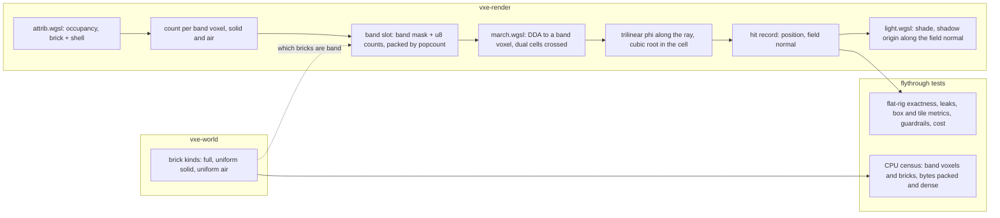

# 0054: The field surface: the trilinear zero set of the 27-fraction, a cost-and-look spike first, then band storage and the walk if the owner picks it

> **Status:** in-progress
> **Approved:** 2026-10-30 (owner, as drafted; the storage and cost bars are set at Phase 2 on Phase 1's readings)
> **Created:** 2026-10-30
> **Milestone:** M2 in [`docs/roadmap.md`](../roadmap.md) (the surface-look decision: "smooth
> and natural rock, not visible cubes")
> **Related ADRs:** [ADR-0011](../adrs/0011-contour-planes-in-attribute-pages-with-procedural-detail.md)
> (the per-voxel plane this surface would replace);
> [ADR-0039](../adrs/0039-the-contour-walk-closes-a-crack-at-the-passed-voxels-exit.md)
> (snap, which a field surface makes moot);
> [ADR-0040](../adrs/0040-one-voxel-features-melt-into-the-contour-surface-by-a-majority-fit-and-a-normal-field.md)
> (whose Alternative B this plan is, and whose Alternative D stays the last fallback). The
> field surface's own ADR (encoding, normal source, what the planes' removal leaves) is
> drafted after Phase 1's readings and accepted or dropped at this plan's close.
> **Source:** the owner at Plan 0050's Phase 5 ("fix it, or if it is unfixable, we will not
> use contours") and the owner's answers of 2026-10-30: the spike runs before Plan 0053's
> windowed check so one session compares every candidate; the storage and cost bars are set
> on Phase 1's readings, the hard line being `nfr.md` §3's 3 GB at `r_full` 16.
> **Starts after:** Plan 0050 Phase 6 and Plan 0053 Phases 1 to 3, stacked on the `plan-0053`
> branch at its Phase 3 tip, so the scratch look sits in the binary the owner compares. Phase 2
> here and Plan 0053's Phase 4 are one windowed session. Phases 3 to 5 run only on the owner's
> pick (a) and then alone on main.

## TL;DR

The per-voxel plane (ADR-0011) is one cube clipped by one plane fit from binary occupancy,
and it cannot represent anything smaller than its own kernel: one-voxel rods, pillars and
lone cubes stay boxes (Plan 0050 Phase 5), two-voxel ridges and concave corners stay steps
even after Plan 0053's filter and normal field. The field surface is the surface those planes
approximate: store at every voxel within one voxel of rock, on both sides, its solid count
over the 27-neighbourhood, define `phi = count / 27 - 0.5`, and hit the ray where the
trilinear interpolation of `phi` over the eight surrounding voxel centres crosses zero. It is
watertight by construction (no cube face, no crack, no closing rule), it melts a one-voxel rod
into a bump a third of a voxel high (worked below), rounds convex edges and fillets concave
corners, and it is what every shipped smooth voxel renderer does, meshed or marched
(`docs/references/voxel-optimizations.md`, ESVO and the isosurface entries). Its price is
field values on air voxels, so air bricks beside rock need a mirror slot, and a cubic solve per
dual cell the ray crosses. Phase 1 builds it as a scratch (dense storage, no size classes) so
the owner sees it in the window beside Plan 0053's looks and the hit pass is measured on both
adapters, and counts the real storage on the level and the flight. If the owner picks it,
Phases 3 to 5 build the band slots, make it the default and remove the planes. The first thing
anyone sees is `--look field` in the fly-through and a test that reads every hit on the flat
floor rig at `z = 64` within a thousandth of a voxel.

## Context & problem

`project-context.md` (Rendering, P0): first person, stable at arm's length, smooth natural
rock. The owner will not ship a contour look with 10 cm boxes on the walls.

**Where the surface stands.** ADR-0011's plane, ADR-0039's snap (Plan 0050: classes 1 and 2
at 0, hit pass +1.0 % RTX, +2.3 % Radeon) and Plan 0053's two changes (the plane fit on a
majority-filtered occupancy, a trilinear normal field over the planes) give a surface whose
remaining faults are geometric: one-voxel features gone or boxed, two-voxel features and
concave corners stepped, shaded smooth. ADR-0040 deferred the field surface for two unmeasured
costs, the air-side storage and the walk, and named it the next plan if the owner's eye
refuses the steps. The owner chose (2026-10-30) to measure it before that check rather than
after.

**What the field is, worked from the formula (not measured; Phase 1 measures it):**

- **A flat floor**, solid below `z = 64`. The top solid layer counts 18 (`phi = +1/6`), the
  air layer above counts 9 (`phi = -1/6`); the zero crossing is their midpoint, `z = 64`,
  exactly the cube face. Flat walls do not move. The same holds for every axis-aligned face.
- **A rod on the floor** (one voxel high and wide, along x). The rod voxel counts 12
  (`phi = -0.056`), as do the air voxels beside it in its layer; the floor voxels under and
  within one voxel of it count 21 (`+0.278`). The crossing between the floor layer and the
  rod's layer sits at `0.278 / 0.334 = 0.83` of the way up: a bump 0.33 voxel high and three
  voxels wide, with no vertical face. A lone cube (count 10, floor under it 19) is a bump 0.11
  voxel high. Plan 0053's filter flattens both completely; the field keeps a hint of them.
- **A convex 90-degree edge voxel** counts 12 (`-0.056`): its centre lies just outside, the
  edge is rounded over about one voxel. **A concave corner's air voxel** counts 15 (`+0.056`):
  it is filleted. A one-voxel groove's bottom voxel counts 24 and its air cell 15: the groove
  is a shallow trough, not a slot with a flat floor.
- **A free one-voxel pillar or sheet** has centres at `-0.056` with air at `-1/6` or lower
  around them: the pillar's rows above the base thin to a bump at the base and vanish above
  it. The hazard ADR-0040 names for the filter is the field's too, in a different shape.

**Why the blend rule's cost is not this plan's cost.** Plan 0050's `blend` was a trilinear
field over plane distances evaluated by two secant steps per voxel stepped, with eight
`lookup`s and eight attribute decodes per evaluation: 5.5x and 8.2x the hit pass at 128 VGPRs.
This plan stores a scalar per voxel (a `u8` count), evaluates once per dual cell crossed with
the cubic solved analytically, and reads the band from a mask, so the per-cell work is eight
byte reads and one cubic. That it lands near ADR-0040's guess of 1.3x to 2x is the thing
Phase 1 reads; nothing here assumes it.

**The `nfr.md` figures touched:** §2 the hit pass (snap alone: RTX 3080 Laptop 0.604 ms,
Radeon RENOIR 4.364 ms at the level's spawn, 1080p from 720p), the light pass (0.913 and
7.026 ms), the attribute pass (the level's fill 17.0 ms under the weighted fit, dev box; the
flight's p50 and p99); §3 the mirror (157 872 640 B live and 259 203 264 B allocated at the
level; the flight's full residency 871 679 852 B live of 3 221 014 080 B allocated at `r_full`
16, under the 3 GB line).

## Decision

Measure first, in the owner's binary. Phase 1 builds the field surface as a scratch look
(`--look field`): a dense field pool beside the mirror (nine units per band brick, a direct
index, no size classes), the attribute pass's own occupancy shell producing the counts for
every band brick including the air and uniform-solid bricks beside rock, and a walk that tests
dual cells from a band mask and solves the trilinear crossing per cell. It reads the hit and
light passes on both adapters, the box, tile-contrast and guardrail metrics of Plans 0039 and
0053, the flat-rig exactness, a leak count, two normal sources, and a CPU census of the band's
real storage packed and dense. Phase 2 is the owner's windowed check, the same session as
Plan 0053's Phase 4, with the field surface as a sixth look. On pick (a), Phase 3 builds the
band slots in the size-classed mirror (a new slot class for air-side bricks, counts packed by
popcount, the sync and the pressure rule aware of them), Phase 4 makes the field the default
walk with the normal source Phase 1 picked and removes the planes, snap and Plan 0053's
losers, and Phase 5 lands the readings and the ADR.

We rejected finishing on the plane (Plan 0053 alone) as the only path because its ceiling is
now known and the owner wants the alternative measured before judging. We rejected a tricubic
or wider reconstruction for the surface itself because the 27-count is already a box filter
and the trilinear zero set of it is C0 across cells, which is all watertightness needs; the
normal is where smoothness is read and Phase 1 compares two sources for it. We rejected
dilation (ADR-0040 Alternative C) because the field fillets concave corners by itself. We
keep `cubes-field` (Alternative D) as the last fallback, built by Plan 0053.

**The analytic window rule** of Plan 0050 holds: analytic bars count hits at least 2 voxels
inside the mirror window and print what they left out.

## Architecture diagram



## Implementation phases

Each phase ships as its own commit. `dev` implements Phase 1 in the stacked lane, stops for
the owner's Phase 2, and implements Phases 3 to 5 in one session on main after pick (a). The
architect reviews once at the end, in a fresh session. Lane rule 9c applies: exploratory
sweeps may run on the RTX 3080 Laptop through `VXE_TEST_ADAPTER`, labelled with the adapter;
every asserted reading, golden and gate stays on lavapipe.

### Phase 1: The field as a scratch look: dense storage, the walk, the readings and the census
- **Owner skill:** dev
- **What:** `LookPreset::FIELD` (`--look field`, the banner names it) renders the field
  surface from a scratch pool, with every reading below. No default changes; the plane looks
  are untouched byte for byte with the field off.
- **The band.** A voxel is in the band when its 27-count is neither 0 nor 27. A brick is a
  band brick when it holds a band voxel: every Full brick with a surface voxel, every
  uniform-solid brick with an air voxel within one voxel of it, every uniform-air brick with a
  solid voxel within one voxel of it. The field's occupancy is the attribute pass's occupancy
  today (dev states in the log whether translucent voxels count as solid or air there, and
  keeps it).
- **The scratch pool.** A separate storage buffer: per band brick in the mirror window, nine
  units (one band mask of 512 bits, eight units of 512 `u8` counts in voxel order), indexed by
  a per-record table of 512 `u32` parallel to `chunk_records` (an index or `ABSENT`). Filled
  by the attribute pass from its 10-cube occupancy shell (the counts of the brick's own 512
  voxels fall out of it), with the work list extended to the air and uniform-solid band bricks
  the 26-neighbour reach already visits. Allocation is a bump allocator over the window,
  rebuilt on a window move; it is a scratch and the log says so.
- **The walk.** The DDA runs as today to the first band voxel the ray enters (the band mask
  read where the opaque mask is read now; a band-air brick has a zero opaque mask and a slot
  index). Inside a band voxel the ray's segment is split at the voxel's three mid-planes into
  the dual cells it crosses (at most four), and in each cell whose eight corner `phi` values
  mix signs the trilinear `phi` along the segment is a cubic in `t`, solved by Marmitt et
  al.'s root isolation (`docs/references/voxel-optimizations.md`, the isosurface entry) or by
  bracketing the sign change and two Newton steps, dev's call under the cost bar; the first
  root on the segment is the hit. A cell whose corners are all solid is a hit at the segment's
  start (the ray is inside rock, which only happens where the band is incomplete; counted as
  a leak). Rays that leave the band into a solid voxel of count 27 without a hit are leaks,
  counted per frame in the cracks view's place.
- **The normal, two sources read:** N1, the analytic gradient of the trilinear `phi` at the
  hit; N2, the trilinear blend at the hit of the eight corner voxels' 27-gradients (Plan 0053
  Phase 3's field, read through the plane attribute where one exists; for an air corner the
  gradient of the occupancy around it, computed in the attribute pass into the scratch pool's
  spare bits or a tenth unit). N1 costs nothing to store and is discontinuous across cell
  faces; N2 is smooth and costs a normal per band voxel. Both are selectable in the scratch
  (`--field-normal analytic|blend`) and read on the tile-contrast metric.
- **The readings** (lavapipe for every asserted figure, both adapters for cost, release, perf
  lock, three alternated runs against the lane's base binary):
  - the flat rigs: `floor` and `wall`, every hit's distance from the plane of the voxel face;
  - the six one-voxel scenes of Plan 0053 and its tilted, 45-degree and diagonal slabs, the
    cavity and the pillar: box pixels (by Plan 0053's metric), tile-contrast share under N1
    and N2, leaks, hit count against the plane look;
  - Plan 0039's guardrails: cavity normal error, pillar silhouette (face 172 px, contour
    32 px), `A`; the speck test;
  - `VEIN_POSE` and `PATCH_POSE` at 384 x 216, lamp on and off: box pixels, tile contrast,
    leaks, side-by-sides under `live/field/` (shaded, normals view, the plane look beside);
  - cost: the hit and light passes at the level's spawn, 1080p from 720p, field against the
    lane's base look, RTX 3080 Laptop and Radeon RENOIR, with RADV shader stats (VGPRs) for
    the hit shader; the attribute pass's initial fill and the autopilot's p50 and p99, both
    adapters;
  - the census (CPU, headless, over the world through `vxe-world`'s public queries): band
    voxels solid-side and air-side, band bricks by kind (Full, uniform solid, uniform air),
    on the level at `--seed 1` and over the streamed flight's full residency; the bytes
    packed (one mask unit plus `ceil(n / 64)` units of `u8` per band brick, plus two header
    units for a brick that has no slot today) and dense (nine units per band brick), against
    today's attribute bytes and the live totals of `nfr.md` §3.
- **Files touched:** `crates/vxe-render/src/shaders/attrib.wgsl` (the counts, the air and
  uniform-solid work items), `march.wgsl` (the band read, the dual cells, the cubic, N1 and
  N2), `light.wgsl` (the shadow origin along the field normal), `composite.wgsl` (the normals
  view, the leak count in the cracks view's place), `crates/vxe-render/src/marcher.rs` and
  `gpu_world.rs` (the scratch pool, the index table, the work list), `lib.rs`,
  `apps/flythrough/src/lib.rs` (`LookPreset::FIELD`), `main.rs`, `hud.rs` (the flags, the
  banner), `apps/flythrough/tests/look.rs`, `sharpness.rs`, `level_mirror.rs` (the census),
  `tests/support/rigs.rs`, this plan's log.
- **Done when:**
  1. `the_field_surface_lies_on_the_flat_faces` asserts on lavapipe, under the analytic
     window rule, that every hit on `floor` lies within 1e-3 voxel of `z = 64` and every hit
     on `wall` within 1e-3 of its face plane, and that both read 0 leaks; the hit counts are
     printed beside the plane look's.
  2. `the_field_surface_has_no_boxes_and_no_leaks` asserts 0 box pixels on `rod`, `lone
     cube`, `groove`, `wall pillar` and `ridge`, 0 leaks on every analytic scene and at both
     poses, and prints the tile-contrast share under N1 and N2 for every scene. Amended
     2026-10-31 (architect, owner's pick): under the field look a box pixel also needs its
     shading normal within 15 degrees of the face's axis normal; a curved-surface hit that
     happens to lie within 1e-3 of a face plane is not a box. The plane look's metric is
     unchanged. The counts under the unamended metric (9, 0, 8, 2, 10) stay in the log, and
     the rod's flat top at z = 60.333 is named there for the owner's eye in Phase 2. If any scene
     reads leaks, dev stops for the architect: the band definition or the cell test is wrong.
  3. `field_readings` (ignored, a reading) prints the full table: every scene and pose, N1
     and N2, box pixels by count class, tile contrast, leaks, guardrails, the speck test, hit
     counts against the plane look; the log carries it and names, per guardrail, whether the
     field reads within Plan 0039's bars (cavity normal error at most 12 degrees, silhouette
     at most half of face mode's, `A` at most 10 %).
  4. The cost table is in the log: hit and light passes on both adapters, field against base,
     VGPRs; attribute pass fill and flight p50 and p99 on both adapters. No bar: the owner
     sets it at Phase 2 on these numbers.
  5. `band_census` (a test, asserted on the level) prints the census and asserts the
     invariant that every Full brick with at least one surface voxel is a band brick, and that
     the GPU scratch pool's band-brick count at the level's spawn equals the CPU census's for
     the mirror window. The packed and dense byte totals, level and flight, are in the log
     against today's figures. No bar: the owner sets it at Phase 2.
  6. With the field off, every golden reads the same pixels as the lane's base (29 of 29 or
     the count at the base), and `mirror_bytes` and `allocated_bytes` equal the base's: the
     scratch pool is outside the mirror's accounting and the log says its bytes.
  7. The side-by-sides exist for both poses, and the log says in one line per pose what the
     field does to the owner's rods, pillars and lone cubes of Plan 0050's Phase 5 shots and
     to the ledge steps.

### Phase 2: The owner's windowed check, one session with Plan 0053's Phase 4
- **Owner skill:** human
- **What:** the owner runs the release fly-through at `--pose vein` and `--pose patch`, lamp
  on and off, shaded and normals views, in six looks: Plan 0053's four (today's snap,
  `--fit-filter majority`, `--normal-field on`, both), `--look cubes-field`, and `--look
  field` under N1 and N2, with the cost and census tables of Phase 1 in hand.
- **Files touched:** this plan's log and Plan 0053's.
- **Done when:** the owner records one of: (a) the field surface is the pick; the owner sets
  the storage bar (live bytes at the level and the flight, against `nfr.md` §3's 3 GB at
  `r_full` 16) and the cost bar (the hit plus light passes on the Radeon, and on the RTX),
  and names the normal source or leaves it to Phase 1's tile-contrast reading; Phases 3 to 5
  run. (b) a Plan 0053 look is the pick; this plan is abandoned, its Phase 1 commit is not
  merged, and the log says what the field read so the next reader need not rebuild it. (c)
  `cubes-field` is the pick; as (b), and Plan 0053's Phase 5 lands it.

### Phase 3: Band slots in the size-classed mirror
- **Owner skill:** dev
- **What:** the field's storage as a mirror slot, replacing the scratch pool. A band brick's
  slot carries, after its existing units, one band-mask unit and `ceil(n / 64)` units of `u8`
  counts in band-index order (prefix per layer in the header, as the surface prefix is today);
  a uniform-solid or uniform-air band brick gets a slot of a new class (opaque mask as today's
  rule for the kind, header, band mask, counts; no payload) and its record entry's bit 31 and
  class, so the walk enters it. The CPU side (`gpu_world.rs` sync) decides band membership
  from the world's brick kinds and the neighbour masks it already reads for the surface mask,
  reserves the units within the slot bins, and the pressure rule (Plan 0017) counts them. An
  edit that exposes rock to an air brick without a slot allocates one through the same path
  as a brick turning Full. The attribute pass fills the counts (and N2's normals if the owner
  picked N2) for every band brick in the work list.
- **Files touched:** `crates/vxe-render/src/gpu_world.rs` (the class, the units, the sync,
  the pressure count), `src/shaders/attrib.wgsl` and `march.wgsl` (the slot layout read),
  `crates/vxe-render/tests/mirror.rs` (slot layout pins), `apps/flythrough/tests/level_mirror.rs`
  (the bytes), this plan's log.
- **Done when:**
  1. A mirror test pins a band-air brick's slot bit-exact for a one-brick world beside a solid
     brick: its class, its band mask (the face layer's 64 bits set), its first count unit's
     first bytes (9 for a face-adjacent air voxel on a flat face, 6 at an edge, 4 at a corner).
  2. `mirror_bytes` at the level reads the census's packed figure plus the header units,
     within 1 %, and the flight's full residency and the level's live bytes are within the
     owner's storage bar; `allocated_bytes` at `r_full` 16 stays under 3 GB.
  3. The field look's hit mask and normals view at both poses are byte for byte Phase 1's
     (the storage moved, the surface did not).
  4. An edit test: a sphere carve that opens a uniform-solid brick to air gives the exposed
     air brick a band slot within the frame of the edit's sync, and the field look renders the
     new hole with 0 leaks on lavapipe.
  5. The attribute pass's cost under the autopilot flight on both adapters, three alternated
     runs against the Plan 0053 close binary; the reading is in the log against Phase 1's.

### Phase 4: The field as the default walk, the planes removed
- **Owner skill:** dev
- **What:** the contour looks become field looks: the walk's hit test is the dual-cell
  crossing with the owner's normal source, the shadow origin steps along the field normal,
  the detail tilt and Plan 0039's lamp ratio read the field normal. The plane attribute, its
  fit settings (`PlaneFit`, `PlaneOffset`, `OccupancyFilter`), `CrackClosing` and snap, the
  cracks view's classes, `SurfaceTuning::normal_field` and the losing looks of Plan 0053 are
  removed as Plan 0048's rule says, unless the owner keeps one for comparison at Phase 2. The
  `u16` attribute goes; N2, if picked, stores its normal as an octahedral `u16` per band voxel
  in the same units. `cubes-field` stays until the close as the comparison look and goes with
  the ADR's acceptance unless the owner keeps it. The LOD ring's mip cells stay cubes, as the
  planes stopped at the full radius today.

  Amended 2026-10-31 (architect, from ADR-0041's drafting; the owner picked N1, so the N2
  storage sentence above is moot): two things the text left open once the planes are gone.
  *Shadows:* the spike's shadow rays still walked the planes. With the attribute removed the
  shadow ray walks the voxel occupancy (the brick and mip walk without a plane test), with its
  origin pushed along the field normal by the shadow push that exists today; it does not walk
  the field, whose cost the owner's bar cannot carry twice. The speck test reads this at the
  default and the log carries the count beside today's; a count above today's is a finding
  for the close, not a stop. *Translucency:* translucent voxels count as solid in the field
  for the primary hit, as the spike did; the translucent walk after the hit stays as today
  over the voxel occupancy; `crates/vxe-render/tests/translucent.rs` and the cutaway tests
  pass unchanged, and if one cannot, dev stops with the reading. Both choices are recorded
  in ADR-0041 and are revisable by the walk-speed spike.
- **Files touched:** `crates/vxe-render/src/shaders/march.wgsl`, `attrib.wgsl`, `light.wgsl`,
  `composite.wgsl`, `crates/vxe-render/src/marcher.rs`, `gpu_world.rs`, `lib.rs`,
  `apps/flythrough/src/lib.rs`, `main.rs`, `hud.rs`, `apps/flythrough/tests/look.rs`,
  `sharpness.rs`, `golden.rs` and the moved goldens, `crates/vxe-render/tests/mirror.rs`,
  `walk.rs`, this plan's log.
- **Done when:**
  1. `the_default_surface_is_the_field` asserts on lavapipe at the default: the flat-rig
     exactness of Phase 1's done-when 1, 0 box pixels on the five one-voxel scenes, 0 leaks on
     every scene and at both poses, the tile-contrast share at most Phase 1's reading for the
     picked normal source, and Plan 0039's guardrails within their bars.
  2. Every moved golden is named in the log with its share of pixels over 2/255; the face
     goldens did not move (Plan 0050 owner answer 2).
  3. The hit and light passes at the level's spawn on both adapters, three alternated runs
     against the Plan 0050 close binary (main at `28948a5`; amended 2026-10-31: it read "the
     Plan 0053 close binary", and Plan 0053 closes together with this plan), within the
     owner's cost bar on the RTX (hit plus light at most 5 ms; the spike read 4.36 ms, so the
     margin is 0.64 ms) and as a reading on the Radeon; the VGPR counts of the hit and light
     shaders are in the log.
  4. No removed setting's flag remains in `--help` or the banner; `cargo doc` has no mention
     of a plane attribute outside the ADR citations.

### Phase 5: The readings, the ADR, the close block
- **Owner skill:** dev
- **What:** `nfr.md` §2 and §3 carry the field's readings with machine, commit and load; the
  plan's log carries the close block. The field surface's ADR (drafted by the architect after
  Phase 1, number from the index; it is ADR-0041, drafted 2026-10-31) is accepted at the
  close; ADR-0011 (its surface; the per-material detail survives) and ADR-0040 are marked
  superseded by it, ADR-0039 superseded as moot (no cube face, no crack), and ADR-0038 (the
  plane code's zero component) superseded as moot with the attribute (amended 2026-10-31).
- **Files touched:** `docs/nfr.md`, this plan's log.
- **Done when:** the close block names every reading above; the full tier, clippy, fmt,
  doctests, deny and the doc gates are clean at the tip, with the full tier's wall time and
  load recorded.

## Data shapes

```rust
// illustrative: vxe-render
pub enum SurfaceModel { Planes, Field }        // Phase 1: a look's choice; Phase 4: Field alone
pub enum FieldNormal { Analytic, Blend }       // N1, N2; Phase 4 keeps the pick
pub struct SurfaceTuning {
    pub model: SurfaceModel,                   // new
    pub field_normal: FieldNormal,             // new
    pub face_mix: f32,                         // unchanged
    // Plan 0050's `closing` and `shadow_push`, Plan 0053's `fit` and `normal_field`:
    // present through Phase 3, removed in Phase 4 on pick (a)
}
// A band brick's slot (Phase 3), after today's units:
//   one band-mask unit (bit i: voxel i has 0 < count < 27),
//   ceil(n / 64) units of u8 counts in band-index order (prefix per layer in the header),
//   and, under N2, ceil(n / 32) units of octahedral u16 normals.
// A uniform band brick gets a slot of class 6 (illustrative): opaque mask, header, band
// mask, counts; no payload. Its record entry carries bit 31 and the class, as Full bricks do.
```

The CPU world, its edits and its results do not change. Determinism is untouched: everything
is in `vxe-render`, a client-side view.

## Budgets

| `nfr.md` figure | Base (read) | Expected | How the close measures it |
|---|---|---|---|
| §2 the hit pass and the light pass | level spawn, 1080p from 720p, snap alone: RTX 0.604 + 0.913 ms, Radeon 4.364 + 7.026 ms (Plan 0050) | **a guess** of 1.3x to 2x on the hit pass (ADR-0040), one cubic per dual cell crossed and eight byte reads, VGPRs near snap alone's 64; light unchanged but for the normal | `flythrough --level --seed 1 --headless --render 1920x1080 --frames 300 --adapter NVIDIA\|AMD` per look against the Plan 0053 close binary, alternated, release, perf lock, memory cap, three quiet runs; bar set by the owner at Phase 2 |
| §2 the attribute pass | the level's fill 17.0 ms (weighted fit, dev box, Plan 0039); the flight's p50 and p99 of Plan 0028 and 0039 | **a guess** of 1.5x to 2.5x the work items (the air and uniform-solid band bricks), each cheaper (counts, no fit) | the initial fill and `--autopilot --headless --seed 1` p50 and p99 on both adapters, three alternated runs |
| §3 mirror bytes | 157 872 640 B live, 259 203 264 B allocated at the level; 871 679 852 B live of 3 221 014 080 B allocated over the flight (Plan 0039) | the band's bytes replace the attribute's: **a guess** of 1.5x to 3x today's attribute bytes, the air side the larger part; the census of Phase 1 replaces the guess | `mirror_bytes` and `allocated_bytes` at the level and over the flight, under the owner's bar; `r_full` 16 under 3 GB is the hard line |

## Risks & open questions

- **The band's air side is bigger than the solid side in a cave.** Concave caverns have more
  air next to rock than rock next to air, and every uniform-air brick touching rock gets a
  slot. The census is the answer, and it comes before any slot code is written. If the owner's
  bar fails at the level, the fallback inside this plan is a two-byte-per-brick-face scheme
  (counts for a face layer only) or `r_full` 14, both the owner's call; outside it, Plan 0053's
  pick stands.
- **Trilinear normals crease.** N1's gradient is discontinuous across dual cells and may show
  a faint tiling under the lamp at arm's length. N2 removes it at a `u16` per band voxel.
  Phase 1's tile-contrast metric reads both; the owner sees both.
- **The cubic's precision.** `f32` along a ray at the level's extent (`2^24` voxels is Plan
  0052's followup line) and a near-tangent crossing can miss or double a root. Bracketing the
  sign change before the Newton steps bounds it; the leak count is the gate.
- **Mixed-sign cells with no crossing on the segment** (the ray passes a cell whose corners
  mix signs without touching the surface) are the common case along a wall: the cubic must
  reject them cheaply. Marmitt's extremum test does; a miss here is the cost risk.
- **The walk enters more bricks.** Band-air bricks have slots, so the hierarchy skips less
  air near rock. The hit pass reading carries it; the mask-level skips inside a band-air brick
  (its opaque mask is zero) keep the cost to the band voxels themselves.
- **Collision keeps the voxels.** The visible surface lies up to half a voxel inside a convex
  edge and outside a concave corner. At a 30 cm capsule and 10 cm voxels the player slides
  over it; a consumer wanting the look and the collision to agree gets a followup, not this
  plan.
- **Deliberate one-voxel detail in prefabs** becomes a bump. A consumer who wants 10 cm
  detail visible models it two voxels thick, as under Plan 0053's filter.
- **The attribute pass under edits** now touches air bricks. Plan 0023's hitch budget is on
  the render thread's CPU, which the GPU pass does not load; the sync's new slot allocations
  for exposed air bricks do, and Phase 3's done-when 4 reads it.

## What this plan does NOT do

- Change `vxe-world`, its edits, results, queries or collision. The field is a render-side
  view of the voxels.
- Give the LOD ring's mip cells a field, or a transition between the field and the cubes at
  the full radius beyond what the planes have today.
- A tricubic or filtered surface, dilation, or per-material opt-outs.
- The lighting: Plan 0051 is the light spike; this plan changes only which normal shades.
- Decide the look. Phase 2 is the owner's, and (b) and (c) are real outcomes.

## Owner answers

1. **Phase 1's box pixels (owner, 2026-10-31, recommended option).** The field look's box
   metric gains the 15-degree normal condition above. The cost (hit pass 6x to 12x the base)
   is not a Phase 1 bar; the owner sets the bars at Phase 2 on these readings.

2. **Phase 2, the pick (owner, 2026-10-31, session 1, 14 runs at `b282738`'s release binary).**
   Outcome (a): the field surface is the default surface look. At the vein the four plane looks
   kept the rods and slabs ("same problem" through filter, field and both); `cubes-field` read
   calmer ("not even too bad, if not for the lighting flickers") but at the patch showed thin
   lit lines along cube edges ("not acceptable really"); the field read "smooth, wonderful" at
   both poses. N1 analytic is the normal source: N2 showed "not much of a visual difference"
   at either pose at twice N1's hit cost, so N2 goes. The flicker the owner saw in every look
   is the lighting's (Plan 0051), not the surface's.
3. **Phase 2, the cost bar (owner, 2026-10-31).** Set on the RTX 3080 Laptop: the hit plus
   light passes at most 5 ms at the level's spawn, 1080p from 720p, release, perf lock, quiet
   load (Phase 1 read 3.46 + 0.90 ms under N1 against 0.58 + 0.88 at the base). The Radeon
   reading (30.0 + 6.9 ms, 7x the base hit) is recorded as out of budget on `docs/nfr.md`
   section 1's slow adapter; a separate walk-speed spike, its own plan and ADR after this one,
   decides whether the iGPU ships the field or falls back. Phase 2's done-when asked for a
   Radeon bar too; amended 2026-10-31 (owner): the Radeon bar is that spike's to set.
4. **Phase 2, the storage bar (owner, 2026-10-31).** Live band bytes at most the packed
   figures plus 10 %: 106 MB at the level and 530 MB over the full flight at `r_full` 16, the
   band pool inside the mirror's accounting (`mirror_bytes` and `allocated_bytes`). Phase 3
   lands the packed layout; the spike's dense pool (241 MB / 1.15 GB) is not the bar.

## Implementation log

> Written by `dev`: one row per phase as its commit lands, then the close block. **The phases
> above are the contract. This section records what happened.** Observations, never conclusions:
> no pass list, no self-assessment. Deviations and unmet done-whens are **always** disclosed.
> Keep it shorter than `## Implementation phases`.

| phase | owner | state | commit |
|---|---|---|---|
| 1: The field as a scratch look: dense storage, the walk, the readings and the census | dev | done | b282738 (the code, wip) and committed with this row (the field look's box rule) |
| 2: The owner's windowed check, one session with Plan 0053's Phase 4 | human | done (a): the field surface, N1 (owner, 2026-10-31; answers 2 to 4) | owner answers, this commit |
| 3: Band slots in the size-classed mirror | dev | not started | |
| 4: The field as the default walk, the planes removed | dev | not started | |
| 5: The readings, the ADR, the close block | dev | not started | |

#### Phase 1

Readings on lavapipe (llvmpipe, Mesa 26.2.5, LLVM 23.1.3) unless named, exclusive perf lock,
at 811b37e plus this phase's diff. N1 is `--look field` (the field's gradient), N2 `--look field
--field-normal blend`; "start look" is `contour-sharp`, the lane base's default. Lamp off reads
the same rows as lamp on at both poses.

- Done-when 1, `the_field_surface_lies_on_the_flat_faces`: `floor` 43012 hits (230 left out),
  0 leaks, worst hit 7.63e-6 voxel off `z = 64` (start look 43012 hits, 392 left out); `wall`
  37800 hits (180), 0 leaks, worst 7.63e-6 off `x = 80` (start look 37800, 180).
- Done-when 2, as amended 2026-10-31: `box_reading` in `look.rs` takes the field look's normal
  condition through `box_voxel`'s face test (`FIELD_BOX_DEGREES` 15: the hit record's
  octahedral normal within 15 degrees of the face's outward axis normal), the plane looks
  keep the position-only test. `the_field_surface_has_no_boxes_and_no_leaks` on lavapipe:
  box px 0 on `rod`, `lone cube`, `groove`, `wall pillar`, `ridge` under N1 and N2; leaks 0 on
  every analytic scene and at both poses under N1 and N2; every other analytic scene reads 0
  box px; `level vein` 0, `level patch` N1 9, N2 0 (the poses carry no box assertion). The
  plane-look counts of Plan 0053's tests at this commit: `one_voxel_features_render_as_boxes_today`
  start look rod 499, lone cube 24, groove 697, wall pillar 276; `the_majority_fit_melts_one_voxel_features`
  rod, lone cube, wall pillar 0 (both pass). Under the unamended metric (b282738) the field read
  box px, N1 and N2 alike: `rod` 9, `lone cube` 0, `groove` 8, `wall pillar` 2, `ridge` 10. The
  rod's 9 (RTX 3080 Laptop scratch dump of each box pixel's point and normals-view normal): 8
  on the bump's flat top at `z = 60.333` within 1e-3 of the planes `y = 64` and `y = 65` with
  normal `+z`, 1 at `x = 58.0005` with normal `(-0.11, 0, 0.99)`. The rod's flat top at
  `z = 60.333` is for the owner's eye in Phase 2.
- Done-when 3, `field_readings` (lavapipe, under the unamended box metric at b282738; the RTX 3080 Laptop run reads the same rows but
  tilted slab start look 49354 hits / 17962 box px, cavity start look 20258, pillar start
  look 8.836 %, patch N1/N2 314 box px):

  | scene | look | hits | left out | box px | count < 14 | count >= 14 | 2 air | 3 air | 4+ air | pairs | tile edges % | leaks |
  |---|---|---|---|---|---|---|---|---|---|---|---|---|
  | bare floor | start look | 50747 | 77 | 0 | 0 | 0 | 0 | 0 | 0 | 97251 | 0.000 | - |
  | bare floor | field N1 | 50747 | 38 | 0 | 0 | 0 | 0 | 0 | 0 | 97251 | 0.000 | 0 |
  | bare floor | field N2 | 50747 | 38 | 0 | 0 | 0 | 0 | 0 | 0 | 97251 | 0.000 | 0 |
  | rod | start look | 50747 | 77 | 499 | 499 | 0 | 0 | 418 | 81 | 97251 | 0.785 | - |
  | rod | field N1 | 50747 | 38 | 9 | 9 | 0 | 0 | 7 | 2 | 97251 | 0.649 | 0 |
  | rod | field N2 | 50747 | 38 | 9 | 9 | 0 | 0 | 7 | 2 | 97251 | 0.000 | 0 |
  | lone cube | start look | 50728 | 76 | 24 | 24 | 0 | 0 | 0 | 24 | 97232 | 0.000 | - |
  | lone cube | field N1 | 50728 | 38 | 0 | 0 | 0 | 0 | 0 | 0 | 97232 | 0.000 | 0 |
  | lone cube | field N2 | 50728 | 38 | 0 | 0 | 0 | 0 | 0 | 0 | 97232 | 0.000 | 0 |
  | groove | start look | 51626 | 63 | 697 | 0 | 697 | 697 | 0 | 0 | 98926 | 0.647 | - |
  | groove | field N1 | 51626 | 33 | 8 | 0 | 8 | 8 | 0 | 0 | 98926 | 0.644 | 0 |
  | groove | field N2 | 51626 | 33 | 8 | 0 | 8 | 8 | 0 | 0 | 98926 | 0.000 | 0 |
  | wall pillar | start look | 41400 | 180 | 276 | 276 | 0 | 0 | 210 | 66 | 80260 | 0.381 | - |
  | wall pillar | field N1 | 41400 | 180 | 2 | 2 | 0 | 0 | 2 | 0 | 80260 | 0.272 | 0 |
  | wall pillar | field N2 | 41400 | 180 | 2 | 2 | 0 | 0 | 2 | 0 | 80260 | 0.000 | 0 |
  | ridge | start look | 50729 | 76 | 568 | 115 | 453 | 453 | 115 | 0 | 97216 | 0.728 | - |
  | ridge | field N1 | 50729 | 36 | 10 | 4 | 6 | 6 | 4 | 0 | 97233 | 0.645 | 0 |
  | ridge | field N2 | 50729 | 36 | 10 | 4 | 6 | 6 | 4 | 0 | 97233 | 0.000 | 0 |
  | free pillar | start look | 48590 | 110 | 828 | 828 | 0 | 0 | 0 | 828 | 93192 | 0.098 | - |
  | free pillar | field N1 | 48590 | 54 | 0 | 0 | 0 | 0 | 0 | 0 | 93318 | 0.004 | 0 |
  | free pillar | field N2 | 48590 | 54 | 0 | 0 | 0 | 0 | 0 | 0 | 93318 | 0.000 | 0 |
  | sheet | start look | 47782 | 116 | 8108 | 7717 | 391 | 8026 | 82 | 0 | 91542 | 0.965 | - |
  | sheet | field N1 | 47782 | 61 | 6 | 2 | 4 | 4 | 2 | 0 | 91878 | 0.773 | 0 |
  | sheet | field N2 | 47782 | 61 | 6 | 2 | 4 | 4 | 2 | 0 | 91878 | 0.003 | 0 |
  | tilted slab | start look | 49366 | 191 | 17971 | 0 | 17971 | 10843 | 7128 | 0 | 97133 | 0.000 | - |
  | tilted slab | field N1 | 49361 | 146 | 181 | 0 | 181 | 91 | 90 | 0 | 98223 | 0.000 | 0 |
  | tilted slab | field N2 | 49361 | 146 | 181 | 0 | 181 | 91 | 90 | 0 | 98223 | 0.000 | 0 |
  | 45-degree slab | start look | 48333 | 142 | 34164 | 0 | 34164 | 34164 | 0 | 0 | 94313 | 0.000 | - |
  | 45-degree slab | field N1 | 48330 | 85 | 204 | 0 | 204 | 204 | 0 | 0 | 96143 | 0.000 | 0 |
  | 45-degree slab | field N2 | 48330 | 85 | 204 | 0 | 204 | 204 | 0 | 0 | 96143 | 0.000 | 0 |
  | diagonal slab | start look | 57600 | 0 | 36903 | 0 | 36903 | 0 | 36903 | 0 | 114700 | 0.000 | - |
  | diagonal slab | field N1 | 57600 | 0 | 357 | 0 | 357 | 0 | 357 | 0 | 114700 | 0.000 | 0 |
  | diagonal slab | field N2 | 57600 | 0 | 357 | 0 | 357 | 0 | 357 | 0 | 114700 | 0.000 | 0 |
  | cavity | start look | 57600 | 0 | 20255 | 0 | 20255 | 14432 | 5823 | 0 | 114700 | 2.787 | - |
  | cavity | field N1 | 57600 | 0 | 300 | 0 | 300 | 172 | 128 | 0 | 114700 | 0.188 | 0 |
  | cavity | field N2 | 57600 | 0 | 300 | 0 | 300 | 172 | 128 | 0 | 114700 | 0.000 | 0 |
  | pillar | start look | 3476 | 0 | 885 | 8 | 877 | 554 | 331 | 0 | 6360 | 8.962 | - |
  | pillar | field N1 | 3444 | 0 | 32 | 0 | 32 | 0 | 32 | 0 | 6380 | 0.125 | 0 |
  | pillar | field N2 | 3444 | 0 | 32 | 0 | 32 | 0 | 32 | 0 | 6380 | 0.000 | 0 |
  | level vein | start look | 82944 | 0 | 35098 | 0 | 35098 | 21734 | 13364 | 0 | 165288 | 0.676 | - |
  | level vein | field N1 | 82944 | 0 | 296 | 0 | 296 | 105 | 191 | 0 | 165288 | 0.397 | 0 |
  | level vein | field N2 | 82944 | 0 | 296 | 0 | 296 | 105 | 191 | 0 | 165288 | 0.000 | 0 |
  | level patch | start look | 82944 | 0 | 38250 | 199 | 38051 | 24624 | 13427 | 199 | 165133 | 0.771 | - |
  | level patch | field N1 | 82944 | 0 | 313 | 0 | 313 | 172 | 141 | 0 | 165247 | 0.633 | 0 |
  | level patch | field N2 | 82944 | 0 | 313 | 0 | 313 | 172 | 141 | 0 | 165247 | 0.000 | 0 |

  Guardrails and the speck test (contour golden scene, full shadow walk; with, without, only
  with): start look cavity normal error 7.13 degrees, silhouette 32 px (face 172), `A` 6.73 %,
  specks 365, 360, 6; N1 4.13 degrees, 24 px, 3.15 %, specks 163, 164, 4; N2 3.72 degrees,
  24 px, 3.15 %, specks 178, 178, 5. Against Plan 0039's bars (at most 12 degrees, at most 86
  px, at most 10 %): N1 within all three, N2 within all three.
- Done-when 4, cost: `flythrough --level --headless --seed 1 --render 1920x1080 --frames 300
  --adapter NVIDIA|AMD [--look field [--field-normal blend]]`, 1080p from 1280 x 720, release,
  each run under the exclusive perf lock and the memory cap, three alternated rounds, medians
  of the runs' `gpu hit` and `light` (the HUD line's median of the last 30 frames, 2 decimals)
  and of the initial fill (`attrib:` line: the attribute pass and the field pass in one
  timestamp span); base is 811b37e's binary, "tip default" the tip without `--look`; 1-minute
  load 0.0 to 2.24 (two runs above 2: loaded); adapters by `--adapter`.

  | adapter | binary, look | hit ms | light ms | hit + light | against base | initial fill ms |
  |---|---|---|---|---|---|---|
  | NVIDIA GeForce RTX 3080 Laptop GPU | base | 0.58 | 0.88 | 1.46 | | 14.217 |
  | | tip default | 0.59 | 0.90 | 1.49 | +2.1 % | 14.219 (one run 84.574) |
  | | tip field N1 | 3.46 | 0.90 | 4.36 | +199 % | 23.807 |
  | | tip field N2 | 7.00 | 0.86 | 7.86 | +438 % | 23.809 |
  | AMD Radeon Graphics (RADV RENOIR) | base | 4.30 | 7.02 | 11.32 | | 59.745 |
  | | tip default | 4.30 | 7.03 | 11.33 | +0.1 % | 59.764 |
  | | tip field N1 | 30.04 | 6.91 | 36.95 | +226 % | 96.711 |
  | | tip field N2 | 42.33 | 6.93 | 49.26 | +335 % | 96.699 |

  Hit pass alone: N1 5.97x (RTX), 6.99x (Radeon); N2 12.1x, 9.84x. RADV shader stats
  (`RADV_DEBUG=shaderstats,nocache`, `--frames 3`): the hit shader 64 VGPRs, 31 408 B of
  code, in both binaries; the field hit pipeline 128 VGPRs, 117 060 B; the cracks pipeline
  84. The autopilot's attribute pass GPU time (`flythrough --autopilot --headless --seed 1
  --adapter NVIDIA|AMD [--look field]`, three alternated rounds, medians; load 0.6 to 11.1,
  loaded, indicative): RTX base p50 0.951, p99 1.999 ms, field 4.687, 7.146 ms; Radeon base
  1.272, 1.628 ms, field 2.972, 3.556 ms. The field look's first level sync reads 1876 ms
  (base 714 ms), the CPU band test inside it.
- Done-when 5, `band_census` (lavapipe): the level, every chunk: band voxels 27 497 052
  solid-side, 20 859 580 air-side; band bricks 350 181 Full, 37 738 uniform solid, 30 749
  uniform air (418 668); Full bricks with a surface voxel 349 635, all band bricks; packed
  96 243 264 B, dense 241 152 768 B. The pool at the spawn: 418 668 live slots, 418 668 band
  bricks read back, 0 without a slot, 268 434 432 B in its two shards (252 445 248 B on the
  RTX, whose shards grow by doubling). The flight (`--autopilot --band-census --look field`,
  RTX 3080 Laptop, at full residency, 17 077 full chunks, census 14 982 ms of CPU): band
  voxels 117 462 790 solid-side, 102 253 810 air-side; band bricks 1 453 938 Full, 372 413
  uniform solid, 171 193 uniform air (1 997 544); Full bricks with a surface voxel 1 450 530,
  all band; packed 483 198 272 B, dense 1 150 585 344 B; the pool 2 071 989 live slots,
  1 677 721 536 B in its buffers. Today's attribute bytes, by `nfr.md` §3's contour minus
  plain live totals (Plan 0028): level 157 872 640 - 62 846 720 = 95 025 920 B; flight
  871 679 852 - 502 928 492 = 368 751 360 B. Arithmetic, not measured: packed in place of the
  attributes gives 159 089 984 B live at the level and 986 126 764 B over the flight.
- Done-when 6: the 29 goldens rendered under `VXE_BLESS=1` on lavapipe from 811b37e's tree
  and from the tip, compared with ImageMagick `compare -metric AE`: 29 of 29 identical. The
  level reads 157 872 640 B live, 259 203 264 B allocated in every run of both binaries and
  with the field look; the flight 871 679 852 B live, 3 221 014 080 B allocated in both; the
  pool's bytes are the lines above, outside both.
- Done-when 7, side-by-sides (untracked) `live/field/{vein,patch}[-lamp-off].png` and one per
  scene (start look shaded and normals view, then N1's, then N2's), lavapipe:
  - Vein: the start look's one-tile-per-voxel normals give way to a continuous surface; N1's
    normals view shows soft creases along the dual-cell grid, N2's none; the shaded panels are
    saturated by the lamp in all three looks. No rod, pillar or lone cube of the owner's
    Plan 0050 Phase 5 shots is resolved in this 384 x 216 frame.
  - Patch: the floor's square tiles and the stepped row along the wall's foot become a smooth
    floor meeting the wall in a rounded fillet; the protrusion at the frame's right edge reads
    as a rounded bump; N1 shows faint diagonal creases on the floor, N2 none.
- Deviations: the plan file is copied from main (c2a292d) into this commit (the lane's base has
  no Plan 0054); `crates/vxe-render/src/field.rs` is new (the scratch pool, its CPU band test
  and allocator, the field pass's dispatch); `light.wgsl` and `composite.wgsl` unchanged (the
  shadow origin follows the field normal through `shadow_normal_of` in `march.wgsl`; leaks are
  the cracks view's class 1, drawn red by the composite's palette); the pool is two shards
  (lavapipe binds at most 128 MiB, the level's dense band is 241 MB) with the index in shard
  0's first slots, bound in the hit pass's group 1 (bindings 3, 4), so the storage buffers per
  stage stay 11; slots come from one free list of one size, never compacted, not a bump
  allocator rebuilt on a window move; a brick gets a slot from an exact CPU band test over
  the world's voxels at the end of each sync (a LOD-only neighbour counts as band, a chunk the
  mirror does not hold as air), not from the attribute pass's work list; the field pass is
  `attrib.wgsl`'s second entry point `field_main`, recorded after the attribute pass, uncapped
  by `attr_cap`; the field walk compiles only into a third hit pipeline (`override
  FIELD_SURFACE`, `Marcher::field`); the cubic's first root by its extrema and eight Illinois
  steps; a piece that starts above zero is a hit there, counted as a leak above 1e-4 in phi;
  N2's air corners and solid corners without a plane take the central difference of the
  27-counts across the corner, computed at the hit, not stored; shadow rays walk the planes;
  translucent voxels count as solid in the field (the attribute pass's occupancy) and the
  field look runs no translucent walk; the flight census reads chunks the world does not
  hold as air (census 1 997 544 band bricks, pool 2 071 989 slots); `--band-census` and the
  `field pool:` line in `main.rs`, `flythrough::band_census` and `brick_counts` in `lib.rs`;
  `LookPreset::FIELD` sits in `LookPreset::ALL` after `cubes-field`; the banner names `field
  normal analytic|blend`, `BANNER_ROWS` stays 9; the hud test of each preset's banner
  expects the field's words.
- Gate at b282738: `--profile gpu` 196 run, 192 passed, 4 failed
  (`the_field_surface_has_no_boxes_and_no_leaks` under the unamended metric and the base's
  three below); the rest as at this commit.
- Gate at this commit: build 0; clippy `-D warnings` 0 (workspace, and `-p flythrough
  --features wasm`); fmt 0; doctests ok; `cargo deny check` ok; the four `scripts/check-*.mjs`
  0; `--profile quick` (no lock, load 5.3 at the start, 24.9 at the end) 539 run, 537 passed,
  2 timed out, 3 skipped: `flythrough::castle the_castle_stands_in_the_hall_with_its_gate_facing_the_spawn`
  30.07 s and `flythrough::replay a_stamp_and_a_collapse_replay_from_the_save` 30.03 s, alone
  8.65 s and 14.71 s (load 23.0); `--profile gpu --no-fail-fast` on lavapipe (exclusive perf
  lock, load 2.38 at the start, 1.24 at the end, 1895 s) 196 run, 193 passed, 3 failed, 31
  skipped: the base's three, `look the_normal_field_adds_no_dark_speck`, `look
  the_normal_field_has_no_tile_edges` (Plan 0053 Phase 3) and `sharpness
  detail_after_lighting_is_exact_for_the_lamp` (98.028 %, Plan 0050 Phase 6).

### Resume notes (2026-10-31, second checkpoint, delete when Phase 3 lands)

- Done: Phase 1 (b282738 code, abc8c16 box rule), Phase 2 (owner, 3ce35ac); merges c773e5f
  (`plan-0053` at 8dd3ee4) and ba5b4d2 (main at 929d1b3). Phase 3's code is in 1b36eb3 (wip):
  every done-when below is met and read; left for Phase 3 is the gpu tier's result, the
  Phase 3 log section (move the readings below into it), the table row and a
  `feat(render): ...` commit carrying the log (the code is already in 1b36eb3). Then Phases 4
  and 5.
- The first agent's five design points (kept): (1) header space for a band prefix: the header
  had only word 15 free while the attribute stays; (2) band membership crosses chunk faces
  while uploads were chunk-local; (3) a non-band voxel of a band brick reads 27 when solid,
  translucent included, 0 when air; (4) the census reads chunks the world does not hold as air,
  the mirror reads what it holds; read the flight's bar against the mirror and say so; (5) keep
  a reading from before the storage change for done-when 3.
- How Phase 3 resolved them (each a deviation for the Phase 3 log):
  - The band data is a *separate* band slot (band mask unit, then `ceil(n / 64)` count units),
    not appended "after its existing units": appended, the bins round it to 113.1 MB at the
    level (p3) and 108.8 MB without attributes (p4), over the owner's 106 MB bar; a separate
    slot in a bin of its exact size reads exactly the packed figure. `SLOT_BINS` (13) =
    `BINS` (10, unchanged, brick slots) + 5, 7, 9 (band sizes `BINS` lacks); `BIN_COUNT` is
    13; `band_bin_of`. The brick's header word 15 is `HEADER_BAND_BIT | band unit`. A uniform
    band brick gets a 2-unit `CLASS_UNIFORM` (6) slot laid out as class 1 (3 units for a
    translucent material); `class_planes`/`payload_units` read class 6 as 0 planes in both
    shaders; `MirrorView::full_slot` skips class 6.
  - No band prefix in the header in Phase 3 (the surface prefix holds words 10..13): the walk
    counts it by popcount over the band words below (`field_count` in `march.wgsl`). This is
    why the RTX hit pass reads 6.48 ms against Phase 1's 3.46 (one scratch run, field look,
    level spawn, 1080p from 720p, load 1.7). Phase 4 must put the band prefix in header words
    10..13 as `u16` per layer once the surface prefix goes, or the cost bar (5 ms hit + light)
    fails; also consider caching the brick's header read in `field_brick`.
  - Band masks are computed on the CPU from the world (`field::band_mask`, `Around`: a chunk
    in the window the world holds full by its voxels, mips-only by its level-1 mips, else air),
    in `need()` (select and the backstop) for every brick of `upload_set` (which takes the 26
    in-chunk neighbours of a dirty brick when the field is on); `GpuWorld::fix_band` after the
    uploads re-places the band slots of other chunks' bricks within one brick of chunks written
    whole, dropped or LOD, and the 3^3 around dirty bricks, skipping bricks written this sync
    (`Band::fresh`) and dirty bricks; a failed placement retries next sync (`Band::retry`).
    The field pass (`attrib.wgsl` `field_main`) reads the CPU's mask and packs the counts.
    `set_field_surface` drops and re-queues every full chunk.
  - Files outside Phase 3's list: `field.rs` (rewritten), `marcher.rs` (scratch bindings and
    `field_slots` removed), `main.rs` (`field_line`), `look.rs` (the edit test), `rigs.rs`
    (doc), `examples/world_budget.rs` (`BIN_COUNT`). `target/alt/release/flythrough` was
    rebuilt at 11:29 for a scratch test, before Phase 4 (the owner's session was done;
    `live/flythrough-tip-wip` is Phase 1's binary).
- Phase 3 readings (lavapipe unless named; exclusive perf lock):
  - Done-when 1, `mirror::a_band_air_brick_s_slot_is_pinned`: passes (class 6 entry, 2-unit
    slot, empty mask, header word 15 only; band slot 2 units in `band_bin_of(2)`, mask
    `0x01010101` x 16, counts `4,6,6,6,6,6,6,4` then `6,9,...,9,6`, all 64 checked; 8 band
    bricks).
  - Done-when 2, `level_mirror::band_census`: 418 668 band bricks = census; mirror 157 872 640
    -> 254 115 904 B live, grown 96 243 264 B = packed 96 243 264 B (+0.000 %), 543 629 312 B
    allocated before and after (1 GiB test budget). Flight (RTX 3080 Laptop, `--autopilot
    --headless --seed 1 --look field --band-census --adapter NVIDIA`, 1b36eb3's tree, load
    1.7): full residency at 37.5 s, 17 077 full and 40 700 LOD-only chunks, 1 829 483 band
    bricks, 438 898 624 B of band slots, mirror 1 310 578 476 B live (Phase 1 field off
    871 679 852, +438 898 624), 3 221 014 080 B allocated (unchanged), pressure 0.620, r_full
    16; the census over the same 17 077 chunks (world-absent as air): 1 997 544 band bricks,
    packed 483 198 272 B; the mirror reads LOD-only neighbours by their mips. Bar: 96.2 <= 106
    MB, 438.9 <= 530 MB. Level run (RTX): first sync 3059 ms with the field (Phase 1 1876).
    Level budget (`level_pool_units`) has no band term: the field look's level mirror reads
    pressure 1.000 (254.1 of 259.2 MB) inside the headroom; Phase 4 (field the default) must
    add the band to it.
  - Done-when 3: `live/p3/zz_field_dump.rs` (scratch, copy into `apps/flythrough/tests/` to
    run, never commit) dumped the field look's hit mask and normals view at both poses, 384 x
    216, lamp on, at b2c3fa1 (`live/p3/ref/`) and at the tip (`live/p3/tip/`): 0 bytes differ
    in all four images.
  - Done-when 4, `look::a_carve_gives_the_exposed_air_brick_a_band_slot` (sphere r 7 about
    brick (4, 4, 4) of `floor`): class 6 after the edit's one sync; 57 600 hits of 57 600 px,
    0 leaks. `the_field_surface_lies_on_the_flat_faces` unchanged (floor 43012 hits, wall
    37800, 0 leaks, worst 7.63e-6).
  - Done-when 5 (`live/p3/cost3.sh`, logs `live/p3/cost/`): autopilot attribute pass GPU,
    three alternated rounds, medians of p50 / p99; the base is main 28948a5's release binary
    (`live/base0050/target/release/flythrough`, built from `git archive`), not "the Plan 0053
    close binary" (Plan 0053 closes with this plan); load 2.7 to 10.2, loaded, indicative:
    RTX base 1.260 / 2.574 ms, Phase 1 field 3.346 / 6.802, Phase 3 field 1.093 / 2.573; Radeon
    base 2.037 / 2.579, Phase 1 3.000 / 3.585, Phase 3 1.488 / 2.083.
- Gate at 1b36eb3: build, clippy (workspace and `-p flythrough --features wasm`), fmt,
  doctests, `cargo deny check`, the four scripts: 0. Quick (no lock, load 3.4 to 26): 540 run,
  539 passed, 1 timed out (`replay a_stamp_and_a_collapse_replay_from_the_save` 30.02 s; alone
  13.81 s, load 21), 3 skipped. Gpu tier: started 12:40 under the lock, output in
  `live/p3/gpu.log` (its result is the next agent's to read and record; if it was cut by the
  reboot, rerun it).
- Phase 4 notes: the base binary for its cost reading is built (`live/base0050`). `cubes-field`
  rests on the plane attribute's normal field, so removing the attribute removes it too (the
  orchestrator lists it among the removals; the plan's "stays until the close" sentence is a
  deviation to disclose). The field pass work list is uncapped (no `attr_cap`); with the plane
  pass gone, `attr_work.rs` and `attrib.rs` (outside Phase 4's list) lose their plane purpose.

### Notes

_(Deviations from the plan, with the commit, stated without justification. Done-whens not
satisfiable as stated, and what was done instead. Followups noticed and not acted on. One line
each. Empty is fine.)_

- Base: a stacked lane on `plan-0053` at 811b37e (Plan 0053 Phase 3's wip), on `plan-0050-p6`:
  Plan 0052 (v0.37.0), Plan 0050 Phase 6 (snap the only closing rule, the cracks palette fix,
  three goldens re-blessed), Plan 0053 Phases 1 to 3 (the box metric with its edge rule, the
  majority-filtered fit, `SurfaceTuning::normal_field` on flag bit 15 and `cube_hits` on bit
  16, `cubes-field`, `BANNER_ROWS` 9). The field look takes flag bits 17 and 18. Failing on the
  base and not touched: `sharpness detail_after_lighting_is_exact_for_the_lamp` (98.028 %
  against 98.3 %), `look the_normal_field_has_no_tile_edges`, `look
  the_normal_field_adds_no_dark_speck`.
- Phase 1: the code and readings are in b282738 (wip); done-when 2's box rule for the field
  look is in this phase's second commit. Under the unamended metric the field read rod 9, lone
  cube 0, groove 8, wall pillar 2, ridge 10; the rod's flat top at `z = 60.333` is named for
  the owner's Phase 2 look. The deviations are in the Phase 1 section; `field.rs` has one
  comment reworded for the comment-hygiene gate.
- Noticed, not acted on: the field walk reads every corner count through the chunk table, the
  record and the index, and the hit shader holds 128 VGPRs; no cost work was done.

### Close triggers

_(Facts for the architect. No recommendations, and no suggested version bump.)_

- **What shipped:**
- **Public API changed:**
- **Budget readings:**
- **Gate at the tip:**
- **Outstanding `human` phases:**

## Followups
