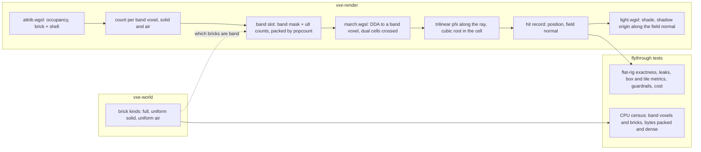

# 0054: The field surface: the trilinear zero set of the 27-fraction, a cost-and-look spike first, then band storage and the walk if the owner picks it

> **Status:** in-progress
> **Approved:** 2026-10-30 (owner, as drafted; the storage and cost bars are set at Phase 2 on Phase 1's readings)
> **Created:** 2026-10-30
> **Milestone:** M2 in [`docs/roadmap.md`](../roadmap.md) (the surface-look decision: "smooth
> and natural rock, not visible cubes")
> **Related ADRs:** [ADR-0011](../adrs/0011-contour-planes-in-attribute-pages-with-procedural-detail.md)
> (the per-voxel plane this surface would replace);
> [ADR-0039](../adrs/0039-the-contour-walk-closes-a-crack-at-the-passed-voxels-exit.md)
> (snap, which a field surface makes moot);
> [ADR-0040](../adrs/0040-one-voxel-features-melt-into-the-contour-surface-by-a-majority-fit-and-a-normal-field.md)
> (whose Alternative B this plan is, and whose Alternative D stays the last fallback). The
> field surface's own ADR (encoding, normal source, what the planes' removal leaves) is
> drafted after Phase 1's readings and accepted or dropped at this plan's close.
> **Source:** the owner at Plan 0050's Phase 5 ("fix it, or if it is unfixable, we will not
> use contours") and the owner's answers of 2026-10-30: the spike runs before Plan 0053's
> windowed check so one session compares every candidate; the storage and cost bars are set
> on Phase 1's readings, the hard line being `nfr.md` §3's 3 GB at `r_full` 16.
> **Starts after:** Plan 0050 Phase 6 and Plan 0053 Phases 1 to 3, stacked on the `plan-0053`
> branch at its Phase 3 tip, so the scratch look sits in the binary the owner compares. Phase 2
> here and Plan 0053's Phase 4 are one windowed session. Phases 3 to 5 run only on the owner's
> pick (a) and then alone on main.

## TL;DR

The per-voxel plane (ADR-0011) is one cube clipped by one plane fit from binary occupancy,
and it cannot represent anything smaller than its own kernel: one-voxel rods, pillars and
lone cubes stay boxes (Plan 0050 Phase 5), two-voxel ridges and concave corners stay steps
even after Plan 0053's filter and normal field. The field surface is the surface those planes
approximate: store at every voxel within one voxel of rock, on both sides, its solid count
over the 27-neighbourhood, define `phi = count / 27 - 0.5`, and hit the ray where the
trilinear interpolation of `phi` over the eight surrounding voxel centres crosses zero. It is
watertight by construction (no cube face, no crack, no closing rule), it melts a one-voxel rod
into a bump a third of a voxel high (worked below), rounds convex edges and fillets concave
corners, and it is what every shipped smooth voxel renderer does, meshed or marched
(`docs/references/voxel-optimizations.md`, ESVO and the isosurface entries). Its price is
field values on air voxels, so air bricks beside rock need a mirror slot, and a cubic solve per
dual cell the ray crosses. Phase 1 builds it as a scratch (dense storage, no size classes) so
the owner sees it in the window beside Plan 0053's looks and the hit pass is measured on both
adapters, and counts the real storage on the level and the flight. If the owner picks it,
Phases 3 to 5 build the band slots, make it the default and remove the planes. The first thing
anyone sees is `--look field` in the fly-through and a test that reads every hit on the flat
floor rig at `z = 64` within a thousandth of a voxel.

## Context & problem

`project-context.md` (Rendering, P0): first person, stable at arm's length, smooth natural
rock. The owner will not ship a contour look with 10 cm boxes on the walls.

**Where the surface stands.** ADR-0011's plane, ADR-0039's snap (Plan 0050: classes 1 and 2
at 0, hit pass +1.0 % RTX, +2.3 % Radeon) and Plan 0053's two changes (the plane fit on a
majority-filtered occupancy, a trilinear normal field over the planes) give a surface whose
remaining faults are geometric: one-voxel features gone or boxed, two-voxel features and
concave corners stepped, shaded smooth. ADR-0040 deferred the field surface for two unmeasured
costs, the air-side storage and the walk, and named it the next plan if the owner's eye
refuses the steps. The owner chose (2026-10-30) to measure it before that check rather than
after.

**What the field is, worked from the formula (not measured; Phase 1 measures it):**

- **A flat floor**, solid below `z = 64`. The top solid layer counts 18 (`phi = +1/6`), the
  air layer above counts 9 (`phi = -1/6`); the zero crossing is their midpoint, `z = 64`,
  exactly the cube face. Flat walls do not move. The same holds for every axis-aligned face.
- **A rod on the floor** (one voxel high and wide, along x). The rod voxel counts 12
  (`phi = -0.056`), as do the air voxels beside it in its layer; the floor voxels under and
  within one voxel of it count 21 (`+0.278`). The crossing between the floor layer and the
  rod's layer sits at `0.278 / 0.334 = 0.83` of the way up: a bump 0.33 voxel high and three
  voxels wide, with no vertical face. A lone cube (count 10, floor under it 19) is a bump 0.11
  voxel high. Plan 0053's filter flattens both completely; the field keeps a hint of them.
- **A convex 90-degree edge voxel** counts 12 (`-0.056`): its centre lies just outside, the
  edge is rounded over about one voxel. **A concave corner's air voxel** counts 15 (`+0.056`):
  it is filleted. A one-voxel groove's bottom voxel counts 24 and its air cell 15: the groove
  is a shallow trough, not a slot with a flat floor.
- **A free one-voxel pillar or sheet** has centres at `-0.056` with air at `-1/6` or lower
  around them: the pillar's rows above the base thin to a bump at the base and vanish above
  it. The hazard ADR-0040 names for the filter is the field's too, in a different shape.

**Why the blend rule's cost is not this plan's cost.** Plan 0050's `blend` was a trilinear
field over plane distances evaluated by two secant steps per voxel stepped, with eight
`lookup`s and eight attribute decodes per evaluation: 5.5x and 8.2x the hit pass at 128 VGPRs.
This plan stores a scalar per voxel (a `u8` count), evaluates once per dual cell crossed with
the cubic solved analytically, and reads the band from a mask, so the per-cell work is eight
byte reads and one cubic. That it lands near ADR-0040's guess of 1.3x to 2x is the thing
Phase 1 reads; nothing here assumes it.

**The `nfr.md` figures touched:** §2 the hit pass (snap alone: RTX 3080 Laptop 0.604 ms,
Radeon RENOIR 4.364 ms at the level's spawn, 1080p from 720p), the light pass (0.913 and
7.026 ms), the attribute pass (the level's fill 17.0 ms under the weighted fit, dev box; the
flight's p50 and p99); §3 the mirror (157 872 640 B live and 259 203 264 B allocated at the
level; the flight's full residency 871 679 852 B live of 3 221 014 080 B allocated at `r_full`
16, under the 3 GB line).

## Decision

Measure first, in the owner's binary. Phase 1 builds the field surface as a scratch look
(`--look field`): a dense field pool beside the mirror (nine units per band brick, a direct
index, no size classes), the attribute pass's own occupancy shell producing the counts for
every band brick including the air and uniform-solid bricks beside rock, and a walk that tests
dual cells from a band mask and solves the trilinear crossing per cell. It reads the hit and
light passes on both adapters, the box, tile-contrast and guardrail metrics of Plans 0039 and
0053, the flat-rig exactness, a leak count, two normal sources, and a CPU census of the band's
real storage packed and dense. Phase 2 is the owner's windowed check, the same session as
Plan 0053's Phase 4, with the field surface as a sixth look. On pick (a), Phase 3 builds the
band slots in the size-classed mirror (a new slot class for air-side bricks, counts packed by
popcount, the sync and the pressure rule aware of them), Phase 4 makes the field the default
walk with the normal source Phase 1 picked and removes the planes, snap and Plan 0053's
losers, and Phase 5 lands the readings and the ADR.

Amended 2026-10-31 (architect, owner answer 7): the field is the surface of smooth materials
only. A material marked crisp renders as honest cubes with face normals through the plain cube
walk, and the field counts its voxels as air. Phase 4 became Phases 4a to 4d: the window's
frame time attributed before any optimisation, the walk brought inside the owner's 5 ms bar
under a stop rule, the crisp flag as a material property with the field as the default and the
planes removed, and the owner's windowed check of the result.

We rejected finishing on the plane (Plan 0053 alone) as the only path because its ceiling is
now known and the owner wants the alternative measured before judging. We rejected a tricubic
or wider reconstruction for the surface itself because the 27-count is already a box filter
and the trilinear zero set of it is C0 across cells, which is all watertightness needs; the
normal is where smoothness is read and Phase 1 compares two sources for it. We rejected
dilation (ADR-0040 Alternative C) because the field fillets concave corners by itself. We
keep `cubes-field` (Alternative D) as the last fallback, built by Plan 0053.

**The analytic window rule** of Plan 0050 holds: analytic bars count hits at least 2 voxels
inside the mirror window and print what they left out.

## Architecture diagram



## Implementation phases

Each phase ships as its own commit. `dev` implements Phase 1 in the stacked lane, stops for
the owner's Phase 2, and implements Phases 3 to 5 in one session on main after pick (a). The
architect reviews once at the end, in a fresh session. Lane rule 9c applies: exploratory
sweeps may run on the RTX 3080 Laptop through `VXE_TEST_ADAPTER`, labelled with the adapter;
every asserted reading, golden and gate stays on lavapipe.

### Phase 1: The field as a scratch look: dense storage, the walk, the readings and the census
- **Owner skill:** dev
- **What:** `LookPreset::FIELD` (`--look field`, the banner names it) renders the field
  surface from a scratch pool, with every reading below. No default changes; the plane looks
  are untouched byte for byte with the field off.
- **The band.** A voxel is in the band when its 27-count is neither 0 nor 27. A brick is a
  band brick when it holds a band voxel: every Full brick with a surface voxel, every
  uniform-solid brick with an air voxel within one voxel of it, every uniform-air brick with a
  solid voxel within one voxel of it. The field's occupancy is the attribute pass's occupancy
  today (dev states in the log whether translucent voxels count as solid or air there, and
  keeps it).
- **The scratch pool.** A separate storage buffer: per band brick in the mirror window, nine
  units (one band mask of 512 bits, eight units of 512 `u8` counts in voxel order), indexed by
  a per-record table of 512 `u32` parallel to `chunk_records` (an index or `ABSENT`). Filled
  by the attribute pass from its 10-cube occupancy shell (the counts of the brick's own 512
  voxels fall out of it), with the work list extended to the air and uniform-solid band bricks
  the 26-neighbour reach already visits. Allocation is a bump allocator over the window,
  rebuilt on a window move; it is a scratch and the log says so.
- **The walk.** The DDA runs as today to the first band voxel the ray enters (the band mask
  read where the opaque mask is read now; a band-air brick has a zero opaque mask and a slot
  index). Inside a band voxel the ray's segment is split at the voxel's three mid-planes into
  the dual cells it crosses (at most four), and in each cell whose eight corner `phi` values
  mix signs the trilinear `phi` along the segment is a cubic in `t`, solved by Marmitt et
  al.'s root isolation (`docs/references/voxel-optimizations.md`, the isosurface entry) or by
  bracketing the sign change and two Newton steps, dev's call under the cost bar; the first
  root on the segment is the hit. A cell whose corners are all solid is a hit at the segment's
  start (the ray is inside rock, which only happens where the band is incomplete; counted as
  a leak). Rays that leave the band into a solid voxel of count 27 without a hit are leaks,
  counted per frame in the cracks view's place.
- **The normal, two sources read:** N1, the analytic gradient of the trilinear `phi` at the
  hit; N2, the trilinear blend at the hit of the eight corner voxels' 27-gradients (Plan 0053
  Phase 3's field, read through the plane attribute where one exists; for an air corner the
  gradient of the occupancy around it, computed in the attribute pass into the scratch pool's
  spare bits or a tenth unit). N1 costs nothing to store and is discontinuous across cell
  faces; N2 is smooth and costs a normal per band voxel. Both are selectable in the scratch
  (`--field-normal analytic|blend`) and read on the tile-contrast metric.
- **The readings** (lavapipe for every asserted figure, both adapters for cost, release, perf
  lock, three alternated runs against the lane's base binary):
  - the flat rigs: `floor` and `wall`, every hit's distance from the plane of the voxel face;
  - the six one-voxel scenes of Plan 0053 and its tilted, 45-degree and diagonal slabs, the
    cavity and the pillar: box pixels (by Plan 0053's metric), tile-contrast share under N1
    and N2, leaks, hit count against the plane look;
  - Plan 0039's guardrails: cavity normal error, pillar silhouette (face 172 px, contour
    32 px), `A`; the speck test;
  - `VEIN_POSE` and `PATCH_POSE` at 384 x 216, lamp on and off: box pixels, tile contrast,
    leaks, side-by-sides under `live/field/` (shaded, normals view, the plane look beside);
  - cost: the hit and light passes at the level's spawn, 1080p from 720p, field against the
    lane's base look, RTX 3080 Laptop and Radeon RENOIR, with RADV shader stats (VGPRs) for
    the hit shader; the attribute pass's initial fill and the autopilot's p50 and p99, both
    adapters;
  - the census (CPU, headless, over the world through `vxe-world`'s public queries): band
    voxels solid-side and air-side, band bricks by kind (Full, uniform solid, uniform air),
    on the level at `--seed 1` and over the streamed flight's full residency; the bytes
    packed (one mask unit plus `ceil(n / 64)` units of `u8` per band brick, plus two header
    units for a brick that has no slot today) and dense (nine units per band brick), against
    today's attribute bytes and the live totals of `nfr.md` §3.
- **Files touched:** `crates/vxe-render/src/shaders/attrib.wgsl` (the counts, the air and
  uniform-solid work items), `march.wgsl` (the band read, the dual cells, the cubic, N1 and
  N2), `light.wgsl` (the shadow origin along the field normal), `composite.wgsl` (the normals
  view, the leak count in the cracks view's place), `crates/vxe-render/src/marcher.rs` and
  `gpu_world.rs` (the scratch pool, the index table, the work list), `lib.rs`,
  `apps/flythrough/src/lib.rs` (`LookPreset::FIELD`), `main.rs`, `hud.rs` (the flags, the
  banner), `apps/flythrough/tests/look.rs`, `sharpness.rs`, `level_mirror.rs` (the census),
  `tests/support/rigs.rs`, this plan's log.
- **Done when:**
  1. `the_field_surface_lies_on_the_flat_faces` asserts on lavapipe, under the analytic
     window rule, that every hit on `floor` lies within 1e-3 voxel of `z = 64` and every hit
     on `wall` within 1e-3 of its face plane, and that both read 0 leaks; the hit counts are
     printed beside the plane look's.
  2. `the_field_surface_has_no_boxes_and_no_leaks` asserts 0 box pixels on `rod`, `lone
     cube`, `groove`, `wall pillar` and `ridge`, 0 leaks on every analytic scene and at both
     poses, and prints the tile-contrast share under N1 and N2 for every scene. Amended
     2026-10-31 (architect, owner's pick): under the field look a box pixel also needs its
     shading normal within 15 degrees of the face's axis normal; a curved-surface hit that
     happens to lie within 1e-3 of a face plane is not a box. The plane look's metric is
     unchanged. The counts under the unamended metric (9, 0, 8, 2, 10) stay in the log, and
     the rod's flat top at z = 60.333 is named there for the owner's eye in Phase 2. If any scene
     reads leaks, dev stops for the architect: the band definition or the cell test is wrong.
  3. `field_readings` (ignored, a reading) prints the full table: every scene and pose, N1
     and N2, box pixels by count class, tile contrast, leaks, guardrails, the speck test, hit
     counts against the plane look; the log carries it and names, per guardrail, whether the
     field reads within Plan 0039's bars (cavity normal error at most 12 degrees, silhouette
     at most half of face mode's, `A` at most 10 %).
  4. The cost table is in the log: hit and light passes on both adapters, field against base,
     VGPRs; attribute pass fill and flight p50 and p99 on both adapters. No bar: the owner
     sets it at Phase 2 on these numbers.
  5. `band_census` (a test, asserted on the level) prints the census and asserts the
     invariant that every Full brick with at least one surface voxel is a band brick, and that
     the GPU scratch pool's band-brick count at the level's spawn equals the CPU census's for
     the mirror window. The packed and dense byte totals, level and flight, are in the log
     against today's figures. No bar: the owner sets it at Phase 2.
  6. With the field off, every golden reads the same pixels as the lane's base (29 of 29 or
     the count at the base), and `mirror_bytes` and `allocated_bytes` equal the base's: the
     scratch pool is outside the mirror's accounting and the log says its bytes.
  7. The side-by-sides exist for both poses, and the log says in one line per pose what the
     field does to the owner's rods, pillars and lone cubes of Plan 0050's Phase 5 shots and
     to the ledge steps.

### Phase 2: The owner's windowed check, one session with Plan 0053's Phase 4
- **Owner skill:** human
- **What:** the owner runs the release fly-through at `--pose vein` and `--pose patch`, lamp
  on and off, shaded and normals views, in six looks: Plan 0053's four (today's snap,
  `--fit-filter majority`, `--normal-field on`, both), `--look cubes-field`, and `--look
  field` under N1 and N2, with the cost and census tables of Phase 1 in hand.
- **Files touched:** this plan's log and Plan 0053's.
- **Done when:** the owner records one of: (a) the field surface is the pick; the owner sets
  the storage bar (live bytes at the level and the flight, against `nfr.md` §3's 3 GB at
  `r_full` 16) and the cost bar (the hit plus light passes on the Radeon, and on the RTX),
  and names the normal source or leaves it to Phase 1's tile-contrast reading; Phases 3 to 5
  run. (b) a Plan 0053 look is the pick; this plan is abandoned, its Phase 1 commit is not
  merged, and the log says what the field read so the next reader need not rebuild it. (c)
  `cubes-field` is the pick; as (b), and Plan 0053's Phase 5 lands it.

### Phase 3: Band slots in the size-classed mirror
- **Owner skill:** dev
- **What:** the field's storage as a mirror slot, replacing the scratch pool. A band brick's
  slot carries, after its existing units, one band-mask unit and `ceil(n / 64)` units of `u8`
  counts in band-index order (prefix per layer in the header, as the surface prefix is today);
  a uniform-solid or uniform-air band brick gets a slot of a new class (opaque mask as today's
  rule for the kind, header, band mask, counts; no payload) and its record entry's bit 31 and
  class, so the walk enters it. The CPU side (`gpu_world.rs` sync) decides band membership
  from the world's brick kinds and the neighbour masks it already reads for the surface mask,
  reserves the units within the slot bins, and the pressure rule (Plan 0017) counts them. An
  edit that exposes rock to an air brick without a slot allocates one through the same path
  as a brick turning Full. The attribute pass fills the counts (and N2's normals if the owner
  picked N2) for every band brick in the work list.
- **Files touched:** `crates/vxe-render/src/gpu_world.rs` (the class, the units, the sync,
  the pressure count), `src/shaders/attrib.wgsl` and `march.wgsl` (the slot layout read),
  `crates/vxe-render/tests/mirror.rs` (slot layout pins), `apps/flythrough/tests/level_mirror.rs`
  (the bytes), this plan's log.
- **Done when:**
  1. A mirror test pins a band-air brick's slot bit-exact for a one-brick world beside a solid
     brick: its class, its band mask (the face layer's 64 bits set), its first count unit's
     first bytes (9 for a face-adjacent air voxel on a flat face, 6 at an edge, 4 at a corner).
  2. `mirror_bytes` at the level reads the census's packed figure plus the header units,
     within 1 %, and the flight's full residency and the level's live bytes are within the
     owner's storage bar; `allocated_bytes` at `r_full` 16 stays under 3 GB.
  3. The field look's hit mask and normals view at both poses are byte for byte Phase 1's
     (the storage moved, the surface did not).
  4. An edit test: a sphere carve that opens a uniform-solid brick to air gives the exposed
     air brick a band slot within the frame of the edit's sync, and the field look renders the
     new hole with 0 leaks on lavapipe.
  5. The attribute pass's cost under the autopilot flight on both adapters, three alternated
     runs against the Plan 0053 close binary; the reading is in the log against Phase 1's.

### Phase 3a: Free-standing thin features and a per-material scratch look
- **Owner skill:** dev
- **What:** amended 2026-10-31 (owner, answer 5). The field cannot show a free-standing
  feature thinner than about three voxels: worked from the formula, a free one-voxel rod
  counts 3 (`phi = -0.39`), a free 2x2 rod 12 (`-0.056`), a free one-voxel sheet 9 (`-1/6`),
  so no dual cell around them mixes signs and they render as nothing, while they still collide
  and block sound. A 10 cm branch is one voxel. This phase shows it on screen and builds the
  candidate the owner named, the field per material with honest cubes for the rest:
  - **A thin-feature rig**, a scene the fly-through can load and the tests can render: a
    vertical trunk 5 voxels across standing on a floor, carrying a free one-voxel branch along
    x, a free 2x2 rod, a free 3x3 rod, a one-voxel diagonal branch (one voxel per step in x and
    z), and a one-voxel and a two-voxel free sheet, each at least 12 voxels long and clear of
    every other feature by 4 voxels, the branches of a second material id (the rig's "wood").
  - **A scratch look `field-cubes`**: voxels whose material row is marked crisp (a scratch
    flag on the material table's render side; the rig's wood is the only crisp material) count
    as air in the field and are hit as honest cubes with face normals; every other voxel is the
    field. A crisp voxel next to field rock is drawn as its cube; the rock's field rounds away
    from it as from air.
  - **Two cost changes that hold under any pick**, both in the held Phase 4 patch
    (`live/p4/phase4-wip.patch`): the band prefix in the header (so the walk does not popcount
    the band words) and the band term in `level_pool_units`.
- **Files touched:** dev's call, inside `vxe-render` and `apps/flythrough`; the crisp flag is a
  render-side scratch, not a `vxe-world` change; this plan's log.
- **Done when:**
  1. On lavapipe, a test renders the rig in the `field` look and reads, per feature, the hit
     pixels inside the feature's screen box against the `face` look's; the log carries the
     table. (The expectation from the formula: the one-voxel branch, the diagonal branch, the
     2x2 rod and the one-voxel sheet read near 0, the 3x3 rod and the two-voxel sheet near the
     face look's. The test asserts the measurement is taken, not the expectation.)
  2. The same test in `field-cubes` reads every branch and sheet within 2 % of the `face`
     look's pixels, 0 leaks on the rig and at both poses, and the trunk and floor's hits
     byte for byte the `field` look's away from the crisp voxels' one-voxel neighbourhood.
  3. The field look's hit pass at the level's spawn on the RTX 3080 Laptop, three alternated
     quiet runs, with the band prefix: within the owner's bar (hit plus light at most 5 ms),
     against the 6.48 ms scratch reading at b4fbfad; the Radeon as a reading. `field-cubes`
     read the same way at the level (no crisp material there, so it measures the material
     test's overhead) and at the rig.
  4. The level's mirror pressure reads the band term (no longer 1.000 at 254.1 of 259.2 MB).

### Phase 3b: The owner's look at thin features and the per-material candidate
- **Owner skill:** human
- **What:** one windowed session on the release binary at Phase 3a's tip: the rig in `face`,
  `field` and `field-cubes`, at arm's length and at a few metres, lamp on; then the vein and
  patch poses in `field-cubes` (no crisp material there, so it must read as `field`). The
  owner picks: (a) the field per material, crisp materials as honest cubes; (b) the field
  everywhere, thin features modelled three voxels thick; (c) neither, with a direction. Each
  look's mode is in the banner.
- **Done when:** the pick and the owner's words are in Owner answers; Phase 4 is rewritten by
  the architect on it before dev starts it.

### The field per material: Phases 4a to 4d

- **Rewritten 2026-10-31 (architect, on owner answer 7).** The owner picked (a) at Phase 3b:
  the field for smooth materials, honest cubes with face normals for crisp ones. The held
  text of this phase (the field everywhere, the planes removed) is replaced by Phases 4a to 4d
  below. The order is the owner's concern first: the window read "fps is really low" in
  `field-cubes`, so Phase 4a attributes the frame time before anything is optimised, Phase 4b
  brings the walk inside the bar, Phase 4c makes the crisp flag a real mechanism, makes the
  field the default and removes the planes, and Phase 4d is the owner's windowed check of the
  result. `live/p4/phase4-wip.patch` (the planes', snap's, `cubes-field`'s and the attribute's
  removal, written against the held text) is Phase 4c's starting point; its band-prefix and
  pool-term pieces landed in Phase 3a and are dropped from it.
- **Settled by owner answer 8:** the crisp flag lives on the material row (Phase 4c); a thin
  free feature of a smooth material is accepted for this plan, its fallback a followup (Phase
  4c); the window at the poses has no bar before Phase 4d (Phase 4b's done-when 2); crisp
  voxels count as solid in the field, so a crisp feature's root carries a smooth collar and a
  flush inlay has no groove (Phase 4c, amended on that answer).
- **What is already known, from the logs (not a reading of this phase):** session 1's frame
  line reads the window at 2530 x 1378 from 1687 x 919 (the own upscaler at 1.5), 1.68x the
  pixels of the bar's 1280 x 720; the 16.4 ms of session 1's `field` at the patch is the march
  GPU p50 over the frames timed while the HUD was on, and that run's frame line was taken in
  the normals view (hit 15.74 ms, light 0.009 ms: no light, probes or denoise); session 1's
  N2 at the vein read a 28.47 ms GPU frame with a 22.99 ms hit; session 2 logged no frame line,
  so its window size and views while timed are not known; session 2's level runs read an
  initial fill of 125 to 149 ms and a 4.0 s upload against session 1's 23.8 ms and 2.0 s
  (`live/session1.log`, `live/session2.log`). So the 16.4 against 29.3 ms gap mixes the pose,
  the view, the storage (the dense pool against the band slots), the crisp test and the passes
  after the hit, and the headless bar (5.93 and 6.38 ms at the spawn, 720p internal) is not the
  window's figure (the patch's windowed hit at 1.68x the pixels read 4.5x the spawn's).

### Phase 4a: Where the window's frame time goes
- **Owner skill:** dev
- **What:** a measurement, no behaviour change: a table that splits the windowed frame time of
  sessions 1 and 2 into named terms, reproduced headless at the window's size, and the same
  split of the spawn's 6.38 ms against the 5 ms bar. Only a log line or a counter may be added
  to the code, and it lands with Phase 4b.
- **The rig.** `flythrough --level --seed 1 --headless --render 2530x1378 --frames 300
  --adapter NVIDIA [--pose vein|patch] --look L [--view normals]`, lamp on and off, release,
  each run under the exclusive perf lock and the memory cap at a 1-minute load under 2, three
  alternated rounds, medians of the frame line's per-pass times (it prints every pass). Four
  binaries, so each storage step is its own row: b282738 (session 1, the dense pool), 1b36eb3
  (Phase 3, band slots counted by popcount), 17045d8 (Phase 3a, the band prefix and the crisp
  test; session 2's binary) and main 28948a5 (the base). Looks: `field` on all three plan
  binaries, `field-cubes` on 17045d8, the base's default and `face`. The same matrix at the
  spawn at `--render 1920x1080` (the bar's conditions) and with `--thin-rig` for `field` and
  `field-cubes`.
- **The per-ray split.** The steps view's counters (walk steps, storage loads, pool reads per
  ray, which the field walk already counts) read as the mean and p99 per pose and binary, so
  the storage terms are counts as well as milliseconds; the RADV shader stats (VGPRs, code
  bytes) of the field hit pipeline at each plan binary; and, if the counters cannot separate
  them, one scratch build per term that disables it (the crisp test, the corner cache, the
  normal), labelled scratch and not committed.
- **The CPU side.** At the level no material is crisp: the reading confirms that the crisp CPU
  path (`GpuWorld::fix_crisp`, `field::band_of`) adds nothing per frame (`update + poll + sync`
  p50 and p99 in `field` against `field-cubes`) and names what the initial fill's and the
  upload's rise between the sessions is (startup only, or per frame).
- **The thin census** (for owner question 2 of this rewrite): a CPU test over the level at
  `--seed 1` printing the solid voxels by 27-count from 1 to 13 (a solid voxel under 14 has its
  centre outside the field's surface; 3 is a free one-voxel rod, 9 a free one-voxel sheet, 12 a
  free 2x2 rod and also a one-voxel rod resting on a floor, which the field keeps as a bump).
- **Files touched:** this plan's log; scratch scripts under `live/p4a/` (untracked); the census
  test in `apps/flythrough/tests/level_mirror.rs` lands with Phase 4b.
- **Done when:**
  1. The log carries the table: per binary, look, pose (spawn, vein, patch, rig), resolution,
     view and lamp, the GPU frame and every pass's median, and the per-ray counters; the load
     of every run.
  2. The log names the windowed gap as a sum of terms: session 1's 16.4 ms against session 2's
     29.3 and 30.4 ms, each term (resolution, view, pose, storage step by binary, the crisp
     test, the passes after the hit, anything else found) with its milliseconds from the
     table, the terms adding up to the headless reproduction of the windowed figures within 10 %
     of the gap, any remainder named as unattributed. If the headless runs at the window's size
     do not reproduce the windowed p50s within 10 %, the log says so, and the remainder is the
     window's (surface, present, the HUD timer's own frames), named as such.
  3. The same split for the spawn: 17045d8's `field-cubes` 6.38 ms hit plus light against the
     5 ms bar, by term, with the per-ray counters against b282738's 4.36 ms.
  4. The thin census's histogram is in the log.

### Phase 4b: The walk inside the bar
- **Owner skill:** dev
- **What:** the field walk with the crisp test brought to the owner's bar (owner answer 3:
  hit plus light at most 5 ms at the level's spawn, 1080p from 720p, RTX 3080 Laptop, release,
  perf lock, quiet load), working Phase 4a's terms largest first, one measured change at a time.
- **What dev may change**, without asking:
  - the band slot's layout and how the walk reaches it: the prefix words and their packing, the
    count units' order, a count base in the header, the band slot's place relative to the
    brick's slot, or a direct band index per record as the dense pool had, provided
    `mirror_bytes` stays inside the storage bar (owner answer 4: 106 MB at the level, 530 MB
    over the flight) and `allocated_bytes` at `r_full` 16 under 3 GB;
  - the walk's held state: the mask and layer cache, the count-word cache, sharing the four
    corners two neighbouring dual cells have in common, `field_brick`'s held brick (Phase 3a's
    one-layer and one-word caches read no gain on their own; a cache that pays only with
    another change is measured with it);
  - register pressure: taking the crisp test, the material resolution (`field_material`) and
    the normal out of the march loop to after the hit, folding the crisp bit into the cell
    read so it is read once, splitting the field hit pipeline;
  - the cubic's root finder (the Illinois steps' count, the extremum test) under the exactness
    gates of done-when 3;
  - the skips inside band-air bricks and the hierarchy's view of band bricks.
- **What dev may not change** (the owner's): the surface (the trilinear zero set, N1), the
  internal resolution, the upscaler's scale, the lighting tier, the full-detail radius, a
  switch to cubes or to another surface by distance, a stored normal, the storage bar, or the
  bar itself. Nothing branches on the backend.
- **Stop rule.** Dev stops for the owner, with the table of every change's reading, what is
  left over the bar, and the next candidate with its expected gain, when either: the RTX reads
  above 5.00 ms after the terms Phase 4a named are worked (or after five measured changes,
  whichever comes first), or the next change needs an item from the list above. The owner's
  options then: raise the bar to the reading; a lower internal resolution for the field look;
  the field inside a radius and cubes beyond it; accept the reading and go on to Phase 4c. A
  new phase or an amendment carries the pick.
- **Files touched:** `crates/vxe-render/src/shaders/march.wgsl`, `attrib.wgsl`,
  `crates/vxe-render/src/gpu_world.rs`, `field.rs`, `marcher.rs`,
  `crates/vxe-render/tests/mirror.rs` (the slot pins, if the layout moves),
  `apps/flythrough/tests/level_mirror.rs` (the thin census), this plan's log.
- **Done when:**
  1. `field-cubes` at the level's spawn reads hit plus light at most 5.00 ms on the RTX 3080
     Laptop, and `field` too, three alternated quiet runs (1-minute load under 2) against
     17045d8's release binary; the Radeon RENOIR read the same way, as a reading (its bar is
     the walk-speed spike's, owner answer 3); the VGPRs and code bytes of the field hit pipeline
     before and after, from the RADV shader stats.
  2. The vein and the patch at the window's size (`--render 2530x1378`), shaded, lamp on, both
     adapters, the GPU frame and hit against Phase 4a's rows; a reading with no bar (owner answer
     8): the owner judges the window in Phase 4d and sets a windowed bar there if needed.
  3. The surface did not move: `the_field_surface_lies_on_the_flat_faces` (1e-3 voxel),
     `the_field_surface_has_no_boxes_and_no_leaks` and `thin_features_in_the_field_and_per_material`
     pass unchanged on lavapipe, and the field and `field-cubes` hit masks at both poses and on
     the rig (384 x 216 and the rig test's 320 x 320) are 17045d8's bit for bit, every hit
     position within 1e-3 voxel of 17045d8's (an exact-equality failure is allowed only for a
     changed root finder, and the log says which).
  4. `mirror_bytes` at the level and over the flight are inside the storage bar, the reading in
     the log against Phase 3's 96 243 264 B and 438 898 624 B.
  5. The thin census test (`level_mirror::thin_census`, a reading) prints its histogram and
     asserts the histogram's total equals the number of solid voxels with a count of 13 or less
     counted by a second, brute-force pass over the same chunks.

### Phase 4c: The crisp flag, the field as the default, the planes removed
- **Owner skill:** dev
- **What:** the per-material surface as an engine mechanism, the field as the only smooth
  surface, and everything the planes needed gone.
- **The crisp flag** (owner answer 8). `MaterialFlags::CRISP` in `vxe-world`'s material row,
  beside `TRANSLUCENT`: a render property of the row, as `detail` and `opacity` are. No edit,
  query, collision, coarse grid, collapse, raycast, census or audio path reads it, so the world
  stays headless and deterministic and its results do not move. Absent is smooth, the default:
  `Material::named` is smooth, `vxe-assets`' palette map makes smooth rows, and a consumer
  marks a crisp material by setting the flag when it pushes the row. The table is fixed for the
  world's life (as for `TRANSLUCENT`), so a material's surface never changes at run time. On a
  `TRANSLUCENT` row the flag has no effect (the translucent walk owns those voxels), and the
  doc comment says so. The payload stays the consumer's and is not read. `MaterialTable::is_crisp`
  is the one reader. In `vxe-render`, `GpuWorld` takes the crisp set from the table it already
  mirrors (`material_rows`); `GpuWorld::set_crisp_materials`, `SurfaceTuning::crisp` and its flag
  bit go. The fly-through's rig wood carries the flag in its row; `flythrough::CRISP_MATERIALS`
  goes.
- **The GPU path (amended on owner answer 8: crisp counts as solid).** The counts are the
  plain occupancy counts, a crisp voxel solid among them, so the band and every count are
  the `field` look's, and a crisp voxel is a band voxel exactly when it touches air. Such a
  voxel carries bit 7 of its `u8` count (`field::CRISP_COUNT_BIT`); a crisp voxel of count 27
  touches no air and is never entered but through a leak. Three rules hold the cubes honest:
  - **Inside a crisp voxel the cube wins.** The walk hits a crisp voxel as its cube where the
    ray enters it, with the entry face's normal (the plain cube walk's hit, kept as the crisp
    path), and tests no field piece inside it. The field's zero set does lie inside crisp
    cubes (a free crisp branch's voxels count 3 to 11, below zero, so the field's surface
    passes inside the branch near its root), and none of it is seen.
  - **Outside a crisp voxel, a mixed-sign dual cell gives a field hit only when one of its
    solid band corners is smooth** (a solid band voxel without bit 7). A cell whose solid
    corners are all crisp gives none, and the ray goes on to the cube: two crisp faces meeting
    in a concave corner stay a sharp corner, not a fillet. The corner test reads the bit the
    count byte already carries; its cost is Phase 4b's bar, re-read at done-when 6.
  - **A field hit takes the material of its cell's largest-weight smooth solid corner**, so
    the collar a crisp feature's root carries is the smooth material's, shaded by N1.
  The field skin therefore lies over a crisp cube only where smooth voxels are within one voxel:
  the collar at a crisp feature's root, and the face of a flush inlay's border, which lies on
  the cube's face plane. **Phase 3a's CPU count path goes:** with crisp as solid, the field pass
  computes every count from the mirror's occupancy, as it does for `field`; only bit 7 needs a
  voxel's material, and the field pass sets it from the voxel's material and the row's `CRISP`
  flag in the material buffer the mirror already holds (`material_rows` carries the flags),
  skipping the read for a brick whose materials hold no crisp row; how the skip is known (a
  per-brick bit from the CPU at upload, or the payload's palette) is dev's call on the
  done-when 4 reading. `field::band_of`'s crisp counts, `GpuWorld::fix_crisp` and the work-list
  exclusion of bricks near crisp voxels go. A chunk held as mips holds no crisp voxel: its mip
  cells are cubes for every material, and a voxel beside a LOD-only chunk counts that chunk by
  its mip occupancy, as solid either way (the transition at the full radius stays today's).
- **The seam (owner answer 8: crisp as solid, the collar accepted).** Worked from the counts:
  - *A crisp inlay flush in a flat rock face* changes no count (everything behind the plane is
    solid either way), so the face is flat across it: the border's field hits lie on the plane
    and the inlay's own pixels are cube hits on the same plane. No groove.
  - *A crisp feature standing out of a flat rock face* raises a collar on the face around its
    root. One-voxel branch: a face voxel beside the root counts 19 (a flat face's 18 plus the
    branch voxel in its front layer) and the air voxel in front of it 11 (9, plus the branch's
    two voxels in its window), so the crossing between their centres lies at
    `0.204 / (0.204 + 0.093) = 0.69` of the way out, 0.19 voxel off the plane (the flat face's
    0.5). 2x2 rod: 20 and 13, 0.43 voxel. 3x3 rod or a two-voxel sheet: 21 and 15, the air
    voxel itself above zero, the crossing 0.75 voxel off the plane, a full fillet. A face voxel
    two voxels from the feature's footprint counts 18 again, so the collar is at most two
    voxels wide.
  - *A crisp feature resting on a rock floor* is the same collar, the floor's face rising
    around its foot.
  - *Two crisp faces in a concave corner* keep the sharp corner (the corner rule above).
  - The ray cannot pass through a seam: the field's band and counts are the `field` look's,
    which read 0 leaks, and a crisp voxel stops the ray at its face.
- **A brick with no smooth voxel near walks as cubes. Amended 2026-10-31 (owner):** the cost
  lever for "smoothness, maybe only for certain types of materials" (`nfr.md` §2, "Frame
  ledger", scenario C). The rules above alone do not give it: with crisp counted as solid, a
  crisp-only region keeps the `field` look's band and counts, so a ray through it still reads
  the band mask, the counts and the corner bits of every dual cell it crosses and pays the field
  walk's cost (Phase 3a's thin rig, its wood crisp: `field-cubes` hit 4.70 ms against `face`'s
  0.64 on the RTX). The rule: a brick whose voxels and one-voxel shell hold no smooth solid voxel
  can give no field hit (every dual cell with a corner in it has no smooth solid corner, the
  second rule above), so the walk crosses it as `face` does: no band-mask, count or corner read
  and no cubic, its crisp voxels hit as cubes with the entry face's normal, its air skipped by
  the occupancy masks and the hierarchy as in `face`. The image does not change; only the cost
  does. One bit per brick (in the record or the slot header, dev's call) carries "no smooth
  near"; the field pass sets it from the same material read that sets bit 7 (a brick that
  holds a smooth solid voxel is smooth-near without reading its shell), and an edit that touches a brick or its shell refreshes it with the counts. A brick of a
  LOD-only chunk is cubes already. The field hit pipeline holds 128 VGPRs against the cube
  walk's 64 (Phase 1's RADV stats), which caps the occupancy of cube-walking rays inside it;
  splitting the pipeline (Phase 4b's list) is dev's to take if done-when 8 needs it.
- **The field as the default.** The fly-through's default look is the field with the table's
  crisp materials as cubes; `field` and `field-cubes` become that one look, named `field`.
  `face` stays as the honest-cubes comparison look and the rig test's reference.
- **What goes**, as Plan 0048's removal rule says: the plane attribute (`attrib.rs`,
  `attr_work.rs` and its bench, the plane fit in `attrib.wgsl`), its settings (`PlaneFit`,
  `PlaneOffset`, `OccupancyFilter`), `CrackClosing` and snap, the cracks view's classes (the
  cracks view shows leaks only), ADR-0038's plane code, `SurfaceTuning::normal_field`, N2
  (`FieldNormal::Blend`, `--field-normal`), Plan 0053's losing looks (the majority filter, the
  normal field), `cubes-field` (it rests on the attribute's normal field, and the owner rejected
  it at Phase 2; this replaces the held text's "stays until the close"), `--plane-fit`,
  `--plane-offset`, `--fit-filter`, `--shadow-push`, `--normal-field`, `attr_cap` and the refit
  banner. The cutaway and a mirror without band slots fall back to the voxel walk, as the held
  patch does.
- **Shadows** (the held text's amendment of 2026-10-31, kept): the spike's shadow rays walked
  the planes. With the attribute removed the shadow ray walks the voxel occupancy (the brick and
  mip walk without a plane test; crisp and smooth voxels alike solid to it), with its origin
  pushed along the hit's normal (N1, or a crisp cube's face normal) by the shadow push that
  exists today; it does not walk the field, whose cost the owner's bar cannot carry twice. The
  speck test reads this at the default and the log carries the count beside today's; a count
  above today's is a finding for the close, not a stop.
- **Translucency** (the same amendment, kept): translucent voxels count as solid in the field
  for the primary hit, as the spike did; the translucent walk after the hit stays as today over
  the voxel occupancy. Both choices are in ADR-0041 and revisable by the walk-speed spike.
- **Thin features in a smooth material** (owner answer 8). A free feature of a smooth material under about three
  voxels across still renders as nothing while its shadow, collision and sound stay (the
  shadow ray walks the voxels; Phase 3a's rig in `field` read 0 % of the face look's pixels for
  the one-voxel, diagonal and 2x2 features). This plan accepts it and records it in ADR-0041:
  a consumer marks a material whose features are thin crisp, or models them three voxels thick.
  Phase 4a's thin census says how often the level carries such voxels, and an automatic
  per-voxel fallback is a followup plan, not this one.
- **Files touched:** `crates/vxe-world/src/material.rs` (the flag, `is_crisp`),
  `crates/vxe-world/tests/edits.rs` (the flag reaches no result), `crates/vxe-render/src/`
  (`attrib.rs`, `attr_work.rs` removed; `field.rs`, `gpu_world.rs`, `marcher.rs`, `lib.rs`),
  `src/shaders/march.wgsl`, `attrib.wgsl` (or its rename), `light.wgsl`, `composite.wgsl` and
  the shaders the held patch touches, `crates/vxe-render/benches/`, `tests/mirror.rs`,
  `walk.rs`, `shader_portability.rs`, `apps/flythrough/src/lib.rs`, `main.rs`, `hud.rs`,
  `thin_rig.rs`, `apps/flythrough/tests/look.rs`, `sharpness.rs`, `golden.rs` and the moved
  goldens, `level_mirror.rs`, `tests/support/rigs.rs`, `examples/`, this plan's log.
- **Done when:**
  1. `the_default_surface_is_the_field` asserts on lavapipe at the default: the flat-rig
     exactness of Phase 1's done-when 1, 0 box pixels on the five one-voxel scenes, 0 leaks on
     every scene and at both poses, the tile-contrast share at most Phase 1's N1 reading per
     scene, and Plan 0039's guardrails within their bars.
  2. The flag: a `vxe-world` test that `Material::named` is smooth and a row pushed with
     `MaterialFlags::CRISP` reads crisp through `MaterialTable::is_crisp`; a test that the same
     sphere carve on two worlds that differ only in the rock row's `CRISP` flag returns equal
     `EditResult`s and equal voxel hashes; `thin_features_in_the_field_and_per_material` with
     the rig wood crisp by its row alone (no renderer setting) reads every branch and sheet
     within 2 % of the `face` look's pixels and 0 leaks, and with the flag cleared reads Phase
     3a's `field` column (0 px on the one-voxel, diagonal and 2x2 features).
  3. `a_smooth_surface_meets_a_crisp_cube_without_a_gap` on lavapipe, on a seam rig: a flat
     rock wall with a crisp inlay 8 x 8 voxels across and 3 deep set flush in it; the thin
     rig's trunk with its crisp branches; and a crisp L (two crisp slabs 3 voxels thick meeting
     at 90 degrees, standing on the rig's rock floor), each seen head-on and at 45 degrees. It
     asserts: 0 leaks and 0 misses inside each seam's screen box. The inlay, head-on: every hit
     in the wall's box, inlay included, lies within 1e-3 voxel of the wall's plane, and every
     hit inside the inlay more than one voxel from its border is a cube hit (crisp material,
     axis-aligned normal). The trunk: every rock hit on the branches' face more than 2 voxels
     from every feature's footprint lies within 1e-3 voxel of the face's plane; within those 2
     voxels every hit lies at most 1 voxel off the plane and has the rock's material; every hit
     on a feature more than 2 voxels from the trunk is a cube hit. The L: every hit on it more
     than 2 voxels from a rock voxel is a cube hit, its concave corner included. It prints the
     collar's highest hit off the face per feature against the worked 0.19, 0.43 and 0.75
     voxel, and the speck test's count on the trunk face with the branches crisp and with them
     smooth (a higher count is a finding for the close, not a stop).
  4. The crisp bit's cost on the attribute side: the field pass's GPU time at the level (no
     crisp material) and on the thin rig against Phase 4b's tip, and `update + poll + sync` of
     the frame holding a radius-7 carve beside the rig's crisp branches against the same carve
     on the trunk's far side away from every crisp voxel, both in the log against `nfr.md` §2's
     streaming line. `GpuWorld::fix_crisp` and `field::band_of`'s crisp counts no longer exist
     (`cargo doc` and a grep say so).
  5. Every moved golden is named in the log with its share of pixels over 2/255; the face
     goldens did not move (Plan 0050 owner answer 2). `crates/vxe-render/tests/translucent.rs`
     and the cutaway tests pass unchanged, or dev stops with the reading.
  6. Hit plus light at the level's spawn on the RTX at most 5.00 ms, three alternated quiet runs
     against Phase 4b's tip and main at `28948a5`; the Radeon as a reading; the VGPRs of the
     hit and light shaders in the log.
  7. No removed setting's flag remains in `--help` or the banner; `cargo doc` has no mention
     of a plane attribute outside the ADR citations; the banner names the look `field` and
     says nothing of crisp cubes (a material property, not a mode).
  8. The cost lever (amended 2026-10-31, owner). The fly-through takes `--crisp none|rock|all`
     (testbed only: it sets `MaterialFlags::CRISP` on the level's rows when the table is built,
     `rock` on the rock row alone and `all` on every row that is not `TRANSLUCENT`; the
     banner's world line lists the rows set, done-when 7's rule otherwise holding), and the
     frame line prints the smooth share `s` of hit pixels (hits whose material is not crisp).
     At the level's spawn, 1080p from 720p, release, three alternated quiet rounds on the RTX
     and the Radeon, against `face` at the same tip: (i) `--crisp all` reads the hit pass within
     10 % of `face`'s, and its hit mask, hit positions (1e-3 voxel), normals and materials at
     the spawn, the vein and the patch (the 384 x 216 readback) are `face`'s bit for bit;
     (ii) `--crisp rock` (crisp-majority: the level's bulk crisp, the ores and the rest smooth)
     reads the hit pass at most `face + s x (none - face)` plus 10 % of the `none - face` gap,
     with `s` its printed share; (iii) `--crisp none` (all smooth) is done-when 6's reading. The
     log tabulates the hit and the GPU frame of the three and `face`, with `s`, per adapter, and
     the same at the vein and the patch at the window's size (`--render 2530x1378`) as readings.
     A miss stops dev with the table; the owner picks the lever's form (a per-band-cell bit, a
     split pipeline, or the reading accepted).

### Phase 4d: The owner's windowed check of the default
- **Owner skill:** human
- **What:** one windowed session on the release binary at Phase 4c's tip, the frame line
  logged every run (the session script turns the HUD's timer on and greps the `frame (` lines,
  so the window's size and the view are on record): the level at the vein and the patch in the
  default look, lamp on and off, shaded, at the window's size of sessions 1 and 2; the thin rig
  (the wood crisp by its row) and the seam rig, `face` beside. The owner judges the frame rate
  against [`nfr.md`](../nfr.md) §2, "Frame ledger" (2026-10-31): cubes, the field but crisp,
  and the field for some materials only, beside the slices reserved for the systems to come.
- **Done when:** the owner records one of: (a) the frame rate and the seam are acceptable;
  Phase 5 runs. (b) the frame rate is not: the owner names a windowed bar (the frame or the hit
  plus light at the poses, at the window's size), and an amendment returns to Phase 4b's
  rules with it. (c) the seam is not: the owner names the direction (ADR-0041's Alternative G,
  crisp as air in the field, with its groove at a flush inlay, or another), and an architect
  amendment follows.

### Phase 5: The readings, the ADR, the close block
- **Owner skill:** dev
- **What:** `nfr.md` §2 and §3 carry the field's readings with machine, commit and load: the
  spawn's hit and light on both adapters, the poses at the window's size, the attribute pass,
  the mirror bytes at the level and over the flight; the plan's log carries the close block.
  ADR-0041 (drafted 2026-10-31, amended on owner answer 7) is accepted at the close; ADR-0011
  (its surface; the per-material detail survives) and ADR-0040 are marked superseded by it,
  ADR-0039 superseded as moot (no cube face, no crack), and ADR-0038 (the plane code's zero
  component) superseded as moot with the attribute. The Radeon walk-speed spike and, under
  owner question 2's recommended option, the thin-feature fallback are named as followups.
- **Files touched:** `docs/nfr.md`, this plan's log.
- **Done when:** the close block names every reading above, Phase 4a's attribution and Phase
  4b's changes among them; the full tier, clippy, fmt, doctests, deny and the doc gates are
  clean at the tip, with the full tier's wall time and load recorded.

## Data shapes

```rust
// illustrative: vxe-render
pub enum SurfaceModel { Planes, Field }        // Phase 1: a look's choice; Phase 4c: Field alone
pub enum FieldNormal { Analytic, Blend }       // N1, N2; the owner picked N1, Phase 4c removes the enum
pub struct SurfaceTuning {
    pub model: SurfaceModel,                   // new
    pub field_normal: FieldNormal,             // new
    pub face_mix: f32,                         // unchanged
    // Plan 0050's `closing` and `shadow_push`, Plan 0053's `fit` and `normal_field`:
    // present through Phase 3, removed in Phase 4 on pick (a)
}
// A band brick's slot (Phase 3), after today's units:
//   one band-mask unit (bit i: voxel i has 0 < count < 27),
//   ceil(n / 64) units of u8 counts in band-index order (prefix per layer in the header),
//   and, under N2, ceil(n / 32) units of octahedral u16 normals.
// A uniform band brick gets a slot of class 6 (illustrative): opaque mask, header, band
// mask, counts; no payload. Its record entry carries bit 31 and the class, as Full bricks do.
// A crisp voxel's u8 count carries bit 7 (Phase 3a); the count is in the low five bits.

// illustrative: vxe-world, Phase 4c (owner answer 8)
impl MaterialFlags {
    /// The renderer draws voxels of this material as cubes with face normals instead of the
    /// smooth surface. Nothing else reads it; no effect on a `TRANSLUCENT` row.
    pub const CRISP: Self = Self(4);
}
```

The CPU world's edits, results, queries and collision do not change, and determinism is
untouched: the field is in `vxe-render`, a client-side view. Amended 2026-10-31 (owner answer
7): Phase 4c adds one render-only flag to `vxe-world`'s material row, beside `TRANSLUCENT`,
which no deterministic path reads.

## Budgets

| `nfr.md` figure | Base (read) | Expected | How the close measures it |
|---|---|---|---|
| §2 the hit pass and the light pass | level spawn, 1080p from 720p, snap alone: RTX 0.604 + 0.913 ms, Radeon 4.364 + 7.026 ms (Plan 0050) | **a guess** of 1.3x to 2x on the hit pass (ADR-0040), one cubic per dual cell crossed and eight byte reads, VGPRs near snap alone's 64; light unchanged but for the normal | `flythrough --level --seed 1 --headless --render 1920x1080 --frames 300 --adapter NVIDIA\|AMD` per look against the Plan 0053 close binary, alternated, release, perf lock, memory cap, three quiet runs; bar set by the owner at Phase 2 (RTX hit plus light at most 5 ms, owner answer 3); amended 2026-10-31: against main `28948a5` and 17045d8, plus the vein and patch at the window's size (`--render 2530x1378`) as readings (Phases 4a, 4b) |
| §2 the attribute pass | the level's fill 17.0 ms (weighted fit, dev box, Plan 0039); the flight's p50 and p99 of Plan 0028 and 0039 | **a guess** of 1.5x to 2.5x the work items (the air and uniform-solid band bricks), each cheaper (counts, no fit) | the initial fill and `--autopilot --headless --seed 1` p50 and p99 on both adapters, three alternated runs |
| §3 mirror bytes | 157 872 640 B live, 259 203 264 B allocated at the level; 871 679 852 B live of 3 221 014 080 B allocated over the flight (Plan 0039) | the band's bytes replace the attribute's: **a guess** of 1.5x to 3x today's attribute bytes, the air side the larger part; the census of Phase 1 replaces the guess | `mirror_bytes` and `allocated_bytes` at the level and over the flight, under the owner's bar; `r_full` 16 under 3 GB is the hard line |

## Risks & open questions

- **The band's air side is bigger than the solid side in a cave.** Concave caverns have more
  air next to rock than rock next to air, and every uniform-air brick touching rock gets a
  slot. The census is the answer, and it comes before any slot code is written. If the owner's
  bar fails at the level, the fallback inside this plan is a two-byte-per-brick-face scheme
  (counts for a face layer only) or `r_full` 14, both the owner's call; outside it, Plan 0053's
  pick stands.
- **Trilinear normals crease.** N1's gradient is discontinuous across dual cells and may show
  a faint tiling under the lamp at arm's length. N2 removes it at a `u16` per band voxel.
  Phase 1's tile-contrast metric reads both; the owner sees both.
- **The cubic's precision.** `f32` along a ray at the level's extent (`2^24` voxels is Plan
  0052's followup line) and a near-tangent crossing can miss or double a root. Bracketing the
  sign change before the Newton steps bounds it; the leak count is the gate.
- **Mixed-sign cells with no crossing on the segment** (the ray passes a cell whose corners
  mix signs without touching the surface) are the common case along a wall: the cubic must
  reject them cheaply. Marmitt's extremum test does; a miss here is the cost risk.
- **The walk enters more bricks.** Band-air bricks have slots, so the hierarchy skips less
  air near rock. The hit pass reading carries it; the mask-level skips inside a band-air brick
  (its opaque mask is zero) keep the cost to the band voxels themselves.
- **Collision keeps the voxels.** The visible surface lies up to half a voxel inside a convex
  edge and outside a concave corner. At a 30 cm capsule and 10 cm voxels the player slides
  over it; a consumer wanting the look and the collision to agree gets a followup, not this
  plan.
- **Deliberate one-voxel detail in prefabs** becomes a bump. A consumer who wants 10 cm
  detail visible models it two voxels thick, as under Plan 0053's filter.
- **The window is not the bar's figure** (owner answer 7). The bar is headless at the spawn at
  720p internal; the window ran at 1687 x 919 internal at poses whose hit per pixel is higher.
  Phase 4a attributes the gap and Phase 4d is where the owner judges the window; a windowed
  bar, if the owner sets one, comes from there.
- **The crisp bit costs a material read in the field pass.** With crisp as solid (owner answer
  8) the counts need no material, but bit 7 does; a world with many crisp materials pays a
  material read per band voxel of their bricks. Phase 4c's done-when 4 reads it.
- **A crisp feature's root carries a smooth collar** up to 0.75 voxel high and two voxels wide
  (worked in Phase 4c), in the smooth material. The owner accepted it (owner answer 8); Phase
  4c's seam test bounds it and the owner sees it in Phase 4d.
- **The attribute pass under edits** now touches air bricks. Plan 0023's hitch budget is on
  the render thread's CPU, which the GPU pass does not load; the sync's new slot allocations
  for exposed air bricks do, and Phase 3's done-when 4 reads it.

## What this plan does NOT do

- Change `vxe-world`, its edits, results, queries or collision. The field is a render-side
  view of the voxels. (Amended 2026-10-31, owner answer 7: Phase 4c adds the render-only
  `CRISP` flag to the material row; nothing in the world reads it.)
- The Radeon walk-speed spike (owner answer 3): its own plan and ADR after this one.
- An automatic per-voxel fallback for thin features of a smooth material, or a switch to
  cubes by distance: followups (Phase 4c, thin features; Phase 4b's stop rule).
- Give the LOD ring's mip cells a field, or a transition between the field and the cubes at
  the full radius beyond what the planes have today.
- A tricubic or filtered surface, or dilation. (Per-material opt-outs were here; amended
  2026-10-31, owner answer 5: Phase 3a builds one as a scratch look.)
- The lighting: Plan 0051 is the light spike; this plan changes only which normal shades.
- Decide the look. Phase 2 is the owner's, and (b) and (c) are real outcomes.

## Owner answers

1. **Phase 1's box pixels (owner, 2026-10-31, recommended option).** The field look's box
   metric gains the 15-degree normal condition above. The cost (hit pass 6x to 12x the base)
   is not a Phase 1 bar; the owner sets the bars at Phase 2 on these readings.

2. **Phase 2, the pick (owner, 2026-10-31, session 1, 14 runs at `b282738`'s release binary).**
   Outcome (a): the field surface is the default surface look. At the vein the four plane looks
   kept the rods and slabs ("same problem" through filter, field and both); `cubes-field` read
   calmer ("not even too bad, if not for the lighting flickers") but at the patch showed thin
   lit lines along cube edges ("not acceptable really"); the field read "smooth, wonderful" at
   both poses. N1 analytic is the normal source: N2 showed "not much of a visual difference"
   at either pose at twice N1's hit cost, so N2 goes. The flicker the owner saw in every look
   is the lighting's (Plan 0051), not the surface's.
3. **Phase 2, the cost bar (owner, 2026-10-31).** Set on the RTX 3080 Laptop: the hit plus
   light passes at most 5 ms at the level's spawn, 1080p from 720p, release, perf lock, quiet
   load (Phase 1 read 3.46 + 0.90 ms under N1 against 0.58 + 0.88 at the base). The Radeon
   reading (30.0 + 6.9 ms, 7x the base hit) is recorded as out of budget on `docs/nfr.md`
   section 1's slow adapter; a separate walk-speed spike, its own plan and ADR after this one,
   decides whether the iGPU ships the field or falls back. Phase 2's done-when asked for a
   Radeon bar too; amended 2026-10-31 (owner): the Radeon bar is that spike's to set.
4. **Phase 2, the storage bar (owner, 2026-10-31).** Live band bytes at most the packed
   figures plus 10 %: 106 MB at the level and 530 MB over the full flight at `r_full` 16, the
   band pool inside the mirror's accounting (`mirror_bytes` and `allocated_bytes`). Phase 3
   lands the packed layout; the spike's dense pool (241 MB / 1.15 GB) is not the bar.
5. **After Phase 3, thin features (owner, 2026-10-31, the three recommended options).** The
   owner reopened answer 2 on the arithmetic that a free-standing feature under about three
   voxels across vanishes under the field (a 10 cm branch): "this solution deemed to be not
   acceptable, or per material only". The materials without the field render as honest cubes;
   the owner sees it on screen before deciding (Phases 3a and 3b, added); Phase 4 holds until
   then. Phase 1's free pillar and sheet readings (0 and 6 box pixels) are consistent with the
   arithmetic but were read as boxes gone, not as features gone.
6. **Phase 3a's done-whens 3 and 4 (owner, 2026-10-31, the recommended options).** Done-when 3
   read the field at 4.95 + 0.98 = 5.93 ms on the RTX 3080 Laptop (`field-cubes` 6.38) against
   the 5 ms bar: the owner judges the look at Phase 3b first, and the walk-speed work goes into
   Phase 4's rewrite, which keeps the same bar. Done-when 4: the level budget's unit term (0.980
   to 0.645) and its reservation (259.2 to 393.9 MB) stand as "reads the band term"; the printed
   pressure stays 1.000 because the record term (one record per chunk) dominates at the level,
   as it did before this plan.
7. **Phase 3b, the pick (owner, 2026-10-31, session 2, five runs at 17045d8's release binary).**
   Outcome (a): the field per material, crisp materials as honest cubes. The rig in `face`:
   "all good". In `field`: "not acceptable - invisible materials, only one trunk is visible,
   invisible cast shadow" (the thin features vanish while their shadows stay, the shadow ray
   walking the voxels). In `field-cubes`: "seems to be good". The vein and patch poses in
   `field-cubes`: "looks good, but fps is really low" and "fps roughly same". The window's
   march GPU p50 read 29.3 ms (vein) and 30.4 ms (patch) on the RTX 3080 Laptop, against
   16.4 ms at the patch in session 1's `field` (window size not logged; `live/session2.log`,
   `live/session1.log`). Phase 4 is rewritten on this pick.
8. **The Phase 4 rewrite's four questions (owner, 2026-10-31).** (1) The crisp flag is
   `MaterialFlags::CRISP` on `vxe-world`'s material row, the recommended option. (2) A thin free
   feature of a smooth material is accepted for this plan and recorded in ADR-0041; an
   automatic fallback is a followup, and Phase 4a's thin census measures how often it happens;
   the recommended option. (3) The 5 ms bar at the spawn stays Phase 4b's gate; the poses at
   the window's size are readings, and the owner sets a windowed bar at Phase 4d if needed; the
   recommended option. (4) Not the recommended option: crisp voxels count as solid in the
   field, so a flush inlay has no groove and each crisp feature's root carries a smooth collar
   of about one voxel, accepted. Phase 4c and ADR-0041 are amended on it (its Alternative G
   became the Decision, the air rule the rejected alternative).

## Implementation log

> Written by `dev`: one row per phase as its commit lands, then the close block. **The phases
> above are the contract. This section records what happened.** Observations, never conclusions:
> no pass list, no self-assessment. Deviations and unmet done-whens are **always** disclosed.
> Keep it shorter than `## Implementation phases`.

| phase | owner | state | commit |
|---|---|---|---|
| 1: The field as a scratch look: dense storage, the walk, the readings and the census | dev | done | b282738 (the code, wip) and committed with this row (the field look's box rule) |
| 2: The owner's windowed check, one session with Plan 0053's Phase 4 | human | done (a): the field surface, N1 (owner, 2026-10-31; answers 2 to 4) | owner answers, this commit |
| 3: Band slots in the size-classed mirror | dev | done | 1b36eb3 (the code, wip) and b4fbfad (the log) |
| 3a: Free-standing thin features and a per-material scratch look | dev | done; done-when 3 (cost bar) and 4 (pressure) not met as stated | committed with this row |
| 3b: The owner's look at thin features and the per-material candidate | human | done (a): the field per material, crisp materials as cubes (owner, 2026-10-31; answer 7) | owner answers, be7b943 |
| 4a: Where the window's frame time goes | dev | not started | |
| 4b: The walk inside the bar | dev | not started | |
| 4c: The crisp flag, the field as the default, the planes removed | dev | not started | |
| 4d: The owner's windowed check of the default | human | not started | |
| 5: The readings, the ADR, the close block | dev | not started | |

#### Phase 1

Readings on lavapipe (llvmpipe, Mesa 26.2.5, LLVM 23.1.3) unless named, exclusive perf lock,
at 811b37e plus this phase's diff. N1 is `--look field` (the field's gradient), N2 `--look field
--field-normal blend`; "start look" is `contour-sharp`, the lane base's default. Lamp off reads
the same rows as lamp on at both poses.

- Done-when 1, `the_field_surface_lies_on_the_flat_faces`: `floor` 43012 hits (230 left out),
  0 leaks, worst hit 7.63e-6 voxel off `z = 64` (start look 43012 hits, 392 left out); `wall`
  37800 hits (180), 0 leaks, worst 7.63e-6 off `x = 80` (start look 37800, 180).
- Done-when 2, as amended 2026-10-31: `box_reading` in `look.rs` takes the field look's normal
  condition through `box_voxel`'s face test (`FIELD_BOX_DEGREES` 15: the hit record's
  octahedral normal within 15 degrees of the face's outward axis normal), the plane looks
  keep the position-only test. `the_field_surface_has_no_boxes_and_no_leaks` on lavapipe:
  box px 0 on `rod`, `lone cube`, `groove`, `wall pillar`, `ridge` under N1 and N2; leaks 0 on
  every analytic scene and at both poses under N1 and N2; every other analytic scene reads 0
  box px; `level vein` 0, `level patch` N1 9, N2 0 (the poses carry no box assertion). The
  plane-look counts of Plan 0053's tests at this commit: `one_voxel_features_render_as_boxes_today`
  start look rod 499, lone cube 24, groove 697, wall pillar 276; `the_majority_fit_melts_one_voxel_features`
  rod, lone cube, wall pillar 0 (both pass). Under the unamended metric (b282738) the field read
  box px, N1 and N2 alike: `rod` 9, `lone cube` 0, `groove` 8, `wall pillar` 2, `ridge` 10. The
  rod's 9 (RTX 3080 Laptop scratch dump of each box pixel's point and normals-view normal): 8
  on the bump's flat top at `z = 60.333` within 1e-3 of the planes `y = 64` and `y = 65` with
  normal `+z`, 1 at `x = 58.0005` with normal `(-0.11, 0, 0.99)`. The rod's flat top at
  `z = 60.333` is for the owner's eye in Phase 2.
- Done-when 3, `field_readings` (lavapipe, under the unamended box metric at b282738; the RTX 3080 Laptop run reads the same rows but
  tilted slab start look 49354 hits / 17962 box px, cavity start look 20258, pillar start
  look 8.836 %, patch N1/N2 314 box px):

  | scene | look | hits | left out | box px | count < 14 | count >= 14 | 2 air | 3 air | 4+ air | pairs | tile edges % | leaks |
  |---|---|---|---|---|---|---|---|---|---|---|---|---|
  | bare floor | start look | 50747 | 77 | 0 | 0 | 0 | 0 | 0 | 0 | 97251 | 0.000 | - |
  | bare floor | field N1 | 50747 | 38 | 0 | 0 | 0 | 0 | 0 | 0 | 97251 | 0.000 | 0 |
  | bare floor | field N2 | 50747 | 38 | 0 | 0 | 0 | 0 | 0 | 0 | 97251 | 0.000 | 0 |
  | rod | start look | 50747 | 77 | 499 | 499 | 0 | 0 | 418 | 81 | 97251 | 0.785 | - |
  | rod | field N1 | 50747 | 38 | 9 | 9 | 0 | 0 | 7 | 2 | 97251 | 0.649 | 0 |
  | rod | field N2 | 50747 | 38 | 9 | 9 | 0 | 0 | 7 | 2 | 97251 | 0.000 | 0 |
  | lone cube | start look | 50728 | 76 | 24 | 24 | 0 | 0 | 0 | 24 | 97232 | 0.000 | - |
  | lone cube | field N1 | 50728 | 38 | 0 | 0 | 0 | 0 | 0 | 0 | 97232 | 0.000 | 0 |
  | lone cube | field N2 | 50728 | 38 | 0 | 0 | 0 | 0 | 0 | 0 | 97232 | 0.000 | 0 |
  | groove | start look | 51626 | 63 | 697 | 0 | 697 | 697 | 0 | 0 | 98926 | 0.647 | - |
  | groove | field N1 | 51626 | 33 | 8 | 0 | 8 | 8 | 0 | 0 | 98926 | 0.644 | 0 |
  | groove | field N2 | 51626 | 33 | 8 | 0 | 8 | 8 | 0 | 0 | 98926 | 0.000 | 0 |
  | wall pillar | start look | 41400 | 180 | 276 | 276 | 0 | 0 | 210 | 66 | 80260 | 0.381 | - |
  | wall pillar | field N1 | 41400 | 180 | 2 | 2 | 0 | 0 | 2 | 0 | 80260 | 0.272 | 0 |
  | wall pillar | field N2 | 41400 | 180 | 2 | 2 | 0 | 0 | 2 | 0 | 80260 | 0.000 | 0 |
  | ridge | start look | 50729 | 76 | 568 | 115 | 453 | 453 | 115 | 0 | 97216 | 0.728 | - |
  | ridge | field N1 | 50729 | 36 | 10 | 4 | 6 | 6 | 4 | 0 | 97233 | 0.645 | 0 |
  | ridge | field N2 | 50729 | 36 | 10 | 4 | 6 | 6 | 4 | 0 | 97233 | 0.000 | 0 |
  | free pillar | start look | 48590 | 110 | 828 | 828 | 0 | 0 | 0 | 828 | 93192 | 0.098 | - |
  | free pillar | field N1 | 48590 | 54 | 0 | 0 | 0 | 0 | 0 | 0 | 93318 | 0.004 | 0 |
  | free pillar | field N2 | 48590 | 54 | 0 | 0 | 0 | 0 | 0 | 0 | 93318 | 0.000 | 0 |
  | sheet | start look | 47782 | 116 | 8108 | 7717 | 391 | 8026 | 82 | 0 | 91542 | 0.965 | - |
  | sheet | field N1 | 47782 | 61 | 6 | 2 | 4 | 4 | 2 | 0 | 91878 | 0.773 | 0 |
  | sheet | field N2 | 47782 | 61 | 6 | 2 | 4 | 4 | 2 | 0 | 91878 | 0.003 | 0 |
  | tilted slab | start look | 49366 | 191 | 17971 | 0 | 17971 | 10843 | 7128 | 0 | 97133 | 0.000 | - |
  | tilted slab | field N1 | 49361 | 146 | 181 | 0 | 181 | 91 | 90 | 0 | 98223 | 0.000 | 0 |
  | tilted slab | field N2 | 49361 | 146 | 181 | 0 | 181 | 91 | 90 | 0 | 98223 | 0.000 | 0 |
  | 45-degree slab | start look | 48333 | 142 | 34164 | 0 | 34164 | 34164 | 0 | 0 | 94313 | 0.000 | - |
  | 45-degree slab | field N1 | 48330 | 85 | 204 | 0 | 204 | 204 | 0 | 0 | 96143 | 0.000 | 0 |
  | 45-degree slab | field N2 | 48330 | 85 | 204 | 0 | 204 | 204 | 0 | 0 | 96143 | 0.000 | 0 |
  | diagonal slab | start look | 57600 | 0 | 36903 | 0 | 36903 | 0 | 36903 | 0 | 114700 | 0.000 | - |
  | diagonal slab | field N1 | 57600 | 0 | 357 | 0 | 357 | 0 | 357 | 0 | 114700 | 0.000 | 0 |
  | diagonal slab | field N2 | 57600 | 0 | 357 | 0 | 357 | 0 | 357 | 0 | 114700 | 0.000 | 0 |
  | cavity | start look | 57600 | 0 | 20255 | 0 | 20255 | 14432 | 5823 | 0 | 114700 | 2.787 | - |
  | cavity | field N1 | 57600 | 0 | 300 | 0 | 300 | 172 | 128 | 0 | 114700 | 0.188 | 0 |
  | cavity | field N2 | 57600 | 0 | 300 | 0 | 300 | 172 | 128 | 0 | 114700 | 0.000 | 0 |
  | pillar | start look | 3476 | 0 | 885 | 8 | 877 | 554 | 331 | 0 | 6360 | 8.962 | - |
  | pillar | field N1 | 3444 | 0 | 32 | 0 | 32 | 0 | 32 | 0 | 6380 | 0.125 | 0 |
  | pillar | field N2 | 3444 | 0 | 32 | 0 | 32 | 0 | 32 | 0 | 6380 | 0.000 | 0 |
  | level vein | start look | 82944 | 0 | 35098 | 0 | 35098 | 21734 | 13364 | 0 | 165288 | 0.676 | - |
  | level vein | field N1 | 82944 | 0 | 296 | 0 | 296 | 105 | 191 | 0 | 165288 | 0.397 | 0 |
  | level vein | field N2 | 82944 | 0 | 296 | 0 | 296 | 105 | 191 | 0 | 165288 | 0.000 | 0 |
  | level patch | start look | 82944 | 0 | 38250 | 199 | 38051 | 24624 | 13427 | 199 | 165133 | 0.771 | - |
  | level patch | field N1 | 82944 | 0 | 313 | 0 | 313 | 172 | 141 | 0 | 165247 | 0.633 | 0 |
  | level patch | field N2 | 82944 | 0 | 313 | 0 | 313 | 172 | 141 | 0 | 165247 | 0.000 | 0 |

  Guardrails and the speck test (contour golden scene, full shadow walk; with, without, only
  with): start look cavity normal error 7.13 degrees, silhouette 32 px (face 172), `A` 6.73 %,
  specks 365, 360, 6; N1 4.13 degrees, 24 px, 3.15 %, specks 163, 164, 4; N2 3.72 degrees,
  24 px, 3.15 %, specks 178, 178, 5. Against Plan 0039's bars (at most 12 degrees, at most 86
  px, at most 10 %): N1 within all three, N2 within all three.
- Done-when 4, cost: `flythrough --level --headless --seed 1 --render 1920x1080 --frames 300
  --adapter NVIDIA|AMD [--look field [--field-normal blend]]`, 1080p from 1280 x 720, release,
  each run under the exclusive perf lock and the memory cap, three alternated rounds, medians
  of the runs' `gpu hit` and `light` (the HUD line's median of the last 30 frames, 2 decimals)
  and of the initial fill (`attrib:` line: the attribute pass and the field pass in one
  timestamp span); base is 811b37e's binary, "tip default" the tip without `--look`; 1-minute
  load 0.0 to 2.24 (two runs above 2: loaded); adapters by `--adapter`.

  | adapter | binary, look | hit ms | light ms | hit + light | against base | initial fill ms |
  |---|---|---|---|---|---|---|
  | NVIDIA GeForce RTX 3080 Laptop GPU | base | 0.58 | 0.88 | 1.46 | | 14.217 |
  | | tip default | 0.59 | 0.90 | 1.49 | +2.1 % | 14.219 (one run 84.574) |
  | | tip field N1 | 3.46 | 0.90 | 4.36 | +199 % | 23.807 |
  | | tip field N2 | 7.00 | 0.86 | 7.86 | +438 % | 23.809 |
  | AMD Radeon Graphics (RADV RENOIR) | base | 4.30 | 7.02 | 11.32 | | 59.745 |
  | | tip default | 4.30 | 7.03 | 11.33 | +0.1 % | 59.764 |
  | | tip field N1 | 30.04 | 6.91 | 36.95 | +226 % | 96.711 |
  | | tip field N2 | 42.33 | 6.93 | 49.26 | +335 % | 96.699 |

  Hit pass alone: N1 5.97x (RTX), 6.99x (Radeon); N2 12.1x, 9.84x. RADV shader stats
  (`RADV_DEBUG=shaderstats,nocache`, `--frames 3`): the hit shader 64 VGPRs, 31 408 B of
  code, in both binaries; the field hit pipeline 128 VGPRs, 117 060 B; the cracks pipeline
  84. The autopilot's attribute pass GPU time (`flythrough --autopilot --headless --seed 1
  --adapter NVIDIA|AMD [--look field]`, three alternated rounds, medians; load 0.6 to 11.1,
  loaded, indicative): RTX base p50 0.951, p99 1.999 ms, field 4.687, 7.146 ms; Radeon base
  1.272, 1.628 ms, field 2.972, 3.556 ms. The field look's first level sync reads 1876 ms
  (base 714 ms), the CPU band test inside it.
- Done-when 5, `band_census` (lavapipe): the level, every chunk: band voxels 27 497 052
  solid-side, 20 859 580 air-side; band bricks 350 181 Full, 37 738 uniform solid, 30 749
  uniform air (418 668); Full bricks with a surface voxel 349 635, all band bricks; packed
  96 243 264 B, dense 241 152 768 B. The pool at the spawn: 418 668 live slots, 418 668 band
  bricks read back, 0 without a slot, 268 434 432 B in its two shards (252 445 248 B on the
  RTX, whose shards grow by doubling). The flight (`--autopilot --band-census --look field`,
  RTX 3080 Laptop, at full residency, 17 077 full chunks, census 14 982 ms of CPU): band
  voxels 117 462 790 solid-side, 102 253 810 air-side; band bricks 1 453 938 Full, 372 413
  uniform solid, 171 193 uniform air (1 997 544); Full bricks with a surface voxel 1 450 530,
  all band; packed 483 198 272 B, dense 1 150 585 344 B; the pool 2 071 989 live slots,
  1 677 721 536 B in its buffers. Today's attribute bytes, by `nfr.md` §3's contour minus
  plain live totals (Plan 0028): level 157 872 640 - 62 846 720 = 95 025 920 B; flight
  871 679 852 - 502 928 492 = 368 751 360 B. Arithmetic, not measured: packed in place of the
  attributes gives 159 089 984 B live at the level and 986 126 764 B over the flight.
- Done-when 6: the 29 goldens rendered under `VXE_BLESS=1` on lavapipe from 811b37e's tree
  and from the tip, compared with ImageMagick `compare -metric AE`: 29 of 29 identical. The
  level reads 157 872 640 B live, 259 203 264 B allocated in every run of both binaries and
  with the field look; the flight 871 679 852 B live, 3 221 014 080 B allocated in both; the
  pool's bytes are the lines above, outside both.
- Done-when 7, side-by-sides (untracked) `live/field/{vein,patch}[-lamp-off].png` and one per
  scene (start look shaded and normals view, then N1's, then N2's), lavapipe:
  - Vein: the start look's one-tile-per-voxel normals give way to a continuous surface; N1's
    normals view shows soft creases along the dual-cell grid, N2's none; the shaded panels are
    saturated by the lamp in all three looks. No rod, pillar or lone cube of the owner's
    Plan 0050 Phase 5 shots is resolved in this 384 x 216 frame.
  - Patch: the floor's square tiles and the stepped row along the wall's foot become a smooth
    floor meeting the wall in a rounded fillet; the protrusion at the frame's right edge reads
    as a rounded bump; N1 shows faint diagonal creases on the floor, N2 none.
- Deviations: the plan file is copied from main (c2a292d) into this commit (the lane's base has
  no Plan 0054); `crates/vxe-render/src/field.rs` is new (the scratch pool, its CPU band test
  and allocator, the field pass's dispatch); `light.wgsl` and `composite.wgsl` unchanged (the
  shadow origin follows the field normal through `shadow_normal_of` in `march.wgsl`; leaks are
  the cracks view's class 1, drawn red by the composite's palette); the pool is two shards
  (lavapipe binds at most 128 MiB, the level's dense band is 241 MB) with the index in shard
  0's first slots, bound in the hit pass's group 1 (bindings 3, 4), so the storage buffers per
  stage stay 11; slots come from one free list of one size, never compacted, not a bump
  allocator rebuilt on a window move; a brick gets a slot from an exact CPU band test over
  the world's voxels at the end of each sync (a LOD-only neighbour counts as band, a chunk the
  mirror does not hold as air), not from the attribute pass's work list; the field pass is
  `attrib.wgsl`'s second entry point `field_main`, recorded after the attribute pass, uncapped
  by `attr_cap`; the field walk compiles only into a third hit pipeline (`override
  FIELD_SURFACE`, `Marcher::field`); the cubic's first root by its extrema and eight Illinois
  steps; a piece that starts above zero is a hit there, counted as a leak above 1e-4 in phi;
  N2's air corners and solid corners without a plane take the central difference of the
  27-counts across the corner, computed at the hit, not stored; shadow rays walk the planes;
  translucent voxels count as solid in the field (the attribute pass's occupancy) and the
  field look runs no translucent walk; the flight census reads chunks the world does not
  hold as air (census 1 997 544 band bricks, pool 2 071 989 slots); `--band-census` and the
  `field pool:` line in `main.rs`, `flythrough::band_census` and `brick_counts` in `lib.rs`;
  `LookPreset::FIELD` sits in `LookPreset::ALL` after `cubes-field`; the banner names `field
  normal analytic|blend`, `BANNER_ROWS` stays 9; the hud test of each preset's banner
  expects the field's words.
- Gate at b282738: `--profile gpu` 196 run, 192 passed, 4 failed
  (`the_field_surface_has_no_boxes_and_no_leaks` under the unamended metric and the base's
  three below); the rest as at this commit.
- Gate at this commit: build 0; clippy `-D warnings` 0 (workspace, and `-p flythrough
  --features wasm`); fmt 0; doctests ok; `cargo deny check` ok; the four `scripts/check-*.mjs`
  0; `--profile quick` (no lock, load 5.3 at the start, 24.9 at the end) 539 run, 537 passed,
  2 timed out, 3 skipped: `flythrough::castle the_castle_stands_in_the_hall_with_its_gate_facing_the_spawn`
  30.07 s and `flythrough::replay a_stamp_and_a_collapse_replay_from_the_save` 30.03 s, alone
  8.65 s and 14.71 s (load 23.0); `--profile gpu --no-fail-fast` on lavapipe (exclusive perf
  lock, load 2.38 at the start, 1.24 at the end, 1895 s) 196 run, 193 passed, 3 failed, 31
  skipped: the base's three, `look the_normal_field_adds_no_dark_speck`, `look
  the_normal_field_has_no_tile_edges` (Plan 0053 Phase 3) and `sharpness
  detail_after_lighting_is_exact_for_the_lamp` (98.028 %, Plan 0050 Phase 6).

#### Phase 3

Readings on lavapipe unless named, exclusive perf lock; the code is 1b36eb3's.

- Done-when 1, `mirror::a_band_air_brick_s_slot_is_pinned`: class 6 entry, a 2-unit slot,
  empty opaque mask, header word 15 only; band slot of 2 units in `band_bin_of(2)`, mask
  `0x01010101` x 16, counts `4,6,6,6,6,6,6,4` then `6,9,...,9,6`, all 64 checked; 8 band
  bricks.
- Done-when 2, `level_mirror::band_census`: 418 668 band bricks, the census's count; mirror
  157 872 640 B live without the field, 254 115 904 B with it, grown 96 243 264 B = packed
  96 243 264 B (+0.000 %); 543 629 312 B allocated before and after (the test's 1 GiB
  budget). The flight (RTX 3080 Laptop, `--autopilot --headless --seed 1 --look field
  --band-census --adapter NVIDIA`, 1b36eb3's tree, load 1.7): full residency at 37.5 s,
  17 077 full and 40 700 LOD-only chunks, 1 829 483 band bricks, 438 898 624 B of band slots,
  mirror 1 310 578 476 B live (871 679 852 without the field, + 438 898 624), 3 221 014 080 B
  allocated (unchanged), pressure 0.620, `r_full` 16. The census over the same 17 077 chunks
  reads 1 997 544 band bricks, packed 483 198 272 B: it reads chunks the world does not hold
  as air, the mirror reads LOD-only neighbours by their mips. Against the owner's bar: 96.2 MB
  <= 106 MB at the level, 438.9 MB <= 530 MB over the flight. The level's first sync with the
  field reads 3059 ms on the RTX (Phase 1 1876 ms).
- Done-when 3: a scratch test (`live/p3/zz_field_dump.rs`, untracked, not committed) dumped
  the field look's hit mask and normals view at both poses, 384 x 216, lamp on, at b2c3fa1
  (`live/p3/ref/`) and at 1b36eb3 (`live/p3/tip/`): 0 bytes differ in all four images.
- Done-when 4, `look::a_carve_gives_the_exposed_air_brick_a_band_slot` (a sphere of radius 7
  about brick (4, 4, 4) of `floor`): the exposed brick's entry is class 6 after the edit's one
  sync; 57 600 hits of 57 600 px, 0 leaks. `the_field_surface_lies_on_the_flat_faces` as in
  Phase 1 (floor 43012 hits, wall 37800, 0 leaks, worst 7.63e-6 voxel).
- Done-when 5 (`live/p3/cost3.sh`, logs `live/p3/cost/`): the autopilot's attribute pass GPU
  time, three alternated rounds, medians of p50 / p99; load 2.7 to 10.2, loaded,
  indicative. RTX: base 1.260 / 2.574 ms, Phase 1 field 3.346 / 6.802, Phase 3 field 1.093 /
  2.573. Radeon: base 2.037 / 2.579, Phase 1 3.000 / 3.585, Phase 3 1.488 / 2.083.
- Cost seen, not a done-when: the field look's hit pass at the level's spawn, 1080p from 720p,
  reads 6.48 ms on the RTX 3080 Laptop in one scratch run at 1b36eb3 (load 1.7) against
  Phase 1's 3.46 ms; the walk counts a band voxel's index by popcount over the band words
  below it (`field_count`), there being no band prefix in the header.
- Deviations (1b36eb3):
  - The band data is a separate band slot (one band-mask unit, then `ceil(n / 64)` count
    units) in a bin of its exact size, not units appended after the brick's slot.
    `SLOT_BINS` (13) is `BINS` (10, unchanged, the brick slots) plus 5, 7 and 9; `BIN_COUNT`
    is 13; `band_bin_of`. The brick's header word 15 is `HEADER_BAND_BIT | band unit`. A
    uniform band brick gets a 2-unit `CLASS_UNIFORM` (6) slot laid out as class 1 (3 units for
    a translucent material); `class_planes` and `payload_units` read class 6 as 0 planes in
    both shaders; `MirrorView::full_slot` skips class 6.
  - No band prefix in the header (the surface prefix holds words 10 to 13 while the attribute
    stays); the walk counts by popcount.
  - Band masks are computed on the CPU from the world (`field::band_mask`, `Around`: a chunk
    in the window the world holds full reads its voxels, one held only as mips its level-1
    mips, any other as air), in `need()` for every brick of `upload_set` (which takes the 26
    in-chunk neighbours of a dirty brick when the field is on); `GpuWorld::fix_band` after
    the uploads places again the band slots of other chunks' bricks within one brick of
    chunks written whole, dropped or LOD, and the 3^3 around dirty bricks, skipping bricks
    written in this sync and dirty bricks; a placement that finds no room retries at the
    next sync. The field pass (`attrib.wgsl` `field_main`) reads the CPU's mask and packs the
    counts. `set_field_surface` drops and queues again every full chunk.
  - The level's budget (`level_pool_units`) has no band term: the field look's level mirror
    reads pressure 1.000 (254.1 of 259.2 MB) inside the headroom.
  - Files outside the phase's list: `field.rs` (rewritten), `marcher.rs` (the scratch
    bindings and `field_slots` removed), `main.rs` (`field_line`), `look.rs` (the edit test),
    `rigs.rs` (a doc line), `examples/world_budget.rs` (`BIN_COUNT`).
  - Done-when 5's base is main 28948a5's release binary (`live/base0050/`, built from
    `git archive`), not "the Plan 0053 close binary" (Plan 0053 closes with this plan).
- Gate at 1b36eb3: build, clippy (workspace and `-p flythrough --features wasm`), fmt,
  doctests, `cargo deny check` and the four `scripts/check-*.mjs`: 0. `--profile quick` (no
  lock, load 3.4 to 26): 540 run, 539 passed, 1 timed out
  (`replay a_stamp_and_a_collapse_replay_from_the_save` 30.02 s; alone 13.81 s, load 21), 3
  skipped. `--profile gpu --no-fail-fast` on lavapipe (exclusive perf lock, 17:20 to 17:48,
  1662.7 s, 1-minute load 5.59 at the start after the test build, 1.91 at the end; CPU-only
  `cargo check` runs shared the machine part of the time): 198 run, 198 passed (7 slow), 31
  skipped (`live/p3/gpu2.log`). An earlier run (12:40, load 19.5) was stopped by a SIGTERM
  after 7 tests (`live/p3/gpu.log`). The three tests Phase 1's gate read failing on the base
  (`sharpness detail_after_lighting_is_exact_for_the_lamp`, `look
  the_normal_field_adds_no_dark_speck`, `look the_normal_field_has_no_tile_edges`) pass in
  this run.

#### Phase 3a

Readings on lavapipe unless named, exclusive perf lock.

- The rig (`flythrough::thin_rig`, `--thin-rig` in the fly-through, 2 x 2 x 2 chunks): rock
  below `z = 64`; a rock trunk 5 x 5 at `x, y` 62..67 up to `z = 118`; on its +x face a
  one-voxel branch (y 64, z 72), a 2 x 2 rod (z 78..80), a 3 x 3 rod (z 86..89) and a diagonal
  branch from (67, 64, 96), one voxel per step in x and z; on its -x face a one-voxel sheet
  (y 64, z 72..82) and a two-voxel sheet (y 64..66, z 88..98); every feature 14 voxels long,
  at least 4 empty voxels from every other (a unit test checks both), of material 5 ("rig
  wood", `flythrough::with_wood`). Camera `flythrough::thin_rig_camera()`: (64.5, 20.5, 94.5)
  looking at (64.5, 64.5, 90.0), 70 degrees.
- Done-when 1 and 2, `look::thin_features_in_the_field_and_per_material` (320 x 320, headlamp,
  detail on, every hit counted; a feature's pixels are the hits whose point lies in the
  feature's bounding box less the 2 voxels nearest the trunk, grown by 0.5 voxel):

  | feature | face px | field px | field / face % | field-cubes px | field-cubes / face % |
  |---|---|---|---|---|---|
  | one-voxel branch | 439 | 0 | 0.0 | 439 | 100.0 |
  | 2x2 rod | 827 | 0 | 0.0 | 827 | 100.0 |
  | 3x3 rod | 1197 | 913 | 76.3 | 1197 | 100.0 |
  | diagonal branch | 508 | 0 | 0.0 | 508 | 100.0 |
  | one-voxel sheet | 3183 | 0 | 0.0 | 3183 | 100.0 |
  | two-voxel sheet | 3489 | 2666 | 76.4 | 3489 | 100.0 |

  Rig hits: face 49 417, field 47 173, field-cubes 48 871; leaks: field 0, field-cubes 0.
  Field against field-cubes away from the wood (no corner of the hit's dual cell within one
  voxel of a wood voxel, in either look): 37 069 hit pixels compared, 0 differ in hit position
  or hit record, 11 874 left out. The level in field-cubes: `VEIN_POSE` 82 944 hits, 0 leaks;
  `PATCH_POSE` 82 944 hits, 0 leaks; the shaded image is the field look's byte for byte at
  both. Side-by-side (face, field, field-cubes): `live/thin/rig.png` (untracked).
- Done-when 3, cost (`live/p3a/cost.sh`, logs `live/p3a/cost/`): `flythrough --level --seed 1
  --headless --render 1920x1080 --frames 300 --adapter NVIDIA|AMD --look field|field-cubes`
  and `flythrough --thin-rig --headless --render 1920x1080 --frames 300 ...`, 1080p from
  1280 x 720, release, each run under the exclusive perf lock and the memory cap, started at a
  1-minute load under 2 (0.56 to 1.92), three alternated rounds; medians of the `gpu hit` and
  `light` line (the HUD's median of the last 30 frames). "Phase 3" is 1b36eb3's release binary
  (`live/p3/flythrough-p3`, the walk counting by popcount), "3a" this commit's; adapters by
  `--adapter`.

  | adapter | scene | binary, look | hit ms | light ms | hit + light |
  |---|---|---|---|---|---|
  | NVIDIA GeForce RTX 3080 Laptop GPU | level | Phase 3, field | 6.56 | 0.95 | 7.51 |
  | | level | 3a, field | 4.95 | 0.98 | 5.93 |
  | | level | 3a, field-cubes | 5.41 | 0.97 | 6.38 |
  | | rig | 3a, field | 5.35 | 0.13 | 5.48 |
  | | rig | 3a, field-cubes | 4.68 | 0.13 | 4.81 |
  | AMD Radeon Graphics (RADV RENOIR) | level | Phase 3, field | 55.17 | 7.24 | 62.41 |
  | | level | 3a, field | 39.91 | 7.22 | 47.13 |
  | | level | 3a, field-cubes | 41.84 | 7.22 | 49.06 |
  | | rig | 3a, field | 49.34 | 1.01 | 50.35 |
  | | rig | 3a, field-cubes | 40.43 | 0.98 | 41.41 |

  The field look at the level reads 5.93 ms on the RTX against the owner's 5 ms bar: not met.
  An exploratory RTX pass (lane rule 9c; one alternated pair of runs each, load 1.4 to 1.9)
  with a one-layer band-mask cache and a one-word count cache in `field_byte` read 5.07 and
  5.06 ms hit against 4.98 and 4.92 without; it was reverted.
- Done-when 4: the fly-through's level mirror under `--look field` (RTX, 1b36eb3 against this
  commit): reserved 259 203 264 B before, 393 945 280 B now (6 049 792 units, 3200 records);
  254 115 904 B live in both; `mirror pressure 1.000` in both. The pressure is the larger of
  the unit term and the record term (`GpuWorld::pressure`); the unit term moved from 0.980 to
  0.645, the record term is 3200 of 3200 records (the level's budget reserves one record per
  chunk of its extent) and reads 1.000 under every look.
- Deviations (this commit):
  - The band prefix is two packed header words (`HEADER_BAND_PREFIX_WORD` 12 and 13), and the
    surface prefix moved into words 10 and 11 in the same packing (`gpu_world::pack_prefix`,
    `layer_prefix` in both shaders: layers 1 to 4 in the first word at 7, 8, 8 and 9 bits,
    5 to 7 in the second at 9 bits each); the held patch put the band prefix in words 10 to 13,
    which the surface prefix holds while the attribute stays. `fix_band` restages a band
    brick's header whenever it places its band slot, not only when the slot moved. The pinned
    header of `mirror::a_band_air_brick_s_slot_is_pinned` gains the band prefix.
  - `level_pool_units` and `level_mirror_budget` take a `field` flag (the fly-through passes
    it when `--look` starts in a field look); with it, each band brick's band slot and each
    uniform band brick's slot count in pages of their bins, and the headroom adds a
    9-unit band slot per headroom brick. Every other caller passes `false` and reads the same
    budget as before.
  - The crisp flag is the mirror's crisp material set (`GpuWorld::set_crisp_materials`, by
    material id) and `SurfaceTuning::crisp` (flag bit 19), not a material row column: the
    band counts a crisp voxel as air and holds every crisp voxel, its `u8` count carrying bit
    7 (`field::CRISP_COUNT_BIT`), so the walk tests a solid band voxel's count byte, not its
    material row. Band bricks within one brick of a crisp voxel get their counts from the CPU
    (`field::band_of`, `GpuWorld::fix_crisp` at the end of a sync) and leave the field pass's
    work list. A chunk held as mips reads no crisp voxel. `flythrough::CRISP_MATERIALS` is
    the rig's wood; `LookPreset::FIELD_CUBES` sits after `field` in `LookPreset::ALL`; the
    banner reads `look field-cubes, field normal analytic, crisp cubes on`.
  - Files: `apps/flythrough/src/thin_rig.rs` (new), `hud.rs`, `lib.rs`, `main.rs`
    (`--thin-rig`), `tests/look.rs`, `tests/support/rigs.rs` (`with_field_pool` sets the crisp
    set), the `level_pool_units` callers in `examples/` and `tests/`;
    `crates/vxe-render/src/field.rs`, `gpu_world.rs`, `marcher.rs`, `attrib.wgsl`,
    `march.wgsl`, `tests/mirror.rs`.
- Gate at this commit: build, clippy `-D warnings` (workspace, and `-p flythrough --features
  wasm`), fmt, doctests, `cargo deny check`, the four `scripts/check-*.mjs`: 0. `--profile
  quick` (no lock, load 3.9 at the start, 21.6 at the end): 542 run, 542 passed (10 slow), 3
  skipped. `--profile gpu --no-fail-fast` on lavapipe
  (exclusive perf lock, 18:50 to 19:28, 2264.4 s, 1-minute load 19.9 at the start right after
  the quick tier, 1.35 at the end): 199 run, 199 passed (14 slow), 31 skipped
  (`live/p3a/gpu.log`).

### Resume notes (2026-10-31, held before Phase 4, delete when Phase 4 lands)

- Held by the coordinator before Phase 4 (the owner is reconsidering the field as the
  default: free features thinner than about 3 voxels vanish under it; an architect amendment
  follows). Phase 3 is committed with this log; nothing of Phase 4 is committed.
- A Phase 4 start, set aside uncommitted: `live/p4/phase4-wip.patch` (untracked, applies with
  `git apply` on this commit's tree, `--check` clean). It removes the plane attribute
  (`attrib.rs`, `attr_work.rs`, the bench, the plane fit in `attrib.wgsl`, renamed
  `field.wgsl`), makes the Contour normal mode the field walk (the cutaway and a mirror
  without band slots fall back to the voxel walk), removes `cubes-field` and `field` from the
  presets, snap, the crack classes (the cracks view shows leaks only, `CrackShares { hits,
  leaks }`), `--plane-fit`, `--plane-offset`, `--fit-filter`, `--shadow-push`,
  `--normal-field`, `--field-normal`, `attr_cap` and the refit banner; puts the band prefix
  in header words 10 to 13 (`gpu_world::band_header`, read once per brick in `field_brick`);
  renames `with_surface_attrs`, `update_attrs` to `with_field_surface`, `update_field`; adds
  the band to `level_pool_units`. State: `vxe-render` checks clean on all targets;
  `flythrough` lib and bin check clean; the flythrough tests (`rigs.rs`, `support/mod.rs`,
  `level_mirror.rs`, `look.rs`, `sharpness.rs`, `golden.rs`), `main.rs`'s flag tests,
  `examples/hero.rs` and `world_budget.rs` do not compile yet; nothing has run. It was
  written against the unamended Phase 4 text and may not match the amendment.
- Phase 4 notes kept: `cubes-field` rests on the plane attribute's normal field, so removing
  the attribute removes it (the plan's "stays until the close" sentence is a deviation to
  disclose); the band prefix is likely needed for the 5 ms cost bar (6.48 ms hit pass at
  1b36eb3 against Phase 1's 3.46 ms); the base binary for the Phase 4 cost reading is built
  (`live/base0050`).

### Notes

_(Deviations from the plan, with the commit, stated without justification. Done-whens not
satisfiable as stated, and what was done instead. Followups noticed and not acted on. One line
each. Empty is fine.)_

- Base: a stacked lane on `plan-0053` at 811b37e (Plan 0053 Phase 3's wip), on `plan-0050-p6`:
  Plan 0052 (v0.37.0), Plan 0050 Phase 6 (snap the only closing rule, the cracks palette fix,
  three goldens re-blessed), Plan 0053 Phases 1 to 3 (the box metric with its edge rule, the
  majority-filtered fit, `SurfaceTuning::normal_field` on flag bit 15 and `cube_hits` on bit
  16, `cubes-field`, `BANNER_ROWS` 9). The field look takes flag bits 17 and 18. Failing on the
  base and not touched: `sharpness detail_after_lighting_is_exact_for_the_lamp` (98.028 %
  against 98.3 %), `look the_normal_field_has_no_tile_edges`, `look
  the_normal_field_adds_no_dark_speck`.
- Phase 1: the code and readings are in b282738 (wip); done-when 2's box rule for the field
  look is in this phase's second commit. Under the unamended metric the field read rod 9, lone
  cube 0, groove 8, wall pillar 2, ridge 10; the rod's flat top at `z = 60.333` is named for
  the owner's Phase 2 look. The deviations are in the Phase 1 section; `field.rs` has one
  comment reworded for the comment-hygiene gate.
- Noticed, not acted on: the field walk reads every corner count through the chunk table, the
  record and the index, and the hit shader holds 128 VGPRs; no cost work was done.
- Phase 3a: done-when 3 not met: the field look's hit plus light at the level reads 5.93 ms on
  the RTX 3080 Laptop against the owner's 5 ms bar (Phase 3's 7.51 ms; Phase 1's dense pool
  4.36 ms). Done-when 4 not met as stated: `mirror pressure` still reads 1.000 at the level
  (the record term, 3200 of 3200); the band term moved the unit term from 0.980 to 0.645 and
  the reservation from 259.2 to 393.9 MB.

### Close triggers

_(Facts for the architect. No recommendations, and no suggested version bump.)_

- **What shipped:**
- **Public API changed:**
- **Budget readings:**
- **Gate at the tip:**
- **Outstanding `human` phases:**

## Followups
