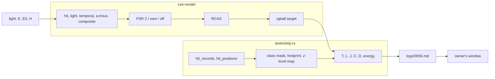

# 0056: The aliasing spike: what moves on the final image with the light held still, read by class, and one window for FSR 2, `own`, native and the far normal

> **Status:** draft (2026-11-03), for the owner's review; no phase starts before the owner's "go"
> **Created:** 2026-11-03
> **Milestone:** M2 in [`docs/roadmap.md`](../roadmap.md) (the surface-look and upscaler bullets).
> The roadmap's order changes when this plan is approved, not at draft.
> **Related ADRs:** [ADR-0034](../adrs/0034-fsr-2-ported-to-wgsl-as-the-default-upscaler-candidate.md)
> (FSR 2 the default; "fsr2 stays counts" stands, and this spike brings readings, not a reversal),
> [ADR-0024](../adrs/0024-own-temporal-upscaler-on-the-hit-buffer.md) (`own`, opt-in),
> [ADR-0042](../adrs/0042-the-far-shading-normal-blends-to-the-27-count-gradient-by-the-voxels-size-on-screen.md)
> (the far normal; `[2, 6]` is provisional, "reopened after Plan 0051": this plan is that reopen).
> No ADR at draft: see Decision.
> **Source:** the owner, 2026-11-03: "yes, draft the aliasing spike", and "the main thing that I
> care about for now is a stable image without any flicker or aliasing artiacts. we move towards
> this image by any means possible, considering performance of course."
> ([`LIGHT-FEEDBACK.md`](../../LIGHT-FEEDBACK.md), "What the owner wants" and "The hero that never
> settled".)
> **Starts after:** [Plan 0051](0051-steady-light-spike-converge-and-freeze-and-a-world-space-emissive-cache.md)'s
> Phase 4 verdict, and before [Plan 0044](0044-hot-path-and-defect-pass.md). See "Where it sits".

## TL;DR

Nothing approved reads aliasing. Plan 0051's `K` reads light per voxel face before the upscaler, so
it sees no geometric aliasing and nothing FSR 2 outputs. This spike reads the **final image, after
the upscaler and sharpening**, under a light that cannot move, and sorts what still moves into five
classes: light, geometric edges, moire and rings, upscaler instability, real geometry. The trick that
keeps it small: **an analytic lamp at the eye, no emissive samples and no probes is noise-free on main
today, with no render code**, and it stays world-static under a pure yaw. So geometry is isolated
without waiting for anything. A still camera's frames are also folded over FSR 2's 18-phase jitter
cycle, which splits what is locked to the jitter from what is not. A pure-yaw pan at a rate worked out
to move the image centre exactly one pixel a frame compares frames with no resampling. The first
thing anyone sees is a map and a table: where the 120-level jumps of the hall lie, and how many are
locked to the jitter. Then the matrix, a short list of cheap candidates, and one window where the owner
judges FSR 2, `own`, native, sharpening and the far normal in a scripted slow pan under the light Plan
0051's verdict picked. An ADR and a plan follow only if that window asks for one.

## Context & problem

`project-context.md` (Rendering, P0): stable at arm's length, in dark scenes. The owner judges in the
app, in a window. The figures touched are `docs/nfr.md` section 2 (the frame, the upscale line) and
section 3 (`frame_bytes`), readings only.

**What is read so far, and what it cannot say.** Plan 0055's strips were single-frame neighbour
differences on crops and a flicker map; its level run and scripted slow pan never ran; ADR-0034's
headless slow-pan bars stay missed from 2026-10-27, with the owner's "fsr2 stays counts" as the
verdict. The readings below are the showcase's `hall` shot, 1920 x 1080, exposure 8, lamp off, still
camera, RTX 3080 Laptop, renders repeatable to zero difference, per pixel in 8-bit levels, the worst
of the three channels. The drift column is from `LIGHT-FEEDBACK.md`, "What the drift is made of"
(main at 362229b):

| Setting | 2048 vs 2049: mean, p99.9, max, over 2 | Drift, 2048 vs 8192: mean, over 2 |
|---|---|---|
| Default (FSR 2, indirect on) | 0.19, 6, 119, 0.62 % | 2.36, 27.8 % |
| Indirect off | 0.18, 6, 122, 0.60 % | 1.84, 17.8 % |
| Native | 0.06, 1, 8, 0.03 % | 2.16, 25.2 % |
| Native, indirect off | 0.05, 1, 4, 0.00 % | 1.64, 15.3 % |

So FSR 2 triples the frame-to-frame mean and brings isolated jumps of about 120 levels against 8
without it, and the probes do not make them. The creep is a separate thing: it is mostly the direct
emissive path, it barely depends on the upscaler, and it is Plan 0051's. **Whether the jumps are the
sparkle the eye sees, and where they lie, is unread.** Still there at 8192 frames: hard-edged colour
patches on the ceiling, dark holes in the cyan wall, rings on the floor, blocky white emitters.

**What the tree says about edges.** Checked at b2ea5ec:

- **There is no edge antialiasing but the upscaler's jitter.** No MSAA or analytic coverage exists for
  a ray-marched hit. `off` is one ray through each pixel's centre.
- **FSR 2's jitter:** `fsr2::jitter_phases` is `int(8 (display / render)^2)`: **18 at 1280 to 1920, 17
  at 1687 to 2530** (the owner's window, 17.99 truncated), 8 at scale 1. `own` takes
  `JITTER_PHASES` 16. The phase comes from `Frame::frame`, the same index that seeds `rand`
  (`marcher.rs`, `params_for`).
- **Sharpening:** RCAS at 0.5 in both paths. `own` blends display-encoded colour, FSR 2 linear HDR
  then tone (`fsr2/tone.wgsl`). ADR-0034 read RCAS overshoot of at most 5/255, headless.
- **The light under jitter:** the half tier shades a lighting grid at jittered hits, and `lit_at`
  rejoins it by a normal and plane weight. Plan 0049 noted that "jitter at scale 1.5 adds noise from the
  lighting grid". `--lighting full` removes the grid.
- **The far normal's band is in internal pixels and is a sphere around the camera:** `px = 514 / t` at
  720 internal, so `[2, 6]` runs from `t` 86 to 257 voxels. The same flags at another scale smooth
  other voxels: `[2, 6]` at scale 1.5 is `[3, 9]` at scale 1 and `[4, 12]` at 2160.
- **A non-shaded view does not read the upscaler alike:** `upscale.wgsl` copies it (no history), while
  FSR 2 accumulates it and its tone pass stores it as it comes. So the `normals` view is no fair
  comparison of `own` and FSR 2, and this plan does not use it for one.

**The rings: what could make them.** Hypotheses for this spike to read, none asserted:

- **R1, real terraces.** `showcase.rs` makes the floor `FLOOR_Z + (ValueNoise(cell 64) >> 11)`: a
  bilinear patch per 64-voxel cell, quantised to whole voxels, in `-16..16`. Each height step is a
  10 cm riser, and contours of bilinear patches close around a lattice extremum, which reads as
  concentric rings. At the mean corner difference (about 11 voxels over 64, an estimate) a terrace is
  about 6 voxels wide.
- **R2, moire where those terraces pass the pixel grid.** With the eye 90 voxels over the floor's mean,
  a 6-voxel terrace spans 2 pixels at about 36 m at 720 internal, and at about 45 m native. So the same
  rings can be geometry near and alias far, and the onset should move with the internal scale.
- **R3, the far normal's transition.** A sphere around the camera meets the floor in circles about the
  camera's foot, out to about 24 m at the hall's eye height. These rings would move with the camera.
  They cannot be the 2026-10-29 bands, which predate the far normal (session 2 step 5, the level's
  patch pose). `gradient27_normal` reads one voxel around the hit, so a tread 3 voxels or wider keeps
  a flat normal at its middle: **terraces may survive the far normal by construction.**
- **R4, 8-bit banding of a smooth falloff.** Neither `fsr2/tone.wgsl` nor `sharpen.wgsl` dithers, and
  the target is `rgba8`. Nothing else in the tree dithers either.
- **R5, the probe grid.** The gather interpolates a regular grid. `--indirect off` removes it.

**Why a separate spike.** Far normal `[2, 6]` was picked with "difficuilt to say with problematic
lighting" on the showcase alone. Its level run did not happen. The window that reopens it and the slow
pan the owner has not seen in a script belong to the same session, under a light that holds still.

## Decision

**A spike: readings, then the owner's call in the window, then an ADR and a plan if warranted.** No
default moves in this plan. Five classes, each with a metric or an honest statement that only the eye
judges it:

| Class | Metric | How it is told apart |
|---|---|---|
| **Shading or light flicker** | `T`, `L` and the unlocked share on face interiors under the hero's light, against the same under `E` | `E` has no light noise, so what `E` lacks is light. Plan 0051's `K` stays its reading |
| **Light drift** | `D`, 2048 vs 8192 | Plan 0051's; read here only to show that `E` reads none |
| **Geometric edge aliasing** | `C` on creases and silhouettes under `E`, by footprint | Native `E` is the raw reading; `R` is the floor at four rays a pixel |
| **Moire and rings** | The z-level map, the ring reads below | World-anchored or camera-anchored; moves with scale or not. **Faint bands: only the eye** |
| **Upscaler: jitter** | `J`, the jitter-locked share, under `E` | Native is zero by construction |
| **Upscaler: history** | `C` against `T` still, under `E`, FSR 2 and `own` | Only in motion |
| **Upscaler: sharpening** | `T`, `C`, energy at sharpen 0.5 and 0 | The one change between the two arms |
| **Real geometry** | Unmoving under `E`, and the same in `R` | Whether it looks good is **only the eye's** |

**The metrics.** All on the display target's `rgba8`, in 8-bit levels, worst of three channels, so
they compare with the table above:

- **`T`:** frame `f` against `f + 1`, per pixel: mean, p99.9, max, share over 2, and the count of
  **jumps** over 32.
- **`L`:** the same with `f + phases` for `f + 1`. A jump that `T` shows and `L` does not is locked to
  the jitter's cycle.
- **`J`:** over `c` whole cycles, per pixel, the variance of the phase means less their expected noise
  (`residual / c`), over the total variance. 1 is all locked, 0 none.
- **`C`, the crawl:** on a pure-yaw pan, `f` against `f - 1` shifted a whole pixel, inside the centre
  band; `f` against `f - 4` at the quarter rate. No resampling, so no filter floor to subtract.
- **`D`:** the drift above.
- **The guard, energy and distance from `R`:** a blurred image scores as stable. Every table carries
  `VXE_STRIP_ENERGY`'s neighbour energy on Plan 0055's crops (dome 800,0 700x250; near pillar 560,300
  200x400; far wall 780,230 640x360) and, at a still camera under `E`, the mean distance from `R`.

**The light arms.**

- **`E`, the eye lamp: frozen, on main today, no render code.** The lamp on, `LightParams::at_eye()`
  with no offset and no shadow ray, its cone opened past the view (half-diagonal 0.96 rad at 16:9, so `inner`
  1.2, `outer` 1.5), `Lighting::indirect` off, and `MirrorConfig::light_radius` 0, so the light pass has
  no sample to draw. `lamp_lit` takes no random number. Under a pure yaw the lamp's position holds, and
  so does the shading at every world point. Emitters still glow, from the composite. `E0` adds
  `Frame::set_emission_scale` 0 for the emitters. Intensity is set so that the dome crop reads a mean
  display luma of 30 to 120.
- **`H`, the hero's light:** the shot's, lamp off, exposure 8, **as Plan 0051's verdict leaves it:**
  `--steady` is not on main yet (branch `plan-0051`: `off`, `a`, `c`, `ac`, with `b` to come), and Plan
  0051's own prediction for its table at `up1.5` is small but above 0, since jitter moves a pixel across
  a face edge. So `H` is only as frozen as the verdict makes it, and the unlocked share reads how far that is.
- **Rejected: pinning `Frame::set_frame_index`.** It pins `rand`, but also the jitter, which reads the
  same index, and the probes' update list. It is kept as a one-off diagnostic for "FSR 2 with no jitter".

**`R`, the reference:** `off` at 3840 x 2160 with the far normal at `[4, 12]`, box-filtered to 1920 x
1080 (`strip.rs`'s `shrink`): four rays a pixel, no history, under `E`. It is a floor, not the truth.

**We rejected** extending Plan 0051's `K` to the display, because a per-face mean hides an edge crawl
on near faces. We rejected a full-frame warp for `C`, because its filter's floor would be read as
aliasing. We rejected adding edge antialiasing or a new upscaler now, because no reading has attributed
a source. We rejected reopening "fsr2 stays counts" in advance: the readings inform the owner, and they
decide. **No ADR at draft:** the architect writes one after Phase 4 only if the owner picks a mechanism
with a rejected alternative. A changed far-normal setting is a dated Outcome on ADR-0042.

### Where it sits

The owner's order is Plan 0051, its verdict plan, Plans 0044, 0045, 0048, then M10. This plan goes in
**after Plan 0051's Phase 4 verdict and before Plan 0044:**

- **The window needs the verdict's light.** Phases 1 and 2's `E` arms need nothing from Plan 0051; the
  `H` arms and Phase 4 do, because the far normal was judged through a wander once already.
- **Relation to the verdict plan:** read-only against it. It builds the light; this reads the image
  through it. Its tests may take `T`, `L` and `C` as display-level bars. See Question 1.
- **Relation to Plan 0044:** that plan removes waste with no change of behaviour, and counts FSR 2's
  per-frame `prepare` and `gradient27_normal` on default pixels, both provisional on the choices made
  here. Reading first saves it re-reading.
- **Relation to Plan 0045:** `own` must still exist. Plan 0055 names 0045 as the plan that removes it,
  while 0045's own phases only move it. Whichever holds, it stays until this plan closes.

## Architecture diagram



## Implementation phases

Each phase ships as its own commit. `dev` implements all dev phases in one session; the architect
reviews once at the end, in a fresh session. Lane rule 9c applies: sweeps on the RTX 3080 Laptop through
`VXE_TEST_ADAPTER=rtx`, labelled; done-when readings and asserts on lavapipe. **Phases 1 and 2 change no
file under `crates/`.** Per phase: `node scripts/test-changed.mjs --profile quick`, then `--profile gpu`
under the perf lock, clippy and fmt. At the tip: `cargo nextest run --workspace --profile gate` under the
perf lock, doctests, clippy, fmt, deny and the doc and tier gates. Readings go to
`docs/plans/logs/0056.md`. `strip_run` stays `#[ignore]`d, so no reading run counts against the soak
line; the named tests below all stay under it. `flythrough::strip` is already in the gpu filter, so the
tier gates need no new entry.

### Phase 1: Where the jumps lie

- **Owner skill:** dev
- **What:** `strip.rs` reads `T`, `L`, `J` and the class mask, and takes `E`; the first table and map:
  where the hall's jumps lie, and how many are locked to the jitter.
- **The mask:** a display pixel takes the internal pixel under it (`Frame::hit_records`,
  `hit_positions`, as the Plan 0051 rig maps it) and its 3 x 3 neighbours. Classes: `interior` (one
  voxel and face), `seam` (same plane, another voxel), `crease` (another face, positions close),
  `silhouette` (a depth jump over 1.5 voxels), `emitter` (the material emits, or a neighbour does),
  `miss`. Footprint bins by `px = W / ((tan_l + tan_r) t)`: under 2, 2 to 6, over 6, the far normal's
  band. At a still camera a pixel's class is the most edge-like across one cycle.
- **New environment:** `VXE_STRIP_READ=fold` (metrics, mask and `jumps.png`, the count of jumps per
  pixel), `VXE_STRIP_LIGHT=hero|eye|eye0`, `VXE_STRIP_PROBE_SPACING` (the hero's 32),
  `VXE_STRIP_LIGHT_RADIUS`, `VXE_STRIP_SHARPEN`. The tool prints its phase count from `jitter_phases`.
- **Files touched:** `apps/flythrough/tests/strip.rs`, `apps/flythrough/tests/support/aliasing.rs` (new),
  `apps/flythrough/tests/support/mod.rs`, `docs/plans/logs/0056.md` (new, from the readings-log template).
- **Done when:**
  1. `the_phase_fold_splits_a_locked_series_from_noise` (no GPU, under 1 s; seeded): over 72 frames of
     10 000 pixels, a series of period 18 reads `J` 1 and `L` max 0 with `T` above 0; seeded white noise
     reads `J` within 0.1 of 0 and `L`'s mean within 20 % of `T`'s; a constant series reads every
     figure 0.
  2. `the_class_mask_names_each_class` (no GPU, under 1 s): a hand-built grid of hits gives each class,
     and a pixel that changes class inside a cycle takes the more edge-like.
  3. `the_eye_lamp_holds_the_native_frame_bit_identical` (lavapipe, `cavity_world`, 192 x 108, `off`,
     `E`; a guess of about 5 s): from a frame the test names (dev reads it and writes it in, at most
     64) to frame 128, every frame is bit-identical. A frame that never repeats is a failure and stops
     the plan for an amendment, since `E` is what isolates geometry.
  4. **The bridge.** At the hero's settings the tool's 2048 vs 2049 reads the Context table's default
     and native rows. Equal, or the difference is logged with its cause.
  5. **The first reading, in the log, RTX:** the hall, FSR 2 at 1.5 and native, `H` as on the tree and
     `E`, settled 512 frames and read over 72 (4 cycles of 18): `T`, `L`, `J`; jumps by class and
     footprint; `jumps.png` and the 8 worst clusters' crops, for FSR 2 under both lights and under `E0`.
     The log answers in words: do the jumps sit on emitters, creases, silhouettes or interiors, are they
     locked to the jitter, and do they survive `E`?
  6. **The stop rule.** If FSR 2's jumps under `E` read under a tenth of those under `H`, they are the
     light under jitter, and not geometry: dev stops for an architect amendment before Phase 2, since
     its matrix and Phase 3's candidates assume otherwise. A guess at the line: the log gives the ratio.

### Phase 2: The matrix, the pan and the rings

- **Owner skill:** dev
- **What:** every arm on the still and the pan, and the rings and the hero's other leftovers classified.
- **The pan:** a pure yaw, positive, to the left, so the image moves right. With the 1080p focal length
  `540 / tan 35 deg` = 771.2 px and the hall's pitch of -12 degrees, the centre moves one pixel per
  0.07595 degrees (`atan(1 / 771.2) / cos 12 deg`): **4.557 degrees a second at 60 frames a second, and
  the quarter rate 1.139**. `C` reads columns 810 to 1109: x error at the band's edge 3.8 % of the shift,
  y error at its corners at most 0.14 px (roll term 0.04 px), under 0.2 px in all. 240 frames at the full
  rate and 640 at the quarter (160 px), so the near pillar enters the band in both. The tool works these
  from the camera and prints them. New: `VXE_STRIP_PAN=PX_PER_FRAME`, which also sets `C`'s lag,
  `VXE_STRIP_SCALE` (`fsr2` at 1) and `VXE_STRIP_SHRINK` (`R`).
- **The arms:** upscaler `fsr2` at 1.5, `own` at 1.5, `off`, and `fsr2` at 1; far normal `[2, 6]` and off
  (`[3, 9]` at scale 1, so that it smooths the same voxels); sharpening 0.5 and 0 on the two
  upscalers at 1.5. Under `E` every combination, still and both pans, at the hall, plus `R`. Under `H`
  the default against `off` and `own`, still and the slow pan. At the level: `patch` and `vein`, `E`,
  the first three upscalers, far normal on and off; ADR-0042 says that it was never judged there. At
  the window's size, 2530 x 1378 (17 phases): the default alone. `D` under `E`, FSR 2 and native, at
  the hall.
- **The rings,** at the hall's floor and the level's `patch`:
  - **R1:** the z-level map (`floor(p.z)` parity from `hit_positions`) written beside the crop; the share
    of ring-edge pixels within 1 pixel of a z-level change. At the hall, the CPU's `floor_at` contours
    against lattice extrema of the 64-voxel cell.
  - **R2:** the rings' farthest resolved distance, at scale 1.5, native and `R`.
  - **R3:** `face` against the far normal, and the eye moved 16 voxels: do they stay on the world?
  - **R4:** the neighbour-difference histogram in the crop, and plateau widths at 1 level.
  - **R5:** `H` with indirect on and off.
- **The hero's other leftovers,** each by `E` against `H` plus the `albedo`, `normals` and `hitmask` views
  at scale 1: the ceiling's colour patches (the 2026-11-03 strips say converged direct light), the dark
  holes in the cyan wall, the blocky white emitters. Each gets a class, or "unread" with why.
- **Files touched:** `apps/flythrough/tests/strip.rs`, `apps/flythrough/tests/support/aliasing.rs`,
  `docs/plans/logs/0056.md`.
- **Done when:**
  1. `the_pan_moves_the_centre_band_one_pixel` (lavapipe, `pillar_world`, 320 x 180, `off`, `E`, pitch 0,
     8 frames; a guess of under 5 s): among whole-pixel shifts of -2 to 2 the band's residual is least at
     the sign and size the rate names, and below the unshifted residual.
  2. The tables are in the log, by class and footprint, all with the guard. RTX, labelled.
  3. **The re-read on lavapipe,** per lane rule 9c: `T`, `L`, `J` and `C` for FSR 2, `own` and `off` under
     `E` at 384 x 216, the hall; a guess of under 10 min, a reading run in no tier. The log says whether
     their order agrees with the RTX's.
  4. **Every row of the class table has its answer in the log,** in one line each, or "only the eye", or
     "unread" with why. The rings' row names which of R1 to R5 stood, and what is left.
  5. The log names the arms that Phase 3 should carry, in one line each, with the reading behind each.

### Phase 3: Candidates, costs and the window's toggles

- **Owner skill:** dev
- **What:** the cheap candidates that Phase 2's readings attribute, their cost on both adapters, and what
  the window needs to show them.
- **Candidates, simplest first. A candidate is read only if its class was attributed; the log names each
  one skipped and why.** All knobs default off; none is proposed as the fix.
  1. Sharpening 0 and 0.25 (`--sharpen`): none to build.
  2. Far normal `[1, 2]`, `[2, 6]`, off (`--far-normal`, `--look face`): none to build.
  3. `--lighting full`, against the half tier's grid: none to build.
  4. `fsr2` at scale 1 with `[3, 9]`: none to build.
  5. **A still image that holds:** how far one frame lies from its cycle's mean, and the jump at the
     pan's first frame if a still view held its image. Read offline from Phase 2's frames: none to build.
  6. Jitter phases 8, 18 and 32: an `Fsr2Settings` field, a few lines.
  7. A static blue-noise dither of 1 level in the tone pass, only if R4 stands. It uses the texture the
     frame already has, and it does not vary with the frame, so it adds no flicker by construction.
  8. A lower cap on an emitter's HDR into FSR 2, only if the jumps lie on emitters.
  9. FSR 2's locks off, only if 6 and 8 leave the jumps standing.
  10. Shading at a face's centre rather than the jittered hit, only if `interior` is jitter-locked. It is a
      look: one value a face, beside Plan 0051's B.
- **The window's toggles, all new:** `--pan DEG_PER_S` (a constant yaw from wall-clock `dt`, `Period`
  starts and stops it); `V` cycles the far normal (`[2, 6]`, `[1, 2]`, off); `Z` cycles sharpening (0.5,
  0.25, 0). `UpscalerBanner::line` gains the sharpening: `upscaler fsr2, scale 1.5, sharpen 0.5`. A
  stats HUD row shows upscaler, scale, sharpening, far normal and pan the whole time. Dev moves a key
  that turns out to be taken (`B E G H I J K L M N O P Q R T U X Y`, `WASD`, `C` and `Space` are today; `V`, `Z` and `Period` read free at b2ea5ec), and
  the log says so.
- **Costs,** for the arms Phase 2 names and the candidates kept: `flythrough --headless --frames 300`,
  showcase start and `--level --pose vein`, RTX at 2530 x 1378, RADV RENOIR at 1920 x 1080, each run's
  frame line and per pass, three alternated quiet rounds, perf lock and memory cap. `frame_bytes` for any
  changed scale.
- **Files touched:** `apps/flythrough/src/main.rs`, `apps/flythrough/src/hud.rs`,
  `apps/flythrough/tests/strip.rs`, `docs/plans/logs/0056.md`, `docs/nfr/02-frame-budget.md`; for
  candidates 6 to 10 only, as attributed, `crates/vxe-render/src/fsr2.rs`, `crates/vxe-render/src/marcher.rs`,
  `crates/vxe-render/src/shaders/fsr2/tone.wgsl` or `light.wgsl`; `renders/plan-0056/session.sh` (local,
  gitignored).
- **Done when:**
  1. `the_aliasing_toggles_show_in_the_banner` (no GPU, under 1 s): `V`, `Z` and the pan's key change
     the banner's text to each mode, and `--pan` parses, refusing a non-number and refusing 0.
  2. Every built knob, off: one golden bit-identical to main's and `frame_bytes` as main's.
  3. Each candidate read has `T`, `L`, `J`, `C` and the guard beside the default's in the log, under `E`
     and, where it can differ, `H`.
  4. The cost table is in the log and in `docs/nfr/02-frame-budget.md`, both adapters, with commit and load.
  5. The runner tees to a log with stdout visible, runs Phase 4's commands one by one and pings the owner.

### Phase 4: The owner's window

- **Owner skill:** human
- **What:** the release fly-through on the RTX, one sitting, about 20 minutes, with the tables beside it.
  `<L>` is the verdict's light: `--steady <preset>`, nothing if the verdict plan has made it the default,
  or `--indirect off` if the verdict names no preset (session 2's "No visible movement"). Every toggle
  below shows in the banner and the HUD row.

  ```
  cargo build --release -p flythrough

  # 1. The hall, still: a minute at each. F10 through fsr2, own and off; V; Z.
  target/release/flythrough --source showcase --shot hall --exposure 8 --hud <L>

  # 2. The hall, the owed slow pan: the same keys. Period stops and starts it.
  target/release/flythrough --source showcase --shot hall --exposure 8 --hud --pan 1.1 <L>

  # 3. The hall, a head turn.
  target/release/flythrough --source showcase --shot hall --exposure 8 --hud --pan 4.5 <L>

  # 4. The floor's rings: fly over them, and look near and far. V.
  target/release/flythrough --level --seed 1 --pose patch --lamp off --hud <L>

  # 5. The far normal where it was never judged: the vein, then a slow pan.
  target/release/flythrough --level --seed 1 --pose vein --lamp off --hud <L>
  target/release/flythrough --level --seed 1 --pose vein --lamp off --hud --pan 1.1 <L>

  # 6. FSR 2 as antialiasing at full rate, if the owner kept it (Question 2).
  target/release/flythrough --source showcase --shot hall --exposure 8 --hud --pan 1.1 \
      --upscaler fsr2 --internal-scale 1 --far-normal 3,9 <L>
  ```

  Any candidate from Phase 3 kept for the eye joins these with its own flag.
- **Files touched:** this plan's log.
- **Done when:** the log has the owner's words on: (a) the upscaler and scale, or "fsr2 stays"; (b) the far
  normal's setting, which closes ADR-0042's "provisional"; (c) the sharpening; (d) what is still seen, by
  class and scene; (e) the rings, holes, patches and emitters: fine, a look item or a fault; (f) whether a
  fix is wanted, and what it may cost. The architect then writes the Outcome, the ADR and the plan these
  ask for. A changed number needs no ADR, and is that plan's first phase. This plan closes with the record.

## Data shapes

```rust
// illustrative: tests/support/aliasing.rs, nothing here reaches `crates/`
pub struct Change { pub mean: f64, pub p999: u8, pub max: u8, pub over_2: f64, pub jumps: u64 }
pub enum Class { Interior, Seam, Crease, Silhouette, Emitter, Miss }
pub enum Footprint { Under2, From2To6, Over6 }
pub struct Fold { pub t: Change, pub l: Change, pub j: f64, pub phases: u32, pub cycles: u32 }
```

## Budgets

No default moves, so the plan costs the frame nothing. Named against `docs/nfr.md` section 2 and
`docs/nfr/02-frame-budget.md`, whose **ledger still reads `own` at 1.5**: its re-basing stays owed, and
this plan does not do it. Its readings are Plan 0055's and sit beside the ledger:

| Figure | Today (Plan 0055) | What this plan could move it by |
|---|---|---|
| Frame, RTX 3080 Laptop, 2530 x 1378, showcase start | 11.799, 11.936 ms | Read in Phase 3 |
| Frame, RTX, `--level --pose vein` | 7.482, 7.519 ms | Read in Phase 3 |
| Frame, RADV RENOIR, 1920 x 1080, showcase start | 55.063, 54.998 ms | Read in Phase 3 |
| Frame, RADV, vein | 33.107, 33.206 ms | Read in Phase 3 |
| Upscale line, 1.5 ms | FSR 2 2.93 to 2.96 ms (RTX), 9.97 to 9.98 ms (RADV) | `own` 0.93 to 1.30 and 3.66 to 3.86 ms |
| Far normal `[2, 6]` in the hit pass, showcase start | RTX about +1.5 ms, RADV +6.6 ms against `face` | `[1, 2]`: RTX +0.39 to +0.45 ms, RADV +2.5 ms |
| `frame_bytes`, 1080p, FSR 2 | 309 377 468 B | `own` 184 957 040 B |

**Guesses, labelled as such:** `fsr2` at scale 1 costs about twice 1.5's rendering, from Plan 0030's `own`
readings (RTX 5.98 to 6.04 against 3.05 to 3.10 ms; RADV 38.7 to 41.0 against 20.1 to 20.9 ms), an old tree
and another pose. So on the Radeon it would be far past 16.6 ms, as today's default already is.
`--lighting full` costs about twice the light pass, a guess. Candidates 6 to 8 cost nothing measurable, a
guess. Phase 3 replaces each one. **Test times** are named in each phase, against the 30 s line of `docs/nfr.md`
section 7. None is near it.

## Risks & open questions

- **`E` is not the hero's look.** A lamp at the eye lights risers head-on and casts no shadows, so its edge
  contrast differs. It answers "does geometry alias, and where", not "how much does it show". The eye
  answers that in Phase 4.
- **The metric may miss what the eye sees.** Plan 0049's rig missed the owner's dots. If Phase 4 names
  something that no table shows, the log says so, and the eye wins.
- **FSR 2 may not reach a limit cycle.** Locks and history may not repeat at 18 frames, so `L` under `E`
  may stay above 0. That is a reading about history, not a failed fold.
- **A blurred arm wins `T`.** Hence the guard in every table.
- **`H` is the verdict's, whatever it is.** Plan 0051 may drop arms at its close. Phase 4's `<L>` has a
  stated fallback. If Plan 0051's rig moves, this plan does not lean on it: it reads `hit_records` itself.
- **The 1.5 scale in the window is 17 phases, not 18.** Hence the one reading at 2530 x 1378.
- **The far normal's band is in internal pixels.** Scale comparisons use the `[3, 9]` and `[4, 12]` above.
- **Runtime toggles under FSR 2.** Changing the sharpening may replace the upscaler and drop its history, a
  visible blip at the key. Dev reads it and says so in the banner's doc; the owner is told.
- **Determinism, threading:** nothing touches `vxe-world`. GPU memory: `R` at 2160 is a larger frame; the
  runs hold the perf lock and the memory cap.

### Questions for the owner

1. **When does it start?** (a) **Recommended: right after Plan 0051's Phase 4 verdict, before the verdict
   plan's mechanisms land.** `--steady` is on main by then, and the verdict plan can take a display-level
   bar from it. (b) After the verdict plan closes: the window then shows the shipped light, but the verdict
   plan gets no such bar, and the owner's first aliasing answer comes one plan later. (c) Phases 1 and 2 now,
   beside Plan 0051, since `E` needs nothing from it: the sooner answer, but the lanes contend for the RTX,
   and the `H` arms need re-reading later.
2. **Is full-rate FSR 2 worth reading?** (a) **Recommended: yes, read it and show it (run 6),** since the
   owner said "by any means possible". It reads what more rays per output pixel buy, at a guessed doubling
   that the RTX can pay at 1080p and the Radeon cannot. (b) No: it stays out, one reading and one run fewer.

## What this plan does NOT do

- Design or ship a fix. A candidate is a reading behind a knob. The fix is the ADR and plan after Phase 4.
- Reopen ADR-0034 by assumption, remove `own` (Plan 0045, or a later one), or remove any upscaler.
- Attribute or fix the drift, the probes' wander, the emissive path's creep or the dots: Plan 0051 and its
  verdict plan.
- Add MSAA, analytic coverage or a mip-based far normal (ADR-0042's Alternative A): a later plan, if the
  window asks.
- Change the floor's generator, so no smoothing of the terraces, even if R1 stands. A level's geometry is the
  consumer's, and a `showcase.rs` change is a look item for the owner.
- Re-base the frame ledger in `docs/nfr/02-frame-budget.md`.
- The Radeon's walk-speed spike, or a flight reading: a pure yaw is the only motion read headless. The owner
  flies in run 4.
- Any change of default, golden or hero image.

## Implementation log

> Written by `dev`: one row per phase as its commit lands, then the close block. **The phases
> above are the contract. This section records what happened.** Observations, never conclusions:
> no pass list, no self-assessment. Deviations and unmet done-whens are **always** disclosed.
> Keep it shorter than `## Implementation phases`. Readings, gate counts, attempts, sweeps and
> resume notes go to the plan's readings log, `docs/plans/logs/0056.md` (started from
> `templates/readings-log.md`), and this section links it once it exists.

| phase | owner | state | commit |
|---|---|---|---|
| 1: Where the jumps lie | dev | not started | |
| 2: The matrix, the pan and the rings | dev | not started | |
| 3: Candidates, costs and the window's toggles | dev | not started | |
| 4: The owner's window | human | not started | |

### Notes

_(Deviations from the plan, with the commit, stated without justification. Done-whens not
satisfiable as stated, and what was done instead. Followups noticed and not acted on. One line
each. Empty is fine.)_

### Close triggers

_(Facts for the architect. No recommendations, and no suggested version bump.)_

- **What shipped:** feature / fix-only / docs-chore-only
- **Public API changed:** types, traits, functions, shader interfaces, config (list them, or none)
- **Budget readings:** each `nfr.md` figure touched, with its measured value, machine and commit
- **Gate at the tip:** the commands run (build, nextest, doctests, clippy, fmt, deny), exit codes, test counts
- **Outstanding `human` phases:** which, or none

## Followups

None at draft.
