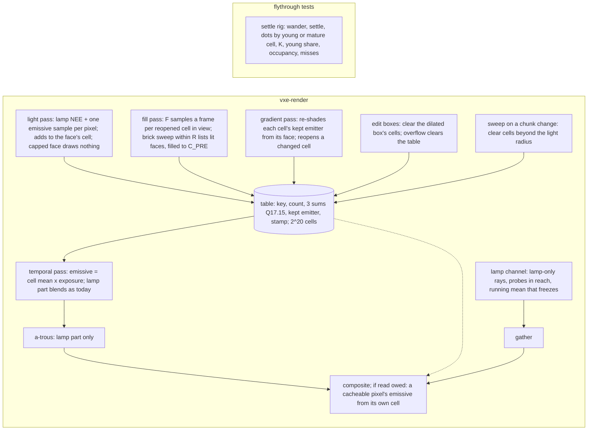

# 0057: Steady light: the per-face table as the only emissive store, faces sampled and guarded in world space, and the probes as a lamp-bounce channel

> **Status:** in-progress (Phases 1 to 6 done, 2026-11-05; the owner questions the direction; awaits the owner's decision and the close review); Plan 0056's Phase 2 readings are in its log (e678ae7)
> **Created:** 2026-11-04
> **Milestone:** M2 in [`docs/roadmap.md`](../roadmap.md) (the "one-sample path tracing ...
> temporal accumulation" bullet and the probe volume's indirect light)
> **Related ADRs:** [ADR-0043](../adrs/0043-emissive-light-from-a-world-space-per-face-table-and-a-lamp-bounce-probe-channel.md)
> (proposed; this plan builds it and its close accepts it), which amends
> [ADR-0018](../adrs/0018-direct-light-per-pixel-one-sample-from-a-hit-buffer-with-svgf-history-killed-by-edits.md),
> [ADR-0023](../adrs/0023-indirect-light-from-a-scrolling-probe-volume.md) and
> [ADR-0036](../adrs/0036-static-emissive-light-on-a-long-full-precision-history-guarded-by-an-emissive-gradient.md)
> and makes [ADR-0037](../adrs/0037-probe-rays-direct-light-keeps-its-energy-apart-from-the-screen-firefly-clamp.md)
> moot. [ADR-0033](../adrs/0033-eye-adaptation-as-an-asymmetric-two-stage-exposure-on-the-gpu.md)
> is untouched (owner, the verdict's item 5).
> **Source:** [Plan 0051](done/0051-steady-light-spike-converge-and-freeze-and-a-world-space-emissive-cache.md)'s
> Phase 4 verdict (owner, 2026-11-04) and its close review's Followups; the readings in
> [`logs/0051.md`](logs/0051.md); [`LIGHT-FEEDBACK.md`](../../LIGHT-FEEDBACK.md), "What the owner
> wants".
> **Starts after:** Plan 0051's close (v0.41.0, on main). Runs beside
> [Plan 0056](done/0056-aliasing-spike-what-moves-on-the-final-image.md)'s lane, which is read-only
> against this plan and hands it the yellow dots' class (0056 Phase 2, done-when 4); this plan
> takes that answer as an input at its Phase 1 and Phase 4. Then Plans 0044 and 0045; Plan 0048
> is moot under ADR-0043 and awaits the owner's "drop".
>
> **Amended 2026-11-04 (architect, for the owner):** Phase 1's stop rule read **stop** (the
> young-cell share of the fast yaws' excess is 0.005 to 0.099 in every positive row,
> `logs/0057.md` Phase 1), and Plan 0056's class answer is **light, not the upscaler, on creases,
> mostly new each frame** (`logs/0056.md` Phase 2). Phase 4 is rewritten: it **drops the warm
> rays and the fill of every young face in view**, and **builds two things only where a reading
> on Phase 3's tree says they are owed**: a fill pass for the cells an edit or the guard
> reopened (the dug hole), against a settle bar of **60 frames at arm's length and 120 at 100
> voxels**, and the composite reading a full-resolution pixel's emissive from its own face's cell
> (the creases), if the half-resolution upsample is read to carry the dots. Phases 1 to 3, 5 and
> 6 stand, with Phase 6's done-when gaining the creases. ADR-0043's fill-pass paragraph is
> amended in its Outcome at the close, as the plan provided.
>
> **Amended 2026-11-04 (architect, for the owner), Phase 2 done-when 7:** Phase 2's fast yaw read
> the opposite of the bar's premise (`logs/0057.md` Phase 2, done-when 7): with the table's read
> off the screen path reads no excess (-911.7 over a floor of 69.3, sd 11.6), and the table reads
> +552.5 over a floor of 27.6 (sd 2.0). The table's read, not the screen path, puts the dots on
> the screen after a yaw. Done-when 7 becomes a reading whose two excesses feed Phase 4's crease
> rule, and the bar it carried (the table puts no excess over its own floor after a yaw) moves to
> Phase 4 as done-when 7, asserted if the own-face read is built. Phase 2 is not held.
>
> **Amended 2026-11-04 (architect, for the owner), from Phase 2 and 3's missed predictions**
> (`logs/0057.md` at bd627c7, Phase 2 done-when 9 and Phase 3 done-when 5). Three decisions:
> (1) the patch's misses at 4 % load are the hash's or the claim's, not the size's: the size
> stays 2^20 and dev reads the slot distribution on the CPU, fixes what it names, and the bar is
> 0 misses; (2) the still hall that moves (native drift 0.257, one frame 0.137, max 175 levels,
> against Plan 0051's 0.004 and 0.001) is a defect against the owner's first rule, attributed by
> class in Phase 4's Part 1 and fixed in a new Part 1b before Parts 2 and 3, with the native
> figures as a bar; (3) the still reopens (4 in 1024 frames at the patch) are a defect, fixed in
> Part 1b by letting the guard reopen only while the world has changed, and the gradient's cost
> (0.092 ms) is a reading against a prediction that compared with a pass Phase 2 did not run: the
> prediction is restated, the cost accepted under `docs/nfr.md` section 2's 6.0 ms line.
>
> **Amended 2026-11-04 (owner), the camera-radius preload.** After Plan 0056's window under
> `--steady b --indirect off` the owner said the light no longer flickers once it settles, but
> "places like this [a dark ceiling corner at the vein] takes some time to settle", "real players
> won't be that slow", "still quite a bit of time before light 'loaded' in dark corners and after
> fast turn", "you can clearly see this light 'loading' when digging holes", and asked to "explore
> idea of preloading light around the camera in certain radius, no matter where this camera
> looks". Phase 4 gains **Part 2b, the camera-radius preload**, built after Part 2 on its pass:
> rays from the eye over the full sphere, out to `R` = 64 voxels, sample the faces they hit
> until each cell holds `C_PRE` samples, at a fixed ray count and sample budget a frame, so the
> faces a turn, a step or a dig at arm's length shows are settled before they are seen. This
> **reinstates the dropped warm rays for the settle, not for the dots**: the dots were read on
> mature cells (Phase 1's young share 0.005 to 0.099; Plan 0056's creases), so warming faces
> could not touch them, and that is why the rays were dropped; the settle is the opposite case,
> cells too young or absent when they come into view (the hole's `S90` 319 and 1891 frames on
> Phase 3's tree against bars of 60 and 120), which warming faces is for. Done-whens 12 to 17,
> Phase 6's run 6 and item (h), the Budgets, Risks, Followups and the Decision follow.
>
> **Amended 2026-11-04 (architect, for the owner), the preload's form.** Part 2b's
> `preload_visibility_readings` read the share of entering pixels within `R` that an eye of the
> previous 60 frames could see at **0.002 and 0.007 on the walks** (1.000 on the yaws,
> `logs/0057.md` Part 2b): walking, a face enters view from behind something, where no eye ray
> reaches. The owner asked for the light around the camera "no matter where this camera looks",
> so the eye rays are not built and **the brick sweep the first amendment rejected is the form**:
> a cursor visits the mirror's bricks within `R` a few a frame, nearest first, finds each lit face
> from the opaque masks without a ray, and lists it for Part 2's fill routine until it holds
> `C_PRE`. The rejection's cost premise fails on the census (about 15 000 to 25 000 faces within
> 64 voxels at the level, from Part 1b's key counts). `R` stays 64 voxels, a brick radius of 8;
> the faces beyond it settle at their footprint. Done-whens 12 to 17, Phase 6's run 6 and item
> (h), the Budgets, Risks, Followups and the Decision follow.
>
> **Amended 2026-11-05 (architect, for the owner), the claim rule, from the level readings**
> (`logs/0057.md` at 4ec11a7, Part 2b's level readings on the restructured tree). The boxes meet
> done-whens 13, 15 and 16, the walk's cost is under its bar, and the level misses done-whens 14
> and 16 with the preload on about as much as off, because **17 563 of the 18 619 faces probed
> at the patch refused a cell**: one sample is a resampled pick over 8 candidates by their
> unshadowed weight plus one shadow ray, so a face lit through a gap, whose best candidates are
> mostly occluded, draws a lit sample with a small probability `p` and 8 of them find it with
> `1 - (1 - p)^8` (about 0.22 at `p` 1/32). The turn's faces in view hold 1024-sample references
> and still miss, so most of the refusals are dim faces, not unlit ones: the owner's dark corner.
> **Decision: every face within `r0` of the eye claims a cell whatever its probes read**
> (`preload_claim_radius`, 24 voxels by default, swept 16, 24 and 32), and is filled to `C_PRE`
> lit or not; beyond `r0` to `R` the 8-probe rule stands; the load and miss guards hold
> everywhere. Rejected: more probe rounds per epoch (option (b)), since a face at `p` 1/32 needs
> about 96 probes to be found nineteen times in twenty, over a third of `C_PRE`, and a face no emitter
> reaches pays them again every epoch, which streaming raises while walking, where a claimed cell
> is filled once for its life; a deterministic centre-to-centre ray per candidate emitter,
> since the candidate table lists chunks of emitter samples, so the test is a loop over every
> emitter within the light radius per face, and a centre ray misses a face lit off its centre
> through a gap; and options (a) and (c), which keep a rule whose miss is attributed. **The
> reference run** claimed through the same rule and kept cells of 1024 samples, so 3 660 of the
> patch walk's 6 349 entering pixels had none: it now claims every face unconditionally, holds
> until every cell reaches `C_CAP`, and a pixel with no reference counts as not settled. Part
> 2b's claim, done-whens 12, 14, 16 and 17, the Budgets, Risks and Phase 6 (h) follow.

## TL;DR

Plan 0051's spike ended with the owner's verdict: emissive light from the world-space per-face
table, read nearest, no indirect gather, exposure unchanged, the probes shrunk to a lamp-bounce
channel whose logic is redone. ADR-0043 records it. This plan makes it the renderer. **The table
becomes the only emissive store** (no screen history, read from the first sample, the a-trous for
the lamp alone), sized and swept so it holds the surfaces around the camera. **A reopened face
is sampled, not only its pixels** (amended): where Phase 3's tree still misses the dug hole's
settle bar, a fill pass draws a fixed number of samples a frame for each cell an edit or the
guard reopened, and where the creases' dots are read to come through the half-resolution
upsample, the composite reads each pixel's own face. **The faces around the camera are
preloaded** (amended 2026-11-04, owner; its form amended the same day): a cursor sweeps the
mirror's bricks within 64 voxels of the eye and fills every face within 24 voxels and every
lit face beyond (amended 2026-11-05), whatever the view
and whether or not any eye could see it, so a fast turn, a walk round a pillar, a dark corner and
a dig at arm's length show light that is already settled. **Invalidation is an edit box
plus a world-space guard:** each cell keeps the emitter that lit it most, and the gradient pass
re-shades that point from the face and reopens the cell where the light changed. **The probe
volume becomes a lamp-bounce channel:** lamp-only rays within the lamp's reach, a running mean
that freezes while the lamp is still, nothing at all with the lamp off, and the scaffolding kept
for a later per-source indirect light. Phase 1 reads the two questions the verdict left open
(`--steady ab --indirect off`, and the dug hole) and whether the young faces are the fast-turn
fault, before any mechanism. The first thing anyone sees is the hall holding still from frame 1
of its first turn, and a dug hole lit within a second. The owner judges the default in the
window at the end, this time with digs.

## Context & problem

`project-context.md` (Rendering, P0): dark scenes, emissive voxels as the light, stable at arm's
length, denoising that survives disocclusion from digging. The owner's rules
(`LIGHT-FEEDBACK.md`): nothing changes while nothing moves; no bright dots in motion; the light
settles while the owner counts to five; the cost matches what is on screen.

**What the spike settled** (Plan 0051, `logs/0051.md`; RTX 3080 Laptop, unasserted): at the
showcase's hall, native, B with indirect off drifts 0.004 at 4096 against 8192 frames against
today's 2.193; at the level the composite's `sigma_view` reads 0.0009 against 0.0413; the frame at
the spawn reads 3.255 ms against 4.944 (RTX) and 21.053 against 35.438 (Cezanne), indicative.
The owner's eye agreed: "there is no radius with better lighting, there is no colored
flickering".

**What it left open, which this plan carries** (the verdict's items and the close's Followups):

1. **The fast turn.** Under B with indirect off the owner saw "problem of fast turn is back",
   and `--steady ab --indirect off` (A's emissive settings over B) was never run. The spike's
   arithmetic: a cell read only after 16 samples, fed by pixels alone, converges at its screen
   footprint, one frame at arm's length (54 lighting pixels a face) and about 48 frames at 88
   voxels (0.34 a face). The young share in the rig's flight read 0.24 at `C_MIN` 16 and 0.14 at
   8. Whether those young faces are the owner's fast-turn fault, or the yellow dots Plan 0056
   hunts, is unread.
2. **The dug hole.** "When i dig it takes some time for light to settle in hole." The box reset
   clears the hole's cells and they refill at the footprint rate; a dig at range is slow by the
   same arithmetic. Beyond the box nothing is invalidated: a wall lit by an emitter the dig
   exposed keeps its capped cells.
3. **The settle bar.** No arm held still within 300 frames at the hall (the least mean at 512
   against its own 8192 was 0.977). The plan states a bar in frames and the mechanism that meets
   it.
4. **The edit-box reset is a spike's:** one dispatch dimension with no cap at 65 535 groups, and
   an overflowed edit frame leaves the table alone.
5. **The lamp channel's reach:** `probes::lamp_reach` at `intensity / d^2 < 1 / 256` is 554 voxels, past
   the volume's far corner (443), so a moving lamp held every probe open.
6. **Readings owed on the arm:** the full-table share, the table's size from occupancy (0.0142
   of 2^22 at most), the arm in flight on both adapters, quiet rounds at rest.
7. **FSR 2 moves the verdict's light:** 0.525 under FSR 2 against 0.004 native. That is Plan
   0056's class to read; this plan asserts at scale 1 and reads at 1.5.

**The `nfr.md` figures touched:** section 2's lighting line (6.0 ms: light, gradient, probes,
gather), denoise line (3.0 ms: temporal, a-trous) and section 3's `Frame::frame_bytes`. The
readings go to `docs/nfr/02-frame-budget.md` and `docs/nfr/03-memory.md`.

## Decision

Build ADR-0043 in six phases, the first a reading. **The table** (Phase 2) carries its key, holds
2^20 cells by default, reads from the first sample, is swept beyond the light radius when the
camera's chunk changes, and replaces the screen's emissive history, reservoirs and guard; the
default flips and the spike's presets go in the same phase. **The guard** (Phase 3) stores the
kept emitter per cell and re-shades it from the face at the stratum cadence. **The hole and the
creases** (Phase 4, amended) are read again on Phase 3's tree, then a fill pass for reopened
cells and an own-face emissive read in the composite are built each only where its reading
says so; the warm rays and the fill of every young face in view are dropped, because Phase 1
read the fast turn's excess outside the young cells. **The camera-radius preload** (Phase 4
Part 2b, amended 2026-11-04, owner; its form amended the same day) sweeps the mirror's bricks
within `R` of the eye and feeds their faces to Part 2's fill routine (every face within `r0`, 24
voxels, and beyond it the faces a probe finds lit; amended 2026-11-05), for the settle the owner
sees in dark corners, after a fast turn, walking and in a dig: faces within `R` are filled to
`C_PRE` before any view reaches them, at a fixed budget a frame. **The lamp channel** (Phase 5) redoes the probe update as lamp-only rays
within a read reach over a running mean that freezes, and keeps the volume's scaffolding. **The
window** (Phase 6) is the owner's, with digs.

We rejected building the fill pass before the reading, because the yellow dots survived every
arm of the spike including no probes and native, so no reading yet says the young faces are the
fault; Plan 0056 reads the class. We rejected keeping a `--steady off` path for the owner's
comparison, because keeping both emissive paths doubles every test; the v0.41.0 binary is the
comparison. We rejected a lower `C_MIN` alone as the fix for the far faces, because it changes
what is shown (the mean of one sample) and not how fast a face gains samples; it is Phase 2's
read and Phase 4's fill that answer the owner's two complaints. The alternatives to the direction
itself are ADR-0043's.

For the preload (amended 2026-11-04, owner; its form amended 2026-11-04, architect, for the
owner) we rejected **rays from the eye over the full sphere**, the form first written, because
the visibility reading puts the walk's entering faces out of every recent eye's sight (0.002 and
0.007 of those within `R`), and within `R` the sweep covers every face they would. We rejected
**rays cast outward from the emitters within `R`**, because they find a face with odds in
proportion to the solid angle it fills from an emitter, so the dim faces lit through a gap (the
owner's dark corner) are found last, and the level's emitters are many exposed voxels sharing a
ray budget. We rejected **a fill at chunk upload**, because the light is GPU work in the frame
whichever thread asks for it, `light_radius` is 4 chunks (256 voxels), 64 times the volume of
`R` and about 1.6 million faces at the vein's density (over the table's 2^20), a face's light
depends on chunks uploaded after it and on edits, and an upload fires once per chunk, not when
the camera comes near. The brick sweep was rejected first for its cost (a scan of 4096 bricks a
frame); the census refutes that: about 2145 bricks within 64 voxels, a sweep of 17 frames at 128
a frame, and 15 000 to 25 000 faces. Prewarming at a dig from the edit's box is Part 2 itself;
the sweep visits a dig's bricks first within `R`, and Part 2 covers the one beyond.

## Architecture diagram



## Implementation phases

Each phase ships as its own commit. `dev` implements all dev phases in one session with no
review between phases. The architect reviews once at the end, in a fresh session. Lane rule 9c
applies: exploratory runs on the RTX 3080 Laptop through `VXE_TEST_ADAPTER=rtx`, labelled; every
asserted reading on lavapipe.

**The gates.** Per phase: `node scripts/test-changed.mjs --profile quick`, then `--profile gpu`
under the perf lock (every phase here touches rendering), clippy and fmt. At the tip:
`cargo nextest run --workspace --profile gate` under the perf lock, doctests, clippy, fmt, deny,
and the doc and tier gates. `soak` and `full` run only when the owner asks. **Tables, sweeps and
attempts go to `docs/plans/logs/0057.md`**, started from the readings-log template, and the
Implementation log below keeps one row per phase.

**Test times.** Every named test states its expected wall time on lavapipe, from Plan 0051's
tests: a hand-built box (`cache_box`) runs 2 to 3 s, the level loads in about 5 s and renders at
about 20 frames a second in the gate's build at 192 x 108. A test over 30 s quiet is born on the
soak list, named in its phase.

**Plan 0056's lane runs beside this one** on the same base. It owns `apps/flythrough/tests/strip.rs`
and `tests/support/aliasing.rs`; this plan does not touch them. It reads the light through the
`--steady` presets until Phase 2 removes them, so Phase 2 lands after 0056's Phase 2 readings are
in its log, or the orchestrator agrees the order; the log names which.

### Phase 1: The open questions, read
- **Owner skill:** dev
- **What:** the verdict's two open questions and the fast turn's attribution, on the spike's
  code, before any mechanism. This phase changes no shader and no default.
- **The readings,** the rig (`apps/flythrough/tests/settle.rs`) at `Manual(pose.exposure)`,
  both poses, lamp on and off, `up1.5` and scale 1, `b --indirect off` beside
  `ab --indirect off`, with today's rows from `logs/0051.md`:
  - **`ab --indirect off`:** the wander table, `K` and the excess dots at the rig's yaws (`yaw 90
    10 f`, `yaw 90 30 f`, `yaw 180 20 f`) and the flight; the hall (`hero --exposure 8 --adapter
    NVIDIA`) at native and `up`, `N` 256, 512, 4096, 8192: drift and frames to settle, as Phase
    3 of Plan 0051 read them. The question it answers: whether A3 and A4 over B change the fast
    turn at all. Under B they reach only pixels on young or absent cells, so a difference, if
    any, is the young share's.
  - **The dots by cell age (the attribution).** `dot_readings` gains a split of the excess
    into pixels whose cell is young (under 16 samples, or none) and pixels whose cell is mature,
    at the rig's three yaws and at **a 90-degree yaw over 118 frames** (Plan 0056's ten display
    pixels a frame at 1080p, 0.76 degrees a frame), both poses, lamp on and off. **The stop
    rule:** if over half of the excess at the fast yaws lies in young-cell pixels where today
    reads an excess, Phase 4 proceeds as written; if under a quarter, dev stops for an architect
    amendment before Phase 4, with Plan 0056's class answer beside the table if it is in its log;
    between, Phase 4 proceeds and the log says so.
  - **The dug hole by distance.** The rig's dig event at `VEIN_POSE` (arm's length) and a new
    event, a dig of the same radius 100 voxels down the passage: per frame after the dig, the
    emissive part's `S90` over the box's pixels and the young share inside the box, `b --indirect
    off`, `C_MIN` 16 and 1. This is the baseline Phase 4's bar is read against.
  - **The owed readings:** the full-table share (slot-probe failures, a new census counter read
    back beside the no-cell share); occupancy after the rig's flight repeated four times from
    each pose (the table is not cleared between), as the input to the table's size; `b
    --indirect off` in flight on both adapters (`flight_cost_readings`); three quiet rounds of
    the cost at rest at the spawn and the vein on both adapters, or the log says the machine
    did not go quiet and gives the load.
- **Files touched:** `apps/flythrough/tests/settle.rs`, `apps/flythrough/tests/support/settle.rs`,
  `apps/flythrough/src/hud.rs` (a test), `docs/plans/logs/0057.md` (new).
- **Done when:**
  1. `ab_with_indirect_off_applies_both` in `hud.rs`'s tests asserts that `--steady ab --indirect
     off` yields a `Lighting` with `emissive_cache` set, `probe_freeze` set, `skip_converged_draw`
     set and `indirect` false (no GPU, under 1 s). The verdict said its parsing was unchecked.
  2. The tables above are in the readings log, with the hall's rows beside Plan 0051's. No
     reading is asserted.
  3. The stop rule's verdict is one line in the log: proceed, stop, or proceed with the share.
  4. `the_dots_split_by_cell_age_sums_to_the_excess` asserts, on `cache_box`, that the young and
     mature shares of the excess sum to the total (under 5 s).

### Phase 2: The table is the only emissive store, and the default
- **Owner skill:** dev
- **What:** ADR-0043's table in its shipping form, the emissive screen path removed, the default
  flipped, the spike's presets gone.
- **The table:**
  - **Cell.** Ten `u32` words: the key (the voxel's three coordinates and the face, packed by
    dev, with a valid bit; the key replaces the spike's check word), the count, three Q17.15
    sums, the kept emitter's voxel and face (Phase 3 fills them; reserved here), its luminance
    (Phase 3), and a frame stamp (Phase 4). 40 B a cell, `2^20` cells: **41 943 040 B**,
    arithmetic. `CACHE_CELLS` is a `Lighting` setting with that default; `C_CAP` stays 4096 (the
    sums' range, Plan 0051's arithmetic).
  - **Read from the first sample.** `C_MIN` is 1 and is no longer a setting. The temporal pass
    writes the cell's mean times `exposure_now()` as the emissive part for every cacheable hit;
    the pixel's own sample reaches the screen only through the cell. The read is nearest; the
    `smooth` read and `CacheRead` go.
  - **The fallback.** A hit with no face (`rec.field`, a translucent hit, `rec.axis < 0`) blends
    its own sample into the accumulation's emissive channels at the lamp part's `ALPHA` 0.2, as
    the lamp's part does, and resets with it. The accumulation pair returns to `rgba16float`.
  - **The light pass** draws its candidates and casts its shadow ray for a pixel whose cell is
    under the cap, and adds the sample to the cell; a capped cell's pixel does neither. No
    reservoir is written or read: `Sampler`, `reuse_m_cap`, the reservoir textures and
    `converged_draw_skip` go. The firefly clamp stays (ADR-0018).
  - **The a-trous** filters the lamp's part and the fallback's emissive; a cacheable pixel's
    emissive passes through unfiltered (its variance is the cell's, not the pixel's).
  - **The sweep.** When the camera's chunk changes, one dispatch over every cell clears the cells
    whose voxel lies beyond `light_radius` chunks of the camera's chunk (`MirrorConfig::light_radius`,
    the light table's own bound), by the key the cell carries.
  - **The full table.** A key that finds neither its cell nor a free slot in four probes counts a
    miss (an atomic counter in the table's header), and its pixel shows its raw sample through
    the fallback. The HUD's lighting row shows `table <cells> <occupied> <misses>`.
  - **The edit-box reset, fixed.** `clear_cells` dispatches in two dimensions (or in slices of at
    most 65 535 groups) so a dilated box of any size clears; a frame with more than `MAX_EDITS`
    boxes clears the whole table, as it flushes the screen history.
- **The default.** `Lighting::default()` has the table on and `indirect` off (Phase 5 retargets
  `indirect` to the lamp channel); the fly-through and `hero` start there. `--steady`,
  `--cache-read`, `SteadyMode`, `Lighting::{emissive_history, skip_converged_draw, emissive_guard,
  reuse_m_cap, sampler}` and their flags (`--emissive-guard`, `--reuse-m-cap`, `--sampler`) go, with
  `DEFAULT_EMISSIVE_HISTORY`, `DEFAULT_REUSE_M_CAP` and `HISTORY_AGE_MAX` where nothing else reads
  them; `probe_freeze`, `skip_inside_probes` and `probe_lamp` stay until Phase 5. The goldens are
  re-blessed once on lavapipe, with their pixel difference against the old baselines in the log.
  Every test that asserted a deleted mechanism is removed or re-pointed and named in the log
  (`reservoir_reuse_lowers_one_frames_error`, `the_emissive_guard_keeps_history_where_nothing_changed`,
  `static_emissive_light_holds_still`, `a_reveal_behind_a_plug_follows_within_seventy_three_frames`
  and `flythrough::emissive_stillness`'s patch bar among them; the reveal returns in Phase 3).
  `a_turn_reads_converged_cells` is replaced by done-when 7.
- **The readings:** the wander table at both poses, lamp on and off, scale 1 and `up1.5`, with the
  spike's `b --indirect off` rows beside; the hall at native and `up`, `N` 256, 512, 4096, 8192
  (the settle bar's baseline before Phase 4); occupancy and misses after four flights; the pass
  costs at rest and in flight on both adapters, quiet rounds where the machine allows;
  `frame_bytes`.
- **Files touched:** `crates/vxe-render/src/shaders/light.wgsl`, `temporal.wgsl`, `atrous.wgsl`,
  `march.wgsl` (the key helpers), `cache_clear.wgsl`, `shaders/cache_sweep.wgsl` (new),
  `crates/vxe-render/src/marcher.rs`, `lib.rs`, `apps/flythrough/src/main.rs`, `hud.rs`,
  `apps/flythrough/examples/hero.rs`, `apps/flythrough/tests/settle.rs`, `support/settle.rs`,
  `apps/flythrough/tests/lights.rs`, `emissive_stillness.rs`, `upscale.rs` (`frame_bytes`), the
  golden baselines, `.config/nextest.toml`, `docs/plans/logs/0057.md`.
- **Done when:**
  1. `a_face_reads_its_mean_from_the_first_sample` asserts, on `cache_box` at scale 1 with no
     jitter, lamp off, that on the first frame a face is seen every pixel on it carries the same
     emissive value, equal to its cell's sums over its count times the exposure within one
     `f16` step, and that the value is bit-identical across the next 64 frames once the cell is
     capped (`C_CAP` set to 64 for the test). About 70 frames: about 4 s.
  2. `a_hit_with_no_face_takes_the_fallback` asserts, on a box with a translucent slab, that a
     translucent hit's emissive part blends at `ALPHA` (its value after 8 frames equals the
     closed-form blend of its samples within 1 %) and writes no cell. Under 5 s.
  3. `the_sweep_clears_cells_beyond_the_light_radius` asserts, on `cache_box` with
     `light_radius` 1, that after the camera moves one chunk the cells of faces beyond the
     radius read count 0 and the cells within it keep their counts. Under 5 s.
  4. `a_full_table_counts_its_misses` asserts, at `CACHE_CELLS` 64, that a view of more than 64
     faces reads a miss count equal to the faces that found no slot, and that those pixels'
     emissive is non-zero (the fallback). Under 5 s.
  5. `a_large_edit_box_clears_every_cell` asserts, with a test-only dispatch cap of 4 groups,
     that a box of 1000 voxels clears all 6000 cells; and `an_overflowed_edit_frame_clears_the_table`
     asserts that a frame with `MAX_EDITS + 1` boxes leaves every cell at count 0. Under 5 s each.
  6. `frame_bytes_hold_the_table_and_no_emissive_history` in `upscale.rs` asserts `frame_bytes`
     at the default equals main's 130 267 216 B minus the `f32` pair's excess (3 686 400 B,
     ADR-0036's figure) minus the reservoir textures' bytes (dev computes and records) plus
     41 943 040 B, with the arithmetic in the test's comment. Under 5 s.
  7. **Amended 2026-11-04 (architect, for the owner): a reading, not a bar.**
     `a_fast_yaw_reads_an_excess_today_and_none_from_the_table` is renamed
     `the_fast_yaw_excess_by_table_read` and stays on the soak list (two runs of about 200
     frames, 29.0 s read on lavapipe). At `VEIN_POSE`, lamp on, indirect off, FSR 2 at 1.5,
     pinned, `yaw 90 10 f`, frames 1 to 60 after, it runs the default and the test-only
     `table_read: false` arm and prints each arm's excess, floor and floor sd, and the noise
     line (60 x the floor's sd) the old assertion used. It asserts only that each arm's floor
     is measured (a non-zero still-frame dot count with its sd) and that the 60 frames ran; it
     asserts no excess. Phase 2's reading stands as its first row: **read off -911.7 (floor
     69.3, sd 11.6, line 696.6); table +552.5 (floor 27.6, sd 2.0, line 120)**. Beside it the
     log sets Phase 1's rows at the same pose, lamp and yaw (`off` +252, the spike's `b` +158;
     one seed, Phase 1's tree), so the table's excess reads against v0.41.0's. The test's
     first premise (the screen path alone reads an excess) did not hold, and Plan 0051's Phase
     3 read the same; the bar the test carried, that the default puts no excess over its own
     floor after a fast yaw, is the owner's want and is Phase 4's done-when 7, where the
     mechanism that could meet it is built.
  8. The banner and the HUD show the table row (`the_banner_names_the_table`, `hud.rs`, no GPU,
     under 1 s), and `--steady`, `--cache-read`, `--emissive-guard`, `--reuse-m-cap` and
     `--sampler` are refused with a message that names this plan's number.
  9. The readings above are in the log. The predictions: the emissive part's `sigma_view` reads
     0.0000 at scale 1 at both poses and under 0.0015 at `up1.5`; the hall's drift at native 4096
     against 8192 reads under 0.01; occupancy after four flights stays under 0.25 of 2^20 (the
     spike read 59 697 cells after one, so about 240 000 is the guess) and the miss count 0. A
     miss is a reading, and a miss count above 0 sends the size to the architect.
     **Amended 2026-11-04 (architect, for the owner):** read, three predictions missed (the
     patch's emissive `sv` 0.0002 and 0.0003 at scale 1; the patch's full-table share 0.00029
     at 0.0424 occupancy; the hall's native drift 0.257). The first is under the hall's bar
     below and stands as a reading. The misses go to Phase 4's Part 1 (the table's census) and
     the hall to Part 1 (the still hall's attribution); both are fixed in Part 1b. Phase 2 is
     not held.
  10. With every deleted mechanism gone, `cargo build` has no dead `Lighting` field, and the
     gate's test count in the log names each removed and each re-pointed test.

### Phase 3: The world-space guard
- **Owner skill:** dev
- **What:** invalidation beyond the edit box: each cell keeps the emitter that lit it most, and
  the gradient pass re-shades that point from the face and reopens the cell where the light
  changed.
- **The guard:**
  - **The kept emitter.** When the light pass adds a sample whose contribution's luminance is
    above the cell's stored kept luminance, it stores the sample's emitter voxel and face and
    that luminance (`atomicMax` on the luminance word, then a compare-exchange on the point; a
    lost race keeps the other winner, which is as good). The fill pass (Phase 4), if built, does the same.
  - **The re-shade.** The gradient pass, for each 3 x 3 stratum of lighting pixels, picks one
    pixel by its hash of stratum and frame as today, takes its cell, and re-shades the cell's
    kept emitter from the face's centre: one shadow ray toward the emitter face's centre and
    the emitter material's emission now, giving an irradiance `e_new`; `e_old` is the kept
    luminance. Where `|e_new - e_old| / max(e_new, e_old)` exceeds the dead zone (0.05,
    ADR-0036's `LAMBDA_FLOOR`), the cell reopens: count, sums, kept point and luminance cleared.
    A cell with no kept emitter (it was lit by nothing) is re-verified by a fresh sample instead:
    the pixel draws its candidates, and a non-zero result reopens the cell.
  - **Cadence by arithmetic.** One cell a stratum a frame means a face of 54 lighting pixels is
    re-verified about six times a frame and a face of 0.34 pixels about once in 26 frames. The
    guard is for reveals and digs, which the owner sees at arm's length; the far case is a
    reading.
  - **The screen-space emissive lambda** of ADR-0036 is gone with Phase 2; the gradient pass's
    combined lambda for the lamp's part stays.
- **The readings:** the reveal and the dig at the rig's two distances (Phase 1's events): frames
  until the lit wall's cells reopen and until their means are within 10 % of a fresh run's; the
  gradient pass's cost on both adapters; a still scene's reopen count over 1024 frames (the
  prediction: 0).
- **Files touched:** `crates/vxe-render/src/shaders/light.wgsl`, `gradient.wgsl`, `march.wgsl`,
  `crates/vxe-render/src/marcher.rs`, `apps/flythrough/tests/lights.rs`, `settle.rs`,
  `docs/plans/logs/0057.md`.
- **Done when:**
  1. `a_revealed_emitter_reopens_the_cells_it_lights` asserts, on a box with an emitter behind a
     one-voxel plug and a wall of capped cells, scale 1, that after the plug's removal every
     cell of the wall within the emitter's reach reopens within 9 frames and reads within 10 % of
     a fresh run's mean within 16 frames at arm's length. About 100 frames: about 6 s.
  2. `a_removed_emitter_darkens_the_cells_it_lit` asserts, on the same box, that replacing the
     emitter with rock reopens the lit cells within 9 frames and their means fall under 1 % of
     the lit value within 16 frames. About 6 s.
  3. `a_still_scene_reopens_no_cell` asserts that 64 still frames on the box leave every count
     monotone and the reopen counter at 0. About 4 s.
  4. `a_reveal_behind_a_plug_follows_within_seventy_three_frames` returns in `lights.rs` on the
     table, with its bar re-derived from done-when 1 (the plan's claim: within 16 frames at arm's
     length). Its time in the log.
  5. The readings are in the log. The prediction: the gradient pass's cost stays within 0.02 ms
     of Phase 2's on the RTX (it casts the same one ray a stratum).
     **Amended 2026-11-04 (architect, for the owner):** read, both predictions missed. The
     cost: the prediction compared with Phase 2's pass, which Phase 2's default did not encode
     (0.000); against Phase 1's `b --indirect off`, which ran it (0.017 spawn, 0.018 vein), the
     guard reads 0.092 and 0.053 on the RTX and 0.395 and 0.236 on the Cezanne (loaded,
     indicative). That is light plus gradient 0.239 ms of `docs/nfr.md` section 2's 6.0 ms
     lighting line on the RTX and 1.147 ms on the Cezanne, and the frame at the spawn 3.285
     against the Budgets row's guess of 3.555: the cost is accepted, and the prediction is
     restated for Part 1b's tree in Phase 4's done-when 10. The still reopens (patch 0 / 2 / 2 /
     4 at 256 / 512 / 768 / 1024 frames, lamp on and off alike; vein 0) break the owner's first
     rule, are not a reading to accept, and are fixed in Phase 4's Part 1b against Phase 4's
     done-when 9.

### Phase 4: The dug hole and the creases, read on the table, then fixed where read
- **Owner skill:** dev
- **Amended 2026-11-04 (architect, for the owner).** Phase 1's stop rule read stop, so the phase
  as first written (a fill of every young face in view and warm rays from the eye) is not built.
  What it now builds, and what it drops, with the readings that decide each:
  - **Dropped: the warm rays, and the fill of every young face in view.** Both served the fast
    turn's young faces. Phase 1 read the young-cell share of the excess dots at the fast yaws at
    0.005 to 0.099 in every positive row (`b` and `ab`, both poses, lamp on and off, `up1.5` and
    scale 1), and the young dots at most 171 over 60 frames in any row. Plan 0056 read the
    yellow dots as light on creases (90.6 to 96.7 % at 10 px a frame), present native and under
    FSR 2, 19 to 35 % world-anchored and the rest new each frame. Neither describes a face that
    has too few samples, so sampling the faces in view buys the turn nothing, and its burst (the
    first draft's guess: about 150 000 samples at a turn's first frame) is cost the screen does
    not show. `W`, `warm_rays` and the 0-4096-16 384 sweep go with it.
  - **Dropped as a bar: the hall from a fresh start** (the first draft's 256 against 8192 under
    0.5). A fresh start is not a reopened cell, so nothing here fills it; Phase 2's hall rows are
    read again on this phase's tree and the owner judges them in Phase 6's run 1.
  - **Kept, if read owed: a fill pass for reopened cells (the dug hole).** Phase 1 read the hole
    slow at both distances (`S90` 335 frames at arm's length and 2031 at 100 voxels, scale 1;
    `up1.5` reads none), with the young share 0 by frame 16 at arm's length and `b1` (`C_MIN` 1)
    reading the same as `b`, and lamp on and off alike: the hole's cells leave the young class
    fast and their means then converge at the samples the hole's pixels give them. On the spike
    the screen's emissive history and reservoirs still sat in that path, and Phase 2 removes
    them, so the hole is read again before anything is built.
  - **Kept, if read owed: the composite reads a pixel's emissive from its own face (the creases).**
    Plan 0056 puts the dots on creases at both upscalers, and Phases 2 and 3 do not reach the
    crease: Phase 2 removes the screen history, reservoirs and the a-trous on the cached part,
    Phase 3 reopens changed cells, but the composite still builds each full-resolution pixel's
    light from the four half-resolution lighting pixels around it (`composite.wgsl`, `lit_at`),
    weighting by normal and plane, and takes the nearest tap's value when every weight vanishes.
    At a crease, with the camera moving, that nearest tap can lie on the other face, so a pixel
    shows its neighbour face's cell for one frame. This is a candidate the readings below
    attribute or refute, not yet a reading.
  - **Amended 2026-11-04 (architect, for the owner), from Phase 2's done-when 7.** The fast
    yaw's excess is now measured headless on the table: +552.5 over a floor of 27.6 (sd 2.0)
    with the table's read on, and none (-911.7 over 69.3) with it off (`logs/0057.md` Phase 2).
    So the table's read is what puts the dots up after a yaw, and they fall on mature cells
    (Phase 1). The rig's row joins the crease reading as a fifth row, its default taken from
    that reading until Phase 3's tree re-reads it, and the bar Phase 2's done-when 7 carried
    lands here as done-when 7. A second candidate is named, not built: at a true face edge FSR
    2's jitter moves a pixel between two faces' cells each frame, a hard step that Phase 2's
    removal of the screen history no longer smooths (v0.41.0 read +252 at the row, the spike's
    `b` +158). The rig row at scale 1 and at `--lighting full` splits the two.
- **The settle bar for the dug hole, stated.** The owner: "I can count to 5 when light settles"
  (`LIGHT-FEEDBACK.md`) and "when i dig it takes some time for light to settle in hole"
  (`logs/0051.md`, Phase 4, note 6). Five counts is the fault, so the bar is one count, one
  second, at `docs/nfr.md`'s 60 fps target, the slowest rate the budget allows (the fly-through
  presents without vsync, so the RTX reaches it in about a fifth of that): **the rig's dig at
  `VEIN_POSE` at arm's length (`[723, 646, 208]`, 5 voxels from the eye), scale 1, lamp off:
  the hole's emissive `S90` at most 60 frames**; the dig 100 voxels down the passage (Phase 1's
  `dig100`), scale 1, lamp off: **at most 120 frames**, two counts, since the owner sees it from
  range. `up1.5` is read at both and is not asserted (Phase 1 read `S90` none there: the step
  lies within FSR 2's noise).
- **Part 1, the readings first, on Phase 3's tree** (the rig, lavapipe for asserted figures and
  the RTX through `VXE_TEST_ADAPTER=rtx` for the rest, lane rule 9c):
  - **The hole:** `dig_box_readings` at both distances, scale 1 and `up1.5`, lamp on and off:
    `S90`, mean90, settled % and the young share, beside Phase 1's rows. **The rule:** if both
    distances meet the bar at scale 1, the fill pass is not built and the log says so; if either
    misses, Part 2 builds it.
  - **The creases:** Plan 0056's fast yaw (90 degrees at ten display pixels a frame, 240 frames)
    at the vein and the patch, FSR 2 and native, lamp off, at the default and at `--lighting
    full`: the yellow dots a frame by 0056's rule (a dot by the settle rig's rule whose red and
    green are both over twice its blue and green over half of red; dev writes it in
    `support/settle.rs` from `logs/0056.md`, without touching 0056's files), with 0056's `H` rows
    beside (131.95, 253.66, 61.39 and 63.30 a frame: patch FSR 2, patch native, vein FSR 2, vein
    native), and for each yellow dot whether its displayed emissive lies more than 10 % from its
    own face's cell mean times the exposure (the cell read back on the CPU as Phase 1's rig
    does). **The rig's row (amended 2026-11-04):** `the_fast_yaw_excess_by_table_read`'s run
    (vein, lamp on, `yaw 90 10 f`, frames 1 to 60) at the default and at `--lighting full`, each
    at `up1.5` and scale 1, with the excess dots split the same way (displayed emissive more
    than 10 % from its own cell or not); the default at `up1.5` is Phase 2's +552.5 over 27.6
    until this tree re-reads it, and the log sets both beside. **The rule:** if `--lighting full`
    reads at most half the default's yellow dots (the rig's row: half its excess) in at least
    three of the five rows, the rig's row among them, and over half of the default's yellow
    dots (the rig's row: its excess dots) lie more than 10 % from their own cell, Part 3 builds
    the own-face read; otherwise it is not built, and the log carries the split, the rig row's
    scale-1 figure with it, to the plan's Followups. The rig's row is required because it is
    the one row where the table's read was shown to carry the excess.
  - **Amended 2026-11-04 (architect, for the owner): three more readings, on Phase 3's tree,
    before Part 1b, Part 2 or Part 3 is built.** They come first because the owner's one
    priority is a still image, and every later reading (the hole's settle, the creases' dots)
    is read against a frame that must first hold still.
  - **The still hall, by class (the attribution run).** Phase 2 read the hall at native drift
    0.257 (p99 4, max 203, over 8 0.52 %) and one frame 8192/8193 0.137 (max 175, over 2
    0.78 %), against Plan 0051's `b-noind-native` 0.004 and 0.001 (max 1) with the same cell
    arithmetic; at `up` 0.707 and 0.255 against 0.525 and 0.178. A one-frame step of 175 levels
    with nothing moving is not a mean of a thousand samples converging; it is a pixel whose
    value is redrawn. The run repeats the hall (`hero --exposure 8 --adapter NVIDIA`, `N` 4096,
    8192 and 8193, native and `up`, lamp off) with a per-pixel class mask written beside each
    image (a test-only output of the composite or the temporal pass, dev's choice), and splits
    the drift's and the one frame's sums, means, maxima and over-2 and over-8 shares by class.
    The classes, each a candidate the run must keep apart:
    1. **The fallback, no face** (`rec.field`, translucent, `rec.axis < 0`): one sample a
       frame blended at `ALPHA` 0.2, which redraws every frame by construction. The leading
       candidate for the one-frame steps.
    2. **The fallback, a missed key** (a cacheable hit whose key found no slot): the same
       redraw, on a face the table should hold. Its share joins the census below.
    3. **A cell under the cap** (count under `C_CAP` at frame 4096): still accumulating, so
       its mean moves by about its noise over `sqrt(count)` between 4096 and 8192, a broad,
       small drift; it cannot carry a 175-level step in one frame. Read its share of the drift
       against its count.
    4. **A capped cell** (count at `C_CAP`): bit-identical by construction; any change in this
       class is a defect (a duplicate key's second cell, a race in the claim), named as such.
    5. **A reopened cell:** the guard's reopen counter over the run, and the pixels whose cell
       reopened between the two frames (the reopen bit or a count that fell); on Phase 3's tree
       this includes a torn-store tag that reopens.
    6. **The half-resolution upsample at a crease:** at a still native camera the taps are
       fixed, so this class can only pass on a change in classes 1 to 5; the run reads the
       pixels whose four taps span two cells apart, to confirm it carries nothing still.
    7. **FSR 2's jitter across face edges:** `up` only; its share is the `up` row minus the
       native row, class by class, and it is Plan 0056's to judge (this plan asserts native).
    Also counted over the run: whole-table clears (the emission-scale clear of Phase 2's
    deviation, the edit overflow, the sweep), each of which would reset every class at once.
    **The rule:** the class or classes carrying over half of the native one frame's sum, and
    over half of the native drift's, are Part 1b's to fix. If class 3 alone carries the drift
    and the one-frame bar is met without it, the drift is the cells' settle and goes to the
    owner in Phase 6 (a) with its count-by-frames table, not to a mechanism.
  - **The table's census (the misses).** The patch read a full-table share of 0.00029 at an
    occupancy of 0.0424; the vein 0 at 0.0576. Four linear probes at a load of 0.04 under a
    uniform hash leave a key without a slot with a probability near `0.04^4`, about 3 x 10^-6,
    so the 44 448 keys would expect under one missed key in the whole table; a share of pixels
    of 0.00029 is a near face, or many keys. A size change does not answer that; the hash's
    spread or the claim does. Dev reads, on the CPU, the patch's and the vein's key sets (the
    cells dumped after the four flights, by key) through `marcher::cache_slot`: the slot runs'
    lengths against a seeded uniform assignment of the same keys, the keys with no free slot
    in four, and duplicate keys (one key held in two cells, which `cache_claim`'s exchange of
    word 1 before word 0 allows when a second pixel reads word 0 before it is stored). **The
    rule:** whichever of the hash, the claim or the counting (a pixel counted twice, a miss
    counted during a clear) the census names, Part 1b fixes; the size stays 2^20 unless the
    census reads uniform runs and the misses persist, which comes back to the architect.
  - **The still reopens, by cause.** Phase 3 read 4 reopens over 1024 still frames at the
    patch, lamp on and off alike. Dev logs each reopen's branch in `gradient.wgsl`: a kept
    emitter whose re-shade left the dead zone (with `e_old`, `e_new`), a torn-store tag that
    found its key lighting nothing, or a dark capped cell whose fresh sample drew light (a rare
    path a cell of 4096 zero samples has not met, which the scene's stillness does not stop).
    Its verdict line names the cause or causes for Part 1b.
- **Part 1b, the still image, fixed (amended 2026-11-04, architect, for the owner; built before
  Parts 2 and 3).**
  - **The guard reopens only while the world has changed.** With nothing edited, no chunk of
    the light radius uploaded and no emission scale changed (which clears the table already),
    no cell's emissive light can change, so a reopen is noise. The gradient pass's re-shade and
    its fresh sample run, and may reopen a cell, only within `GUARD_WINDOW` frames of such an
    event (a frame counter in the params, reset by the edit boxes, the mirror's uploads within
    `light_radius` and the emission scales; 256 a guess, at least the far face's re-verify
    cadence of about 26 frames ten times over; dev states the events in a comment). Outside the
    window the guard does nothing and the gradient pass encodes the lamp's lambda only. Dev
    also fixes, inside the window, any cause the reopens' attribution names that is not a
    change (a torn tag read as a reopen, a dead zone crossed by the packed luminance's 16-bit
    rounding). Phase 3's done-whens 1 to 4 still hold (the reveal and the removal open the
    window by their edit).
  - **The still hall's attributed class, fixed.** If class 1 or 2 carries it: the fallback
    becomes a running mean that freezes while its pixel's reprojection holds (1 / n up to a
    cap, then held; restarted where the reprojection fails, an edit box touches the pixel or
    the lamp part's reset fires), so a still fallback pixel holds still; the lamp's own `ALPHA`
    is untouched. If class 4 or 5 carries it: the defect the census or the reopens' cause
    names. Any other attribution comes back to the architect with the table before a mechanism
    is built.
  - **The table's misses, fixed** as the census names (a hash that mixes the key's two words
    whole, a claim that stores the key before it publishes it, or a corrected counter); the
    size stays 2^20.
  - **Order:** the guard window, then the misses, then the fallback, each with its test; then
    the hall and the still reopens are re-read on Part 1b's tip before Part 2 starts.
- **Part 2, the reopened fill (if the hole's rule says build):**
  - **The list.** The edit-box clear and the guard's reopen set a `reopened` bit in the cell's
    stamp word; a pixel whose cell carries the bit, is under `C_FILL` samples (swept 64, 256;
    the default is the reading's) and whose stamp is not this frame's sets the stamp
    (compare-exchange) and appends the cell's index to the frame's fill list (at most
    `FILL_LIST_MAX` entries, 16 384 a guess; a full list drops the rest and counts them). A cell
    reaching `C_FILL` clears the bit. A face seen for the first time, with no edit, is never
    listed.
  - **The pass.** One workgroup of `F` lanes per listed cell (`F` swept 4, 8, 16; the default is
    the smallest that meets the bar), each lane drawing one resampled emissive sample from a
    random point on the face, with its shadow ray, added to the cell and offered as the kept
    emitter (Phase 3). It runs after the light pass and before the temporal pass.
  - **Cost by arithmetic.** The list is bounded by the reopened faces in view: the rig's dig of
    radius 10 exposes a sphere's surface, 4 pi 10^2, about 1260 faces, about 1900 with the
    voxels' stair (a guess of 1.5), so at `F` 8 about 15 000 samples on the dig's first frame,
    under a tenth of a 720p lighting pass's emissive work, falling as the cells reach `C_FILL`;
    nothing at rest and nothing on a turn. A guess the readings replace.
- **Part 2b, the camera-radius preload (amended 2026-11-04, owner; its form amended 2026-11-04,
  architect, for the owner, from the visibility reading; built after Part 2, on its fill
  routine).** The owner's settle complaint is the cells a turn, a step or a dig brings into view
  before they hold enough samples, and the ask is to preload the light "around the camera in
  certain radius, no matter where this camera looks". Part 2 fills a cell only after an edit or
  the guard reopens it; a face seen for the first time converges at its footprint (Phase 1: one
  frame at arm's length, about 48 at 88 voxels, slower where most samples are shadowed). Part 2b
  fills **every lit face within `R` of the eye, found from the mirror's bricks, not from rays**,
  so a face is settled before any view reaches it, whether a turn, a walk round a pillar or a dig
  shows it. **Order:** Part 1b, then Part 2, then Part 2b on Part 2's routine, then the end
  readings.
  - **Why not the eye rays (the form first written).** `preload_visibility_readings` (the lane's
    log, Part 2b) read the share of entering pixels within `R` that some eye of the previous 60
    frames could see at **0.002 and 0.007 on the walks** against 1.000 on the yaws: walking, a
    face enters view by coming out from behind something, so rays from the eye cannot reach it,
    and that is the "no matter where this camera looks" the owner asked for. Within `R` the
    brick sweep below covers every face the eye rays would, so the rays add only discovery
    latency (a Followup if done-when 14 reads it) and a second mechanism to test. They are not
    built.
  - **The sweep (discovery).** A cursor visits `B` bricks a frame (`preload_bricks`, swept 64,
    128 and 256; the default the smallest that meets done-whens 13, 14 and 16) from a fixed
    table of the brick offsets within `R / BRICK_EDGE` bricks of the eye's brick (at `R` 64,
    about 2145 of the 17^3 cube), sorted by distance, nearest first; the cursor wraps and does
    not restart when the eye changes brick, so a still camera visits every brick within `R` each
    `ceil(2145 / B)` frames (17 at `B` 128). The bricks the frame's dilated edit boxes touch
    (`light_edits`, as Part 2's addition reads them) are visited first that frame. A visit is one
    workgroup per brick reading the mirror as the march does (`chunk_table`, the record's brick
    bits and entries, a Full brick's opaque mask unit; ADR-0002, ADR-0012, ADR-0041): a brick of
    uniform air, or uniform solid with six uniform solid neighbours, ends at once; otherwise each
    opaque voxel's face toward a cacheable air neighbour (the light pass's rule, as
    `the_table_hash_spreads_a_levels_keys` enumerates it) is looked up by `cache_slot`. A face
    whose cell holds `C_PRE` samples is skipped. A face with no cell draws `k0` samples (8)
    through the fill routine and claims a cell (`cache_claim`) by the claim rule below. A face
    with a cell under `C_PRE` is listed once (a `preloading` bit in the stamp word beside Part 2's
    `CACHE_REOPENED`).
  - **The claim rule (amended 2026-11-05, architect, for the owner, from the level readings).**
    Two bands by the distance from the eye to the face's voxel centre, the test `R` uses:
    - **Within `r0`** (`preload_claim_radius`, 24 voxels by default, swept 16, 24 and 32; the
      default the largest whose walking cost meets done-when 17's 0.15 ms at both poses): a face
      with no cell **claims one whatever its `k0` samples read**, takes them, and is listed for
      the fill to `C_PRE` whether or not a sample was lit (the sweep's `preload_wants` lists a
      cell within `r0` under `C_PRE` without asking for a kept emitter). A face no emitter
      reaches is then filled once to `C_PRE` with zeros and skipped as done after that, for the
      life of its cell, instead of being probed again every epoch. The test is the eye's
      distance, so it is the same on every frame for the same eye.
    - **From `r0` to `R`:** the 8-probe rule, unchanged: the face claims a cell only if one of
      its `k0` samples is lit; a face that draws none is probed once an epoch (the slab stamp).
    - **Both bands:** no claim while the last frame's occupancy is at `PRE_LOAD_MAX` (0.25) or
      over, or its light pass counted a miss. The HUD counts claims by band and refusals by
      cause (load, miss, unlit).
    - **Why `r0` 24.** The faces that carry a turn's pixels are the near ones (a face's pixel
      area falls as `1 / d^2`), `VEIN_CORNER` is defined within 24 voxels of `VEIN_POSE`'s eye
      (done-when 16), and the walk's new faces within `r0` grow as `r0^2` (the flux `pi r0^2
      v`), so at 24 they are about `(24 / 64)^2`, a seventh, of the flux into `R`, and at 32 a
      quarter. Why not all of `R`: the vein walk probed about 211 faces a frame (the cost
      table), and filling every one to `C_PRE` is about 54 000 samples a frame, over `S_PRE`
      and about twice the walk's 0.15 ms by the measured 4.6 ns a sample.
  - **The list and the fill.** A persistent preload list, in the counters buffer past Part 2's
    fill list (the light pipeline's 11 storage buffers are full; a preload pipeline binds the
    world's 9, the table and the counters, as the fill's does), at most `PRELOAD_LIST_MAX`
    entries (32 768 a guess; a full list drops the new entries and counts them; the sweep lists them again on its next pass), ping-ponged each
    frame: Part 2's fill routine (`cache_fill.wgsl`'s `fill` and `light.wgsl`'s `face_point`,
    factored as `fill_face`) draws `k` samples (16, `FILL_LANES`) for each of the list's first
    `S_PRE / k` entries in sweep order, and a cell that reaches `C_PRE` (`preload_until`, swept
    256, 1024 and 4096) clears its bit and leaves; the rest carry to the next frame's list with
    the sweep's new entries. An entry whose cell was swept, cleared or re-keyed since is dropped
    on the key check. The pass runs after the light pass and Part 2's fill, before the temporal
    pass; it adds no store beyond the list and fills the existing table.
  - **The budget.** `S_PRE` (`preload_samples`, 32 768 a guess, swept 16 384 and 32 768) caps the
    frame's samples. When the list is empty, the camera has moved under one voxel and turned
    under one degree since the last frame, and the guard window is closed, the cursor visits
    `B / 16` bricks a frame (the trickle that finds a face a small move opens); otherwise `B`.
  - **The demand, by arithmetic from the census.** `the_table_hash_spreads_a_levels_keys` counts
    28 696 air faces in the 128-voxel cube at the patch and 47 835 at the vein (`logs/0057.md`,
    Part 1b), so about **15 000 and 25 000 within `R` 64** (the sphere is 0.52 of the cube; a
    guess at even density, which done-when 12's census replaces). The first draft's objection
    that a brick list costs a scan of 4096 bricks fails on these figures: the sweep is about
    2145 bricks, at `B` 128 one sweep each 17 frames, and the faces are a tenth of the eye rays'
    occupancy guess. At the vein's density, about 0.023 faces a cubic voxel, a walk at 30 voxels
    a second sweeps `pi R^2 v`, about 386 000 cubic voxels a second, into `R`: **about 150 new
    faces a frame**, half of them lit (a guess), times `C_PRE` 256: **about 19 000 samples a
    frame, under `S_PRE`**. At `Shift`, 120 voxels a second, about 75 000, over `S_PRE` by about
    2.3: the faces then reach the eye with about 256 / 2.3, about 110, samples, which is within
    10 % for a lit face of relative spread near 1 and short of it for a dark one (a reading). A
    face revealed at `d` voxels has been within `R` for `(64 - d) / v`: at 32 voxels, walking, 64
    frames, 1024 samples' time at 16 a frame. A fresh table at the vein: about 12 500 lit faces
    times 256 over 32 768, **about 100 frames**, nearest first. All guesses, which done-when 12's
    fill-time table replaces.
  - **What it cannot fill.** Faces beyond `R`: the vein walk's entering pixels lie 0.825 beyond
    64 voxels (the histogram), each under about one lighting pixel, and they settle at their
    footprint as today (a reading in done-when 14, the owner's in Phase 6 (h)). Faces of chunks
    not yet uploaded, which no view shows either. Faces the table has no room for: in the hall
    (0.185 native, 0.260 up, with 659 and 140 missed lighting pixels; the lane's log, the hall's
    census) the claim rule stops at once at up and as soon as a miss is counted at native, so
    the preload fills there only cells the view made; a larger table is Phase 6 (h), the owner's.
  - **`R`: 64 voxels stands, as a brick radius (8 bricks).** The histogram puts most of the vein
    walk's entering pixels beyond 64, but the sweep's faces and samples grow with `R^3` (96
    voxels: 3.4 times the faces, about 85 000 at the vein and 0.08 of the table, and 2.25 times
    the walk's flux), and a face beyond 64 voxels covers under a lighting pixel. `R` tied to the
    chunk upload is rejected: `light_radius` is 4 chunks (256 voxels), 64 times the volume,
    about 1.6 million faces at the vein's density, over the table. `--preload 96` is read beside
    64 in done-when 14 for the owner's call.
- **Part 3, the own-face read (if the creases' rule says build):** the composite, for a
  full-resolution pixel whose hit has a face key and a cell, takes the emissive part as that
  cell's mean times `exposure_now()`; the lamp part and the fallback's emissive are upsampled as
  today, and a pixel whose face has no cell takes today's upsample. One table lookup a
  full-resolution pixel, at most four probes: **a guess** of under 0.1 ms on the RTX at
  1280 x 720 internal, read.
- **The readings, at the end** (on the phase's tip, whatever was built): the hole at both
  distances against the bar; the creases' yellow dots at 0056's fast yaw, four rows, against
  0056's `H` rows; the rig's dots and `K` at its yaws, both poses, lamp on and off; the hall at
  256, 512, 4096, 8192, native and `up`; the fill and the composite's cost at rest, on the dig's
  first frames and in the flight, both adapters, for each `F` and `C_FILL`; amended 2026-11-04:
  the still hall's class table, the still reopens and the occupancy with misses, against
  done-whens 8, 9 and 11, so a fill or an own-face read that moves a still frame shows there;
  amended 2026-11-04 (owner): each of these with the preload on and off, the preload's cost at
  rest (the trickle), in the flight and on a turn's first frames at each `B` and `S_PRE`, both
  adapters, and the occupancy with misses at the vein, the patch and the hall with it on.
- **Files touched:** `crates/vxe-render/src/shaders/cache_fill.wgsl` (new, Parts 2 and 2b),
  `temporal.wgsl` (the fallback's mean, Part 1b), `crates/vxe-render/src/marcher.rs`'s
  `cache_slot` and its CPU test (Part 1b),
  `cache_clear.wgsl`, `gradient.wgsl` (the reopened bit), `composite.wgsl` (Part 3), `light.wgsl`,
  `march.wgsl`, `crates/vxe-render/src/marcher.rs`, `apps/flythrough/src/main.rs`, `hud.rs`,
  `apps/flythrough/tests/settle.rs`, `support/settle.rs`, `lights.rs`, `upscale.rs`
  (`frame_bytes`), `docs/plans/logs/0057.md`.
- **Done when:**
  1. The log holds Part 1's tables and two verdict lines, the hole's (build or not, with the
     `S90`s) and the creases' (build or not, with the shares); amended 2026-11-04, and three
     more: the still hall's (the classes over half, with their shares), the census's (hash,
     claim or counting) and the reopens' (the cause by branch).
  2. If Part 2 is built: `a_dug_hole_settles_within_the_bar` asserts, on `cache_box` at scale 1,
     lamp off, with the camera 5 voxels and 100 voxels from a dig of radius 10, that the hole's
     emissive `S90` reads at most 60 and at most 120 frames, and that with `F` 0 the 100-voxel
     dig reads over 120 (the test fails first; if it does not, the log says so and the fill's
     need rests on the level's reading). About 2 x 300 frames: about 20 s.
  3. If Part 2 is built: `a_reopened_face_fills_and_a_new_face_does_not` asserts, on `cache_box`
     at scale 1 with a one-voxel face 100 voxels away (under one lighting pixel), that after an
     edit box clears its cell the count reads at least `F` after frame 1 and at least `2F` after
     frame 2, and that the same face first seen with no edit reads at most 2 after frame 2.
     About 4 s.
  4. If Part 3 is built: `a_crease_pixel_reads_its_own_face` asserts, on `cache_box` at half
     lighting with an emitter lighting one wall of an L crease and not the other, the camera
     stepped one full pixel a frame for 16 frames, that every full-resolution pixel whose hit
     has a cell shows its own cell's mean times the exposure within one `f16` step; and that
     with the read disabled by a test-only setting at least one pixel of the dark wall shows the
     lit wall's value in some frame (the test fails first). Under 5 s.
  5. What was built shows in the banner and the HUD (`F`, `C_FILL`, `own-face read`; `hud.rs`'s
     banner test, no GPU, under 1 s), and `frame_bytes` reads Phase 3's plus the fill list's
     bytes if Part 2 is built, asserted in `upscale.rs`.
  6. The end readings are in the log. The predictions: the hole meets the bar at `F` 8; with
     Part 3 the yellow dots a frame read under half of 0056's `H` rows in every row. A miss is a
     reading the owner judges in Phase 6.
  7. **Added 2026-11-04 (architect, for the owner), from Phase 2's done-when 7.** If Part 3 is
     built: `a_fast_yaw_reads_no_excess_from_the_table` asserts, on the rig's row (`VEIN_POSE`,
     lamp on, indirect off, FSR 2 at 1.5, pinned, `yaw 90 10 f`, frames 1 to 60), that the
     default's excess over its floor is at most its noise line (60 x the floor's sd; 120 at
     Phase 2's sd 2.0, under v0.41.0's +252 at the row), and that with the own-face read
     disabled by a test-only setting it reads over that line (the test fails first; Phase 2
     read +552.5). Two runs of about 200 frames: about 30 s, on the soak list from birth. If
     Part 3 is not built, the test is not written and `the_fast_yaw_excess_by_table_read`'s
     row on this phase's tip goes to the log and the Followups.
  8. **Added 2026-11-04 (architect, for the owner), the still hall.** The log holds Part 1's
     class table (native and `up`, drift and one frame, by class, with the clears counted) and
     its verdict line, and the same table re-read on Part 1b's tip and on the phase's tip. The
     bar, at native on the RTX (a reading against a bar, not asserted, since the hall at 8192
     frames does not run on lavapipe): **the one frame 8192/8193 mean at most 0.005 with no
     pixel over 8 levels, and the drift 4096/8192 mean under 0.01** (Plan 0051's arm read 0.001,
     max 1, and 0.004). The asserted half, on lavapipe: if the fallback is fixed,
     `a_still_fallback_pixel_holds_still` asserts, on the translucent-slab box of Phase 2's
     done-when 2, scale 1, lamp off, that after 64 frames the slab's pixels are bit-identical
     over the next 64, and that a one-voxel edit box over the slab restarts them (their value
     changes within 2 frames). About 140 frames: about 6 s. A miss of the native bar goes to
     the owner in Phase 6 (a) with the class table; `up` is a reading for Plan 0056.
  9. **Added 2026-11-04 (architect, for the owner), the still reopens.**
     `a_still_world_never_reopens_a_cell` asserts, on `guard_box` (Phase 3's) with the cause
     the reopens' attribution names built into it (for a rare path: a dark wall lit by an
     emitter seen through a gap small enough that a capped cell drew no light; dev records the
     geometry), scale 1, lamp off, `C_CAP` 256, that over 512 still frames after every cell in
     view is capped the reopen counter reads 0 and every count is monotone, and that with the
     guard window forced open for the whole run (a test-only setting) the counter reads above 0
     (the test fails first; if it does not, the log says so and the bar rests on the level's
     reading). About 600 frames: about 20 s. On the level, `still_reopen_readings` at both
     poses, lamp on and off, 1024 frames, reads **0 at 256, 512, 768 and 1024** on Part 1b's
     tip (RTX, a reading against a bar); Phase 3's done-whens 1 to 4 still pass.
  10. **Added 2026-11-04 (architect, for the owner), the gradient's cost restated.** The
     prediction Phase 3's done-when 5 carried compared with a pass Phase 2 did not encode. On
     Part 1b's tip, RTX, at rest at the spawn and the vein: with the guard window closed the
     gradient pass reads within 0.02 ms of Phase 1's `b --indirect off` (0.017 and 0.018), and
     in the window, read on the dig's first frames, it reads Phase 3's 0.092 and 0.053 within
     0.02 ms (loaded figures, indicative). A miss is a reading; the lighting line's 6.0 ms is
     the bar.
  11. **Added 2026-11-04 (architect, for the owner), the table's census.**
     `the_table_hash_spreads_a_levels_keys` (no GPU, under 5 s) asserts, on the key set of
     every air-facing face within a 128-voxel cube around the patch and around the vein, built
     headless from `vxe-world` at seed 1 (dev's enumeration and the key count, recorded), that
     at 2^20 cells and four probes no key lacks a slot, and that at the power of two nearest a
     load of 0.5 the share of keys without a slot is within twice a seeded uniform
     assignment's of the same keys at the same size. The GPU half: after Part 1b,
     `occupancy_readings` reads a full-table share of **0 at both poses after four flights**
     and no duplicate key in the dump. A miss above 0 at 2^20 comes back to the architect with
     the census before the size changes.
  12. **Added 2026-11-04 (owner), the preload's form; amended 2026-11-04 (architect, for the
     owner).** The log holds `preload_visibility_readings`' table (read: 0.002 and 0.007 on the
     walks), and two new tables. **The census within `R`** (`preload_face_census`, CPU, no GPU,
     `vxe-world` at seed 1, under 5 s, ignored): the cacheable air faces within 64 and 96 voxels
     of `VEIN_POSE`'s, `PATCH_POSE`'s and the showcase hall's eye, and the bricks the sweep's
     early-out leaves to visit, against the arithmetic above. **The fill time** (RTX): from a
     fresh table, the frames until every lit face within `R` holds `C_PRE`, at the vein, the
     patch and the hall, at each `B`, `S_PRE` and `C_PRE`, with the occupancy, the misses, the
     cells the claim rule refused (load, miss, unlit) and the list's drops. Amended 2026-11-05
     (architect, for the owner): the fill time and the claims by band (within `r0`, lit and
     unlit; from `r0` to `R`, claimed and refused by cause) at `r0` 16, 24 and 32, and, from the
     reference run (done-when 14), the faces within `R` by band whose reference mean is 0 (no
     emitter reaches them) against those lit, with the lit ones' share of lit samples by decile,
     so the log says how many of the faces the 8-probe rule refuses beyond `r0` are dim, not
     unlit.
  13. **Added 2026-11-04 (owner), the 180-degree turn.**
     `a_face_behind_the_camera_is_settled_before_the_turn` asserts, on a box with an emitter
     lighting a near wall and a dim corner (lit at under a tenth of the near wall's irradiance)
     6 to 12 voxels behind the camera, scale 1, lamp off, `C_PRE` 256, `C_CAP` 1024, that after
     64 still frames facing away and a 180-degree yaw in one frame, on the first frame after the
     yaw at least 90 % of the corner's pixels read within 10 % of their cell's settled mean (the
     same run continued facing the corner until every corner cell reads `C_CAP`); and that with
     `preload_radius` 0 under 50 % do (the test fails first). 64 frames cover a sweep at `B` 64
     (34 frames) with room. About 2 x 140 frames: about 14 s.
  14. **Added 2026-11-04 (owner), the turn and the walk on the level, readings against bars
     (RTX); amended 2026-11-04 (architect, for the owner); amended 2026-11-05 (architect, for
     the owner), the bands and the reference.** **The reference** (`preload_reference`): the
     run's cameras walked at the largest radius read, every face within it claimed whatever its
     probes read (no claim rule; the load and miss guards are read, and a refused claim is
     printed), each 16th camera and the last held until the lists read empty and every listed
     cell holds `C_CAP` (4096); a reference cell is one at `C_CAP`. **A pixel whose face has no
     reference cell counts as not settled**: it stays in the denominator as a miss, the log
     prints the count by band, and a row whose count is over 1 % of its pixels is not a reading
     of this done-when until the reference is fixed. At 4096 samples a face lit on one sample in
     32 has a relative standard error of about 0.09, so the darkest faces' misses are partly the
     reference's own; each row is also split by the reference mean's decile. **The rows:** at
     `VEIN_POSE` from a fresh table, 120 still frames, then the rig's `yaw 90 10 f`: of the
     pixels whose face was not in view in the 120 frames and lies within `r0`, on the first
     frame each face is in view **at least 90 % read within 10 % of the face's reference mean,
     and 99 % by the tenth frame after the yaw ends**. And the rig's flight at both poses at 0.5
     voxel a frame (30 voxels a second): of the entering pixels within `r0`, on their first
     frame in view **at least 90 % within 10 %**; at 2 voxels a frame (`Shift`) the same, read.
     The bands from `r0` to `R` and beyond `R` (the histogram's, at `R` 64 and 96) are read
     beside each row and not asserted. Each row with the preload off beside it, scale 1, lamp
     off and on, at `C_PRE` 256 and 1024; `up1.5` is read and not asserted. The prediction (a
     guess): the band within `r0` meets the bar at `C_PRE` 256 if its faces lit on under one
     sample in 16 carry about a tenth of its pixels, since such a face holds a relative standard
     error of about 0.24 at 256 samples and 0.12 at 1024 and lands within 10 % about a third and
     three fifths of the time; the decile split reads it. A miss goes to the owner in Phase 6 (h) with the table, split
     by cause: no reference, no cell (the sweep had not reached it, or the claim refused it, by
     cause) or a cell under `C_PRE`. **The asserted half** (lavapipe):
     `a_face_near_the_eye_is_claimed_lit_or_not` asserts, on a box with an emitter, a face 8
     voxels from the eye lit only through a one-voxel gap (dev records the geometry and its lit
     share of samples, under one in 16, from a CPU or GPU count), a face 8 voxels from the eye
     no emitter reaches (checked on the CPU through `World::raycast` against every emitter
     voxel), and a face of the same unlit kind 40 voxels from the eye, `r0` 24, `C_PRE` 256,
     scale 1, lamp off, after one sweep and 32 still frames facing away from all three: the two
     near faces hold cells of `C_PRE` samples, the unlit one's mean 0, the far unlit face holds
     no cell; and with `preload_claim_radius` 0 the gap-lit face holds a cell in under half of
     16 seeds (the test fails first; if it does not, the log says so and the rule's need rests
     on the level's reading). About 2 x 60 frames: about 6 s.
  15. **Added 2026-11-04 (owner), the dig at arm's length and at range; amended 2026-11-04
     (architect, for the owner).** `a_near_dig_settles_from_the_preload_alone` asserts, on
     done-when 2's box with the camera 5 voxels from the dig, `F` 0 (Part 2 off) and the
     preload on, that the edit box's bricks are visited on the dig's frame and **at least 90 %
     of the hole's lit pixels read within 10 % of their settled mean by frame 16 after the dig**
     (16 samples a frame reach `C_PRE` 256 there; the first frame cannot be held without a burst
     of about 1900 faces times 256 samples, about 1.7 ms on the RTX by the per-sample figure, which
     the plan does not buy), and its `S90` at most 60 frames, Part 2's bar; with both off, `S90`
     over 60 (the test fails first). About 2 x 150 frames: about 15 s. On the level,
     `dig_box_readings` at both distances with the preload on and off, beside Part 2's rows: the
     5-voxel dig's share within 10 % at frames 1, 4 and 16 and its `S90` at most 60 (scale 1,
     lamp off, against the bar); the 100-voxel dig lies beyond `R` and stays Part 2's bar of 120.
  16. **Added 2026-11-04 (owner), the dark corner and the walk round a pillar.**
     `a_face_hidden_from_every_eye_is_settled_before_it_is_seen` asserts, on a box with an
     emitter and a pillar, and a lit face behind the pillar that no eye on the path sees until
     the path passes the pillar's edge (dev records the geometry and checks the hiding on the
     CPU through `World::raycast`), the camera moving along the path from 80 voxels out at 0.5
     voxel a frame (30 voxels a second), scale 1, lamp off, `C_PRE` 256: on the first frame any of
     the face's pixels is in view **at least 90 % of them read within 10 % of their settled
     mean**, and with `preload_radius` 0 under 50 % (the test fails first); the same path at 2
     voxels a frame (`Shift`, 120 voxels a second) **at least 90 % by the tenth frame in view**
     (on the box the budget does not bind: the face is within `R` about 24 frames before it shows,
     against a worst case of one sweep, 17 frames at `B` 128, plus 16 frames of fill). About 3 runs of 170 and 50 frames: about 22 s. On the level,
     `VEIN_CORNER` (dev picks it as the lit faces within 24 voxels of `VEIN_POSE`'s eye and above
     it in the lowest tenth of the settled means, records its box; the owner confirms or moves
     it in Phase 6's run 6): the camera walks the 60 voxels of the rig's path into `VEIN_POSE`
     at 0.5 voxel a frame with its heading held 180 degrees from the corner, stops, and turns
     with `yaw 180 20 f`; on every frame the corner is in view **at least 90 % of its pixels
     read within 10 % of their settled mean** (RTX, fresh table, scale 1, lamp off, a reading
     against a bar), the preload off beside it (expected to miss), and at `Shift` read.
     Amended 2026-11-05 (architect, for the owner): the corner is read against done-when 14's
     reference (cells of `C_CAP`, a pixel with none not settled), and the log records the frames
     the corner's faces lay within `r0` of the eye before its first frame in view, against the
     lead the preload needs (one sweep, 17 frames at `B` 128, plus 16 frames of fill); a miss
     with a shorter lead is the lead's, named so, not the claim rule's.
  17. **Added 2026-11-04 (owner), the preload's cost, memory and show; amended 2026-11-04
     (architect, for the owner); amended 2026-11-05 (architect, for the owner).** The banner and
     the HUD show `preload R <R> r0 <r0> B <B> C <C_PRE>` or `preload off` (`--preload-claim
     <voxels>` sets `r0`), the HUD the bricks visited, faces listed, cells claimed by band and
     refused by cause, and samples of the frame (`hud.rs`'s banner test, no GPU, under 1 s); `--preload
     <voxels>|off` sets it and a free key (dev's choice, named in the banner) toggles it in the
     window; it is on by default at 64 until the owner's Phase 6 (h). `frame_bytes` reads
     done-when 5's figure plus the preload list and its stats (dev records the bytes), asserted
     in `upscale.rs`. The cost on the RTX, quiet where the machine allows: **at rest after the
     fill at most 0.01 ms (the trickle); in the flight at walking speed at most 0.15 ms**; at
     `Shift` and on a fresh table read; the Cezanne a reading against the lighting line. The
     still hall's native bar (done-when 8) and the still reopens' 0 (done-when 9) hold with the
     preload on; the occupancy after four flights stays under 0.25 at both poses with 0 misses;
     and at the hall the misses with the preload on read no more than with it off.

### Phase 5: The lamp-bounce channel
- **Owner skill:** dev
- **What:** the probe volume redone as ADR-0043's lamp channel, and the emissive part of today's
  probe logic removed.
- **The channel:**
  - **Lamp-only rays.** The probe rays shade their hits with the headlamp term alone: no
    emissive sample or shadow ray, no hit emission, no previous-frame irradiance. `probe_lamp`
    and the `STEADY_NO_LAMP` bit go; the emission-scale read and the emission-change window go
    (a lamp switch-on still opens the window, as the channel's fast fill from zero).
  - **The reach, from a reading.** Dev reads, on `cache_box` and at the level's spawn, the gather's
    irradiance at a lit wall's hit as the lamp-to-probe distance grows, against the wall's direct
    irradiance from the lamp, and sets `probes::lamp_reach` where the bounce falls under 1 % of the
    direct, rounded up to whole probe spacings. The volume's side (`PROBES_PER_AXIS`, a setting
    now) is the smallest power of two whose half-side covers the reach (the plan's guess: 16, so
    25.6 m and an eightfold smaller volume). Only probes within the reach of the lamp are listed;
    the others hold zero and gather as zero.
  - **The blend.** A running mean over visits that freezes at `probe_freeze` visits (Plan 0051's
    A1, now the only blend; `HYSTERESIS`, `YOUNG_UPDATES` and `YOUNG_HYSTERESIS` go), restarted
    by a window, an edit touching the probe, a scroll bringing a new probe into the slot, or the
    lamp moving. While the lamp moves, the probes in reach blend at a fixed `h_move`, swept 0.5,
    0.8 and 0.9 against the flight's `K` with the lamp on and the frames to 90 % after a lamp
    step; the default is the reading's.
  - **Lamp off, nothing runs.** With the lamp off no probe pass is encoded and the gather is
    skipped; the volume is allocated on demand as today (Plan 0052). `Lighting::indirect`
    becomes `lamp_bounce` (on by default); the fly-through gains `--lamp-bounce on|off`, `F8`
    toggles it, the banner names `lamp bounce`, and `--indirect on|off` stays as an alias until
    Plan 0056 closes (its `E` arm and Phase 4 fallback pass `--indirect off`).
  - **Kept** (ADR-0043): the tagged scrolling volume, the maps, the gather's weights and bias,
    the inside flag and skip (`skip_inside_probes` becomes the rule), the edit-touch list, the
    ray set, on-demand allocation.
- **The readings:** the channel's cost at rest and in flight with the lamp on, both adapters,
  against the spike's `off` and `b --indirect off` rows; `K` in the flight at each `h_move`; the
  frames to 90 % after a lamp step at each `h_move`; the wander at both poses with the lamp on;
  `frame_bytes` at the new side.
- **Files touched:** `crates/vxe-render/src/shaders/probe_update.wgsl`, `probe_gather.wgsl`,
  `crates/vxe-render/src/probes.rs`, `marcher.rs`, `apps/flythrough/src/main.rs`, `hud.rs`,
  `apps/flythrough/examples/hero.rs`, `apps/flythrough/tests/indirect.rs`, `golden.rs` (the two
  indirect goldens), `settle.rs`, `.config/nextest.toml`, `docs/plans/logs/0057.md`.
- **Done when:**
  1. `the_channel_holds_the_lamps_bounce_only` asserts, on a closed box with an emitter and the
     lamp, that with the lamp off every probe texel reads exactly 0 over 64 frames, and with the
     lamp on the texels of the probes in reach read within 10 % of a run with the emitter's
     emission set to 0. About 150 frames: about 16 s.
  2. `the_lamp_furnace_reads_its_albedo_times_the_direct_mean` replaces
     `the_furnace_box_reads_pi_of_indirect_irradiance`: a closed box of albedo 0.5 lit by the lamp
     at its centre, the centre probe's tile zeroed to read the rays' direct mean `D`; after 256
     frames the texel mean reads within 4 % of `0.5 D` and every texel within 7 %. This is M2's
     headless proof restated. On the soak list, as its predecessor was.
  3. `a_still_lamp_freezes_the_channel` asserts, at `probe_freeze` 8, that after 8 visits with the
     lamp still the probes' texels and state are bit-identical over 64 frames. About 16 s.
  4. `a_lamp_step_moves_the_probes_in_reach_only` asserts, with the origin pinned so a probe lies
     beyond the reach, that after the lamp moves the probes in reach change within 8 frames and
     the probe beyond stays bit-identical, and that the ones in reach freeze again once the lamp
     is still. About 16 s.
  5. `the_lamp_off_encodes_no_probe_pass` asserts that with the lamp off the probe passes'
     timers read 0 and the frame's probe dispatch count is 0 over 16 frames. Under 5 s.
  6. The emissive probe tests are removed and named in the log: `the_furnace_box_reads_pi_of_indirect_irradiance`,
     `an_emission_step_drops_the_probe_history`, `a_pulse_at_its_mean_leaves_the_probes_still`,
     `indirect_golden_shows_the_vein_s_bounce_light`, `fsr2_carries_the_indirect_golden_s_bounce_light`;
     `a_hole_in_the_wall_lights_the_dark_box_and_filling_it_darkens_it_again` and
     `no_light_leaks_through_a_two_voxel_wall` are re-pointed at the lamp. The soak list in
     `.config/nextest.toml` follows, and `check-test-tiers` exits 0.
  7. The readings are in the log. The predictions, RTX at the spawn at rest, lamp on: the probe
     update under 0.2 ms (the spike's A read 0.016 frozen) and the whole frame under the spike's
     `b --indirect off` 3.255 ms plus 0.3; Cezanne under 21.053 plus 2.0. `frame_bytes` falls by
     seven eighths of the atlases and state (about 44 MB of the 58 837 024 B, arithmetic) at a
     side of 16.
  8. **Added 2026-11-04 (architect, for the owner), the still image holds through the
     channel.** On Phase 5's tip the hall's native row (lamp off, so no probe pass runs) meets
     Phase 4's done-when 8 bar again, and `still_reopen_readings` reads 0 at both poses with the
     lamp on and still (the lamp channel uploads nothing that opens the guard's window). With
     the lamp on and still at the vein, the composite reads bit-identical over 64 frames once
     `probe_freeze` visits have passed (scale 1, the rig, RTX reading; lavapipe asserts it
     through done-when 3's frozen texels). A miss goes to the owner in Phase 6 (a).

### Phase 6: The owner's window, with digs
- **Owner skill:** human
- **What:** the release fly-through on the RTX, one sitting, with the v0.41.0 binary beside it
  for comparison (built from main at 3d4f2ad as `target/release/flythrough-v0.41`, by the
  orchestrator) and Phase 2 to 5's tables and the hall's difference images at hand. Every toggle
  shows in the banner and the HUD.

  ```
  cargo build --release -p flythrough

  # 1. The hall from a fresh start: count to five, then a still minute, a fast turn, a slow
  #    turn, a dig at arm's length and one at range; then the lamp on, move, and off.
  target/release/flythrough --source showcase --shot hall --exposure 8 --hud

  # 2. The same in v0.41.0 for the comparison, lamp off.
  target/release/flythrough-v0.41 --source showcase --shot hall --exposure 8 --hud --steady off

  # 3. The level, auto exposure: still, the lamp toggle both ways, a fast turn, a flight
  #    down the passage and back, a dig at arm's length and one down the passage, at each pose.
  target/release/flythrough --level --seed 1 --pose vein --hud
  target/release/flythrough --level --seed 1 --pose patch --hud

  # 4. The lamp bounce off, to judge what the channel adds and whether it lags.
  target/release/flythrough --level --seed 1 --pose vein --hud --lamp-bounce off

  # 5. At arm's length of a lit wall: the step at a voxel edge, nearest only.

  # 6. (amended 2026-11-04, owner; steps amended the same day, architect) The camera-radius
  #    preload, on and off by its key, each step once with it on and once off: at the vein,
  #    (i) walk in from down the passage and turn fast to the dark ceiling corner (point at it,
  #    to confirm or move VEIN_CORNER); (ii) walk round a pillar or a passage bend at walking
  #    speed, then again with Shift held, watching the faces that come out from behind it;
  #    (iii) stand still, then a fast 180-degree turn; (iv) a dig at arm's length, then one
  #    about 100 voxels down the passage; (v) the same walk with --preload 96, for R. Once at
  #    auto exposure and once with --exposure fixed, to tell the table's settle from the eye
  #    adaptation's (ADR-0033). Then the hall with the preload on and off, the HUD's claimed
  #    and refused cells in view, for the table's size.
  target/release/flythrough --level --seed 1 --pose vein --hud
  target/release/flythrough --level --seed 1 --pose vein --hud --exposure 8
  target/release/flythrough --level --seed 1 --pose vein --hud --exposure 8 --preload 96
  target/release/flythrough --source showcase --shot hall --exposure 8 --hud
  ```
- **Files touched:** this plan's log.
- **Done when:** the log records the owner's words on: (a) whether anything moves at rest, hall
  and level, with Phase 4's still-hall class table (native and `up`, Part 1 and the phase's
  tip) and the still reopens at hand (amended 2026-11-04); if the drift left is the uncapped
  cells' settle (class 3), whether that settle is acceptable is the owner's call here, and the
  `up` drift over native is judged as Plan 0056's; (b) the fast turn, against v0.41.0 and against the spike's session, and the small
  yellow dots on creases while turning (Phase 4's verdict on the own-face read and the rig's
  fast-yaw row, against v0.41.0's, beside it); (c) the
  dug hole at arm's length and at range, in frames or seconds by eye, against Phase 4's bar (60
  and 120 frames); (d) the lamp bounce's look and lag,
  and whether `lamp_bounce` stays on by default; (e) the step at voxel edges; (f) what remains
  visible, by run and pose; (h) (amended 2026-11-04, owner; amended the same day, architect)
  run 6: whether the light still "loads" in the dark corner, round the pillar at walking speed
  and at Shift, after a fast turn and in a dig at arm's length and at range, with the preload on
  against off, with done-whens 12 to 17's tables at hand; whether the preload is on by default
  and at which `R` (64 or 96); (amended 2026-11-05, architect, for the owner) whether the light
  within `r0` (24 by default, or what done-when 17's cost picked) reads "loaded" in the dark
  corner and after a fast turn, and whether the dim faces from `r0` to `R` that the 8-probe rule
  still refuses are visible, with done-when 12's lit-share table and done-when 14's bands and
  deciles at hand, so a wider `r0` (its cost by the Budgets' `r0^2` arithmetic) or a larger
  `C_PRE` near the eye for the darkest faces is the owner's call, not raised unasked; whether its off-screen cost (the sweep and fill of faces the view
  does not show, done-when 17's figures) is acceptable against the rule that the cost matches
  what is on screen; whether the faces beyond `R` that still settle at their footprint are
  visible; and, since the hall's table sits near or over `PRE_LOAD_MAX` (0.185 native, 0.260
  up), whether a larger table is wanted there; (g) whether the default is accepted. A "no" on (g) names the run and
  goes to the architect with the tables. The plan closes with that record.

## Data shapes

```rust
// illustrative: vxe-render
pub struct Lighting {
    // ... the lamp, candidates, shadow walk, filter, exposure, tone map as today ...
    pub table_cells: u32,          // 2^20 by default; a power of two
    pub fill_samples: u32,         // F: samples a frame per reopened cell in view; 0 off (if built)
    pub fill_until: u32,           // C_FILL: a reopened cell leaves the list at this count (if built)
    pub own_face_read: bool,       // the composite reads a pixel's own cell (if built)
    pub preload_radius: u32,       // R voxels of the brick sweep around the eye; 64 default, 0 off
    pub preload_bricks: u32,       // B bricks the sweep visits a frame (B / 16 at rest once filled)
    pub preload_until: u32,        // C_PRE: a listed face's cell is filled to this count
    pub preload_samples: u32,      // S_PRE: the frame's cap on the preload's samples
    pub lamp_bounce: bool,         // the probe channel; on by default, nothing runs lamp-off
    pub probe_freeze: u32,         // visits to converge; the only blend
    pub probe_side: u32,           // PROBES_PER_AXIS, from the reach
}
```

```wgsl
// illustrative: a cell is 10 u32s, table[slot * 10 + i]
// 0..1 key (voxel xyz and face, valid bit)   2 count   3..5 sums Q17.15
// 6..7 kept emitter (voxel and face)          8 kept luminance (f32 bits)   9 frame stamp
```

## Budgets

Base figures are Plan 0051's cost tables (`logs/0051.md`, Phases 2 and 3), the level's spawn,
1080p from 720p, half tier, lamp on, **loaded (indicative), not quiet**. `off` is today
(v0.41.0's default); `b --indirect off` is the verdict's arm as spiked.

| `nfr.md` figure | Base (read, indicative) | Expected | How the close measures it |
|---|---|---|---|
| §2 GPU frame | RTX `off` 4.944 ms, `b --indirect off` 3.255; Cezanne 35.438, 21.053 | The default (table, guard, lamp channel, and whatever Phase 4 builds): **a guess** of the `b --indirect off` figure plus 0.3 ms on the RTX and 2.0 ms on the Cezanne, lamp on; on a dig's first frames the reopened fill adds its burst, nothing on a turn (Phase 4's reading) | `flythrough --level --seed 1 --headless --render 1920x1080 --frames 2700 --adapter NVIDIA\|AMD [--pose vein]`, three quiet rounds alternated with the v0.41.0 binary, the perf lock, the memory cap; and the rig's flight on both adapters |
| §2 lighting line (6.0 ms): light + gradient + probes + gather | RTX `off` 0.802 + 0.086 + 1.058 + 0.092; `b --indirect off` 0.122 + 0.017 + 0 + 0 | light near the arm's (a capped view draws nothing); gradient within 0.02 ms of the arm's (one ray a stratum); probes **a prediction** under 0.2 ms RTX with the lamp still, the moving case Phase 5's reading; the reopened fill and the own-face read **guesses** in Phase 4, each only if built. **Amended 2026-11-04:** the guard read (Phase 3, loaded) light + gradient 0.147 + 0.092 ms RTX and 0.752 + 0.395 Cezanne at the spawn, 4 % and 19 % of the line, accepted; with Part 1b's window closed at rest the gradient returns to about Phase 1's 0.017 (a prediction, Phase 4 done-when 10). **Amended 2026-11-04 (owner; the form amended the same day, architect), the preload, guesses by arithmetic:** a sample with its shadow ray costs about 3.5 ns on the RTX (v0.41.0's light pass, 0.802 ms over 640 x 360 lighting pixels), so `S_PRE` 32 768 is about 0.11 ms; the walk's demand, about 19 000 samples a frame at 30 voxels a second, about 0.07 ms, and `Shift` binds at `S_PRE`. The sweep at `B` 128: most bricks end on their entry word, a surface brick's 512 voxels test six neighbours each through the mirror's lookup, a guess of under 0.01 ms; at rest the trickle (`B / 16`) and an empty list, under 0.01 ms. About 0.12 ms in flight. The Cezanne at Phase 3's light ratio (5.1) about 0.6 ms. The line then reads about 0.36 ms RTX and 1.8 ms Cezanne of 6.0 (6 % and 30 %), before Part 2's fill. **Amended 2026-11-05 (architect, for the owner), read and guessed:** the walk read 0.062 (patch) and 0.094 ms (vein), about 4.6 ns a sample in the light pass's excess (0.059 ms over 12 798 samples at the vein), at rest 0.015 and 0.012 (loaded; a quiet re-read owed against 0.01). The claim within `r0` 24 adds, **a guess**, the faces probed a frame (444 and 211, read) times `(24 / 64)^2` times their refused share (0.94 and 0.75, read) times the 248 samples to `C_PRE`: about 14 500 and 5 600 samples, **+0.07 and +0.03 ms, about 0.13 and 0.12 ms walking**; at `r0` 32 the patch is about 0.18, over the bar, so the sweep picks; at rest nothing once the faces within `r0` hold `C_PRE` (their slabs are done); at `Shift` `S_PRE` binds (about 0.19 ms, read, not a bar) | the same runs, per pass; the preload's cost at rest, in flight and on a turn (done-when 17), at each `r0` |
| §2 denoise line (3.0 ms): temporal + a-trous | RTX 0.086 + 0.497 | unchanged or lower (the a-trous over one channel) | the same runs |
| §3 `Frame::frame_bytes` | main 130 267 216 B; the spike's table on, 89 617 600 B at the rig's setting | **arithmetic:** + 41 943 040 (table) + the fill list if Phase 4 builds it, + the preload list (`PRELOAD_LIST_MAX` 32 768 entries ping-ponged, about 256 KiB, a guess) and its stats words (amended 2026-11-04: no other store; it fills the table, about 15 000 to 25 000 faces within `R` 64 at the level, half lit, 0.007 to 0.012 of 2^20 by the census, mostly cells the view also makes, and claims none past `PRE_LOAD_MAX` 0.25 or after a frame's miss; amended 2026-11-05: the claim within `r0` adds no store, only a uniform word, and its cells, the faces within 24 voxels of a walked path inside the 256-voxel light radius, are about 23 000 on a straight 512-voxel walk at the vein's density, about 0.022 of 2^20, **a guess**, beside today's read 0.010 and 0.024), - 3 686 400 (the `f32` pair) - the reservoir textures - about 44 MB of the probe atlases and state at a side of 16, lamp on; dev records the exact sum in the test's comment | `frame_bytes` asserted in `upscale.rs` at the default, printed at the close |

Determinism is not touched: everything is in `vxe-render`. The table's integer sums make a
face's mean independent of the order its pixels add, which the close reads as a bit-identical
cell dump across two runs of the same still frame on lavapipe.

## Risks & open questions

- **The young faces are not the fast-turn fault** (read, Phase 1; Plan 0056: light on creases).
  The crease candidate (the half-resolution upsample's nearest tap on the other face) is
  unread until Phase 4's Part 1; if it is refuted, the dots have no mechanism in this plan and
  go to the Followups with the split.
- **The table's read raises the fast yaw's dots over v0.41.0's** (read, Phase 2: +552.5 over
  27.6 at the rig's row, where Phase 1 read v0.41.0 at +252 and the spike's `b` at +158). Phase
  2 lands with it; Phase 4's done-when 7 is the bar, and if Part 3 is not built or misses it,
  the default ships to Phase 6 with that excess, and the owner judges it there (item b).
- **The guard sees one point a cell.** A second emitter behind the first changes a face's light
  without moving the kept point's re-shade; the cell is caught only when a new sample lands. The
  reveal test is the bar; a two-emitter test is a reading.
- **The reopened fill's burst on a large dig.** Its cost is the reopened faces in view times
  `F`, bounded by `FILL_LIST_MAX`; a collapse or a wide carve lists more than the rig's dig. The
  dig's first-frame reading and `F`'s sweep bound it. A turn lists nothing.
- **The hall from a fresh start is not filled** (amended): it converges at its pixels' rate, as
  Phase 2 reads it. If the owner calls it slow in Phase 6's run 1, it is a Followup.
- **One value a face at a lit wall's edge.** The step is the accepted look (owner, the verdict);
  the owner sees it again in Phase 6 with digs.
- **The fallback flickers.** The field look, translucent hits and rays from inside rock blend one
  sample a frame at `ALPHA` with no table. The field look is opt-in; a smooth material's key is a
  later plan. **Amended 2026-11-04:** the leading candidate for the still hall's one-frame steps
  (Phase 2: 0.137, max 175, against 0.001); Phase 4's Part 1 attributes it and Part 1b's
  freezing mean fixes it if it carries them. The freezing mean in motion is today's blend.
- **The guard window misses a change** (amended 2026-11-04). With the guard gated to frames after
  an edit, an upload within the light radius or an emission change, a change that is none of
  these goes unseen until the next window. Nothing in the engine changes emissive light otherwise
  today; a later moving emitter (an entity's light) must open the window, and its plan says so.
- **The still hall's drift is the cells' settle** (amended 2026-11-04). If Phase 4's attribution
  puts the drift on uncapped cells, no mechanism here removes it at 4096 frames (about 68 s at
  60 fps); the owner judges it in Phase 6 (a), and a fill for those cells is the Followup below.
- **The census refutes the hash and the misses persist at a uniform spread** (amended
  2026-11-04): then the size or `CACHE_PROBES` comes back to the architect with the census, and
  ADR-0043's Outcome records it.
- **The table fills in a dense scene.** The sweep bounds it to the light radius; the castle's
  92 % air stamps and the showcase's pillars are the dense cases to read occupancy on. A miss
  count above 0 at the default size goes to the architect.
- **The preload is outrun** (amended 2026-11-04, owner; amended the same day, architect). At
  `Shift` (120 voxels a second) a face first seen at 8 voxels has had about 28 frames within
  `R`, the sweep may reach it up to one sweep late (17 frames at `B` 128), and the walk's demand,
  about 75 000 samples a frame, is over `S_PRE` 32 768 by about 2.3. There the faces settle at
  the preload's lowered rate plus their footprint, never slower than without it; the level's
  `Shift` rows are readings and the box's is a bar at the tenth frame (done-when 16).
- **The sweep visits what no one will see** (amended 2026-11-04, architect, for the owner). It
  lists every lit face within `R`, including the far side of a wall no path reaches, so its
  samples outrun the eye rays' in a dense, walled-off level; the census and the fill-time table
  (done-when 12) read how many, and the claim rule and `PRE_LOAD_MAX` bound the table. A face
  lit only rarely may draw 8 unlit samples and take no cell; it then fills at its footprint when
  seen, as today (the refused count reads it). Amended 2026-11-05 (architect, for the owner):
  read at the patch as 17 563 of 18 619 faces probed, most of them dim rather than unlit; within
  `r0` they now claim a cell regardless, and from `r0` to `R` they still refuse, which done-when
  12's lit-share table and done-when 14's band from `r0` to `R` read for the owner.
- **Dark faces need more samples than bright ones** (amended 2026-11-04, owner). A face lit
  through a gap sees most of its samples shadowed, so its relative spread is several times a
  lit wall's and 10 % takes far more than 256 samples; that is the owner's dark corner. The
  `C_PRE` sweep up to 4096 (`C_CAP`) and done-when 16 read it; if 4096 at the default `B` and
  `S_PRE` does not meet done-when 16 within the walk's 112 frames, the shortfall goes to the owner in Phase 6
  (h) with the table, not to a larger budget unasked. Amended 2026-11-05: done-when 14 reads
  the band within `r0` at `C_PRE` 256 and 1024, split by the reference mean's decile, and the
  reference at `C_CAP` 4096 is itself about 0.09 noisy for a face lit on one sample in 32.
- **The claim within `r0` fills unlit faces** (amended 2026-11-05, architect, for the owner).
  A face within `r0` that no emitter reaches takes a cell and `C_PRE` samples of zero, once for
  the cell's life: about 248 samples wasted a face, a guess of up to 0.07 ms walking at the
  patch, inside the walk's bar by the Budgets' arithmetic, and the `r0` sweep reads it. If the
  walk's cost at 24 reads over 0.15 ms, `r0` falls to 16 and the band from 16 to 24 goes to the
  owner in Phase 6 (h); a cheaper unlit test inside `r0` (a sum of squares to stop on, the
  Followups' stop rule) is the next form, not more probes.
- **The preload works off the screen** (amended 2026-11-04, owner). It spends samples on faces
  the view does not show, against "the cost matches what is on screen". The owner asked for it;
  the trickle at rest bounds the waste, and whether it is on by default is the owner's (Phase 6
  (h)).
- **The table at the hall's load** (amended 2026-11-04, owner; the figures amended the same day
  from the hall's census). The hall's view holds 0.185 of 2^20 native and 0.260 up, with 659 and
  140 missed lighting pixels in the last frame, so the claim rule (no claim after a frame's miss,
  none past `PRE_LOAD_MAX`) lets the preload claim no cell there and its unseen faces settle as
  today; done-when 17 asserts it adds no miss. Raising the size is the owner's call in Phase 6 (h), against `docs/nfr.md`
  section 3's 1.5 GB line (2^21 cells add 41 943 040 B).
- **Exposure's settle reads as the light's** (amended 2026-11-04, owner). Turning into a dark
  corner at auto exposure, ADR-0033's eye adaptation also brightens over seconds, which no fill
  shortens; Phase 6's run 6 at a fixed exposure tells the two apart.
- **The lamp channel's lag.** `h_move` trades flicker for lag; the owner judges it in Phase 6
  and may turn `lamp_bounce` off.
- **Plan 0056 reads the light through `--steady` until Phase 2 removes it.** The lane order is
  the orchestrator's; the log names it.
- **FSR 2 moves the final image** (0.525 against 0.004 native in the spike). This plan asserts at
  scale 1; the display-level bar is Plan 0056's.

## What this plan does NOT do

- Fix the yellow dots beyond the crease's own-face read (Phase 4, Part 3, if read owed): any
  other light mechanism the split leaves is a Followup for the architect, and an upscaler or
  geometry share is 0056's followup plan.
- A fill of every young face in view, or warm rays aimed at the fast turn's dots: dropped by the
  amendment of 2026-11-04 on Phase 1's stop rule. Rays from the eye do not return for the
  preload either: Part 2b's brick sweep fills the faces within `R` whatever the view (amended
  2026-11-04, architect, for the owner).
- Fill faces beyond `R`, rays from the emitters, or a fill at chunk upload (Decision); or a
  burst that holds a dig's faces on its first frame (done-when 15).
- Set a display-level drift or flicker bar under FSR 2, or change the upscaler, sharpening or
  the far normal: Plan 0056.
- Indirect light from emissive sources: a per-source feed into the lamp channel, a later plan
  when the owner asks ("maybe we will come back with indirect light for some sources later").
- Touch ADR-0033's exposure constants (owner, the verdict's item 5).
- Give the field look or translucent hits a table key: a later plan, if the owner takes the
  field for a material class.
- Plan 0048's schemes: moot under ADR-0043 (no emissive sample at the probe rays); the owner's
  "drop" is owed on it.
- Plan 0044's waste items in the frame (FSR 2's `prepare`, the far normal on default pixels),
  or re-basing the frame ledger in `docs/nfr/02-frame-budget.md`: readings go there, the
  re-base is Plan 0044's.
- The Radeon's walk-speed spike, or any change to the surface.

## Owner answers

The verdict (owner, 2026-11-04, Plan 0051 Phase 4, recorded in `logs/0051.md`):

1. **Direction:** B with indirect off. `--steady ab --indirect off` is this plan's first
   question (Phase 1).
2. **Read mode:** nearest. The `smooth` read goes (Phase 2).
3. **The probes:** shrink to a lamp-bounce channel, built here (Phase 5), the scaffolding kept
   for a later return of indirect light for some sources; today's probe logic redone, not
   patched.
4. **The deletes:** ADR-0043's roster, reconciling "B's list plus the probes" with the shrink.
5. **Exposure's settle:** no change.
6. **Next:** Plan 0056 runs now beside this plan; the slow settle in a dug hole is this plan's
   (Phases 1 and 4).

Open at draft: the "go".

## Implementation log

> Written by `dev`: one row per phase as its commit lands, then the close block. **The phases
> above are the contract. This section records what happened.** Observations, never conclusions:
> no pass list, no self-assessment. Deviations and unmet done-whens are **always** disclosed.
> Keep it shorter than `## Implementation phases`. Readings, gate counts, attempts, sweeps and
> resume notes go to `docs/plans/logs/0057.md`.

| phase | owner | state | commit |
|---|---|---|---|
| 1: The open questions, read | dev | done: code at 1a4d8c9; stop rule read stop; Plan 0056's class: light ([log](logs/0057.md)) | edee79b |
| 2: The table is the only emissive store, and the default | dev | done: code at d940f32; done-when 7 a reading (amended f107977, test 84f5c60); 9's predictions not met on the patch's scale-1 `sv`, the hall's native drift and the patch's misses; 10 not met (`Lighting::sampler` kept) ([log](logs/0057.md)) | b9b9b3b |
| 3: The world-space guard | dev | done; done-when 5's predictions not met (gradient 0.092 / 0.053 ms RTX against 0.017; 4 still reopens at the patch) ([log](logs/0057.md)) | 64a6598 |
| 4: The dug hole and the creases, read on the table, then fixed where read | dev | done: Part 1 verdicts (hole: build; creases: Part 3 not built, done-whens 4 and 7 unwritten; still hall: class 2; census: the claim; reopens: the dark capped cell); Parts 1b, 2, 2b built, deviations in the log (the guard window's event and counter, pixel samples at face points, the preload's band-ordered fill, slab stamps, fill and probes in the light dispatch, idle in place of the trickle, the idle skip, the done slab re-read within r0, r0 32 from the sweep); not met: 2 and 15's off arms on the box, 14 and 16 on the level (two 4096-sample references agree within 10 % on 0.08 to 0.66 of cells), 15 on the level (S90 271), 11's vein share 0.00019 ([log](logs/0057.md)) | 4de5c4e |
| 5: The lamp-bounce channel | dev | done, committed before Phase 4's row (the orchestrator's order); deviations: the moving lamp carried per probe (`MOVED_BIT`), the window sets the schedule only, `Lighting::default()` keeps `lamp_bounce` off (the fly-through on), side 8 from the reach of 64; done-when 5's timers unread on lavapipe; 8 not met (the still composite moves, bounce on and off alike) ([log](logs/0057.md)) | 12a9178 |
| 6: The owner's window, with digs | human | done; verdict in the log; direction questioned ([log](logs/0057.md)) | committed with this row |

### Notes

_(Deviations from the plan, with the commit, stated without justification. Done-whens not
satisfiable as stated, and what was done instead. Followups noticed and not acted on. One line
each. Empty is fine.)_

- Phase 1: the dig at 100 voxels is seen from the steady flight's start facing its travel, not from `VEIN_POSE` (no hit near 100 voxels in that view's central half).
- Phase 1: `the_dots_split_by_cell_age_sums_to_the_excess` reads 5.2 to 7.6 s on lavapipe, loaded, against the plan's "under 5 s".
- Phase 1: the hall re-ran `ab --indirect off` only; the `b --indirect off` rows are Plan 0051's.
- Phase 1: `ab_with_indirect_off_applies_both` checks the preset over `indirect: false`; the flag parse in `main.rs` is outside the phase's files and was read, not tested.
- Phase 2 (d940f32): the table's counters live in a 16 B buffer of their own (`CacheStats`), not in its header.
- Phase 2 (d940f32): the miss counter counts lighting pixels whose key found no slot, not faces.
- Phase 2 (d940f32): an edit frame whose dilated boxes hold more faces than the table has cells clears the whole table.
- Phase 2 (d940f32): an emission-scale change clears the whole table.
- Phase 2 (d940f32): `vxe_render::Sampler`, `Lighting::sampler`, `marcher::CacheRead` and `hud::SteadyMode` stay, unread, for Plan 0056's `strip.rs`; done-when 10 not met.
- Phase 2 (d940f32): `apps/flythrough/tests/look.rs`'s `DEFAULT_FRAME_BYTES` changed, outside the phase's files.
- Phase 2: done-when 7 is a reading (amended at f107977); the table reads +552.5 over its floor after the fast yaw, the read-off arm none.
- Phase 2: done-when 9's predictions not met: patch scale-1 emissive `sv` 0.0002 / 0.0003, the hall's native drift 0.257, the patch's full-table share 0.00029 (misses above 0: the size goes to the architect).
- Phase 3: the kept luminance is the centre-to-centre irradiance with its shadow ray, not the sample's contribution.
- Phase 3: no compare-exchange on the kept point; a 16-bit key tag in the packed luminance word detects a torn store.
- Phase 3: the fresh-sample re-verify runs only for capped cells whose sums are 0.
- Phase 3: the gradient pass runs in every shaded view; `Frame::read_table_reopens` is new public API.
- Phase 3: done-whens 1 to 3 read the far wall's faces with at least 9 pixels as the wall's cells within reach.
- Phase 3: `a_reveal_behind_a_plug_follows_within_seventy_three_frames` reads 57.3 s and is on the soak list.
- Phase 3: done-when 5's predictions not met: gradient 0.092 / 0.053 ms on the RTX at rest; 4 reopens over 1024 still frames at the patch.
- Phase 4: Part 3 not built (the creases' rule read do not build); done-whens 4 and 7 are not written; the rig's fast-yaw row goes to the Followups.
- Phase 4: done-when 2's F 0 arm and done-when 15's both-off arm do not read over their bars on the 192 x 108 box; 15's is asserted at 24 x 14 (`NEAR_DIG_SMALL`).
- Phase 4: done-when 14 and 16's bars (90 % within 10 %) are not met on the level at C_PRE 256 or 1024, preload on or off; two references of 4096 samples agree within 10 % on 0.08 to 0.66 of lit cells within r0 by decile.
- Phase 4: done-when 15's level bar (S90 at most 60 at 5 voxels) not met: 271 with the preload, 303 off.
- Phase 4: done-when 11's "0 at both poses after four flights" not met at the vein with the preload on (full-table share 0.00019).
- Phase 4: done-when 14's lamp-on and `up1.5` rows are not read.
- Phase 4 (52ada45): the preload's passes are skipped while a non-blocking readback confirms the sweep idle and every encode since is quiet (`Frame::preload_skips`, new public API); `Preload::still` also needs the eye's brick unchanged.
- Phase 4 (52ada45): a done slab within r0 is read again, and a fourth stamp state ends it; a face within r0 is held back, not probed, while a guard is shut.
- Phase 4 (52ada45): the reference walks at the run's largest R (96), not 128.
- Phase 4: `look.rs`, `shader_portability.rs` and the golden baselines changed, outside the phase's files.
- Phase 4 (refactor after a337f76, Plan 0056 closed): `Sampler`, `Lighting::sampler`, `CacheRead` and `hud::SteadyMode` removed; `strip.rs` refuses `VXE_STRIP_SAMPLER` and `VXE_STRIP_STEADY`; Phase 2's done-when 10 met there.

### Close triggers

_(Facts for the architect. No recommendations, and no suggested version bump.)_

- **What shipped:** feature / fix-only / docs-chore-only
- **Public API changed:** types, traits, functions, shader interfaces, config (list them, or none)
- **Budget readings:** each `nfr.md` figure touched, with its measured value, machine and commit
- **Gate at the tip:** the commands run (build, nextest, doctests, clippy, fmt, deny), exit codes, test counts
- **Outstanding `human` phases:** none; direction decision pending

## Followups

- **The yellow dots, if Phase 4's Part 1 refutes the crease candidate** (amended 2026-11-04,
  architect): light on creases, mostly new each frame, not young cells (Phase 1) and not the
  upscaler (Plan 0056 Phase 2), with no mechanism yet attributed. It belongs to no plan yet: the
  architect takes Phase 4's split and drafts the spike for the plan after this one. The same
  holds if Part 3 is built and Phase 4's done-when 7 misses (amended 2026-11-04, from Phase 2's
  done-when 7): the spike starts from the rig's fast-yaw row (table read on and off, `up1.5` and
  scale 1, `--lighting full`) and the second candidate, a pixel at a true face edge moving
  between two cells under FSR 2's jitter with no screen history to smooth the step.
- **The hall's settle from a fresh start**, if the owner calls it slow in Phase 6: a fill for
  cells opened after a table clear, the same list as Phase 4's Part 2; no plan yet. Amended
  2026-11-04: the same fill answers a still hall's drift if Phase 4 puts it on uncapped cells
  and the owner calls it visible. Amended 2026-11-04 (owner): Part 2b's preload fills the
  fresh start's faces within `R` of the eye, where the table is under `PRE_LOAD_MAX`; what
  remains is the hall beyond `R` and the hall's table over that load.
- **The preload's other forms** (amended 2026-11-04, owner; amended the same day, architect,
  from the visibility reading): eye rays beside the sweep as a faster discoverer of the faces in
  view, if done-when 14's misses split mostly to faces with no cell yet (the sweep's latency);
  a larger table for the hall, if the owner asks in Phase 6 (h); a stop rule by a cell's spread
  instead of its count (the cell holds no sum of squares today), if the dark faces' `C_PRE`
  reading says a count is the wrong stop; and, for static emitters, a store kept per chunk and
  filled once per upload, so a face is lit before it can be seen at any range, the strongest
  form of the owner's "loaded", which needs a store the table is not (a later ADR, if the faces
  beyond `R` are called visible in Phase 6 (h)).
- **ADR-0043's Outcome at the close** (amended 2026-11-04, owner; amended the same day,
  architect): the warm rays it named stay dropped, for the turn's dots and for the settle; the
  settle is Part 2b's brick sweep, and the Outcome records it with Part 2b's readings.
- **ADR-0043's table-sizing input, for its Outcome at the close** (amended 2026-11-04,
  architect): the occupancy after four flights (Phase 2: 0.0576 vein, 0.0424 patch of 2^20),
  the dense cases the Risks name (the castle, the showcase hall) read once on Phase 4's tip, the
  census's verdict (hash, claim or counting) and its fix, and the misses at 0 after it. The size
  stays 2^20 at this plan's close unless a dense case reads over 0.25; shrinking it to save
  memory is not this plan's, since the image comes first.
