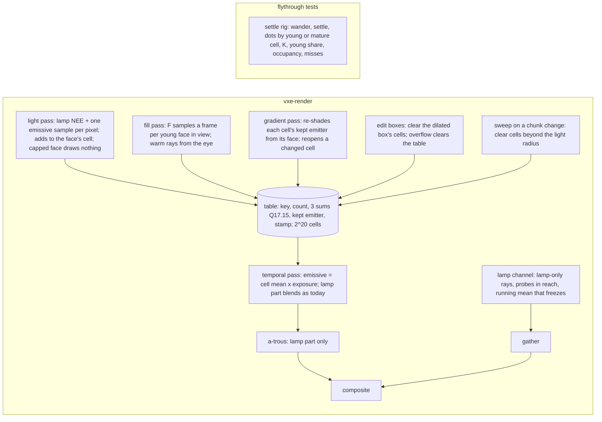

# 0057: Steady light: the per-face table as the only emissive store, faces sampled and guarded in world space, and the probes as a lamp-bounce channel

> **Status:** in-progress (Phase 1, 2026-11-04); Phase 2 lands after Plan 0056's Phase 2 readings
> **Created:** 2026-11-04
> **Milestone:** M2 in [`docs/roadmap.md`](../roadmap.md) (the "one-sample path tracing ...
> temporal accumulation" bullet and the probe volume's indirect light)
> **Related ADRs:** [ADR-0043](../adrs/0043-emissive-light-from-a-world-space-per-face-table-and-a-lamp-bounce-probe-channel.md)
> (proposed; this plan builds it and its close accepts it), which amends
> [ADR-0018](../adrs/0018-direct-light-per-pixel-one-sample-from-a-hit-buffer-with-svgf-history-killed-by-edits.md),
> [ADR-0023](../adrs/0023-indirect-light-from-a-scrolling-probe-volume.md) and
> [ADR-0036](../adrs/0036-static-emissive-light-on-a-long-full-precision-history-guarded-by-an-emissive-gradient.md)
> and makes [ADR-0037](../adrs/0037-probe-rays-direct-light-keeps-its-energy-apart-from-the-screen-firefly-clamp.md)
> moot. [ADR-0033](../adrs/0033-eye-adaptation-as-an-asymmetric-two-stage-exposure-on-the-gpu.md)
> is untouched (owner, the verdict's item 5).
> **Source:** [Plan 0051](done/0051-steady-light-spike-converge-and-freeze-and-a-world-space-emissive-cache.md)'s
> Phase 4 verdict (owner, 2026-11-04) and its close review's Followups; the readings in
> [`logs/0051.md`](logs/0051.md); [`LIGHT-FEEDBACK.md`](../../LIGHT-FEEDBACK.md), "What the owner
> wants".
> **Starts after:** Plan 0051's close (v0.41.0, on main). Runs beside
> [Plan 0056](0056-aliasing-spike-what-moves-on-the-final-image.md)'s lane, which is read-only
> against this plan and hands it the yellow dots' class (0056 Phase 2, done-when 4); this plan
> takes that answer as an input at its Phase 1 and Phase 4. Then Plans 0044 and 0045; Plan 0048
> is moot under ADR-0043 and awaits the owner's "drop".

## TL;DR

Plan 0051's spike ended with the owner's verdict: emissive light from the world-space per-face
table, read nearest, no indirect gather, exposure unchanged, the probes shrunk to a lamp-bounce
channel whose logic is redone. ADR-0043 records it. This plan makes it the renderer. **The table
becomes the only emissive store** (no screen history, read from the first sample, the a-trous for
the lamp alone), sized and swept so it holds the surfaces around the camera. **Faces are
sampled, not only pixels:** a fill pass draws a fixed number of samples a frame for each young
face in view, and warm rays from the eye find the faces about to come into view, so a far face
or a dug hole converges in frames, not in its screen footprint. **Invalidation is an edit box
plus a world-space guard:** each cell keeps the emitter that lit it most, and the gradient pass
re-shades that point from the face and reopens the cell where the light changed. **The probe
volume becomes a lamp-bounce channel:** lamp-only rays within the lamp's reach, a running mean
that freezes while the lamp is still, nothing at all with the lamp off, and the scaffolding kept
for a later per-source indirect light. Phase 1 reads the two questions the verdict left open
(`--steady ab --indirect off`, and the dug hole) and whether the young faces are the fast-turn
fault, before any mechanism. The first thing anyone sees is the hall holding still from frame 1
of its first turn, and a dug hole lit within a second. The owner judges the default in the
window at the end, this time with digs.

## Context & problem

`project-context.md` (Rendering, P0): dark scenes, emissive voxels as the light, stable at arm's
length, denoising that survives disocclusion from digging. The owner's rules
(`LIGHT-FEEDBACK.md`): nothing changes while nothing moves; no bright dots in motion; the light
settles while the owner counts to five; the cost matches what is on screen.

**What the spike settled** (Plan 0051, `logs/0051.md`; RTX 3080 Laptop, unasserted): at the
showcase's hall, native, B with indirect off drifts 0.004 at 4096 against 8192 frames against
today's 2.193; at the level the composite's `sigma_view` reads 0.0009 against 0.0413; the frame at
the spawn reads 3.255 ms against 4.944 (RTX) and 21.053 against 35.438 (Cezanne), indicative.
The owner's eye agreed: "there is no radius with better lighting, there is no colored
flickering".

**What it left open, which this plan carries** (the verdict's items and the close's Followups):

1. **The fast turn.** Under B with indirect off the owner saw "problem of fast turn is back",
   and `--steady ab --indirect off` (A's emissive settings over B) was never run. The spike's
   arithmetic: a cell read only after 16 samples, fed by pixels alone, converges at its screen
   footprint, one frame at arm's length (54 lighting pixels a face) and about 48 frames at 88
   voxels (0.34 a face). The young share in the rig's flight read 0.24 at `C_MIN` 16 and 0.14 at
   8. Whether those young faces are the owner's fast-turn fault, or the yellow dots Plan 0056
   hunts, is unread.
2. **The dug hole.** "When i dig it takes some time for light to settle in hole." The box reset
   clears the hole's cells and they refill at the footprint rate; a dig at range is slow by the
   same arithmetic. Beyond the box nothing is invalidated: a wall lit by an emitter the dig
   exposed keeps its capped cells.
3. **The settle bar.** No arm held still within 300 frames at the hall (the least mean at 512
   against its own 8192 was 0.977). The plan states a bar in frames and the mechanism that meets
   it.
4. **The edit-box reset is a spike's:** one dispatch dimension with no cap at 65 535 groups, and
   an overflowed edit frame leaves the table alone.
5. **The lamp channel's reach:** `probes::lamp_reach` at `intensity / d^2 < 1 / 256` is 554 voxels, past
   the volume's far corner (443), so a moving lamp held every probe open.
6. **Readings owed on the arm:** the full-table share, the table's size from occupancy (0.0142
   of 2^22 at most), the arm in flight on both adapters, quiet rounds at rest.
7. **FSR 2 moves the verdict's light:** 0.525 under FSR 2 against 0.004 native. That is Plan
   0056's class to read; this plan asserts at scale 1 and reads at 1.5.

**The `nfr.md` figures touched:** section 2's lighting line (6.0 ms: light, gradient, probes,
gather), denoise line (3.0 ms: temporal, a-trous) and section 3's `Frame::frame_bytes`. The
readings go to `docs/nfr/02-frame-budget.md` and `docs/nfr/03-memory.md`.

## Decision

Build ADR-0043 in six phases, the first a reading. **The table** (Phase 2) carries its key, holds
2^20 cells by default, reads from the first sample, is swept beyond the light radius when the
camera's chunk changes, and replaces the screen's emissive history, reservoirs and guard; the
default flips and the spike's presets go in the same phase. **The guard** (Phase 3) stores the
kept emitter per cell and re-shades it from the face at the stratum cadence. **The fill pass and
the warm rays** (Phase 4) sample faces, built only if Phase 1 attributes the fast turn and the
hole to the young faces. **The lamp channel** (Phase 5) redoes the probe update as lamp-only rays
within a read reach over a running mean that freezes, and keeps the volume's scaffolding. **The
window** (Phase 6) is the owner's, with digs.

We rejected building the fill pass before the reading, because the yellow dots survived every
arm of the spike including no probes and native, so no reading yet says the young faces are the
fault; Plan 0056 reads the class. We rejected keeping a `--steady off` path for the owner's
comparison, because keeping both emissive paths doubles every test; the v0.41.0 binary is the
comparison. We rejected a lower `C_MIN` alone as the fix for the far faces, because it changes
what is shown (the mean of one sample) and not how fast a face gains samples; it is Phase 2's
read and Phase 4's fill that answer the owner's two complaints. The alternatives to the direction
itself are ADR-0043's.

## Architecture diagram



## Implementation phases

Each phase ships as its own commit. `dev` implements all dev phases in one session with no
review between phases. The architect reviews once at the end, in a fresh session. Lane rule 9c
applies: exploratory runs on the RTX 3080 Laptop through `VXE_TEST_ADAPTER=rtx`, labelled; every
asserted reading on lavapipe.

**The gates.** Per phase: `node scripts/test-changed.mjs --profile quick`, then `--profile gpu`
under the perf lock (every phase here touches rendering), clippy and fmt. At the tip:
`cargo nextest run --workspace --profile gate` under the perf lock, doctests, clippy, fmt, deny,
and the doc and tier gates. `soak` and `full` run only when the owner asks. **Tables, sweeps and
attempts go to `docs/plans/logs/0057.md`**, started from the readings-log template, and the
Implementation log below keeps one row per phase.

**Test times.** Every named test states its expected wall time on lavapipe, from Plan 0051's
tests: a hand-built box (`cache_box`) runs 2 to 3 s, the level loads in about 5 s and renders at
about 20 frames a second in the gate's build at 192 x 108. A test over 30 s quiet is born on the
soak list, named in its phase.

**Plan 0056's lane runs beside this one** on the same base. It owns `apps/flythrough/tests/strip.rs`
and `tests/support/aliasing.rs`; this plan does not touch them. It reads the light through the
`--steady` presets until Phase 2 removes them, so Phase 2 lands after 0056's Phase 2 readings are
in its log, or the orchestrator agrees the order; the log names which.

### Phase 1: The open questions, read
- **Owner skill:** dev
- **What:** the verdict's two open questions and the fast turn's attribution, on the spike's
  code, before any mechanism. This phase changes no shader and no default.
- **The readings,** the rig (`apps/flythrough/tests/settle.rs`) at `Manual(pose.exposure)`,
  both poses, lamp on and off, `up1.5` and scale 1, `b --indirect off` beside
  `ab --indirect off`, with today's rows from `logs/0051.md`:
  - **`ab --indirect off`:** the wander table, `K` and the excess dots at the rig's yaws (`yaw 90
    10 f`, `yaw 90 30 f`, `yaw 180 20 f`) and the flight; the hall (`hero --exposure 8 --adapter
    NVIDIA`) at native and `up`, `N` 256, 512, 4096, 8192: drift and frames to settle, as Phase
    3 of Plan 0051 read them. The question it answers: whether A3 and A4 over B change the fast
    turn at all. Under B they reach only pixels on young or absent cells, so a difference, if
    any, is the young share's.
  - **The dots by cell age (the attribution).** `dot_readings` gains a split of the excess
    into pixels whose cell is young (under 16 samples, or none) and pixels whose cell is mature,
    at the rig's three yaws and at **a 90-degree yaw over 118 frames** (Plan 0056's ten display
    pixels a frame at 1080p, 0.76 degrees a frame), both poses, lamp on and off. **The stop
    rule:** if over half of the excess at the fast yaws lies in young-cell pixels where today
    reads an excess, Phase 4 proceeds as written; if under a quarter, dev stops for an architect
    amendment before Phase 4, with Plan 0056's class answer beside the table if it is in its log;
    between, Phase 4 proceeds and the log says so.
  - **The dug hole by distance.** The rig's dig event at `VEIN_POSE` (arm's length) and a new
    event, a dig of the same radius 100 voxels down the passage: per frame after the dig, the
    emissive part's `S90` over the box's pixels and the young share inside the box, `b --indirect
    off`, `C_MIN` 16 and 1. This is the baseline Phase 4's bar is read against.
  - **The owed readings:** the full-table share (slot-probe failures, a new census counter read
    back beside the no-cell share); occupancy after the rig's flight repeated four times from
    each pose (the table is not cleared between), as the input to the table's size; `b
    --indirect off` in flight on both adapters (`flight_cost_readings`); three quiet rounds of
    the cost at rest at the spawn and the vein on both adapters, or the log says the machine
    did not go quiet and gives the load.
- **Files touched:** `apps/flythrough/tests/settle.rs`, `apps/flythrough/tests/support/settle.rs`,
  `apps/flythrough/src/hud.rs` (a test), `docs/plans/logs/0057.md` (new).
- **Done when:**
  1. `ab_with_indirect_off_applies_both` in `hud.rs`'s tests asserts that `--steady ab --indirect
     off` yields a `Lighting` with `emissive_cache` set, `probe_freeze` set, `skip_converged_draw`
     set and `indirect` false (no GPU, under 1 s). The verdict said its parsing was unchecked.
  2. The tables above are in the readings log, with the hall's rows beside Plan 0051's. No
     reading is asserted.
  3. The stop rule's verdict is one line in the log: proceed, stop, or proceed with the share.
  4. `the_dots_split_by_cell_age_sums_to_the_excess` asserts, on `cache_box`, that the young and
     mature shares of the excess sum to the total (under 5 s).

### Phase 2: The table is the only emissive store, and the default
- **Owner skill:** dev
- **What:** ADR-0043's table in its shipping form, the emissive screen path removed, the default
  flipped, the spike's presets gone.
- **The table:**
  - **Cell.** Ten `u32` words: the key (the voxel's three coordinates and the face, packed by
    dev, with a valid bit; the key replaces the spike's check word), the count, three Q17.15
    sums, the kept emitter's voxel and face (Phase 3 fills them; reserved here), its luminance
    (Phase 3), and a frame stamp (Phase 4). 40 B a cell, `2^20` cells: **41 943 040 B**,
    arithmetic. `CACHE_CELLS` is a `Lighting` setting with that default; `C_CAP` stays 4096 (the
    sums' range, Plan 0051's arithmetic).
  - **Read from the first sample.** `C_MIN` is 1 and is no longer a setting. The temporal pass
    writes the cell's mean times `exposure_now()` as the emissive part for every cacheable hit;
    the pixel's own sample reaches the screen only through the cell. The read is nearest; the
    `smooth` read and `CacheRead` go.
  - **The fallback.** A hit with no face (`rec.field`, a translucent hit, `rec.axis < 0`) blends
    its own sample into the accumulation's emissive channels at the lamp part's `ALPHA` 0.2, as
    the lamp's part does, and resets with it. The accumulation pair returns to `rgba16float`.
  - **The light pass** draws its candidates and casts its shadow ray for a pixel whose cell is
    under the cap, and adds the sample to the cell; a capped cell's pixel does neither. No
    reservoir is written or read: `Sampler`, `reuse_m_cap`, the reservoir textures and
    `converged_draw_skip` go. The firefly clamp stays (ADR-0018).
  - **The a-trous** filters the lamp's part and the fallback's emissive; a cacheable pixel's
    emissive passes through unfiltered (its variance is the cell's, not the pixel's).
  - **The sweep.** When the camera's chunk changes, one dispatch over every cell clears the cells
    whose voxel lies beyond `light_radius` chunks of the camera's chunk (`MirrorConfig::light_radius`,
    the light table's own bound), by the key the cell carries.
  - **The full table.** A key that finds neither its cell nor a free slot in four probes counts a
    miss (an atomic counter in the table's header), and its pixel shows its raw sample through
    the fallback. The HUD's lighting row shows `table <cells> <occupied> <misses>`.
  - **The edit-box reset, fixed.** `clear_cells` dispatches in two dimensions (or in slices of at
    most 65 535 groups) so a dilated box of any size clears; a frame with more than `MAX_EDITS`
    boxes clears the whole table, as it flushes the screen history.
- **The default.** `Lighting::default()` has the table on and `indirect` off (Phase 5 retargets
  `indirect` to the lamp channel); the fly-through and `hero` start there. `--steady`,
  `--cache-read`, `SteadyMode`, `Lighting::{emissive_history, skip_converged_draw, emissive_guard,
  reuse_m_cap, sampler}` and their flags (`--emissive-guard`, `--reuse-m-cap`, `--sampler`) go, with
  `DEFAULT_EMISSIVE_HISTORY`, `DEFAULT_REUSE_M_CAP` and `HISTORY_AGE_MAX` where nothing else reads
  them; `probe_freeze`, `skip_inside_probes` and `probe_lamp` stay until Phase 5. The goldens are
  re-blessed once on lavapipe, with their pixel difference against the old baselines in the log.
  Every test that asserted a deleted mechanism is removed or re-pointed and named in the log
  (`reservoir_reuse_lowers_one_frames_error`, `the_emissive_guard_keeps_history_where_nothing_changed`,
  `static_emissive_light_holds_still`, `a_reveal_behind_a_plug_follows_within_seventy_three_frames`
  and `flythrough::emissive_stillness`'s patch bar among them; the reveal returns in Phase 3).
  `a_turn_reads_converged_cells` is replaced by done-when 7.
- **The readings:** the wander table at both poses, lamp on and off, scale 1 and `up1.5`, with the
  spike's `b --indirect off` rows beside; the hall at native and `up`, `N` 256, 512, 4096, 8192
  (the settle bar's baseline before Phase 4); occupancy and misses after four flights; the pass
  costs at rest and in flight on both adapters, quiet rounds where the machine allows;
  `frame_bytes`.
- **Files touched:** `crates/vxe-render/src/shaders/light.wgsl`, `temporal.wgsl`, `atrous.wgsl`,
  `march.wgsl` (the key helpers), `cache_clear.wgsl`, `shaders/cache_sweep.wgsl` (new),
  `crates/vxe-render/src/marcher.rs`, `lib.rs`, `apps/flythrough/src/main.rs`, `hud.rs`,
  `apps/flythrough/examples/hero.rs`, `apps/flythrough/tests/settle.rs`, `support/settle.rs`,
  `apps/flythrough/tests/lights.rs`, `emissive_stillness.rs`, `upscale.rs` (`frame_bytes`), the
  golden baselines, `.config/nextest.toml`, `docs/plans/logs/0057.md`.
- **Done when:**
  1. `a_face_reads_its_mean_from_the_first_sample` asserts, on `cache_box` at scale 1 with no
     jitter, lamp off, that on the first frame a face is seen every pixel on it carries the same
     emissive value, equal to its cell's sums over its count times the exposure within one
     `f16` step, and that the value is bit-identical across the next 64 frames once the cell is
     capped (`C_CAP` set to 64 for the test). About 70 frames: about 4 s.
  2. `a_hit_with_no_face_takes_the_fallback` asserts, on a box with a translucent slab, that a
     translucent hit's emissive part blends at `ALPHA` (its value after 8 frames equals the
     closed-form blend of its samples within 1 %) and writes no cell. Under 5 s.
  3. `the_sweep_clears_cells_beyond_the_light_radius` asserts, on `cache_box` with
     `light_radius` 1, that after the camera moves one chunk the cells of faces beyond the
     radius read count 0 and the cells within it keep their counts. Under 5 s.
  4. `a_full_table_counts_its_misses` asserts, at `CACHE_CELLS` 64, that a view of more than 64
     faces reads a miss count equal to the faces that found no slot, and that those pixels'
     emissive is non-zero (the fallback). Under 5 s.
  5. `a_large_edit_box_clears_every_cell` asserts, with a test-only dispatch cap of 4 groups,
     that a box of 1000 voxels clears all 6000 cells; and `an_overflowed_edit_frame_clears_the_table`
     asserts that a frame with `MAX_EDITS + 1` boxes leaves every cell at count 0. Under 5 s each.
  6. `frame_bytes_hold_the_table_and_no_emissive_history` in `upscale.rs` asserts `frame_bytes`
     at the default equals main's 130 267 216 B minus the `f32` pair's excess (3 686 400 B,
     ADR-0036's figure) minus the reservoir textures' bytes (dev computes and records) plus
     41 943 040 B, with the arithmetic in the test's comment. Under 5 s.
  7. `a_fast_yaw_reads_an_excess_today_and_none_from_the_table` asserts, at `VEIN_POSE` with the
     lamp on, indirect off, at the yaw and the run Phase 1 found today's excess at (the plan's
     guess: `yaw 90 10 f`; the log names it), that **a build with the table's read disabled by a
     test-only setting reads an excess over its floor** (the test fails first), and that the
     default's excess at frames 1 to 60 is at most 10 % of it. If Phase 1 finds no run where
     today reads an excess, the test asserts the default reads none over its floor and the log
     says the first half could not be written. Two runs of about 200 frames: about 25 s, on the
     soak list from birth.
  8. The banner and the HUD show the table row (`the_banner_names_the_table`, `hud.rs`, no GPU,
     under 1 s), and `--steady`, `--cache-read`, `--emissive-guard`, `--reuse-m-cap` and
     `--sampler` are refused with a message that names this plan's number.
  9. The readings above are in the log. The predictions: the emissive part's `sigma_view` reads
     0.0000 at scale 1 at both poses and under 0.0015 at `up1.5`; the hall's drift at native 4096
     against 8192 reads under 0.01; occupancy after four flights stays under 0.25 of 2^20 (the
     spike read 59 697 cells after one, so about 240 000 is the guess) and the miss count 0. A
     miss is a reading, and a miss count above 0 sends the size to the architect.
  10. With every deleted mechanism gone, `cargo build` has no dead `Lighting` field, and the
     gate's test count in the log names each removed and each re-pointed test.

### Phase 3: The world-space guard
- **Owner skill:** dev
- **What:** invalidation beyond the edit box: each cell keeps the emitter that lit it most, and
  the gradient pass re-shades that point from the face and reopens the cell where the light
  changed.
- **The guard:**
  - **The kept emitter.** When the light pass adds a sample whose contribution's luminance is
    above the cell's stored kept luminance, it stores the sample's emitter voxel and face and
    that luminance (`atomicMax` on the luminance word, then a compare-exchange on the point; a
    lost race keeps the other winner, which is as good). The fill pass (Phase 4) does the same.
  - **The re-shade.** The gradient pass, for each 3 x 3 stratum of lighting pixels, picks one
    pixel by its hash of stratum and frame as today, takes its cell, and re-shades the cell's
    kept emitter from the face's centre: one shadow ray toward the emitter face's centre and
    the emitter material's emission now, giving an irradiance `e_new`; `e_old` is the kept
    luminance. Where `|e_new - e_old| / max(e_new, e_old)` exceeds the dead zone (0.05,
    ADR-0036's `LAMBDA_FLOOR`), the cell reopens: count, sums, kept point and luminance cleared.
    A cell with no kept emitter (it was lit by nothing) is re-verified by a fresh sample instead:
    the pixel draws its candidates, and a non-zero result reopens the cell.
  - **Cadence by arithmetic.** One cell a stratum a frame means a face of 54 lighting pixels is
    re-verified about six times a frame and a face of 0.34 pixels about once in 26 frames. The
    guard is for reveals and digs, which the owner sees at arm's length; the far case is a
    reading.
  - **The screen-space emissive lambda** of ADR-0036 is gone with Phase 2; the gradient pass's
    combined lambda for the lamp's part stays.
- **The readings:** the reveal and the dig at the rig's two distances (Phase 1's events): frames
  until the lit wall's cells reopen and until their means are within 10 % of a fresh run's; the
  gradient pass's cost on both adapters; a still scene's reopen count over 1024 frames (the
  prediction: 0).
- **Files touched:** `crates/vxe-render/src/shaders/light.wgsl`, `gradient.wgsl`, `march.wgsl`,
  `crates/vxe-render/src/marcher.rs`, `apps/flythrough/tests/lights.rs`, `settle.rs`,
  `docs/plans/logs/0057.md`.
- **Done when:**
  1. `a_revealed_emitter_reopens_the_cells_it_lights` asserts, on a box with an emitter behind a
     one-voxel plug and a wall of capped cells, scale 1, that after the plug's removal every
     cell of the wall within the emitter's reach reopens within 9 frames and reads within 10 % of
     a fresh run's mean within 16 frames at arm's length. About 100 frames: about 6 s.
  2. `a_removed_emitter_darkens_the_cells_it_lit` asserts, on the same box, that replacing the
     emitter with rock reopens the lit cells within 9 frames and their means fall under 1 % of
     the lit value within 16 frames. About 6 s.
  3. `a_still_scene_reopens_no_cell` asserts that 64 still frames on the box leave every count
     monotone and the reopen counter at 0. About 4 s.
  4. `a_reveal_behind_a_plug_follows_within_seventy_three_frames` returns in `lights.rs` on the
     table, with its bar re-derived from done-when 1 (the plan's claim: within 16 frames at arm's
     length). Its time in the log.
  5. The readings are in the log. The prediction: the gradient pass's cost stays within 0.02 ms
     of Phase 2's on the RTX (it casts the same one ray a stratum).

### Phase 4: Faces are sampled: the fill pass and the warm rays
- **Owner skill:** dev
- **What:** a fill pass that draws a fixed number of samples a frame for every young face in view,
  and warm rays from the eye that find the faces about to come into view. **Built only if Phase
  1's stop rule says proceed**; otherwise this phase is skipped, its row in the Implementation
  log says why, and the architect amends ADR-0043's Outcome at the close.
- **The fill:**
  - **The list.** A pixel whose cell is under the cap and whose frame stamp is not this frame's
    sets the stamp (compare-exchange) and appends the cell's index to the frame's fill list (a
    storage buffer of at most `FILL_LIST_MAX` entries, 65 536 a guess; a full list drops the
    rest and counts them).
  - **The pass.** One workgroup of `F` lanes per listed cell (`F` swept 4, 8, 16; the default is
    the reading's), each lane drawing one resampled emissive sample from a random point on the
    face (the voxel and face from the key, the point jittered in the face), with its shadow ray,
    added to the cell and offered as the kept emitter. The pass runs after the light pass and
    before the temporal pass, so the frame reads the filled mean.
  - **The warm rays.** `W` rays a frame (swept 0, 4096, 16 384) from the eye over the full
    sphere (the probe set's Fibonacci directions, rotated per frame), through the full walk; each
    hit on a cube face under its cap appends its cell to the fill list. A hit behind the camera
    warms the face a turn will reveal. `W` is a `Lighting` setting; 0 turns it off.
  - **Cost by arithmetic.** After a 90-degree turn at the vein the spike saw about 10 000 to
    18 000 keys in view, so a turn's first frame lists at most that many young faces: at `F` 8,
    about 150 000 samples, about two thirds of a 720p lighting pass's emissive work, falling to
    near nothing at rest. The warm rays at 16 384 are about a fourteenth of a 720p hit pass.
    Both are guesses the readings replace.
- **The settle bar, stated.** At the hall (`hero`, native, lamp off, a fresh start), the mean per
  pixel at 256 frames against the same arm's 8192 reads **under 0.5** and the share over 8 levels
  under 0.5 %, against Phase 2's reading (the spike's B with indirect off read 1.691 and 3.20 %).
  A dug hole at arm's length and at 100 voxels (Phase 1's events) reaches within 10 % of its
  settled mean **within 60 frames**. The fast yaw's excess dots in young-cell pixels fall to at
  most 10 % of Phase 1's. A miss is a reading the owner judges in Phase 6.
- **The readings:** the young share, `K` and the dots at the rig's yaws and Plan 0056's fast
  yaw, both poses, lamp on and off; the hall at 256, 512, 4096, 8192, native and `up`; the hole
  at both distances; the fill and warm passes' cost at rest, at the turn's first frames and in
  the flight, both adapters, for each `F` and `W`.
- **Files touched:** `crates/vxe-render/src/shaders/cache_fill.wgsl` (new), `light.wgsl`,
  `march.wgsl`, `crates/vxe-render/src/marcher.rs`, `apps/flythrough/src/main.rs`, `hud.rs`,
  `apps/flythrough/tests/settle.rs`, `upscale.rs` (`frame_bytes`), `docs/plans/logs/0057.md`.
- **Done when:**
  1. `a_young_face_fills_at_the_fill_rate` asserts, on `cache_box` with the camera 100 voxels
     from a one-voxel face at scale 1 (the face covers under one lighting pixel), that at `F` 8
     the cell's count reads at least 8 after frame 1 and at least 16 after frame 2, and that
     with the fill off it reads at most 2 after frame 2. About 4 s.
  2. `warm_rays_fill_faces_behind_the_camera` asserts, on a box with a lit wall behind the
     camera, that with `W` 4096 the wall's cells hold samples after 8 still frames and with `W`
     0 they hold none. About 4 s.
  3. `a_dug_hole_refills_within_sixty_frames` asserts, on the box at both camera distances, that
     after a dig the hole's cells read within 10 % of their frame-512 means by frame 60. About
     600 frames on a box: about 20 s.
  4. The fill and warm settings show in the banner and the HUD (`hud.rs`'s banner test, no GPU).
  5. The readings are in the log against the bar above; the defaults for `F` and `W` are the
     smallest that meet it, named in the log, or the log says no setting did.
  6. `frame_bytes` reads Phase 2's plus the fill list's bytes, asserted in `upscale.rs`.

### Phase 5: The lamp-bounce channel
- **Owner skill:** dev
- **What:** the probe volume redone as ADR-0043's lamp channel, and the emissive part of today's
  probe logic removed.
- **The channel:**
  - **Lamp-only rays.** The probe rays shade their hits with the headlamp term alone: no
    emissive sample or shadow ray, no hit emission, no previous-frame irradiance. `probe_lamp`
    and the `STEADY_NO_LAMP` bit go; the emission-scale read and the emission-change window go
    (a lamp switch-on still opens the window, as the channel's fast fill from zero).
  - **The reach, from a reading.** Dev reads, on `cache_box` and at the level's spawn, the gather's
    irradiance at a lit wall's hit as the lamp-to-probe distance grows, against the wall's direct
    irradiance from the lamp, and sets `probes::lamp_reach` where the bounce falls under 1 % of the
    direct, rounded up to whole probe spacings. The volume's side (`PROBES_PER_AXIS`, a setting
    now) is the smallest power of two whose half-side covers the reach (the plan's guess: 16, so
    25.6 m and an eightfold smaller volume). Only probes within the reach of the lamp are listed;
    the others hold zero and gather as zero.
  - **The blend.** A running mean over visits that freezes at `probe_freeze` visits (Plan 0051's
    A1, now the only blend; `HYSTERESIS`, `YOUNG_UPDATES` and `YOUNG_HYSTERESIS` go), restarted
    by a window, an edit touching the probe, a scroll bringing a new probe into the slot, or the
    lamp moving. While the lamp moves, the probes in reach blend at a fixed `h_move`, swept 0.5,
    0.8 and 0.9 against the flight's `K` with the lamp on and the frames to 90 % after a lamp
    step; the default is the reading's.
  - **Lamp off, nothing runs.** With the lamp off no probe pass is encoded and the gather is
    skipped; the volume is allocated on demand as today (Plan 0052). `Lighting::indirect`
    becomes `lamp_bounce` (on by default); the fly-through gains `--lamp-bounce on|off`, `F8`
    toggles it, the banner names `lamp bounce`, and `--indirect on|off` stays as an alias until
    Plan 0056 closes (its `E` arm and Phase 4 fallback pass `--indirect off`).
  - **Kept** (ADR-0043): the tagged scrolling volume, the maps, the gather's weights and bias,
    the inside flag and skip (`skip_inside_probes` becomes the rule), the edit-touch list, the
    ray set, on-demand allocation.
- **The readings:** the channel's cost at rest and in flight with the lamp on, both adapters,
  against the spike's `off` and `b --indirect off` rows; `K` in the flight at each `h_move`; the
  frames to 90 % after a lamp step at each `h_move`; the wander at both poses with the lamp on;
  `frame_bytes` at the new side.
- **Files touched:** `crates/vxe-render/src/shaders/probe_update.wgsl`, `probe_gather.wgsl`,
  `crates/vxe-render/src/probes.rs`, `marcher.rs`, `apps/flythrough/src/main.rs`, `hud.rs`,
  `apps/flythrough/examples/hero.rs`, `apps/flythrough/tests/indirect.rs`, `golden.rs` (the two
  indirect goldens), `settle.rs`, `.config/nextest.toml`, `docs/plans/logs/0057.md`.
- **Done when:**
  1. `the_channel_holds_the_lamps_bounce_only` asserts, on a closed box with an emitter and the
     lamp, that with the lamp off every probe texel reads exactly 0 over 64 frames, and with the
     lamp on the texels of the probes in reach read within 10 % of a run with the emitter's
     emission set to 0. About 150 frames: about 16 s.
  2. `the_lamp_furnace_reads_its_albedo_times_the_direct_mean` replaces
     `the_furnace_box_reads_pi_of_indirect_irradiance`: a closed box of albedo 0.5 lit by the lamp
     at its centre, the centre probe's tile zeroed to read the rays' direct mean `D`; after 256
     frames the texel mean reads within 4 % of `0.5 D` and every texel within 7 %. This is M2's
     headless proof restated. On the soak list, as its predecessor was.
  3. `a_still_lamp_freezes_the_channel` asserts, at `probe_freeze` 8, that after 8 visits with the
     lamp still the probes' texels and state are bit-identical over 64 frames. About 16 s.
  4. `a_lamp_step_moves_the_probes_in_reach_only` asserts, with the origin pinned so a probe lies
     beyond the reach, that after the lamp moves the probes in reach change within 8 frames and
     the probe beyond stays bit-identical, and that the ones in reach freeze again once the lamp
     is still. About 16 s.
  5. `the_lamp_off_encodes_no_probe_pass` asserts that with the lamp off the probe passes'
     timers read 0 and the frame's probe dispatch count is 0 over 16 frames. Under 5 s.
  6. The emissive probe tests are removed and named in the log: `the_furnace_box_reads_pi_of_indirect_irradiance`,
     `an_emission_step_drops_the_probe_history`, `a_pulse_at_its_mean_leaves_the_probes_still`,
     `indirect_golden_shows_the_vein_s_bounce_light`, `fsr2_carries_the_indirect_golden_s_bounce_light`;
     `a_hole_in_the_wall_lights_the_dark_box_and_filling_it_darkens_it_again` and
     `no_light_leaks_through_a_two_voxel_wall` are re-pointed at the lamp. The soak list in
     `.config/nextest.toml` follows, and `check-test-tiers` exits 0.
  7. The readings are in the log. The predictions, RTX at the spawn at rest, lamp on: the probe
     update under 0.2 ms (the spike's A read 0.016 frozen) and the whole frame under the spike's
     `b --indirect off` 3.255 ms plus 0.3; Cezanne under 21.053 plus 2.0. `frame_bytes` falls by
     seven eighths of the atlases and state (about 44 MB of the 58 837 024 B, arithmetic) at a
     side of 16.

### Phase 6: The owner's window, with digs
- **Owner skill:** human
- **What:** the release fly-through on the RTX, one sitting, with the v0.41.0 binary beside it
  for comparison (built from main at 3d4f2ad as `target/release/flythrough-v0.41`, by the
  orchestrator) and Phase 2 to 5's tables and the hall's difference images at hand. Every toggle
  shows in the banner and the HUD.

  ```
  cargo build --release -p flythrough

  # 1. The hall from a fresh start: count to five, then a still minute, a fast turn, a slow
  #    turn, a dig at arm's length and one at range; then the lamp on, move, and off.
  target/release/flythrough --source showcase --shot hall --exposure 8 --hud

  # 2. The same in v0.41.0 for the comparison, lamp off.
  target/release/flythrough-v0.41 --source showcase --shot hall --exposure 8 --hud --steady off

  # 3. The level, auto exposure: still, the lamp toggle both ways, a fast turn, a flight
  #    down the passage and back, a dig at arm's length and one down the passage, at each pose.
  target/release/flythrough --level --seed 1 --pose vein --hud
  target/release/flythrough --level --seed 1 --pose patch --hud

  # 4. The lamp bounce off, to judge what the channel adds and whether it lags.
  target/release/flythrough --level --seed 1 --pose vein --hud --lamp-bounce off

  # 5. At arm's length of a lit wall: the step at a voxel edge, nearest only.
  ```
- **Files touched:** this plan's log.
- **Done when:** the log records the owner's words on: (a) whether anything moves at rest, hall
  and level; (b) the fast turn, against v0.41.0 and against the spike's session; (c) the dug hole
  at arm's length and at range, in frames or seconds by eye; (d) the lamp bounce's look and lag,
  and whether `lamp_bounce` stays on by default; (e) the step at voxel edges; (f) what remains
  visible, by run and pose; (g) whether the default is accepted. A "no" on (g) names the run and
  goes to the architect with the tables. The plan closes with that record.

## Data shapes

```rust
// illustrative: vxe-render
pub struct Lighting {
    // ... the lamp, candidates, shadow walk, filter, exposure, tone map as today ...
    pub table_cells: u32,          // 2^20 by default; a power of two
    pub fill_samples: u32,         // F: samples a frame per young face in view; 0 off
    pub warm_rays: u32,            // W: rays a frame from the eye; 0 off
    pub lamp_bounce: bool,         // the probe channel; on by default, nothing runs lamp-off
    pub probe_freeze: u32,         // visits to converge; the only blend
    pub probe_side: u32,           // PROBES_PER_AXIS, from the reach
}
```

```wgsl
// illustrative: a cell is 10 u32s, table[slot * 10 + i]
// 0..1 key (voxel xyz and face, valid bit)   2 count   3..5 sums Q17.15
// 6..7 kept emitter (voxel and face)          8 kept luminance (f32 bits)   9 frame stamp
```

## Budgets

Base figures are Plan 0051's cost tables (`logs/0051.md`, Phases 2 and 3), the level's spawn,
1080p from 720p, half tier, lamp on, **loaded (indicative), not quiet**. `off` is today
(v0.41.0's default); `b --indirect off` is the verdict's arm as spiked.

| `nfr.md` figure | Base (read, indicative) | Expected | How the close measures it |
|---|---|---|---|
| §2 GPU frame | RTX `off` 4.944 ms, `b --indirect off` 3.255; Cezanne 35.438, 21.053 | The default (table, guard, fill, lamp channel): **a guess** of the `b --indirect off` figure plus 0.3 ms on the RTX and 2.0 ms on the Cezanne, lamp on; at a turn's first frames the fill adds its burst (Phase 4's reading) | `flythrough --level --seed 1 --headless --render 1920x1080 --frames 2700 --adapter NVIDIA\|AMD [--pose vein]`, three quiet rounds alternated with the v0.41.0 binary, the perf lock, the memory cap; and the rig's flight on both adapters |
| §2 lighting line (6.0 ms): light + gradient + probes + gather | RTX `off` 0.802 + 0.086 + 1.058 + 0.092; `b --indirect off` 0.122 + 0.017 + 0 + 0 | light near the arm's (a capped view draws nothing); gradient within 0.02 ms of the arm's (one ray a stratum); probes **a prediction** under 0.2 ms RTX with the lamp still, the moving case Phase 5's reading; fill and warm **guesses** in Phase 4 | the same runs, per pass |
| §2 denoise line (3.0 ms): temporal + a-trous | RTX 0.086 + 0.497 | unchanged or lower (the a-trous over one channel) | the same runs |
| §3 `Frame::frame_bytes` | main 130 267 216 B; the spike's table on, 89 617 600 B at the rig's setting | **arithmetic:** + 41 943 040 (table) + the fill list, - 3 686 400 (the `f32` pair) - the reservoir textures - about 44 MB of the probe atlases and state at a side of 16, lamp on; dev records the exact sum in the test's comment | `frame_bytes` asserted in `upscale.rs` at the default, printed at the close |

Determinism is not touched: everything is in `vxe-render`. The table's integer sums make a
face's mean independent of the order its pixels add, which the close reads as a bit-identical
cell dump across two runs of the same still frame on lavapipe.

## Risks & open questions

- **The young faces may not be the fast-turn fault.** The yellow dots survived every arm of the
  spike, including no probes and native. Phase 1's stop rule and Plan 0056's class answer decide
  Phase 4; if the dots are the upscaler's or geometry's, this plan still settles the hall and the
  hole and leaves the dots to 0056's followup.
- **The guard sees one point a cell.** A second emitter behind the first changes a face's light
  without moving the kept point's re-shade; the cell is caught only when a new sample lands. The
  reveal test is the bar; a two-emitter test is a reading.
- **The fill pass's burst on a turn into a new cave.** Its cost is the young faces in view times
  `F`; a flight through unseen rock keeps it high. The flight reading and `F`'s sweep bound it,
  and the warm rays trade a steady small cost for a smaller burst.
- **One value a face at a lit wall's edge.** The step is the accepted look (owner, the verdict);
  the owner sees it again in Phase 6 with digs.
- **The fallback flickers.** The field look, translucent hits and rays from inside rock blend one
  sample a frame at `ALPHA` with no table. The field look is opt-in; a smooth material's key is a
  later plan.
- **The table fills in a dense scene.** The sweep bounds it to the light radius; the castle's
  92 % air stamps and the showcase's pillars are the dense cases to read occupancy on. A miss
  count above 0 at the default size goes to the architect.
- **The lamp channel's lag.** `h_move` trades flicker for lag; the owner judges it in Phase 6
  and may turn `lamp_bounce` off.
- **Plan 0056 reads the light through `--steady` until Phase 2 removes it.** The lane order is
  the orchestrator's; the log names it.
- **FSR 2 moves the final image** (0.525 against 0.004 native in the spike). This plan asserts at
  scale 1; the display-level bar is Plan 0056's.

## What this plan does NOT do

- Fix the yellow dots if Plan 0056 attributes them to the upscaler or to geometry: 0056's
  followup plan.
- Set a display-level drift or flicker bar under FSR 2, or change the upscaler, sharpening or
  the far normal: Plan 0056.
- Indirect light from emissive sources: a per-source feed into the lamp channel, a later plan
  when the owner asks ("maybe we will come back with indirect light for some sources later").
- Touch ADR-0033's exposure constants (owner, the verdict's item 5).
- Give the field look or translucent hits a table key: a later plan, if the owner takes the
  field for a material class.
- Plan 0048's schemes: moot under ADR-0043 (no emissive sample at the probe rays); the owner's
  "drop" is owed on it.
- Plan 0044's waste items in the frame (FSR 2's `prepare`, the far normal on default pixels),
  or re-basing the frame ledger in `docs/nfr/02-frame-budget.md`: readings go there, the
  re-base is Plan 0044's.
- The Radeon's walk-speed spike, or any change to the surface.

## Owner answers

The verdict (owner, 2026-11-04, Plan 0051 Phase 4, recorded in `logs/0051.md`):

1. **Direction:** B with indirect off. `--steady ab --indirect off` is this plan's first
   question (Phase 1).
2. **Read mode:** nearest. The `smooth` read goes (Phase 2).
3. **The probes:** shrink to a lamp-bounce channel, built here (Phase 5), the scaffolding kept
   for a later return of indirect light for some sources; today's probe logic redone, not
   patched.
4. **The deletes:** ADR-0043's roster, reconciling "B's list plus the probes" with the shrink.
5. **Exposure's settle:** no change.
6. **Next:** Plan 0056 runs now beside this plan; the slow settle in a dug hole is this plan's
   (Phases 1 and 4).

Open at draft: the "go".

## Implementation log

> Written by `dev`: one row per phase as its commit lands, then the close block. **The phases
> above are the contract. This section records what happened.** Observations, never conclusions:
> no pass list, no self-assessment. Deviations and unmet done-whens are **always** disclosed.
> Keep it shorter than `## Implementation phases`. Readings, gate counts, attempts, sweeps and
> resume notes go to `docs/plans/logs/0057.md`.

| phase | owner | state | commit |
|---|---|---|---|
| 1: The open questions, read | dev | wip: readings owed (patch occupancy, flight and rest costs); stop rule read stop ([log](logs/0057.md)) | committed with this row |
| 2: The table is the only emissive store, and the default | dev | not started | |
| 3: The world-space guard | dev | not started | |
| 4: Faces are sampled: the fill pass and the warm rays | dev | not started | |
| 5: The lamp-bounce channel | dev | not started | |
| 6: The owner's window, with digs | human | not started | |

### Notes

_(Deviations from the plan, with the commit, stated without justification. Done-whens not
satisfiable as stated, and what was done instead. Followups noticed and not acted on. One line
each. Empty is fine.)_

- Phase 1: the dig at 100 voxels is seen from the steady flight's start facing its travel, not from `VEIN_POSE` (no hit near 100 voxels in that view's central half).
- Phase 1: `the_dots_split_by_cell_age_sums_to_the_excess` reads 5.2 to 7.6 s on lavapipe, loaded, against the plan's "under 5 s".
- Phase 1: the hall re-ran `ab --indirect off` only; the `b --indirect off` rows are Plan 0051's.
- Phase 1: `ab_with_indirect_off_applies_both` checks the preset over `indirect: false`; the flag parse in `main.rs` is outside the phase's files and was read, not tested.

### Close triggers

_(Facts for the architect. No recommendations, and no suggested version bump.)_

- **What shipped:** feature / fix-only / docs-chore-only
- **Public API changed:** types, traits, functions, shader interfaces, config (list them, or none)
- **Budget readings:** each `nfr.md` figure touched, with its measured value, machine and commit
- **Gate at the tip:** the commands run (build, nextest, doctests, clippy, fmt, deny), exit codes, test counts
- **Outstanding `human` phases:** which, or none

## Followups
