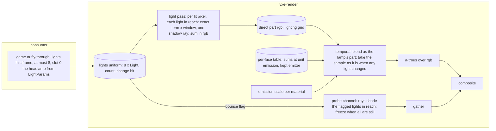

# 0058: Dynamic lights: a list of eight analytic lights the consumer hands the frame, shaded exactly, dropped and carried in the fly-through, scaled emission over the table, and a bounce flag per source

> **Status:** draft
> **Created:** 2026-11-04
> **Milestone:** M2 in [`docs/roadmap.md`](../roadmap.md) (the consumer's "headlamp, flares,
> glowing crystal"; the per-source switch on feeding the probes, parked 2026-10-22)
> **Related ADRs:** [ADR-0044](../adrs/0044-direct-light-from-a-fixed-list-of-analytic-lights-one-shadow-ray-each.md)
> (proposed; the list, exact shading, reach, history, the bounce flag) and
> [ADR-0045](../adrs/0045-the-per-face-table-stores-irradiance-at-unit-emission-and-the-read-applies-the-scale-now.md)
> (proposed; the table's sums at unit emission). Both are accepted at this plan's close. Rests
> on [ADR-0043](../adrs/0043-emissive-light-from-a-world-space-per-face-table-and-a-lamp-bounce-probe-channel.md)
> (the table and the lamp channel [Plan 0057](0057-steady-light-the-per-face-table-as-the-emissive-store-and-a-lamp-bounce-channel.md) builds)
> and [ADR-0018](../adrs/0018-direct-light-per-pixel-one-sample-from-a-hit-buffer-with-svgf-history-killed-by-edits.md)
> (the lamp's exact estimate and its reset).
> **Source:** the owner, 2026-11-04: "I want to be able to for example light cavern by dropping
> some light source inside, and see lighting change in real time", and the answers under Owner
> answers.
> **Starts after:** [Plan 0059](0059-loaded-light-a-per-chunk-store-baked-at-load-and-at-edit.md)'s
> verdict in its Phase 13 (amended 2026-11-05: Phase 3 here is written over the table and is
> refreshed if baked light wins, when a kept emitter becomes a dominant material; Phases 3 and 4
> change the store and the lamp channel). Its order against [Plan 0044](0044-hot-path-and-defect-pass.md) and
> [Plan 0045](0045-structure-pass-split-the-mega-files-share-the-fixtures.md) is the owner's
> call at the go.

## TL;DR

The renderer shades one light that is not a voxel, the headlamp, and it is bound to the camera.
This plan makes it slot 0 of **a list of eight analytic lights** (point or spot, colour,
intensity, reach, flags) that the consumer hands the frame every frame. A lit pixel shades every
light in reach **exactly, with one shadow ray each**: no random number, no settle, no dots. The
fly-through drops a light where you look (`C`), carries the newest one in front of the camera
(`V`), cycles its colour (`Z`) and removes it (`F`), and shows the count and the mode in the HUD.
The direct part of the frame widens from a white scalar to rgb. Then two things ADR-0043's table
left open: **emissive light follows a material's emission scale without reopening a cell**
(ADR-0045: the table stores irradiance at unit emission), so a flame can flicker and the
sound-lit crystal can glow with the table steady underneath; and **a `bounce` flag per light**
feeds ADR-0043's probe channel from the flagged lights, off for dropped lights by default. The
first thing anyone sees: press `C` in the hall with the lamp off, and the floor, the pillars and
the far wall are lit that frame and hold still.

## Context & problem

`project-context.md` (Rendering, P0): "dark scenes with few lights; headlamp, flares, glowing
crystal; emissive voxels as light sources, with emission changeable at runtime". The flare has no
path to the pixels: `LightParams` describes one lamp placed from the camera, `Params` carries its
position and cone, and `light.wgsl`'s `lamp_lit` shades it. The emission scale
(`Frame::set_emission_scales`) is the runtime change the P0 names, and under ADR-0043's table a
periodic change reopens the cells it lights every frame (ADR-0045, Context).

**What the tree gives this plan.** The lamp's estimate is exact up to its shadow ray; its screen
history exists for the half tier's jittered grid and takes this frame's sample as it is when the
lamp changed (`LIGHTING_LAMP_CHANGED`). The owner flew the headlamp in every session without a
flicker complaint about it. The irradiance texture holds the emissive part in rgb and the lamp's
white part in `a`; the temporal pass blends them on different rules, the a-trous filters the sum,
the composite reads the accumulation. Plan 0057 returns the accumulation pair to `rgba16float`
and puts the table's read in the emissive channels. The probe channel of Plan 0057 Phase 5 shades
its rays with the headlamp alone, lists the probes within the lamp's reach, and freezes when the
lamp is still.

**What a lamp shadow ray costs** (`docs/nfr/02-frame-budget.md`; `logs/0051.md`, loaded,
indicative): the light pass with the lamp on and every emissive face capped read 0.113 ms on the
RTX 3080 Laptop at 720p internal on the half tier; the Plan 0041 table's light pass reads about
eight times the RTX's on the Cezanne iGPU. So one light in reach of every lighting pixel is
about 0.1 ms on the dev reference and about 0.8 ms on the slow adapter, projections this plan's
readings replace.

**The `nfr.md` figures touched:** section 2's lighting line (6.0 ms: light, gradient, probes,
gather) and denoise line (3.0 ms: temporal, a-trous), and section 3's `Frame::frame_bytes`. The
readings go to `docs/nfr/02-frame-budget.md` and `docs/nfr/03-memory.md`.

## Decision

Build ADR-0044 and ADR-0045 in five phases. **The list** (Phase 1) replaces the single lamp in
the light pass, white only, with its reach, its cull and the fly-through's drop and carry: a
walking skeleton that lights a cavern on the frame the key is pressed. **Colour** (Phase 2)
widens the direct part to rgb through the temporal, a-trous and composite passes. **The emission
scale over the table** (Phase 3) is ADR-0045 on Plan 0057's table. **The bounce flag** (Phase 4)
generalises Plan 0057's lamp channel to the flagged lights. **The window** (Phase 5) is the
owner's, with lights dropped in the hall and the level.

We rejected lights as emissive voxels (ADR-0044 A), a stochastic pick among lights (B), hardware
ray queries (C) and folding a still light into the table (D). We rejected amending Plan 0057 for
ADR-0045, because its lane is live and its Phase 2 is where the table is written; the change is
small on a finished table and no default scene pulses in between. We rejected a colour-first
Phase 1, because the white list exercises the whole path (upload, cull, shadow rays, history,
HUD) with no layout change, and the layout change is then one phase on its own.

## Architecture diagram



## Implementation phases

Each phase ships as its own commit. `dev` implements all dev phases in one session with no
review between phases. The architect reviews once at the end, in a fresh session. Lane rule 9c
applies: exploratory runs on the RTX 3080 Laptop through `VXE_TEST_ADAPTER=rtx`, labelled; every
asserted reading on lavapipe.

**The gates.** Per phase: `node scripts/test-changed.mjs --profile quick`, then `--profile gpu`
under the perf lock (every phase touches rendering), clippy and fmt. At the tip: `cargo nextest
run --workspace --profile gate` under the perf lock, doctests, clippy, fmt, deny, and the doc and
tier gates. `soak` and `full` run only when the owner asks. **Tables, sweeps and attempts go to
`docs/plans/logs/0058.md`**, started from the readings-log template; the Implementation log
below keeps one row per phase.

**Test times.** From Plan 0051's and 0057's tests on lavapipe: a hand-built box renders 2 to 3 s
for a few dozen frames at 192 x 108 in the gate's build, about 4 s for 64 frames, about 16 s for
150; the level loads in about 5 s. A test over 30 s quiet is born on the soak list, named in its
phase. New GPU tests go in `apps/flythrough/tests/dynamic_lights.rs`, listed in
`.config/nextest.toml`'s gpu filter (`check-test-tiers` exits 0).

**The analytic figures the tests use.** The shader's term is `PI * intensity * cone * max(n . l,
0) / d^2`, times ADR-0044's window `(1 - (d / r)^4)^2`. A point light of intensity 1200 at 20
voxels above a floor, reach `sqrt(1200 / 0.1)` = 109.5 voxels: directly below, `E = PI * 1200 /
400 = 9.425`, window 0.998, so **9.40**; 20 voxels to the side, `d^2 = 800`, `cos = 0.7071`,
`E = PI * 1200 * 0.7071 / 800 = 3.332`, window 0.993, so **3.31**. At manual exposure 1 the direct
part stores these as they are (under `HDR_MAX`).

### Phase 1: The list, white, with the fly-through's drop and carry
- **Owner skill:** dev
- **What:** ADR-0044's list in the light pass, white only, the headlamp as slot 0, the reach
  and the per-pixel cull, the change detection, and the fly-through's `C`, `V`, HUD row and
  `--lights N`. No layout change: each light's term is summed as luminance into the irradiance's
  `a`, where the lamp's part is today, so the temporal, a-trous and composite passes are
  untouched.
- **The list:**
  - **`Light`** (`vxe_render::Light`, `#[repr(C)]`, 64 B): `pos: [f32; 3]`, `intensity`,
    `dir: [f32; 3]`, `cos_inner`, `colour: [f32; 3]`, `cos_outer`, `flags: u32` (`ON`,
    `SHADOWS`, `BOUNCE`), three pad words. `MAX_LIGHTS` 8. `Frame::set_lights(&mut self, queue,
    &[Light])` takes slots 1 to 7 (the first seven given; the rest are counted in
    `Frame::lights_dropped()` and the HUD); slot 0 is filled from `LightParams` and the camera
    when `Lighting::lamp` is on, as the `Params` lamp fields are today, which move into the
    slot. A uniform of `8 x Light` plus `count` and the change bit, written when any field
    changed (a hash of the list against the last frame's). `LIGHTING_LAMP_CHANGED` becomes "any
    light changed" and keeps its name in the shader for Phase 2 to rename.
  - **Shading.** `lamp_lit` becomes `light_lit(i, p, n, ns)` over slot `i`: the term above,
    `cone` from the cosines as today (a point light has `cos_outer` -1 and `cone` 1), the window,
    zero beyond the reach, zero where the shadow ray toward the light finds rock (skipped when
    `SHADOWS` is clear). The light pass loops over `count` and sums the lit lights' luminance
    into `e`.
  - **Reach.** `Lighting::light_floor: f32`, default 0.1 (ADR-0044); `reach(i) = sqrt(intensity /
    light_floor)`. The `steps` view counts the shadow rays cast per pixel in its `a` as it counts
    the lamp's today, so the cull is readable.
- **The fly-through:** `C` adds a white point light of intensity 1200 at the looked-at hit, 2
  voxels off the surface along its normal (a miss drops it 20 voxels ahead); `V` toggles **carry**
  of the newest light: its position is the eye plus 2 m forward and 0.3 m down each frame until
  `V` again, which leaves it where it is. `--lights N` (headless or windowed) places `N` white
  lights of intensity 600 on a ring of radius 3 m around the spawn pose at eye height, for the
  readings. The HUD's lighting row gains `lights <n>/8 [carry] dropped <k>`; the banner names
  `lights`. A ninth `C` prints a line and does nothing.
- **The readings:** the light pass and the frame at the level's spawn and the vein, `--lights` 0,
  1, 2, 4, 8 (ring radius 3 m puts every light in reach of the near pixels), lamp on and off,
  both adapters, three quiet rounds where the machine allows, with the pass's shadow-ray count
  per pixel from the `steps` view; the same at `light_floor` 0.1 and 0.025 (reach 110 and 219
  voxels); the hall at exposure 8 with one light at the floor's centre, native and `up`, 64
  against 512 frames (the prediction: 0 difference at native).
- **Files touched:** `crates/vxe-render/src/light.rs`, `marcher.rs`, `lib.rs`,
  `crates/vxe-render/src/shaders/march.wgsl` (`Params`, the lights uniform), `light.wgsl`,
  `probe_update.wgsl` (its lamp term reads slot 0), `apps/flythrough/src/main.rs`, `hud.rs`,
  `apps/flythrough/tests/dynamic_lights.rs` (new), `tests/hud_golden.rs` if the row moves a
  line, `.config/nextest.toml`, `docs/plans/logs/0058.md` (new).
- **Done when:**
  1. `a_point_light_gives_the_analytic_irradiance_on_the_floor` asserts, on a closed dark box
     (albedo 0.5, no emitter, lamp off, `--lighting full`, manual exposure 1, no jitter) with one
     list light of intensity 1200 at 20 voxels above the floor's centre, that the direct part
     at the floor pixel under the light reads 9.40 within 2 % and at the pixel 20 voxels to the
     side 3.31 within 2 %, on the first frame. About 3 s.
  2. `a_slab_between_the_light_and_the_floor_casts_a_hard_shadow` asserts, on the same box with
     a 4-voxel slab 10 voxels under the light covering half the floor, that a floor pixel under
     the slab reads 0 direct and a pixel one voxel past its edge reads its analytic value within
     2 %, and that with `SHADOWS` clear the shadowed pixel reads its analytic value too. About
     3 s.
  3. `the_headlamp_as_slot_zero_leaves_the_goldens_as_they_are`: no golden is re-blessed in this
     phase and the gate's golden tests pass unchanged; if any differs, the log names the pixel
     count and the greatest level and the test asserts at most 1 level at every pixel.
  4. `a_light_beyond_its_reach_casts_no_shadow_ray` asserts, in the `steps` view, that a floor
     pixel at 150 voxels from a light of intensity 1200 (reach 109.5) counts 0 shadow rays toward
     it and a pixel at 50 voxels counts 1, and that at `light_floor` 0.025 (reach 219) both count
     1. About 3 s.
  5. `a_ninth_light_is_counted_and_not_shaded` asserts that `set_lights` with 8 slots given keeps
     7, `lights_dropped()` reads 1, and the dropped light's floor pixel reads 0 direct. Under 5 s.
  6. `a_changed_light_takes_this_frames_sample` asserts that after 32 still frames a light moved
     by 10 voxels gives, on the next frame, a direct part equal to the new analytic value within
     2 % (no blend), and that an unchanged list leaves the change bit clear (`lights_changed()`
     false) over 32 frames. About 4 s.
  7. `the_banner_and_hud_name_the_lights` (`hud.rs`, no GPU, under 1 s): the lighting row reads
     `lights 3/8 carry dropped 0` for three lights with carry on; `--lights 3` parses and `C`
     with 8 lights is refused with a line that names this plan's number.
  8. The readings are in the log, with the shadow-ray count per pixel beside each cost. The
     prediction: the light pass grows by 0.08 to 0.12 ms per light in reach on the RTX and by
     0.6 to 1.0 ms on the Cezanne; a figure outside that range is a reading, not a failure.

### Phase 2: Colour: the direct part in rgb
- **Owner skill:** dev
- **What:** the direct part becomes rgb through the light, temporal, a-trous and composite
  passes; the fly-through's `Z` and `F`; a golden with two coloured lights; `frame_bytes`.
- **The layout:** the light pass writes a **direct** `rgba16float` target on the lighting grid
  (rgb the lights' sum, `a` its luminance for the moments) beside the irradiance texture, whose
  `a` goes unused; the temporal pass keeps a **direct accumulation pair** (`rgba16float`,
  lighting grid) blended on the lamp's rule (ADR-0018: `max(ALPHA, 1 / (age + 1))`, this frame's
  sample as it is when any light changed, the edit-box and reprojection resets as today), and the
  moments' luminance is the direct's plus the emissive's as today; the a-trous filters the
  direct rgb (its variance from the same moments) and passes the table's emissive through as
  Plan 0057 leaves it; the composite adds the filtered direct rgb to the emissive. `LIGHTING_LAMP_CHANGED`
  is renamed `LIGHTING_LIGHTS_CHANGED`. Arithmetic at the default (1280 x 720 internal, half
  tier: 640 x 360 lighting pixels): the direct target 1 843 200 B, the pair 3 686 400 B,
  **5 529 600 B** more in `frame_bytes`.
- **The fly-through:** `Z` cycles the newest light's colour through white, warm (1.0, 0.7, 0.4),
  red, green, blue; `F` removes the newest light. The HUD row names the colour.
- **Files touched:** `crates/vxe-render/src/shaders/light.wgsl`, `temporal.wgsl`, `atrous.wgsl`,
  `composite.wgsl`, `march.wgsl` (the bit's name), `crates/vxe-render/src/marcher.rs` (targets,
  `frame_bytes`), `apps/flythrough/src/main.rs`, `hud.rs`, `apps/flythrough/tests/dynamic_lights.rs`,
  `golden.rs` and a new baseline under `tests/golden/`, `upscale.rs` (`frame_bytes`),
  `docs/plans/logs/0058.md`.
- **Done when:**
  1. `two_coloured_lights_sum_per_channel` asserts, on Phase 1's box with a red light (1, 0, 0)
     and a blue light (0, 0, 1) of intensity 1200 each at 20 voxels above the floor and 20 voxels
     apart, that the floor pixel under the red light reads direct `(9.40, 0, 3.31)` within 2 % per
     channel and the pixel under the blue one `(3.31, 0, 9.40)`. About 3 s.
  2. `lights_box_golden_holds_two_coloured_lights`: a golden of the box at 192 x 108 with the
     red and the blue light, lamp off, `--lighting half`, blessed once on lavapipe, with the
     gate's pixel tolerance; its name is in the log. About 3 s.
  3. `a_dropped_light_holds_still_while_the_camera_moves` asserts, on the box with the lamp off
     and one still list light, that over a 32-frame sideways step of 0.5 voxel a frame the direct
     accumulation at a reprojected floor pixel never differs from its analytic value by more
     than 2 % (the blend never sees a sample that differs). About 4 s.
  4. `frame_bytes_hold_the_direct_pair` in `upscale.rs` asserts `frame_bytes` at the default
     equals Plan 0057's close figure plus 5 529 600 B, with the arithmetic in the test's comment.
     Under 5 s.
  5. The HUD and banner tests cover `Z` and `F` (no GPU, under 1 s).
  6. The readings: the temporal and a-trous passes' cost at the spawn, lamp on, `--lights` 0 and
     4, both adapters, against Phase 1's (the prediction: the a-trous grows by under 0.1 ms on
     the RTX for three channels against one); the hall's 64 against 512 frames with two coloured
     lights, native (the prediction: 0).

### Phase 3: The emission scale over the table (ADR-0045)
- **Owner skill:** dev
- **What:** the table's sums at unit emission, the read times the kept emitter's material scale
  now, the guard at unit scale, and the emission-change window off the pixels' path. Rests on
  Plan 0057 Phases 2 and 3 as closed.
- **The mechanism:** `cache_add` divides the sample by `emission_scale[material]` of the sample's
  emitter at this frame (a material at scale 0 adds nothing); the fill pass does the same; the
  firefly clamp is applied to the unit-scale value. The temporal pass's table read looks up the
  cell's kept emitter voxel's material in the mirror (the hit pass's brick read) and multiplies
  the mean by its current pixel scale; a cell with no kept emitter reads 0. The gradient pass's
  re-shade divides `e_new` by the kept emitter material's current scale before the dead-zone
  test. `LIGHTING_EMISSION_CHANGED` leaves the light and temporal passes (the fallback's blend
  stays at `ALPHA`); `Frame::set_emission_scales` keeps the probe half of the buffer for the
  channel as Plan 0057 leaves it.
- **Files touched:** `crates/vxe-render/src/shaders/light.wgsl`, `cache_fill.wgsl` (if Plan 0057
  built it), `gradient.wgsl`, `temporal.wgsl`, `march.wgsl`, `crates/vxe-render/src/marcher.rs`,
  `apps/flythrough/tests/dynamic_lights.rs`, `lights.rs` (the emission tests re-pointed),
  `docs/plans/logs/0058.md`.
- **Done when:**
  1. `a_pulsing_emitter_moves_its_faces_light_without_reopening_a_cell` asserts, on `cache_box`
     at scale 1 with the lamp off, `C_CAP` 64 for the test: after 64 still frames every lit cell
     is capped; then with the glow material's pixel scale alternating 0.5 and 1.5 every frame for
     32 frames, every cell's count stays at the cap, the reopen counter reads 0, and a lit face's
     emissive part on each frame equals its capped mean times that frame's scale within one `f16`
     step. About 6 s.
  2. `a_scale_step_reopens_no_cell_and_a_swap_does` asserts, on the same box, that a step of the
     scale from 1 to 3 reopens no cell over 16 frames and the faces read three times their mean,
     and that replacing the emitter with rock reopens the cells it lit within 9 frames (Plan
     0057 Phase 3's bar). About 5 s.
  3. `a_dark_material_adds_no_sample` asserts that with the glow material at scale 0 from frame 0
     every cell of the faces it lights reads count 0 after 32 frames, and that after the scale
     rises to 1 the cells fill (count above 0 by frame 2 with the fill pass, by frame 4 without).
     About 4 s.
  4. `a_two_material_face_follows_its_kept_emitter` is a reading, not a bar: a face lit by two
     materials, one scaled 1 to 2, the log records the face's read against the exact sum before
     and after, and the kept emitter's share.
  5. The readings: the temporal pass's cost at the spawn against Phase 2's (the prediction: within
     0.05 ms on the RTX for the mirror read).

### Phase 4: The bounce flag
- **Owner skill:** dev
- **What:** Plan 0057 Phase 5's lamp channel generalised to the lights with `BOUNCE` set.
- **The channel:** the probe rays shade their hits with every flagged light in reach (the
  headlamp's flag on by default; a dropped light's off), summing the terms as the light pass
  does; the probes listed are those within the reach of any flagged light (Plan 0057's
  `lamp_reach` rule applied per light, the union); the running mean freezes when every flagged
  light is still, and blends at Plan 0057's `h_move` while any moves; with no flagged light on,
  no probe pass runs. `Lighting::lamp_bounce` stays the channel's switch. The fly-through's `1`
  toggles the newest light's flag; the HUD row marks a flagged light `*`.
- **Files touched:** `crates/vxe-render/src/shaders/probe_update.wgsl`, `crates/vxe-render/src/probes.rs`,
  `marcher.rs`, `apps/flythrough/src/main.rs`, `hud.rs`, `apps/flythrough/tests/dynamic_lights.rs`,
  `indirect.rs`, `.config/nextest.toml`, `docs/plans/logs/0058.md`.
- **Done when:**
  1. `a_flagged_light_feeds_the_channel_and_an_unflagged_one_does_not` asserts, on a closed box
     of albedo 0.5 with the lamp off and one list light at the centre: with `BOUNCE` clear every
     probe texel reads exactly 0 over 64 frames and no probe pass is encoded; with `BOUNCE` set
     the centre probe's texel mean after 256 frames reads within 4 % of `0.5 D`, `D` the rays'
     direct mean read as Plan 0057's lamp furnace reads it. The second half is on the soak list
     from birth, as the lamp furnace is; the first half about 4 s.
  2. `the_channel_freezes_when_every_flagged_light_is_still` asserts, at `probe_freeze` 8 with a
     flagged list light and the lamp off, that after 8 visits the probes' texels are bit-identical
     over 64 frames, that moving the light changes the probes in its reach within 8 frames, and
     that they freeze again once it is still. About 16 s.
  3. `a_light_beyond_every_reach_lists_no_probe` asserts that a flagged light of intensity 1200
     pinned so that a probe lies beyond its reach leaves that probe at 0 and unvisited. About 4 s.
  4. The HUD and banner tests cover `1` and the `*` (no GPU, under 1 s).
  5. The readings: the probe update's cost at the spawn with the lamp on and 0, 1 and 4 flagged
     lights in reach, both adapters, against Plan 0057's channel reading (the prediction: the
     update grows with the flagged lights' shadow rays per probe ray, about linearly).

### Phase 5: The owner's window
- **Owner skill:** human
- **What:** the release fly-through on the RTX, one sitting, Phase 1 to 4's tables at hand.
  Every toggle shows in the banner and the HUD.

  ```
  cargo build --release -p flythrough

  # 1. The hall, lamp off: drop a light at the floor's centre (C), count to five, a fast turn,
  #    a slow pan; carry it (V) down the hall and set it down; a second and third light; colours (Z).
  target/release/flythrough --source showcase --shot hall --exposure 8 --hud --lamp off

  # 2. The level: drop a light in the vein's passage, dig next to it, dig a hole and drop a
  #    light into it; carry one through the passage with the lamp on and off.
  target/release/flythrough --level --seed 1 --pose vein --hud

  # 3. Bounce: the same light with its flag on (1), beside it off; the lamp's bounce beside it.
  target/release/flythrough --level --seed 1 --pose vein --hud --lamp-bounce on

  # 4. Eight lights on the ring, for the cost on screen.
  target/release/flythrough --level --seed 1 --lights 8 --hud
  ```
- **Files touched:** this plan's log.
- **Done when:** the log records the owner's words on: (a) whether anything moves with a dropped
  light and a still camera, hall and level; (b) the carried light in motion, against the
  headlamp; (c) the frame of the drop (does the cavern light "that frame"); (d) hard shadows and
  the reach's edge at `light_floor` 0.1; (e) the bounce flag's look and lag, and whether dropped
  lights should default to it; (f) eight lights' cost on screen; (g) whether the defaults are
  accepted. A "no" on (g) names the run and goes to the architect with the tables. The plan
  closes with that record.

## Data shapes

```rust
// illustrative: vxe-render
#[repr(C)]
pub struct Light {
    pub pos: [f32; 3],      // voxels
    pub intensity: f32,     // radiance on the axis at one voxel, as LightParams::intensity
    pub dir: [f32; 3],      // unit; ignored for a point light
    pub cos_inner: f32,
    pub colour: [f32; 3],   // linear, multiplies the term
    pub cos_outer: f32,     // -1 for a point light
    pub flags: u32,         // ON | SHADOWS | BOUNCE
    pub _pad: [u32; 3],
}
pub const MAX_LIGHTS: usize = 8;
impl Frame {
    pub fn set_lights(&mut self, queue: &wgpu::Queue, lights: &[Light]); // slots 1..8
    pub fn lights_dropped(&self) -> u32;
    pub fn lights_changed(&self) -> bool;
}
pub struct Lighting { /* as today, plus: */ pub light_floor: f32 /* 0.1 */ }
```

```wgsl
// illustrative: the lights uniform, 8 x 64 B + 16 B
struct Lights { l: array<Light, 8>, count: u32, changed: u32, _p: vec2<u32> };
```

## Budgets

Base figures are Plan 0057's close readings, the level's spawn, 1080p from 720p, half tier,
lamp on, both adapters; where Plan 0057 has not closed at draft the base is `logs/0051.md`'s
`b --indirect off` rows (RTX frame 3.255 ms, light pass 0.113; Cezanne frame 21.053), loaded,
indicative.

| `nfr.md` figure | Base | Expected | How the close measures it |
|---|---|---|---|
| §2 lighting line (6.0 ms): light + gradient + probes + gather | Plan 0057's close | light pass **a projection:** + 0.08 to 0.12 ms per light in reach on the RTX, + 0.6 to 1.0 ms on the Cezanne, read at `--lights` 0, 1, 2, 4, 8; probes grow with the flagged lights (Phase 4's reading) | `flythrough --level --seed 1 --headless --render 1920x1080 --frames 2700 --adapter NVIDIA\|AMD --lights N [--pose vein]`, three quiet rounds, the perf lock, the memory cap, per pass |
| §2 denoise line (3.0 ms): temporal + a-trous | Plan 0057's close | a-trous over three channels: **a guess** of under + 0.1 ms on the RTX; temporal + the mirror read of Phase 3, under + 0.05 ms | the same runs |
| §3 `Frame::frame_bytes` | Plan 0057's close figure | **arithmetic:** + 5 529 600 B at the default (the direct target and its pair on the 640 x 360 lighting grid) | `frame_bytes` asserted in `upscale.rs`, printed at the close |

Determinism is not touched: everything is in `vxe-render` and the fly-through. The list's
shading draws no random number, so two runs of the same still frame are bit-identical in the
direct part, which the close reads on lavapipe.

## Risks & open questions

- **Eight lights on the slow adapter.** Eight in reach of every pixel project to about 7 ms of
  shadow rays on the Cezanne. The reach, the window and the readings at `--lights 8` bound it;
  the portable profile may cap the count, which is a settings row, not this plan.
- **The reset on a change exposes the half tier's grid.** A carried or flickering light resets
  the direct blend on every pixel in reach each frame, as the flying headlamp does today. If the
  owner sees shimmer in Phase 5, the reset narrows to the changed lights' reach (a per-pixel
  test of the changed lights' windows), a followup the log names.
- **Hard shadows.** A point light's shadow has no penumbra. The owner judges it in Phase 5; a
  soft shadow is stochastic and is not offered here (ADR-0044).
- **Mixed-material faces** read their kept emitter's scale (ADR-0045). Phase 3's reading shows
  the error; a second kept emitter is a later ADR if the owner sees it.
- **Plan 0057's final shapes.** Phases 3 and 4 are written against Plan 0057's plan text; if its
  close changed the cell layout, the fill pass or the channel's reach rule, dev follows the tree
  and the log names the difference.
- **The lights uniform and `Params`.** Moving the lamp fields out of `Params` touches every
  shader that reads them (`march.wgsl`'s cutaway and the probe trace); the gate's goldens catch
  a slip.

## What this plan does NOT do

- More than eight lights, a stochastic pick among lights, or a tiled cull: ADR-0044 B, when a
  consumer asks.
- Soft shadows or area lights.
- Hardware ray queries: ADR-0044 C, an opt-in tier with its own ADR if a reading asks for it.
- A per-emitter emission scale, or a second kept emitter per cell: later ADRs.
- Indirect light from emissive materials: the flag per emissive material into the channel is
  the next step after this plan, when the owner asks.
- Light persistence, replication or physics: the consumer's; a light that is part of the world
  is an emissive voxel through an op, as today. A thrown light's arc is the consumer's motion,
  not the testbed's.
- Entities (M6) carrying lights: they write a slot each frame; the entity itself is M6.
- Volumetrics (M8): a light in fog is M8's.

## Owner answers

2026-11-04, at the draft:

1. **The cap:** 8 lights, one shadow ray each, exact (not 32 with a reservoir pick, not 4).
2. **The bounce:** a phase of this plan, the flag off for dropped lights by default.
3. **The testbed:** drop at the looked-at point and a carry mode; no thrown arc.

Open at draft: the "go"; the plan's order against Plans 0044 and 0045; the keys (`C`, `V`, `Z`,
`F`, `1`) are the architect's picks from the unbound ones and dev may move them if a binding
collides.

## Implementation log

> Written by `dev`: one row per phase as its commit lands, then the close block. **The phases
> above are the contract. This section records what happened.** Observations, never conclusions:
> no pass list, no self-assessment. Deviations and unmet done-whens are **always** disclosed.
> Keep it shorter than `## Implementation phases`. Readings, gate counts, attempts, sweeps and
> resume notes go to `docs/plans/logs/0058.md`.

| phase | owner | state | commit |
|---|---|---|---|
| 1: The list, white, with the fly-through's drop and carry | dev | not started | |
| 2: Colour: the direct part in rgb | dev | not started | |
| 3: The emission scale over the table | dev | not started | |
| 4: The bounce flag | dev | not started | |
| 5: The owner's window | human | not started | |

### Notes

_(Deviations from the plan, with the commit, stated without justification. Done-whens not
satisfiable as stated, and what was done instead. Followups noticed and not acted on. One line
each. Empty is fine.)_

### Close triggers

_(Facts for the architect. No recommendations, and no suggested version bump.)_

- **What shipped:** feature / fix-only / docs-chore-only
- **Public API changed:** types, traits, functions, shader interfaces, config (list them, or none)
- **Budget readings:** each `nfr.md` figure touched, with its measured value, machine and commit
- **Gate at the tip:** the commands run (build, nextest, doctests, clippy, fmt, deny), exit codes, test counts
- **Outstanding `human` phases:** which, or none

## Followups
