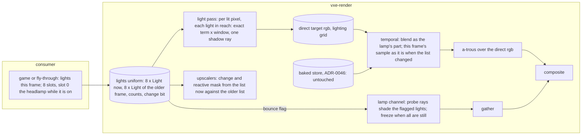

# 0058: Dynamic lights: a list of eight analytic lights the consumer hands the frame, shaded exactly, dropped and carried in the fly-through, and a bounce flag per source

> **Status:** approved, **amended 2026-11-13 (refresh at a312c19; owner answers 7 to 10 the same day, keys re-checked at b1465ab)** (owner go 2026-11-10; the lane starts after Plan 0045 merges and the
> architect's re-read below, order amended 2026-11-11), was draft (redrafted 2026-11-10 over the baked store of ADR-0046; the emission-scale
> phase and ADR-0045 are gone, Plan 0059 built that; amended 2026-11-10 for a light fired in
> flight, the owner's projectile: Phase 1's `6` and done-whens 11 and 12, Phase 4's run 5).
> The owner's answers to the refresh (7 to 10, 2026-11-13) are under Owner answers.
> **Paths (architect, 2026-11-13, at Plan 0045's close):** Plan 0045 split files this plan names
> by their old paths (`gpu_world.rs`, `marcher.rs`, `bake.rs`, `fsr2.rs`, `march.wgsl`,
> `tests/gpu_mirror.rs`, `tests/gpu_strip.rs`'s reading, the fly-through's `main.rs` and
> `hud.rs`). Read each through "Where things moved" in
> [Plan 0045](done/0045-structure-pass-split-the-mega-files-share-the-fixtures.md); the
> phases re-cut their Files touched at their start. **Done by the refresh of 2026-11-13:** every
> path below is the tree's at a312c19.
> **Created:** 2026-11-04
> **Milestone:** M2 in [`docs/roadmap.md`](../roadmap.md) (the consumer's "headlamp, flares,
> glowing crystal"; the per-source switch on feeding the probes, parked 2026-10-22)
> **Related ADRs:** [ADR-0044](../adrs/0044-direct-light-from-a-fixed-list-of-analytic-lights-one-shadow-ray-each.md)
> (proposed; the list, exact shading, reach, history, the bounce flag), accepted at this plan's
> close. Rests on [ADR-0046](../adrs/0046-static-emissive-light-is-baked-per-chunk-when-a-chunk-loads-or-changes.md)
> (accepted: emissive light on a cube face is the baked store's, which this plan leaves alone),
> on the lamp channel of [ADR-0043](../adrs/0043-emissive-light-from-a-world-space-per-face-table-and-a-lamp-bounce-probe-channel.md)
> (accepted; its table is superseded by ADR-0046, its lamp channel stands) and on
> [ADR-0018](../adrs/0018-direct-light-per-pixel-one-sample-from-a-hit-buffer-with-svgf-history-killed-by-edits.md)
> (the lamp's exact estimate and its reset).
> [ADR-0045](../adrs/0045-the-per-face-table-stores-irradiance-at-unit-emission-and-the-read-applies-the-scale-now.md)
> is withdrawn: the store is baked at unit emission and read times the scale now since Plan 0059.
> **Source:** the owner, 2026-11-04: "I want to be able to for example light cavern by dropping
> some light source inside, and see lighting change in real time", and the answers under Owner
> answers.
> **Starts after:** [Plan 0045](done/0045-structure-pass-split-the-mega-files-share-the-fixtures.md)'s
> merge (owner, 2026-11-11: 0045 moves ahead of this plan; before that, Plans 0061, 0067 and
> 0068 merge). The order is Plans 0061, 0067, 0045, this plan, then
> [Plan 0044](0044-hot-path-and-defect-pass.md)'s render phases and Plan 0069. Plan 0061 edits
> `temporal.wgsl` (the store read), `composite.wgsl` (the emitter cap) and `Lighting` (one bit),
> the files Phases 1 and 2 here change, and 0045 moves `marcher.rs` and the shaders apart.
> **Before the lane starts the architect re-reads Phases 1 and 2 against Plan 0045's tip** and
> refreshes their paths (done 2026-11-13, below); bit and binding numbers in this plan are
> "the next free at the start commit", which dev reads from the tree.

> **Amended 2026-11-13 (refresh at a312c19).** Phases 1 to 3 re-read against main at a312c19
> (v0.52.0), after Plans 0045 (v0.50.0), 0072 (v0.51.0) and 0070 (v0.52.0). ADR-0044's
> mechanism, the slot rule, the analytic figures and every bar stand; ADR-0044 needs no edit.
> What changed in the text below:
> 1. **Paths.** The readers table and each phase's Files touched name the split tree. The WGSL
>    `Params`, `lamp(p)` and `lamp_term` are in `common.wgsl`, the glass reflection's lamp in
>    `hit.wgsl`; the Rust `Params` and the `LIGHTING_*` bits in `frame/settings.rs`; the lamp's
>    change key in `frame/state.rs` (`LightKey`, `LampKey`) and its use in `frame/encode.rs`;
>    the upscalers' older lamp in `frame/upscale.rs` (`Lamp`, `UpscaleUniform`) and
>    `fsr2/prepare.rs` (`InLamp`'s buffer); the probe list's reach test in `frame/encode.rs`.
>    Rust constants reach WGSL through `frame/compose.rs`'s generated prelude, which
>    `no_constant_rust_defines_is_a_wgsl_literal` guards; each pass's modules are its `PASSES`
>    row in `frame/pipelines.rs`. The fly-through's keys are `toggles.rs` (modes) and
>    `run/keys.rs` (actions), its flags `cli/flags.rs`, its HUD and banner `hud/modes.rs`.
> 2. **Keys** (owner answer 7). Digits 1 to 8 are the bake queue's toggles (Plans 0059 and
>    0060) and 9 and 0 the audio mix's. The lights keep `1` to `6`; Phase 1 moves the six
>    displaced queue toggles to `Insert`, `PageDown`, `PageUp`, `Delete`, `Home` and `End`,
>    their modes on screen as before, and adds a test that no two inputs share a key.
> 3. **Plan 0065's lamp-off skips.** Three shader gates read `LIGHTING_LAMP` clear as "the
>    direct part is zero": `temporal.wgsl`'s store-only path (a cube face stores the store's
>    value with no blend and returns), and `atrous.wgsl`'s early-out and its `dark_store`
>    variance skip. With list lights and the lamp off that is false, and done-when 1 would read
>    an unblended, unfiltered or dropped direct part. Phase 1 moves them onto a new bit,
>    `LIGHTING_DIRECT` (some light is shaded), and adds done-when 13.
> 4. **A HUD row of its own.** The lighting row is the HUD's longest line; the list's words go
>    in a new `HudRow::Lights` (prefix `lights `), which `every_toggle_shows_its_mode_in_the_hud_grid`
>    (`apps/flythrough/tests/toggles.rs`) covers.
> 5. **The soak line is 10 s** on lavapipe (`docs/nfr.md` section 7), not the 30 s this text
>    carried: Phase 1's done-whens 7 and 12 and Phase 3's done-when 3 are born
>    `#[ignore = "soak"]` on their estimates, each with a gate variant.
> 6. **Per-phase checks** name their `gpu_*` binaries (`test-changed.mjs --binaries`) and use
>    `test-changed.mjs --clippy` (Plan 0072).
> 7. **File caps.** `frame/encode.rs` is at 1130 of `check-file-size`'s 1200 lines, so the
>    list's slots, hash and upload live in a new `frame/lights.rs`, not in `encode.rs`.
> 8. **Plan 0070's backlog entries stay in the backlog.** `light_note` (`note_lights` in
>    `exposed_emitters`) and the windowed `light place` spikes are the emissive light-sample
>    mirror's (`gpu_world/lights.rs`, ADR-0025), on the sync's CPU side, which this plan does
>    not touch: a list light is never an emitter and never reaches the mirror (ADR-0044).
>    Folding them would put a sync plan inside a look-gated lighting plan; the next sync plan is
>    drafted separately and runs beside this one (owner answer 9). Phase 4 and the Budgets'
>    runs read the sync's line beside the frame, so a hitch there is not charged to the list.
>    The a-trous entry ("fewer iterations, or none") is taken here (owner answer 8): Phase 2's
>    iteration setting and Phase 4's question (i).
> 10. **Coloured shots** (owner, 2026-11-13). Phase 2's `3` sets a picked colour that drops and
>    shots take, with a done-when and Phase 4's question (j).
> 9. **Budgets** restated against `docs/nfr.md` section 2 as it reads at a312c19, with the
>    machines named.

> **Amended 2026-11-10 (test cost, owner).** Phases 1 to 3 are **exploration** (lane rules 2b):
> the owner's window in Phase 4 is their gate. Each lands its CPU tests of data, determinism
> and API; every test it names that judges the image (goldens, SSIM or pixel floors, stillness,
> settle and difference bars) runs as a reading from `live/`, a `mod reading` or the strip tool,
> recorded in the readings log, and is written as a test in Phase 5, after the window, against
> the picks. Per phase the gpu check runs only the `gpu_*` binaries the phase names
> (`test-changed.mjs --binaries`, Plan 0066); a named test over 10 s on lavapipe is born
> `#[ignore = "soak"]` (`docs/nfr.md` section 7). The mechanisms and bars stand; only when they
> become tests moves.

## TL;DR

The renderer shades one light that is not a voxel, the headlamp, and it is bound to the camera.
This plan makes it one entry of **a list of eight analytic lights** (point or spot, colour,
intensity, reach, flags) that the consumer hands the frame every frame. A lit pixel shades every
light in reach **exactly, with one shadow ray each**: no random number, no settle, no dots. The
fly-through drops a light where you look (`1`), carries the newest one in front of the camera
(`2`), cycles its colour (`3`), removes it (`4`), flags it for bounce
(`5`) and fires one along the view ray (`6`), and shows the
count and each mode in the window. The direct part of the frame widens from a white scalar to
rgb, in a target of its own. Then **a `bounce` flag per light** feeds ADR-0043's lamp channel
from the flagged lights, off for dropped lights by default. The first thing anyone sees: press
`1` in the hall with the lamp off, and the floor, the pillars and the far wall are lit that
frame and hold still.

## Context & problem

`project-context.md` (Rendering, P0): "dark scenes with few lights; headlamp, flares, glowing
crystal; emissive voxels as light sources, with emission changeable at runtime". The flare has no
path to the pixels: `LightParams` describes one lamp placed from the camera, `Params` carries its
position and cone (`light_pos`, `light_intensity`, `light_dir`, `cos_inner`, `cos_outer`), and
`light.wgsl`'s `lamp_lit` shades it. The runtime emission change the P0 names is already met:
the store is baked at unit emission and the read multiplies by the dominant material's scale
now (ADR-0046; `a_scale_change_moves_no_bake` in `apps/flythrough/tests/gpu_bake.rs`).

**What the tree gives this plan.** The lamp's estimate is exact up to its shadow ray; its screen
history exists for the half tier's jittered grid and takes this frame's sample as it is when the
lamp changed (`LIGHTING_LAMP_CHANGED`). The owner flew the headlamp in every session without a
flicker complaint about it. The irradiance texture holds the emissive part in rgb (the store's
value on a cube face, a fallback's running mean elsewhere) and the lamp's white part in `a`; the
temporal pass blends only the lamp's part and a fallback's, the a-trous passes store pixels
through, the composite reads the accumulation. The lamp channel (`Lighting::lamp_bounce`, off by
default) shades its probe rays with the headlamp alone, lists the probes within
`Lighting::lamp_reach` of the lamp, and freezes a probe at `probe_freeze` visits while the lamp
is still.

**Every reader of the lamp fields, at a312c19** (all move to the lights uniform in Phase 1;
shaders under `crates/vxe-render/src/shaders/`, Rust under `crates/vxe-render/src/`):

| File | What it reads |
|---|---|
| `common.wgsl` | `Params`' lamp fields (`light_pos`, `light_intensity`, `light_dir`, `cos_outer`, `cos_inner`); `lamp(p)`, the unshadowed lamp; `lamp_term`, the term the masks compare |
| `light.wgsl` | `lamp_lit` under `LIGHTING_LAMP`, the steps view's one shadow ray toward `light_pos` |
| `hit.wgsl` | `lamp(p)` under `LIGHTING_LAMP`, the unshadowed lamp on a glass hit's reflection |
| `gradient.wgsl` | `lamp_lit`, re-shaded against the previous frame's `a` (the gradient mode, not the default) |
| `upscale.wgsl` | `up_light_changed`: `lamp_term` now against `up_tuning.old_*`, the change mask |
| `fsr2/input.wgsl` | `light_changed`: `lamp_term` now against `in_lamp.old_*`, the reactive and change mask |
| `probe_update.wgsl` | `lamp_lit` at the probe rays' hits |
| `probe_gather.wgsl` | `probe_beyond_reach`, `light_pos` against `probe.reach` |
| `temporal.wgsl`, `atrous.wgsl` | `LIGHTING_LAMP` clear as "no direct part" (Plan 0065's skips; the refresh's item 3) |
| `frame/settings.rs` | `Params`' lamp fields and `lamp_pose`; `LIGHTING_LAMP`, `LIGHTING_LAMP_CHANGED` |
| `frame/encode.rs` | fills the lamp fields from `LightParams` and the camera; sets `LIGHTING_LAMP_CHANGED` from `LightKey`; lists the probes within `lamp_reach` of `light_pos` |
| `frame/state.rs`, `frame/upscale.rs`, `fsr2/prepare.rs` | `LightKey`/`LampKey` (the change key); `Lamp` and `UpscaleUniform`'s `old_*` (the older lamp); FSR 2's `lamp` buffer (`InLamp`) |

**What a lamp shadow ray costs** (`docs/nfr/02-frame-budget.md`; `docs/plans/logs/0051.md`,
loaded, indicative): the light pass with the lamp on and every emissive face capped read 0.113 ms
on the RTX 3080 Laptop at 720p internal on the half tier; the Plan 0041 table's light pass reads
about eight times the RTX's on the Cezanne iGPU (RADV RENOIR in the readings). So one light in reach of every lighting pixel is
about 0.1 ms on the dev reference and about 0.8 ms on the slow adapter, projections this plan's
readings replace. Under the store the light pass draws no emissive sample on a cube face, so its
cost at the start commit is the lamp's ray and the fallback hits'.

**The `nfr.md` figures touched:** section 2's lighting line (light, gradient, probes, gather) and
denoise line (temporal, a-trous), and section 3's `Frame::frame_bytes`. The readings go to
`docs/nfr/02-frame-budget.md` and `docs/nfr/03-memory.md`.

## Decision

Build ADR-0044 in four phases. **The list** (Phase 1) replaces the single lamp in every reader,
white only, with its reach, its cull, the upscalers' change mask over the list, and the
fly-through's drop and carry: a walking skeleton that lights a cavern on the frame the key is
pressed. **Colour** (Phase 2) moves the direct part into an rgb target of its own through the
temporal, a-trous and composite passes. **The bounce flag** (Phase 3) generalises the lamp
channel to the flagged lights. **The window** (Phase 4) is the owner's, with lights dropped in
the hall and the level.

We rejected lights as emissive voxels (ADR-0044 A), a stochastic pick among lights (B), hardware
ray queries (C) and baking a still light into the store (D). We rejected a colour-first Phase 1,
because the white list exercises the whole path (upload, cull, shadow rays, history, the change
mask, the window's rows) with no target added, and the layout change is then one phase on its
own.

**The slot rule** (the owner, 2026-11-10). The list has eight slots. While `Lighting::lamp` is
on, the headlamp takes slot 0 and `Frame::set_lights` keeps the first seven lights it is given
in slots 1 to 7. While the lamp is off, `set_lights` keeps the first eight in slots 0 to 7. The
lights past the cap are counted (`Frame::lights_over_cap()`) and not shaded. Turning the lamp on
or off moves every list light by one slot, which the change detection sees as a changed list:
the direct part takes that frame's sample as it is, the same reset the lamp's own switch causes
today.

## Architecture diagram



## Implementation phases

Each phase ships as its own commit. `dev` implements all dev phases in one session with no
review between phases. The architect reviews once at the end, in a fresh session. Lane rule 9c
applies: exploratory runs on the RTX 3080 Laptop through `VXE_TEST_ADAPTER=rtx`, labelled; every
asserted reading on lavapipe.

**The gates.** Per phase: `node scripts/test-changed.mjs --profile quick`, then `--profile gpu
--binaries <the phase's list>` under the perf lock (every phase touches rendering; each phase
names its binaries), `node scripts/test-changed.mjs --clippy` and fmt. At the tip: `cargo nextest
run --workspace --profile gate` under the perf lock, doctests, clippy, fmt, deny, and the doc and
tier gates. The soak tier (`--profile soak --run-ignored only`) and the full tier (`--profile
full --run-ignored all`) run only when the owner asks. **Tables, sweeps and attempts go to
`docs/plans/logs/0058.md`**, started from the readings-log template; the Implementation log
below keeps one row per phase.

**Test files and tiers** (`.config/nextest.toml`, by marks). New GPU tests go in
`apps/flythrough/tests/gpu_dynamic_lights.rs`; the `gpu_` prefix is the classification and
`node scripts/check-test-tiers.mjs` checks it. A test over 10 s on lavapipe (60 s on CI;
`docs/nfr.md` section 7) is born `#[ignore = "soak"]` and is named as such in its phase. A
measurement written as a test goes `#[ignore]`d inside a `mod reading`; the readings below are
fly-through runs, not tests. The HUD and banner tests are unit tests in
`apps/flythrough/src/hud/modes.rs` and `apps/flythrough/tests/toggles.rs`, with no device.

**Test times are estimates**, none measured for this plan: from Plan 0051's and 0057's tests on
lavapipe, a hand-built box renders 2 to 3 s for a few dozen frames at 192 x 108 in the gate's
build, about 4 s for 64 frames, about 16 s for 150; the level loads in about 5 s. Each named
test carries its estimate; `node scripts/test-times.mjs` on the phase's log replaces it.

**The analytic figures the tests use.** The shader's term is `PI * intensity * cone * max(n . l,
0) / d^2`, times ADR-0044's window `(1 - (d / r)^4)^2`. A point light of intensity 1200 at 20
voxels above a floor, reach `sqrt(1200 / 0.1)` = 109.5 voxels: directly below, `E = PI * 1200 /
400 = 9.425`, window `(1 - 160 000 / 1.44e8)^2` = 0.998, so **9.40**; 20 voxels to the side,
`d^2 = 800`, `cos = 0.7071`, `E = PI * 1200 * 0.7071 / 800 = 3.332`, window `(1 - 640 000 /
1.44e8)^2` = 0.991, so **3.30**. At manual exposure 1 the direct part stores these as they are
(under `HDR_MAX`).

### Phase 1: The list, white, with the fly-through's drop and carry
- **Owner skill:** dev
- **What:** ADR-0044's list in every reader of the lamp, white only, the slot rule, the reach
  and the per-pixel cull, the change detection, the upscalers' change mask over the list, and
  the fly-through's `1`, `2`, `6`, the queue toggles' move off the digits, HUD row and `--lights N`. No target is added: each light's term is
  summed as luminance into the irradiance's `a`, where the lamp's part is today, so the
  temporal, a-trous and composite passes keep their layout; only their lamp-off gates move
  (below). The list's Rust side (`Light`, the slots, the hash, the uniform's upload) is a new
  `frame/lights.rs`, since `frame/encode.rs` is near `check-file-size`'s cap.
- **The list:**
  - **`Light`** (`vxe_render::Light`, `#[repr(C)]`, 64 B): `pos: [f32; 3]`, `intensity`,
    `dir: [f32; 3]`, `cos_inner`, `colour: [f32; 3]`, `cos_outer`, `flags: u32` (`ON`,
    `SHADOWS`, `BOUNCE`), three pad words. `MAX_LIGHTS` 8. `Frame::set_lights(&mut self, queue,
    &[Light])` fills the slots by the slot rule above; the headlamp's slot is filled from
    `LightParams` and the camera, as the `Params` lamp fields are today, which leave `Params`.
  - **The uniform** holds the list now, the list of the older frame the upscalers compare
    against (the frame `up_tuning.old_*` and `in_lamp.old_*` name today, which leave those
    structs), both counts, a `changed` word and a `lamp` word (1 when slot 0 is the headlamp):
    `2 x 8 x 64 + 16` = 1040 B. It is written when any field changed (a hash of the list against
    the last frame's). `LIGHTING_LAMP_CHANGED` becomes "the list changed" and keeps its name in
    the shader for Phase 2 to rename.
  - **Shading.** `lamp_lit` becomes `light_lit(i, p, n, ns)` over slot `i`: the term above,
    `cone` from the cosines as today (a point light has `cos_outer` -1 and `cone` 1), the window,
    zero beyond the reach, zero where the shadow ray toward the light finds rock (skipped when
    `SHADOWS` is clear). The light pass loops over the count and sums the lit lights' luminance
    into `a`.
  - **"Some light is shaded."** A new bit, `LIGHTING_DIRECT` (the next free `LIGHTING_*` bit,
    through the prelude), is set when the list's count is above 0, the headlamp included. It
    replaces `LIGHTING_LAMP` in the gates that mean "the direct part is zero":
    `temporal.wgsl`'s store-only path (a cube face with the lamp off stores the store's value,
    no blend, and returns) and `atrous.wgsl`'s early-out and `dark_store`. With the bit clear
    those paths are taken exactly as with the lamp off at the start commit, so Plan 0065's
    savings hold with an empty list. `LIGHTING_LAMP` stays the headlamp's (slot 0 and the
    `lamp` word).
  - **Reach.** `Lighting::light_floor: f32`, default 0.1 (ADR-0044); `reach(i) = sqrt(intensity /
    light_floor)`. A floor of 0 means no reach: the window is 1 and no light is culled, which is
    the lamp's arithmetic at the start commit. The `steps` view counts the shadow rays cast per
    pixel in its `a` as it counts the lamp's today, so the cull is readable.
  - **The other readers.** `common.wgsl`'s `lamp(p)`, called on `hit.wgsl`'s glass reflection,
    sums the list in reach, unshadowed as today.
    `probe_update.wgsl` and `probe_gather.wgsl` read the headlamp's slot through the `lamp` word
    (the channel stays the lamp's until Phase 3). `gradient.wgsl` re-shades the summed list
    against the previous frame's `a`, so the gradient mode's lambda is 0 on a still list of any
    length.
  - **The upscalers' change mask.** `up_light_changed` (`upscale.wgsl`) and `light_changed`
    (`fsr2/input.wgsl`) compare the summed unshadowed luminance of the list now against the
    older list's at the pixel, each light inside its own reach and window, on today's two
    thresholds (`change_abs`, `change_rel`). A pixel a dropped, moved, recoloured or removed
    light reaches is marked as a pixel under a stepped lamp is today; a pixel out of every
    changed light's reach is not. With the `changed` word clear for both frames the loop is
    skipped.
- **The fly-through:** `1` adds a white point light of intensity 1200 at the looked-at hit
  (the dig's ray, `run/edit.rs`'s `camera_ray`), 2
  voxels off the surface along its normal (a miss drops it 20 voxels ahead); `2` toggles **carry**
  of the newest light: its position is the eye plus 2 m forward and 0.3 m down each frame until
  `2` again, which leaves it where it is. `6` **fires** a white point light of intensity 1200
  from the eye along the view ray at 200 voxels a second (20 m/s; 3.3 voxels a frame at 60 fps),
  its `BOUNCE` flag clear as a dropped light's: its position advances by the frame's time step
  each frame, it stops 2 voxels short of the first surface on that ray (the drop's ray, cast
  once at the key press; an edit on its path afterwards is not seen) or at 400 voxels with no
  hit, and it stays there as a dropped light. Several may fly at once; `2` on a light in flight
  ends the flight and carries it; `4` removes it. The light has no visible body (What this plan
  does NOT do). `--lights N` (headless or windowed; a row in `cli/flags.rs`'s table, which
  `help_lists_every_flag_the_parser_accepts` covers) places `N` white
  lights of intensity 600 on a ring of radius 3 m around the spawn pose at eye height, for the
  readings. A new HUD row, `HudRow::Lights`, reads `lights <n>/8 [carry] [fly <m>] over <k>`, where `m` counts the lights in flight and `n` counts the
  headlamp while it is on; the banner names `lights <n>/8` on `1` and `carry on` or `carry off`
  on `2` and `fire` with `lights <n>/8` on `6`. A drop or a shot into a full list (eight with the lamp off, seven list lights with it on) prints
  a line and adds nothing. Carry is a mode (a `toggles.rs` row); drop, fire and remove are
  actions in `run/keys.rs`, as the dig is.
- **The digits come back to the lights** (owner answer 7, 2026-11-13). At b1465ab `Digit1` to
  `Digit6` are the bake queue's toggles (Plans 0059 and 0060), `Digit7` and `Digit8` its
  missing-light and reach toggles, `Digit9` and `Digit0` the audio mix's pre-delay. This phase
  moves the six displaced rows in `toggles.rs`'s table to the navigation block, which nothing
  in `apps/flythrough/src` or `crates/vxe-app/src` binds at b1465ab: queue order `Insert`,
  queue angle halved `PageDown`, queue angle doubled `PageUp`, queue withdraw `Delete`, bake
  budget `Home`, full-first `End`. `Digit7`, `Digit8`, `Digit9` and `Digit0` stay. Each moved
  toggle keeps its name, its `HudRow::Queue` row and its words, so its mode stays on screen as
  today; only the key changes. The launcher's menu (`apps/tester/src/menu.rs`) binds the digits
  in its own window and is not touched. The free keys left after this phase: `F`, `F4`
  (Phase 2 takes it), `F11`, `F12`, `Tab`, `Backquote`, `Quote`, `Slash`, `Backslash`,
  `Backspace`, the arrows and the numpad. If dev finds the block awkward on the laptop's
  keyboard (`Fn` layers), the rule in Owner answers lets dev move a key; the log names the move.
- **The fired light's colour** (owner, 2026-11-13: "shoot some form of moving light with
  different colors"). From Phase 2, `3` sets the **picked colour**: it recolours the newest
  light, as below, and is the colour every later drop (`1`) and shot (`6`) takes. Until Phase 2
  the picked colour is white.
- **The readings** (fly-through runs): the light pass and the frame at the level's spawn and the
  vein, lamp off at `--lights` 0, 1, 2, 4, 8 and lamp on at 0, 1, 2, 4, 7 (the slot rule), both
  adapters, three quiet rounds where the machine allows, with the pass's shadow-ray count per
  pixel from the `steps` view; the same at `light_floor` 0.1 and 0.025 (the ring's intensity 600
  reaches 77 and 155 voxels; the ring's radius is 30 voxels); the upscale pass under FSR 2 with
  a still list of 0 and 8 (the mask's loop); the hall at exposure 8 with one light at the floor's
  centre, native and FSR 2 at 1.5, 64 against 512 frames (the prediction: 0 difference at
  native).
- **Files touched** (at a312c19): `crates/vxe-render/src/light.rs`, `lib.rs`,
  `frame/lights.rs` (new), `frame/settings.rs` (`Params`, `Lighting::light_floor`, the bits),
  `frame/state.rs` (the change key), `frame/encode.rs`, `frame/upscale.rs`, `frame/mod.rs`
  (`set_lights`, `lights_over_cap`, `lights_changed`), `frame/pipelines.rs` (the uniform's
  binding in each reader's `PASSES` row), `frame/compose.rs` (the prelude's constants),
  `fsr2/prepare.rs`, `fsr2/resources.rs`; `crates/vxe-render/src/shaders/common.wgsl`
  (`Params`, the lights uniform, `lamp`, `lamp_term`), `light.wgsl`, `hit.wgsl`,
  `gradient.wgsl`, `temporal.wgsl` and `atrous.wgsl` (the gates), `upscale.wgsl`,
  `fsr2/input.wgsl`, `probe_update.wgsl`, `probe_gather.wgsl`; `apps/flythrough/src/lights.rs`
  (new: the testbed's list, drop, carry and flight), `toggles.rs`, `run/keys.rs`,
  `run/frame.rs` (`set_lights` each frame), `cli/flags.rs`, `hud/modes.rs`,
  `run/tests.rs` (its queue-key tests press the new keys), `apps/flythrough/tests/toggles.rs`,
  `README.md` (the fly-through's input table gains rows for `1` to `6` and the six moved queue
  keys); `apps/flythrough/tests/gpu_dynamic_lights.rs` (new),
  `gpu_fsr2.rs`, `gpu_upscale.rs`, and the lamp-lit baselines under `tests/golden/` with the
  tests that bless them (done-when 3); `docs/plans/logs/0058.md` (new).
- **GPU binaries per phase:** `gpu_dynamic_lights`, `gpu_fsr2`, `gpu_upscale`, `gpu_golden`,
  `gpu_hud_golden`, `gpu_castle_golden`, `gpu_look`, `gpu_bake`, `gpu_lights`, `gpu_indirect`
  and vxe-render's `gpu_frame` (every binary that compares a golden or reads the lamp's
  history; done-when 3 needs each golden).
- **Done when:**
  1. `a_point_light_gives_the_analytic_irradiance_on_the_floor` asserts, on a closed dark box
     (albedo 0.5, no emitter, lamp off, `--lighting full`, manual exposure 1, no jitter) with one
     list light of intensity 1200 at 20 voxels above the floor's centre, that the direct part
     at the floor pixel under the light reads 9.40 within 2 % and at the pixel 20 voxels to the
     side 3.30 within 2 %, on the first frame. About 3 s (an estimate).
  2. `a_slab_between_the_light_and_the_floor_casts_a_hard_shadow` asserts, on the same box with
     a 4-voxel slab 10 voxels under the light covering half the floor, that a floor pixel under
     the slab reads 0 direct and a pixel one voxel past its edge reads its analytic value within
     2 %, and that with `SHADOWS` clear the shadowed pixel reads its analytic value too. About
     3 s (an estimate).
  3. `the_list_at_no_reach_is_the_lamps_arithmetic`: at `light_floor` 0 with the lamp the only
     light, every gate golden passes against its baseline as blessed at the start commit, with
     no re-bless. At the default floor the lamp is windowed and cut at 109.5 voxels, so the
     lamp-lit baselines are re-blessed once in this phase on lavapipe, and the log names, per
     baseline, the share of pixels that moved and the greatest level. No new test time: the
     golden tests run twice in one binary, about double their time today (an estimate).
  4. `a_light_beyond_its_reach_casts_no_shadow_ray` asserts, in the `steps` view, that a floor
     pixel at 150 voxels from a light of intensity 1200 (reach 109.5) counts 0 shadow rays toward
     it and a pixel at 50 voxels counts 1, and that at `light_floor` 0.025 (reach 219) both count
     1. About 3 s (an estimate).
  5. `the_slots_follow_the_lamp` asserts the slot rule: with the lamp on, `set_lights` with 8
     given keeps 7, `lights_over_cap()` reads 1 and the eighth light's floor pixel reads 0
     direct; with the lamp off the same 8 are all shaded and `lights_over_cap()` reads 0; a
     ninth is over the cap in both. Under 5 s (an estimate).
  6. `a_changed_light_takes_this_frames_sample` asserts that after 32 still frames a light moved
     by 10 voxels gives, on the next frame, a direct part equal to the new analytic value within
     2 % (no blend), that an unchanged list leaves the change bit clear (`lights_changed()`
     false) over 32 frames, and that turning the lamp on sets it for one frame. About 4 s (an
     estimate).
  7. `fsr2_marks_a_changed_list_light_and_keeps_pace` (`gpu_fsr2.rs`) asserts, under FSR 2 at
     1.5 with the lamp off: a still list light leaves the reactive mask as it is with no list
     light; on the frame a light is dropped, every floor pixel within half its reach is marked
     and a pixel beyond its reach is not; and the output at the pixel under the light reaches its
     settled value within the frame count and tolerance that
     `fsr2_keeps_pace_with_a_sweeping_headlamp_and_a_lamp_step` allows a lamp step. The same
     mask assertion runs under `own` in `gpu_upscale.rs`. About 15 s (an estimate from the lamp
     test's size), so it is born `#[ignore = "soak"]` and a 16-frame mask-only variant,
     `fsr2_marks_a_dropped_list_light`, about 4 s, stays in the gate (refresh 2026-11-13: the
     line is 10 s).
  8. `the_gradient_mode_holds_still_under_a_still_list` asserts, in the gradient mode with two
     list lights and the lamp off, that the strata's lambda reads 0 at every stratum over 16
     still frames. About 3 s (an estimate).
  9. `the_banner_and_hud_name_the_lights` (`hud/modes.rs`, no device, under 1 s): the `lights`
     row reads `lights 3/8 carry over 0` for three lights with carry on and the lamp off, and
     `lights 4/8` for the same with the lamp on; the banner reads `lights 3/8` after `1` and
     `carry on` after `2`; `--lights 3` parses; `1` on a full list is refused with a line that
     names this plan's number. With two lights, one of them in flight, the row reads `lights 2/8
     fly 1 over 0`; the banner reads `fire` and `lights 2/8` after `6`; `6` on a full list is
     refused with the same line. `every_toggle_shows_its_mode_in_the_hud_grid` passes with the
     carry row in the `lights` row and the six queue toggles on their new keys.
  9b. `no_two_inputs_share_a_key` (`apps/flythrough/tests/toggles.rs`, no device, under 1 s;
     owner answer 7): every key in the toggles table and in `run/keys.rs`'s action keys
     (exported as one list for the test) is bound once; `Digit1` to `Digit6` are the lights'
     actions and carry; `Insert`, `PageDown`, `PageUp`, `Delete`, `Home` and `End` flip the
     queue order, the angle halved and doubled, withdraw, the bake budget and full-first, each
     changing the `queue` row's words as the digit did at b1465ab (the `run/tests.rs` tests,
     their keys changed, still pass).
  10. The readings are in the log, with the shadow-ray count per pixel beside each cost. The
      prediction: the light pass grows by 0.08 to 0.12 ms per light in reach on the RTX and by
      0.6 to 1.0 ms on the Cezanne; a figure outside that range is a reading, not a failure.
  11. `a_light_in_flight_leaves_no_trail_in_the_direct_part` asserts, on done-when 1's box
      (lamp off, no jitter) with one list light of intensity 1200 at 20 voxels above the floor,
      held still for 32 frames and then moved 4 voxels a frame along the floor for 16 frames:
      on every frame of the flight the direct part at the floor pixel under the start position
      and at the pixel under the light's position that frame equals the analytic value for that
      frame's position within 2 %, computed in the test from the term above; on the last frame
      of the flight the start pixel reads **0.185** within 2 %, down from 9.40 (64 voxels to
      the side: `d^2` = 4496, `cos` = 0.2983, `E = PI * 1200 * 0.2983 / 4496` = 0.2501, window
      `(1 - 0.6121^4)^2` = 0.739); `lights_changed()` is true on each frame of the flight and
      false on the second frame after it. The box is at least 100 voxels long. About 4 s (an
      estimate).
  12. `fsr2_leaves_no_trail_behind_a_light_in_flight` (`gpu_fsr2.rs`) asserts, under FSR 2 at
      1.5 with the lamp off and done-when 11's flight: the output's luminance at the pixel under
      the start position never rises from one frame of the flight to the next by more than the
      tolerance `fsr2_keeps_pace_with_a_sweeping_headlamp_and_a_lamp_step` allows, and within
      that test's frame count after the light stops it is within that tolerance of a reference
      settled with the light still at the end position; the floor pixels within half the reach
      of the light's position are marked reactive on each frame of the flight. **The trail's
      length is a reading:** the frames from the light's last move until the start pixel is
      within the tolerance, in the log, on lavapipe and labelled on the RTX. About 15 s (an
      estimate), so it is born `#[ignore = "soak"]` and an 8-frame flight,
      `fsr2_marks_a_light_in_flight`, about 4 s, stays in the gate (refresh 2026-11-13).
  13. `a_list_light_with_the_lamp_off_survives_the_lamp_off_skips` (refresh 2026-11-13) asserts,
      on done-when 1's box with the lamp off and one list light, over 32 still frames at
      `--lighting half`: the direct part at the floor pixel under the light reads 9.40 within
      2 % on every frame both after the temporal pass (the store-only path did not drop it) and
      after the filter (the early-out did not pass it around); and with the list empty and the
      lamp off, `LIGHTING_DIRECT` is clear, and every lamp-off gate golden passes against its
      baseline as blessed at the start commit, with no re-bless (the skips unchanged). About 4 s
      (an estimate).

### Phase 2: Colour: the direct part in a target of its own
- **Owner skill:** dev
- **What:** the direct part becomes rgb through the light, temporal, gradient, a-trous and
  composite passes; the fly-through's `3` and `4`, the picked colour for drops and shots; a
  golden with two coloured lights; `frame_bytes`; the a-trous iteration setting (owner answer
  8). Phase 1's `LIGHTING_DIRECT` gates read the direct target from here on: with
  the irradiance's `a` unused, `atrous.wgsl`'s `dark_store` tests the direct accumulation, not
  `acc.w`.
- **The direct target** (the contract Plan 0032 builds on; see Data shapes for the same text):
  - **Shape.** The light pass writes a `direct` texture, `rgba16float` on the lighting grid: rgb
    the pre-exposed sum of the frame's exact, analytic direct terms (each list light's term
    times its colour), `a` that sum's luminance. The temporal pass keeps a **direct
    accumulation pair** of the same format and grid. The irradiance texture's `a` goes unused.
  - **Blend.** The lamp's rule of ADR-0018, unchanged: `max(ALPHA, 1 / (age + 1))` on the
    reprojected history, with today's reprojection, edit-box and no-history resets; in the
    gradient mode the weight rises with the strata's lambda as today, and `gradient.wgsl`
    compares its re-shade against the direct target's `a`.
  - **Change rule.** On a frame where `LIGHTING_LIGHTS_CHANGED` is set (the bit
    `LIGHTING_LAMP_CHANGED` holds today, renamed) every pixel takes this frame's sample as it
    is. The bit is set by the list's change detection and by nothing else in this plan. A term
    added to the target that does not raise the bit is blended on the rule above.
  - **Reactive rule.** The upscalers mark a pixel when the unshadowed luminance of the terms
    now and of the older frame's differ past `change_abs` and `change_rel` (Phase 1's mask). A
    term outside the list needs its own now-and-then pair in that comparison to be marked.
  - **Filter and composite.** The moments' luminance is the direct's `a` plus the emissive's as
    today. The a-trous filters the direct rgb (its variance from the same moments) and passes
    the store's emissive through as today. The composite adds the filtered direct rgb to the
    emissive before the albedo.
- **Arithmetic** at 1280 x 720 internal on the half tier (640 x 360 lighting pixels, 8 B a
  pixel): the direct target 1 843 200 B, the pair 3 686 400 B, **5 529 600 B** more in
  `frame_bytes`.
- **The fly-through:** `3` cycles the **picked colour** through white, warm (1.0, 0.7, 0.4),
  red, green, blue, and sets the newest light's colour to it, in flight or still; every later
  drop (`1`) and shot (`6`) takes the picked colour, so three shots with `3` between them fly
  in three colours. `4` removes the newest light. The `lights` row names the picked colour
  (`colour red`); the banner names the colour on `3` and `lights <n>/8` on `4`.
- **The a-trous iterations** (owner answer 8, 2026-11-13; a cheap mode, so it stays a render
  setting whatever the window picks). `Lighting::atrous_iterations: u32`, one of 1, 2 or 4,
  default 4 (today's `ATROUS_ITERATIONS`, which becomes the cap the step buffers and bind
  groups are built for); the encode records that many a-trous dispatches after the variance
  pass, and the output is read from the filter target the last one wrote (`filter[n % 2]`,
  today fixed at `filter[ATROUS_ITERATIONS % 2]` in `frame/encode.rs` and `frame/mod.rs`).
  `Lighting::filter` off still skips the pass, and Plan 0065's skips hold at every count. The
  fly-through's `F4` cycles 4, 2, 1 (unbound at b1465ab; the README's `F4` row names a removed
  sampler and is rewritten); the lighting row gains `filter <n>`, and the banner names it;
  `--atrous-iterations 1|2|4` sets it (a row in `cli/flags.rs`).
- **Files touched** (at a312c19): `crates/vxe-render/src/shaders/light.wgsl`, `temporal.wgsl`,
  `gradient.wgsl`, `atrous.wgsl`, `composite.wgsl`, `common.wgsl` and `hit.wgsl` (the bit's
  name, `lamp` in rgb); `crates/vxe-render/src/frame/targets.rs` (the direct target and its
  pair), `frame/mod.rs` (`frame_bytes`), `frame/encode.rs` (the passes' bind groups),
  `frame/pipelines.rs`, `frame/settings.rs` (the renamed bit, `atrous_iterations`) and
  `frame/compose.rs`; `apps/flythrough/src/lights.rs`, `toggles.rs`, `run/keys.rs`,
  `hud/modes.rs`, `cli/flags.rs`, `apps/flythrough/tests/toggles.rs`, `README.md` (the `F4` row);
  `apps/flythrough/tests/gpu_dynamic_lights.rs`, `gpu_golden.rs` and a new baseline
  under `tests/golden/`, `gpu_upscale.rs` and `gpu_fsr2.rs` (`frame_bytes`),
  `docs/plans/logs/0058.md`.
- **GPU binaries per phase:** `gpu_dynamic_lights`, `gpu_golden`, `gpu_upscale`, `gpu_fsr2`,
  `gpu_lights`, `gpu_hud_golden`, `gpu_castle_golden`, `gpu_look` and `gpu_bake` (done-when
  5's and 9's no-re-bless rule: every binary that compares a golden).
- **Done when:**
  1. `two_coloured_lights_sum_per_channel` asserts, on Phase 1's box with a red light (1, 0, 0)
     and a blue light (0, 0, 1) of intensity 1200 each at 20 voxels above the floor and 20 voxels
     apart, that the floor pixel under the red light reads direct `(9.40, 0, 3.30)` within 2 % per
     channel and the pixel under the blue one `(3.30, 0, 9.40)`. About 3 s (an estimate).
  2. `lights_box_golden_holds_two_coloured_lights`: a golden of the box at 192 x 108 with the
     red and the blue light, lamp off, `--lighting half`, blessed once on lavapipe, on the
     harness's floor (at most 0.1 % of pixels differ by more than 2/255 in any channel). About
     3 s (an estimate).
  3. `a_dropped_light_holds_still_while_the_camera_moves` asserts, on the box with the lamp off
     and one still list light, that over a 32-frame sideways step of 0.5 voxel a frame the direct
     accumulation at a reprojected floor pixel never differs from its analytic value by more
     than 2 % (the blend never sees a sample that differs). About 4 s (an estimate).
  4. `frame_bytes_hold_the_direct_pair` in `gpu_upscale.rs` asserts that the frame's inventory
     at 1280 x 720 internal on the half tier counts the direct target and its pair at 5 529 600 B
     and that `frame_bytes` equals the inventory's sum; `gpu_fsr2.rs`'s inventory test
     (`frame_bytes_under_fsr2_swap_the_histories_for_fsr2s_inventory`) gains the
     same three targets. Under 5 s each (an estimate).
  5. Phase 1's done-whens 6, 7, 8, 11, 12 and 13 hold on the direct target (the bit renamed;
     7's and 12's gate variants in the gate, the soak tests once by name), and no gate
     golden without a list light is re-blessed in this phase.
  6. The HUD and banner tests cover `3` and `4` (no device, under 1 s): the banner reads the
     colour's name after `3` and `lights 2/8` after `4` on three lights; after `3` twice from
     white, the `lights` row reads `colour red` and a light then dropped with `1` or fired with
     `6` has colour (1, 0, 0) in the testbed's list (`apps/flythrough/src/lights.rs`'s unit
     test, `a_shot_takes_the_picked_colour`).
  8. `a_coloured_light_in_flight_lights_its_channel_only` (`gpu_dynamic_lights.rs`) asserts,
     on Phase 1 done-when 11's flight with the light's colour red: on every frame the direct
     part at the pixel under the light's position reads `(E, 0, 0)` with `E` that frame's
     analytic value within 2 % in red and 0 in green and blue, and at the start pixel on the
     last frame `(0.185, 0, 0)` within 2 %. About 4 s (an estimate).
  9. `the_atrous_count_follows_the_setting` (`gpu_dynamic_lights.rs`, about 3 s, an estimate)
     asserts that a frame encoded at `atrous_iterations` 1, 2 and 4 records 1, 2 and 4 a-trous
     dispatches (`Frame`'s per-pass timer labels or a dispatch count beside
     `probe_dispatches`), that at 4 every gate golden passes against its start-commit baseline
     with no re-bless, and that at 1 and 2 the composite on Phase 1's box with one light
     differs from the count-4 frame (the output target follows the count). The HUD test:
     `F4` from the default reads `filter 2`, then `filter 1`, then `filter 4`, and
     `every_toggle_shows_its_mode_in_the_hud_grid` covers the row.
  7. The readings: the temporal and a-trous passes' cost at the spawn, lamp on, `--lights` 0 and
     4, both adapters, against Phase 1's (the prediction: the a-trous grows by under 0.1 ms on
     the RTX for three channels against one, a guess); the hall's 64 against 512 frames with two
     coloured lights, native (the prediction: 0); the a-trous at 1, 2 and 4 iterations, lamp on
     and lamp off with one dropped light, at the spawn and the vein, both adapters (the
     prediction: about linear in the count, a guess; Plan 0065's close read the lamp-on pass
     at 3.088 to 3.321 ms on the RTX at the full tier).

### Phase 3: The bounce flag
- **Owner skill:** dev
- **What:** the lamp channel generalised to the lights with `BOUNCE` set, and two of the
  backlog's lamp-channel faults (the furnace's `D`, the one-probe step test).
- **Two reaches, named.** A light's **direct reach** is ADR-0044's `sqrt(intensity /
  light_floor)`: it windows the term wherever the light is shaded, at a pixel or at a probe
  ray's hit. The **bounce reach** is `Lighting::lamp_reach` (64 voxels by default), the same
  for every flagged light: it decides which probes a light lists and it sizes the volume
  (`probes_per_axis`), as it does for the lamp today.
- **The channel:** the probe rays shade their hits with every flagged light whose direct reach
  covers the hit, summing the terms as the light pass does (rgb after Phase 2); the probes
  listed are those within the bounce reach of any flagged light (the union;
  `probe_gather.wgsl`'s `probe_beyond_reach` tests every flagged light); a probe's mean freezes
  at `probe_freeze` visits while every flagged light within its bounce reach is still, and
  blends at `Lighting::probe_move_blend` while one moves; with no flagged light on, no probe
  pass is encoded (today's gate in `frame/encode.rs` needs `Lighting::lamp` on; it becomes "a
  flagged light is on"). `Lighting::lamp_bounce` stays the channel's switch and the headlamp's flag.
  **The volume still scrolls with the camera** (`ProbeVolume::origin_for`): a flagged light farther
  from the camera than the volume's half-side plus the bounce reach lists no probe and adds no
  bounce, and its direct light is unchanged. The fly-through's `5` toggles the newest light's
  flag; the `lights` row marks a flagged light `*`; the banner reads `bounce on` or `bounce off`.
- **Files touched** (at a312c19): `crates/vxe-render/src/shaders/probe_update.wgsl`,
  `probe_gather.wgsl`, `crates/vxe-render/src/probes.rs`, `frame/encode.rs` (the channel's gate
  and the update list's reach test, today `lamp_reach` against `light_pos`),
  `frame/probe_channel.rs` (the probe uniform), `frame/lights.rs`;
  `apps/flythrough/src/lights.rs`, `toggles.rs`, `hud/modes.rs`;
  `apps/flythrough/tests/gpu_dynamic_lights.rs`, `gpu_indirect.rs` (the lamp furnace's CPU
  reference), `gpu_settle.rs` (`a_lamp_step_moves_the_probes_in_reach_only`, the one-probe step
  test the backlog names), `docs/plans/logs/0058.md`.
- **GPU binaries per phase:** `gpu_dynamic_lights`, `gpu_indirect`, `gpu_settle`, and vxe-render's
  `gpu_frame` (its probe-volume test).
- **Done when:**
  1. `a_flagged_light_feeds_the_channel_and_an_unflagged_one_does_not` asserts, on a closed box
     of albedo 0.5 with the lamp off and one list light at the centre: with `BOUNCE` clear every
     probe texel reads exactly 0 over 64 frames and no probe pass is encoded; with `BOUNCE` set
     the centre probe's texel mean is above 0 after 16 frames. About 4 s (an estimate).
  2. `a_flagged_lights_furnace_reads_its_albedo_times_the_analytic_direct_mean`, born
     `#[ignore = "soak"]` (256 frames, as the lamp furnace): on the same box with `BOUNCE` set
     and `light_floor` 0, the centre probe's texel mean after 256 frames reads within 4 % of
     `0.5 D_ref`. `D_ref` is computed on the CPU, in the test, from the box's geometry alone:
     the analytic term `PI * intensity * cos / d^2` at the wall point each direction from the
     probe meets, cosine-weighted over a quadrature of at least 4096 directions, in the
     normalisation `the_lamp_furnace_reads_its_albedo_times_the_direct_mean` documents. No
     value read back from the shader enters `D_ref`. The lamp furnace takes the same CPU
     reference for a spot light in this phase.
  3. `the_channel_freezes_when_every_flagged_light_is_still` asserts, at `probe_freeze` 8 with a
     flagged list light and the lamp off, that after 8 visits the texels of every probe within
     the bounce reach are bit-identical over 64 frames, that moving the light changes every
     probe within the bounce reach of its old or new position within 8 frames and leaves the
     others bit-identical, and that they freeze again once it is still. About 16 s (an
     estimate), so it is born `#[ignore = "soak"]` (refresh 2026-11-13); its gate variant,
     `a_moved_flagged_light_wakes_the_probes_in_reach_only`, about 5 s, asserts the move's
     half at `probe_freeze` 4 over 24 frames.
  4. `a_light_beyond_the_bounce_reach_lists_no_probe` asserts that a flagged light of intensity
     1200 placed 80 voxels from a probe (beyond the bounce reach of 64, inside the direct reach
     of 109.5) leaves that probe at 0 and unvisited, and that a flagged light placed outside the
     volume by more than the bounce reach encodes no probe pass. About 4 s (an estimate).
  5. The HUD and banner tests cover `5` and the `*` (no device, under 1 s): the banner reads
     `bounce on` after `5` and `bounce off` after a second.
  6. The readings: the probe update's cost at the spawn with the lamp on and 0, 1 and 4 flagged
     lights in reach, both adapters, against the channel's cost at the start commit (the
     prediction: the update grows with the flagged lights' shadow rays per probe ray, about
     linearly); the count of probes inside rock traced while a light moves (the backlog's third
     fault, a reading); **the bounce's lag behind a light in flight:** with a flagged light on
     Phase 1's done-when 11 flight, the frames from its last move until the mean of the probe
     nearest the end position is within 10 % of its frozen value (a reading at the default
     `probe_move_blend`, no bar).

### Phase 4: The owner's window
- **Owner skill:** human
- **What:** the release fly-through on the RTX, one sitting, Phase 1 to 3's tables at hand.
  Every toggle shows in the banner and the HUD.

  ```
  cargo build --release -p flythrough

  # 1. The hall, lamp off: drop a light at the floor's centre (1), count to five, a fast turn,
  #    a slow pan; carry it (2) down the hall and set it down; a second and third light;
  #    colours (3).
  target/release/flythrough --source showcase --shot hall --exposure 8 --hud --lamp off

  # 2. The level: drop a light in the vein's passage, dig next to it, dig a hole and drop a
  #    light into it; carry one through the passage with the lamp on and off.
  target/release/flythrough --level --seed 1 --pose vein --hud

  # 3. Bounce: the same light with its flag on (5), beside it off; the lamp's bounce
  #    beside it.
  target/release/flythrough --level --seed 1 --pose vein --hud --lamp-bounce on

  # 4. Eight lights on the ring, lamp off, for the cost on screen.
  target/release/flythrough --level --seed 1 --lights 8 --lamp off --hud

  # 5. A light in flight (6): down the hall's length with the lamp off; along the vein's
  #    passage and across the cavern, camera still and then following it; three in a row; one
  #    with the bounce flag set after it lands (5). Coloured shots: pick a colour (3) and fire
  #    (6), three shots in three colours down the passage, then recolour one in flight (3).
  target/release/flythrough --source showcase --shot hall --exposure 8 --hud --lamp off
  target/release/flythrough --level --seed 1 --pose vein --hud --lamp off

  # 6. The a-trous iterations (F4: 4, 2, 1) on runs 1, 2 and 5's scenes: still, panning and
  #    with a light in flight, lamp on and off; the filter's count shows in the lighting row.
  target/release/flythrough --level --seed 1 --pose vein --hud --lamp off --atrous-iterations 2
  ```

  The runs keep their stdout on screen (the per-second `frames:` and `sync:` lines). A hitch
  the owner names is read against the `sync:` line's `light place` and `note` for that
  second before it is charged to the list: those are the emissive mirror's, which this plan
  does not touch (`docs/backlog.md`, "The sync's `light_note` stage and the windowed glide's
  light walks"), and they spiked to 846 ms in Plan 0070's windowed glide.
- **Files touched:** this plan's log.
- **Done when:** the log records the owner's words on: (a) whether anything moves with a dropped
  light and a still camera, hall and level, under FSR 2 at 1.5; (b) the carried light in motion,
  against the headlamp; (c) the frame of the drop (does the cavern light "that frame"); (d) hard
  shadows and the reach's edge at `light_floor` 0.1, the headlamp's included; (e) the bounce
  flag's look and lag, and whether dropped lights should default to it; (f) eight lights' cost on
  screen, with each hitch the owner names beside that second's `sync:` line; (g) whether the defaults are accepted; (h) the light in flight under FSR 2 at 1.5:
  whether the walls it passes are lit that frame, whether a trail stays behind it, and whether
  the lit walls shimmer while it flies; (i) the a-trous iterations (owner answer 8): at 1, 2
  and 4, whether list-light shadows, still frames and a light in flight look right, which
  count is the default, and whether the cost the HUD shows is worth it; (j) coloured shots
  (owner, 2026-11-13): whether a shot's colour reads on the walls it passes and where it lands,
  and whether a colour change in flight is clean. **Stop rule:** a "no" on (a), (b) or (h) that names
  shimmer or a trail under FSR 2 stops the close and goes to the architect with Phase 1's mask
  readings and done-when 12's trail length; the narrowed reset under Risks is the first amendment. A "no" on (g) names the run
  and goes to the architect with the tables. A pick on (i) other than 4 is Phase 5's default and
its goldens; every count stays a setting. The plan closes with that record.

### Phase 5: The picks as tests

- **Owner skill:** dev
- **What:** the image tests, goldens and bars Phases 1 to 3 name, written now with the
  values the Phase 4 window settled, and the readings they replace cited from the log.
- **Files touched:** the `gpu_*` test files and `golden/` images Phases 1 to 3 name,
  `crates/vxe-render/src/frame/settings.rs` if the window picks another a-trous default (and
  the goldens that default moves, re-blessed once on lavapipe), `docs/plans/logs/0058.md`.
- **Done when:** every image test Phases 1 to 3 name exists, asserts the picked value or
  the bar the plan states (a bar the window moved says so in the log, with the owner's words),
  and passes in the gpu tier under the lock; each one over 10 s on lavapipe is
  `#[ignore = "soak"]` and passes once by name. A test for a mechanism the window dropped
  is not written, and the log names it.

## Data shapes

```rust
// illustrative: vxe-render
#[repr(C)]
pub struct Light {
    pub pos: [f32; 3],      // voxels
    pub intensity: f32,     // radiance on the axis at one voxel, as LightParams::intensity
    pub dir: [f32; 3],      // unit; ignored for a point light
    pub cos_inner: f32,
    pub colour: [f32; 3],   // linear, multiplies the term
    pub cos_outer: f32,     // -1 for a point light
    pub flags: u32,         // ON | SHADOWS | BOUNCE
    pub _pad: [u32; 3],
}
pub const MAX_LIGHTS: usize = 8;
impl Frame {
    /// Lamp on: the first 7 go to slots 1..=7. Lamp off: the first 8 go to slots 0..=7.
    pub fn set_lights(&mut self, queue: &wgpu::Queue, lights: &[Light]);
    pub fn lights_over_cap(&self) -> u32;
    pub fn lights_changed(&self) -> bool;
}
pub struct Lighting {
    /* as today, plus: */
    pub light_floor: f32,        // 0.1; 0 is no reach
    pub atrous_iterations: u32,  // 1, 2 or 4; 4 by default until the window (owner answer 8)
}
```

```wgsl
// illustrative: the lights uniform, 2 x 8 x 64 B + 16 B = 1040 B
struct Lights {
    l: array<Light, 8>,     // this frame
    old: array<Light, 8>,   // the older frame the upscalers compare against
    count: u32, old_count: u32, changed: u32, lamp: u32,
};
```

**The direct target, for the plans that add a term to it.**
[Plan 0032](0032-sun-and-sky-hillaire-atmosphere-time-of-day-and-an-outdoor-testbed.md)'s sun is
not a list entry (the list has no directional kind and ADR-0044 adds none); its sun and sky
terms are added to this plan's direct target. What that target is at this plan's close:

> `direct` is `rgba16float` on the lighting grid: rgb the pre-exposed sum of the frame's exact
> direct terms, `a` its luminance; a direct accumulation pair of the same format and grid holds
> its history. The temporal pass blends it at `max(ALPHA, 1 / (age + 1))` with the lamp's
> reprojection, edit-box and no-history resets; on a frame where `LIGHTING_LIGHTS_CHANGED` is
> set every pixel takes this frame's sample as it is, and only the list's change detection sets
> that bit. The upscalers mark a pixel changed and reactive when the unshadowed luminance of the
> list now and of the older list differ at it past `change_abs` and `change_rel`. The a-trous
> filters the rgb on the shared moments; the composite adds it to the store's emissive before
> the albedo. A term added without raising the bit is blended on the same rule and is not in
> the upscalers' comparison until its writer adds a now-and-then pair there.

## Budgets

The base for every row is a reading at this plan's start commit (a312c19 or the lane's later
start on main), taken with the command in the table before Phase 1's first change and written
to the log. The machines are `docs/nfr.md` section 1's: the RTX 3080 Laptop (dev reference) and
the Cezanne iGPU (RADV RENOIR, the slow adapter); the baseline card is not on hand, so its
figure stays a projection between the two. **The lines as they read at a312c19 (`docs/nfr.md`
section 2, refresh 2026-11-13):** lighting 6.0 ms; denoise 3.0 ms, which the lamp-on a-trous
at the full lighting tier already exceeds on the RTX (3.088 to 3.321 ms at Plan 0065's close,
2530 x 1378 output); upscale 1.5 ms, over under the FSR 2 default (2.103 to 2.424 ms RTX,
15.691 to 16.058 ms RENOIR, the same close); the streaming line's `update + poll + sync` p99
22.8 to 28.2 ms after Plan 0070, over, which this plan does not move and reads only so a
spike is not charged to it. Section 3's "everything else in VRAM" is 1.5 GB. This plan's
reading on each line over its budget is its delta, and it claims none of them.

| `nfr.md` figure | Base | Expected | How the close measures it |
|---|---|---|---|
| §2 lighting line (6.0 ms): light + gradient + probes + gather | the start commit's reading | light pass **a projection:** + 0.08 to 0.12 ms per light in reach on the RTX 3080 Laptop, + 0.6 to 1.0 ms on the RADV RENOIR, read lamp off at `--lights` 0, 1, 2, 4, 8; probes grow with the flagged lights (Phase 3's reading) | `flythrough --level --seed 1 --headless --render 1920x1080 --frames 2700 --adapter NVIDIA\|AMD --lights N [--pose vein]`, three quiet rounds, the perf lock, the memory cap, per pass |
| §2 denoise line (3.0 ms): temporal + a-trous | the start commit's reading | a-trous over three channels: **a guess** of under + 0.1 ms on the RTX at 4 iterations, and about half and a quarter of the pass at 2 and 1 (a guess); with the lamp off and an empty list Plan 0065's skips hold (Phase 1 done-when 13), with any light shaded they do not | the same runs, lamp off at `--lights` 0 and 1 beside lamp on |
| §2 upscale line (1.5 ms, over at the base) | the start commit's reading | the mask's loop over a still list: **a guess** of under + 0.05 ms on the RTX at 8 lights, skipped at 0 | the same runs, `--lights` 0 and 8 |
| §2 streaming line (1.0 ms; the sync's p99 over at the base) | the start commit's `sync:` stages | **no change:** the list never reaches the mirror | the same runs' `sync` p99 and `light place`/`note`, read and not barred |
| §3 `Frame::frame_bytes` (inside the 1.5 GB) | the start commit's figure at the run's resolution | **arithmetic:** + 8 B x 3 per lighting pixel (5 529 600 B at 1280 x 720 internal, half tier, which is the 1920 x 1080 runs' internal size under FSR 2 at 1.5); the lights uniform + 1040 B | `frame_bytes` asserted in `gpu_upscale.rs` and `gpu_fsr2.rs`, printed at the close |

**Review note (2026-11-10, the static performance review; estimates, nothing was run).** The
per-light projection above comes from one loaded reading of the headlamp: a spot cone at the
eye, whose shadow rays retrace the open path the primary ray crossed. A dropped point light
has no cone and its shadow rays are incoherent across the cave, so its cost may sit nearer a
share of the hit pass per light than 0.1 ms: **a guess of 0.15 to 1.1 ms each in the hall on
the RTX**. The close's readings therefore add one arm to the table's command: `--lights` 1, 4
and 8 as **dropped point lights at the hall**, beside the vein. A reading over 0.3 ms per
light on the RTX is not a failure; it goes to the owner with the cap the render-profile plan
would set (`docs/backlog.md`).
[Plan 0065](done/0065-the-baked-lights-waste-atomics-a-filter-of-zeros-and-a-scan-per-frame.md)
has landed (refresh 2026-11-13): the a-trous row's lamp-off base is its early-out, which any
shaded light, still or moving, switches off (Phase 1's `LIGHTING_DIRECT`).

Determinism is not touched: everything is in `vxe-render` and the fly-through. The list's
shading draws no random number, so two runs of the same still frame are bit-identical in the
direct part, which the close reads on lavapipe.

## Risks & open questions

- **Eight lights on the slow adapter.** Eight in reach of every pixel project to about 7 ms of
  shadow rays on the Cezanne. The reach, the window and the readings at `--lights 8` bound it;
  the portable profile may cap the count, which is a settings row, not this plan.
- **The reset on a change exposes the half tier's grid.** A carried or flickering light resets
  the direct blend on every pixel each frame, as the flying headlamp does today. If the owner
  sees shimmer in Phase 4, the reset narrows to the changed lights' reach (a per-pixel test of
  the changed lights' windows), the amendment Phase 4's stop rule names.
- **A carried light under FSR 2.** The change mask marks every pixel a moving light reaches,
  each frame it moves; FSR 2's history is clipped there as under the sweeping headlamp, which the
  owner accepted for one lamp. Several carried lights widen that area. Phase 1's done-when 7
  bounds one light; Phase 4 (a) and (b) judge the rest.
- **A light in flight is the worst case of the two risks above.** It changes the list on every
  frame for a second or two and sweeps its reach across the walls: the direct part there is one
  unblended sample a frame on the half tier's grid, and FSR 2 holds no history under it. Exact
  shading means no trail can come from the direct part (Phase 1 done-when 11); a trail or a
  shimmer can only come from the upscaler and the half grid, which done-when 12 reads and Phase
  4 (h) judges. The bounce of a flagged light in flight lags by the channel's blend (Phase 3's
  reading); the default leaves a fired light unflagged.
- **The headlamp gains a reach.** At the default floor its light ends at 109.5 voxels where
  today it falls off without end; Phase 1 re-blesses the lamp-lit goldens for it and Phase 4 (d)
  judges it. If the owner refuses the edge, the lamp's slot takes floor 0 and the list keeps its
  reach.
- **Hard shadows.** A point light's shadow has no penumbra. The owner judges it in Phase 4; a
  soft shadow is stochastic and is not offered here (ADR-0044).
- **Glass.** `common.wgsl`'s `lamp(p)`, on `hit.wgsl`'s glass path, sums the list unshadowed on a glass hit's reflection, as
  it does the lamp today; a light behind a wall therefore shows in a pane's reflection. No bar
  here; a shadowed term there is a followup if the window shows it.
- **The lights uniform and `Params`.** Moving the lamp fields out of `Params` touches every
  reader in the Context's table; the gate's goldens at floor 0 (Phase 1 done-when 3) catch a
  slip.
- **Plan 0061's tip** (resolved by the refresh of 2026-11-13): its store read by the far normal
  and its removed emitter cap are in the tree at a312c19, and Phases 1 and 2 name the files as
  they are.
- **Plan 0065's skips** (refresh 2026-11-13). They save the a-trous and the temporal blend with
  the lamp off; Phase 1 keeps them for an empty list only. A scene with one dropped light and
  the lamp off therefore pays the filter the lamp-on scene pays today, which the denoise row
  reads. A gate missed in the move drops or unfilters a list light with the lamp off, which
  Phase 1 done-when 13 catches.
- **Two lists named "lights".** `gpu_world/lights.rs` (the emissive light-sample mirror,
  `LightSample`, `light_place`, `light_note`, `--light-radius`) is not this plan's list. The
  list's types and files say `Light`, `MAX_LIGHTS`, `frame/lights.rs` and `--lights`; a doc
  comment on each names the other so a reader does not take one for the other.

## What this plan does NOT do

- More than eight lights, a stochastic pick among lights, or a tiled cull: ADR-0044 B, when a
  consumer asks.
- A directional light. The sun is Plan 0032's, added to the direct target, not to the list.
- Soft shadows or area lights.
- Hardware ray queries: ADR-0044 C, an opt-in tier with its own ADR if a reading asks for it.
- Anything in the baked store, its bake or its queue (ADR-0046, Plans 0059 and 0060). A list
  light is never baked. The emission scale over the store is built (Plan 0059); a per-emitter
  scale is a later ADR.
- Indirect light from emissive materials: the flag per emissive material into the channel is
  the next step after this plan, when the owner asks (`docs/backlog.md`, "Per-source indirect
  light").
- A channel volume that follows a light instead of the camera, or a second volume.
- Light persistence, replication or physics: the consumer's; a light that is part of the world
  is an emissive voxel through an op, as today. The testbed flies a light on a straight line
  at one speed (`6`); gravity, an arc, a ricochet, a light that dies on impact and collision
  with anything that is not a voxel are the consumer's motion.
- A visible body for a light. A list light lights surfaces and is itself not drawn; a glowing
  projectile is an entity with an emissive model (M6) that also writes a slot.
- Entities (M6) carrying lights: they write a slot each frame; the entity itself is M6.
- Volumetrics (M8): a light in fog is M8's.

## Owner answers

2026-11-04, at the draft:

1. **The cap:** 8 lights, one shadow ray each, exact (not 32 with a reservoir pick, not 4).
2. **The bounce:** a phase of this plan, the flag off for dropped lights by default.
3. **The testbed:** drop at the looked-at point and a carry mode; no thrown arc.

2026-11-10, at the review of the active plans:

4. **The slots:** eight, and the headlamp takes slot 0 only while it is on: eight list lights
   fit with the lamp off, seven with it on.
5. **The order:** Plan 0060, Plan 0061, this plan, then Plans 0044 and 0045. **Amended
   (owner, 2026-11-11):** Plans 0061, 0067, 0045, this plan, then 0044's render phases.

2026-11-10, after the review ("I want for example to fire a projectile and this projectile
will be lighting up walls of cave"; "yes, amend the plan"):

6. **A light in flight:** the fly-through fires a light along the view ray (`6`), and the plan
   reads the trail behind it. This replaces "no thrown arc" in answer 3 as far as a straight
   flight; an arc stays the consumer's.

The "go" is given (owner, 2026-11-10: "move all draft plans to approved"); the lane starts
after the architect's re-read against Plan 0045's tip (amended 2026-11-11). The keys are the
architect's picks and dev may move one if a binding collides, naming the move in the log.

2026-11-13, the refresh's questions (asked with recommendations; the owner's answers):

7. **The keys: "Lights get 1-6"** (the owner took (b) over the recommended unbound keys). The
   lights keep `1` to `6`; the bake queue's six digit toggles move to `Insert`, `PageDown`,
   `PageUp`, `Delete`, `Home` and `End` in Phase 1, each mode still on screen.
8. **The a-trous iterations: "Add to 0058"** (the owner took (b) over the recommended
   backlog). A 1, 2 or 4 iteration render setting in Phase 2 (`F4`, its mode in the lighting
   row), and Phase 4's question (i).
9. **The sync's `light_note` and `light place`:** (a), as recommended. The next sync plan is
   drafted now, by another architect session, and runs beside this plan's lane; this plan does
   not take them.

2026-11-13, the owner on dynamic lights: "in dynamic lights - I want to be able to also shoot
some form of moving light with different colors, or should we do it later?"

10. **Coloured shots, in this plan.** The fired light (`6`, Phase 1) already moves: from the
    eye along the view ray at 200 voxels a second, a straight line at one speed, until 2
    voxels short of the first surface or 400 voxels, then it stays as a dropped light. Before
    this answer it was always white, and `3` could only recolour it after the shot as the
    newest light. Phase 2 now makes `3` a picked colour that every later drop and shot takes
    (done-whens 6 and 8, Phase 4's (j)). What it does not give: a visible projectile (a list
    light is not drawn; a glowing body is an entity with an emissive model, M6's Plan 0062,
    which writes a slot), and a curved path (gravity, an arc, a bounce off walls: the
    consumer's motion, which writes the slot's position each frame; the testbed flies straight).
    Both stay later.

## Implementation log

> Written by `dev`: one row per phase as its commit lands, then the close block. **The phases
> above are the contract. This section records what happened.** Observations, never conclusions:
> no pass list, no self-assessment. Deviations and unmet done-whens are **always** disclosed.
> Keep it shorter than `## Implementation phases`. Readings, gate counts, attempts, sweeps and
> resume notes go to `docs/plans/logs/0058.md`.

| phase | owner | state | commit |
|---|---|---|---|
| 1: The list, white, with the fly-through's drop and carry | dev | not started | |
| 2: Colour: the direct part in a target of its own | dev | not started | |
| 3: The bounce flag | dev | not started | |
| 4: The owner's window | human | not started | |
| 5: The picks as tests | dev | not started | |

### Notes

_(Deviations from the plan, with the commit, stated without justification. Done-whens not
satisfiable as stated, and what was done instead. Followups noticed and not acted on. One line
each. Empty is fine.)_

### Close triggers

_(Facts for the architect. No recommendations, and no suggested version bump.)_

- **What shipped:** feature / fix-only / docs-chore-only
- **Public API changed:** types, traits, functions, shader interfaces, config (list them, or none)
- **Budget readings:** each `nfr.md` figure touched, with its measured value, machine and commit
- **Gate at the tip:** the commands run (build, nextest, doctests, clippy, fmt, deny), exit codes, test counts
- **Outstanding `human` phases:** which, or none

## Followups
