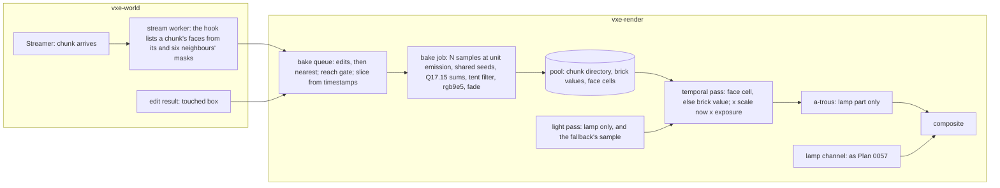

# 0059: Loaded light: a per-chunk store of face and brick values, baked when a chunk loads or
changes

> **Status:** approved (owner, 2026-11-05; starts after Plan 0057's close)
> **Created:** 2026-11-05
> **Milestone:** M2 in [`docs/roadmap.md`](../roadmap.md) (the emissive light behind "dark scenes,
> emissive voxels as the light")
> **Related ADRs:**
> [ADR-0046](../adrs/0046-static-emissive-light-is-baked-per-chunk-when-a-chunk-loads-or-changes.md)
> (proposed; this plan builds it and its close accepts it), which replaces, on the owner's verdict
> in
> Phase 7, the table, fill, preload and guard of
> [ADR-0043](../adrs/0043-emissive-light-from-a-world-space-per-face-table-and-a-lamp-bounce-probe-channel.md),
> and refines
> [ADR-0025](../adrs/0025-light-candidates-from-a-power-over-distance-table-of-near-emitter-chunks.md)
> and
> [ADR-0045](../adrs/0045-the-per-face-table-stores-irradiance-at-unit-emission-and-the-read-applies-the-scale-now.md).
> **Source:** the owner's window of 2026-11-05 (Plan 0057's readings log, Phase 6, on its branch)
> and this design's
> interview of the same day.
> **Starts after:** [Plan
> 0057](0057-steady-light-the-per-face-table-as-the-emissive-store-and-a-lamp-bounce-channel.md)'s
> close (owner, 2026-11-05). The design does not rely on its Phase 7 landing: what this plan takes
> from Phases 1 to 5 is
> the table's fill routine, the keys, the strip tools and the lamp channel, and Phase 1 records
> whether Phase 7's blend
> exists, since this plan's filter is built here either way. Before Plan 0058, whose emission-scale
> phase needs a
> refresh (Followups).

## TL;DR

When the owner walks into a place the light is already there. Each chunk holds its static emissive
light in a
store the renderer owns: one value per face near the camera, six per surface brick out to 12 chunks.
A budgeted GPU
slice computes the values when a chunk becomes bakeable and when an edit changes it, near first,
with samples falling
as distance squared so that every ring costs the same. A pixel reads a value and draws nothing, so
the image cannot
move while nothing moves, and a place not yet looked at is lit like any other. A fresh start bakes
before its first
frame, and a dug hole is lit in the frame it appears. The grain is met with shared random sequences
and a filter run
once at bake, and Phase 1 reads whether that works before anything is built, with a stop rule. The
lamp and its bounce
stay as Plan 0057 built them. The first thing anyone sees is the owner's own Phase 3 window: the
vein and the hall lit
from frame 1. The table is deleted only on the owner's verdict in Phase 7.

## Context & problem

`project-context.md` (Rendering, P0): dark scenes, emissive voxels as the light, stable at arm's
length, denoising that
survives digging. The owner's rules (`LIGHT-FEEDBACK.md`, "What the owner wants"): nothing changes
while nothing
moves; the light settles quickly after a change; the cost matches what is on screen; a stable image
comes first.

**The owner, 2026-11-05 (verbatim, Plan 0057's log, Phase 6):** "there is no flicker nether when i
turn or go
forward/backward. But there is visible visual artifacts on places that I was not looking at when
scene loaded
initially, dark patches on some voxels"; "when I move through caves, I see dark patches everywhere -
it settles
slowly"; "distand caves are too bad"; "preload doesnt really change anything - or it should be much
much bigger. But it
feels like this is wrong way". And of Plan 0056's window: "once light settles it is not flickering
anymore".

ADR-0046's Context holds the readings that decide the direction and answers Plan 0057's four
objections to a fill at
upload. In short: the store idea worked and the view-driven fill did not.

**The arithmetic this plan rests on** (RTX 3080 Laptop and AMD Cezanne, derived from Plan 0057's
readings; every
row a guess until Phase 1 reads it). `S` = samples a second, a frame at 60 fps.

Cost of one surface chunk at the vein's density (6 900 faces, 187 surface bricks), 4.6 ns and about
50 ns a sample:

| Tier | Ring | Samples a chunk | RTX | Cezanne |
|---|---|---|---|---|
| brick level, 64 per brick direction, 2.5 directions a brick | 12 chunks | about 30 000 | 0.14 ms | 1.5 ms |
| face, 32 | 4 chunks | about 224 000 | 1.0 ms | 11 ms |
| face, 128 | 2 chunks | about 896 000 | 4.1 ms | 45 ms |
| face, 512 | 1 chunk | about 3 600 000 | 16.5 ms | 180 ms |

The loader's rate. Chunks entering a ring of radius `r` chunks at `v` chunks a second: `pi r^2 v`,
halved for a surface
share of 0.5. Walking is the fly-through's 3 m/s (30 voxels/s, 0.47 chunks/s) and Shift is the rig's
2 voxels a frame (120
voxels/s, 1.875 chunks/s):

| Ring | Surface chunks/s walking / Shift | Samples/s walking / Shift |
|---|---|---|
| 12, brick | 106 / 424 | 3.2 M / 12.7 M |
| 4, 32 | 11.8 / 47 | 2.65 M / 10.6 M |
| 2, 128 | 2.95 / 11.8 | 2.65 M / 10.6 M |
| 1, 512 | 0.74 / 2.9 | 2.65 M / 10.6 M |
| **sum** | | **11.1 M / 44 M** |

**On the RTX,** walking is 51 ms of GPU a second, **0.85 ms a frame**, under a 1.5 ms slice. Shift
is 3.4 ms a frame
over it: the near-first queue lets the far brick level lag, and a tier lags to the tier under it,
never to dark. **On the
Cezanne** the full set is 9.3 ms a frame at 60 fps. Today it pays 4.2 to 6.9 ms in the light pass
walking at 1280 x 720, so it
gets a 4 ms slice with `N` and the brick samples a quarter: at about 30 fps, 2.4 M samples/s against
2.8 M/s wanted at
that quarter, a close fit. **The light pass's emissive sampling leaves** (0.75 to 1.33 ms on the RTX
in Plan 0057's readings
and window), so the net line moves little.

**The dig** (a 1 m carve, radius 10 voxels): about 3 000 faces with the survivors in its bricks. 32
samples: 96 000, 0.44 ms RTX, 4.8
ms Cezanne, in the frame. Refined to 512 at arm's length: 1.5 M, 7 ms, about five 1.5 ms slices.

**The fresh start** at the vein's density: face rings 7.5 M + 15 M + 30 M samples (2 chunks at 512,
17 at 128, 134 at 32, nested rings
not subtracted) and the brick level within 6 chunks 13.6 M (452 chunks): **about 66 M samples, 0.3 s
RTX, 3.3 s Cezanne, about 0.8 s at its quarter of the samples.**
The brick level from 6 to 12 chunks is another 95 M, in slices: about 290 frames at 1.5 ms, about 5
s at 60 fps, nearest first.

**The grain** by samples, independent seeds, `82 / sqrt(N)` levels rms per face (Plan 0057's
derivation), and through the
3 x 3 tent at 0.375: 32: 14.5, 5.4; 128: 7.2, 2.7; 512: 3.6, 1.36. The p90 of a normal is 1.645 rms:
8.9, 4.5 and 2.2 through the
tent. Shared seeds aim below these and have no reading yet.

**The memory:** about 62 KB a near chunk (2 KB directory, 187 x 24 B brick values, 6 900 x 8 B
cells) and 6.5 KB a far one.
At the rings' residency, with face cells retained to 6 chunks: 452 x 62 KB + 3 167 x 6.5 KB, about
49 MB. A 128 MiB pool leaves
retention room; `nfr.md` section 3's other line is 1.5 GB.

## Decision

Build ADR-0046 in eight phases. Phase 1 is a spike on the table's tree that changes no default.
**The store and the
pre-roll** (Phase 2) make a still bake visible through `--light baked`, and **the owner looks at
it** (Phase 3) before
anything else is built, because Plan 0057 reached its first window after six phases and heard "wrong
way". **The queue and
rings** (Phase 4) light a walked world, **invalidation** (Phase 5) lights a dug one, **budgets and
the default**
(Phase 6) come next, then **the owner's window** (Phase 7), then **the deletion** (Phase 8), of
whichever path lost.

**Of Plan 0057's Phase 7, which its Followups ask this plan to state:** Part A's size and age-out
are moot under a store, and go with the table; Part B's filter is kept in form but runs once at
bake, so its per-frame pass goes; Part C's widening goes, since the brick level is what shows where
a wall is young. **The lamp and the bounce stay as built**: the composite adds the store's value to
the lamp's part and the gather, and the bake never sees them.

We rejected: the view-driven table alone, a larger radius preload, screen-space history, faces only,
per-brick irradiance
with occlusion, a CPU or a split bake, the count alone, emitter-out rays, re-baking whole chunks at
an edit, keeping
the guard, the table as a not-ready cache, and fixed-point shading. The reasons are ADR-0046's.

## Architecture diagram



## Implementation phases

Each phase ships as its own commit. `dev` implements the dev phases in order and stops at each
`human` phase for the
owner's window. The architect reviews once at the end, in a fresh session. Lane rule 9c applies:
exploratory runs on the
RTX 3080 Laptop by `VXE_TEST_ADAPTER=rtx`, labelled; asserted readings on lavapipe. **Tables and
attempts go to
`docs/plans/logs/0059.md`**, from the readings-log template.

**The gates.** Per phase: `node scripts/test-changed.mjs --profile quick`, then `--profile gpu`
under the perf lock, clippy,
fmt. At the tip: `cargo nextest run --workspace --profile gate` under the perf lock, doctests,
clippy, fmt, deny, and the
doc and tier gates. A new test file that opens a device joins `.config/nextest.toml`'s gpu filter.
`soak` and `full` only
if the owner asks.

**Test times.** On lavapipe a hand-built box (`cache_box`) runs 2 to 3 s and the level loads in
about 5 s. A bake's times below
assume a box of under 2 000 faces and test-set sample counts. A test over 30 s is born on the soak
list and named in its phase.

### Phase 1: What a bake reads (the spike)
- **Owner skill:** dev
- **What:** the readings that can overturn the design, on the table's tree, with no default changed.
  A scratch test path fills
  every listed face to `N` samples through Plan 0057's fill routine with a chosen seed form, then
  dumps the cells the way
  `light_strip` does. It lives in `apps/flythrough/tests/bake_spike.rs` and is ignored, a reading.
- **The census** (CPU, no GPU; the level at the vein and the patch, the showcase's hall, the
  streamed cave at the fly-through's
  residency): faces per surface chunk (p50, p99, max) and per surface brick (the same), surface
  share of chunks within 4 and 12
  chunks, the bytes the store would take under ADR-0046's layout, the emitter samples resident at 16
  chunks against the
  reservation of 1 048 576, and the share of faces whose 16 384-sample reference reads 0.
- **The grain.** At the vein's `back` view (Plan 0057 Phase 7's supplementary view), the patch and
  the hall, all faces within 96
  voxels (the census's 98 025, 47 242 and 61 066; 512 samples is at most about 50 M samples, 0.23 s
  RTX), `N` of 32, 128, 512 and 2048, filter on and off, seed arms:
  **independent** per face; **chunk-side**, one sequence per chunk and side; **global-side**, one
  sequence per side for every
  chunk; **lattice**, one sequence offset per face by a low-discrepancy step of its plane
  coordinates. A second seed set for every
  arm. The figures, through the display transform at the pose's fixed exposure (`rigs.rs`'s
  `tone_bytes`):
  - **`G_local`**, p50 and p90 over coplanar neighbour pairs `(f, n)`: `|(D_f - D_n)_A - (D_f -
    D_n)_B| / sqrt 2`, A and B the two
    seed sets. This is the grain the eye sees, with the true gradient cancelled, and it is what
    shared seeds should lower.
  - **`G_seam`**, the same over pairs that cross a chunk border.
  - **`G_patch`**, p90 of `|mean_A - mean_B| / sqrt 2` over 8 x 8 coplanar patches: the slow error
    that shared seeds leave.
  - **The dark share**, faces whose reference is over 1 level and which read 0.
  - Mean bias by decile against a 16 384-sample reference with the deciles' spread beside it.
  - The filter's harm: at a flat wall's shadow edge and a crease in the level, the values across it,
    in levels.
- **The cost.** ns a sample in a separate dispatch of 1 000, 10 000, 100 000, 300 000 and 1 000 000
  samples, on the RTX and the Cezanne,
  at the vein and the hall, with the shadow rays' mean length (Plan 0057 read a floor of about 0.4
  ms for a separate pass at 192 x 108,
  and the 4.6 ns was read inside the light pass near the camera). One read of a CPU sampler over
  `World::raycast` on one worker
  thread, ns a sample, for ADR-0046's Alternative F. A candidate table centred on the job's chunk,
  read against the camera-centred
  one by `G_local` and cost.
- **The stop rule.** The arm kept is the cheapest that meets, at all three poses with the filter on:
  `G_local` p90 at most 2 levels and p50 at
  most 1 at 512; p90 at most 5 at 128 and at most 10 at 32 (the arithmetic's 2.2, 4.5, 8.9, with
  room); and `G_seam` p90 at most 2 at 512.
  Ties go to chunk-side. **Dev stops for an architect amendment, with the tables, if:** no arm meets
  it (independent seeds at 1024
  is then the named fallback, about 1.5 ms a frame walking, the whole slice); the RTX reads over 8
  ns a sample at 300 000 at any pose; p50 faces
  a surface chunk reads over 14 000 at any pose, or the surface share over 0.75; emitter samples at
  16 chunks exceed the reservation; or the CPU
  reads under 100 ns a sample.
- **Files touched:** `apps/flythrough/tests/bake_spike.rs` (new, ignored readings),
  `crates/vxe-render/src/marcher.rs` (a test-only fill entry if the
  routine is not reachable), `crates/vxe-render/src/shaders/` (the seed form as a test-only
  uniform), `.config/nextest.toml`, `docs/plans/logs/0059.md` (new).
- **Done when:**
  1. The log holds the census, the grain figures for every arm, `N` and pose, the cost rows on both
     adapters, whether Phase 7's blend exists on the
     base and which commit, and one line: the arm kept, or stop.
  2. `the_seed_forms_differ_as_named` (lavapipe, `cache_box`, under 5 s) asserts that on a wall lit
     through a slit, with `N` 16: under chunk-side, two coplanar
     faces of a chunk that see the same emitters read closer to each other than under independent
     seeds, by `G_local` measured on the box, the independent
     arm being the failure case.
  3. No default, shader path or golden changed: the gate's goldens pass untouched.

### Phase 2: The store, its read and the pre-roll
- **Owner skill:** dev
- **What:** the store and a bake with no budget: a still scene lit from frame 1 through `--light
  baked`, and nothing else moving. A chunk bakes only by
  `Frame::bake_until`, so a walk leaves its area; Phase 4 fixes that.
- **The list.** A function of a chunk's opaque masks and its six neighbours' borders gives each
  surface brick's sorted face keys and per-direction counts.
  It runs on the stream workers through ADR-0017's hook, declared in `vxe-world` and implemented in
  `vxe-render`, the result opaque to the world, with
  the same inline path if a prepared result is missing; an equality test guards the two.
- **The pool.** One storage buffer (`Lighting::bake_pool_bytes`, 128 MiB), allocated in chunk blocks
  by a free list on the render thread. A window-indexed
  table gives a chunk's block; the block holds a 512-entry directory (a `u32` per brick: run offset
  and face count, 0 for no surface), then each surface brick's
  six values (24 B) and its run of cells (8 B each, sorted by key). `BRICK_FACES_MAX` is 512 (a
  guess that Phase 1's census sets).
  The light pipeline's storage bindings are full (Plan 0057's resume notes), so the job and the read
  bind the pool where they have room, or it shares a binding with
  the table's buffer; dev says which in the log.
- **The bake job.** Phase 1's kept seed form, unit emission, the candidate table per job (ADR-0025's
  weights about the job chunk's box, every emitter chunk within
  `light_radius` of it, up to its 1024 entries) and the window `(1 - (d / L)^4)^2` on each sample,
  `L` being `light_radius` in voxels from the face. Q17.15 sums in a
  transient buffer (`16 B x BAKE_BATCH_FACES`, 65 536 faces, 1 MiB; a larger job runs in batches).
  Then the tent: 3 x 3, the kernel of Plan 0057's Part B (same axis and sign, the coplanar
  voxel first, then a voxel toward the air, then one into the rock, stepped neighbours at half
  weight, no material test), across the job's cells, a brick's run and a neighbour chunk's stored
  values
  at border faces. Then `rgb9e5`, and the brick's direction values as each direction's face mean, or
  for a brick-level job from its own samples. The dominant material is the emitter of the face's
  largest single sample.
- **The read.** With `Lighting::light` at `Baked`, the temporal pass reads a cacheable hit's cell by
  chunk, directory and a binary search of the run; else its brick's direction value, interpolated
  across the same-side
  values of neighbouring bricks; else 0. It multiplies by the dominant material's scale (the brick's
  first dominant material at the brick level) and the exposure. The light pass draws no emissive
  sample and casts no emissive shadow ray for a cube face. A no-face hit keeps
  the fallback. `--light baked|table` (or a toggle key at the owner's request) shows in the banner
  and HUD with `store <chunks> <MB>`.
- **Pre-roll.** `Frame::bake_until(center, BakeReach)`, no budget, batches submitted and waited on,
  prints progress through a callback. The fly-through calls it before its first frame under `--light
  baked`, with a stdout line.
- **Files touched:** `crates/vxe-render/src/bake.rs` (new), `shaders/bake.wgsl` (new),
  `shaders/temporal.wgsl`, `light.wgsl`, `march.wgsl`, `marcher.rs`, `gpu_world.rs`, `lib.rs`,
  `crates/vxe-world/src/stream.rs` (the hook), `apps/flythrough/src/main.rs`, `hud.rs`,
  `apps/flythrough/tests/bake.rs` (new), `.config/nextest.toml`, `docs/plans/logs/0059.md`.
- **Done when:**
  1. `every_exposed_face_has_one_key` (no GPU, under 1 s): a seeded mixed chunk with seeded
     neighbours lists exactly the faces a brute-force scan finds toward a non-opaque voxel, across
     borders, each once, sorted, and the prepared list equals the inline one.
  2. `a_bake_does_not_depend_on_its_slicing_or_order` (lavapipe, under 10 s): `cache_box` baked at
     64 samples in one batch, in batches of 7 faces, and with its jobs reversed reads bit-identical
     cells and brick values.
  3. `a_wall_reads_its_analytic_light` (lavapipe, under 5 s): an unoccluded wall under one emitter
     at 1024 samples, filter off, reads within 3 % of the closed form on every face (ADR-0025's box
     figure was 2.9 % over a 64-frame mean), and at twice `light_radius` from the emitter reads 0.
  4. `a_baked_view_is_final_on_its_first_frame` (lavapipe, under 5 s, scale 1, no jitter, lamp off):
     after `bake_until`, frame 1 and frame 64 are bit-identical, frame 1's emissive equals the
     cell's value times the exposure within one `f16` step, and the light pass reports 0 emissive
     samples.
  5. `the_filter_stops_at_a_crease_and_softens_a_shadow_by_one_face` (lavapipe, under 5 s; Plan
     0057's arithmetic): an unlit wall's row along an L crease reads exactly 0, and on a flat wall
     half under a slab the face two from the edge on the dark side reads exactly 0 and the face
     beside the edge between 0.15 and 0.35 of the lit face beside it.
  6. `a_face_with_no_cell_reads_its_brick` (lavapipe, under 5 s): a lit wall with its cells dropped
     by a test hook reads within 4 levels of the mean of the same faces' cells, the wall's pixels
     non-zero.
  7. **A strip:** `light_strip` (ignored, a reading) at the vein, its `back` view and the hall at
     the window's size, FSR 2 and native, baked, beside the table's frame 1 and frame 4096 of the
     same base: the share within 1, 2 and 4 levels of the table's 4096, `G_plane`, the dark shares,
     the pre-roll's seconds on both adapters, and the frame's passes at rest. The temporal pass's
     cost against the table's at the window's size is a reading, with the bar at Phase 6.
  8. `the_banner_names_the_light` (`hud.rs`, no GPU, under 1 s).

### Phase 3: The owner's look at a still bake
- **Owner skill:** human
- **What:** a short window on Phase 2's tree before any scheduling is built: `--light baked` at the
  vein, the patch and the hall, from a fresh start, standing and turning, with `--light table`
  beside it, the orchestrator running it with stdout visible and pinging when ready. The lamp on and
  off. No walk beyond the baked area and no dig: the HUD says so.
- **Files touched:** this plan's log.
- **Done when:** the log records the owner's words on: (a) grain at rest; (b) dark patches; (c) the
  brick level beyond 4 chunks against face cells ("Lego" or not), and whether the ring should move;
  (d) the filter's softening, shadows and a pit; (e) the wait at the fresh start; (f) whether to go
  on. A "no" on (f), or a look fault, comes to the architect with the words before Phase 4.

### Phase 4: The queue, the rings and the reach gate
- **Owner skill:** dev
- **What:** a walked world stays lit: the scheduler of ADR-0046, nothing yet for edits.
- **The queue,** on the render thread: a chunk bakes only when every chunk within `light_radius` of
  it is mirrored or known empty. Its order: edits (Phase 5), then distance to the camera, ties by
  forward direction then by coordinate. Each chunk has a tier from its ring (12 brick, 4 / 2 / 1
  face at 32, 128, 512; the rings a `Lighting` setting), and a job replaces a lower tier from
  scratch. Tier-ups are enqueued when the camera crosses a ring, and a chunk leaving a ring keeps
  what it holds.
- **The slice.** `Lighting::bake_slice_ms` (1.5 by default; 4 with `BakeProfile::Low`, where `N` and
  the brick samples are a quarter, on `--adapter` Radeon by default): samples this frame are the
  last frames' ns a sample into the slice, from the bake's timestamp. Without timestamps, or in a
  test, a fixed `bake_samples_per_frame`. An idle queue dispatches nothing.
- **The fade.** A job's values are written to the transient buffer's final form and copied over
  `FADE` 16 frames by a lerp in the pool, in the job's dispatch; a first value for a face and
  anything under `bake_until` is written directly. The move from brick level to face cell uses the
  same fade, by a per-chunk counter the read mixes with.
- **Eviction.** The pool's free list under pressure drops the farthest chunk's cells to its brick
  level, then a chunk beyond 12 altogether; a bake for a nearer chunk always finds room. A chunk
  leaving the mirror frees its block. Nothing else drops values, so walking back finds them.
- **Emitter ranges** (ADR-0025): ranges are held within bake radius plus `light_radius`, up to the
  reservation, by the existing nearest-first writes, and every job's table is written from ranges
  that exist: a job waits rather than baking against a missing range. The extraction is re-read
  against its budget.
- **Readings:** the rig's flight (`settle.rs`, Plan 0057's `light_table` paths) at 30 and 120
  voxels/s at the vein, the patch, the hall and the streamed cave, per second: jobs, samples, queue
  depth by ring, the slice's ms; per frame, the share of pixels at a face cell of each tier, the
  brick level and no value, by ring.
- **Files touched:** `crates/vxe-render/src/bake.rs`, `shaders/bake.wgsl`, `shaders/temporal.wgsl`,
  `gpu_world.rs`, `marcher.rs`, `lib.rs`, `apps/flythrough/src/main.rs`, `hud.rs`,
  `apps/flythrough/tests/bake.rs`, `settle.rs`, `support/settle.rs`, `upscale.rs`,
  `docs/plans/logs/0059.md`.
- **Done when:**
  1. `a_chunk_waits_for_its_reach` (lavapipe, under 10 s): a chunk whose reach holds an emitter in a
     chunk not yet mirrored is not baked; after the chunk arrives it is, and its wall reads the
     emitter's light within 3 % of a bake where both were present from the start, and the value is
     bit-identical to it.
  2. `the_queue_runs_near_first_and_within_its_samples` (no GPU where the scheduler allows, under 1
     s): over a scripted ring of chunks, jobs emit by distance, each frame's samples stay at or
     under `bake_samples_per_frame` but for one batch's overrun, and an idle queue emits nothing.
  3. `a_tier_up_fades_and_ends_still` (lavapipe, under 10 s): moving a camera across a ring re-bakes
     at the higher tier, each face moves at most `|new - old| / FADE` a frame plus one `rgb9e5`
     step, and 32 frames after the last job two frames read bit-identical.
  4. `a_full_pool_drops_the_farthest_first` (lavapipe, under 10 s): a pool of a test size over-asked
     keeps the near chunk's cells, drops the farthest's to the brick level, and reports both in the
     HUD's counters.
  5. `walking_back_finds_its_light` (lavapipe, under 15 s): a camera moved away and back over a pool
     with room causes 0 new jobs for chunks it left within the pool's retention.
  6. **On the RTX, readings against bars:** at 30 voxels/s over 180 voxels at the vein and the patch
     (Plan 0057's `flight_path`), in every frame, **no pixel with a hit within 256 voxels has no
     value**, **the share of pixels whose hit is within 64 voxels and at a face cell of at least 128
     samples is at least 0.99**, and **the dark share (over 8 levels darker than the settled frame)
     of hits beyond 64 voxels is at most 0.01** (Plan 0057's rows, frame 1: 0.4389 under FSR 2,
     frame 64: 0.0180). The slice's mean is at most 1.5 ms. At 120 voxels/s the same rows are read,
     not barred. A miss comes to the architect with the queue's depth.
  7. `frame_bytes` in `upscale.rs` asserts the base's figure plus `bake_pool_bytes` plus the working
     buffer (1 MiB) plus the chunk table's, the arithmetic in its comment, under 5 s, while `--light
     table` allocates a minimal pool.

### Phase 5: Invalidation, the dug hole
- **Owner skill:** dev
- **What:** the three rings of ADR-0046, driven by the box `Frame::invalidate` receives.
- **Ring 1,** the box dilated by one voxel. In the frame the mirror receives the edit, ahead of the
  temporal pass: a brick's run is relisted (surviving keys keep their value until replaced) and
  baked at 32 samples within a per-frame cap of `BAKE_EDIT_SAMPLES` (400 000 RTX, about 1.8 ms, on
  top of the slice in that frame only, a tenth of it on `BakeProfile::Low`; a guess). What the cap
  postpones is first in the queue and reads the brick's old direction value. Then the ring's tier at
  edit priority. A face with no value takes its first value directly, without the fade.
- **Ring 2,** bricks within 32 voxels of the box: at the ring's tier, at edit priority, fading in.
- **Ring 3,** bricks within `light_radius` of the box: at low priority, at the ring's tier (or brick
  level), only if the touched bricks' direction values read above 0 before or after the edit, or the
  box's material counts include an emitter.
- **Dedup and coalescing.** Per chunk a 512-bit dirty mask and a generation: a re-dirtied brick
  restarts its job, and a job for a stale generation throws its result away. `MAX_EDITS` no longer
  matters to this store. A collapse's `drop_region` and `remove_region` arrive as boxes through the
  same path: one per tick.
- **A scale change** moves nothing: a test defends it. A material swap that adds or removes an
  emitter opens ring 3 and updates the emitter lists as today.
- **Files touched:** `crates/vxe-render/src/bake.rs`, `shaders/bake.wgsl`, `gpu_world.rs`,
  `marcher.rs`, `apps/flythrough/tests/bake.rs`, `settle.rs`, `support/settle.rs`, `strip.rs`,
  `docs/plans/logs/0059.md`.
- **Done when:**
  1. `a_dug_hole_is_lit_on_its_first_frame` (lavapipe, under 15 s, a test-set samples per frame,
     scale 1, lamp off; a lit wall, a radius 3 carve): on the first frame the hole is on screen,
     every pixel whose settled value is over 1 level reads over 0, and the hole's faces' p90
     distance to their settled values is at most 10 levels (32 through the tent: 8.9); by frame +16,
     at most 3 levels (512: 2.2).
  2. `a_postponed_face_reads_its_bricks_old_light` (lavapipe, under 10 s, the cap at 1 sample): the
     new faces read their brick's direction value from before the edit, within 4 levels of it, and
     no pixel in the box reads 0 where the value was over 1 level.
  3. `a_break_through_reaches_the_far_wall` (lavapipe, under 15 s): a wall between an emitter and a
     far room: after carving a window in it, the far wall facing the window reads within 10 % of a
     fresh bake within the frames its samples need (the test states them), and the plug put back
     returns it to within 1 level of 0.
  4. `a_dark_carve_opens_no_reach` (lavapipe, under 10 s): a carve in rock no emitter reaches queues
     rings 1 and 2 only.
  5. `an_emitter_dug_away_darkens_what_it_lit` (lavapipe, under 15 s): removing the box's one
     emitter brings its wall under 1 level within the frames ring 3 needs at the test's samples.
  6. `a_scale_change_moves_no_bake` (lavapipe, under 10 s): `Frame::set_emission_scales` at 0.5
     halves a lit wall's displayed irradiance on that frame, within one `rgb9e5` step before the
     display, and the queue stays empty and the cells unchanged; a material at 0 at bake time reads
     its light when raised.
  7. `a_falling_slab_bakes_only_what_it_touched` (lavapipe, under 15 s): a `drop_region` over 8
     ticks, the bricks baked are within the rings of its boxes, no brick is baked twice for one
     generation, and 32 frames after the last tick two frames read bit-identical.
  8. **The owner's test on the RTX, readings against bars** (the rig's dig at `VEIN_POSE`, Plan
     0057's 5-voxel dig and the dig at 100 voxels, scale 1, lamp off): **`Q90` (Plan 0057's
     stop-moving figure) at most 16 frames at arm's length and at most 30 at 100 voxels**, against
     that plan's bars of 60 and 120; **`S90` and the travel after the stop** beside it; the frame's
     lighting ms on the dig frame and the next 16. The B strip (Plan 0057 Part 0's four presses, the
     fly-through's bench): the carved region's share within 2 levels of +256 at +1, +4, +16, +64,
     against that plan's before rows (0.8317 and 0.9814 at +1 and +4 native at the vein), and the
     whole frame's jobs and seconds to an empty queue. Read, not barred.

### Phase 6: Budgets, the default and the end strip
- **Owner skill:** dev
- **What:** both adapters read and `--light baked` made the default, goldens re-blessed once on
  lavapipe with their pixel difference in the log. `--light table` stays for the window.
- **Files touched:** `crates/vxe-render/src/lib.rs`, `apps/flythrough/src/main.rs`,
  `apps/flythrough/examples/hero.rs`, the golden baselines, `apps/flythrough/tests/*` that assert
  the default, `docs/plans/logs/0059.md`, `docs/nfr/02-frame-budget.md`, `docs/nfr/03-memory.md`,
  `docs/nfr.md`.
- **Done when:**
  1. The Budgets rows below are read with machine, commit and load. **The bars on the RTX at the
     window's size:** the slice's mean at most 1.5 ms walking; at rest with an empty queue the
     bake's slot at most 0.02 ms and two frames bit-identical at scale 1; the temporal pass within
     0.1 ms of the table's; the lighting line (light, gradient, probes, gather, bake) at or under
     the table's in the same run at rest and walking. **On the Cezanne:** the lighting line under
     `docs/nfr.md`'s 6.0 ms, or the reading names what is over.
  2. The still image holds: Plan 0057's still bars read at baked (the hall native one-frame mean at
     most 0.005, no pixel over 8 levels), and `the_fast_yaw_excess_by_table_read`'s row beside the
     table's.
  3. The dark shares and `G_plane` from Phase 2's strip are re-read on the tip with the window's
     path, and the adapter difference is read once: the vein strip's cells on the RTX against the
     Cezanne, the mean and p99 in levels (the target is under 1 level mean, a reading).
  4. Residency p95 is re-read under motion (owed since `docs/nfr.md` section 5's note of 2026-11-04)
     at the fly-through's default, and the worker hook's list time per chunk beside it. Any
     regression over 500 ms comes to the architect.

### Phase 7: The owner's window
- **Owner skill:** human
- **What:** the orchestrator's runner on Phase 6's tip, with `--light table` and stdout visible, and
  the strips at hand; a ping when ready. Vein, patch and hall from a fresh start, then a walk in and
  out of a place not yet seen, then a dig at each, then the fast turn.
- **Files touched:** this plan's log.
- **Done when:** the log records the owner's words, with the HUD in view, on: (a) "already there":
  at a fresh start and on walking into a place not yet seen; (b) dark patches and the distant caves;
  (c) grain at rest, on a turn and while walking; (d) anything moving at rest, and any tier change
  seen while walking or standing; (e) the dug hole at arm's length and at range, the `B` presses,
  and a dug break-through; (f) the brick level at range, the ring's place, seams at chunk borders;
  (g) the lamp and bounce over the bake; (h) the fresh start's wait on both adapters; (i) **the
  verdict: baked or table.** A "no" names the step and goes to the architect.

### Phase 8: The deletion
- **Owner skill:** dev
- **What:** the path that lost goes. **On "baked":** the table, its fill, the preload, the guard's
  re-shade of cells, the sweep, the age-out, Phase 7's table size and the blend pass, `--light`, the
  cell's test rigs, and every test that asserted them, named in the log. `frame_bytes` falls by the
  table. The gradient pass's lamp lambda stays. **On "table":** the store and bake, the hook,
  `--light` and this plan's tests go, Phase 1's readings stay in the log, and ADR-0046 is marked
  superseded by an architect amendment.
- **Files touched:** `crates/vxe-render/src/marcher.rs`, `bake.rs`, `lib.rs`, `shaders/`
  (`cache_fill.wgsl`, `cache_clear.wgsl`, `cache_sweep.wgsl`, `gradient.wgsl`, `light.wgsl`,
  `temporal.wgsl`, `march.wgsl`), `apps/flythrough/src/main.rs`, `hud.rs`,
  `apps/flythrough/tests/*`, `upscale.rs`, `look.rs`, `.config/nextest.toml`,
  `docs/plans/logs/0059.md`.
- **Done when:**
  1. `cargo build` has no dead `Lighting` field and the flags that went are refused with a message
     naming this plan's number (`hud.rs`, no GPU, under 1 s).
  2. `frame_bytes` asserts the base less the table plus the store, and the log prints the figure
     against `docs/nfr.md` section 3's 1.5 GB.
  3. The gate's test count in the log names each test removed and each re-pointed. The still-image
     and dig bars of Phases 5 and 6 are re-read on the tip, within their bars.

## Data shapes

Illustrative; dev records the final layout in the log.

```rust
// A chunk's block in the pool. Offsets are in u32 words from the block's start.
struct ChunkLightBlock {
    directory: [u32; 512], // (run_offset << 10) | face_count; 0 = no surface in the brick
    // per surface brick, at run_offset:
    //   direction_values: [u32; 6]  rgb9e5, side order +x -x +y -y +z -z
    //   cells: [FaceCell; face_count], sorted by key; absent at the brick level
}

#[repr(C)]
struct FaceCell {
    rgb: u32,  // rgb9e5, irradiance at unit emission, albedo divided out
    tail: u32, // key: 12 (voxel 9, side 3) | flags: 4 | dominant emitter material: 16
}
```

**The stored error:** `rgb9e5` steps by about 0.2 to 0.4 % of a value, at most about 0.36 of a
display level at level 200 through the 2.2 encode, arithmetic: under `STILL_LEVEL`.

## Budgets

| `docs/nfr.md` figure | Today | Expected (a guess until read) | How the close measures it |
|---|---|---|---|
| §2 lighting line 6.0 ms | RTX in the window: light 1.33 to 3.18, gradient 0.00 to 0.17, preload 0.00 to 0.04; Cezanne walking at 1280 x 720: light 4.2 to 6.9 | RTX: slice mean at most 1.5 walking, lamp pass about 0.11 (Plan 0051), gradient as lamp only. Cezanne: 4 ms slice at a quarter's samples plus about 0.3 | `cost` rows in `settle.rs` on both adapters at rest, walking and Shift, quiet where the machine allows; Phase 6 done-when 1; `docs/nfr/02-frame-budget.md` |
| §2 denoise line 3.0 ms (the temporal pass's read) | The table's read at the window's size | Within 0.1 ms of it: a directory read and at most about six in a run of 34 faces | The same rows |
| §2 streaming line 1.0 ms (a recorded miss) | p50 about 5 ms over a flight | Adds under about 25 KB a frame of copies walking (1.4 MB/s: face chunks 12/s x 62 KB, brick chunks 106/s x 6.5 KB), and the free list. Listing on workers | The autopilot's streaming CPU, the worker hook's list time per chunk; Phase 6 done-when 4 |
| §3 everything else in VRAM, 1.5 GB | About 274 MB with the table at 2^22 (Plan 0057's Budgets) | Between phases + 134 217 728 B pool + 1 048 576 B working + the chunk table; at Phase 8 - 201 326 592 B (the table, at the size Plan 0057 closes with): about 208 MB. Use inside the pool about 49 MB at the vein's density | `frame_bytes` in `upscale.rs` asserted; HUD `store`; `docs/nfr/03-memory.md` |
| §5 residency p95, 500 ms | Last read at Plan 0023, 188 to 403 ms; owed | No regression: the bake never delays a chunk's mirror | Phase 6 done-when 4 |
| Light sample buffer | 16 B x 1 048 576, peak 18 522 within 4 chunks | Up to about 997 740 at 16 chunks (ADR-0025's streamed reading) | Phase 1's census; Phase 4's readings |

## Risks & open questions

- **Shared seeds might not beat their seam.** Phase 1's stop rule; independent seeds at 1024 are the
  fallback and Phase 4's slice then needs a re-read.
- **The 4.6 ns may not hold.** It was read inside the light pass near the camera, with a
  camera-centred table and short rays. A far job's rays may be longer, and a separate dispatch has a
  floor. Phase 1's cost row is a stop rule, and the rings are settings.
- **The brick level may look blocky.** Interpolation helps, and the owner sees it in Phase 3 before
  the queue exists, when moving the ring is a one-line change. The cost: ring 6 at 32 samples is
  2.25 times ring 4's.
- **Faces lit through a gap cost as many samples as bright ones,** and so do the unlit, a share
  Phase 1 reads. An early out on a brick whose 32-sample tier found nothing would save its later
  tiers. It is a Followup, because it can miss a face lit on one sample in 32 about 36 % of the time
  at 32 samples (`(1 - 1/32)^32`).
- **Fading vs nothing moves.** A tier change moves a still face for 16 frames. Tier changes happen
  when the camera crosses a ring and so only after motion, with one exception: a queue still behind
  when the camera stops. The queue empties in seconds on the RTX, and the owner judges it in Phase 7
  (d).
- **GPU feature limits.** The pool is one binding: 128 MiB is at `wgpu::Limits::default`'s
  `max_storage_buffer_binding_size`, and `limits_within` already asks for more for the table. No new
  feature is needed. `rgb9e5` is arithmetic in the shader, not a storage format.
- **Threading.** The hook runs on workers and reads a chunk's and six neighbours' masks through the
  existing per-chunk locks, read-only; the render thread stays the only owner of the pool and the
  queue (ADR-0017). A prepared list stale by an edit is thrown away by the chunk's generation.
- **Long jobs on the slow adapter.** The slice caps dispatch sizes, so the driver's watchdog sees
  small dispatches. The pre-roll's batches are also capped: `BAKE_BATCH_FACES` at a low `N` and
  submitted separately, with a wait between.
- **Determinism.** Asserted within an adapter, read across. A bake's input includes emitter ranges
  and their order, which must be sorted by coordinate; the slicing test defends it. `vxe-world`
  gains a hook type and nothing that reads the result.
- **Plan 0058.** Its emission-scale phase reads a cell's kept emitter. This plan's Phase 5 already
  makes the scale work through the dominant material. See Followups.

## What this plan does NOT do

- Dynamic or moving emitters in the store. They are ADR-0044's list, Plan 0058.
- Bounce from emitters. ADR-0043's lamp channel stays lamp-only; the per-source bounce is
  `docs/backlog.md`'s.
- Bake to disk or across runs, or per-frame refinement past a ring's tier. A still face stops at its
  tier.
- A per-emitter delta on an emission add. An edit opens ring 3.
- LOD or far-field light beyond the bake radius, and sky light (Plan 0032).
- Change the upscaler, the exposure or the far normal (Plan 0056's owed plan).
- Move the rings by adapter speed beyond the one `BakeProfile::Low`. The settings surface is
  `docs/backlog.md`'s.
- Entities shadowing the bake (M6).

## Implementation log

> Written by `dev`: one row per phase as its commit lands, then the close block. **The phases above
> are the contract.
> This section records what happened.** Observations, never conclusions: no pass list, no
> self-assessment. Deviations and
> unmet done-whens are **always** disclosed. Keep it shorter than `## Implementation phases`.
> Readings, gate counts,
> attempts, sweeps and resume notes go to the plan's readings log, `docs/plans/logs/0059.md`,
> started from
> `templates/readings-log.md`.

| phase | owner | state | commit |
|---|---|---|---|
| 1: What a bake reads (the spike) | dev | not started | |
| 2: The store, its read and the pre-roll | dev | not started | |
| 3: The owner's look at a still bake | human | not started | |
| 4: The queue, the rings and the reach gate | dev | not started | |
| 5: Invalidation, the dug hole | dev | not started | |
| 6: Budgets, the default and the end strip | dev | not started | |
| 7: The owner's window | human | not started | |
| 8: The deletion | dev | not started | |

### Notes

_(Deviations from the plan, with the commit, stated without justification. Done-whens not
satisfiable as stated, and what
was done instead. Followups noticed and not acted on. One line each. Empty is fine.)_

### Close triggers

_(Facts for the architect. No recommendations, and no suggested version bump.)_

- **What shipped:** feature / fix-only / docs-chore-only
- **Public API changed:** types, traits, functions, shader interfaces, config (list them, or none)
- **Budget readings:** each `nfr.md` figure touched, with its measured value, machine and commit
- **Gate at the tip:** the commands run (build, nextest, doctests, clippy, fmt, deny), exit codes,
  test counts
- **Outstanding `human` phases:** which, or none

## Followups

- **Plan 0058's refresh** (architect, at this plan's Phase 8 on "baked"): its emission-scale phase
  and ADR-0045's kept emitter become the dominant material of this plan. Its analytic lights stand.
- **ADR-0043's Outcome and supersession,** at this plan's close, on "baked": the table, fill,
  preload and guard, with the lamp channel, the nearest read and the empty screen history kept.
- **A brick-level early out** for faces unlit at a low tier, if Phase 1's unlit share is large and
  the slice is short.
- **A cone from the box for ring 3,** if the owner sees far re-bakes starve near ones while digging
  repeatedly.
- **The light pass's lamp-only reduction,** and whether the gradient pass needs its emissive parts
  at all under a store: dev removes what a deletion leaves dead in Phase 8; anything larger is Plan
  0044's.
