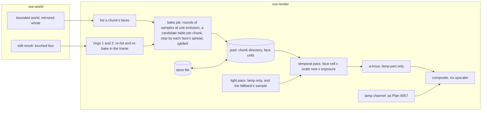

# 0059: Loaded light: a per-chunk store of face values, a reference with no budget first, then cuts by eye

> **Status:** in-progress (owner's go 2026-11-05; amended 2026-11-05 to look first, cut later; amended 2026-11-05
> (owner) to a bounded piece and the stop's submits after Phase 1's stop rule)
> **Created:** 2026-11-05
> **Milestone:** M2 in [`docs/roadmap.md`](../roadmap.md) (the emissive light behind "dark scenes,
> emissive voxels as the light")
> **Related ADRs:**
> [ADR-0046](../adrs/0046-static-emissive-light-is-baked-per-chunk-when-a-chunk-loads-or-changes.md)
> (proposed; this plan builds it and its close accepts it), which replaces, on the owner's verdict
> in Phase 13, the table, fill, preload and guard of
> [ADR-0043](../adrs/0043-emissive-light-from-a-world-space-per-face-table-and-a-lamp-bounce-probe-channel.md),
> and refines
> [ADR-0025](../adrs/0025-light-candidates-from-a-power-over-distance-table-of-near-emitter-chunks.md)
> and
> [ADR-0045](../adrs/0045-the-per-face-table-stores-irradiance-at-unit-emission-and-the-read-applies-the-scale-now.md).
> **Source:** the owner's windows of 2026-11-05 (`docs/plans/logs/0057.md`, Phases 6 and 8)
> and this design's interview of the same day.
> **Starts after:** [Plan
> 0057](done/0057-steady-light-the-per-face-table-as-the-emissive-store-and-a-lamp-bounce-channel.md)'s
> close. Before Plan 0058, whose emission-scale phase needs a refresh (Followups).
>
> **Amended 2026-11-05 (architect, for the owner), the order.** The owner, after Plan 0057's second
> window: "what if we go differently - no matter performance, but build something that would look
> really polished, then we will see where we can cut performance?", and on its scope: "agreed, only
> light. antializing next". The first thing built is now a reference with no budget, and the owner
> judges it before any budget work starts. The old Phases 1 to 8 are Phases 4 to 14, re-cut around
> that; everything after Phase 3 is provisional and the architect re-reads it at the verdict.

> **Amended 2026-11-05 (architect, for the owner), glass at rest.** The owner asked that Phase 3's window look at glass at
> rest. A translucent hit has no face, so it keeps the fallback, and on 299b5c8 a fallback whose accumulation holds
> bit-identical still reads 51.10 composite patches a step at the patch pose, with every hit a fallback (`docs/backlog.md`,
> "A held fallback still moves on screen"). The reference's two worlds hold no glass: its only row is the castle's, and
> `--reference` refuses the streamed world the castle lives in. So Phase 2 gains a key that places a pane, and Phase 3 a step.

> **Amended 2026-11-05 (architect, for the owner), an early look.** The owner asked to see the light sooner, so Phase 1b puts
> Phase 1's bake in a window before the whole-world work starts. It is a first look, not Phase 3's verdict.

> **Amended 2026-11-05 (owner), a bounded piece and the stop's submits.** Phase 1's stop rule fired (`logs/0059.md`,
> Phase 1). The kept arm (32 candidates, clamp off) meets the `G_noise` bars at all four views at 65 536 samples, but the
> census read the level at 21 316 662 faces (surface share 0.990, not 0.5) and a sample costs 36 to 64 ns in its own
> dispatch (not 4.6), so a whole level projects at about 15 h on the RTX. The stop's own path ran at 310 ns a sample,
> because a chunk's last faces took one waited submit a round. The owner's answers, verbatim: on the reference, "Bounded
> piece, bars kept"; on Phase 1b, "Fix submits, radius 1". So the bars, `BAKE_SE`, `N_MIN`, `N_MAX` and the kept arm
> stand. The reference becomes a baked piece of the world around each of the window's poses, not a whole world (TL;DR,
> Context, Decision, Phases 1b to 3). A new dev Phase 1a makes the stop's submits efficient before 1b, and 1b runs at
> `--bake-radius 1`. Part 2 is unchanged, and its numbers (4.6 ns, the share of 0.5) are re-read at the verdict as before.
>
> **Phase 1's departures, ruled (architect).** Each is accepted as the Notes state it. (1) The deepest count is 65 536,
> and the reference is the mean of a view's four 65 536 runs: the bars compare seed with seed and never read the
> reference, and the clamp's bias is a paired difference against it. (2) The clamp arms reuse the unclamped arms'
> samples, which gives a paired difference, tighter than separate runs. (3) The zero share is read on the views' faces,
> since no phase bakes a whole world now. (4) The stop was read at the vein only: Phase 1a reads it there again, and
> Phase 2 reads it at every view. (5) The pool is clamped to 220 MiB: a radius-2 piece takes under 10 MB, and even the
> whole level's 177 MB fits. (6) The running sums, the stop and the packing run on the CPU in f64, which Phase 1a may
> change under its rule. (7) `--light baked` is refused without `--level` or `--source showcase`, and Phase 8 lifts that.

## TL;DR

Build the light as it should look before asking what it costs. **The reference** bakes every face
of every chunk in a bounded piece of the world around each of the window's poses, before the first
frame, until each face's own noise is under half a display level, however long that takes. (A
whole level would take about 15 h on the RTX, by Phase 1's census.) It renders at native resolution with full-resolution
lighting and no FSR 2. A pixel reads its face's value and draws nothing, so moving fast cannot
outrun the light and nothing moves at rest. A dug hole is re-baked in the frame it appears, at a
hitch nobody budgets. **The owner judges that in the window (Phase 3) before anything else is
built.** After the verdict comes antialiasing, in its own plan, and then cuts, one at a time:
samples, reach, resolution, each read against the reference and each shown to the owner beside it.
The queue, the rings and the budgets of the first draft are what the cuts are expected to need, and
they are built only once a cut asks for them. The table stays the default until Phase 12, and is
deleted only on the owner's verdict in Phase 13. The lamp and its bounce stay as Plan 0057 built them.

## Context & problem

`project-context.md` (Rendering, P0): dark scenes, emissive voxels as the light, stable at arm's
length, denoising that survives digging. The owner's rules (`LIGHT-FEEDBACK.md`, "What the owner
wants"): nothing changes while nothing moves; the light settles quickly after a change; the cost
matches what is on screen; a stable image comes first. **For this reference the owner has set
performance aside until after the verdict.**

**The owner, first window, 2026-11-05 (verbatim, `docs/plans/logs/0057.md`, Phase 6):** "there
is no flicker nether when i turn or go forward/backward. But there is visible visual artifacts on
places that I was not looking at when scene loaded initially, dark patches on some voxels"; "when I
move through caves, I see dark patches everywhere - it settles slowly"; "distand caves are too bad";
"preload doesnt really change anything - or it should be much much bigger. But it feels like this is
wrong way". And of Plan 0056's window: "once light settles it is not flickering anymore".

**The owner, second window, on the table's fix pass (verbatim, Phase 8):** the hall: "fast turn still
has artifacts, but better"; the old binary: "old is very bad, a lot of bark spots everywhere"; the
vein: "quite a few of dark patches when moving fast, but it seems they are gone after stabilization";
the patch: "maybe a little better"; the distant caves: "yess same problem with dark patches on distant
caves when moving fast"; `B` at the vein: "same, maybe a bit faster"; the hall with preload and `B`:
"mostly same, distant parts are with dark patches".

ADR-0046's Context holds the readings that decide the direction. In short: the store idea worked and
the view-driven fill did not.

**Why the sample count is the reference's first question.** The first draft priced grain as `82 /
sqrt(N)` display levels rms a face, whatever its brightness, so 4096 samples reads 1.3. That holds in
the hall and not beside emitters. Plan 0057's end readings at frame 4096, with every face at the
4096 cap (`logs/0057.md`, Phase 7, `G_noise` p50 / p90, blend off, "before" rows):

| Row | `G_noise` at 4096 samples | p90 at most 1 level needs, by `1 / sqrt(N)` |
|---|---|---|
| hall, native | 0.91 / 2.92 | about 35 000 samples |
| vein, native | 3.18 / 13.78 | about 780 000 samples |

Its fresh runs at the vein differ face by face by a constant (max 7 levels native), and done-when 5's
first frame missed at any pool with the blend on or off: dev's reading, untested, is estimator variance
beside the emitters. **No fixed count fits both**: 780 000 samples on every face is about 11 hours, so
the reference stops each face by its own spread (below), and Phase 1 reads whether that is enough
before the whole world is baked. The light pass's sampler also clamps a sample's luminance at `2 PI
lum(Le)` (`FIREFLY_CLAMP`, `light.wgsl`), which biases faces beside an emitter dark and exists to spare a
history from a firefly. A bake has no history, so Phase 1 reads it off.

**The reference's arithmetic** (Phase 1's readings, RTX 3080 Laptop at 5bb8c11, `logs/0059.md`; the
first draft's 4.6 ns a sample and surface share of 0.5 are refuted). At the kept arm a sample costs 36
to 64 ns in its own dispatch. Its shadow rays run 141 to 161 voxels on the level and 275 in the
showcase. The stop spends about 60 954 samples a face at the vein. The census, CPU, whole worlds:

| World | Chunks, surface share | Faces (p50 / p99 / max a surface chunk) | Store | At 60 954 samples a face |
|---|---|---|---|---|
| level, `LEVEL_CHUNKS` 20 x 20 x 8 | 3200, 0.990 | 21 316 662 (6 948 / 14 275 / 18 026) | 177 MB | about 15 h at 42 ns |
| showcase, `SHOWCASE_CHUNKS` 14 x 12 x 7 | 1176, 0.378 | 2 005 240 (4 047 / 13 117 / 14 663) | 17 MB | about 2.0 h at 60 ns |

**So the reference is a piece:** the `(2r + 1)^3` chunks within `--bake-radius r` of a pose's chunk.
The rest of the world is mirrored whole and left unbaked. At the level's p50, r = 1 is 27 chunks,
about 1.9 x 10^5 faces and about 8 minutes at 42 ns. r = 2 is 125 chunks, about 8.7 x 10^5 faces
and about 37 minutes. These are guesses from the census and the vein's stop mean, and an unlit face
stops sooner, at `N_MIN`. A piece is baked once per tree and pose, and written to a file the window
loads (Phase 2).

**The arithmetic the cuts rest on** (the first draft's, RTX 3080 Laptop and AMD Cezanne, derived from
Plan 0057's readings; every row a guess until read, **and none of it binds the reference**; Phase 1
refuted its 4.6 ns and its surface share of 0.5, above, and Part 2's rows are re-read at the verdict). `S` =
samples a second, a frame at 60 fps.

Cost of one surface chunk at the vein's density (6 900 faces, 187 surface bricks), 4.6 ns and about
50 ns a sample:

| Tier | Ring | Samples a chunk | RTX | Cezanne |
|---|---|---|---|---|
| brick level, 64 per brick direction, 2.5 directions a brick | 12 chunks | about 30 000 | 0.14 ms | 1.5 ms |
| face, 32 | 4 chunks | about 224 000 | 1.0 ms | 11 ms |
| face, 128 | 2 chunks | about 896 000 | 4.1 ms | 45 ms |
| face, 512 | 1 chunk | about 3 600 000 | 16.5 ms | 180 ms |

The loader's rate. Chunks entering a ring of radius `r` chunks at `v` chunks a second: `pi r^2 v`,
halved for a surface share of 0.5. Walking is the fly-through's 3 m/s (30 voxels/s, 0.47 chunks/s) and
Shift is the rig's 2 voxels a frame (120 voxels/s, 1.875 chunks/s):

| Ring | Surface chunks/s walking / Shift | Samples/s walking / Shift |
|---|---|---|
| 12, brick | 106 / 424 | 3.2 M / 12.7 M |
| 4, 32 | 11.8 / 47 | 2.65 M / 10.6 M |
| 2, 128 | 2.95 / 11.8 | 2.65 M / 10.6 M |
| 1, 512 | 0.74 / 2.9 | 2.65 M / 10.6 M |
| **sum** | | **11.1 M / 44 M** |

**On the RTX,** walking is 51 ms of GPU a second, **0.85 ms a frame**, under a 1.5 ms slice. Shift is
3.4 ms a frame over it: the near-first queue lets the far brick level lag, and a tier lags to the tier
under it, never to dark. **On the Cezanne** the full set is 9.3 ms a frame at 60 fps. Today it pays 4.2
to 6.9 ms in the light pass walking at 1280 x 720, so it gets a 4 ms slice with `N` and the brick
samples a quarter: at about 30 fps, 2.4 M samples/s against 2.8 M/s wanted at that quarter, a close
fit. **The light pass's emissive sampling leaves** (0.75 to 1.33 ms on the RTX in Plan 0057's readings
and window), so the net line moves little.

**The dig under a budget** (a 1 m carve, radius 10 voxels): about 3 000 faces with the survivors in its
bricks. 32 samples: 96 000, 0.44 ms RTX, 4.8 ms Cezanne, in the frame. Refined to 512 at arm's length:
1.5 M, 7 ms, about five 1.5 ms slices.

**The fresh start under a budget** at the vein's density: face rings 7.5 M + 15 M + 30 M samples (2
chunks at 512, 17 at 128, 134 at 32, nested rings not subtracted) and the brick level within 6 chunks
13.6 M (452 chunks): **about 66 M samples, 0.3 s RTX, 3.3 s Cezanne, about 0.8 s at its quarter of the
samples.** The brick level from 6 to 12 chunks is another 95 M, in slices: about 290 frames at 1.5 ms,
about 5 s at 60 fps, nearest first.

**The grain under a budget** by samples, independent seeds, `82 / sqrt(N)` levels rms per face (Plan
0057's derivation, which the vein's row above overshoots), and through the 3 x 3 tent at 0.375: 32:
14.5, 5.4; 128: 7.2, 2.7; 512: 3.6, 1.36. The p90 of a normal is 1.645 rms: 8.9, 4.5 and 2.2 through the
tent. Shared seeds aim below these and have no reading yet.

**The memory under a budget:** about 62 KB a near chunk (2 KB directory, 187 x 24 B brick values, 6 900 x
8 B cells) and 6.5 KB a far one. At the rings' residency, with face cells retained to 6 chunks: 452 x 62
KB + 3 167 x 6.5 KB, about 49 MB. A 128 MiB pool leaves retention room; `nfr.md` section 3's other line
is 1.5 GB.

## Decision

Build ADR-0046 from the far end: **the look first, the cost after.**

**The reference (Phases 1 to 3).** One store, one job, one read: every face a cell, every chunk of a
bounded piece around the pose baked before the first frame, each face to its own spread, native resolution, full-resolution
lighting, no upscaler. Nothing else is built ahead of it. **What leaves the front of the plan:** the
spike's seed arms and filter, its stop rule and cost bars, the budgets table, the brick level, the
rings, the queue, the fade and the worker hook. All of them answer "what does this cost", which the
owner has put after "does this look right". **What stays ahead of it:** one reading, the sample count
(Phase 1), because the reference cannot be called one until its own noise is under the eye's line, and
Plan 0057's vein row says a fixed count will not get there.

**The verdict (Phase 3)** gates everything below it. A "no" goes to the architect with the owner's
words, and the plan may end there: the table is untouched and stays the default.

**Antialiasing comes next after the verdict, in its own plan** (`docs/backlog.md`; the owner: "antializing
next"). The reference has no upscaler partly so that fast-turn artifacts can be attributed: what
survives with no upscaler and fully baked light is not the light store. Phases 4 onward wait for that
plan's window, and the resolution cut needs its answer in any case.

**The cuts (Phases 4 to 11), one at a time, each with the owner watching.** Samples, then reach, then
the machinery a walked and dug world needs once the bake leaves the pre-roll, then resolution. Each cut
is a setting read against the reference and shown beside it, and the owner can refuse it. Numbers in
these phases come from the first draft and are re-read at the verdict.

**The default and the deletion (Phases 12 to 14):** as first drafted. The table is deleted only on the
owner's verdict.

**Digging in the reference.** The owner's requirement that a dug hole settle quickly is in it: the box
and the bricks within 32 voxels (ADR-0046's rings 1 and 2) re-bake in the frame the edit reaches the
mirror, to the reference's stop, ahead of the read, so the hole is final on its first frame. The cost is
a hitch, printed, not budgeted: at Phase 1's rate, a 1 m dig at the vein takes about half a minute (a guess:
about 11 000 faces at the stop's mean and 42 ns). **Deliberately out of the first look:** ring 3. Beyond 32 voxels a face
keeps its value after a dig, so light through a new opening does not reach a far room, and a far wall
lit by a dug-away emitter stays lit. The HUD says so, the runner says so, and the owner does not judge
that here. Re-baking every face in reach (about 1.6 million) is about 4.6 minutes a dig even at `N_MIN` (at Phase 1's 42 ns), and it would
make every dig a wait for a fault that is the budgeted queue's to answer (Phase 9).

**The lamp and the bounce stay as built**: the composite adds the store's value to the lamp's part and
the gather, and the bake never sees them.

**Of Plan 0057's Phase 7, which its Followups ask this plan to state:** the table's size and age-out are
moot under a store, and go with the table; the blend is kept in form as the bake's filter, a cut in
Phase 4 and absent from the reference; the widening goes, since the brick level is what would show where
a wall is young, if the reach cut brings it.

We rejected: the budget-first order this plan first had, cutting down from the table, and a still
offline reference. Their reasons, and those for the view-driven table alone, a larger radius preload,
screen-space history, per-brick irradiance with occlusion, a CPU or a split bake, the count alone,
emitter-out rays, re-baking whole chunks at an edit, keeping the guard, the table as a not-ready cache,
and fixed-point shading, are ADR-0046's.

## Architecture diagram

The reference. A cut adds a level to the pool (Phase 6) or moves the job onto a queue (Phase 8).



## Implementation phases

Each phase ships as its own commit. `dev` implements the dev phases in order and stops at each `human`
phase for the owner's window. The architect reviews once at the end, in a fresh session, **and re-reads
Phases 4 onward by an amendment at Phase 3's verdict**. Lane rule 9c applies: exploratory runs on the
RTX 3080 Laptop by `VXE_TEST_ADAPTER=rtx`, labelled; asserted readings on lavapipe. **Tables and
attempts go to `docs/plans/logs/0059.md`**, from the readings-log template.

**The gates.** Per phase: `node scripts/test-changed.mjs --profile quick`, then `--profile gpu` under the
perf lock, clippy, fmt. At the tip: `cargo nextest run --workspace --profile gate` under the perf lock,
doctests, clippy, fmt, deny, and the doc and tier gates. A new test file that opens a device joins
`.config/nextest.toml`'s gpu filter. `soak` and `full` only if the owner asks.

**Test times.** On lavapipe a hand-built box (`cache_box`) runs 2 to 3 s and the level loads in about 5 s.
A bake's times below assume a box of under 2 000 faces and test-set sample counts. A test over 30 s is
born on the soak list and named in its phase. **A test's stated time is a quiet machine's** (one-minute load
under about 2, the test alone or in the tier). It is not a gate bar, because the gate's line is `docs/nfr.md`
section 7's 30 s. Ruled at the 2026-11-05 amendment: `a_baked_view_is_final_on_its_first_frame` read 3.7 s alone
and 5.8 s in the gpu tier, against "under 5 s". `a_moving_camera_reads_what_a_still_one_reads` read 6.9 s alone
and 13.2 s in the tier, against "under 10 s". Both runs were at load 12.4, so both tests stay in the gpu tier
and off the soak list, and no stated time moves. The plan's tip gate reads them again on a quiet machine with
`node scripts/test-times.mjs`. A quiet reading over the stated time goes to the architect, which corrects the
time by an owner-visible amendment. A reading over 30 s moves the test to the soak list.

**A long bake.** A bake holds the GPU at full load for minutes, on a laptop whose RTX has fallen off the
bus under load (2026-10-16). It runs under the perf lock and only with no other GPU work, in submits of
at most 10 M samples (about 0.4 s on the RTX at Phase 1's 42 ns) with a wait between, and it prints
progress. Nothing bakes a whole world in a test, and no phase bakes a whole level.

## Part 1: the reference

### Phase 1: The reference bake, and the count it needs
- **Owner skill:** dev
- **What:** the store, the job and the read: a still view lit from frame 1 through `--light baked`, on a
  world small enough to wait for, and the reading that sets the stop. The table stays the default and no
  golden moves.
- **The list.** A function of a chunk's opaque masks and its six neighbours' borders gives each surface
  brick's sorted face keys. It runs inline on the render thread for now.
- **The pool.** One storage buffer under `Light::Baked` only (`Lighting::bake_pool_bytes`, 256 MiB by
  default, clamped to the device's storage binding as `table_cells_within` does; `--light table` allocates
  a minimal one, so `frame_bytes` at the default does not move). A window-indexed table gives a chunk's
  block; the block holds a 512-entry directory (a `u32` per brick: run offset and face count, 0 for no
  surface), then each surface brick's run of cells (8 B each, sorted by key). **No brick level and no
  `BRICK_FACES_MAX`:** a run may hold every face a brick can expose, 1536 in a checkerboard, so the count
  takes 11 bits. The light pipeline's storage bindings are full (Plan 0057's resume notes), so the job and
  the read bind the pool where they have room, or it shares a binding with the table's buffer; dev says
  which in the log.
- **The bake job.** Independent seeds, keyed by face key and sample index. Unit emission. The candidate
  table per job (ADR-0025's weights about the job chunk's box, every emitter chunk within `light_radius` of
  it, up to its 1024 entries) and the window `(1 - (d / L)^4)^2` on each sample, `L` being `light_radius` in
  voxels from the face, at each scene's `light_radius` as the fly-through runs it (4 chunks on the level, 19
  in the showcase). Rounds of `BAKE_ROUND` 1024 samples a face, a face's sums and its luminance's second moment
  kept in a working buffer (`BAKE_BATCH_FACES`, 65 536 faces a batch; dev states its layout). No filter, no
  shared seeds. **The stop:** a face ends when its standard error through the display transform at exposure 8
  (`rigs.rs`'s `tone_bytes`, the runner's fixed exposure) is at most `BAKE_SE` 0.5 levels, not before `N_MIN`
  4096 and not after `N_MAX` 2^20. Then `rgb9e5`, and the dominant material as the emitter of the face's
  largest single sample. The stop depends only on the face's own samples, so a result does not depend on
  batching.
- **The read.** With `Lighting::light` at `Baked`, the temporal pass reads a cacheable hit's cell by chunk,
  directory and a binary search of the run; else 0, counted in `store_missing` for the HUD. It multiplies by
  the dominant material's scale and the exposure. The light pass draws no emissive sample and casts no emissive
  shadow ray for a cube face. A no-face hit keeps the fallback. `--light baked|table` shows in the banner and
  HUD with `store <chunks> <MB> missing <pixels>`.
- **Pre-roll.** `Frame::bake_until(extent)`, batches submitted and waited on, progress through a callback. The
  fly-through calls it before its first frame under `--light baked`, with a stdout line. Under this phase a chunk
  outside the extent is simply not baked.
- **The count reading** (`bake_count_readings`, ignored, RTX, `apps/flythrough/tests/bake.rs`). All faces within
  96 voxels at `VEIN_POSE`, its `back` view, the patch and the hall (the census's 98 025, 47 242 and 61 066 at
  the vein, patch and hall; 262 144 samples on 98 025 faces is 2.6 x 10^10, about 2 minutes), against a
  reference of that scene at the deepest count run:
  - **Fixed counts,** `N` of 4096, 16 384, 65 536 and 262 144, two seed sets, `params.candidates` 8 and 32,
    the firefly clamp on and off: `G_noise` and `G_plane`, p50 and p90, by the distance from the face to its
    nearest emitter (under 4, 4 to 16, 16 to 64, over 64 voxels) and by decile of brightness; the mean bias by
    decile against the deepest run; ns a sample in a separate dispatch with the shadow rays' mean length.
  - **The stop,** at the kept arm: the samples spent, the faces at `N_MIN` and at `N_MAX`, and the same
    `G_noise`.
  - **The census,** CPU: faces per surface chunk (p50, p99, max), surface share, and faces whose reference reads
    0, for the whole level and the whole showcase, and the bytes the store takes.
  - **The kept arm:** the fewest samples whose `G_noise` is at most **p50 0.5 and p90 1 level at all four
    views** (a standard error of 0.5 reads about p50 0.34, p90 0.82), the clamp off unless its bias is under a
    level in every decile.
- **The stop rule.** Dev stops for an architect amendment, with the table, if no arm meets the bars at `N_MAX`, or
  if the kept arm projects a whole level over 60 minutes on the RTX. Everything short of that is the reference
  simply taking its time.
- **Files touched:** `crates/vxe-render/src/bake.rs` (new), `shaders/bake.wgsl` (new), `shaders/temporal.wgsl`,
  `light.wgsl`, `march.wgsl`, `marcher.rs`, `gpu_world.rs`, `lib.rs`, `apps/flythrough/src/main.rs`, `hud.rs`,
  `apps/flythrough/tests/bake.rs` (new), `.config/nextest.toml`, `docs/plans/logs/0059.md` (new).
- **Done when:**
  1. `every_exposed_face_has_one_key` (no GPU, under 1 s): a seeded mixed chunk with seeded neighbours lists
     exactly the faces a brute-force scan finds toward a non-opaque voxel, across borders, each once, sorted.
  2. `a_bake_does_not_depend_on_its_slicing_or_order` (lavapipe, under 10 s): `cache_box` baked at test counts
     in one batch, in batches of 7 faces, and with its jobs reversed reads bit-identical cells.
  3. `a_wall_reads_its_analytic_light` (lavapipe, under 5 s): an unoccluded wall under one emitter, at a distance
     under `L / 4` (the window then within 0.8 %, arithmetic: `2 (1/4)^4`), a fixed 4096 samples, reads within 3 %
     of the closed form times the window on every face, with the clamp off, and at twice `light_radius` from the
     emitter reads 0.
  4. `a_baked_view_is_final_on_its_first_frame` (lavapipe, under 5 s, scale 1, no jitter, lamp off): after
     `bake_until`, frame 1 and frame 64 are bit-identical, frame 1's emissive equals the cell's value times the
     exposure within one `f16` step, the light pass reports 0 emissive samples, and `store_missing` reads 0.
  5. `the_stop_spends_where_the_noise_is` (lavapipe, under 10 s; `N_MIN` 64, `BAKE_ROUND` 64, `N_MAX` 4096): on a box
     with an emitter, a face beside it, a face far from it and a face no emitter reaches: the unlit face holds
     exactly 64 samples, the face beside the emitter holds more than the far one, and every face ends with its
     standard error at most `BAKE_SE` or at `N_MAX`.
  6. `a_moving_camera_reads_what_a_still_one_reads` (lavapipe, under 10 s, scale 1, no jitter, lamp off): after a
     bake, a frame reached by a 90 degree yaw in 2 frames is bit-identical to a fresh `Frame` at that pose, on every
     pixel with a face. **This is the owner's "moving fast" as a property.** With the table in the same arm the test
     fails first.
  7. **The count reading's table in the log,** with the kept arm, or stop, in one line, and the cost rows named with
     machine, commit and load.
  8. `the_banner_names_the_light` (`hud.rs`, no GPU, under 1 s). With `--light table` the goldens and `frame_bytes`
     pass untouched.
  9. `the_bake_radius_flag_sets_the_extent` (`main.rs`, no GPU, under 1 s): `--bake-radius N`, under `--light baked` only, bakes
     the chunks within `N` of the eye's chunk and is refused without it; unset, the pre-roll takes the whole extent. The runner
     `live/session1b.sh` is written.

### Phase 1a: The stop's submits
- **Owner skill:** dev
- **What:** the stop's path made about as fast as a fixed count's, so that a piece bakes at the dispatch rate. Phase 1's stop
  ran at 310 ns a sample, against 42 ns in a fixed run at the same view, because a chunk's last faces each took one waited submit
  a round. This is a dev efficiency change, and it moves no bar, constant or arm.
  - **Batches across chunks.** A submit is filled with the live faces of as many jobs as fit under `SUBMIT_SAMPLES`, rather than
    with one chunk's tail. Each face still samples its own job's candidate table. Dev states in the log how: tables for several
    jobs in one buffer indexed from the face, or the jobs grouped by table.
  - **Several rounds a submit.** A submit runs `k` rounds of each live face before its readback, `k` being dev's choice and
    stated. The stop is still decided round by round from each round's sums. A round past a face's stop inside a submit is
    thrown away and counted as waste.
  - **The rule it keeps.** A face's stop and its cell depend only on its own samples. The round it stops at, its samples and its
    cell are what one face alone at one round a submit would give.
- **Files touched:** `crates/vxe-render/src/bake.rs`, `shaders/bake.wgsl`, `apps/flythrough/tests/bake.rs`,
  `docs/plans/logs/0059.md`; the runner `live/session1b.sh` (untracked).
- **Done when:**
  1. `a_bake_does_not_depend_on_its_slicing_or_order` (lavapipe, under 10 s) also bakes `cache_box` to a test stop
     (`the_stop_spends_where_the_noise_is`'s constants) four ways: at one round a submit, at several, with all its jobs in one
     submit, and with each job alone. The four read bit-identical cells and bit-identical samples a face.
  2. **The stop's rate on the RTX** (`bake_count_readings`'s stop part, seed 0, the vein's faces within 96 voxels, exclusive
     perf lock, about 5 minutes): the wall time over the samples kept is at most 1.25 times the rate of a fixed 16 384-sample
     c32 run of the same faces in the same session (Phase 1 read 42.1 ns at 65 536, so about 53 ns). The waste share (samples
     thrown away over samples kept) is read beside it. If the stop's arithmetic is unchanged, the samples spent and the faces at
     `N_MIN` and at `N_MAX` equal Phase 1's seed-0 row exactly (5.9696 x 10^9, 3698 and 460). If dev changes the arithmetic, the
     log says how, and the stop's `G_noise` at the vein, with both seeds, meets the bars again.
  3. If the rate misses 1.25 times, the log records the miss and its cause. Phase 1b still runs if its `--bake-radius 1` launch
     at the vein projects under 20 minutes at the measured rate. Otherwise the miss goes to the architect.
  4. `live/session1b.sh` runs every stop at `--bake-radius 1`, and its first lines print the projected minutes of a launch at
     the measured rate.

### Phase 1b: The owner's first look
- **Owner skill:** human
- **What:** a short window on Phase 1a's tree, on the RTX, with stdout visible and a ping when ready. It runs at the settings
  Phase 2's `--reference` will name, set by hand: `--light baked --internal-scale 1 --upscaler off --lighting full --far-normal 1,2`,
  no jitter, at Phase 1's kept arm, with `--bake-radius 1` (the owner, 2026-11-05: "Fix submits, radius 1"). That bakes at least 64
  voxels around the eye in every direction, and up to 128. At the level it is 27 chunks, about 1.9 x 10^5 faces at the census's p50,
  so about 8 minutes a launch at the stop's 60 954 samples a face and 42 ns. That figure is a guess, and the runner prints the
  projection at Phase 1a's measured rate. There is no bake file yet, so each launch waits for its bake and prints its progress. Stops: the vein, the patch and the
  hall, each standing, then turning and walking a little, the lamp off and on, and the mode key against `--light table` if Phase 1
  has one. **The runner says first:** this is a small piece of the world, so beyond it faces read dark and `store_missing` counts
  them (that is the unbaked edge, not the light); silhouettes are not antialiased; there is no dig yet; the verdict is Phase 3's.
- **Files touched:** this plan's log.
- **Done when:** the log records the owner's words on: (a) the flat, settled look of a face at rest; (b) grain, above all beside the
  vein; (c) dark patches inside the baked piece while turning; (d) **whether Phase 2 should go on.** Only "no" stops the lane: it
  goes to the architect with the words and Phase 1's table. A remark on the look does not stop it, and Phase 3 still asks every question.

### Phase 2: The reference: a piece to walk and a hole to dig
- **Owner skill:** dev
- **What:** the bake of a bounded piece around each of the window's poses, the file that spares the wait, the dig, and the
  settings the window runs under.
- **The piece** (amended 2026-11-05, the owner: "Bounded piece, bars kept"). `--reference` bakes the chunks within
  `--bake-radius` of the pose's chunk, with a default of 2 under `--reference` (125 chunks, about 37 minutes at the vein at
  Phase 1's rate, a guess). An explicit radius overrides the default. The world is still mirrored whole, and a piece's job samples
  every emitter within `light_radius` of its chunk, whether it lies inside the piece or not. So a piece's cell is the cell a
  whole-world bake gives that face, and `light_radius` limits the far light at a piece's edge exactly as it does anywhere else. A
  chunk outside the piece has no block: its hits read 0, count in `store_missing`, and are the **unbaked edge**, not the light.
  The HUD's store row names the piece (`piece r<radius> at <chunk>`). The window's files are the vein, the patch and the hall,
  the hall's being in the showcase. Dev may serve two poses from one file if its piece covers both poses' radius. **The whole
  showcase** (the owner's "and/or"): after the hall's piece is baked, dev projects the whole showcase from that piece's samples a
  face and its rate. If the projection is at most 60 minutes, the hall's file is the whole showcase. If it is over, the hall's
  piece stands and the log says so. The owner kept this 60-minute rule over a one-time bake of up to 3 hours (2026-11-05).
- **The stop rule, restated for the piece.** Dev projects each file at Phase 1a's rate and the census's faces before baking it.
  A file that projects over 60 minutes on the RTX goes to the architect before it is baked. So does a miss of the `G_noise`
  bar below.
- **`--reference`** (fly-through): `--light baked`, `--internal-scale 1 --upscaler off`, `--lighting full`, `--far-normal 1,2` (the owner's pick in Plan 0056's window; the fly-through's default stays `[2, 6]`
  until the far-normal plan), no
  jitter, the clamp and candidates of the kept arm. The banner names it. It takes `--level` and `--source showcase`,
  and refuses a streamed world with a message naming this plan's Phase 8: a streamed world has no "every chunk".
  A free key (dev's choice; the banner and the HUD name the mode) swaps the temporal pass's read between the store
  and the table in place, so the owner compares one pose.
- **The store file.** `--bake-file PATH` writes the pool after a bake and loads it instead of baking when its header
  matches: the world's seed and extent, the piece's centre chunk and radius, `light_radius`, the arm and stop, and the
  `bake.wgsl` source's hash. It holds the piece's blocks only. Otherwise
  it refuses with a message naming the field. Files under `live/bake/` (gitignored). This is the testbed's, for a
  window and for Phase 4's comparison; a product's bake on disk stays out of this plan.
- **The dig.** On `Frame::invalidate`'s box, in the frame the mirror receives the edit and ahead of the temporal pass: the
  bricks of the box dilated by one voxel and those within 32 voxels of it are re-listed, their blocks rebuilt, and their
  faces baked to the same stop with `N_MAX` 65 536, by the same submits and waits, inside the frame. The emitter ranges
  and each job's candidate table are refreshed first, as `sync` gives them. A frame's several boxes are merged by brick.
  Nothing beyond that ring moves. The ring is clipped to the piece: its bricks in a chunk outside the piece gain no block, and
  a dig wholly outside the piece re-bakes nothing and prints `dig outside the baked piece`.
  **The hitch is printed per dig on stdout** (faces, samples, ms) and shown on the HUD.
  The HUD's row says `far light stale after a dig` once one has happened.
- **A scale change** moves nothing: the read multiplies by the dominant material's scale now.
- **The readings** (`reference_readings`, ignored, RTX, exclusive perf lock, the window's 2530 x 1378 native, level at the
  vein and patch, showcase at the hall, each from its file; no bars but the first):
  - **`G_noise` at Phase 1's four views, on each view's faces within 96 voxels of its eye that lie inside its file's piece: the
    file's cells against a second seed's stop bake of the same faces, p50 at most 0.5 and p90 at most 1 level.** A miss goes to
    the architect.
  - Each file's pre-roll: minutes, samples, samples a face, faces at `N_MIN` and at `N_MAX`, ns a sample, and the file's bytes.
    Beside it, for Part 2 and with no bar, the whole level and the whole showcase projected at that rate.
  - A strip beside the table's frame 4096 of the same tree: the share within 1, 2 and 4 levels, `G_plane`, and the back view's
    dark share of hits beyond 64 voxels (the table's frame 1: 0.4389 under FSR 2, frame 64: 0.0180), over the hits inside the
    piece, with the share of hits outside it beside.
  - The rig's fast yaw (`the_fast_yaw_excess_by_table_read`'s row) at the reference with the lamp off and on, beside the table's
    at native and at FSR 2. The rig's flight at 30 and 120 voxels/s, on the part of its path whose eye stays inside the piece:
    `store_missing` per frame as the piece's edge, and the same counts. **What remains here is not the light store, and the
    antialiasing plan starts from it.**
  - The frame's passes at rest and in flight, so the owner knows the frame rate the window will show. If the mean frame is over
    33 ms the runner says so and offers the owner a smaller window, since a low rate could read as a motion fault.
  - The dig: a 5-voxel dig, a dig at 100 voxels and each of the four `B` presses at the vein (78 to 87 carves): faces, samples, ms.
    The runner states each step's measured hitch before it. A `B` press over 5 minutes leaves Phase 3's `B` step at one press,
    the lightest, unless the owner asks for more. A dig keeps the reference's stop: the owner chose this over a fixed 4096
    samples for dug faces and over dropping `B` (2026-11-05).
  - Glass at rest: a pane placed by the key below at the hall, 600 still frames, the lamp off and then on: the pixels of the
    accumulation that changed from first to last, and the composite's patches a step on the tiles the pane fills. No bar.
- **The glass pane.** Under `--reference` only, a free key (dev's choice; the banner names the panes placed) stamps a pane of the
  castle's glass row, 2 voxels thick and about 40 x 40, 6 voxels ahead of the eye, on air voxels only, through the world's edit
  ops. A pane that would reach outside the piece is refused, and the banner says so. It goes through the dig's re-bake, so no
  bake file changes. An unused glass row in the reference's material table changes
  no frame until the key is pressed. No key removes a pane.
- **Files touched:** `crates/vxe-render/src/bake.rs`, `shaders/bake.wgsl`, `shaders/temporal.wgsl`, `marcher.rs`, `gpu_world.rs`,
  `lib.rs`, `apps/flythrough/src/main.rs`, `hud.rs`, `apps/flythrough/tests/bake.rs`, `.config/nextest.toml`, `.gitignore`,
  `docs/plans/logs/0059.md`.
- **Done when:**
  1. `a_dug_hole_is_final_on_its_first_frame` (lavapipe, under 15 s, test counts, scale 1, lamp off; a lit wall, a radius 3 carve):
     on the first frame the hole is on screen, every cell in the ring is bit-identical to a whole fresh bake of the edited world (the test's `N_MAX` the same for both), and
     that frame and frame +64 are bit-identical.
  2. `a_dug_emitter_leaves_the_near_ring_at_once` (lavapipe, under 15 s): carving the box's one emitter brings every cell within the
     ring to exactly 0 on that frame, bit-identical to a fresh bake.
  3. `the_far_light_stays_as_the_reference_states` (lavapipe, under 15 s): a wall between an emitter and a far room, the room beyond 32
     voxels of the carve: after a window is carved, the far wall's cells are bit-identical to before and the HUD string names it. This test
     defends a stated limit, and Phase 9 replaces it.
  4. `a_scale_change_moves_no_bake` (lavapipe, under 10 s): `Frame::set_emission_scales` at 0.5 halves a lit wall's displayed irradiance on
     that frame, within one `rgb9e5` step before the display, with the cells unchanged; a material at 0 at bake time reads its light when
     raised.
  5. `the_lamp_adds_over_the_bake` (lavapipe, under 10 s): with the lamp on, a frame's emissive part equals the lamp-off frame's and the
     cells are unchanged; off again, the frame is bit-identical to the first lamp-off frame after the lamp's history empties (the test states the frames).
  6. `a_store_file_loads_the_same_light` (lavapipe, under 10 s): a written file loaded into a new `Frame` gives every cell and a frame
     bit-identical, and a file with another seed, piece, `light_radius` or stop is refused with the field's name.
  7. `the_reference_flag_sets_its_look_and_refuses_a_streamed_world` (with its default bake radius of 2) and the mode key's banner
     (`hud.rs` and `main.rs`, no GPU, under 1 s).
  8. The readings above in the log, the `G_noise` bar met, and the runner `live/session3.sh` written with its files baked.
  9. `the_glass_key_places_a_pane_under_the_reference` (`main.rs` or `hud.rs`, no GPU, under 1 s): the key's edit returns the
     pane's voxel count in the glass row and changes no solid voxel, the banner names the pane, and outside `--reference` the
     key does nothing.
  10. `a_piece_reads_what_the_whole_world_reads` (lavapipe, under 15 s, test counts): take a box of at least two chunks whose
      emitter lies outside a one-chunk piece. The piece's cells are bit-identical to a whole bake's, the chunk outside has no
      block, and its hit pixels count in `store_missing`. A carve that straddles the piece's edge re-bakes only cells inside it,
      bit-identical to a fresh piece bake of the edited world, and creates no block outside.

### Phase 3: The owner's verdict on the reference
- **Owner skill:** human
- **What:** the window, on Phase 2's tree, from the files, on the RTX; the orchestrator runs it with stdout visible and pings when ready. The
  owner's steps of Plan 0057's second window, with the mode key in each: the hall, the vein, the patch, the distant caves down the
  passage, moving fast, turning fast, standing; the lamp on and off; a dig at arm's length; then `B` at the vein; then, at the hall, a glass
  pane placed by Phase 2's key, standing still with the lamp off and on. **The runner says first:**
  silhouettes are not antialiased (that is next), a dig hitches (nothing is budgeted, and each step's measured hitch is stated before it),
  and beyond 32 voxels a dig does not reach. Each pose is a baked piece of the world, launched from its file, and moving between poses is a
  relaunch. Beyond the piece, faces read dark and `store_missing` counts them: that is the unbaked edge, not the light. The loading wait is
  the file's, and the real bake's minutes are printed beside it.
- **Files touched:** this plan's log.
- **Done when:** the log records the owner's words, with the strips beside, on: (a) dark patches while moving fast and in the distant caves inside the piece,
  the second window's complaint; (b) anything moving at rest, Plan 0057's unanswered (a); (c) the grain at rest, its unanswered (d);
  (d) the fast turn: **what survives here is not the light store**, and goes to the antialiasing plan; (e) a face's flat value at a
  voxel step and at a shadow edge, with no filter, against the owner's "nearest"; (f) the lamp and its bounce over the bake; (g) the dug
  hole at arm's length, and the hitch; (h) `B` at the vein; (i) glass at rest: does the pane or what shows through it move while nothing moves? A "yes" takes
  `docs/backlog.md`'s "A held fallback still moves on screen" to the architect with the words and Phase 2's reading, and does
  not by itself decide (j); (j) **the verdict: is this the look to cut down from?** A "no" names the step and goes
  to the architect with the words, and nothing below runs. **Nothing in Part 2 starts before a "yes".** A "yes" hands to the architect, who drafts
  the antialiasing plan from `docs/backlog.md` and re-reads Part 2.

## Part 2: the cuts (after the verdict, then the antialiasing plan's window; provisional)

**The rule of every cut.** A setting, one at a time. The headless read is the cut's distance from the reference, on the same poses, as the share
of pixels within 1, 2 and 4 levels, `G_plane`, and `G_noise`, beside what it saves. The owner sees the cut and the reference at one pose, from
two store files, by a key. **A bar a dev phase reads does not overrule the owner's eye.**

### Phase 4: The samples cut, the shared seeds and the filter (read against the reference)
- **Owner skill:** dev
- **What:** what Phase 1 of the first draft read, now on the reference's own job and against the reference instead of against arithmetic.
- **The grain.** At the vein's `back` view, the patch and the hall, all faces within 96 voxels, `N` of 32, 128, 512 and 2048, filter on and off, seed
  arms: **independent** per face; **chunk-side**, one sequence per chunk and side; **global-side**, one sequence per side for every chunk;
  **lattice**, one sequence offset per face by a low-discrepancy step of its plane coordinates. A second seed set for every arm. The figures, through
  the display transform at the pose's fixed exposure (`rigs.rs`'s `tone_bytes`):
  - **`G_local`**, p50 and p90 over coplanar neighbour pairs `(f, n)`: `|(D_f - D_n)_A - (D_f - D_n)_B| / sqrt 2`, A and B the two seed sets. This is the
    grain the eye sees, with the true gradient cancelled, and it is what shared seeds should lower.
  - **`G_seam`**, the same over pairs that cross a chunk border.
  - **`G_patch`**, p90 of `|mean_A - mean_B| / sqrt 2` over 8 x 8 coplanar patches: the slow error that shared seeds leave.
  - **The dark share**, faces whose reference is over 1 level and which read 0.
  - Mean bias by decile against the reference, with the deciles' spread beside it.
  - The filter's harm: at a flat wall's shadow edge and a crease in the level, the values across it, in levels.
- **The filter.** The tent: 3 x 3, the kernel of Plan 0057's Part B (same axis and sign, the coplanar voxel first, then a voxel toward the air, then one into
  the rock, stepped neighbours at half weight, no material test), across the job's cells, a brick's run and a neighbour chunk's stored values at border faces.
- **The cost.** ns a sample in a separate dispatch of 1 000, 10 000, 100 000, 300 000 and 1 000 000 samples, on the RTX and the Cezanne, at the vein and the
  hall, with the shadow rays' mean length (Plan 0057 read a floor of about 0.4 ms for a separate pass at 192 x 108, and the 4.6 ns was read inside the light
  pass near the camera). One read of a CPU sampler over `World::raycast` on one worker thread, ns a sample, for ADR-0046's Alternative F. Whether the kept
  arm's spread stop still earns its second moment at these counts.
- **What goes to the owner.** The arm that is the cheapest to meet, at all three poses with the filter on: `G_local` p90 at most 2 levels and p50 at most 1 at
  512; p90 at most 5 at 128 and at most 10 at 32; and `G_seam` p90 at most 2 at 512. Ties go to chunk-side. Beside it, the next arm up in samples, and
  `N` 1024 independent through the filter (the first draft's fallback). **Dev stops for an architect amendment, with the tables, if:** no arm meets it; the RTX
  reads over 8 ns a sample at 300 000 at any pose; or the CPU reads under 100 ns a sample.
- **Files touched:** `crates/vxe-render/src/bake.rs`, `shaders/bake.wgsl`, `apps/flythrough/src/main.rs`, `hud.rs`, `apps/flythrough/tests/bake.rs`,
  `.config/nextest.toml`, `docs/plans/logs/0059.md`.
- **Done when:**
  1. The log holds the grain figures for every arm, `N` and pose against the reference, the cost rows on both adapters, and one line: the arm offered, or stop.
  2. `the_seed_forms_differ_as_named` (lavapipe, `cache_box`, under 5 s) asserts that on a wall lit through a slit, with `N` 16: under chunk-side, two coplanar
     faces of a chunk that see the same emitters read closer to each other than under independent seeds, by `G_local` measured on the box, the independent arm
     being the failure case.
  3. `the_filter_stops_at_a_crease_and_softens_a_shadow_by_one_face` (lavapipe, under 5 s; Plan 0057's arithmetic): an unlit wall's row along an L crease reads
     exactly 0, and on a flat wall half under a slab the face two from the edge on the dark side reads exactly 0 and the face beside the edge between 0.15 and 0.35
     of the lit face beside it.
  4. Store files for the offered arm at the window's poses, and the mode key cycles the reference and the cut, its name in the banner and HUD.

### Phase 5: The owner's look at the samples cut
- **Owner skill:** human
- **What:** a short window, standing and turning, the reference and the offered arm at one pose by the key, at the vein, the patch and the hall. Plan 0057's unanswered
  (g), the blend's look, is asked here, since the filter is where it returns.
- **Files touched:** this plan's log.
- **Done when:** the log records the owner's words on: (a) the grain against the reference; (b) a slow error across a wall, and seams at chunk borders; (c) the filter's
  softening, shadows and a pit's lit rim; (d) **which arm stands, or how many samples to go back up.** A refusal of every arm comes to the architect.

### Phase 6: The reach cut, the brick level and the rings
- **Owner skill:** dev
- **What:** samples by distance, and a coarse level beyond a ring. **The brick level:** a surface brick holds six direction values (24 B), each the mean of that direction's faces.
  A brick-level job draws from its own samples (64 per brick direction, a guess). A face with no cell reads its brick's direction value, interpolated across the same-side values of
  neighbouring bricks, multiplied by the brick's first dominant material's scale. A brick over `BRICK_FACES_MAX` (512, set by Phase 1's census) stays at the brick level. **The rings**, a
  `Lighting` setting: 12 brick, 4 / 2 / 1 face at 32, 128, 512 (or the samples Phase 5 kept), still from a pre-roll, with no queue yet. The bake's ring is cut against the reference too:
  whether the world past `r_full - light_radius` needs anything, and at what share of the view.
- **Files touched:** `crates/vxe-render/src/bake.rs`, `shaders/bake.wgsl`, `shaders/temporal.wgsl`, `marcher.rs`, `apps/flythrough/src/main.rs`, `hud.rs`, `apps/flythrough/tests/bake.rs`,
  `docs/plans/logs/0059.md`.
- **Done when:**
  1. `a_face_with_no_cell_reads_its_brick` (lavapipe, under 5 s): a lit wall with its cells dropped by a test hook reads within 4 levels of the mean of the same faces' cells, the wall's
     pixels non-zero.
  2. A strip at the vein's `back` view and the hall against the reference, by ring: the share within 1, 2 and 4 levels, `G_plane`, the dark shares, the fresh start's seconds on both
     adapters at the rings' samples, and the store's bytes against the reference's.
  3. Store files for the rings as offered, under the mode key.

### Phase 7: The owner's look at the reach cut
- **Owner skill:** human
- **What:** the first draft's still-bake look: the reference and the rings at one pose by the key, standing and turning, then flown across a ring on the pre-rolled store.
- **Files touched:** this plan's log.
- **Done when:** the log records the owner's words on: (a) the brick level beyond 4 chunks against face cells ("Lego" or not), and whether the ring should move; (b) the far caves against the
  reference; (c) the fresh start's wait at the rings' samples; (d) **which ring stands.** A refusal comes to the architect.

### Phase 8: The queue, the rings and the reach gate
- **Owner skill:** dev
- **What:** the bake leaves the pre-roll, so a walked and a streamed world stay lit: the scheduler of ADR-0046, nothing yet for edits. This lifts `--light baked`'s refusal of a streamed world.
- **The list on the workers.** The face list moves to the stream workers through ADR-0017's hook, declared in `vxe-world` and implemented in `vxe-render`, the result opaque to the world, with the inline path if a prepared result is missing; `every_exposed_face_has_one_key` gains the equality of the two.
- **The queue,** on the render thread: a chunk bakes only when every chunk within `light_radius` of
  it is mirrored or known empty. Its order: edits (Phase 9), then distance to the camera, ties by
  forward direction then by coordinate. Each chunk has a tier from its ring (Phase 7's, the first draft's 12 brick, 4 / 2 / 1
  face at 32, 128, 512), and a job replaces a lower tier from
  scratch. Tier-ups are enqueued when the camera crosses a ring, and a chunk leaving a ring keeps
  what it holds.
- **The slice.** `Lighting::bake_slice_ms` (1.5 by default; 4 with `BakeProfile::Low`, where `N` and
  the brick samples are a quarter, on `--adapter` Radeon by default): samples this frame are the
  last frames' ns a sample into the slice, from the bake's timestamp. Without timestamps, or in a
  test, a fixed `bake_samples_per_frame`. An idle queue dispatches nothing.
- **The fade.** A job's values are written to the transient buffer's final form and copied over
  `FADE` 16 frames by a lerp in the pool, in the job's dispatch; a first value for a face and
  anything under `bake_until` is written directly. The move from brick level to face cell uses the
  same fade, by a per-chunk counter the read mixes with.
- **Eviction.** The pool's free list under pressure drops the farthest chunk's cells to its brick
  level, then a chunk beyond 12 altogether; a bake for a nearer chunk always finds room. A chunk
  leaving the mirror frees its block. Nothing else drops values, so walking back finds them.
- **Emitter ranges** (ADR-0025): ranges are held within bake radius plus `light_radius`, up to the
  reservation, by the existing nearest-first writes, and every job's table is written from ranges
  that exist: a job waits rather than baking against a missing range. The extraction is re-read
  against its budget.
- **Readings:** the rig's flight (`settle.rs`, Plan 0057's `light_table` paths) at 30 and 120
  voxels/s at the vein, the patch, the hall and the streamed cave, per second: jobs, samples, queue
  depth by ring, the slice's ms; per frame, the share of pixels at a face cell of each tier, the
  brick level and no value, by ring.
- **Files touched:** `crates/vxe-render/src/bake.rs`, `shaders/bake.wgsl`, `shaders/temporal.wgsl`,
  `crates/vxe-world/src/stream.rs` (the hook), `gpu_world.rs`, `marcher.rs`, `lib.rs`, `apps/flythrough/src/main.rs`, `hud.rs`,
  `apps/flythrough/tests/bake.rs`, `settle.rs`, `support/settle.rs`, `upscale.rs`,
  `docs/plans/logs/0059.md`.
- **Done when:**
  1. `a_chunk_waits_for_its_reach` (lavapipe, under 10 s): a chunk whose reach holds an emitter in a
     chunk not yet mirrored is not baked; after the chunk arrives it is, and its wall reads the
     emitter's light within 3 % of a bake where both were present from the start, and the value is
     bit-identical to it.
  2. `the_queue_runs_near_first_and_within_its_samples` (no GPU where the scheduler allows, under 1
     s): over a scripted ring of chunks, jobs emit by distance, each frame's samples stay at or
     under `bake_samples_per_frame` but for one batch's overrun, and an idle queue emits nothing.
  3. `a_tier_up_fades_and_ends_still` (lavapipe, under 10 s): moving a camera across a ring re-bakes
     at the higher tier, each face moves at most `|new - old| / FADE` a frame plus one `rgb9e5`
     step, and 32 frames after the last job two frames read bit-identical.
  4. `a_full_pool_drops_the_farthest_first` (lavapipe, under 10 s): a pool of a test size over-asked
     keeps the near chunk's cells, drops the farthest's to the brick level, and reports both in the
     HUD's counters.
  5. `walking_back_finds_its_light` (lavapipe, under 15 s): a camera moved away and back over a pool
     with room causes 0 new jobs for chunks it left within the pool's retention.
  6. **On the RTX, readings against bars:** at 30 voxels/s over 180 voxels at the vein and the patch
     (Plan 0057's `flight_path`), in every frame, **no pixel with a hit within 256 voxels has no
     value**, **the share of pixels whose hit is within 64 voxels and at a face cell of at least 128
     samples is at least 0.99**, and **the dark share (over 8 levels darker than the settled frame)
     of hits beyond 64 voxels is at most 0.01** (Plan 0057's rows, frame 1: 0.4389 under FSR 2,
     frame 64: 0.0180). The slice's mean is at most 1.5 ms. At 120 voxels/s the same rows are read,
     not barred. A miss comes to the architect with the queue's depth.
  7. `frame_bytes` in `upscale.rs` asserts the base's figure plus `bake_pool_bytes` plus the working
     buffer (1 MiB) plus the chunk table's, the arithmetic in its comment, under 5 s, while `--light
     table` allocates a minimal pool.

### Phase 9: The dig under a budget, the three rings
- **Owner skill:** dev
- **What:** the three rings of ADR-0046, driven by the box `Frame::invalidate` receives. They replace the reference's in-frame re-bake of Phase 2, and ring 3 is what the reference left out; `the_far_light_stays_as_the_reference_states` goes. The owner's eye on it is Phase 13 (e).
- **Ring 1,** the box dilated by one voxel. In the frame the mirror receives the edit, ahead of the
  temporal pass: a brick's run is relisted (surviving keys keep their value until replaced) and
  baked at 32 samples within a per-frame cap of `BAKE_EDIT_SAMPLES` (400 000 RTX, about 1.8 ms, on
  top of the slice in that frame only, a tenth of it on `BakeProfile::Low`; a guess). What the cap
  postpones is first in the queue and reads the brick's old direction value. Then the ring's tier at
  edit priority. A face with no value takes its first value directly, without the fade.
- **Ring 2,** bricks within 32 voxels of the box: at the ring's tier, at edit priority, fading in.
- **Ring 3,** bricks within `light_radius` of the box: at low priority, at the ring's tier (or brick
  level), only if the touched bricks' direction values read above 0 before or after the edit, or the
  box's material counts include an emitter.
- **Dedup and coalescing.** Per chunk a 512-bit dirty mask and a generation: a re-dirtied brick
  restarts its job, and a job for a stale generation throws its result away. `MAX_EDITS` no longer
  matters to this store. A collapse's `drop_region` and `remove_region` arrive as boxes through the
  same path: one per tick.
- **A scale change** moves nothing: a test defends it. A material swap that adds or removes an
  emitter opens ring 3 and updates the emitter lists as today.
- **Files touched:** `crates/vxe-render/src/bake.rs`, `shaders/bake.wgsl`, `gpu_world.rs`,
  `marcher.rs`, `apps/flythrough/tests/bake.rs`, `settle.rs`, `support/settle.rs`, `strip.rs`,
  `docs/plans/logs/0059.md`.
- **Done when:**
  1. `a_dug_hole_is_lit_on_its_first_frame` (lavapipe, under 15 s, a test-set samples per frame,
     scale 1, lamp off; a lit wall, a radius 3 carve): on the first frame the hole is on screen,
     every pixel whose settled value is over 1 level reads over 0, and the hole's faces' p90
     distance to their settled values is at most 10 levels (32 through the tent: 8.9); by frame +16,
     at most 3 levels (512: 2.2).
  2. `a_postponed_face_reads_its_bricks_old_light` (lavapipe, under 10 s, the cap at 1 sample): the
     new faces read their brick's direction value from before the edit, within 4 levels of it, and
     no pixel in the box reads 0 where the value was over 1 level.
  3. `a_break_through_reaches_the_far_wall` (lavapipe, under 15 s): a wall between an emitter and a
     far room: after carving a window in it, the far wall facing the window reads within 10 % of a
     fresh bake within the frames its samples need (the test states them), and the plug put back
     returns it to within 1 level of 0.
  4. `a_dark_carve_opens_no_reach` (lavapipe, under 10 s): a carve in rock no emitter reaches queues
     rings 1 and 2 only.
  5. `an_emitter_dug_away_darkens_what_it_lit` (lavapipe, under 15 s): removing the box's one
     emitter brings its wall under 1 level within the frames ring 3 needs at the test's samples.
  6. `a_scale_change_moves_no_bake` (Phase 2's) also asserts the queue stays empty.
  7. `a_falling_slab_bakes_only_what_it_touched` (lavapipe, under 15 s): a `drop_region` over 8
     ticks, the bricks baked are within the rings of its boxes, no brick is baked twice for one
     generation, and 32 frames after the last tick two frames read bit-identical.
  8. **The owner's test on the RTX, readings against bars** (the rig's dig at `VEIN_POSE`, Plan
     0057's 5-voxel dig and the dig at 100 voxels, scale 1, lamp off): **`Q90` (Plan 0057's
     stop-moving figure) at most 16 frames at arm's length and at most 30 at 100 voxels**, against
     that plan's bars of 60 and 120; **`S90` and the travel after the stop** beside it; the frame's
     lighting ms on the dig frame and the next 16. The B strip (Plan 0057 Part 0's four presses, the
     fly-through's bench): the carved region's share within 2 levels of +256 at +1, +4, +16, +64,
     against that plan's before rows (0.8317 and 0.9814 at +1 and +4 native at the vein), and the
     whole frame's jobs and seconds to an empty queue. Read, not barred.

### Phase 10: The resolution cut
- **Owner skill:** dev
- **What:** lighting and internal resolution against the reference, on the antialiasing plan's answer. `--internal-scale` and the upscaler are that plan's choice; what is cut here is
  `--lighting half` under the store, and whether a half-resolution read needs the own-face read of Plan 0057's unbuilt Part 3 at face edges. Each setting is read against the reference at
  the same poses, standing and on the rig's fast yaw.
- **Files touched:** `crates/vxe-render/src/shaders/temporal.wgsl` and the composite if the own-face read is built, `apps/flythrough/src/main.rs`, `hud.rs`, `apps/flythrough/tests/bake.rs`,
  `docs/plans/logs/0059.md`.
- **Done when:**
  1. The log holds, per setting, the share of pixels within 1, 2 and 4 levels of the reference at one display size, the frame's passes, and the fast yaw's excess.
  2. The settings are offered under the mode key, the mode named in the banner and HUD.

### Phase 11: The owner's look at the resolution cut
- **Owner skill:** human
- **What:** a short window: the reference and each offered setting, at the hall and the vein, standing, turning and moving fast.
- **Files touched:** this plan's log.
- **Done when:** the log records the owner's words on: (a) face edges and silhouettes; (b) the fast turn; (c) **which setting stands.** A refusal comes to the architect.

### Phase 12: Budgets, the default and the end strip
- **Owner skill:** dev
- **What:** both adapters read at the cuts the owner kept, and `--light baked` made the default, goldens re-blessed once on
  lavapipe with their pixel difference in the log. `--light table` stays for the window.
- **Files touched:** `crates/vxe-render/src/lib.rs`, `apps/flythrough/src/main.rs`,
  `apps/flythrough/examples/hero.rs`, the golden baselines, `apps/flythrough/tests/*` that assert
  the default, `docs/plans/logs/0059.md`, `docs/nfr/02-frame-budget.md`, `docs/nfr/03-memory.md`,
  `docs/nfr.md`.
- **Done when:**
  1. The Budgets rows below are read with machine, commit and load. **The bars on the RTX at the
     window's size:** the slice's mean at most 1.5 ms walking; at rest with an empty queue the
     bake's slot at most 0.02 ms and two frames bit-identical at scale 1; the temporal pass within
     0.1 ms of the table's; the lighting line (light, gradient, probes, gather, bake) at or under
     the table's in the same run at rest and walking. **On the Cezanne:** the lighting line under
     `docs/nfr.md`'s 6.0 ms, or the reading names what is over.
  2. The still image holds: Plan 0057's still bars read at baked (the hall native one-frame mean at
     most 0.005, no pixel over 8 levels), and `the_fast_yaw_excess_by_table_read`'s row beside the
     table's.
  3. The dark shares and `G_plane` from Phase 2's strip, and the share within 1, 2 and 4 levels of the reference, are re-read on the tip with the window's
     path, and the adapter difference is read once: the vein strip's cells on the RTX against the
     Cezanne, the mean and p99 in levels (the target is under 1 level mean, a reading).
  4. Residency p95 is re-read under motion (owed since `docs/nfr.md` section 5's note of 2026-11-04)
     at the fly-through's default, and the worker hook's list time per chunk beside it. Any
     regression over 500 ms comes to the architect.

### Phase 13: The owner's window
- **Owner skill:** human
- **What:** the orchestrator's runner on Phase 12's tip, with `--light table`, the reference's files and stdout visible, and
  the strips at hand; a ping when ready. Vein, patch and hall from a fresh start, then a walk in and
  out of a place not yet seen, then a dig at each, then the fast turn.
- **Files touched:** this plan's log.
- **Done when:** the log records the owner's words, with the HUD in view, on: (a) "already there":
  at a fresh start and on walking into a place not yet seen; (b) dark patches and the distant caves;
  (c) grain at rest, on a turn and while walking; (d) anything moving at rest, and any tier change
  seen while walking or standing; (e) the dug hole at arm's length and at range, the `B` presses,
  and a dug break-through; (f) the brick level at range, the ring's place, seams at chunk borders;
  (g) the lamp and bounce over the bake; (h) the fresh start's wait on both adapters; (i) **the
  verdict: baked or table.** A "no" names the step and goes to the architect.

### Phase 14: The deletion
- **Owner skill:** dev
- **What:** the path that lost goes. **On "baked":** the table, its fill, the preload, the guard's
  re-shade of cells, the sweep, the age-out, Plan 0057's table size and blend pass, `--light`, the
  cell's test rigs, and every test that asserted them, named in the log. `frame_bytes` falls by the
  table. The gradient pass's lamp lambda stays. **On "table":** the store and bake, the hook,
  `--light` and this plan's tests go, the reference's readings stay in the log, and ADR-0046 is marked
  superseded by an architect amendment.
- **Files touched:** `crates/vxe-render/src/marcher.rs`, `bake.rs`, `lib.rs`, `shaders/`
  (`cache_fill.wgsl`, `cache_clear.wgsl`, `cache_sweep.wgsl`, `gradient.wgsl`, `light.wgsl`,
  `temporal.wgsl`, `march.wgsl`), `apps/flythrough/src/main.rs`, `hud.rs`,
  `apps/flythrough/tests/*`, `upscale.rs`, `look.rs`, `.config/nextest.toml`,
  `docs/plans/logs/0059.md`.
- **Done when:**
  1. `cargo build` has no dead `Lighting` field and the flags that went are refused with a message
     naming this plan's number (`hud.rs`, no GPU, under 1 s).
  2. `frame_bytes` asserts the base less the table plus the store, and the log prints the figure
     against `docs/nfr.md` section 3's 1.5 GB.
  3. The gate's test count in the log names each test removed and each re-pointed. The still-image
     and dig bars of Phases 9 and 12 are re-read on the tip, within their bars.

## Data shapes

Illustrative; dev records the final layout in the log. The reference holds the directory and the cells; the direction values arrive with the reach cut (Phase 6).

```rust
// A chunk's block in the pool. Offsets are in u32 words from the block's start.
struct ChunkLightBlock {
    directory: [u32; 512], // (run_offset << 11) | face_count; 0 = no surface in the brick
    // per surface brick, at run_offset:
    //   direction_values: [u32; 6]  rgb9e5, side order +x -x +y -y +z -z (Phase 6 on)
    //   cells: [FaceCell; face_count], sorted by key; absent at the brick level
}

#[repr(C)]
struct FaceCell {
    rgb: u32,  // rgb9e5, irradiance at unit emission, albedo divided out
    tail: u32, // key: 12 (voxel 9, side 3) | flags: 4 | dominant emitter material: 16
}
```

**The stored error:** `rgb9e5` steps by about 0.2 to 0.4 % of a value, at most about 0.36 of a
display level at level 200 through the 2.2 encode, arithmetic: under `STILL_LEVEL`.

## Budgets

**The reference has none.** Phases 1 and 2 read their figures so the cuts have something to cut from, and no bar here applies before Phase 12. `frame_bytes` under `--light table`, the default until then, does not move. The table below is the first draft's and is re-read at the verdict.

| `docs/nfr.md` figure | Today | Expected (a guess until read) | How the close measures it |
|---|---|---|---|
| The reference (read, no bar) | none | A radius-2 piece: about 8.7 x 10^5 faces, about 7 MB in the pool and about 37 minutes a file on the RTX (guesses from Phase 1's census and rate; the whole level read 21.3 M faces and 177 MB, about 15 h); a 1 m dig's hitch of about half a minute at the vein | Phase 2's `reference_readings` |
| §2 lighting line 6.0 ms | RTX in the window: light 1.33 to 3.18, gradient 0.00 to 0.17, preload 0.00 to 0.04; Cezanne walking at 1280 x 720: light 4.2 to 6.9 | RTX: slice mean at most 1.5 walking, lamp pass about 0.11 (Plan 0051), gradient as lamp only. Cezanne: 4 ms slice at a quarter's samples plus about 0.3 | `cost` rows in `settle.rs` on both adapters at rest, walking and Shift, quiet where the machine allows; Phase 12 done-when 1; `docs/nfr/02-frame-budget.md` |
| §2 denoise line 3.0 ms (the temporal pass's read) | The table's read at the window's size | Within 0.1 ms of it: a directory read and at most about six in a run of 34 faces | The same rows |
| §2 streaming line 1.0 ms (a recorded miss) | p50 about 5 ms over a flight | Adds under about 25 KB a frame of copies walking (1.4 MB/s: face chunks 12/s x 62 KB, brick chunks 106/s x 6.5 KB), and the free list. Listing on workers | The autopilot's streaming CPU, the worker hook's list time per chunk; Phase 12 done-when 4 |
| §3 everything else in VRAM, 1.5 GB | About 274 MB with the table at 2^22 (Plan 0057's Budgets) | Between phases + 134 217 728 B pool + 1 048 576 B working + the chunk table; at Phase 14 - 201 326 592 B (the table, at the size Plan 0057 closes with): about 208 MB. Use inside the pool about 49 MB at the vein's density | `frame_bytes` in `upscale.rs` asserted; HUD `store`; `docs/nfr/03-memory.md` |
| §5 residency p95, 500 ms | Last read at Plan 0023, 188 to 403 ms; owed | No regression: the bake never delays a chunk's mirror | Phase 12 done-when 4 |
| Light sample buffer | 16 B x 1 048 576, peak 18 522 within 4 chunks | Up to about 997 740 at 16 chunks (ADR-0025's streamed reading) | Phase 1's census; Phase 8's readings |

## Risks & open questions

- **The reference may not look right.** That is what it is for. A "no" at Phase 3 costs the two phases before it and leaves the table in place, against the first draft's eight phases.
- **The count may not reach the eye's line at any wait.** Plan 0057's vein row extrapolates to about 780 000 samples a face beside the emitters, and `1 / sqrt(N)` is an extrapolation. Phase 1's arms read `params.candidates` and the clamp, its stop spends only where the noise is, and its stop rule brings a miss to the architect. A heavy-tailed sample can also make a face's own spread read small before its rare bright samples arrive, so the `G_noise` bars across two seed sets are the check, not the stop's own estimate.
- **Dev's reading of the vein's first frame was not tested** (Plan 0057's done-when 5, estimator variance beside the emitters). If the reference's vein still reads dark or noisy at a low `G_noise`, the cause is elsewhere, and Phase 1's rows by distance to the nearest emitter are where that shows.
- **Turning the clamp off changes the look beside emitters.** It should, since the clamp biased them dark, but the owner has never seen those faces without it. Phase 3 (e) covers it, and the setting is one word.
- **A long bake on this laptop.** See "A long bake" above. A piece's bake of up to an hour at full GPU load is the longest sustained load this box has had from this repo. It is run once per tree, alone, under the lock, with the owner told, and the file spares repeats.
- **The window's frame rate.** Native at the owner's 2530 x 1378 with full-resolution lighting marches about 2.25 times the pixels of today's 1687 x 919 and runs the lamp's passes at about 9 times the lighting pixels of today's 843 x 459. A low rate could read as a motion fault. Phase 2 reads it and the runner says so.
- **A dig's hitch at `B`.** 78 to 87 carves at the vein, each about 11 000 faces in its ring at the guessed count, at most about 3.6 x 10^9 samples at `N_MIN` before overlap: at Phase 1's 42 ns about 2.5 minutes frozen at `N_MIN`, and up to about 35 minutes at the stop's mean, before overlap (arithmetic on a guess; Phase 2 reads each press, and a press over 5 minutes leaves the step at one press). The bake's waits keep the window's events pumped so the compositor does not call it hung. Stated before the step, and accepted for this look.
- **What the owner sees after a dig is not the whole truth.** Ring 3 is out and the runner says so; the far light is stale until Phase 9.
- **The cuts may fall short of the frame.** The reference says nothing about whether a cut version meets 60 fps on the Cezanne. The first draft's arithmetic is the only evidence so far, and it now carries the vein's correction: `82 / sqrt(N)` understates the grain beside emitters, so the same samples read worse there than the first draft said. Phase 4 reads it, and the owner chooses.
- **Shared seeds might not beat their seam.** Phase 4; independent seeds at 1024 are the fallback and Phase 8's slice then needs a re-read.
- **The 4.6 ns may not hold.** It was read inside the light pass near the camera, with a camera-centred table and short rays. A far job's rays may be longer, and a separate dispatch has a floor. Phase 1 reads it for the reference and Phase 4 for the cuts. **Phase 1: it did not hold** (36 to 64 ns at 32 candidates, 141 to 275 voxels of shadow ray).
- **The brick level may look blocky.** Interpolation helps, and the owner sees it in Phase 7 before the queue exists, when moving the ring is a one-line change. The cost: ring 6 at 32 samples is 2.25 times ring 4's.
- **Faces lit through a gap cost as many samples as bright ones,** and so do the unlit, a share Phase 1 reads. Under the cuts, an early out on a brick whose 32-sample tier found nothing would save its later tiers. It is a Followup, because it can miss a face lit on one sample in 32 about 36 % of the time at 32 samples (`(1 - 1/32)^32`).
- **Fading vs nothing moves.** A tier change moves a still face for 16 frames. Tier changes happen when the camera crosses a ring and so only after motion, with one exception: a queue still behind when the camera stops. The queue empties in seconds on the RTX, and the owner judges it in Phase 13 (d).
- **GPU feature limits.** The pool is one binding: 256 MiB is over `wgpu::Limits::default`'s `max_storage_buffer_binding_size`, and `limits_within` already asks for more for the table. Lavapipe stops at 128 MiB, and the tests' worlds fit it. No new feature is needed. `rgb9e5` is arithmetic in the shader, not a storage format.
- **Threading.** Before Phase 8 everything runs on the render thread and blocks it, which is the reference's stated price. From Phase 8 the hook runs on workers and reads a chunk's and six neighbours' masks through the existing per-chunk locks, read-only; the render thread stays the only owner of the pool and the queue (ADR-0017). A prepared list stale by an edit is thrown away by the chunk's generation.
- **Long jobs on the slow adapter.** The slice caps dispatch sizes, so the driver's watchdog sees small dispatches. The reference does not run on the Cezanne; the first read there is Phase 4's.
- **Determinism.** Asserted within an adapter, read across. A bake's input includes emitter ranges and their order, which must be sorted by coordinate; the slicing test defends it. `vxe-world` gains a hook type at Phase 8 and nothing that reads the result.
- **Plan 0058.** Its emission-scale phase reads a cell's kept emitter. This plan's Phase 2 already makes the scale work through the dominant material. See Followups.

## What this plan does NOT do

- Bounce or ambient occlusion in the reference: "agreed, only light". The lamp's bounce stays live, and nothing is baked for it.
- Antialiasing. Its own plan, after Phase 3's verdict (`docs/backlog.md`). This plan's reference only shows what it has to fix.
- Dynamic or moving emitters in the store. They are ADR-0044's list, Plan 0058.
- Bounce from emitters. ADR-0043's lamp channel stays lamp-only; the per-source bounce is `docs/backlog.md`'s.
- A bake to disk as a product feature, or across runs for a consumer. `--bake-file` is the testbed's. Per-frame refinement past a stop: a still face stops at it.
- A per-emitter delta on an emission add. An edit opens ring 3.
- LOD or far-field light beyond the bake radius, and sky light (Plan 0032).
- Change the exposure or the fly-through's default far normal (Plan 0056's owed plan). The reference runs at `[1, 2]`, the owner's pick, by flag.
- Move the rings by adapter speed beyond the one `BakeProfile::Low`. The settings surface is `docs/backlog.md`'s.
- Entities shadowing the bake (M6).

## Implementation log

> Written by `dev`: one row per phase as its commit lands, then the close block. **The phases above
> are the contract.
> This section records what happened.** Observations, never conclusions: no pass list, no
> self-assessment. Deviations and
> unmet done-whens are **always** disclosed. Keep it shorter than `## Implementation phases`.
> Readings, gate counts,
> attempts, sweeps and resume notes go to the plan's readings log, `docs/plans/logs/0059.md`,
> started from
> `templates/readings-log.md`.

| phase | owner | state | commit |
|---|---|---|---|
| 1: The reference bake, and the count it needs | dev | stopped at its stop rule: the kept arm (32 candidates, clamp off, 65 536) meets the `G_noise` bars and projects a whole level at about 15 h on the RTX; readings in [`logs/0059.md`](logs/0059.md) | 70305ba |
| 1a: The stop's submits | dev | done: one dispatch a submit across jobs, rounds a submit by the stop's expectation; the stop reads 13.51 ns a sample kept against the fixed run's 14.23 on the RTX; the runner at `--bake-radius 1` | c7e1bb9 |
| 1b: The owner's first look | human | done 2026-11-05/06 on 9394ad5's release binary, RTX, `live/session1b.sh`: (a), (b) and (c) "all good" at the vein, the patch and the hall; (d) no "no", Phase 2 goes on; a remark: the load of the small piece is too long (words and bakes in the log) | committed with this row |
| 2: The reference: a piece to walk and a hole to dig | dev | not started | |
| 3: The owner's verdict on the reference | human | not started | |
| 4: The samples cut, the shared seeds and the filter | dev | not started | |
| 5: The owner's look at the samples cut | human | not started | |
| 6: The reach cut, the brick level and the rings | dev | not started | |
| 7: The owner's look at the reach cut | human | not started | |
| 8: The queue, the rings and the reach gate | dev | not started | |
| 9: The dig under a budget, the three rings | dev | not started | |
| 10: The resolution cut | dev | not started | |
| 11: The owner's look at the resolution cut | human | not started | |
| 12: Budgets, the default and the end strip | dev | not started | |
| 13: The owner's window | human | not started | |
| 14: The deletion | dev | not started | |

### Notes

_(Deviations from the plan, with the commit, stated without justification. Done-whens not
satisfiable as stated, and what
was done instead. Followups noticed and not acted on. One line each. Empty is fine.)_

- Phase 1 (this row's commit): the stop rule fired (done-when 7: the kept arm projects a whole level over 60 minutes); Phase 1b is not run.
- Phase 1: the running sums, the stop and the `rgb9e5` packing live on the CPU in f64; the working buffer holds one round's sums (layout in the log).
- Phase 1: the pool's binding is clamped to what `limits_within` requests, 220 MiB (`TABLE_BINDING_BYTES`), not 256 MiB; lavapipe's 128 MiB.
- Phase 1: `--light baked` is refused without `--level` or `--source showcase`; `--bake-radius` without `--light baked`.
- Phase 1: under `Light::Baked`, `Frame::set_lighting` turns off the table's blend, fill, preload and age-out, and the encode skips the guard and the chunk sweep.
- Phase 1: the count reading's deepest count is 65 536 (not 262 144), the reference is the mean of a view's four 65 536 runs, the clamp arms share the unclamped arms' samples, the zero share is read on the views' faces, and the stop was read at the vein only.
- Phase 1: the runner's comparison against the table is a separate `--light table` launch (no mode key in Phase 1).
- Phase 1, noticed: the stop's wall rate (310 ns a sample against 42 in fixed runs) is set by one waited submit a round for a chunk's last faces.
- Phase 1a (this row's commit): the bake's module is march.wgsl and light.wgsl with two lines replaced in `bake.rs` (`bake_source`): the candidate table read (`table_slot`) and the LOD walk's camera chunk (`lod_level`) come from the entry's job slot. The two files are not edited.
- Phase 1a: a face takes its rounds to `N_MIN` in one submit, then one; past that, rounds up to the count its standard error expects (`1 / sqrt(n)`) fill a submit's room once no job is left to open. The stop's arithmetic is unchanged.
- Phase 1a: the slicing test's four ways run on `cache_box`, where every face ends at its first round at the test stop, and again on a two-chunk slab under a small emitter at the chunk border, where faces end at 9 counts.
- Phase 1a: the count reading's stop part takes `VXE_BAKE_SEEDS` and `VXE_BAKE_FIXED`; the census part prints each view's piece at `VXE_BAKE_RADIUS`.
- Phase 1a, noticed: Phase 1's log reads `the_stop_spends_where_the_noise_is`'s face beside the emitter at se 1.673; 70305ba's tree prints 1.168, as this tree does.
- Phase 1a, noticed: in `apps/flythrough/src/main.rs`, `start_camera`'s doc comment sits above `bake_extent`.
- Phase 1b, the owner's remark (for the architect at Phase 3): the comparison against the table is "striking", but the load of even the small piece takes too long; Part 2's cuts.

### Close triggers

_(Facts for the architect. No recommendations, and no suggested version bump.)_

- **What shipped:** feature / fix-only / docs-chore-only
- **Public API changed:** types, traits, functions, shader interfaces, config (list them, or none)
- **Budget readings:** each `nfr.md` figure touched, with its measured value, machine and commit
- **Gate at the tip:** the commands run (build, nextest, doctests, clippy, fmt, deny), exit codes,
  test counts
- **Outstanding `human` phases:** which, or none

## Followups

- **The antialiasing plan** (architect, at Phase 3's "yes"): from `docs/backlog.md`, Phase 2's fast-yaw rows and Phase 3 (d), together with the far-normal plan Plan 0056 owes, since the edge dots left at `[1, 2]` are its next item. This plan's Part 2 resumes after its window.
- **Plan 0058's refresh** (architect, at this plan's Phase 14 on "baked"): its emission-scale phase
  and ADR-0045's kept emitter become the dominant material of this plan. Its analytic lights stand.
- **ADR-0043's Outcome and supersession,** at this plan's close, on "baked": the table, fill,
  preload and guard, with the lamp channel, the nearest read and the empty screen history kept.
- **A brick-level early out** for faces unlit at a low tier, if Phase 1's unlit share is large and
  Phase 8's slice is short.
- **A cone from the box for ring 3,** if the owner sees far re-bakes starve near ones while digging
  repeatedly.
- **The light pass's lamp-only reduction,** and whether the gradient pass needs its emissive parts
  at all under a store: dev removes what a deletion leaves dead in Phase 14; anything larger is Plan
  0044's.
