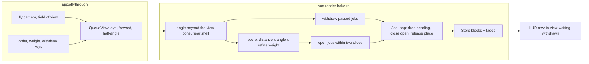

# 0060: The live queue by the view, nearest first, and withdrawing the work a flight has passed

> **Status:** in-progress (owner go 2026-11-10), amended 2026-11-10 (review pass)
> **Created:** 2026-11-10
> **Milestone:** M2 in [`docs/roadmap.md`](../roadmap.md) (the emissive light behind "dark scenes, emissive voxels
> as the light")
> **Related ADRs:**
> [ADR-0048](../adrs/0048-the-live-queue-orders-by-the-view-and-withdraws-the-work-a-flight-has-passed.md)
> (proposed; this plan builds it, its close accepts it), which amends the queue clause of
> [ADR-0046](../adrs/0046-static-emissive-light-is-baked-per-chunk-when-a-chunk-loads-or-changes.md)'s Outcome.
> **Source:** the owner's window of 2026-11-09, Plan 0059 Phase 13 (`docs/plans/logs/0059.md`), parked in
> [`docs/backlog.md`](../backlog.md) and taken here. Drafted without an interview (orchestrator's instruction);
> the owner answered its four questions on 2026-11-10 (Owner answers, below).
> **Starts after:** Plan 0059's close (done, v0.44.0). The owner's order (2026-11-10): this plan, then Plan
> 0061 (antialiasing), then Plan 0058 (dynamic lights), then Plans 0044 and 0045. 0061's Phase 1 (readings
> only) runs beside this plan, and the rest of 0061 waits for this plan's merge, because both edit
> `apps/flythrough/src/main.rs`, `apps/flythrough/src/hud.rs` and `crates/vxe-render/src/marcher.rs`. Plan
> 0058 edits the same three files and refreshes its paths against the tip it starts on. Plan 0045 splits
> `bake.rs` and `main.rs` last and is re-cut against the tree it finds.

> **Owner answers, 2026-11-10** (to the four questions of the draft, through the orchestrator):
> 1. **Order: one blended score** of distance and angle to the view (the draft's option (c), not its
>    recommendation of hard tiers). The plan and ADR-0048 are revised to it: the score's weights are named
>    constants, Phase 1 reads what they need, Phase 2 builds it, the owner tunes it by eye in Phase 4.
> 2. **Passed work: withdraw** open and pending jobs outside the near shell and the keep cone (as drafted).
> 3. **The view:** the frustum widened by 15 degrees, plus the near shell (as drafted).
> 4. **Bake speed:** keep the 1.5 ms slice and judge the order first (as drafted).

> **Amended 2026-11-10 (owner), Phase 1's two stop rules.** Both fired (`docs/plans/logs/0060.md`, Phase 1):
> in the streamed cave about 0.70 of the in-view waiting chunks are `waiting reach`, the near shell takes 98 to
> 99 % of the slice at `--glide 300`, and the passed samples there are 0.7 to 1.2 % (46 to 84 % in the vein
> flights, 62 % on the autopilot). Readings taken at load 17 to 44. The owner's answers:
> 1. **Before Phase 2: build Phase 2 as written.** The score is the lever at rest; the near shell's cost in
>    flight and the streaming edge are out of this plan and go to `docs/backlog.md` at its close.
> 2. **Before Phase 3: build the withdrawal** (answer 2 stands), not demote only.

> **Amended 2026-11-10 (review pass, before any code).** The score, the withdrawal and the owner's four
> answers stand. What changed: the view enters the queue as one half-angle, not a basis and four tangents
> (Decision, and the note on answer 3 there); Phase 2 says what replaces the class gate and the check caps,
> and reads what the score costs the coarse-first rule, with a stop rule; Phase 3's withdrawal test uses
> chunks small enough for two jobs to be in the loop at once; every toggle's text has a named test; the
> tests' file is `apps/flythrough/tests/gpu_queue.rs`; the budgets name the right arms and the line already
> missed.

> **Amended 2026-11-11 (owner), the queue step's bar.** The base a8b1a2c read p50 about 1.0 ms before a
> reboot and about 9 ms after it, same scene, source and protocol (readings log, Phase 5 fix pass): p50 follows
> the share of steps that open, and that share swings between runs for a cause not found. The fixed absolute
> bar is replaced by an A/B: the tip's queue step p50 and p99 are no worse than the base's read alternated in
> the same session (two rounds each, the spread between a side's rounds as the tolerance). The opening step's
> cost (about 9 ms, about 3.4 ms of it rebuilding and sorting the candidates) and the swing move to Plan 0067.
> The pre-roll no longer withdrawing its own coarse pass (78740af) is accepted without a window check.

## TL;DR

The baked light's live queue (`bake::BakeQueue`) opens chunks by distance first, so far light in the view waits
for every nearer chunk, behind the camera included, and a fast flight keeps baking chunks it has passed. This
plan reads where the queue's samples go in a flight first, then sorts the candidates by one score that blends
a chunk's distance with its angle to the view (the owner's pick), and then withdraws the jobs of chunks the
camera has passed. The first thing the owner sees is a HUD row that counts the chunks in view still waiting;
the last is a window where he turns the score's weight with a key until the far cave refines while he looks at
it and a fast flight's light lands ahead of him.

## Context & problem

ADR-0046's Outcome built one queue on the render thread, nearest by chunk distance, ties to the chunk ahead.
In `BakeQueue::open` (`crates/vxe-render/src/bake.rs`) the sort key is `(class, d2, -cos, coord)`: class 0 (a
full chunk with no block) before class 1 (a coarse block to refine), then squared chunk distance, the view only
as a tie. The owner, Plan 0059 Phase 13:

- the patch, at rest: "in long distance, light is not recalculated until I come closer, it would be better to
  recalculate all in the field of view, starting from the nearest chunks";
- the streamed cave, fast flight: "it takes quite a bit of time to settle light even as coarse. I think this is
  becouse we are starting to calculate places that camera is already passed. We should be able to cancel it when
  camera passed".

What the tree says about each (read, not measured):

- **At rest.** After the pre-roll every chunk of the level is coarse or full; refinements run nearest first in
  every direction. Plan 0059 Phase 8c read the vein's level all at 4096 after 157 s. A chunk in view at distance
  6 waits for every chunk at 5 or less.
- **In flight.** On the streamed cave the mirror holds about 17 000 full chunks at `r_full` 16 (Phase 8c's
  pre-roll read 17 077), so class 0 never empties while the camera moves and the coarse pass takes the slice. The
  nearest unbaked chunks are about as likely behind the camera as ahead. A job runs to its end in the sink:
  nothing in `JobLoop` takes a job out early except `stale` (an edit), which still lets it run.
- **Throughput is not this plan's lever.** At 1.5 ms a frame and the 36 to 64 ns a sample Plan 0059 read, the
  slice draws roughly 2 to 4 x 10^4 samples a frame (a guess from those figures, not a reading); a refinement at
  4096 is about 1.2 x 10^6 samples (Phase 8a: 3.836 x 10^9 over 3168 chunks), so tens of frames a chunk. The order
  decides which chunks get those frames; Phase 1 reads how far that goes.

What it serves: `project-context.md`'s dark-scene requirement (light where the player looks), and the owner's
standing rule that a stable image comes first. The `nfr.md` figures touched: section 2 (the slice and the queue
step's CPU), section 3 (no new buffer), section 7 (time to first frame, through the pre-roll's order).

## Decision

Build ADR-0048: the queue sorts its candidates by **one score**, `|o| x (1 + W_ANGLE x a) x (W_REFINE for a
coarse block, else 1)`, where `o` is the chunk's integer offset from the camera's chunk and `a` its angle beyond
the view cone over pi (0 inside the frustum's widest half-angle plus 15 degrees, and 0 in the near shell, every
direction); digs stay ahead of all. **The view is a circular cone, not the frustum's four planes** (owner
answer 3 said "the frustum widened by 15 degrees"): the score needs one angle beyond the view that grows
smoothly to straight behind, and a cone has it where a frustum's four planes give four. The cone is the wider
of the two: at the fly-through's 70 degree vertical field at 16:9 it is 66.2 degrees every way, where the
widened frustum is 50 degrees up and down. So chunks above and below the frame count as in view; Phase 1
reads how many, and the owner's window judges whether it shows. If it does, the fallback is the frustum's
own vertical half-angle for the up and down component, an architect amendment. It **withdraws** an open or pending job that is not a dig or ring 3 once its
chunk leaves the shell and a wider keep cone while a candidate with `a` 0 is ready. Both are behind fly-through
flags, the weight on a live key, so the owner compares them with Plan 0059's order and tunes them in one window.
We rejected hard tiers (all of the view first), the draft's recommendation, on the owner's pick of the blended
score; a predicted eye (velocity lead) because it adds a knob and equals the view score at rest; and demotion
without withdrawal on the owner's answer 2.

## Architecture diagram



## Implementation phases

Each phase ships as its own commit. `dev` implements all `dev` phases in one session. The readings go to
`docs/plans/logs/0060.md` (from the readings-log template); the Implementation log below keeps one row a phase.
**Phase 1 is a spike:** it reads where the queue's samples go before any order changes, and Phase 3's shape
depends on its reading (the stop rule there).

### Phase 1: The view cone as a reading, and where a flight's samples go
- **Owner skill:** dev
- **What:** the queue computes each candidate's angle term and view class (near shell, in view, out of view)
  without changing its order, counts where its samples go, and logs what the score's weights need, so the HUD
  and stdout show what the owner complained about.
- **Files touched:** `crates/vxe-render/src/bake.rs` (`QueueView` gains the view's widest half-angle, an
  `angle_term` function and its unit test, `QueueStats` counters), `crates/vxe-render/src/marcher.rs` (the
  queue's step takes its `QueueView` through `Frame`), `crates/vxe-render/src/lib.rs` (exports, if any),
  `apps/flythrough/src/main.rs` (both places that build a `QueueView` fill the half-angle from the fly
  camera's field of view and aspect; the stdout line), `apps/flythrough/src/hud.rs` (the queue row and its
  test), `apps/flythrough/tests/gpu_queue.rs` (the rig's `QueueView` takes the rig camera's half-angle),
  `docs/plans/logs/0060.md`.
- **The counters (dev may rename):** per view class, the chunks waiting (no block, coarse) and the samples read
  back for jobs whose chunk was in that class when the job ended; the samples of jobs whose chunk was out of view
  and behind the camera (view cosine of its centre under 0) at their end ("passed"); for each chunk that enters
  the view with no full block, the time to its first block and to its full block (p50, p95 over the run); the
  waiting chunks that are inside the cone and outside the widened frustum (what the cone adds over owner
  answer 3's frustum).
- **What the weights need (logged once a second):** the waiting candidates as a histogram over distance (chunk
  bands 0-2, 3-5, 6-10, over 10), `a` (0, under 0.2, 0.2-0.4, over 0.4) and class; and, from it, the
  `W_ANGLE` at which the chunks the slice baked in the last second, re-ranked by the score, would have been in
  view at p50 and p90 of those chunks, and the `W_REFINE` at which a coarse chunk in view at distance 3 ranks
  with a blank one at 5 or 6. The log gives the range Phase 2's constants start in; the owner's eye picks.
- **Done when:**
  - A unit test `the_view_cone_scores_a_chunk_by_its_angle` (CPU, under 1 s): a camera at the centre of chunk
    [2, 0, 0] looking +x with a 70 degree vertical field at 16:9 (horizontal half-angle atan(tan 35 x 16 / 9),
    51.2 degrees, plus the 15 degree margin: 66.2) and `near` 1: [7, 0, 0] (straight ahead) has `a` 0;
    [-3, 0, 0] (straight behind) has `a` (180 - 66.2) / 180 = 0.632 within 0.005; [1, 0, 0] (behind, in the
    shell) has `a` 0; with `W_ANGLE` 0 every score is `|o|` (times `W_REFINE` for a coarse block). The
    half-angle is the wider of the horizontal and the vertical one, not the corner's.
  - `the_queue_row_counts_the_view` (CPU, in `hud.rs`, under 1 s): the HUD's queue row reads
    `in view: N waiting (C coarse)` for a hand-built `QueueStats`. The per-second stdout line adds the samples
    by view class, the passed samples, the in-view ages and the weight log; under the default order every
    existing test of `gpu_queue.rs` still passes unchanged (the order is not touched in this phase). If the
    row moves `apps/flythrough/tests/gpu_hud_golden.rs`'s image, it is re-blessed here and the log says so.
  - Readings (RTX 3080 Laptop by `--adapter NVIDIA`, release, exclusive perf lock, headless 2530 x 1378; one row
    on the RADV RENOIR at 1280 x 720) into the readings log, with the 1-minute load:
    1. the patch at rest, facing down the cave (`--level --pose patch`, 120 s): the time until every chunk in
       view holds a full block, and the chunks in view still coarse at 30, 60 and 120 s;
    2. `--pose vein-flight --glide 30` and `--glide 120`: the share of the slice's samples by view class and
       passed;
    3. the streamed cave with `--glide 150` and `--glide 300` from the spawn (15 and 30 m/s at 10 cm voxels),
       60 s each: the same shares, the in-view ages, the no-value and coarse shares of the lighting pixels the
       existing line prints, and `waiting reach` among the chunks in view;
    4. the autopilot (`--autopilot --headless --seed 1`): the same shares, as the baseline for the close.
  - **Stop rule (dev reports; the orchestrator takes it to the owner before Phase 3 starts):** if in run 3 at
    `--glide 300` the passed samples are under 10 % of the slice's samples, the passed work is not the flight's
    fault, and the owner is asked again whether to build the withdrawal (answer 2) or demote only (ADR-0048's
    Alternative D). If the waiting chunks in view are mostly `waiting reach` (over half), the flight's fault is
    the streaming edge, not the order, and the plan stops for an owner question before Phase 2.

### Phase 2: The blended score
- **Owner skill:** dev
- **What:** `BakeQueue::open` sorts by ADR-0048's score, ties by the view cosine then the coordinate, the
  pre-roll included, behind `--queue-order score|distance` (default `score`; `distance` is Plan 0059's key,
  class first) and a live key; the weights are named constants `QUEUE_ANGLE_WEIGHT` and `QUEUE_REFINE_WEIGHT`
  (starting values from Phase 1's log; 4 and 2 are guesses until then), overridden by `--queue-weights A,R`,
  and a live key pair steps the angle weight (halve, double; dev picks free keys and the banner names them).
- **The opening loop under the score.** Today the loop breaks at the first refinement once a blank chunk was
  found ready (`class == 1 && ready0 > 0`) and counts its reach checks per class (`QUEUE_CHECKS` 16 a sliced
  step, `QUEUE_CHECKS_UNSLICED` 64 in the pre-roll), so candidates blocked at the streaming edge cannot starve
  the refinements behind them. Under `score` the class is in the score, so the break goes and **one** counter
  of the same size runs over the sorted list, whatever the class. What still bounds starvation: a candidate
  found blocked is skipped, uncounted, for `QUEUE_RECHECK` 30 steps, so each opening's checks move on to the
  next candidates by score. Under `distance` the loop is Plan 0059's, unchanged. `--queue-weights A,tier`
  keeps the score inside each class and the class as the leading key with its break and its per-class
  counters (ADR-0046's coarse-first rule); it is the fallback of the stop rule below and an arm in the window.
- **Files touched:** `crates/vxe-render/src/bake.rs`, `crates/vxe-render/src/marcher.rs` (a setter, if the queue
  is reached through `Frame`), `apps/flythrough/src/main.rs`, `apps/flythrough/src/hud.rs`,
  `apps/flythrough/tests/gpu_queue.rs`, `docs/plans/logs/0060.md`.
- **Done when:**
  - `the_score_blends_distance_and_the_view` (lavapipe, gpu tier, about 3 s, an estimate from its siblings'
    2.5 s): the
    six-chunk row of `the_queue_runs_near_first_and_within_its_samples`, camera in chunk 2 looking +x, `near` 0,
    coarse pass on, `W_REFINE` 2. Chunks first appear in `jobs()` in the order [2, 3, 4, 5, 1, 0] at `W_ANGLE` 4
    (scores 1, 2, 3 ahead; 1 x 3.53 and 2 x 3.53 behind), [2, 3, 1, 4, 5, 0] at `W_ANGLE` 1 (behind 1.63 and
    3.26), and [2, 3, 1, 4, 0, 5] at `W_ANGLE` 0 (distance, ties ahead first). Under `distance` the rig reads
    Plan 0059's [2, 3, 1, 4, 0, 5].
  - `the_queue_runs_near_first_and_within_its_samples` passes unchanged at `near` 2 (chunks 0 to 4 are the near
    shell, `a` 0, so they keep distance order; chunk 5, beyond it and in view, comes last).
  - `a_blank_chunk_waits_behind_a_nearer_refinement_only_under_the_score` (lavapipe, about 3 s, an estimate):
    the same row, coarse pass on, chunk 3 holding a coarse block and chunk 5 none, the others full, camera in
    chunk 2 looking +x, `near` 0, `W_REFINE` 2. Under `score` chunk 3 (1 x 2 = 2) opens before chunk 5 (3);
    under `--queue-weights 4,tier` and under `distance` chunk 5 opens first.
  - `a_turn_resorts_the_queue` (lavapipe, about 3 s, an estimate): the same row at `near` 0 and `W_ANGLE` 4, the camera
    turned to look -x after its own chunk opens; of the chunks not yet in `jobs()` at the turn, 1 and 0 open
    before 4 and 5.
  - `the_queue_settles_to_a_direct_bake` and `the_queue_settles_to_a_direct_bake_after_a_turn` (its copy with
    the camera turned half-way; lavapipe, each about the first one's time today, which dev records) pass: every
    block bit-identical to a one-shot bake whatever the order and the weights (ADR-0046's order independence).
  - `the_banner_names_the_queue_order_and_its_weights` (CPU, beside the fly-through's other banner tests,
    under 1 s): the flag parses `score` and `distance` and refuses anything else, `--queue-weights` parses
    `A,R` and `A,tier`; each key press changes the banner and the HUD's queue row in the same frame to
    `order score, angle 4, refine 2`, `order score, angle 4, refine tier` or `order distance`, and the halve
    and double keys change the angle's figure. Stdout prints a line at each change.
  - Phase 1's runs 1 to 4 read again under `score` at the starting weights into the readings log, beside Phase
    1's rows; the pre-roll's first frame at the vein and the hall beside Plan 0059 Phase 8c's 7137 and 1839 ms.
  - **What the score costs the coarse-first rule, and its stop rule.** Run 3 (the streamed cave, `--glide 150`
    and `--glide 300`) is read three ways, `distance`, `score` and `score` with `A,tier`, two rounds each: the
    no-value share and the coarse share of the lighting pixels, and the in-view time to a first block (p50,
    p95). If under `score` the no-value share at `--glide 300` is above `distance`'s by more than the two
    rounds' spread, the starting arm for Phases 3 and 4 is `A,tier`, the banner says so on a plain start, and
    the log names the figures; the owner still sees all three arms in the window. Dev does not retune
    `W_REFINE` to pass this.

### Phase 3: Withdrawing passed work
- **Owner skill:** dev
- **What:** `JobLoop` gains a withdrawal (a pending job dropped; an open job closed with no write, its table
  slot and pool place released, nothing in flight read into it), and the queue withdraws by ADR-0048's rule,
  behind `--queue-withdraw on|off` (default `on`) and a live key. Its shape follows Phase 1's stop rule.
- **Files touched:** `crates/vxe-render/src/bake.rs`, `apps/flythrough/src/main.rs`, `apps/flythrough/src/hud.rs`,
  `apps/flythrough/tests/gpu_queue.rs`, `docs/plans/logs/0060.md`.
- **Done when:**
  - `a_passed_chunk_is_withdrawn` (lavapipe, gpu tier, about 5 s, a guess): eight chunks in a row, each one
    8^3 rock cube on a brick (6 brick directions, so 24 576 samples a chunk at 4096 a brick direction), `near`
    0, coarse off, slice 1e-6 ms, so a step draws the cap's floor of 16 384 samples. An opening admits jobs
    while fewer than two caps (32 768 samples) are left in the loop, so two of these chunks can be in the loop
    at once where one 32^3 cube (393 216 samples) could not. The camera sits in chunk 0 looking +x and the rig
    steps until `jobs()` holds chunk 2 (it then holds chunk 1 or 2 open and whatever is pending; dev pins the
    step count), then moves to chunk 5 looking +x. At the next step `jobs()` holds no chunk in 0 to 4, the
    withdrawn count and samples in `QueueStats` are above 0, and each withdrawn chunk holds no block it did not
    hold before the move and no pool place (every pool word is the header's, a held block's or free, the
    eviction test's check). `tracks()` of a withdrawn chunk names at most `listed` (its face list, kept for the
    re-open, if dev keeps it) and never `job_coarse`, `stale`, `fades`, `dig_open` or `blocked`. Run to empty,
    every block is bit-identical to a one-shot bake.
  - `a_dig_is_never_withdrawn` (lavapipe, about 3 s, an estimate): the same row with a carve in chunk 1 before
    the move; the dig's job stays in `jobs()` after the move and its chunk settles to a one-shot bake of the
    edited world.
  - `the_edge_of_the_view_does_not_churn` (lavapipe, about 3 s, an estimate): a camera yawing by plus and
    minus 5 degrees a step about a chunk at the cone's edge withdraws nothing over 64 steps (the keep cone).
  - `the_banner_names_the_withdrawal` (CPU, beside the fly-through's other banner tests, under 1 s): the flag
    parses `on` and `off` and refuses anything else; the key changes the banner and the HUD's queue row to
    `withdraw on` and `withdraw off` in the same frame, and the row shows `withdrawn N` from a hand-built
    `QueueStats`. With `--queue-withdraw off` the Phase 2 tests read as before.
  - Phase 1's runs 2 to 4 read again under `score` with withdrawal on, beside the Phase 2 rows: the passed samples'
    share, the samples withdrawn, the in-view ages.

### Phase 4: The owner's window
- **Owner skill:** human
- **What:** the owner judges the order and the withdrawal by eye on the release binary, stdout visible.
- **Files touched:** `docs/plans/logs/0060.md` (the owner's words verbatim, by the orchestrator or `dev`).
- **The runs** (a `live/session60.sh` in the lane, untracked, the fly-through's defaults with `--hud`; each step
  starts on `order score` at Phase 2's weights with withdrawal on; the owner steps the angle weight and swaps
  the order and the withdrawal with the keys):
  1. the patch at rest, looking down the cave: does the far light in view refine soon enough, nearest first,
     and at which angle weight;
  2. the streamed cave, flown fast with the pad or keys: does the coarse light land ahead of the flight, and
     what does a turn back show;
  3. the vein: a slow flight and a dig, to confirm nothing regressed;
  4. the Radeon, step 2 at 1280 x 720.
- **Done when:** the owner has picked the angle and refine weights (or the class as a tier, or `distance`) and the withdrawal (on or
  off), or has named what is still wrong; the words and the weights on screen are in the readings log.

### Phase 5: The defaults at the owner's pick, and the close's readings
- **Owner skill:** dev
- **What:** the defaults follow Phase 4's picks, the weights as the named constants' values; a losing arm's flag stays as a comparison flag unless the owner
  asked for it gone; the budget readings the close needs.
- **Files touched:** `crates/vxe-render/src/bake.rs`, `apps/flythrough/src/main.rs`,
  `apps/flythrough/tests/gpu_queue.rs`, `docs/plans/logs/0060.md`.
- **Done when:**
  - The fly-through's defaults equal the owner's picks, and the banner names them on a plain start.
  - The autopilot read under `docs/nfr.md` section 5's protocol (RTX, 2530 x 1378, FSR 2 at 1.5, `--seed 1`, two
    rounds, exclusive perf lock): the queue step's CPU per frame p50 / p99 / max beside Plan 0059's fix-pass
    rounds (1.029 / 18.424 and 1.019 / 18.198 ms), and `frame_bytes` beside 888 490 396 B.
  - `cargo nextest run --profile gate` at the tip, exit 0, its wall time and the new tests' times in the
    readings log.

## Data shapes

```rust
// illustrative
pub struct QueueView<'a> {
    pub eye: [f32; 3],
    pub forward: [f32; 3],
    /// The wider of the view's horizontal and vertical half-angles, in radians; the queue adds the margin.
    pub half_angle: f32,
    // resident, samples, hold as today
}
pub enum Refine { Weight(f32), Tier } // Tier: the class is the leading key, ADR-0046's coarse-first rule
pub enum QueueOrder { Score { angle: f32, refine: Refine }, Distance }
pub const QUEUE_ANGLE_WEIGHT: f32 = 4.0; // a guess until Phase 1's log; the owner's pick at Phase 4
pub const QUEUE_REFINE_WEIGHT: f32 = 2.0; // the same
// QueueStats gains: per view class waiting and samples, passed samples, withdrawn jobs and samples.
```

## Budgets

- **Section 2, frame.** The slice stays 1.5 ms (`DEFAULT_BAKE_SLICE_MS`, owner answer 4). The queue step's CPU
  per frame: the score adds an angle and a multiply per candidate (up to about
  17 000 on the streamed cave), so the bar is an A/B against the base read alternated in the same session:
  the tip's p50 and p99 no worse than the base's, within the spread between a side's two rounds (amended
  2026-11-11, owner; the earlier absolute bar of p50 within 0.1 ms of 1.019 ms and p99 at most 18.65 ms was
  missed by the base itself in a later session). Phase 5 reads it.
- **Section 3, memory.** No new buffer; `frame_bytes` unchanged (888 490 396 B), the pool unchanged; a withdrawn
  job's place returns to the pool (asserted in Phase 3).
- **Section 7, startup.** The line is "time to first frame under 3 s on the dev reference (proposal)", and it
  is already missed under the baked light: Plan 0059 Phase 8c read 7137 ms at the vein. This plan does not
  claim the line; its bar is the delta. The pre-roll follows the order; the first frame at the vein and the
  hall is read against 7137 and 1839 ms (RTX), and may not exceed them by more than 10 % (a proposal).
- **Section 7, tests.** Every named test above states its time; none is planned over 30 s on lavapipe. One
  that reads over the line is marked `#[ignore = "soak"]`, the phase's log says so, and its claim keeps a
  gate-sized test.
- **Section 5, streaming.** Not touched: the streamer's load order stays by distance. Residency p95 is not
  re-read.
- The in-view ages and the passed share are this plan's own readings, recorded in the readings log and in
  ADR-0048's Outcome, with no `nfr.md` line: the owner judges them by eye.

## Risks & open questions

- **The streaming edge, not the order.** A chunk in view within the light radius of the mirror's edge waits
  for its reach (`reach_ready`). If the flight's in-view chunks mostly wait there, ordering cannot help; Phase
  1's stop rule catches it.
- **No weight is right everywhere.** A blended score lets a near chunk behind beat a far one in view at any
  finite angle weight; the patch at rest and the cave in flight may want different weights. Phase 4 reads the
  owner's weight on both; if they differ, the owner picks one or asks for a later plan.
- **The score gives up ADR-0046's coarse-first rule.** As built, every chunk with no block opens before any
  refinement, so an unlit chunk never waits behind one that already has coarse light. Under the score at
  `W_REFINE` 2 a coarse chunk at `|o|` 4 (score 8) opens before a blank one in view at `|o|` 9, and in a
  streamed flight blank chunks enter near `|o|` 16. That can lengthen the owner's second complaint ("takes
  quite a bit of time to settle light even as coarse"). Phase 2 reads the no-value share three ways and falls
  back to the class as a hard tier (`A,tier`) by its stop rule; the owner's answer 1 covered distance and
  angle, not the class.
- **The cone is wider than the frustum** up and down (66.2 against 50 degrees at the fly-through's view), so
  work goes to chunks above and below the frame. Phase 1 counts them; the window judges.
- **Churn.** A withdrawn chunk that comes back into view starts over. The keep cone and the "a better candidate
  is ready" condition bound it; Phase 3's edge test and the withdrawn samples read it.
- **A turn shows the back.** Behind the near shell the light is coarse or absent until the queue reaches it.
  The window decides whether `near` 2 is enough.
- **Determinism.** Render-side only; `vxe-world` is not touched. Order, weights and withdrawal must not change
  a block's bits; Phases 2 and 3 assert it against a one-shot bake.
- **Open:** none left from the draft; the owner answered all four on 2026-11-10 (the header). Phase 1's stop
  rule can raise one.

## What this plan does NOT do

- No change to the slice, the counts, the coarse pass's samples, the pool or the store's layout (ADR-0046).
- No velocity-predicted order (ADR-0048's Alternative C), parked for a later plan if the window asks.
- No change to the streamer's own load order in `vxe-world`.
- No antialiasing (the hall's "a lot of aliasing" goes to the antialiasing plan).
- No VR union of frusta; the queue takes the one camera's view.

## Implementation log

> Written by `dev`: one row per phase as its commit lands, then the close block. Readings, attempts and resume
> notes go to [`docs/plans/logs/0060.md`](logs/0060.md).

| phase | owner | state | commit |
|---|---|---|---|
| 1: The view cone as a reading | dev | done; both stop rules read as firing (readings log, Phase 1); the census and the in-view reach count are Phase 2 tree code | f371e66 |
| 2: The blended score | dev | done; code and tests at 17a6454 (`wip(render)`, before the owner's answer); the coarse-first stop rule read as firing, so the plain start is `4,tier` (readings log, Phase 2) | 49428d7 |
| 3: Withdrawing passed work | dev | done; code at 903cbda (`wip(render)`); `withdrawn_samples` counts rounds in flight and the dig test's rig sets `edit_ms` 0 (readings log, Phase 3) | 599dcd5 |
| 4: The owner's window | human | done 2026-11-11; order and angle weight: no visible difference; withdrawal kept on; step 4 first ran on the RTX (the window ignores `--adapter`), rerun on the Radeon by Mesa's device select (readings log, Phase 4) | 51ad42f |
| 5: The defaults and the close's readings | dev | done; defaults unchanged in the fly-through (`score 4,tier`, withdrawal on), `QueueOrder::default()` follows them; queue step CPU p50 against the 1.119 ms bar not met by the tip or the base after the fix pass (d5c4532, 78740af; readings log, Phase 5) | 95ce5ac |

### Notes

- Phase 5's queue-step CPU bar is not met: tip p50 3.290 and 3.392 ms against base a8b1a2c's 1.007 and 1.006 ms
  (bar 1.119); p99 under its line (readings log, Phase 5).
- Fix pass on that bar (readings log, Phase 5, the fix pass): d5c4532 prunes the queue's in-view entries at the census
  instead of every step (1.31 ms a step); 78740af stops the pre-roll withdrawing (it withdrew about 8 400 jobs of its
  own coarse pass); test `a_pre_roll_step_withdraws_nothing`. After them the A/B reads tip p50 9.290 and 9.009 ms
  against base 9.268 and 9.175 ms (p99 tip 19.549 and 18.149, base 19.176 and 18.813 ms). The base read 1.007 and
  1.006 ms before the reboot in the same protocol: the step is about 1 ms with no opening and about 9 ms with one,
  and p50 follows the share of steps that open, which moves between runs of the same binary.
- `bake::QueueOrder::default()` changed to the score with the class as the tier, so the library's default equals the
  fly-through's plain start (Phase 5).
- `frame_bytes` reads 683 273 268 B on the base and the tip; the plan's 888 490 396 B is not the line this branch's
  base prints.
- Followup: the window cannot pick an adapter. The shell ignores `--adapter` outside `--headless` ("the window
  takes the default adapter"); Phase 4's Radeon step ran only through Mesa's
  `MESA_VK_DEVICE_SELECT=1002:1638 MESA_VK_DEVICE_SELECT_FORCE_DEFAULT_DEVICE=1`.
- Followup: far-light throughput on a slow adapter. The bake gets a per-frame slice (1.5 ms), so at the Radeon's
  15 fps it gets about a quarter of the RTX's work a second; light the store does not hold yet shows black
  (Phase 4, 4A: light store 526 bricks, 36 932 missing; owner: "after several seconds distant caves still black").
  Raised with the owner by the orchestrator; not designed or built here.
- `the_score_blends_distance_and_the_view` reads 10.463 s in the tip's gate run and 10.405 s in Phase 5's gpu run
  (both loaded, load 6.7 to 6.9), over the 10 s soak line on lavapipe; not marked `soak`.

### Close triggers

- Gate at 95ce5ac: `cargo nextest run --workspace --profile gate` exit 0, 736 run, 736 passed, 75 skipped,
  832.1 s (lavapipe, exclusive perf lock, load 6.9); doctests 7 passed; clippy 0; fmt 0; `cargo deny check` 0;
  doc, comment, index-row, test-tier and plan-size scripts 0.
- Queue step CPU per frame, autopilot (RTX 3080 Laptop, 2530 x 1378, FSR 2 at 1.5, `--seed 1`, exclusive perf
  lock, started under load 1.5), p50 / p99 / max ms: base a8b1a2c 1.007 / 18.318 / 31.443 and 1.006 / 17.670 /
  38.234; tip 95ce5ac's tree 3.290 / 18.572 / 30.563 and 3.392 / 18.542 / 45.475. After the fix pass, the same
  protocol, 11:03 to 11:14: base a8b1a2c 9.268 / 19.176 / 28.603 and 9.175 / 18.813 / 23.393; tip 78740af's tree
  9.290 / 19.549 / 27.585 and 9.009 / 18.149 / 22.979.
- Gate after the fix pass (78740af's tree): clippy 0, fmt 0, quick tier 176 passed; gpu tier of the changed crates
  185 run, 185 passed, 71 skipped, 604.8 s (lavapipe, exclusive perf lock, load 5.19: loaded). The full gate tier
  not re-run.
- `frame_bytes` (`autopilot: frame targets`): 683 273 268 B on the base and the tip.
- Section 7's first frame at the vein and the hall: Phase 2's readings (readings log, Phase 2); not re-read here.

## Followups
