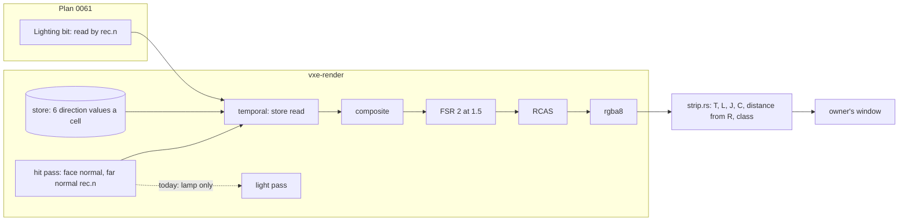

# 0061: Antialiasing: the far bands are back under the baked light; split them by measurement, read the store by the far normal, and pick by eye

> **Status:** draft
> **Created:** 2026-11-10
> **Milestone:** M2 in [`docs/roadmap.md`](../roadmap.md) (the upscaler and surface-look bullets;
> "a stable image" is the owner's one priority, 2026-11-03)
> **Related ADRs:** [ADR-0049](../adrs/0049-the-baked-light-is-read-by-the-far-shading-normal.md)
> (proposed; the store read by the far normal; Phase 1 can reject it, the window picks it or not),
> [ADR-0042](../adrs/0042-the-far-shading-normal-blends-to-the-27-count-gradient-by-the-voxels-size-on-screen.md)
> (the far normal; its setting gets its Outcome at this plan's close),
> [ADR-0034](../adrs/0034-fsr-2-ported-to-wgsl-as-the-default-upscaler-candidate.md) (FSR 2 at 1.5
> stays; its slow-pan Outcome is owed and written at this close),
> [ADR-0046](../adrs/0046-static-emissive-light-is-baked-per-chunk-when-a-chunk-loads-or-changes.md)
> (the store this plan reads, unchanged).
> **Source:** [`docs/backlog.md`](../backlog.md), "Antialiasing after the look-first light", with
> "Far normal range" and "Slow-pan verdict for FSR 2". The owner, Plan 0059's Phase 13 window
> (2026-11-09, the defaults: FSR 2 at 1.5, far normal `[2, 6]`, the baked light), at the hall: "a lot
> of aliasing on this step, doesn't look good".
> **Starts after:** Plan 0060 (the live queue) merges, since both touch `temporal.wgsl` and the
> goldens; Phase 1 changes no file under `crates/` and may start beside it (open question 5).

## TL;DR

The aliasing in the owner's still (`session13-hall-aliasing.png`) is mostly **ADR-0042's far bands,
back**: sub-pixel terraces on the hall's dome, walls and floor, each riser and tread lit by a
different value, folding into swirls and rings. By the code, the far normal no longer reaches the
light: since Plan 0059 a cube face's emissive part is the store's value for the face's own direction
(`temporal.wgsl`, `store_face(rec.axis, nf)`), and the blended normal `rec.n` reaches only the lamp,
which the hall runs off. That would also explain Phase 8d's "aliasing got much worse in hall", the
first window on the store. The edges are a smaller second class: FSR 2's jitter-locked jumps on
silhouettes and emitters (Plan 0056), and the edge dots it left at `[1, 2]`.

Phase 1 checks this by measurement before any mechanism: under the baked light, does the far normal
change the far crops at all, and which class carries the distance from a 4-ray reference? Phase 2
builds ADR-0049 behind a toggle: where the far normal's weight is above 0, the store is read as the
squared-cosine mix of the cell's direction values by the shading normal. It is exactly today's read
up close. Phase 3 reads the matrix and the edges left. Phase 4 is the owner's window. Phase 5 lands
the picks as defaults. The first thing anyone sees is a table: far normal on against off under the
baked light, which Phase 1 predicts reads the same.

## Context & problem

`project-context.md` (Rendering, P0): stable at arm's length in dark scenes. The owner, 2026-11-03:
"a stable image without any flicker or aliasing artiacts ... considering performance of course".
The figures touched: `docs/nfr.md` section 2 (frame: the light passes and the upscale line), section
3 (`frame_bytes`, unchanged by design).

**The windows so far, on the hall:**

| Window | Settings | Owner's words |
|---|---|---|
| Plan 0056 Phase 4 (2026-11-04) | FSR 2 at 1.5, `--steady b` (the per-face table), far normal cycled | "far normal 1..2 is the best, however aliasing artifacts is not gone completely" (edge dots on silhouettes and emitters' edges) |
| Plan 0059 Phase 8d (2026-11-08) | defaults, the store (`--light queue`), far normal `[2, 6]` | "aliasing got much worse in hall" (`session8c-img20.png`) |
| Plan 0059 Phase 8e (2026-11-09) | native, jitter off, lighting full, far normal `[1, 2]`, the store | "we need to work on antializing later, but much better than before" |
| Plan 0059 Phase 13 (2026-11-09) | defaults: FSR 2 at 1.5, far normal `[2, 6]`, the baked store | "a lot of aliasing on this step, doesn't look good" (`session13-hall-aliasing.png`) |

**Before these,** from the backlog entry this plan takes: Plan 0057's second window (2026-11-05),
"antializing next", the fast turn "still has artifacts"; at Plan 0059's Phase 3 verdict (2026-11-06)
the native reference's edges "Barely noticed", and the order "Cuts first, then AA".

**What the stills show (read by eye, not measured).** `session13-hall-aliasing.png` and
`session8c-img20.png`: contour lines over the whole far dome, the cyan wall and the floor, dashed
along their length; a riser reads as a dark dash and a tread as a lit strip. They follow the
surface's slope, as the terraces do. The near pillars show honest stair edges (the default look).
Stalactite and pillar silhouettes and the white crystals' blocks are sharp. This is the picture
ADR-0042's Context describes and the far normal was built to remove.

**Why the far normal stopped working, by the code (to be confirmed by Phase 1).** Checked at 9ce251d:

- The hit pass blends the shading normal (`march.wgsl`, `far_normal_weight`, `gradient27_normal`)
  and writes it to the hit record (`rec.n`).
- The temporal pass reads a cube-face hit's emissive part from the store:
  `nf = shadow_normal_of(rec, ray.d)`, `store_brick_value(store_voxel(rec.p, nf), store_face(rec.axis, nf))`:
  the face direction, the same value at every pixel of the face, no screen history. `rec.n` is not
  read.
- `rec.n` reaches `light.wgsl` (the lamp, line 93) and the weights of `lit_at` and `atrous.wgsl`.
- So at the hall, lamp off, the far normal costs the hit pass (Plan 0056 Phase 3: RTX hit 4.34 ms
  against `face`'s 2.85 at the showcase start, RADV 21.1 against 14.5) and should change no lit value.
- The store holds per 8-voxel cell six direction values, each the mean of that direction's faces, and
  a face reads the 2 x 2 cells around it in its plane (ADR-0046's Outcome). A far riser and its tread
  read two different values of the same cell.

**What Plan 0056 measured, under the eye lamp (`E`), still relevant:** native is bit-identical at
rest, and its pan's crawl is creases (64 %) and silhouettes (35 %) without the far normal; the far
normal halves native's crawl (`C` 2.90 to 1.03). FSR 2 at 1.5's still jumps sit on silhouettes and
emitters, 0.76 locked to the jitter; without the far normal they rise from 4766 to 221 412. `[1, 2]`
reads about seven times `[2, 6]`'s still jumps under `E`, and the owner picked it by eye anyway. The
floor's rings are its 1-voxel terraces, world-anchored (R1, R3). The emitter cap was a fault; jitter
phases 8 and the static dither stay opt-in knobs. The rig is `apps/flythrough/tests/strip.rs` with
`tests/support/aliasing.rs` (`T`, `L`, `J`, `C`, the class mask, the guard, `R`).

**The defaults today** (`apps/flythrough/src/lib.rs`, `LookPreset::DEFAULT`): face, far normal
`[2, 6]`. The owner's `[1, 2]` from Plan 0056 never landed; the far-normal plan it asked for is this
one.

## Decision

**A reading first, then one mechanism behind a toggle, then the owner's window, then defaults.**

- **Phase 1 attributes** the hall's aliasing under the baked light into Plan 0056's classes, plus one
  new reading: far normal on against off, under the store and under `E`. The code read predicts no
  change under the store. A stop rule sends the plan back if that is false.
- **ADR-0049** (proposed) is the mechanism for the far bands: where the far normal's weight is above
  0, a cube-face hit reads the store as `sum_a n_a^2 value(cell, dir_a(n))` over the directions the
  cell holds, renormalised. At weight 0 it is today's read to the bit. No storage, no pass.
- **The edges are read, not fixed:** jitter phases, sharpening and FSR 2 at scale 1 already exist
  as knobs and go to the window. A mechanism for them is a later plan if the window asks for one.
- **The far normal's setting is picked again** under the new read, since `[1, 2]` was picked under
  the table's light, and ADR-0042 gets its Outcome at this plan's close.

We rejected **FSR 2 at scale 1 or native as the default**, because they double the march (Plan 0056:
20.6 against 8.7 ms in the window) and a finer staircase of two lights is still stripes; they stay
opt-in. We rejected **a footprint-prefiltered store** (ADR-0049 Alternative B), because the cell
already holds the six values the blend needs. We rejected **a screen-space blur of the stored part**,
because it is camera-anchored and crawls under motion, as the static dither did. We rejected **a
fix for the edges now**, because no reading under the baked light has attributed them yet.

## Architecture diagram



## Implementation phases

Each phase ships as its own commit. `dev` implements all dev phases in one session; the architect
reviews once at the end, in a fresh session. Readings go to `docs/plans/logs/0061.md` (from the
readings-log template). Sweeps on the RTX 3080 Laptop (`VXE_TEST_ADAPTER=rtx`, labelled), each
reading run under the perf lock and the memory cap; done-when asserts on lavapipe. Per phase:
`node scripts/test-changed.mjs --profile quick`, and `--profile gpu` under the perf lock on a phase
that changes `crates/vxe-render` or a GPU test; clippy, fmt. At the tip: `cargo nextest run
--workspace --profile gate` under the perf lock, doctests, clippy, fmt, deny, the doc and tier gates.
`strip_run` stays `#[ignore]`d.

### Phase 1: Which aliasing it is, under the baked light

- **Owner skill:** dev
- **What:** the strip rig on the fly-through's default light, and the first table: what the far
  normal does under the store, and which class carries the hall's distance from the reference.
- **The rig:** `VXE_STRIP_LIGHT=baked` runs the fly-through's default light: the store baked over the
  view before the read (the rig `apps/flythrough/tests/bake.rs` uses for its rest readings; dev states
  which), lamp off, the shot's exposure. A new read beside Plan 0056's z-level map: the **direction
  map**, a pixel's store direction (`store_face`), and the share of image-edge pixels (a neighbour 2
  levels apart) within 1 pixel of a direction change against the share elsewhere. `R` is `off` at 3840
  x 2160 with the far normal scaled to native's voxels (`[2, 4]` for `[1, 2]`, `[4, 12]` for `[2, 6]`, as Plan 0056),
  box-filtered to 1920 x 1080, four rays a pixel. Plan 0056 left `R` not bit-identical at rest (max 26):
  dev reads why first, or states it unread.
- **Arms, the hall, 1920 x 1080:** light `baked` and `E`; upscaler FSR 2 at 1.5, `off`, and `R`; far
  normal off, `[1, 2]`, `[2, 6]`. Still (72 frames over 4 cycles, settle 512) and the pan at 1 px a
  frame (240 frames); the fast yaw at 10 px a frame for the defaults and native. One row at the
  window's size, 2530 x 1378, for the defaults. The `albedo` view at the hall, to show the material is
  one colour where the bands are.
- **Files touched:** `apps/flythrough/tests/strip.rs`, `apps/flythrough/tests/support/aliasing.rs`,
  `docs/plans/logs/0061.md` (new).
- **Done when:**
  1. `the_direction_map_names_each_face_direction` (no GPU, under 1 s): a hand-built grid of hits on
     a two-step staircase gives each pixel its `store_face`, and the edge share counts a luma step at a
     direction change and not one inside a face.
  2. **The far normal under the store, in the log (RTX):** the far crops (dome 800,0 700x250; far wall
     780,230 640x360) under `baked`, FSR 2 and native, far normal off against `[1, 2]` and `[2, 6]`:
     the guard's energy, the distance from `R`, `T` still. Beside it the same under `E`, where Plan
     0056 read the far normal lowering the far wall's and dome's energy.
  3. **The stop rule.** If under `baked` the far normal moves the far crops' energy by more than 10 %
     against off, at either setting, the code read above is wrong and the bands have another source:
     dev stops for an architect amendment before Phase 2. The log gives the figure either way.
  4. **The class table under `baked`, in the log:** for the defaults and native, the share of `T`
     jumps, `C` jumps and the distance from `R` on interior, seam, crease, silhouette, emitter and
     miss pixels, by footprint (under 2, 2 to 6, over 6 internal pixels), and the direction map's edge
     ratio by 10 m bins of `t`. The log names in one line each: the largest class by distance from `R`,
     the largest by `C`, and whether the bands are world-anchored (the eye moved 16 voxels, as Plan
     0056's R3).
  5. **The re-read on lavapipe,** per lane rule 9c: the far crops' guard and `T` for `baked`, far normal
     off and `[2, 6]`, FSR 2 at 384 x 216; a reading run in no tier. The log says whether it agrees.

### Phase 2: The store read by the far normal (ADR-0049), behind a toggle

- **Owner skill:** dev
- **What:** ADR-0049's read in `temporal.wgsl`, a `Lighting` bit off in the library, a fly-through
  flag and key that show their mode, its tests and its cost.
- **The read:** at a cube-face hit with `rec.n` not equal to the face normal (the far normal's weight
  above 0), for each axis `a` with `n_a^2` above 1e-4, `store_brick_value(voxel, 2a + (n_a > 0))` at
  the hit's voxel; the values with `w > 0` summed by `n_a^2` and renormalised; the face's own read
  where none has a value. The hit face's term is today's call. The counters `store[0..2]` count the
  hit face's read as today. The glass's reflected share (`march.wgsl`, `glass_store_value`) is not
  changed.
- **The window:** `--store-read face|normal` (default `face` in this phase); a key cycles it (`Comma`
  reads free at 9ce251d; dev moves it if taken and says so). The banner and the stats HUD's aliasing
  row show `store read face` or `store read normal` beside the far normal, the whole time.
- **Files touched:** `crates/vxe-render/src/shaders/temporal.wgsl`, `crates/vxe-render/src/marcher.rs`
  (the `Lighting` bit and its doc), `crates/vxe-render/src/lib.rs` if the bit is re-exported,
  `apps/flythrough/src/main.rs`, `apps/flythrough/src/hud.rs`, `apps/flythrough/src/lib.rs`,
  `apps/flythrough/tests/look.rs` (the staircase test), `apps/flythrough/tests/hud_golden.rs` if the
  row's golden changes, `docs/plans/logs/0061.md`, `docs/nfr/02-frame-budget.md`.
- **Done when:**
  1. `a_far_staircase_reads_the_mix_of_its_two_directions` (lavapipe, a guess of under 20 s; over 30 s
     it moves to the soak list and the phase says so): a 45-degree staircase of 1-voxel steps rising
     along +x, its store filled so that a tread's (+z) value is `Vz` and a riser's (-x) is `Vx`, with
     `Vz` four times `Vx` (by hand or by a bake, dev states which); a 192 x 108 view, 70 degrees
     horizontal, far normal `[1, 2]`. The far-normal weight is 1 where `px <= 1`, that is
     `t >= 192 / (2 tan 35 deg) = 137.1` voxels, and 0 where `t <= 68.6`. Knob on: every hit pixel
     with `t >= 140` reads the stored part within 1 % of `n_x^2 Vx + n_z^2 Vz`, with `n` the hit
     record's normal (for a perfect 45-degree staircase `(Vx + Vz) / 2`; dev logs the gradient read
     there); knob off, the same pixels read `Vx` or `Vz` within 1 % and both occur.
  2. `the_store_read_by_normal_leaves_near_faces_alone` (lavapipe, same world, under 10 s): every
     pixel with `t <= 64` reads the same stored part to the bit with the knob on and off, and the
     whole frame is bit-identical with the far normal off.
  3. `the_store_read_toggle_shows_in_the_banner` (no GPU, under 1 s): the flag parses `face` and
     `normal` and refuses anything else; the key changes the banner's and the row's text to each mode.
  4. Knob off: the existing goldens unchanged (`golden.rs`, `castle_golden.rs`), `frame_bytes` as
     main's.
  5. **Cost, in the log and `docs/nfr/02-frame-budget.md`:** the temporal pass and the GPU frame with
     the knob off and on, far normal `[1, 2]` and `[2, 6]`, `flythrough --headless --frames 300` at
     the hall shot and `--level --pose vein`, RTX at 2530 x 1378 and RADV RENOIR at 1920 x 1080, three
     alternated rounds, perf lock, load per run. A proposed line, a guess: +0.3 ms RTX and +1.5 ms
     RADV at the hall; a miss goes to the window as a cost, not a stop.

### Phase 3: The matrix with the read, the edges left, and the window's runner

- **Owner skill:** dev
- **What:** Phase 1's tables again with the knob, the edge knobs that exist, and a runner for Phase 4.
- **Arms (hall, `baked`; the level's `vein` and `patch` for the defaults and the pick):** store read
  `face` and `normal`; far normal off, `[1, 2]`, `[2, 6]`; FSR 2 at 1.5, native, FSR 2 at 1 with the
  far normal scaled to the same voxels (`[1.5, 3]` for `[1, 2]`); for the edges, at the knob's best
  arm: `--jitter-phases 8`, `--sharpen 0.25`. Still, the 1 px pan, the 10 px yaw.
- **Files touched:** `apps/flythrough/tests/strip.rs`, `apps/flythrough/tests/support/aliasing.rs`,
  `docs/plans/logs/0061.md`, `live/session-0061.sh` (local, untracked).
- **Done when:**
  1. Every arm's `T`, `L`, `J`, `C`, distance from `R` and guard are in the log, with the class table
     of what is left at the knob's best arm.
  2. The log names, in one line each with its reading: the far crops' distance from `R` with the knob
     against without; whether the guard's energy fell below `R`'s (a blurred arm wins `T`, so a fall
     below `R` by more than 10 % is named as blur); the class now largest; what the edge knobs move.
  3. The runner prints and runs Phase 4's steps one by one, each started on Enter, under the perf lock
     and the memory cap, stdout on screen and teed to a log, and pings the owner when ready.

### Phase 4: The owner's window

- **Owner skill:** human
- **What:** the release fly-through on the RTX, one sitting of about 20 minutes, plus one Radeon run.
  Every toggle below shows in the banner and the HUD row.

  ```
  cargo build --release -p flythrough
  # 1. The hall, still: a minute each. Comma (store read), V (far normal), F10 (upscaler).
  target/release/flythrough --source showcase --shot hall --hud
  # 2. The hall, a slow pan and a head turn. The same keys.
  target/release/flythrough --source showcase --shot hall --hud --pan 1.1
  target/release/flythrough --source showcase --shot hall --hud --pan 4.5
  # 3. The hall, flown: fly in, turn fast, dig once.
  target/release/flythrough --source showcase --shot hall --hud
  # 4. The level: vein and patch, near and far.
  target/release/flythrough --level --seed 1 --pose vein --lamp off --hud
  target/release/flythrough --level --seed 1 --pose patch --lamp off --hud
  # 5. FSR 2 at 1 with the pick, as a quality setting.
  target/release/flythrough --source showcase --shot hall --hud --upscaler fsr2 --internal-scale 1
  # 6. The Radeon, the hall at the pick.
  target/release/flythrough --adapter RADV --source showcase --shot hall --hud
  ```

  Dev's runner adds the pick's flags to each step once Phase 3 names them.
- **Files touched:** `docs/plans/logs/0061.md`.
- **Done when:** the log has the owner's words on: (a) the store read, `normal` or `face`; (b) the far
  normal's setting, or off; (c) what is still seen, by class and scene (bands, rings, silhouettes,
  emitters' edges, the edge dots); (d) whether an edge fix is wanted and what it may cost; (e) FSR 2
  at 1 as a quality setting, yes or no; (f) the Radeon's default, the same or `--look face`.

### Phase 5: The picks as defaults

- **Owner skill:** dev
- **What:** the window's answers in the defaults, the dead knob out, the goldens re-blessed.
- **The changes:** `LookPreset::DEFAULT` takes the far normal of (b); the fly-through's store read
  takes (a) (the library default stays `face`); `Fsr2Settings::emitter_cap` and `--emitter-cap` are
  removed (Plan 0056's verdict: a fault); `--jitter-phases` and `--dither` stay opt-in or go, as (c)
  and (d) say, and the log states which. If (a) is `face`, the read stays as an opt-in knob or is
  removed, as the owner says.
- **Files touched:** `apps/flythrough/src/lib.rs`, `apps/flythrough/src/main.rs`,
  `apps/flythrough/src/hud.rs`, `crates/vxe-render/src/fsr2.rs`, `crates/vxe-render/src/shaders/composite.wgsl`
  (the cap's read), `crates/vxe-render/src/marcher.rs`, `apps/flythrough/tests/golden.rs` and its
  `golden/` images, `apps/flythrough/tests/look.rs`, `apps/flythrough/tests/settle.rs`,
  `docs/plans/logs/0061.md`, `docs/nfr/02-frame-budget.md`.
- **Done when:**
  1. `the_default_look_is_the_windows_pick` (no GPU, under 1 s): `LookPreset::DEFAULT.far_normal` and
     the fly-through's default store read equal the log's (a) and (b), and the banner's first row
     names both.
  2. The staircase test of Phase 2 runs at the defaults and holds its claim (or, if (a) is `face`, its
     knob-off half).
  3. `--emitter-cap` is refused as an unknown flag, and no shader reads the cap.
  4. Re-blessed goldens on lavapipe, each with its old and new image's mean and max difference in the
     log, and the reason (the far normal or the read).
  5. The default's cost on both adapters at the hall and the vein, three rounds, in the log and
     `docs/nfr/02-frame-budget.md`, against Phase 1's default row.

## Data shapes

```wgsl
// illustrative: temporal.wgsl, the stored part at a cube-face hit
fn store_value_by_normal(voxel: vec3<i32>, face: u32, n: vec3<f32>) -> vec4<f32> {
    var sum = vec3<f32>(0.0);
    var weight = 0.0;
    for (var a = 0u; a < 3u; a++) {
        let w = n[a] * n[a];
        if (w < 1e-4) { continue; }
        let r = store_brick_value(voxel, 2u * a + select(0u, 1u, n[a] > 0.0));
        sum += r.xyz * (w * r.w);
        weight += w * r.w;
    }
    if (weight > 0.0) { return vec4<f32>(sum / weight, 1.0); }
    return store_brick_value(voxel, face);
}
```

No new buffer, binding or stored byte. One `Lighting` bit.

## Budgets

Against `docs/nfr.md` section 2 and `docs/nfr/02-frame-budget.md`. Today's figures are Plan 0056's
(table light) until Phase 1 re-reads the defaults under the store:

| Figure | Today | This plan |
|---|---|---|
| GPU frame, RTX 3080 Laptop, 2530 x 1378, showcase start, defaults | 11.99 to 13.55 ms (Plan 0056, loaded in round 3) | Phase 1 re-reads; Phase 2 adds the read's cost, proposed +0.3 ms (a guess) |
| GPU frame, RADV RENOIR, 1920 x 1080, showcase start | 54.95 to 56.18 ms | proposed +1.5 ms (a guess); the slow adapter is far over 16.6 ms already |
| Hit pass, far normal `[2, 6]` against `[1, 2]` against `face` | RTX 4.34 / 3.37 to 3.77 / 2.85 ms; RADV 21.1 / 17.0 / 14.5 ms | a pick of `[1, 2]` saves about 0.6 to 1 ms RTX and 4 ms RADV against today's default |
| Upscale line, 1.5 ms | FSR 2 2.93 to 3.15 ms RTX, 9.95 to 10.0 ms RADV | unchanged; FSR 2 at 1 (opt-in) about 5 ms RTX |
| `frame_bytes` | unchanged by design | Phase 2 done-when 4 checks it |

The close measures with `flythrough --headless --frames 300`, three alternated rounds, perf lock,
both adapters, as in Phase 2. Test times are named per phase; none is planned over the 30 s line of
`docs/nfr.md` section 7.

## Risks & open questions

- **The code read may be wrong** (a path that reads `rec.n` for the stored part that this draft
  missed): Phase 1's stop rule catches it before any mechanism.
- **The blend may read as plastic** near the band's start, as whole-frame `gradient27` did (ADR-0042).
  The band sits where a voxel is under 2 pixels, and the owner judges it in the window.
- **A cell's direction mean leaks** (ADR-0046's Alternative E): a riser value from another room's
  faces spreads onto far treads. Read in the class table; a dark or bright cast at distance is the
  sign.
- **The far normal's band is in internal pixels:** comparisons across scales use the scaled settings
  named in each phase.
- **`R` is not bit-identical at rest** (Plan 0056's unread max 26): Phase 1 reads why or says so.
- **Determinism and threading:** nothing touches `vxe-world` or the bake. The read is per pixel and
  reads no random number, so a still frame stays bit-identical at native.

**Open questions for the owner** (drafted with the recommended option first; the go answers them):

1. **The fix for the far bands.** (a) ADR-0049's store read by the far normal, judged in the window
   (recommended: no storage, exact up close, cheap); (b) FSR 2 at scale 1 as the default, at about
   twice the march; (c) a footprint-prefiltered store (ADR-0049 Alternative B), more storage and a
   bake step; (d) none: the bands are the cubes' look.
2. **The far normal's setting.** (a) Picked again by eye in Phase 4 under the new read, `[1, 2]`
   against `[2, 6]` against off (recommended: `[1, 2]` was picked under the table's light); (b) land
   `[1, 2]` now in Phase 2, as Plan 0056's verdict said, and judge only the read.
3. **The edges (silhouettes, emitters' edges, the edge dots).** (a) Read in Phases 1 and 3 and shown
   with the existing knobs; a fix is a later plan if the window asks (recommended); (b) add a phase
   now that tries jitter phases 8 as the default; (c) FSR 2 at 1 as a quality setting the fly-through
   offers on a key.
4. **The Radeon.** (a) One default on both adapters, its cost read and recorded; profiles wait for the
   render-settings plan (recommended); (b) the slow adapter starts in `--look face` with the read off.
5. **The start.** (a) Phase 1 now beside Plan 0060, Phases 2 to 5 after it merges (recommended:
   Phase 1 touches no file under `crates/`, and both plans change `temporal.wgsl`); (b) all after Plan
   0060 merges; (c) all now, as a parallel lane.

## What this plan does NOT do

- Change the store, its bake, its cells or its queue (ADR-0046; Plan 0060).
- Add MSAA, analytic coverage, a new upscaler or a footprint-prefiltered store.
- Fix the silhouettes', emitters' or edge dots' jumps: read only; a later plan if the window asks.
- Change the generators' terraces (the consumer's geometry), or the glass's reflected share.
- Remove `own` or any upscaler (Plan 0045), or re-base the frame ledger's `own` line.
- Render profiles per adapter (backlog, "render settings + profiles").
- Write ADR outcomes: the architect writes ADR-0042's and ADR-0034's at the close, and accepts or
  rejects ADR-0049.

## Implementation log

> Written by `dev`: one row per phase as its commit lands, then the close block. **The phases
> above are the contract. This section records what happened.** Observations, never conclusions:
> no pass list, no self-assessment. Deviations and unmet done-whens are **always** disclosed.
> Keep it shorter than `## Implementation phases`. Readings, gate counts, attempts, sweeps and
> resume notes go to the plan's readings log, `docs/plans/logs/0061.md` (started from
> `templates/readings-log.md`), and this section links it once it exists.

| phase | owner | state | commit |
|---|---|---|---|
| 1: Which aliasing it is, under the baked light | dev | not started | |
| 2: The store read by the far normal (ADR-0049), behind a toggle | dev | not started | |
| 3: The matrix with the read, the edges left, and the window's runner | dev | not started | |
| 4: The owner's window | human | not started | |
| 5: The picks as defaults | dev | not started | |

### Notes

### Close triggers

_(Facts for the architect. No recommendations, and no suggested version bump.)_

- **What shipped:** feature / fix-only / docs-chore-only
- **Public API changed:** types, traits, functions, shader interfaces, config (list them, or none)
- **Budget readings:** each `nfr.md` figure touched, with its measured value, machine and commit
- **Gate at the tip:** the commands run (build, nextest, doctests, clippy, fmt, deny), exit codes, test counts
- **Outstanding `human` phases:** which, or none

## Followups
