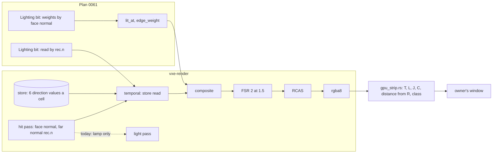

# 0061: Antialiasing: the far bands are back under the baked light; split them by measurement, read the store by the far normal, and pick by eye

> **Status:** in-progress (close review 2026-11-11: not clean, two majors; a dev fix pass is owed, see Close review), amended 2026-11-10 (review pass), amended 2026-11-11 (owner: read + face weights)
> **Created:** 2026-11-10
> **Milestone:** M2 in [`docs/roadmap.md`](../roadmap.md) (the upscaler and surface-look bullets;
> "a stable image" is the owner's one priority, 2026-11-03)
> **Related ADRs:** [ADR-0049](../adrs/0049-the-baked-light-is-read-by-the-far-shading-normal.md)
> (proposed; the store read by the far normal; Phase 1 can reject it, the window picks it or not),
> [ADR-0042](../adrs/0042-the-far-shading-normal-blends-to-the-27-count-gradient-by-the-voxels-size-on-screen.md)
> (the far normal; its setting gets its Outcome at this plan's close),
> [ADR-0034](../adrs/0034-fsr-2-ported-to-wgsl-as-the-default-upscaler-candidate.md) (FSR 2 at 1.5
> stays; its slow-pan Outcome is owed and written at this close),
> [ADR-0046](../adrs/0046-static-emissive-light-is-baked-per-chunk-when-a-chunk-loads-or-changes.md)
> (the store this plan reads, unchanged).
> **Source:** [`docs/backlog.md`](../backlog.md), "Antialiasing after the look-first light", with
> "Far normal range" and "Slow-pan verdict for FSR 2". The owner, Plan 0059's Phase 13 window
> (2026-11-09, the defaults: FSR 2 at 1.5, far normal `[2, 6]`, the baked light), at the hall: "a lot
> of aliasing on this step, doesn't look good".
> **Starts after:** Plan 0060 (the live queue) runs first. Phase 1 (readings, no file under
> `crates/`) runs beside it; Phases 2 to 5 wait for Plan 0060's merge into main (Owner answers, 5),
> because both plans edit `apps/flythrough/src/main.rs`, `apps/flythrough/src/hud.rs` and
> `crates/vxe-render/src/marcher.rs`. Plan 0060 touches no shader and no golden. The overlap in
> `temporal.wgsl`, `composite.wgsl`, `Lighting` and the goldens is with Plan 0058 (dynamic lights),
> which runs **after** this plan (the owner's order, 2026-11-10: 0060, 0061, 0058, 0044, 0045) and
> refreshes its phases against this plan's tip.

> **Amended 2026-11-10 (review pass, before any code).** The mechanism and the owner's five answers
> stand. What changed: Phase 1 gains a positive stop rule, so Phase 2 starts only on a reading that
> attributes the far bands to direction changes; the ordering reason above; the test files' `gpu_`
> names and the tiers by marks (`#[ignore = "soak"]`, `mod reading`); the read's rule under the
> whole-frame normal looks; a gate-sized staircase golden for the read; Phase 4 no longer asks for
> a per-adapter default (answer 4); Phase 5 names every site of the emitter cap and gives its
> re-bless a floor.

> **Amended 2026-11-11 (owner).** Phase 1 stopped at its done-when 3; the owner picked option 1,
> "read + face weights". Phase 2 builds ADR-0049's read as planned **plus a second `Lighting` bit**:
> `lit_at` (`composite.wgsl`) and `edge_weight` (`atrous.wgsl`) weigh their taps by the face normal
> (from `rec.axis`) instead of `rec.n`. `--lighting full` (`F6`) joins Phase 3's matrix and Phase 4's
> window as an existing comparison arm, its cost now read. Rewritten: Phase 1's stop rules 3
> (answered) and 5(i) (restated), Phase 2 (the second bit, its done-when, its key), Phase 3 (`R`
> normal beside `R` face; judged by edge ratio, `T` and the eye), Phase 4 and 5 (the light's
> resolution and weights as a pick), the Budgets, and ADR-0049 (proposed, edited in place: the
> weight rule). Phase 2 still starts only after Plan 0060 merges into main.

*The finding* ([the readings log](logs/0061.md), Phase 1, RTX, loaded, indicative). Under `baked`,
`[2, 6]` moves the far crops' energy just over 10 % against far normal off (native far wall
−10.6 %, FSR 2 dome −10.0 %); `[1, 2]` stays under. With the light passes at full resolution the
three far-normal arms read the same to the printed digit, so the far normal changes no light value:
ADR-0049's Context (the store is read by face) holds, and the 10 % comes from the half-resolution
grid. `lit_at` upsamples with `max(n.n', 0)^32` on `rec.n` and the a-trous `edge_weight` uses
`^128`; with the far normal on, a riser's and a tread's taps stop being orthogonal and mix, which
blurs the far crops and doubles FSR 2's still jumps (20 739 to 43 605). Full-resolution light alone
cut them to 1 309 and brought the far crops nearer `R` (dome 2.74 to 1.71 levels). The direction
bands remain at full resolution (far-crop edge ratio 2.52). Stop rule 5 holds in substance: no
far-crop pixel is `interior` (sub-pixel terraces class as silhouette), but across every class the
pixels at a direction change carry 97.4 % of the distance from `R`, and the edge ratio is 2.09 to
2.92 in every bin. Two caveats: `R` reads the store by face too, so it carries the same bands and
penalises ADR-0049's read by construction (hence `R` normal in Phase 3); and lavapipe at 384 x 216
does not reproduce the energy move (it does reproduce `T`'s rise).

*The cost of full-resolution light, read* ([the readings log](logs/0061.md), "Full-resolution
light cost": the hall, the baked defaults, FSR 2 at 1.5, `[2, 6]`, 600 frames, 3 alternated runs,
quiet; RTX at 2530 x 1378, Radeon RENOIR at 1280 x 720). It replaces the draft's guess of +6 to
+10 ms RTX.

| adapter | GPU p50, full against half | wall p50 / p99, full | denoise, full (line 3.0 ms) |
|---|---|---|---|
| RTX, lamp off | +3.41 ms (8.79 to 12.20) | 15.6 to 15.8 / 18.0 to 18.6 ms (p99 over 16.6) | 4.35 ms, +1.35 over |
| RTX, lamp on | +4.7 ms (9.5 to 14.2) | 17.8 to 17.9 ms p50, over 16.6 | 4.38 ms, +1.38 over |
| Radeon, lamp off | +3.81 ms (20.2 to 24.0) | 27.1 ms p50 (half already 23.3) | 5.28 ms, +2.28 over |

The lighting line (6.0 ms) holds in every arm; the cost is the denoise (a-trous +2.27, temporal
+0.98 ms RTX). Frame targets +56.8 MB RTX, +15.0 MB Radeon.

*Rejected, owner 2026-11-11:*

- Full resolution as the fix: +3.4 to +4.7 ms RTX, denoise over its line, and the direction bands stay (edge ratio 2.52); it stays an arm.
- ADR-0049's read alone: the half-resolution weights keep mixing a riser's and a tread's taps under the far normal, doubling the still jumps.
- Full resolution in the far band only: a new mechanism, ADR and plan before this one could go on; the most design work.

> **Amended 2026-11-10 (test cost, owner).** Phases 2 and 3 are **exploration** (lane rules 2b):
> the owner's window in Phase 4 is their gate. Each lands its CPU tests of data and API; the image
> tests they name (Phase 2's staircase golden, done-when 1b, and Phase 3's matrix bars) run as
> readings from `live/`, a `mod reading` or the strip tool, recorded in the readings log, and Phase 5
> writes them as tests against the picks (its done-when 2 already holds the staircase claim at the
> defaults). Per phase the gpu check runs only the `gpu_*` binaries the phase names
> (`test-changed.mjs --binaries`, Plan 0066); a named test over 10 s on lavapipe is born
> `#[ignore = "soak"]` (`docs/nfr.md` section 7). Phase 1 is readings already and is unchanged.

## TL;DR

The aliasing in the owner's still (`session13-hall-aliasing.png`) is mostly **ADR-0042's far bands,
back**: sub-pixel terraces on the hall's dome, walls and floor, each riser and tread lit by a
different value, folding into swirls and rings. By the code, the far normal no longer reaches the
light: since Plan 0059 a cube face's emissive part is the store's value for the face's own direction
(`temporal.wgsl`, `store_face(rec.axis, nf)`), and the blended normal `rec.n` reaches only the lamp,
which the hall runs off. That would also explain Phase 8d's "aliasing got much worse in hall", the
first window on the store. The edges are a smaller second class: FSR 2's jitter-locked jumps on
silhouettes and emitters (Plan 0056), and the edge dots it left at `[1, 2]`.

Phase 1 checks this by measurement before any mechanism: under the baked light, does the far normal
change the far crops at all, and which class carries the distance from a 4-ray reference? Phase 2
builds ADR-0049 behind a toggle: where the far normal's weight is above 0, the store is read as the
squared-cosine mix of the cell's direction values by the shading normal. It is exactly today's read
up close. Since Phase 1 (owner amendment, 2026-11-11) a second bit makes the half-resolution
light's filters weigh by the face normal, and `--lighting full` is a comparison arm. Phase 3 reads
the matrix and the edges left. Phase 4 is the owner's window. Phase 5 lands
the picks as defaults. The first thing anyone sees is a table: far normal on against off under the
baked light, which Phase 1 predicts reads the same.

## Context & problem

`project-context.md` (Rendering, P0): stable at arm's length in dark scenes. The owner, 2026-11-03:
"a stable image without any flicker or aliasing artiacts ... considering performance of course".
The figures touched: `docs/nfr.md` section 2 (frame: the light passes and the upscale line), section
3 (`frame_bytes`, unchanged by design).

**The windows so far, on the hall:**

| Window | Settings | Owner's words |
|---|---|---|
| Plan 0056 Phase 4 (2026-11-04) | FSR 2 at 1.5, `--steady b` (the per-face table), far normal cycled | "far normal 1..2 is the best, however aliasing artifacts is not gone completely" (edge dots on silhouettes and emitters' edges) |
| Plan 0059 Phase 8d (2026-11-08) | defaults, the store (`--light queue`), far normal `[2, 6]` | "aliasing got much worse in hall" (`session8c-img20.png`) |
| Plan 0059 Phase 8e (2026-11-09) | native, jitter off, lighting full, far normal `[1, 2]`, the store | "we need to work on antializing later, but much better than before" |
| Plan 0059 Phase 13 (2026-11-09) | defaults: FSR 2 at 1.5, far normal `[2, 6]`, the baked store | "a lot of aliasing on this step, doesn't look good" (`session13-hall-aliasing.png`) |

**Before these,** from the backlog entry this plan takes: Plan 0057's second window (2026-11-05),
"antializing next", the fast turn "still has artifacts"; at Plan 0059's Phase 3 verdict (2026-11-06)
the native reference's edges "Barely noticed", and the order "Cuts first, then AA".

**What the stills show (read by eye, not measured).** `session13-hall-aliasing.png` and
`session8c-img20.png`: contour lines over the whole far dome, the cyan wall and the floor, dashed
along their length; a riser reads as a dark dash and a tread as a lit strip. They follow the
surface's slope, as the terraces do. The near pillars show honest stair edges (the default look).
Stalactite and pillar silhouettes and the white crystals' blocks are sharp. This is the picture
ADR-0042's Context describes and the far normal was built to remove.

**Why the far normal stopped working, by the code (to be confirmed by Phase 1).** Checked at 9ce251d:

- The hit pass blends the shading normal (`march.wgsl`, `far_normal_weight`, `gradient27_normal`)
  and writes it to the hit record (`rec.n`).
- The temporal pass reads a cube-face hit's emissive part from the store:
  `nf = shadow_normal_of(rec, ray.d)`, `store_brick_value(store_voxel(rec.p, nf), store_face(rec.axis, nf))`:
  the face direction, the same value at every pixel of the face, no screen history. `rec.n` is not
  read.
- `rec.n` reaches `light.wgsl` (the lamp's `lamp_lit` call) and the weights of `lit_at` and `atrous.wgsl`.
- So at the hall, lamp off, the far normal costs the hit pass (Plan 0056 Phase 3: RTX hit 4.34 ms
  against `face`'s 2.85 at the showcase start, RADV 21.1 against 14.5) and should change no lit value.
- The store holds per 8-voxel cell six direction values, each the mean of that direction's faces, and
  a face reads the 2 x 2 cells around it in its plane (ADR-0046's Outcome). A far riser and its tread
  read two different values of the same cell.

**What Plan 0056 measured, under the eye lamp (`E`), still relevant:** native is bit-identical at
rest, and its pan's crawl is creases (64 %) and silhouettes (35 %) without the far normal; the far
normal halves native's crawl (`C` 2.90 to 1.03). FSR 2 at 1.5's still jumps sit on silhouettes and
emitters, 0.76 locked to the jitter; without the far normal they rise from 4766 to 221 412. `[1, 2]`
reads about seven times `[2, 6]`'s still jumps under `E`, and the owner picked it by eye anyway. The
floor's rings are its 1-voxel terraces, world-anchored (R1, R3). The emitter cap was a fault; jitter
phases 8 and the static dither stay opt-in knobs. The rig is `apps/flythrough/tests/gpu_strip.rs`
(its run is `reading::strip_run`, in the file's `mod reading`) with
`tests/support/aliasing.rs` (`T`, `L`, `J`, `C`, the class mask, the guard, `R`).

**The defaults today** (`apps/flythrough/src/lib.rs`, `LookPreset::DEFAULT`): face, far normal
`[2, 6]`. The owner's `[1, 2]` from Plan 0056 never landed; the far-normal plan it asked for is this
one.

## Decision

**A reading first, then one mechanism behind a toggle, then the owner's window, then defaults.**

- **Phase 1 attributes** the hall's aliasing under the baked light into Plan 0056's classes, plus one
  new reading: far normal on against off, under the store and under `E`. The code read predicts no
  change under the store. Two stop rules send the plan back: one if that is false, one if the
  class table does not put the far crops' distance from the reference on direction changes.
- **ADR-0049** (proposed) is the mechanism for the far bands: where the far normal's weight is above
  0, a cube-face hit reads the store as `sum_a n_a^2 value(cell, dir_a(n))` over the directions the
  cell holds, renormalised. At weight 0 it is today's read to the bit. No storage, no pass.
- **The half-resolution light's filters weigh by the face normal** (ADR-0049, the weight rule;
  owner 2026-11-11), a second `Lighting` bit: `lit_at`'s upsample and the a-trous `edge_weight`
  compare the taps' face normals, not `rec.n`, so a far riser's and tread's taps stay apart while
  the read makes their values smooth. Phase 1 read the mixing under `rec.n` as the far normal's
  10 % energy move and its doubled still jumps.
- **Full-resolution light (`--lighting full`) is a comparison arm**, not the mechanism: read at
  +3.4 ms RTX (lamp off), it goes to the window beside the bits; a default flip to it owes a new
  ADR on ADR-0018's resolution pick.
- **The edges are read, not fixed:** jitter phases, sharpening and FSR 2 at scale 1 already exist
  as knobs and go to the window. A mechanism for them is a later plan if the window asks for one.
- **The far normal's setting is picked again** under the new read, since `[1, 2]` was picked under
  the table's light, and ADR-0042 gets its Outcome at this plan's close.

We rejected **FSR 2 at scale 1 or native as the default**, because they double the march (Plan 0056:
20.6 against 8.7 ms in the window) and a finer staircase of two lights is still stripes; they stay
opt-in. We rejected **a footprint-prefiltered store** (ADR-0049 Alternative B), because the cell
already holds the six values the blend needs. We rejected **a screen-space blur of the stored part**,
because it is camera-anchored and crawls under motion, as the static dither did. We rejected **a
fix for the edges now**, because no reading under the baked light has attributed them yet.

## Architecture diagram



## Implementation phases

Each phase ships as its own commit. `dev` implements all dev phases in one session; the architect
reviews once at the end, in a fresh session. Readings go to `docs/plans/logs/0061.md` (from the
readings-log template). Sweeps on the RTX 3080 Laptop (`VXE_TEST_ADAPTER=rtx`, labelled), each
reading run under the perf lock and the memory cap; done-when asserts on lavapipe. Per phase:
`node scripts/test-changed.mjs --profile quick`, and `--profile gpu` under the perf lock on a phase
that changes `crates/vxe-render` or a GPU test; clippy, fmt. At the tip: `cargo nextest run
--workspace --profile gate` under the perf lock, doctests, clippy, fmt, deny, the doc and tier gates.

**Tiers by marks** (`.config/nextest.toml`, `scripts/check-test-tiers.mjs`). The strip rig's run is
`reading::strip_run` in `gpu_strip.rs`'s `mod reading`, `#[ignore]`d, run by hand with
`cargo nextest run --release -p flythrough --test gpu_strip --run-ignored only --no-capture -E 'test(=reading::strip_run)'`.
**Every measurement this plan adds to `gpu_strip.rs` (the direction-map read, Phase 3's matrix, the
lavapipe re-read) is an arm of `strip_run` or a new `#[ignore]`d test inside `mod reading`**; an
`#[ignore]` anywhere else fails the tier gate. A test that asserts and reads over 30 s on lavapipe
is marked `#[ignore = "soak"]`, its phase's log says so, and its claim keeps a gate-sized test.
The wall times below are estimates until a phase reads them.

### Phase 1: Which aliasing it is, under the baked light

- **Owner skill:** dev
- **What:** the strip rig on the fly-through's default light, and the first table: what the far
  normal does under the store, and which class carries the hall's distance from the reference.
- **The rig:** `VXE_STRIP_LIGHT=baked` runs the fly-through's default light: the store baked over the
  view before the read (the rig `apps/flythrough/tests/gpu_bake.rs` uses for its rest readings; dev
  states which), lamp off, the shot's exposure. A new read beside Plan 0056's z-level map: the **direction
  map**, a pixel's store direction (`store_face`), and the share of image-edge pixels (a neighbour 2
  levels apart) within 1 pixel of a direction change against the share elsewhere. `R` is `off` at 3840
  x 2160 with the far normal scaled to native's voxels (`[2, 4]` for `[1, 2]`, `[4, 12]` for `[2, 6]`, as Plan 0056),
  box-filtered to 1920 x 1080, four rays a pixel. Plan 0056 left `R` not bit-identical at rest (max 26):
  dev reads why first, or states it unread.
- **Arms, the hall, 1920 x 1080:** light `baked` and `E`; upscaler FSR 2 at 1.5, `off`, and `R`; far
  normal off, `[1, 2]`, `[2, 6]`. Still (72 frames over 4 cycles, settle 512) and the pan at 1 px a
  frame (240 frames); the fast yaw at 10 px a frame for the defaults and native. One row at the
  window's size, 2530 x 1378, for the defaults. The `albedo` view at the hall, to show the material is
  one colour where the bands are.
- **Files touched:** `apps/flythrough/tests/gpu_strip.rs`, `apps/flythrough/tests/support/aliasing.rs`,
  `docs/plans/logs/0061.md` (new).
- **Done when:**
  1. `the_direction_map_names_each_face_direction` (no GPU, under 1 s; it lives with the support
     module's own tests, so it runs in a CPU binary if one hosts them and in `gpu_strip` otherwise,
     dev states which): a hand-built grid of hits on
     a two-step staircase gives each pixel its `store_face`, and the edge share counts a luma step at a
     direction change and not one inside a face.
  2. **The far normal under the store, in the log (RTX):** the far crops (dome 800,0 700x250; far wall
     780,230 640x360) under `baked`, FSR 2 and native, far normal off against `[1, 2]` and `[2, 6]`:
     the guard's energy, the distance from `R`, `T` still. Beside it the same under `E`, where Plan
     0056 read the far normal lowering the far wall's and dome's energy.
  3. **The stop rule, the code read.** If under `baked` the far normal moves the far crops' energy
     by more than 10 % against off, at either setting, the code read above is wrong and the bands
     have another source: dev stops for an architect amendment before Phase 2. The log gives the
     figure either way. **Answered 2026-11-11 (owner):** met at `[2, 6]` (−10.6 % native far
     wall, −10.0 % FSR 2 dome); the source is the half-resolution filters' weights on `rec.n`,
     not the store's read, and Phase 2's second bit is the answer.
  4. **The class table under `baked`, in the log:** for the defaults and native, the share of `T`
     jumps, `C` jumps and the distance from `R` on interior, seam, crease, silhouette, emitter and
     miss pixels, by footprint (under 2, 2 to 6, over 6 internal pixels), and the direction map's edge
     ratio by 10 m bins of `t`. The log names in one line each: the largest class by distance from `R`,
     the largest by `C`, and whether the bands are world-anchored (the eye moved 16 voxels, as Plan
     0056's R3).
  5. **The stop rule, the attribution.** Phase 2 builds a fix for direction changes, so it starts
     only if the reading puts the bands there. Both must hold on the far crops under `baked` at
     the defaults: (i) the pixels within 1 pixel of a direction change, across every class, carry
     the largest share of the distance from `R` against each class's pixels inside one direction
     (restated 2026-11-11: the far crops hold no `interior` pixel, since sub-pixel terraces class
     as silhouette; met, 97.4 %); (ii) the direction
     map's edge ratio in the bins beyond the far normal's band start is above 2 (an image edge is
     more than twice as likely at a direction change as elsewhere; a ratio near 1 says the edges
     are not the store's directions). If either fails (silhouettes, emitters or seams carry the
     distance, or the ratio is near 1), dev stops for an architect amendment before Phase 2 and
     the log names the class that leads. The threshold 2 is a proposal; the log gives the figures
     either way. (ii) met: 2.09 to 2.92 in every bin, 2.64 pooled.
  6. **The re-read on lavapipe,** per lane rule 9c: the far crops' guard and `T` for `baked`, far normal
     off and `[2, 6]`, FSR 2 at 384 x 216, as an arm of `reading::strip_run` (no tier runs it). The
     log says whether it agrees.

### Phase 2: The store read by the far normal and the filters weighed by face (ADR-0049), behind two toggles

- **Owner skill:** dev
- **What:** ADR-0049's read in `temporal.wgsl` and its weight rule in `composite.wgsl` and
  `atrous.wgsl`, two `Lighting` bits off in the library, a fly-through flag and key for each that
  show their mode, their tests and their cost. Starts after Plan 0060 merges into main.
- **The read:** at a cube-face hit with `rec.n` not equal to the face normal, for each axis `a` with `n_a^2` above 1e-4, `store_brick_value(voxel, 2a + (n_a > 0))` at
  the hit's voxel; the values with `w > 0` summed by `n_a^2` and renormalised; the face's own read
  where none has a value. The hit face's term is today's call. The counters `store[0..2]` count the
  hit face's read as today. The glass's reflected share (`march.wgsl`, `glass_store_value`) is not
  changed.
- **Which pixels that is, by look.** Under `--look face` (the default) `rec.n` leaves the face
  normal only where the far normal's weight is above 0, so near faces keep today's read to the bit
  (done-when 2). Under the whole-frame normal looks, `gradient27` and `trilinear8` (opt-in), `rec.n`
  is the look's normal at every distance, so with the knob on the stored part follows it on near
  faces too: the light reads the same normal the lamp already does there. That is the rule, not a
  side effect; done-when 2 covers it with a finite-and-renormalised check, and those looks get no
  golden. The field look's hits do not read the store by face (`reads_store`), so the knob does not
  reach them.
- **The weights (the second bit).** With it on, `lit_at`'s 2 x 2 upsample weight
  (`max(n.n', 0)^32`) and the a-trous `edge_weight` (`max(n.n', 0)^128`) take the dot of the two
  hits' face normals instead of their `rec.n`: the unit vector on `rec.axis`, signed against the
  view ray as `shadow_normal_of` signs it (dev states how each pass gets the ray to a tap). A hit
  with no face axis (`rec.axis < 0`: the field look, a miss) keeps `rec.n`. The plane term
  (`exp(-plane / SIGMA_PLANE)`) keeps `rec.n` (a proposal: it measures distance from the surface,
  not direction; dev reads the far crops with it on `rec.n` and on the face normal and logs both).
  Under `--look face` with the far normal's weight at 0, `rec.n` is the face normal, so the bit
  changes no near pixel. Under `--lighting full`, `lit_at` reads its own pixel and only the a-trous
  weight moves. The temporal pass's history weights are not changed.
- **The window:** `--store-read face|normal` (default `face` in this phase); a key cycles it (`Comma`
  reads free at 9ce251d; dev moves it if taken and says so). `--light-weights normal|face` (default
  `normal`, today's) and a key that cycles it (`Semicolon`, free at 0d9f782; the same rule). The
  banner and the stats HUD's aliasing row show `store read face|normal` and `weights normal|face`
  beside the far normal and the light's resolution (`F6`), the whole time.
- **Files touched:** `crates/vxe-render/src/shaders/temporal.wgsl`,
  `crates/vxe-render/src/shaders/composite.wgsl` (`lit_at`), `crates/vxe-render/src/shaders/atrous.wgsl`
  (`edge_weight`), `crates/vxe-render/src/marcher.rs`
  (the two `Lighting` bits and their docs), `crates/vxe-render/src/lib.rs` if the bits are re-exported,
  `apps/flythrough/src/main.rs`, `apps/flythrough/src/hud.rs`, `apps/flythrough/src/lib.rs`,
  `apps/flythrough/tests/gpu_look.rs` (the staircase tests and their golden under
  `apps/flythrough/tests/golden/`), `apps/flythrough/tests/gpu_hud_golden.rs` if the row's golden
  changes, `docs/plans/logs/0061.md`, `docs/nfr/02-frame-budget.md`.
- **Done when:**
  1. `a_far_staircase_reads_the_mix_of_its_two_directions` (lavapipe, a guess of under 20 s; if it
     reads over 30 s it is marked `#[ignore = "soak"]`, the log says so, and done-when 1b carries
     the claim in the gate): a 45-degree staircase of 1-voxel steps rising
     along +x, its store filled so that a tread's (+z) value is `Vz` and a riser's (-x) is `Vx`, with
     `Vz` four times `Vx` (by hand or by a bake, dev states which); a 192 x 108 view, 70 degrees
     horizontal, far normal `[1, 2]`. The far-normal weight is 1 where `px <= 1`, that is
     `t >= 192 / (2 tan 35 deg) = 137.1` voxels, and 0 where `t <= 68.6`. Knob on: every hit pixel
     with `t >= 140` reads the stored part within 1 % of `n_x^2 Vx + n_z^2 Vz`, with `n` the hit
     record's normal (for a perfect 45-degree staircase `(Vx + Vz) / 2`; dev logs the gradient read
     there); knob off, the same pixels read `Vx` or `Vz` within 1 % and both occur.
  1b. `a_small_far_staircase_reads_the_mix_and_matches_its_golden` (lavapipe, a guess of under 10 s;
     the gate-sized variant, always in the gate): the same world at 96 x 54, so the weight is 1
     from `t >= 96 / (2 tan 35 deg) = 68.6` voxels and 0 at `t <= 34.3`. Knob on, every hit pixel
     with `t >= 72` holds the claim of done-when 1; knob off, both `Vx` and `Vz` occur there. The
     knob-on frame matches a new golden, `far_staircase_store_normal.png`, at the harness's floor
     (at most 0.1 % of pixels over 2/255), blessed on lavapipe. This is the golden of
     `store read normal`; the showcase hall's golden is a soak test
     (`showcase_hall_golden_is_lit_by_its_four_ores`, `#[ignore = "soak"]`) and gates nothing.
  2. `the_store_read_by_normal_leaves_near_faces_alone` (lavapipe, same world, under 10 s, an
     estimate): under `--look face`, every pixel with `t <= 64` at 192 x 108 reads the same stored
     part to the bit with the knob on and off, and the whole frame is bit-identical with the far
     normal off. Under `gradient27` and `trilinear8` with the knob on, every stored part read is
     finite, and a pixel whose three direction values are equal reads that value within 1e-5 (the
     weights renormalise).
  2b. `the_face_weights_leave_near_faces_alone` (lavapipe, the same world at 96 x 54, under 10 s,
     an estimate): under `--look face` with the far normal off, the whole frame is bit-identical
     with the weights bit on and off, at half and at full light resolution. (No per-pixel claim
     with the far normal on: the a-trous passes carry a far tap's weight across most of a
     96 x 54 frame, so a near pixel may move by its far neighbours.)
  3. `the_store_read_toggle_shows_in_the_banner` (no GPU, under 1 s): each flag parses its two
     modes and refuses anything else; each key changes the banner's and the row's text to each of
     its modes, and the row names the light's resolution.
  4. Both knobs off: the existing goldens unchanged (`gpu_golden.rs`, `gpu_castle_golden.rs`),
     `frame_bytes` as main's.
  5. **The weights' claim, a reading in the log (RTX, the strip rig's Phase 1 conditions):** the
     far crops' guard energy under `baked`, FSR 2 at 1.5 and native, far normal `[1, 2]` and
     `[2, 6]`, weights bit on (read off and on), against far normal off; and FSR 2's still jumps
     beside Phase 1's 20 739 (far normal off) and 43 605 (`[2, 6]`). The bit exists for the energy
     to stay within 10 % of far normal off; a miss is named in the log and goes to Phase 3 and the
     window as a reading, not a stop (the phases before the window are exploration).
  6. **Cost, in the log and `docs/nfr/02-frame-budget.md`:** the temporal, composite and a-trous
     passes and the GPU frame with each knob off and on, far normal `[1, 2]` and `[2, 6]`,
     `flythrough --headless --frames 300` at the hall shot and `--level --pose vein`, RTX at
     2530 x 1378 and RADV RENOIR at 1920 x 1080, three alternated rounds, perf lock, load per run.
     Proposed lines, guesses: the read +0.3 ms RTX and +1.5 ms RADV at the hall, the weights about
     0; a miss goes to the window as a cost, not a stop. `--lighting full` is not re-read here:
     its cost is the readings log's "Full-resolution light cost".

### Phase 3: The matrix with the read, the edges left, and the window's runner

- **Owner skill:** dev
- **What:** Phase 1's tables again with the two knobs and full-resolution light, the edge knobs
  that exist, and a runner for Phase 4.
- **Arms (hall, `baked`; the level's `vein` and `patch` for the defaults and the pick):** store read
  `face` and `normal`; weights `normal` and `face`; light `half` and `full` (`--lighting full`, the
  comparison arm: no new code, its cost already read); far normal off, `[1, 2]`, `[2, 6]`; FSR 2 at
  1.5, native, FSR 2 at 1 with the far normal scaled to the same voxels (`[1.5, 3]` for `[1, 2]`);
  for the edges, at the knobs' best arm: `--jitter-phases 8`, `--sharpen 0.25`. Still, the 1 px
  pan, the 10 px yaw. Not every product: dev names the arms run and why (the bits are read on and
  off at each far normal and resolution; the edge knobs and FSR 2 at 1 at the best arm only).
- **Two references.** `R face` is Phase 1's `R` (it reads the store by face, so it carries the
  direction bands and penalises the read by construction). `R normal` is the same `R` with the
  store read on, far normal scaled as Phase 1 (`[2, 4]`, `[4, 12]`). Every arm's distance is given
  from both. Neither is ground truth for the read; the plan judges it by the edge ratio, `T` and
  the eye.
- **Files touched:** `apps/flythrough/tests/gpu_strip.rs` (the matrix's arms, inside `mod reading`),
  `apps/flythrough/tests/support/aliasing.rs`, `docs/plans/logs/0061.md`, `live/session61.sh`
  (local, untracked; named as Plan 0060's `live/session60.sh`).
- **Done when:**
  1. Every arm's `T`, `L`, `J`, `C`, distance from `R face` and from `R normal`, the direction
     map's edge ratio by bin, and the guard are in the log, with the class table of what is left
     at the knobs' best arm.
  2. The log names, in one line each with its reading, for the read, the weights and full
     resolution, each against its off arm: the far crops' edge ratio (the direction bands' own
     measure: toward 1 is the bands gone); `T` still and the pan's `C`; the distance from both
     references; whether the guard's energy fell below `R`'s (a blurred arm wins `T`, so a fall
     below `R` by more than 10 % is named as blur); the class now largest; what the edge knobs
     move. "Best arm" is the lowest edge ratio without blur, with `T` beside it; the log says
     which arm that is, and the eye decides in Phase 4.
  3. The runner prints and runs Phase 4's steps one by one, each started on Enter, under the perf lock
     and the memory cap, stdout on screen and teed to a log, and pings the owner when ready.

### Phase 4: The owner's window

- **Owner skill:** human
- **What:** the release fly-through on the RTX, one sitting of about 20 minutes, plus one Radeon run.
  Every toggle below shows in the banner and the HUD row.

  ```
  cargo build --release -p flythrough
  # 1. The hall, still: a minute each. Comma (store read), Semicolon (weights),
  #    F6 (light half or full), V (far normal), F10 (upscaler).
  target/release/flythrough --source showcase --shot hall --hud
  # 2. The hall, a slow pan and a head turn. The same keys.
  target/release/flythrough --source showcase --shot hall --hud --pan 1.1
  target/release/flythrough --source showcase --shot hall --hud --pan 4.5
  # 3. The hall, flown: fly in, turn fast, dig once.
  target/release/flythrough --source showcase --shot hall --hud
  # 4. The level: vein and patch, near and far.
  target/release/flythrough --level --seed 1 --pose vein --lamp off --hud
  target/release/flythrough --level --seed 1 --pose patch --lamp off --hud
  # 5. FSR 2 at 1 with the pick, as a quality setting.
  target/release/flythrough --source showcase --shot hall --hud --upscaler fsr2 --internal-scale 1
  # 6. The Radeon, the hall at the pick.
  target/release/flythrough --adapter RADV --source showcase --shot hall --hud
  ```

  Dev's runner adds the pick's flags to each step once Phase 3 names them.
- **Files touched:** `docs/plans/logs/0061.md`.
- **Done when:** the log has the owner's words on: (a) the store read, `normal` or `face`; (b) the far
  normal's setting, or off; (c) what is still seen, by class and scene (bands, rings, silhouettes,
  emitters' edges, the edge dots); (d) whether an edge fix is wanted and what it may cost; (e) FSR 2
  at 1 as a quality setting, yes or no; (f) what the Radeon run showed at the pick, as words for
  the log; (g) the light's filters and resolution: half with face weights, half with `rec.n`
  weights, or full (read at +3.4 ms RTX lamp off, +3.8 ms Radeon; the readings log's
  "Full-resolution light cost"). The Radeon keeps the same default (owner answer 4); a per-adapter
  default is the render-settings plan's question, not this window's.

### Phase 5: The picks as defaults

- **Owner skill:** dev
- **What:** the window's answers in the defaults, the dead knob out, the goldens re-blessed.
- **The changes:** `LookPreset::DEFAULT` takes the far normal of (b); the fly-through's store read
  takes (a) (the library default stays `face`); `Fsr2Settings::emitter_cap` and `--emitter-cap` are
  removed (Plan 0056's verdict: a fault); `--jitter-phases` and `--dither` stay opt-in or go, as (c)
  and (d) say, and the log states which. If (a) is `face`, the read stays as an opt-in knob or is
  removed, as the owner says. The fly-through's weights and light resolution take (g) (the
  library defaults stay `normal` weights and half). If (g) is full, the architect writes a new
  ADR on ADR-0018's resolution pick before this phase lands it, and the denoise line's miss
  (4.35 ms against 3.0 ms RTX) is recorded in `docs/nfr/02-frame-budget.md`.
- **Files touched:** `apps/flythrough/src/lib.rs`, `apps/flythrough/src/main.rs` (the flag, its
  field and its banner test), `apps/flythrough/src/hud.rs` (`fsr2_knob_words`). The emitter cap's
  sites: `crates/vxe-render/src/fsr2.rs` (`Fsr2Settings::emitter_cap`),
  `crates/vxe-render/src/marcher.rs` (the `Params` field and its fill),
  `crates/vxe-render/src/shaders/march.wgsl` (`Params.emitter_cap`),
  `crates/vxe-render/src/shaders/composite.wgsl` (the cap's read), `apps/flythrough/tests/gpu_strip.rs`
  (`VXE_STRIP_EMITTER_CAP` and its doc line). Then `apps/flythrough/tests/gpu_golden.rs`,
  `gpu_castle_golden.rs` and their `golden/` images, `apps/flythrough/tests/gpu_look.rs`,
  `apps/flythrough/tests/gpu_settle.rs`, `docs/plans/logs/0061.md`, `docs/nfr/02-frame-budget.md`.
  Removing `Params.emitter_cap` changes `march.wgsl`, which the bake compiles: a store written to
  a `--bake-file` re-bakes once (ADR-0047, Negative).
- **Done when:**
  1. `the_default_look_is_the_windows_pick` (no GPU, under 1 s): `LookPreset::DEFAULT.far_normal`,
     the fly-through's default store read, weights and light resolution equal the log's (a), (b)
     and (g), and the banner's first row names them.
  2. Phase 2's gate-sized staircase test (done-when 1b) runs at the defaults and holds its claim
     (or, if (a) is `face`, its knob-off half); it is in the gate whether or not the 192 x 108 test
     went to soak. If (b) is not `[1, 2]`, its distances follow the picked band and the plan's log
     gives the arithmetic.
  3. `--emitter-cap` is refused as an unknown flag, `VXE_STRIP_EMITTER_CAP` is gone from the rig,
     and no shader or `Params` field names the cap (`the_emitter_cap_is_gone`, no GPU, under 1 s,
     for the flag; a grep line in the log for the rest).
  4. Re-blessed goldens on lavapipe, each with its old and new image's mean and max difference in the
     log, and the reason (the far normal, the read, the weights or the resolution). The floor: a
     golden none of whose pixels has a far-normal weight above 0 under the old or the new band does
     not move (max difference 0), unless (g) is full, which moves every lit golden and the log
     says so; dev lists which those are; every re-blessed golden passes its own test at the
     harness's floor on a second run. The hall's golden is a soak test, so its re-bless is run by
     name with `--run-ignored only` and the log says so; it is not part of the gate.
  5. The default's cost on both adapters at the hall and the vein, three rounds, in the log and
     `docs/nfr/02-frame-budget.md`, against Phase 1's default row.

## Data shapes

```wgsl
// illustrative: temporal.wgsl, the stored part at a cube-face hit
fn store_value_by_normal(voxel: vec3<i32>, face: u32, n: vec3<f32>) -> vec4<f32> {
    var sum = vec3<f32>(0.0);
    var weight = 0.0;
    for (var a = 0u; a < 3u; a++) {
        let w = n[a] * n[a];
        if (w < 1e-4) { continue; }
        let r = store_brick_value(voxel, 2u * a + select(0u, 1u, n[a] > 0.0));
        sum += r.xyz * (w * r.w);
        weight += w * r.w;
    }
    if (weight > 0.0) { return vec4<f32>(sum / weight, 1.0); }
    return store_brick_value(voxel, face);
}
```

```wgsl
// illustrative: the weights bit, in lit_at and edge_weight; face_normal_of is
// shadow_normal_of's face branch with the view ray to that hit
let na = select(a.n, face_normal_of(a), weigh_by_face && a.axis >= 0);
let nb = select(b.n, face_normal_of(b), weigh_by_face && b.axis >= 0);
var c = max(dot(na, nb), 0.0); // then ^32 (lit_at) or ^128 (edge_weight), as today
```

No new buffer, binding or stored byte. Two `Lighting` bits; `--lighting full` (an existing
knob) adds its frame targets (+56.8 MB RTX at 2530 x 1378) only when picked.

## Budgets

Against `docs/nfr.md` section 2 and `docs/nfr/02-frame-budget.md`. Today's figures are Plan 0056's
(table light) until Phase 1 re-reads the defaults under the store:

| Figure | Today | This plan |
|---|---|---|
| GPU frame, RTX 3080 Laptop, 2530 x 1378, showcase start, defaults | 11.99 to 13.55 ms (Plan 0056, loaded in round 3) | Phase 1 re-reads; Phase 2 adds the read's cost, proposed +0.3 ms (a guess) |
| GPU frame, RADV RENOIR, 1920 x 1080, showcase start | 54.95 to 56.18 ms | proposed +1.5 ms (a guess); the slow adapter is far over 16.6 ms already |
| Hit pass, far normal `[2, 6]` against `[1, 2]` against `face` | RTX 4.34 / 3.37 to 3.77 / 2.85 ms; RADV 21.1 / 17.0 / 14.5 ms | a pick of `[1, 2]` saves about 0.6 to 1 ms RTX and 4 ms RADV against today's default |
| Upscale line, 1.5 ms | FSR 2 2.93 to 3.15 ms RTX, 9.95 to 10.0 ms RADV | unchanged; FSR 2 at 1 (opt-in) about 5 ms RTX |
| `frame_bytes` | unchanged by design | Phase 2 done-when 4 checks it |
| `--lighting full` against half (the arm), the hall, baked, `[2, 6]` | read 2026-11-10 at 68b7575: RTX lamp off GPU p50 +3.41 ms, wall p99 18.0 to 18.6 ms; lamp on +4.7 ms; Radeon +3.81 ms; denoise 4.35 ms against its 3.0 ms line | a pick of full misses the denoise line and the RTX's p99; Phase 5 records it and owes an ADR |

**Review note (2026-11-10, the static performance review; an estimate, nothing was run).** The
+0.3 ms guess for Phase 2's read may be low. The read is `store_brick_value`, up to three of
them where there is one today, and that read is what took the temporal pass from 0.39 to
1.54 ms in Plan 0059 (full tier): through an atomic binding each one re-reads the store's
header per tap. Where the hall is mostly far band, +1 ms or more is plausible at the full
tier. [Plan 0065](done/0065-the-baked-lights-waste-atomics-a-filter-of-zeros-and-a-scan-per-frame.md)'s
Phase 2 makes the read cheaper, and **Phase 2 here starts after Plan 0065 merges** (owner,
2026-11-10; `docs/plans/README.md`, Sequence). Phase 2 here reads the temporal pass by itself, at the half
and the full tier, so the read's cost is not lost in the frame figure.

The close measures with `flythrough --headless --frames 300`, three alternated rounds, perf lock,
both adapters, as in Phase 2. Test times are named per phase and are estimates; none is planned
over the 30 s line of `docs/nfr.md` section 7, and one that reads over it is marked
`#[ignore = "soak"]` with a gate-sized test kept for its claim. The upscale line is already missed
under the FSR 2 default (the table's row); this plan reads its delta and does not claim the line.

## Risks & open questions

- **The code read may be wrong** (a path that reads `rec.n` for the stored part that this draft
  missed): Phase 1's stop rule catches it before any mechanism.
- **The blend may read as plastic** near the band's start, as whole-frame `gradient27` did (ADR-0042).
  The band sits where a voxel is under 2 pixels, and the owner judges it in the window.
- **A cell's direction mean leaks** (ADR-0046's Alternative E): a riser value from another room's
  faces spreads onto far treads. Read in the class table; a dark or bright cast at distance is the
  sign.
- **Face weights may bring back half-resolution blocks at distance.** With a far riser's and
  tread's taps apart, `lit_at` falls back to fewer taps (or the nearest) where the steps are under
  a light cell, which is far normal off's filtering. The read is meant to make the two taps' values
  agree there; if it does not, the bit trades blur for blocks. Phase 2 done-when 5 and Phase 3
  read it; the window judges it beside full resolution.
- **The far normal's band is in internal pixels:** comparisons across scales use the scaled settings
  named in each phase.
- **The attribution may not hold.** The stills were read by eye; if Phase 1's class table puts the
  distance from `R` on silhouettes or emitters, ADR-0049 is not the fix and Phase 1's second stop
  rule sends the plan back before any shader changes.
- **Plan 0058 rewrites the same paths afterwards** (`temporal.wgsl`'s direct pair, `composite.wgsl`,
  the `Lighting` bits, the lamp path the `E` readings rest on). The `E` rows here are read before
  it lands and are not comparable after; Plan 0058 says so on its side.
- **`R` is not bit-identical at rest** (Plan 0056's unread max 26): Phase 1 reads why or says so.
- **Determinism and threading:** nothing touches `vxe-world` or the bake. The read is per pixel and
  reads no random number, so a still frame stays bit-identical at native.

**Open questions for the owner** (drafted with the recommended option first; answered 2026-11-10, see Owner answers):

1. **The fix for the far bands.** (a) ADR-0049's store read by the far normal, judged in the window
   (recommended: no storage, exact up close, cheap); (b) FSR 2 at scale 1 as the default, at about
   twice the march; (c) a footprint-prefiltered store (ADR-0049 Alternative B), more storage and a
   bake step; (d) none: the bands are the cubes' look.
2. **The far normal's setting.** (a) Picked again by eye in Phase 4 under the new read, `[1, 2]`
   against `[2, 6]` against off (recommended: `[1, 2]` was picked under the table's light); (b) land
   `[1, 2]` now in Phase 2, as Plan 0056's verdict said, and judge only the read.
3. **The edges (silhouettes, emitters' edges, the edge dots).** (a) Read in Phases 1 and 3 and shown
   with the existing knobs; a fix is a later plan if the window asks (recommended); (b) add a phase
   now that tries jitter phases 8 as the default; (c) FSR 2 at 1 as a quality setting the fly-through
   offers on a key.
4. **The Radeon.** (a) One default on both adapters, its cost read and recorded; profiles wait for the
   render-settings plan (recommended); (b) the slow adapter starts in `--look face` with the read off.
5. **The start.** (a) Phase 1 now beside Plan 0060, Phases 2 to 5 after it merges (recommended:
   Phase 1 touches no file under `crates/`, and both plans change `temporal.wgsl`); (b) all after Plan
   0060 merges; (c) all now, as a parallel lane.

## Owner answers

The owner, 2026-11-10, to the open questions above:

1. **The fix for the far bands:** (a), ADR-0049's store read by the far normal, judged in the window.
   ADR-0049 stays proposed until this plan's close.
2. **The far normal's setting:** (a), picked again by eye in Phase 4 under the new read.
3. **The edges:** (a), read in Phases 1 and 3 and shown with the existing knobs; a fix is a later
   plan if the window asks.
4. **The Radeon:** (a), one default on both adapters, its cost read and recorded.
5. **The start:** Plan 0060 runs first. Phase 1 runs beside it; Phases 2 onward wait for Plan 0060's
   merge into main. (The draft's reason, "both plans change `temporal.wgsl`", was wrong: Plan 0060
   touches no shader. The shared files are `main.rs`, `hud.rs` and `marcher.rs`; the header says
   so.)

## What this plan does NOT do

- Change the store, its bake, its cells or its queue (ADR-0046; Plan 0060).
- Add MSAA, analytic coverage, a new upscaler or a footprint-prefiltered store.
- Fix the silhouettes', emitters' or edge dots' jumps: read only; a later plan if the window asks.
- Change the generators' terraces (the consumer's geometry), or the glass's reflected share.
- Remove `own` or any upscaler, or re-base the frame ledger's `own` line. Removing `own` is its own
  small plan, owed and not yet drafted ([`docs/backlog.md`](../backlog.md); the owner, 2026-11-10);
  Plan 0045 stays a structure move and does not remove it.
- Render profiles per adapter (backlog, "render settings + profiles").
- Write ADR outcomes: the architect writes ADR-0042's and ADR-0034's at the close, and accepts or
  rejects ADR-0049.

## Implementation log

> Written by `dev`: one row per phase as its commit lands, then the close block. **The phases
> above are the contract. This section records what happened.** Observations, never conclusions:
> no pass list, no self-assessment. Deviations and unmet done-whens are **always** disclosed.
> Keep it shorter than `## Implementation phases`. Readings, gate counts, attempts, sweeps and
> resume notes go to the plan's readings log, `docs/plans/logs/0061.md` (started from
> `templates/readings-log.md`), and this section links it once it exists.

| phase | owner | state | commit |
|---|---|---|---|
| 1: Which aliasing it is, under the baked light | dev | readings in; stop rule 3 met (done-when 3), answered by the owner's amendment; see [the readings log](logs/0061.md) | e79620f |
| 2: The store read by the far normal and the filters weighed by face (ADR-0049), behind two toggles | dev | code, staircase reading and gate in; done-whens 5 and 6 (strip and cost readings) landed with Phase 3's commit, see the readings log | c327f6a |
| 3: The matrix with the read, the edges left, and the window's runner | dev | half-light matrix, FSR 2 at 1, the pick's pan and yaw read; the full-light, jitter 8 and sharpen 0.25 arms and the level's arms not run (see Notes) | f4989a9 |
| 4: The owner's window | human | done by the owner, 2026-11-11 (`live/session61.sh`): (a) `normal`, (b) `[2, 6]`, (g) half with face weights, (e) FSR 2 at 1 as a setting, not the default; words in the readings log | c3fce0e |
| 5: The picks as defaults | dev | done; one golden added, none moved (see Notes) | a2d289d |

### Notes

- Phase 1: the rig adds `VXE_STRIP_LIGHTING` (the light passes' resolution) beside the phase's
  arms, for the attribution of done-when 3's reading; the plan names no such arm.
- Phase 1, done-when 5 (i): the class mask leaves the far crops with no `interior` pixel, so the
  row as written is empty; the log gives the figure both as written and across every class.

- Merge of main (bd2f6d2): no name mapping needed; every name the plan uses resolves in the tree.
- Phase 2: the staircase reading lives in `gpu_bake.rs`'s `mod reading` (`staircase_read`), not
  `gpu_look.rs`, because the CPU replica of the store read (`brick_value`, `cells_of`,
  `hit_face`) lives there; its store is filled by a bake (Vz / Vx 2.25 and 1.85, not 4). Done-when
  1b's golden is not written (exploration, Phase 5). The "three equal direction values" check of
  done-when 2 was not built. The plane term keeps `rec.n` and its face-normal variant was not read.
- Phase 2 touches `apps/flythrough/tests/gpu_strip.rs` (two env knobs and several references in
  `VXE_STRIP_REF`) and re-blesses `apps/flythrough/tests/golden/mode_banner.png` (the banner's
  text); neither is in the phase's Files touched.
- Phase 3 (orchestrator, 2026-11-11, to bring the owner's window forward): before the window only
  the arms that can change the pick run (FSR 2 at 1, one pan, one yaw, at the pick); the
  full-resolution arms, `--jitter-phases 8` and `--sharpen 0.25` are deferred to after the window.
  The level's `vein` and `patch` arms are not run before the window either.
- Phase 3's runner holds the perf lock for the whole session rather than run by run, so no
  reading (this lane's or another's) runs between the owner's steps.
- Phase 3: after the owner's verdict the deferred arms (full light, `--jitter-phases 8`,
  `--sharpen 0.25`, the level's `vein` and `patch`) were not run: neither Phase 5 nor the close
  needs them. Done-when 2's full-resolution line cites Phase 1's `bF` arms; the edge knobs are
  unread.
- Phase 3: "best arm" by the rule (lowest edge ratio without blur) is nnh at `[2, 6]` (1.09);
  the runner's and the owner's pick is nfh (1.29), the weights bit the owner's amendment asked
  for.
- Phase 5: the fly-through's defaults are `flythrough::DEFAULT_STORE_READ` and
  `DEFAULT_LIGHT_WEIGHTS` (`apps/flythrough/src/lib.rs`); `LookPreset::DEFAULT` was already
  `[2, 6]` and is unchanged; the light stays half. `--jitter-phases` and `--dither` stay opt-in
  ((c) and (d) named nothing).
- Phase 5: the gate-sized staircase test (`a_small_far_staircase_reads_the_mix_and_matches_its_golden`)
  lives in `gpu_bake.rs`, not `gpu_look.rs` (the CPU replica of the read is there), with the
  staircase helpers moved out of its `mod reading`. Its claim is checked at full light
  resolution (the per-pixel stored part), its golden at the fly-through's defaults (half).
  Done-when 1 (192 x 108) stays a reading (`reading::staircase_read`).
- Phase 5: `README.md` gains the `--store-read` and `--light-weights` rows and the FSR 2 at 1
  quality setting (`--upscaler fsr2 --internal-scale 1 --far-normal 3,9`), outside the phase's
  Files touched; no code adds a quality key (owner: a setting, profiles are Plan 0069's).
- Phase 5: the settle rig (`tests/support/settle.rs`) and the hall golden's render
  (`gpu_golden.rs`, `showcase_hall`) take the fly-through's store read and weights. The hall's
  golden (soak, a known failure before this plan) was not run or re-blessed: the orchestrator's
  no-soak instruction. Done-when 4's re-bless of it is open for the close.
- Phase 5 done-when 5: the default's cost is Phase 2 done-when 6's `nf` `[2, 6]` arms against
  `fn` (the old default) on c327f6a's code; not re-read on Phase 5's binary, which differs by the
  emitter cap's removal (a 0 cap: no branch taken) and the defaults.
- Fix pass (close review majors 1, 2, nit 9; readings log "Fix pass"): the two near-face gate
  tests in `gpu_bake.rs` (3.3 and 3.2 s); `showcase_hall.png` re-blessed (the read and weights
  move none of its pixels; its compare passes, its hue assert still fails at `[336, 0, 209,
  121]` and its luma reads 2.7 against 11..40); `gpu_settle` soak 5 of 5; the `atrous.wgsl`
  comment reworded. Committed with this note.

### Close triggers

_(Facts for the architect. No recommendations, and no suggested version bump.)_

- **What shipped:** feature
- **Public API changed:** `vxe_render::{StoreRead, LightWeights}` and `Lighting::{store_read,
  light_weights}` (bits 14 and 15, Phase 2); `Fsr2Settings::emitter_cap` removed; `Params`
  (`marcher.rs`, `march.wgsl`): `emitter_cap` replaced by a pad word (`_tail: [u32; 3]`), size
  unchanged; fly-through: `--store-read face|normal` (`Comma`), `--light-weights normal|face`
  (`Semicolon`), defaults `normal` and `face` (`flythrough::DEFAULT_STORE_READ`,
  `DEFAULT_LIGHT_WEIGHTS`); `--emitter-cap` removed; `hud::fsr2_knob_words` loses its cap
  argument.
- **Budget readings** (all loaded, indicative; exclusive perf lock; `docs/plans/logs/0061.md`,
  Phase 2 done-when 6; `docs/nfr/02-frame-budget.md`): release binary of c327f6a's code, FSR 2
  at 1.5, half light, `[2, 6]`, three rounds, load at lock 0.64 to 9.32. RTX 3080 Laptop GPU at
  2530 x 1378: GPU frame hall 7.241 (old default) against 7.379 ms (new), temporal 0.077 against
  0.163; vein 4.663 against 4.795, a-trous 0.833 against 0.903. RADV RENOIR at 1920 x 1080: hall
  40.948 against 41.159, temporal 0.367 against 0.578; vein 19.766 against 20.214, a-trous 2.701
  against 3.187 (over the 3.0 ms denoise line). `frame_bytes`: no target added (not read).
- **Gate at the tip** (a2d289d's tree): `cargo build --workspace --all-targets` 0;
  `scripts/build-guests.sh` 0; `cargo nextest run --workspace --profile gate --no-fail-fast`
  (lavapipe, perf lock, load 1.51 at the lock) exit 0, 779 run, 779 passed, 104 skipped,
  622.7 s; doctests 8 passed, 1 ignored; clippy `-D warnings` 0; fmt `--check` 0; `cargo deny
  check` ok; `check-doc-links`, `check-comment-hygiene`, `check-index-rows`,
  `check-test-tiers`, `check-plan-size` 0. Soak and full tiers not run.
- **Outstanding `human` phases:** none (Phase 4 done by the owner, 2026-11-11).

## Followups

- The owner at the window, step 1a (2026-11-11), on the pick: "looks good, maybe even a bit too
  soft - but no aliazing". A remark, no change asked.
- The Radeon at the pick, step 6: "ok but fps are low" (hall GPU frame 41.2 ms at 1920 x 1080);
  performance, for Plans 0067 and 0069. The face weights put the RADV vein's a-trous pass at
  3.19 ms, over the 3.0 ms denoise line.
- FSR 2 at 1 (`--far-normal 3,9`) as a quality setting: "looks fine, maybe even a bit better";
  Plan 0069's profiles take it.

## Close review (2026-11-11, architect, fresh session)

On the lane at dd656c6 (78b3d12 with main d6d205a merged; docs only came in, so the dev's tip gate
on a2d289d stands and was not rerun). **Verdict: not clean.** The mechanism, the toggles, the
defaults and the emitter cap's removal match the amended plan and the owner's window, but the
picked defaults ship without the gate tests that defend ADR-0049's "near faces to the bit", and
Phase 5's done-when 4 is open on the hall golden. A dev fix pass is owed; the close ceremony
follows it.

**Major**

1. **Phase 2 done-whens 2 and 2b were never written as tests**, and Phase 5 lands both bits as the
   fly-through's defaults. `the_store_read_by_normal_leaves_near_faces_alone` and
   `the_face_weights_leave_near_faces_alone` exist only as rows of `reading::staircase_read`
   (`apps/flythrough/tests/gpu_bake.rs`, run by hand); no gate test asserts that the defaults'
   read and weights leave a near face, or a frame with the far normal off, as the library's
   `Face` / `Normal` render it. Phase 5 done-when 4 ("none moved") rests on those readings. The
   read's guard is a float compare (`any(rec.n != nf)`, `temporal.wgsl`) on a decoded normal, and
   the face term's renormalisation (`sum / weight`) is exact only if that compare holds, which is
   the claim to defend. Plan 0058 rewrites `temporal.wgsl` and `composite.wgsl` next. The Notes
   disclose only that done-when 2's "three equal values" sub-check was not built. Fix: the two
   tests in the gate (see the fix-pass brief). The "three equal values within 1e-5" sub-check is
   waived: the gate staircase test's match to the CPU `by_normal` within 1 % covers the
   renormalised mix.
2. **Phase 5 done-when 4 is open: `showcase_hall.png` is not re-blessed**, though its render now
   takes the defaults' read and weights (`gpu_golden.rs`, `showcase_hall`), so the image moves by
   this plan. The done-when names its run by name with `--run-ignored only`; the orchestrator's
   no-soak instruction covered tiers, not a done-when's named test. Its hue-class failure
   (`[336, 0, 209, 121]`, ember 0) predates the plan (backlog, "A stale soak golden") and does not
   hold the close: if it persists after the re-bless, the log gives the figures and the backlog
   entry narrows to it. The settle rig (`tests/support/settle.rs`) also took the defaults, so
   `gpu_settle`'s soak tests run once by name too.

**Minor**

3. Phase 5 done-when 5's cost is Phase 2's `nf` against `fn` arms on c327f6a's code, not re-read on
   Phase 5's binary. Accepted: the only code difference is the emitter cap's removal (a cap of 0,
   no branch taken), and the arms are the defaults' own. No re-read.
4. The best arm by the plan's rule is `nnh` at `[2, 6]` (edge ratio 1.09); the owner picked `nfh`
   (1.29), the weights the amendment asked for. The owner's pick stands; ADR-0049's Outcome
   records both. The pick's far-crop energy is 50 to 80 % under `R face` (the plan's blur mark
   against that reference, within 5 % of `R normal`); the owner's "a bit too soft" is the same
   reading by eye, kept in Followups.
5. RADV RENOIR, the vein: the a-trous pass reads 3.19 ms with the face weights, over the 3.0 ms
   denoise line (2.70 without). Routed at the close to Plan 0067 (the frame's cost) and Plan 0069
   (profiles: a per-adapter default for the weights is its question); the line's miss is in
   `docs/nfr/02-frame-budget.md`.
6. Phase 3's full-light, `--jitter-phases 8`, `--sharpen 0.25` and level arms were not run
   (disclosed; orchestrator's call before the window, and the owner's verdict made them moot).
   Accepted; the edge knobs stay unread, which the owner's (c) and (d) leave as is.

**Nit**

7. The staircase tests live in `gpu_bake.rs`, not `gpu_look.rs` (disclosed: the CPU replica of
   the store read lives there). Accepted.
8. `README.md` gained the two flag rows and the FSR 2 at 1 quality setting outside Phase 5's Files
   touched (disclosed). Accepted; the README is the flags' home.
9. `atrous.wgsl`'s header comment, "(the normals march.wgsl's `filter_normal`s)", reads badly and
   overruns the block's width; reword in the fix pass.

**Bookkeeping owed at the close (architect):** Status `done` and the move to `done/`; the index
rows; the roadmap's M2 line; ADR-0049 accepted with an Outcome (the pick, the weight rule, the
best-by-rule arm, the cost), and Outcomes on ADR-0042 (`[2, 6]` under the read) and ADR-0034 (the
slow-pan verdict: no artifacts at 1.1 and 4.5 deg/s at the pick; FSR 2 at 1 a quality setting);
`CHANGELOG.md` (the two flags, the defaults, `--emitter-cap` gone); the Radeon a-trous routing to
Plans 0067 and 0069; v0.48.0. `node scripts/velocity.mjs`: the last 14 days 538 commits over 14
active days, 18 plans closed; commits per active day 0.50x the window before (for the owner, not
this plan). `node scripts/loc.mjs`: total 42,772 / 50,313 / 14,420 / 5,422 / 73,142; functional
48,194, test : code 1.18; `apps/flythrough/src/main.rs` heads the largest files at 9443 lines
(+249 here), Plan 0045's.
