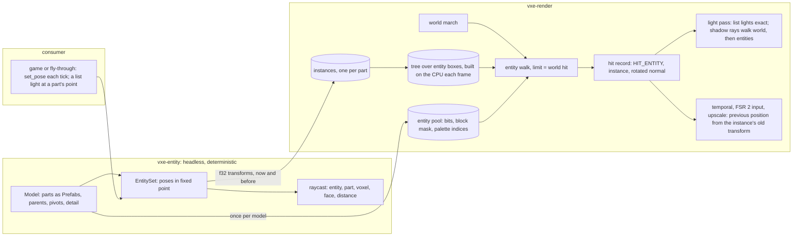

# 0062: Entities: voxel models on rigid parts, traced with the world, lit and shadowed by the list lights, and hit by a headless ray query

> **Status:** approved (owner go 2026-11-10; Phase 1 may start now, Phases 2 to 6 start after
> Plans 0058 and 0045 close and the architect's re-read below)
> **Created:** 2026-11-10
> **Milestone:** M6 in [`docs/roadmap.md`](../roadmap.md) (the render half; Plan 0008 closed the
> `.vox` import)
> **Related ADRs:** [ADR-0050](../adrs/0050-entities-are-posed-voxel-volumes-in-their-own-pool-traced-after-the-world-march.md)
> (proposed; the representation), accepted at this plan's close. Rests on
> [ADR-0044](../adrs/0044-direct-light-from-a-fixed-list-of-analytic-lights-one-shadow-ray-each.md)
> (the light list and its shadow rays), on
> [ADR-0043](../adrs/0043-emissive-light-from-a-world-space-per-face-table-and-a-lamp-bounce-probe-channel.md)
> (the fallback a hit with no cube face takes) and on
> [ADR-0014](../adrs/0014-prefab-identity-in-the-op-log.md) (a prefab's content id).
> **Source:** the owner, 2026-11-10: "we need a plan for voxel model entity ... with possibility
> of emissive light (gloving eyes for example) - we place model on a level", and the answers
> under Owner answers.
> **Starts after:** [Plan 0058](0058-dynamic-lights-a-list-of-analytic-lights-dropped-carried-and-bounced.md)'s
> close for Phases 2 to 6 (they read its light list, its direct target and its change rule),
> and after [Plan 0045](0045-structure-pass-split-the-mega-files-share-the-fixtures.md) by the
> order in the plans index. **Phase 1 adds a crate and edits no existing source file**; it may
> run as a side lane at any point. Before the Phase 2 lane starts the architect re-reads Phases 2 to
> 4 against the tip (Plans 0058 and 0045 move the files they name). Bit and binding numbers
> are "the next free at the start commit".
> **Followed by:** [Plan 0063](0063-rigs-and-clips-keyframe-animation-a-model-viewer-and-text-authoring.md)
> (rig files, clips, the model viewer).

## TL;DR

The renderer draws the world and nothing that moves. This plan adds **entities**: a model of
up to 16 rigid parts, each a small voxel volume with a pose, drawn in the same rays as the
world. A new headless crate, `vxe-entity`, holds models and poses in fixed point and answers
**which entity, part and voxel a ray hits**, the same on every platform. `vxe-render` mirrors
the parts in a pool of their own and walks a small tree of entity boxes after the world march,
for primary rays and for the list lights' shadow rays: an entity is lit exactly by Plan 0058's
lights, casts a hard shadow, shows its emissive voxels, and leaves no ghost when it moves. The
caps are 64 entities and 512 parts. The first thing anyone sees: press `7` in the fly-through
and a four-part walker with glowing eyes stands where you look, shadowed on the floor behind
it; press `8` and it walks.

Poses are handed in by the consumer each frame. Clips that produce them are Plan 0063's.

## Context & problem

`project-context.md` (Rendering, P1): "entities lit consistently". The roadmap's M6 names
instanced voxel volumes traced in the same pipeline, rigid-part rigs, consistent lighting and
shadows, emissive entities, and motion vectors, because the temporal pass reprojects by hit
position and a moving thing ghosts without them.

**What the tree gives this plan** (at 6c76234):

- A voxel volume type with a content id: `vxe_world::Prefab` (`prefab.rs`), and `.vox` files
  parsed to prefabs with their scene placements (`vxe-assets`, `vox.rs`), plus a writer
  (`write.rs`).
- A deterministic world ray query in integers (`vxe-world`, `raycast.rs`) and `Fixed3` at
  1/256 voxel (`fixed.rs`).
- One marcher, `march(o, d, t_limit, cutaway)` in `march.wgsl`, called by the primary pass
  (`march.wgsl`), the light pass's shadow ray (`light.wgsl`) and the probe rays
  (`probe_update.wgsl`). A hit travels as `HitRecord` (position, normal, material, axis, flags
  `HIT_FOUND`, `HIT_FIELD`, `HIT_TRANSLUCENT`).
- Reprojection by the hit position through the previous view: `temporal.wgsl`,
  `fsr2/input.wgsl` (FSR 2's motion vectors), `upscale.wgsl`, `gradient.wgsl`. None knows a
  hit that moved.
- After Plan 0058: a list of eight exact lights, a `direct` target whose history takes this
  frame's sample when the list changed, and upscaler masks driven by the list.

**What is missing:** any volume that is not on the world's grid, a pose, a second thing for a
ray to hit, the previous position of a hit that moved, and a reason for the direct history to
refresh under a moving shadow.

**The `nfr.md` figures touched:** section 2's primary and lighting lines and its headroom line
(which names entities), section 3's "everything else in VRAM", section 6 (a new deterministic
crate with fixed vectors) and section 7 (the gate's wall time).

## Decision

Build ADR-0050 in six phases. **The headless crate** (Phase 1) gives models, poses and the ray
query, proven on fixed vectors. **The mirror and the primary hit** (Phase 2) put a posed model
on screen in the albedo view: the walking skeleton on the GPU side. **Light and shadow** (Phase
3) shade entity hits with the list lights, let shadow rays hit entities, and show emission.
**Motion** (Phase 4) gives a moved hit its previous position and refreshes the direct part
under a moving shadow. **The costs and caps** (Phase 5) are read at 0, 16 and 64 entities.
**The window** (Phase 6) is the owner's.

We rejected stamping entities into the world, sharing the world's brick pool, a flat list with
no tree, and float poses (ADR-0050 A to D). We rejected lighting before the primary hit as
Phase 2, because the albedo view proves the pool, the transforms and the tree with no light
path in the way.

## Architecture diagram



## Implementation phases

Each phase ships as its own commit. `dev` implements all dev phases in one session with no
review between phases. The architect reviews once at the end, in a fresh session. Exploratory
runs on the RTX 3080 Laptop go through `VXE_TEST_ADAPTER=rtx`, labelled; every asserted reading
is on lavapipe.

**The gates.** Phase 1: `node scripts/test-changed.mjs --profile quick`, clippy, fmt, deny.
Phases 2 to 5: the same, then `--profile gpu` under the perf lock. At the tip: `cargo nextest
run --workspace --profile gate` under the perf lock, doctests, clippy, fmt, deny, and the doc
and tier gates. The soak and full tiers run only when the owner asks. Tables and attempts go to
`docs/plans/logs/0062.md`, started from the readings-log template.

**Test files and tiers.** Headless tests live in `crates/vxe-entity/tests/`. GPU tests go in
`apps/flythrough/tests/gpu_entities.rs`; the `gpu_` prefix is the classification
(`scripts/check-test-tiers.mjs`). A test over 30 s on lavapipe is born `#[ignore = "soak"]`. A
measurement written as a test goes `#[ignore]`d inside a `mod reading`.

**Test times are estimates**, none measured: a hand-built box renders 2 to 3 s for a few dozen
frames at 192 x 108 on lavapipe in the gate's build (Plans 0051 and 0057). `node
scripts/test-times.mjs` on each phase's log replaces them.

**The lit box** the GPU tests share is Plan 0058's: a closed dark box of albedo 0.5, no
emitter, lamp off, `--lighting full`, manual exposure 1, no jitter, one white list light of
intensity 1200 (reach 109.5 voxels). Its analytic term is `PI * intensity * max(n . l, 0) /
d^2` times the window `(1 - (d / r)^4)^2`: **9.40** at 20 voxels straight below the light and
**3.30** on a level surface 20 voxels below and 20 to the side (Plan 0058's arithmetic).

### Phase 1: `vxe-entity`: models, poses in fixed point, and the ray query
- **Owner skill:** dev
- **What:** a new workspace crate, headless and deterministic as `vxe-world` is (no GPU, no
  wall clock, no unseeded RNG, no float in a result), depending on `vxe-world` only.
  - **`Model`**: 1 to 16 `Part`s; a part holds an `Arc<Prefab>` of at most 64 voxels a side, an
    optional parent (an earlier part), a pivot in 1/256 model voxel, and a `detail` of 1, 2 or
    4. `Model::new` refuses a parent cycle, a seventeenth part and an oversized volume with a
    typed error. `Model::id()` hashes the parts' prefab ids and rig fields.
  - **`Pose`**: a root (`Fixed3` position, Q14 quaternion) and one `PartPose` a part (`i32`
    translation at 1/256 voxel, Q14 quaternion), relative to the parent's pivot.
    `Pose::rest(&Model)` is all identities. `Pose::part_point(model, part, local)` returns the
    world `Fixed3` of a point given in the part's voxels (what a consumer attaches a list light
    to). Quaternion products renormalise with an integer square root.
  - **`EntitySet`**: `insert(Arc<Model>, Pose) -> EntityId`, `set_pose`, `remove`, `iter`, and
    `raycast(origin, dir, max_t) -> Option<EntityHit>` with the argument conventions of
    `World::raycast`. It tests each entity's box, transforms the ray into each part's space and
    walks the prefab grid. `EntityHit` is the entity, the part, the model voxel, the face (axis
    and sign in the part's space), the material and the distance. Among equal distances the
    lower entity id, then the lower part, wins.
  - A consumer orders world and entity hits itself: `World::raycast`, then
    `EntitySet::raycast` with the world's distance as `max_t`. The crate's top doc shows it.
- **Files touched:** `crates/vxe-entity/` (new: `Cargo.toml`, `src/lib.rs`, `model.rs`,
  `pose.rs`, `quat.rs`, `set.rs`, `raycast.rs`, `tests/raycast.rs`, `tests/determinism.rs`),
  the workspace `Cargo.toml` (member and the `vxe-entity` table row), `clippy.toml` if its
  wall-clock denial is listed per crate, `CLAUDE.md` ("Where things live"),
  `docs/plans/logs/0062.md` (new).
- **Done when:**
  1. `a_ray_names_the_part_voxel_and_face` asserts, for a one-part model (an 8 x 8 x 8 prefab
     of solid material 3, pivot at its centre, detail 1) at rest with its minimum corner at
     voxel (100, 50, 100), and a ray from (90.5, 54.25, 104.25) along +x: part 0, model voxel
     (0, 4, 4), face -x, material 3, distance 9.5 voxels. Under 1 s.
  2. `a_half_turn_maps_the_hit_to_the_far_voxel`: the same model with the part turned 180
     degrees about y through its pivot (quaternion (0, 0, 1, 0) in w, x, y, z order; one is 16384 in
     Q14, so the turn is exact) reports model voxel (7, 4, 3), face +x, at the same distance (the turn maps local x
     to 8 - x and z to 8 - z). Under 1 s.
  3. `detail_two_halves_the_voxel`: a 16 x 16 x 16 part at detail 2 fills the same 8 world
     voxels; the same ray reports model voxel (0, 8, 8) at distance 9.5. Under 1 s.
  4. `a_child_follows_its_parent`: a two-part model, the child's rest offset 8 voxels along +x
     from the parent's pivot; with the parent turned 180 degrees about y the child's
     `part_point` at its pivot is 8 voxels along -x from the parent's pivot, exactly. Under 1 s.
  5. `a_tilted_part_agrees_with_the_float_reference`: for a part turned 45 degrees about z and
     256 seeded rays, the hit's distance is within 1/64 voxel of an `f64` reference computed in
     the test, on every ray both agree is a hit; rays the two disagree on are counted, and the
     count is at most 2 of 256 (silhouette grazes; a proposal the first run confirms or
     replaces with its reading). Under 2 s.
  6. `entity_hits_match_the_fixed_vectors` (`tests/determinism.rs`): 1024 seeded rays against
     a posed three-part model hash to a committed constant; CI runs it on Linux and Windows.
     Under 2 s.
  7. `a_ray_past_max_t_or_beside_the_box_hits_nothing`, and `Model::new`'s three refusals each
     return their typed error. Under 1 s.

### Phase 2: The mirror and the primary hit
- **Owner skill:** dev
- **What:** entities on screen in the albedo view.
  - **The pool.** `vxe_render::EntityMirror`: a storage buffer of fixed capacity (default 8
    MiB, set at creation). `upload_model(&Model, &MaterialTable) -> Result<ModelHandle,
    PoolFull>` writes each part once, keyed by prefab id (two models sharing a prefab share its
    bytes): a 32 B header (size, offsets), one occupancy bit a voxel, one bit per 4 x 4 x 4
    block that holds a voxel, one palette byte a voxel, and a palette of 256 `u32` material
    ids. A 16-voxel cube part is `32 + 512 + 8 + 4096 + 1024` = **5672 B**. A part with more
    than 255 materials is refused. `PoolFull` is an error, never a silent drop.
  - **Instances and the tree.** `Frame::set_entities(&mut self, queue, &EntitySet,
    &[(EntityId, ModelHandle)])` writes one instance a part (world-to-part and its inverse as
    3 x 4 `f32`, the part-to-world of the frame before, the volume's offset, the entity index,
    flags: 128 B) and builds a binary tree over the entities' boxes by median split on the
    longest axis: at most 127 nodes of 32 B, depth at most 7. An entity's box is the union of
    its parts' boxes now and in the frame before. `MAX_ENTITIES` 64, `MAX_PARTS` 512; entities
    past either cap are counted (`entities_over_cap()`) and not drawn, in the order given.
  - **The walk.** `entity_march(o, d, t_limit) -> EntityHit` in a new `entity.wgsl` (included
    where `march.wgsl` is): a fixed stack of 8, box tests, then per part a grid walk in the
    part's space that skips empty 4-voxel blocks. With an entity count of 0 it returns at
    once. The primary pass calls it after `march` with the world hit's `t` as the limit and
    keeps the nearer hit. World glass in front of an entity tints it as it tints a world hit,
    because `translucent_march` already runs to the hit's `t`. A translucent material on an
    entity is drawn opaque.
  - **The hit record.** A new flag `HIT_ENTITY`; the record carries the instance index where a
    world hit carries what the entity hit does not need (dev reads the packing at the start
    commit and writes the choice in the log), the rotated face normal in `n`, and the axis
    value that means "no cube face", so no reader takes the baked store's path for it.
  - **The fly-through.** A built-in **walker** made in code: torso 8 x 12 x 6, head 6 x 6 x 6
    with two emissive eye voxels, two legs 3 x 8 x 3, all at detail 2. `7` places one standing
    on the looked-at surface, facing the camera; `4` removes the newest thing placed, light or
    entity; `--entities N` (headless or windowed) places `N` walkers on a ring of radius 3 m
    around the spawn pose, for the readings. The HUD gains a row `entities <n>/64 parts
    <m>/512 over <k>`; the banner names `entities <n>/64` on `7`. `Digit7` and `Digit8` are
    unbound at 6c76234 (`Digit9` and `Digit0` are bound); dev may move a key that collides.
- **Files touched:** `crates/vxe-render/Cargo.toml` (`vxe-entity`), `src/entities.rs` (new),
  `src/shaders/entity.wgsl` (new), `src/shaders/march.wgsl` (the primary pass, the hit
  packing), `src/marcher.rs`, `src/lib.rs`, `apps/flythrough/src/main.rs`, `hud.rs`,
  `walker.rs` (new), `apps/flythrough/tests/gpu_entities.rs` (new), a baseline under
  `tests/golden/`, `docs/plans/logs/0062.md`.
- **Done when:**
  1. `an_entity_hides_the_wall_behind_it` asserts, in the albedo view on the box with an
     8-voxel cube part of albedo (0.8, 0.2, 0.2) 20 voxels in front of the camera and the wall
     40 voxels away: the centre pixel reads the part's albedo, a pixel 12 voxels to the side at
     the part's depth reads the wall's, and the centre pixel's hit distance reads 20 within
     0.01 voxel. About 3 s (an estimate).
  2. `a_world_voxel_in_front_hides_the_entity`: a world slab between camera and part gives the
     slab's albedo at the centre pixel. About 3 s (an estimate).
  3. `a_turned_bar_shows_its_turned_silhouette`: a 16 x 4 x 4 bar facing the camera reads the
     bar at 6 voxels right of centre and the wall at 6 voxels above; turned 90 degrees about
     the view axis, the two swap. About 3 s (an estimate).
  4. `the_picture_and_the_query_name_the_same_part`: for the walker in a tilted pose and an 8 x
     8 grid of pixels over it, the part the hit record names equals `EntitySet::raycast`'s for
     the pixel's ray, on every pixel whose four neighbours name the same part (silhouette
     pixels are skipped and counted). About 4 s (an estimate).
  5. `no_entity_moves_no_pixel`: with no entity given, every gate golden passes against its
     baseline with no re-bless. No new test time.
  6. `the_caps_count_what_they_drop`: 65 one-part entities draw 64 and report 1 over; 40
     walkers (160 parts) all draw; 129 four-part entities draw 64 and report 65 over (the entity cap binds at 256
     parts); 40 sixteen-part entities draw 32 and report 8 over (the part cap binds at 512). `upload_model` into a pool of 4096 B returns `PoolFull` for the 16-voxel
     cube part. Under 5 s (an estimate).
  7. `walker_albedo_golden`: the walker at rest, 192 x 108, albedo view, blessed once on
     lavapipe, on the harness's floor. About 3 s (an estimate).
  8. The HUD and banner tests (no device, under 1 s): the row reads `entities 2/64 parts 8/512
     over 0` for two walkers; the banner reads `entities 2/64` after `7`; `--entities 3`
     parses.

### Phase 3: Light, shadow and emission
- **Owner skill:** dev
- **What:**
  - **Shading.** The light pass shades a `HIT_ENTITY` pixel with every list light in reach, as
    it shades a world hit, with the record's rotated normal.
  - **Shadows.** The light pass's shadow ray calls `entity_march` after `march`, limited to
    the light's distance: entities shadow the world, each other and themselves. A shadow ray
    from an entity hit starts off the face along its normal by the offset a world hit uses,
    scaled by `1 / detail`.
  - **Emission.** The composite shows an entity hit's own material emission as it shows a
    world emitter's face, under the same scale and cap rules as the tip has then.
  - **The world's emissive light on an entity.** A `HIT_ENTITY` pixel takes the fallback a hit
    with no cube face takes (ADR-0043). This plan sets no bar on it; Phase 3 reads it and
    Phase 6 judges it.
  - **Not lit by entities:** the probe rays and the bake rays do not call `entity_march`.
  - **The fly-through.** A placed walker carries a warm list light (colour (1.0, 0.7, 0.4),
    intensity 150, `SHADOWS` set, `BOUNCE` clear) at the midpoint of its eyes, through
    `Pose::part_point`, while the list has a free slot; `Minus` toggles those lights and the
    banner reads `eye lights on` or `eye lights off`. A walker without a slot keeps its glow
    and lights nothing.
- **Files touched:** `crates/vxe-render/src/shaders/light.wgsl`, `composite.wgsl`,
  `temporal.wgsl` (the fallback's branch), `entity.wgsl`, `src/marcher.rs`,
  `apps/flythrough/src/main.rs`, `hud.rs`, `walker.rs`,
  `apps/flythrough/tests/gpu_entities.rs`, a baseline under `tests/golden/`,
  `docs/plans/logs/0062.md`.
- **Done when:**
  1. `an_entity_casts_a_hard_shadow_on_the_floor` asserts, on the lit box (light 20 voxels
     above the floor) with a 16 x 2 x 16 slab part level between heights 9 and 11, centred under
     the light: the floor pixel under the light reads 0 direct; the floor pixel 10 voxels to the
     side reads 0 (the shadow's edge is at `8 * 20 / 9` = 17.8 voxels); the pixel 20 voxels to
     the side reads 3.30 within 2 %. With `SHADOWS` clear all three read their analytic value.
     About 3 s (an estimate).
  2. `an_entity_face_is_lit_by_its_own_normal` asserts, with the light 22 voxels above the
     floor and a 16 x 2 x 16 slab part resting on it (top face 20 below the light): the top
     face's centre reads 9.40 within 2 %; with the part turned 45 degrees about a level axis
     through that centre the same point reads `9.40 * 0.7071` = **6.65** within 2 %. About 3 s
     (an estimate).
  3. `an_entity_shadows_another_and_itself`: a second slab 4 voxels under the first reads 0 at
     its top centre; the first slab's bottom face reads 0. About 3 s (an estimate).
  4. `an_entity_emitter_shows_as_a_world_emitter_does`: with no light, an entity voxel of an
     emissive material and a world voxel of the same material at the same distance read the
     same output value within 1/255 a channel. About 3 s (an estimate).
  5. `the_probes_and_the_bake_see_no_entity`: with an entity between a flagged light and a
     wall, every probe texel and every baked store value is bit-identical to the run without
     the entity over 32 frames. About 6 s (an estimate).
  6. `walker_shadow_golden` (the roadmap's visible proof): the walker in mid-stride on the lit
     box's floor, its shadow on the floor and its eyes emissive, 192 x 108, `--lighting half`,
     blessed once on lavapipe. About 3 s (an estimate).
  7. The readings: on a still walker beside the vein with no list light, the fallback's value
     on its nearest face and that pixel's frame-to-frame rms over 64 frames, lavapipe and
     labelled RTX; the light pass's shadow-ray cost with 0 and 4 walkers in the lit box.
  8. The banner test covers `Minus` (no device, under 1 s).

### Phase 4: Motion: the previous position of a moved hit, and a fresh direct sample under a moving shadow
- **Owner skill:** dev
- **What:**
  - **Previous position.** One helper, `prev_world(rec)`: for a `HIT_ENTITY` record, the
    hit's position in the part's space carried through the instance's part-to-world of the
    frame before; for any other record, the position itself. `temporal.wgsl`,
    `fsr2/input.wgsl`, `upscale.wgsl` and `gradient.wgsl` reproject `prev_world(rec)` where
    they reproject the position today. A history sample is rejected when one of the two
    pixels is an entity hit and the other is not, or when their instances differ.
  - **Moving shadows.** An instance is **moved** when its transform differs from the frame
    before's. The light pass sets a per-pixel `fresh` bit when a shadow ray's walk entered
    the box of an entity with a moved part (the box already holds both frames). The temporal
    pass takes this frame's direct sample as it is at a `fresh` pixel, by Plan 0058's change
    rule applied per pixel, and the upscalers mark a `fresh` pixel changed and reactive. A
    moved entity's own pixels are `fresh` too. `Frame::entities_moved()` reports whether any
    instance moved.
  - **The fly-through.** `8` toggles the walkers' motion: each walks a circle of radius 2 m
    about the point it was placed, legs swinging 30 degrees either way, computed in the
    fly-through from the frame's time step. The banner reads `walk on` or `walk off` and the
    HUD row gains `walk`.
- **Files touched:** `crates/vxe-render/src/shaders/temporal.wgsl`, `fsr2/input.wgsl`,
  `upscale.wgsl`, `gradient.wgsl`, `light.wgsl`, `entity.wgsl`, `src/marcher.rs`, `fsr2.rs`,
  `apps/flythrough/src/main.rs`, `hud.rs`, `walker.rs`,
  `apps/flythrough/tests/gpu_entities.rs`, `gpu_fsr2.rs`, `gpu_upscale.rs`,
  `docs/plans/logs/0062.md`.
- **Done when:**
  1. `a_moving_entity_leaves_no_ghost_and_no_stale_shadow` asserts, on the lit box with an
     8-voxel cube part 6 voxels above the floor, still for 32 frames and then moved 4 voxels a
     frame along the floor for 16 frames: on every frame of the move (a) a floor pixel that
     was inside the shadow one frame before and is outside it now reads its analytic lit value
     within 2 %; (b) a pixel that showed the part one frame before and shows the wall now
     reads the wall's value from a reference without the entity within 2 %; (c) the pixel at
     the centre of the part's top face, followed with it, reads its analytic value within 2 %.
     About 5 s (an estimate).
  2. `a_still_entity_marks_nothing_fresh`: over 32 still frames `entities_moved()` is false
     and no pixel carries the `fresh` bit; on the first frame of a move the pixels of the old
     and the new shadow carry it and a floor pixel 40 voxels from both does not. About 3 s (an
     estimate).
  3. `fsr2_motion_follows_a_moving_part` (`gpu_fsr2.rs`): with a still camera and a part moved
     4 voxels sideways in one frame, the motion vector at the part's centre pixel equals the
     projected displacement within 0.1 internal pixel, and at a wall pixel it is 0 exactly;
     for a bar turning 10 degrees a frame about its centre, the vector at its tip matches the
     tip's projected displacement within 0.25 pixel. About 6 s (an estimate).
  4. `fsr2_leaves_no_trail_behind_a_moving_entity` (`gpu_fsr2.rs`): under FSR 2 at 1.5, after
     done-when 1's move the output at a pixel the part left is within the tolerance of
     `fsr2_keeps_pace_with_a_sweeping_headlamp_and_a_lamp_step` of the reference without the
     entity, within that test's frame count. The trail's length in frames is a reading in the
     log. The same mask assertion runs under `own` in `gpu_upscale.rs` while `own` exists.
     About 15 s (an estimate; over 30 s it is marked `#[ignore = "soak"]` and an 8-frame move
     stays in the gate).
  5. `history_does_not_cross_between_instances`: two parts of the same albedo passing each
     other never blend one's lit face into the other's unlit one: the unlit face reads under
     2 % of the lit face's value on every frame. About 4 s (an estimate).
  6. The banner and HUD tests cover `8` (no device, under 1 s).

### Phase 5: The costs and the caps
- **Owner skill:** dev
- **What:** the readings, and `EntityMirror::bytes()` in the memory inventory.
- **Arithmetic:** the pool 8 388 608 B, the instances `512 * 128` = 65 536 B, the tree `128 *
  32` = 4096 B: **8 458 240 B**. One `fresh` bit rides in a flags word that exists. The
  walker's four parts at detail 2 (torso 8 x 12 x 6, head 6 x 6 x 6, two legs sharing one 3 x
  8 x 3 prefab) are three volumes; dev prints their bytes from the header rule in Phase 2.
- **Files touched:** `crates/vxe-render/src/entities.rs`, `marcher.rs`,
  `apps/flythrough/src/main.rs`, `apps/flythrough/tests/gpu_entities.rs`, `gpu_upscale.rs`,
  `docs/plans/logs/0062.md`.
- **Done when:**
  1. `entity_bytes_are_in_the_inventory` asserts `EntityMirror::bytes()` is 8 458 240 at the
     defaults and that the frame's inventory lists it. Under 5 s (an estimate).
  2. The readings are in the log: the primary, light, temporal and upscale passes and the
     frame, at the level's spawn and the vein, `--entities` 0, 4, 16 and 64, walkers still and
     walking, lamp on, and at 16 and 64 walkers also with `--lights 8` (amended 2026-11-10:
     the entity walk runs after every shadow ray of every list light, so its cost multiplies
     with Plan 0058's list and the lamp-only arm cannot show it), both adapters, three quiet
     rounds where the machine allows; the CPU
     time of `set_entities` at 64 walkers; `EntitySet::raycast` at 64 walkers, mean over 4096
     seeded rays, on the dev box (a `mod reading` test).
  3. `--entities 0` reads within the round-to-round spread of the start commit's frame on
     both adapters. Outside it, the log names the pass that grew and the plan stops for the
     architect.
  4. The predictions, all **guesses**: 16 walkers within 0.2 to 0.5 ms of the frame on the RTX
     3080 Laptop and 2 to 4 ms on the Cezanne; 64 walkers within 0.5 to 1.2 ms and 4 to 10 ms.
     A figure outside a range is a reading, not a failure.

### Phase 6: The owner's window
- **Owner skill:** human
- **What:** the release fly-through on the RTX, one sitting, Phase 5's table at hand.

  ```
  cargo build --release -p flythrough

  # 1. The hall, lamp off: place a walker (7), drop a light beside it (1), walk it (8); look at
  #    its shadow's edge while it moves; place three more.
  target/release/flythrough --source showcase --shot hall --exposure 8 --hud --lamp off

  # 2. The level: a walker in the vein's passage with no list light, eye lights on and off
  #    (Minus); with the lamp on; fire a light past it (6).
  target/release/flythrough --level --seed 1 --pose vein --hud

  # 3. Sixteen and sixty-four walkers on the ring, walking, for the cost on screen.
  target/release/flythrough --level --seed 1 --entities 16 --hud
  target/release/flythrough --level --seed 1 --entities 64 --hud
  ```
- **Files touched:** this plan's log.
- **Done when:** the log records the owner's words on: (a) a still walker, still camera: does
  anything move; (b) a walking walker under FSR 2 at 1.5: a ghost behind it, a trail under
  its shadow, shimmer on its faces; (c) the hard shadow and its edge; (d) the glowing eyes,
  with and without their light; (e) the walker beside the vein with no list light: the
  fallback's grain; (f) detail 2 against the world's voxels: does it read as one world; (g)
  the cost at 16 and 64. **Stop rule:** a "no" on (b) goes to the architect with Phase 4's
  trail reading; a "no" on (e) goes to the architect with Phase 3's rms reading, and the first
  amendment is a read of the baked store at the nearest world face. The plan closes with that
  record.

## Data shapes

```rust
// illustrative: vxe-entity
pub struct Part {
    pub volume: Arc<Prefab>,       // at most 64 voxels a side
    pub parent: Option<u8>,        // an earlier part
    pub pivot: [i32; 3],           // 1/256 model voxel
    pub detail: u8,                // 1, 2 or 4 model voxels per world voxel
}
pub struct PartPose { pub t: [i32; 3], pub q: [i16; 4] }   // 1/256 voxel; Q14, w x y z
pub struct Pose { pub root: Fixed3, pub root_q: [i16; 4], pub parts: Vec<PartPose> }
pub struct EntityHit {
    pub entity: EntityId, pub part: u8, pub voxel: [u8; 3],
    pub axis: u8, pub positive: bool, pub material: MaterialId, pub t: i64,
}
```

```wgsl
// illustrative: one instance, 128 B
struct Instance {
    world_to_part: mat3x4<f32>,     // 48 B
    prev_part_to_world: mat3x4<f32>,// 48 B
    volume: u32, entity: u32, flags: u32, inv_detail: f32,
    pad: vec4<u32>,
};
```

## Budgets

The base for every row is a reading at this plan's start commit, taken with the command in the
table before Phase 2's first change.

| `nfr.md` figure | Base | Expected | How the close measures it |
|---|---|---|---|
| §2 primary and lighting lines | the start commit's reading | **guesses:** + 0.2 to 0.5 ms on the RTX 3080 Laptop at 16 walkers, + 0.5 to 1.2 ms at 64; about eight times that on the Cezanne RADV; within the spread at 0 | `flythrough --level --seed 1 --headless --render 1920x1080 --frames 2700 --adapter NVIDIA\|AMD --entities N [--pose vein]`, three quiet rounds, the perf lock, the memory cap, per pass |
| §2 headroom line (2.1 ms, names entities) | 2.1 ms, all of it claimed by the outdoor plans' table in Plan 0035 | this plan's delta is drawn from it; **the two claims conflict outdoors** and the render-profile plan arbitrates (`docs/backlog.md`) | the same runs |
| §3 everything else in VRAM | the start commit's figure | **arithmetic:** + 8 458 240 B | `EntityMirror::bytes()` asserted, printed at the close |
| §6 determinism | none for entities | `vxe-entity`'s fixed vectors equal on Linux and Windows | CI, Phase 1 done-when 6 |
| §7 gate wall time | the start commit's gate | **an estimate:** + about 90 s on lavapipe for the new GPU tests | `node scripts/test-times.mjs` on the tip's gate log |

## Risks & open questions

- **The cost on the slow adapter.** Sixty-four walkers may cost more than the whole headroom
  line on the Cezanne. The caps are settings; the portable profile may lower them. Phase 5
  reads it before anyone argues.
- **The fallback on a moving entity.** ADR-0043's fallback is a running mean reprojected in
  screen space. On a walking creature beside an emitter it may show grain or lag. Phase 3
  reads it, Phase 6 (e) judges it, and the stop rule names the amendment.
- **The fallback's reach in the shader.** The plan assumes a hit flagged as having no cube
  face reaches the fallback without the field flag. If the tip's branch is keyed on
  `HIT_FIELD` alone, dev says so in the Notes and keys it on the axis value.
- **`fresh` under many moving entities.** Every pixel whose shadow ray crosses a moving
  entity's box loses its direct history each frame. Direct light is exact, so the cost is the
  half tier's grid showing, as under Plan 0058's carried light. Phase 6 (b) judges it.
- **Self-shadow acne on small voxels.** A detail-4 voxel is 2.5 cm; the shadow ray's offset
  is scaled by `1 / detail`. A turned part's faces are not on the world grid, so the offset
  runs along the rotated normal. Phase 3 done-when 3 guards the gross case only.
- **Plan 0058's shape at its close.** This plan cites its change rule, its `direct` target
  and its keys; the header's re-read is the guard.
- **Integer quaternion drift.** A pose composed down four parents renormalises four times.
  Phase 1 done-when 5 bounds the error against a float reference for one level; if a deep
  chain drifts past 1/64 voxel dev reports the reading.
- **Open, for the owner:** whether 64 and 512 are defaults or ceilings for the consumer's
  design; whether an entity should shadow the bounce channel (a follow-up either way).

## What this plan does NOT do

- Clips, rig files, a model viewer or any authoring tool: Plan 0063.
- An editor. Voxels are authored in MagicaVoxel (`docs/roadmap.md`: no scene editor).
- Placing entities on a level, spawning, AI, health: the consumer's. `crates/` names no
  creature; the walker lives in the fly-through.
- Light from an entity's emissive voxels onto the world. The consumer attaches a list light
  (ADR-0044); the engine derives none.
- Entities in the probe rays or the bake: a creature blocks no bounce and no baked light.
- Destructible entities (carving voxels off a part): a follow-up plan with its own storage
  ADR.
- Collision of the character controller or of world sweeps with entities: `vxe-sim` is
  untouched; the consumer uses `EntitySet::raycast` or its own shapes.
- Deformation, skinning, squash and stretch: parts are rigid.
- Translucent or field-surface entities: every entity voxel is an opaque honest cube.
- Level of detail, or more than 64 entities: a later plan, with a reading that asks for it.
- Replication of entities over the network (M9), audio occlusion by entities, and entities
  in the far field (M10).
- Held tools and hands in first person: they are entities, but the view-model pass is its own
  plan.

## Owner answers

2026-11-10, at the draft:

1. **Animation:** the engine plays keyframe clips. The architect split it: this plan takes
   poses from the consumer, Plan 0063 adds clips on top.
2. **Count:** about 64 entities and 512 parts on screen.
3. **Glow:** emissive voxels glow; light on the walls is a list light the game attaches.
4. **Queries:** render plus a headless ray query.

5. **The order** ("agreed", to the architect's proposal): after Plan 0045 and ahead of M10;
   Phase 1 may run as a side lane.

Architect's calls the owner may overturn: detail 1, 2 or 4 per part; 16 parts and 64 voxels a
side per part; entities absent from the bounce and the bake; the fallback for the world's
emissive light on an entity; the walker and its keys (`7`, `8`, `Minus`).

The "go" is given (owner, 2026-11-10: "move all draft plans to approved").

## Implementation log

> Written by `dev`: one row per phase as its commit lands, then the close block. **The phases
> above are the contract. This section records what happened.** Observations, never conclusions:
> no pass list, no self-assessment. Deviations and unmet done-whens are **always** disclosed.
> Keep it shorter than `## Implementation phases`. Readings, gate counts, attempts, sweeps and
> resume notes go to `docs/plans/logs/0062.md`.

| phase | owner | state | commit |
|---|---|---|---|
| 1: `vxe-entity`: models, poses in fixed point, and the ray query | dev | not started | |
| 2: The mirror and the primary hit | dev | not started | |
| 3: Light, shadow and emission | dev | not started | |
| 4: Motion | dev | not started | |
| 5: The costs and the caps | dev | not started | |
| 6: The owner's window | human | not started | |

### Notes

_(Deviations from the plan, with the commit, stated without justification. Done-whens not
satisfiable as stated, and what was done instead. Followups noticed and not acted on. One line
each. Empty is fine.)_

### Close triggers

_(Facts for the architect. No recommendations, and no suggested version bump.)_

- **What shipped:** feature / fix-only / docs-chore-only
- **Public API changed:** types, traits, functions, shader interfaces, config (list them, or none)
- **Budget readings:** each `nfr.md` figure touched, with its measured value, machine and commit
- **Gate at the tip:** the commands run (build, nextest, doctests, clippy, fmt, deny), exit codes, test counts
- **Outstanding `human` phases:** which, or none

## Followups
