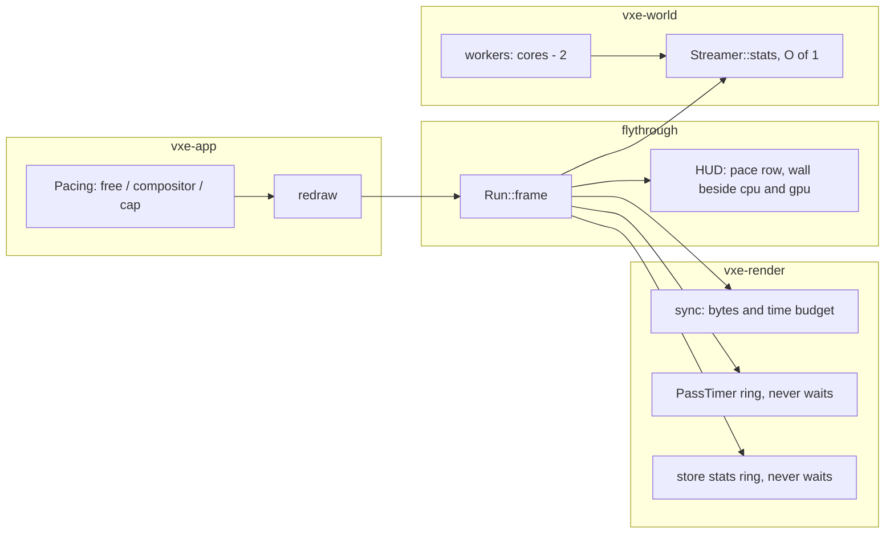

# 0064: The window's frame: what paces it, workers that leave no core, and readbacks that wait

> **Status:** in-progress (owner go 2026-11-10; Phase 1 may start now, beside Plan 0060)
> **Created:** 2026-11-10
> **Milestone:** cross-cutting (code health), like [Plan 0044](0044-hot-path-and-defect-pass.md).
> It serves `docs/nfr.md` section 2's frame and section 5's streaming line.
> **Related ADRs:** none yet. Phase 1 is a spike; if its reading makes the pacing a trade
> (frames the compositor never shows against a frame of latency), the architect writes the ADR
> before Phase 2 starts.
> **Source:** the owner, 2026-11-10: "I'm a bit afraid that we have avg 30-50 fps on my machine
> with no load and very little details/effects". A static review of the tree at `50b637a`
> followed. **The owner asked for no load tests, so every figure in this plan is an estimate
> from reading the code and the readings already on record; Phase 1 takes the first reading.**
> **Starts after:** Phases 1 and 2 touch `crates/vxe-app/src/shell.rs` and the fly-through's
> flag table only and may run beside Plan 0060. Phases 3 to 5 edit `marcher.rs`, `main.rs`,
> `hud.rs` and `gpu_world.rs` and start on main after Plan 0060 merges (owner, 2026-11-10;
> `docs/plans/README.md`, Sequence). **If Phase 1 reads free pacing no better than the
> compositor's, the plan stops there and Plan 0065 does not start** until the architect has
> read the windowed figures: the window then has another cause.

## TL;DR

The recorded GPU frame is 7.5 to 12 ms at the owner's window, yet the window shows 30 to 50
fps. The review's reading of the code says the window is not bound by rendering: the shell
asks the compositor for a frame callback on every present, so a frame's CPU work starts only
after the frame before it was shown, and CPU and GPU run one after the other. On top of that
the HUD waits on the GPU every frame, a stdout line waits on it once a second, and the
streamer's workers take every core but one.

This plan first **measures** what paces the window (Phase 1), then removes each wait the
reading confirms. The first thing the owner sees: a `pace` row in the HUD that names the
pacing mode and shows the wall time of a frame beside its CPU and GPU time, so the gap is on
screen.

## Context & problem

Each item was read in the source at `50b637a`. Lines are for orientation; `dev` re-reads each
at the phase's start commit.

- **The frame callback gates the next frame.** `Shell::redraw` (`crates/vxe-app/src/shell.rs`)
  calls `window.pre_present_notify()` before every present. In winit 0.30.13 on Wayland that
  requests a `wl_surface.frame` callback, and the event loop returns no `RedrawRequested`
  while one is outstanding (`platform_impl/linux/wayland/event_loop/mod.rs`, the
  `FrameCallbackState::Requested` test). `Pacing::Unthrottled` with `AutoNoVsync` therefore
  does not do what `ShellConfig`'s doc says: frame N+1 starts after the compositor showed
  frame N. The frame's wall time is the sum of CPU and GPU, rounded up to the display's
  refresh (6.06 ms at the dev box's 165 Hz), not the larger of the two. **Arithmetic from the
  readings on record, not a reading:** 4 to 5 ms of CPU plus 7.5 to 12 ms of GPU plus the
  bake's 1.5 ms slice is 13 to 19 ms, which rounds up to 18.2 or 24.2 ms: 41 to 55 fps.
- **The dev box presents across two GPUs.** The panel hangs off the AMD iGPU and Hyprland
  composites there; the RTX has no connected output. Each presented frame crosses to the
  iGPU. That is the machine, not the engine, but it lengthens the wait above and belongs in
  every windowed reading's label.
- **The HUD waits on the GPU every frame** while it shows: `PassTimer::read_all_ms` and two
  `read_ms` calls map and then `poll(wait_indefinitely())`. This is Plan 0044's Phase 2, moved
  here whole (see "Decision").
- **A stdout line waits on the GPU once a second**, HUD or not: `read_store_stats` in the
  fly-through's queue line submits, maps and waits.
- **The streamer's workers take every core but one.** The fly-through sets
  `available_parallelism - 1` workers (15 on the dev box). With the main thread spinning on
  `ControlFlow::Poll`, no core is left for the compositor or the driver's threads while chunks
  generate. **Suspected** as part of the streaming line's p99 of 45 to 84 ms; not measured.
- **The mirror's upload is bounded by bytes, not time.** `GpuWorld::sync` uploads up to
  `SYNC_BUDGET_MIB` of packed bricks on the render thread; the time that takes is unbounded.
  `docs/nfr/02-frame-budget.md` reads the sync as most of the streaming CPU. Plan 0044's
  Phase 4 removes a duplicate sizing call and does not bound the time.
- **`Streamer::stats` walks every resident chunk** to count the full ones, and the frame
  calls it three times, two of them only for `ticks`.

## Decision

Measure first, then fix what the reading confirms, in the shell and on the frame's CPU path.
No pixel changes: every golden stays byte-identical.

- **Pacing.** `Pacing::Unthrottled` becomes what its doc says: no frame callback is requested,
  so a frame starts as soon as the loop is idle. Pacing by the compositor stays available as
  its own named mode, and the fly-through's default is whichever the owner picks in the window
  (Phase 2). We rejected **keeping the callback and starting the next frame's CPU work
  early**: it hides the serialisation by rendering a frame ahead, which adds a frame of
  latency to input and to an edit's appearance.
- **Plan 0044's Phase 2 moves here.** It touches `PassTimer` and three call sites, claims no
  golden, and its fix is worth little while it sits behind three plans. Plan 0044 keeps its
  other phases.
- **Workers default to two fewer than the logical cores**, kept only if Phase 4's reading
  shows the frame's p99 lower with residency no worse. We rejected **lowering the workers'
  priority**: it needs a per-platform call and a dependency or `unsafe`.
- **The sync gets a time budget beside its byte budget.** We rejected **packing slot words on
  the workers** here: it moves the mirror's format knowledge across a thread boundary and
  wants its own plan (`docs/backlog.md`).

## Architecture diagram



## Implementation phases

Every phase gates on `node scripts/test-changed.mjs --profile quick`, plus `--profile gpu`
under the perf lock when it touches `vxe-render`; the tip gates on
`cargo nextest run --profile gate`. Readings run under the perf lock and name the machine,
the commit, the 1-minute load, the granted present mode and the display's refresh. A windowed
reading on the dev box also says "RTX rendering, iGPU compositing".

### Phase 1: What paces the window (a spike)
- **Owner skill:** dev
- **What:** the `frames:` summary and the HUD gain the wall time between frames beside the
  frame's CPU and GPU time, and the shell logs the present mode the surface was granted. A
  `--pace free|compositor` flag selects whether `pre_present_notify` is called. Both arms are
  read in a window.
- **Files touched:** `crates/vxe-app/src/shell.rs`, `apps/flythrough/src/main.rs`, `hud.rs`,
  `lib.rs`, `docs/plans/logs/0064.md` (new).
- **Done when:**
  - A shell unit test (no window, under 1 s) asserts `Pacing`'s new mode maps to "no frame
    callback" and the old behaviour to its own named mode, and the flag parses both words.
  - The HUD's `pace` row shows the mode and `wall / cpu / gpu` in ms; `a_shown_hud_names_the_pace`
    (CPU only, under 1 s) asserts the row's text for both modes.
  - The log holds, for each arm, at the level's spawn and the showcase start, HUD hidden and
    shown, wall p50 and p99 beside CPU and GPU p50, three runs each. **The reading decides
    Phase 2:** if `free` reads no better than `compositor` within the spread, the log says so,
    Phase 2 is struck and the plan goes back to the architect with the reading.

### Phase 2: The pacing the reading supports, as the default
- **Owner skill:** human
- **What:** the owner flies both modes in the window and picks the fly-through's default.
  `dev` then sets it and keeps the other mode behind the flag.
- **Files touched:** `apps/flythrough/src/main.rs`, `crates/vxe-app/src/shell.rs` (the doc of
  `ShellConfig` and `Pacing`), `docs/plans/logs/0064.md`.
- **Done when:** the log has the owner's words on both modes (smoothness, tearing, fan noise),
  the default equals the pick, and the banner names the mode on a plain start.

### Phase 3: Nothing on the frame waits for the GPU
- **Owner skill:** dev
- **What:** Plan 0044's Phase 2 as written there (a ring of 3 query sets, `try_read_all_ms`,
  the two `read_ms` timers in the same form, `LightingRow` reused, the HUD allocation test
  covering `refresh_hud_stats` and the banner). The queue line's `read_store_stats` gets the
  same ring and prints the newest finished set.
- **Files touched:** `crates/vxe-render/src/marcher.rs`, `apps/flythrough/src/main.rs`,
  `hud.rs`, `crates/vxe-render/tests/gpu_frame.rs` or a new `tests/gpu_*.rs` file.
- **Done when:**
  - Plan 0044 Phase 2's three done-whens hold as written there.
  - A counter of blocking polls on the frame path reads **0 over 300 frames** of a headless
    run with the HUD on and the queue line due at least once (lavapipe, about 10 s, an
    estimate). Before the fix it reads at least 601: two a frame and one for the line.
  - The queue line prints the same fields; its `missing` figure may be up to 2 frames old,
    which the line says.

### Phase 4: The frame's CPU: workers, the sync's time, the stats
- **Owner skill:** dev
- **What:**
  - The fly-through's default worker count is `available_parallelism - 2`, at least 1, behind
    a `--workers N` flag.
  - `GpuWorld::sync` takes a time budget beside the byte budget and stops selecting uploads
    when either is spent; what it leaves is first in the next sync. The default is 2 ms, a
    proposal Phase 5 reads.
  - `Streamer` keeps `resident_full` as a counter and exposes `ticks()`; the frame calls
    `stats()` once.
- **Files touched:** `apps/flythrough/src/main.rs`, `lib.rs`,
  `crates/vxe-render/src/gpu_world.rs`, `crates/vxe-render/tests/gpu_mirror.rs`,
  `crates/vxe-world/src/stream.rs`, `crates/vxe-world/tests/` (the streaming test file).
- **Done when:**
  - `stats_counts_match_a_walk` (CPU, under 2 s): after a seeded flight of load, demote and
    evict steps, `stats().resident_full` equals a count over the resident map at every step.
  - `a_sync_stops_at_its_time_budget` (lavapipe, about 5 s, an estimate): with a clock the
    test supplies that advances a fixed step per uploaded chunk, a sync of 64 pending chunks
    under a budget of 8 steps uploads exactly 8 and defers 56, and the next sync starts with
    the 9th. With the budget unset the same sync uploads all 64, and the slot words are
    byte-identical in both orders (the existing `a_slot_holds_the_packed_brick_s_own_words`).
  - The world's pinned hashes and every golden are unchanged: neither the worker count nor
    the budget changes a voxel.
  - The autopilot of `docs/nfr.md` section 5's protocol is read at 15 and at 14 workers,
    three alternated rounds: frame CPU p99, streaming CPU p50 and p99, residency p95. The 14
    default is kept only if p99 is lower and residency p95 is within the spread; otherwise it
    is reverted and the log says so.

### Phase 5: The close's readings
- **Owner skill:** dev
- **What:** the readings of "Budgets", headless and windowed, into `docs/nfr/02-frame-budget.md`
  and the log.
- **Files touched:** `docs/plans/logs/0064.md`, `docs/nfr/02-frame-budget.md`, `docs/nfr.md`
  (section 5's residency line, if it moved).
- **Done when:** every row of "Budgets" has a before (Phase 1's start commit) and an after,
  on both adapters where the row is a GPU or frame figure.

## Data shapes

```rust
// illustrative
pub enum Pacing {
    /// No frame callback: a frame starts when the loop is idle.
    Unthrottled,
    /// A frame starts after the compositor showed the last one.
    Compositor,
    Cap { hz: u32 },
}

pub struct SyncBudget {
    pub bytes: u64,
    pub time: Option<Duration>,
}
```

## Budgets

| `nfr.md` figure | Base | Expected | How the close measures it |
|---|---|---|---|
| The window's wall frame (no line today) | Phase 1's `compositor` arm | **an estimate:** wall p50 near the larger of CPU and GPU instead of their sum | the windowed runs of Phase 1, both modes, HUD hidden and shown |
| §2 streaming line, 1.0 ms: frame CPU p50 3.4 to 4.2 ms, p99 45.9 to 83.6 ms (Plan 0059's fix pass) | the start commit's reading | **guesses:** p99 under 10 ms with the time budget; p50 lower by 0.2 to 0.5 ms from the stats; the line stays missed at p50 | the autopilot of section 5's protocol, three alternated rounds |
| §5 residency p95, 500 ms (314 to 354 ms on record) | the start commit's reading | no worse than the spread; a time budget and one worker fewer can only slow it, so this is the bar that can fail | the same runs |

## Risks & open questions

- **The reading may refute the headline.** The winit gate is read in the source; its effect on
  this compositor with this driver is not. Phase 1 exists for that, and Phase 2 is struck if
  it reads no better.
- **A free-running window draws frames nobody sees** and runs the GPU and the fans flat out.
  The `Cap` mode exists for that; the owner's pick in Phase 2 covers it.
- **Tearing.** `AutoNoVsync` may be granted `Immediate`. Phase 1 logs what was granted.
- **A time budget slows residency under load.** It is the row of "Budgets" that can fail;
  the remedy is a larger budget, read, not a guess.
- **Determinism:** untouched. `vxe-world` reads no clock; the time budget is in `vxe-render`
  and the test supplies its clock. The worker count changes the order chunks arrive in, never
  their content.
- **Threading:** `Streamer::stats` stops taking the workers' queue lock twice a frame; no new
  lock is added.

## What this plan does NOT do

- Shader work: the baked light's waste is [Plan 0065](0065-the-baked-lights-waste-atomics-a-filter-of-zeros-and-a-scan-per-frame.md).
- Plan 0044's other phases (bind groups, the sync's sizing, the march's inner loop).
- Packing slot words on the workers, or any change to the mirror's format (`docs/backlog.md`).
- Anything about the dev box's two-GPU present path; it is recorded as a label on readings.
- A budget line for the bake's slice and the queue's step (`docs/backlog.md`).

## Implementation log

> Written by `dev`: one row per phase as its commit lands, then the close block. Readings,
> attempts and resume notes go to `docs/plans/logs/0064.md`.

| phase | owner | state | commit |
|---|---|---|---|
| 1: what paces the window | dev | done: code (flag, present-mode log, HUD `pace` row, `frames:` wall, 3 CPU tests) and the owner's 24 windowed runs, `free` below `compositor` in every cell, Phase 2 stands; see [the readings log](logs/0064.md) | fc05003 (code), readings committed with this row |
| 2: the pacing default | human | awaits the owner's window | |
| 3: nothing waits for the GPU | dev | not started | |
| 4: workers, the sync's time, the stats | dev | not started | |
| 5: the close's readings | dev | not started | |

### Notes

### Close triggers

- **What shipped:**
- **Public API changed:**
- **Budget readings:**
- **Gate at the tip:**
- **Outstanding `human` phases:**

## Followups
