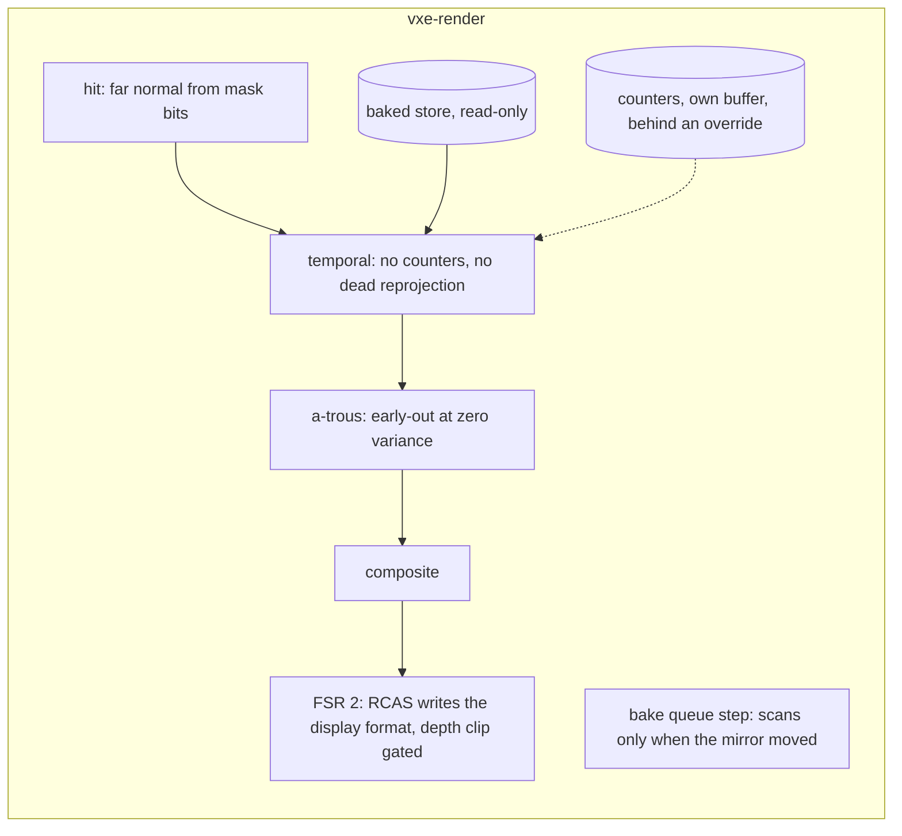

# 0065: The baked light's waste: atomics on every pixel, a filter of zeros, a scan per frame

> **Status:** approved (owner go 2026-11-10; the lane starts after Plans 0060 and 0064)
> **Created:** 2026-11-10
> **Milestone:** cross-cutting (code health), like [Plan 0044](0044-hot-path-and-defect-pass.md).
> It serves `docs/nfr.md` section 2's lighting, denoise and upscale lines.
> **Related ADRs:** none. Each fix keeps its mechanism and removes work whose result is
> discarded or already known. It rests on
> [ADR-0046](../adrs/0046-static-emissive-light-is-baked-per-chunk-when-a-chunk-loads-or-changes.md)
> (the baked store) and changes nothing it decided.
> **Source:** the owner, 2026-11-10, and the static review at `50b637a` that
> [Plan 0064](done/0064-the-windows-frame-pacing-workers-and-readbacks-that-wait.md) also comes
> from. **The owner asked for no load tests, so every saving here is an estimate from reading
> the code; Phase 1 takes the readings.**
> **Starts after:** Plan 0060's merge (it rewrites `bake.rs`) and Plan 0064's close, and only
> if Plan 0064's Phase 1 confirmed the pacing (its header says why). **It runs before Plan
> 0061's Phase 2 and before Plan 0058** (owner, 2026-11-10), because both decide by per-pass
> readings that today include this waste, and both edit `temporal.wgsl`.

## TL;DR

Plan 0059 replaced stochastic emissive light with a baked store, but the passes around it
still do the work the old light needed. The temporal pass reads the store through an atomic
binding and bumps three global counters from every pixel. With the lamp off the a-trous
filter runs four 25-tap iterations over zeros and then adds the stored value back. The far
normal calls the full lookup 26 times where the brick's mask already holds the bits. The
bake queue filters every block it holds on every frame, queue empty or not.

This plan removes each, with the image unchanged. The first thing anyone sees: a per-pass
table in the readings log at the window's size and the half lighting tier, lamp on and off,
which no reading on record has (`docs/plans/logs/0059.md`: "`--lighting half` not read under
the store").

## Context & problem

Each item was read in the source at `50b637a`; `dev` re-reads it at the phase's start commit
and strikes in the log what an earlier plan resolved.

- **The temporal pass** (`temporal.wgsl`).
  - The store is bound `array<atomic<u32>>`, read-write. Every cube-face pixel does an
    `atomicAdd` on `store[0]` or `store[1]`, some on `store[2]`: counters only the HUD and
    `--read-missing` read. Three adjacent words take every pixel's write.
  - Under an atomic binding no load can be merged, so `store_table` re-reads the store's
    origin and size for each of the four taps of `store_brick_value` and again for the
    counter. `march.wgsl`'s `glass_store_value` reads the same words through a read-only
    binding.
  - Plan 0059's close read the pass at 1.54 ms against the table's 0.39 ms (RTX, FSR 2 at
    1.5, full lighting tier) and left it as "not done".
  - For a stored pixel with the lamp off the reprojection's 16 to 36 loads feed nothing: the
    result is the store's value, and the lamp's channel and the moments are zero.
- **The a-trous pass** (`atrous.wgsl`). Its input for a stored pixel is the lamp's part only,
  zero with the lamp off. The variance is zero, four iterations return zero, the last adds
  the stored value back. `docs/nfr/02-frame-budget.md` reads the pass at 2.96 to 6.95 ms on
  the RTX at the full tier, over section 2's 3.0 ms denoise line, with no owner.
- **The far normal** (`march.wgsl`, `gradient27_normal`): 26 `lookup` calls per far pixel.
  Plan 0044's Phase 5 removes the material read inside each; the descents stay. For a voxel
  interior to a full-detail brick the 27 bits are in the brick's opaque mask. The hall's hit
  pass reads 3.07 ms at `1..2` against 4.21 ms at `2..6` (`docs/plans/logs/0059.md`).
- **The pool word read** (`slot_word`): a `u32` divide by `params.units_per_shard`, not a
  power of two, on every load.
- **FSR 2.** The tone pass is a display-resolution pass that only converts what RCAS just
  wrote, into a texture nothing else reads. Depth clip loads nine `rgba32float` colour taps
  it uses only where the reactive mask is non-zero.
- **The bake queue's step** (`bake.rs`, `BakeQueue::step`): it filters every block key against
  the mirror and `retain`s six maps on every frame, and `open` rebuilds and sorts the
  candidate list from every mirrored record. The docs read the step at 1.0 ms p50 at rest;
  Plan 0060 holds that figure as a bar and does not lower it. The step already computes
  whether the mirror moved.
- **Suspected defect, not run:** with `--filter off` the composite reads the light pass's raw
  irradiance, which holds no stored value, so the baked light would vanish. Phase 3 tests it.

## Decision

Remove each item where it stands. Every phase claims the image unchanged and proves it with
the goldens; where "unchanged" cannot be exact, the phase says so and names the bound.

- We rejected **dropping the a-trous under the baked light on the CPU side** as this plan's
  fix: with the lamp on it still softens shadow edges, and fewer iterations is a look the
  owner picks (`docs/backlog.md`). The early-out removes the dead work and keeps the look.
- We rejected **narrowing the hit position to a ray length** here: reconstruction is not
  bit-exact, every golden moves, and its gain shrinks once the a-trous stops loading it.
- We rejected **a beam prepass or a distance value per brick**: new mechanisms that want a
  steps histogram first, and their own plan (`docs/backlog.md`).

## Architecture diagram

## Implementation phases

Every phase re-verifies its findings at its start commit, gates on
`node scripts/test-changed.mjs --profile quick` and `--profile gpu` under the perf lock, and
states "byte-identical" against its own start commit. A soak-marked golden a phase claims is
run by name. `march.wgsl` and `temporal.wgsl` changes that alter the bake's source re-bake a
stored bake once; the phase's log says so.

### Phase 1: The per-pass readings the record lacks
- **Owner skill:** dev
- **What:** a `mod reading` test (or the existing `rest_readings` with a tier argument) that
  reads every pass at 1687 x 919 internal, FSR 2 at 1.5, at the **half and the full** lighting
  tier, lamp off and on, at rest and walking, at the vein and the hall, on both adapters.
- **Files touched:** `apps/flythrough/tests/gpu_bake.rs`, `docs/plans/logs/0065.md` (new).
- **Done when:** the log holds the table, with the machine, commit, lock and load per row,
  and names for each later phase the pass it expects to move and that pass's base. **A phase
  whose base reads under 0.05 ms on both adapters at the half tier is struck** in the log as
  not worth its change, and the plan's log table says so.

### Phase 2: The temporal pass reads the store plainly
- **Owner skill:** dev
- **What:**
  - The store binds read-only as `array<u32>` in `temporal.wgsl`.
  - The three counters move to a small buffer of their own, written behind
    `override COUNT_STORE: bool`, true only in the pipeline the HUD or `--read-missing` asks
    for.
  - The store's origin, size and flags are loaded once per pixel.
  - A stored pixel with the lamp bit clear writes its value and zero moments without the
    reprojection loop.
- **Files touched:** `crates/vxe-render/src/shaders/temporal.wgsl`,
  `crates/vxe-render/src/marcher.rs`, `bake.rs` (the stats readback's source),
  `apps/flythrough/src/main.rs`, `apps/flythrough/tests/gpu_bake.rs`.
- **Done when:**
  - Every golden is byte-identical to the start commit, lamp on and lamp off.
  - `the_store_counters_count_with_the_override_on` (lavapipe, about 5 s, an estimate): on a
    fixed frame the three counters equal the start commit's values, read through the same
    `read_store_stats`; with the override off the counter buffer stays zero.
  - `gpu_shader_portability.rs` passes with `temporal.wgsl` in it.
  - The pass is read against Phase 1's base on both adapters.

### Phase 3: The a-trous stops filtering what has no variance
- **Owner skill:** dev
- **What:** `atrous` reads the 3 x 3 variance first and, where it is zero, writes the centre
  (plus the stored value on the last iteration) before the 25-tap loop. `variance` skips its
  7 x 7 fallback for a stored pixel whose lamp part is zero. A test covers `--filter off`.
- **Files touched:** `crates/vxe-render/src/shaders/atrous.wgsl`,
  `crates/vxe-render/src/marcher.rs` (only if the filter-off binding is wrong),
  `apps/flythrough/tests/gpu_look.rs` or `gpu_bake.rs`.
- **Done when:**
  - With the lamp off every golden is byte-identical: a weighted mean of zeros is zero, so
    this is a property.
  - With the lamp on the goldens are **expected** byte-identical. Where one moves, the log
    names the largest channel difference on the 8-bit output; over 1 code value the phase
    stops for the architect, at 1 or under the golden is re-blessed on lavapipe and named in
    the log.
  - `the_baked_light_shows_with_the_filter_off` (lavapipe, about 5 s, an estimate): a lit
    cube face's mean luminance with `--filter off` is within 2 % of the same frame with the
    filter on, lamp off. If it fails at the start commit, the defect is fixed in this phase
    and the log records it; if it passes, the suspicion is struck.
  - The pass is read against Phase 1's base on both adapters, lamp off and on, still and
    walking.

### Phase 4: The far normal from the brick's bits, and the pool read without a divide
- **Owner skill:** dev
- **What:** for a hit voxel at local coordinates 1 to 6 on every axis of a full-detail `Full`
  brick, `gradient27_normal` takes its 27 occupancy bits from the brick's opaque mask; any
  other voxel keeps today's path. `descend` resolves a brick's shard and base once, so
  `slot_word` neither divides nor multiplies per load.
- **Files touched:** `crates/vxe-render/src/shaders/march.wgsl`, `field.wgsl` (if it holds a
  copy), `crates/vxe-render/tests/gpu_walk.rs`.
- **Done when:**
  - Every golden is byte-identical, the far normal's view included: the mask bit of a voxel
    equals `lookup(v).size == 0`, so this is a property.
  - `the_mask_path_equals_the_lookup_path` (lavapipe, about 10 s, an estimate): over a carved
    brick with every local coordinate hit once (512 voxels), the normal from the mask path
    equals the lookup path's bit for bit, read through a debug view that forces each.
  - The hit pass is read at the hall and the vein at far normal `1..2` and `2..6`.
  - If Plan 0044's Phase 5 has landed first, this phase builds on its `solid_at`; if not, the
    log notes that Phase 5 there must keep the mask path.

### Phase 5: FSR 2: one display pass fewer, and colour taps only where used
- **Owner skill:** dev
- **What:** with sharpening on, RCAS tone-maps and writes the display format itself and the
  tone pass is not dispatched; with sharpening off the tone pass stays. Depth clip loads its
  nine reactive taps first and its colour taps only when their sum is non-zero.
- **Files touched:** `crates/vxe-render/src/fsr2.rs`, `shaders/fsr2/rcas.wgsl`, `tone.wgsl`,
  `depth_clip.wgsl`, `crates/vxe-render/tests/gpu_fsr2.rs`.
- **Done when:**
  - `gpu_fsr2.rs`'s goldens are byte-identical with sharpening on and off.
  - `Fsr2`'s pass count reads one fewer with sharpening on, asserted on the dispatch list;
    `frame_bytes` falls by the upscaled `rgba16float` target if nothing else reads it
    (`4 x 2 x 2530 x 1378` = 27 890 720 B at the owner's window), or is unchanged and the log
    says what reads it.
  - FSR 2's passes are read against Phase 1's base on both adapters.

### Phase 6: The queue's step scans only when the mirror moved (moved to Plan 0067)
- **Owner skill:** dev
- **What:** struck here 2026-11-11 (architect): the step is the frame's largest CPU item in
  Plan 0060's window (7.0 ms p50 at rest, 10.3 in flight, against the 1.0 ms this plan was
  written to), so it belongs with the profile that attributes it.
  [Plan 0067](0067-the-frames-cpu-a-cheap-queue-step-a-bake-budget-by-time-and-no-black-for-missing-light.md)'s
  Phase 2 carries this phase's mechanism and its `a_still_step_scans_nothing` test as written,
  with a reach cache added. Nothing to do in this plan; the log row reads "moved".
- **Files touched:** none.
- **Done when:** nothing; the row is marked moved when Phase 7 lands.

### Phase 7: The close's readings
- **Owner skill:** dev
- **What:** Phase 1's table again at the tip, into the log and
  `docs/nfr/02-frame-budget.md`.
- **Files touched:** `docs/plans/logs/0065.md`, `docs/nfr/02-frame-budget.md`.
- **Done when:** every row of "Budgets" has its before and after with machine, commit, lock
  and load.

## Data shapes

No new format. One buffer of three `u32` counters, bound only in the counting pipeline. The
store's layout and the brick's mask are read as they are.

## Budgets

Every "expected" is an estimate from the code; the base is Phase 1's reading.

| `nfr.md` figure | On record | Expected | How the close measures it |
|---|---|---|---|
| §2 lighting line, the temporal pass | 1.54 ms RTX at the full tier, FSR 2 at 1.5 (Plan 0059); no half-tier reading | lower by a third to two thirds; the half tier about a quarter of the full | Phase 1's table at the tip |
| §2 denoise line, 3.0 ms | a-trous 2.96 to 6.95 ms RTX, 4.26 to 10.85 ms RENOIR, full tier | lamp off or still: most of the pass gone; lamp moving: unchanged | the same |
| §2 primary line, the hit pass | hall 4.21 ms at `2..6`, 3.07 ms at `1..2` | the gap between the two ranges mostly closed in halls; the vein unchanged | the same, both ranges |
| §2 upscale line, 1.5 ms (over) | FSR 2 2.93 to 3.15 ms RTX | lower by 0.2 to 0.5 ms; still over | the same |
| The queue's step (no line) | 1.0 ms p50 at rest (Plan 0059's fix pass); 7.0 ms in Plan 0060's window | moved to Plan 0067 with Phase 6 (2026-11-11) | Plan 0067's Budgets |
| §3 `frame_bytes` | the start commit's figure | minus 27 890 720 B at the window if Phase 5 frees the target | asserted in `gpu_fsr2.rs` |

## Risks & open questions

- **The savings are unmeasured and the default tier is half.** At the half tier the screen
  passes cost about a quarter of the figures on record; Phase 1 strikes what is not worth it.
- **Order against Plans 0061 and 0058.** Both edit `temporal.wgsl`. This plan runs first
  (owner, 2026-11-10) and gives them honest bases; the architect's re-read of Plan 0058's
  Phases 1 and 2 at Plan 0061's tip covers this plan's changes too. Plan 0061's Phase 2 adds store reads by the far normal, which this plan's
  cheaper read makes cheaper.
- **Plan 0044's Phase 5** (the walk reads no discarded material, shifts for divides) has the
  same argument for running before those two plans. It stays after Plan 0058 (owner,
  2026-11-10): it rewrites the walk across four files and forces a re-bake, and Phase 4 here
  takes the part that weighs on Plan 0061's far-normal pick.
- **GPU features:** none new. `override` constants and read-only storage are in use already.
- **Determinism:** untouched; everything is in `vxe-render`.
- **Threading:** none; the queue's step stays on the render thread.

## What this plan does NOT do

- Change the look: a-trous iteration count, the far normal's range, FSR 2's settings.
- Narrow any target's format, fold FSR 2's input pass into the composite, or turn uniform
  branches into `override`s (`docs/backlog.md`).
- A beam prepass or a distance value per brick (`docs/backlog.md`).
- Plan 0044's phases, or the window's pacing ([Plan 0064](done/0064-the-windows-frame-pacing-workers-and-readbacks-that-wait.md)).
- Lower the bake's 1.5 ms slice; it has no budget line yet (`docs/backlog.md`).

## Implementation log

> Written by `dev`: one row per phase as its commit lands, then the close block. Readings,
> attempts and resume notes go to `docs/plans/logs/0065.md`.

| phase | owner | state | commit |
|---|---|---|---|
| 1: the per-pass readings | dev | not started | |
| 2: the temporal pass | dev | not started | |
| 3: the a-trous | dev | not started | |
| 4: the far normal and the pool read | dev | not started | |
| 5: FSR 2 | dev | not started | |
| 6: the queue's step | dev | moved to Plan 0067 (2026-11-11) | |
| 7: the close's readings | dev | not started | |

### Notes

### Close triggers

- **What shipped:**
- **Public API changed:**
- **Budget readings:**
- **Gate at the tip:**
- **Outstanding `human` phases:**

## Followups
