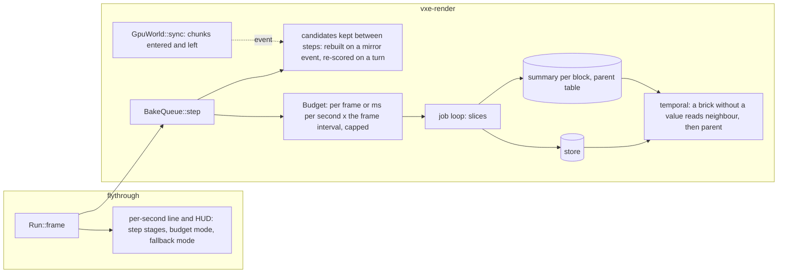

# 0067: The frame's CPU: a cheap queue step, a bake budget by time, and no black for missing light

> **Status:** in-progress (owner go 2026-11-11, with the defaults on the open points)
> **Created:** 2026-11-11
> **Milestone:** M2 (the light that holds in the dark has to hold at a playable frame), and
> cross-cutting like [Plan 0064](done/0064-the-windows-frame-pacing-workers-and-readbacks-that-wait.md).
> It serves `docs/nfr.md` section 2's frame and streaming lines and section 1's slow adapter.
> **Related ADRs:** [ADR-0052](../adrs/0052-the-live-queues-bake-budget-is-time-per-second-not-a-slice-per-frame.md)
> (accepted 2026-11-11, owner): the bake budget's unit. It rests on
> [ADR-0046](../adrs/0046-static-emissive-light-is-baked-per-chunk-when-a-chunk-loads-or-changes.md)
> and [ADR-0048](../adrs/0048-the-live-queue-orders-by-the-view-and-withdraws-the-work-a-flight-has-passed.md)
> and changes nothing they decided about the order or the withdrawal. Phase 4 builds
> [ADR-0053](../adrs/0053-a-light-summary-per-block-and-a-two-level-parent-table-light-a-brick-with-no-value.md)
> (accepted 2026-11-11, owner): a summary record per block and a two-level parent table in
> ADR-0046's store. If Phase 1's reading sends the queue's bookkeeping off the render thread, or
> Phase 5's arm is picked, the architect writes that ADR before the phase starts.
> **Source:** the owner, 2026-11-11, after Plan 0060's and 0064's windows: "we are not there -
> either lagging too much, or the picture is unacceptable or both"; "address performance next
> after this set of plans". The readings are those windows' (`docs/plans/logs/0060.md` Phase 4,
> `docs/plans/logs/0064.md` Phases 1 and 2) and Plan 0060's Phase 5 autopilot.
> **Starts after:** Plan 0061 has merged, ahead of Plan 0058 (`docs/plans/README.md`, Sequence,
> owner 2026-11-11). Phase 1 is readings only and may run beside Plan 0061's Phase 2 once Plans
> 0064 and 0065 have merged. It takes Plan 0065's Phase 6 (the queue's step), struck there.

> **Amended 2026-11-11 (owner).** The draft's five owner questions are answered; the plan stays
> a draft until the owner's "go". (1) **Start slot:** as sequenced, after Plan 0061 and ahead
> of Plan 0058. (2) **Missing light:** the owner did not take the flat-L fallback; a brick
> with no value takes its **neighbour's or its parent's** light. Phase 4 is rewritten around
> a summary record per block and a two-level parent table; flat L moves to "Decision" as
> rejected, and Phases 6 and 7, "Data shapes", "Budgets" and the risks follow. The points this
> leaves to the owner are under "Open points for the owner". (3) **Partial reach:** the arm
> stays in Phase 5. (4) **The Radeon's GPU frame:** left to the render settings and profiles
> plan and Plan 0065; this plan does not carry it. (5) **ADR-0052** is accepted as a standing
> rule; its values stay Phase 6's pick.

> **Amended 2026-11-11 (owner), at the go:** "go on 0067, defaults on the open points". The
> plan is approved; the six open points are answered with their defaults (under "Open points
> for the owner"), and ADR-0053 records Phase 4's store shape, accepted the same day.

> **Amended 2026-11-11 (owner), Plan 0060's fix-pass findings.** Two readings of Plan 0060's
> Phase 5 fix pass (`docs/plans/logs/0060.md`, "The queue step's CPU, fix pass") move here. (1)
> **The opening step's cost:** a step that opens reads about 9 ms p50, one that does not about
> 1 ms at best (Phase 1, loaded, regime A: 1.39 ms at slice 3, 0.68 at 0.75); Phase 2 takes
> the opening step as a target. (2) **The run-to-run swing:** the
> same base binary source read queue-step p50 about 1.0 ms before a reboot and 4.8 to 9.4 ms
> after it; Phase 1 measures the swing and names its cause or says it could not. While the
> swing is unexplained an absolute millisecond bar is not reliable, so Phase 2's bars are an
> A/B against the plan's base read alternated in the same session, the protocol Plan 0060 was
> amended to. "Context", "Budgets" and the risks follow. The plan stays approved.

> **Amended 2026-11-11 (owner), the queue's two regimes** ("Amend 0067", the recommended
> option). An independent read of Plan 0060's fix-pass logs and `bake.rs` explains the swing as
> two self-sustaining operating points of the live queue, a starved one (A) and one where the
> coarse front keeps up (B) ("Context", "The two regimes"; what is read and what is inferred is
> marked there). (1) **Phase 1** confirms that model with one variable, the slice, instead of
> an open-ended hunt; the hunt's wider logging is the fallback if the regime does not follow the
> slice. Every queue reading from then on logs the regime line and reports p50 per regime,
> never pooled. (2) **The A/B bars are read with the regime pinned**: B by `--near 0` carries
> the opening step's bar, A by `--coarse 0` the non-opening step's and the p99's; Phase 2 and
> "Budgets" restate them. The opening step (B's about 9 ms) stays the main target. (3) **A new
> Phase 2b** stops the queue starving: a chunk with no block takes the coarse pass first in the
> near shell too, an arm until the owner's window (Phase 6) picks it. "Decision", "Data shapes",
> "Budgets" and the risks follow. The plan stays approved.

> **Amended 2026-11-11 (architect, owner away; default taken, owner may overrule), Phase 1's
> stop.** The lane stopped at Phase 1's rule: no slice-3 run held B (`docs/plans/logs/0067.md`,
> "The slice test"). Every run of that test was loaded (1-minute load 1.4 to 13.5 at the start,
> 7 to 23 at the end, other lanes' GPU jobs and a nice-19 build), and load lowers the frame
> rate, which pushes a run toward A, so the readings cannot decide the model. What they do
> show: every run read B for its first 14 to 22 s and A from about 22 to 25 s to the end, and
> `--near 0` held B on both binaries. (1) **The verdict waits for a quiet re-read**: the slice
> test and the queued pins and rigs (`live/p1-readings3.sh`) run again on a machine with no
> other lane building or rendering, which the orchestrator arranges after Plans 0061 and 0068
> merge; a run whose 1-minute load at its start reads over 2 is marked loaded and does not
> count (Phase 1, "The quiet re-read"). (2) **Phase 2's A/B does not wait for the model**: it
> runs against the base 4bc8100 under both pins, judged per regime by the existing bars and by
> the step's cost with an empty queue at rest (Plan 0064's trace, about 3 ms; Phase 2); the
> unpinned flights are reported, not judged. (3) **Phase 2b goes ahead if the quiet slice-3
> runs fall into A**, the near shell's starvation; if every quiet slice-3 run holds B, Phase 2b
> becomes a reading and the lane goes on to Phase 3 (Phase 2b, "The premise"). Phase 2 takes
> the incremental candidate pool, since Phase 1 names the candidates as the opening step's
> largest stage. "Context", "Budgets" and the risks take Phase 1's figures.

> **Amended 2026-11-12 (architect, owner away; default taken, owner may overrule), Phase 2's
> stop.** The quiet session (`docs/plans/logs/0067.md`, Phase 2) confirmed the regime model (3
> of 4 slice-3 runs fall into A and stay; both pins hold), so Phase 2b goes ahead. Phase 2
> missed two bars. (1) **At rest the queue never drains**: it opens and withdraws the same job
> every step (8 590 withdrawals a run, 2 967 coarse chunks never refined), because the
> withdrawal fires on any ready candidate in the cone, whether or not the camera moved. Plan
> 0064's 2.84 to 3.56 ms "drained" step was this loop. **Phase 2 fixes it**: a job is withdrawn
> only if it opened before the camera's chunk last changed; the at-rest bar stays a fifth, read
> after the fix on drained lines, with a test and a drain reading; ADR-0048 gains an Outcome. (2)
> **The opening step under `--near 0`** went from about 10.0 to 8.0 ms; the sort and most of the
> candidates are gone, and what is left (list 3.6, candidates 1.1, submit 1.0, checks 0.9) is
> per-opening work the kept list does not touch. The bar is re-derived as **at most 0.8 of the
> base's opening p50, p99 no worse** (arithmetic in Phase 2); the listing's cut (scoped threads,
> as the pre-roll lists) moves to **Phase 2b**, which makes B the default flight's regime. (3)
> **Regime A's p50** (+7 to 12 %) is accepted only if the base's non-opening p50, read with
> Phase 1's binary, is no better than the tip's; otherwise Phase 2 fixes it. (4) **The sync's
> p99** (`update + poll + sync` 44 to 97 ms in flight) is recorded, not a stop: draft Plan 0070
> owns it, for the owner to rule; the frame-CPU bar becomes the queue step's own share
> (2026-11-12 architecture review, section 1.1).

> **Amended 2026-11-12 (architect, owner away; default taken), Phase 2's A-pin miss.** The
> owner may overturn this in the morning; the rejected alternatives follow the ruling. Every
> Phase 2 bar is met but one (`docs/plans/logs/0067.md`, "Phase 2: the amended bars"): rig (a)
> drains in about 140 s with 0 withdrawn and a drained step p50 of 0.068 ms; the `--near 0`
> opening bar is met on rigs (b) and (c), glide 300 marginally and inside the spread; the
> `--coarse 0` opening p50 and p99 are better. **The miss:** under `--coarse 0` on rig (b) the
> tip's non-opening p50 reads 0.874 against the base's 0.81 to 0.83 at glide 150, and 1.27
> against 0.94 to 0.97 at glide 300. All of the difference is in the `filter` stage (base 0.02
> to 0.03 ms, tip 0.17 to 0.26) and it grows with the mirror's changes a step. bdbe008's keyed
> removal did not move it. **Ruling: attribute the cost, make one targeted fix, then apply the
> bar as written. A bounded tolerance replaces a second stop** (Phase 2, "The non-opening
> step's `filter`"). In short:
> (1) Split the `filter` lap into stages of its own.
> (2) The leading hypothesis, from a code read at bdbe008 and arithmetic, not a reading:
> `GpuWorld::take_changes` lists every queue event, repeats included, and `drop_reach` removes
> 1 331 keys a raw change. An enqueue or a repeat changes no input of `reach_ready`.
> (3) Make one fix where the laps point, then re-read rig (b) after the unattended chains end.
> (4) If the tip still misses, the bar becomes +0.1 ms over the base's at both glides. The rest
> goes to Phase 7 as a followup, and only a reading over that tolerance stops the lane. The
> lane's built phases (2b, 3, 4) and their unattended readings go on unchanged.
> **Rejected:**
> - **The tolerance now, with the attribution moved to a later phase or Plan 0070.** The cost
>   comes from each mirror change in `bake.rs`'s step. It grows with flight speed, so it lands
>   in the default flight the owner's window judges. Plan 0070 moves the slot packing in
>   `gpu_world.rs`, a different stage that does not touch this one. A lap costs one commit.
> - **Keep the bar and stop.** Phases 2b to 4 are built and their readings are running. The
>   miss is 0.05 to 0.33 ms on a step whose opening the phase already cut by 2 to 3 ms, and no
>   attributed fix has been tried yet. A stop overnight buys nothing a lap does not.
>
> The same amendment rules on the dev's notes:
> (5) **Phase 5 stays struck only provisionally.** Its rule read 0 at `--level`, a bounded world
> where the census counts 0 reach-bound chunks by construction. One streamed reading at rest
> decides it (Phase 5).
> (6) **Phase 4's summary at block word 512**, just past the directory, is inside ADR-0053,
> which leaves the place to `dev`. "Before the first word" was a resume note, not the plan, so
> no Outcome is owed. The place goes into `bake.rs`'s module docs, as Phase 4 asked; today it
> is only on `SUMMARY_AT`.
> (7) **`a_first_block_fades_from_its_fallback` lives in `gpu_queue`**, since fades exist only
> in the live queue. Phase 4 now names it there.
> (8) **`Frame::set_bake_full_first` in `marcher.rs`** is the Frame's pass-through, as Phase 3's
> budget has. Phase 2b's files gain `marcher.rs`.
> (9) **The private `Budget` struct becomes `SubmitRoom`** so Phase 3's public `Budget` can take
> the name. It is accepted, and no public API changes beyond the plan's.
> ADR-0048 is untouched: the cost is the step's bookkeeping, not the order or the withdrawal.
>
> **Amended 2026-11-12 (owner), after the re-read at c8a621d** (`docs/plans/logs/0067.md`; three
> questions, each the recommended option):
> - **Phase 2 passes.** Rig (b) `--coarse 0` non-opening p50 at glide 300 reads +0.118 ms over
>   the base (+0.1 tolerance); glide 150 meets the bar as written, p99 and opening p50 are
>   better at both. The remaining `filter` cost (about 0.055 ms: `gone`, `drop_reach`,
>   `touched`) is a named Phase 7 followup. Rejected: one more cut before the window; moving it
>   to Plan 0070.
> - **Phase 3's cross-adapter bar is a reading.** The Radeon holds the budget (148 ms/s); the
>   RTX draws about 91 to 92 ms/s under `second:150,0.25`, its submits using about 5.3 ms of an
>   about 8 ms slice. The cause is a named Phase 7 followup. Rejected: finding it before the
>   window.
> - **Phase 5 is built before Phase 6.** The streamed reading reinstated it (reach-bound 3044
>   of 3641 waiting in view, 0.84 against the tenth). The window compares `--reach partial`
>   against Phase 4's `chain`. Rejected: the window now with a second one for Phase 5; striking
>   it.

## TL;DR

On the RTX the GPU is not the lag. In the owner's window at 2560 x 1440 the march reads 6.1 to
6.7 ms, while the render thread's frame CPU reads 7.1 ms p50 at rest and 11.5 ms in the streamed
cave, with a p99 of 71.5 ms in flight; the live queue's step alone reads 7.0 ms p50 at rest and
10.3 ms in flight, on the main thread every frame, and single steps of 25 to 56 ms. On the Radeon
the frame is GPU-bound (52 ms at the window's size) and the bake, a 1.5 ms slice a frame, gets a
tenth of the RTX's bake time a second, so distant caves stay black. This plan **measures where the
step's time goes, then makes a step that has nothing to do cost nothing**, gives the bake a budget
in milliseconds per second rather than a slice per frame (ADR-0052), lights a brick with no
value from its neighbour chunk's or its parent cell's summary instead of black, and reads an arm
that bakes far chunks whose reach can never be resident. In a flight the queue falls into one of
two regimes, starved (A: a step of 0.7 to 1.4 ms when it opens nothing, about 7 ms when it
opens, little light) or keeping up (B: 10 ms or more, nearly every step opening; Phase 1,
loaded); the plan confirms that with the slice on a quiet machine, reads every bar inside one
regime, and stops the queue starving if the quiet re-read shows it starves. The owner picks the budget, the fallback, the starvation fix and the reach
arm in a window on both adapters. The first thing anyone sees: a `step` breakdown in the per-second `bake queue:` line and
the HUD's queue row, so the 7 ms has a name.

## Context & problem

Every figure is a reading unless marked; the conditions are in the logs named. "RTX" is the
NVIDIA GeForce RTX 3080 Laptop GPU, "Radeon" the AMD Radeon Graphics (RADV RENOIR), the slow
adapter of `docs/nfr.md` section 1. The dev box presents across both (the panel hangs off the
iGPU), which Plan 0064 records as a label on windowed readings.

- **The owner's window, Plan 0060 Phase 4** (release at 83e72e1, 2560 x 1440 window, FSR 2 at
  1.5, HUD on, 1-minute load about 1; `live/session60.log`, untracked):

  | scene | adapter | frame CPU p50 / p99 ms | queue step p50 (median of the per-second lines) | `update + poll + sync` p99 | march GPU p50 / p99 |
  |---|---|---|---|---|---|
  | the patch at rest | RTX | 7.076 / 11.598 | 7.012 (line max up to 24.9) | 0.047 | 6.281 / 7.333 |
  | the streamed cave, flown fast | RTX | 11.495 / 71.540 | 10.342 (line max up to 56.3) | 48.048 | 6.650 / 14.966 |
  | the vein, slow, digs | RTX | 3.660 / 12.492 | 2.095 | 0.045 | 6.132 / 13.233 |
  | the cave at 1280 x 720 | RTX | 14.934 / 63.587 | 13.099 | 39.510 | 2.903 / 10.328 |
  | the cave, window size | Radeon | 4.740 / 48.140 | 2.657 | 39.580 | 52.331 / 72.512 |
  | the cave at 1280 x 720 | Radeon | 4.149 / 48.324 | 2.252 | 40.505 | 15.880 / 18.973 |

  At rest the step is the CPU frame. In the patch's first minute the line reads `baked +0`
  for seconds on end beside `jobs 3` and `depth 3068`: the step spends 7 ms finding nothing to
  open. The Radeon at the window's size: fps 15.1, hit 26.2 ms, FSR 2 18.5 ms (1707 x 960 to
  2560 x 1440), a-trous 4.4 ms; light store 526 bricks, **36 932 missing** after 137 s, 5 601
  in view waiting. Owner: "after several seconds distant caves still black".
- **The step's cost grew with Plan 0060.** Its Phase 5 autopilot (RTX, quiet, headless
  2530 x 1378, `docs/plans/logs/0060.md`): the step p50 1.007 ms at the base a8b1a2c, 3.29 to
  3.39 ms at the tip; p99 18.3 to 18.6 ms at both. The autopilot's path is lighter than the
  window's fast flight (3.3 against 10.3 ms), so this plan's readings include that flight, not
  only the autopilot.
- **The opening step and the swing** (Plan 0060's Phase 5 fix pass, the same protocol, 16G cap,
  `docs/plans/logs/0060.md`, "The queue step's CPU, fix pass"; amended 2026-11-11, owner).
  Gating the census to the line's cadence changed nothing (tip p50 3.276 ms). Lap timers on
  the base a8b1a2c and the tip, after a reboot: a step that opens reads 9.0 to 10.6 ms p50, one
  that does not 0.96 ms on the base's first run but 5.59 ms on its second (4.0 to 4.2 on the
  tip). Of an opening step, building the candidates reads 2.2 to 2.3 ms and the sort 0.9 to 1.0
  ms (together about 3.4 ms), the check-and-list loop 3.5 to 3.9 ms, then collect and dispatch;
  the same on base and tip. The candidate count in the autopilot is not in that log (about
  17 000 is the streamed cave's, from the code read below). The base's own queue-step p50 read
  1.007 and 1.006 ms before the reboot (09:34 to 09:45, 6G cap) and 4.818, 9.410, 9.268 and
  9.175 ms after it (10:22 to 11:14), same scene and binary source; its share of steps that open
  read 1245 of 2569 (48 %) and 1826 of 2236 (82 %), the tip's 1825 to 1889 of 1917 to 1980
  (about 95 %). p50 follows that share; the pre-reboot runs did not count it. The cause of the
  swing is not found. The lane fixed two tip-only costs (d5c4532, `entered.retain` at the
  census; 78740af, the pre-roll no longer withdraws its own coarse pass); neither is the swing.
- **The two regimes** (amended 2026-11-11, owner; an independent read-only investigation of
  the fix-pass logs, `live/p5/*.log` on Plan 0060's branch, untracked, and of `bake.rs` at
  Plan 0060's tip 0a660e7, spot-checked by the architect). The swing is two operating points of
  the queue in a flight, not two machine states.
  - **Read in the code.** The slice's sample cap is `slice_ms x 1e6 / ns_per_sample`, clamped
    to [16 384, 10^7], `ns_per_sample` an EMA of the GPU timestamps; the queue opens when the
    loop holds fewer than `2 x cap` samples and the quiet box has passed. The default order
    (`Refine::Tier`) puts every chunk with no block (class 0) before any refinement, the score
    inside each class, so the near shell's blank chunks come first. `push_listed` gives a class-0
    chunk the coarse pass (256 a brick direction) only beyond the near shell (Chebyshev `near`, 2);
    inside it a blank chunk takes a full job (4096). The sliced opening loop breaks once the
    loop holds `2 x cap`, and the loop plans its jobs' rounds in order, so a coarse job pushed
    behind a full one waits for it. The flight is wall-clock driven (10 m/s, about 1.56 chunks
    a second at 6.4 m a chunk) whatever the frame rate; the slice is one per frame. This rule
    came with Plan 0059's Phase 8c (03c73c2); ADR-0046's Outcome records the pre-roll's near
    chunks at 4096, not the live queue's.
  - **Read in the logs** (RTX, headless, rig (c)). Regime B: +140 to +245 chunks baked a
    second, 5 to 10 jobs, about 1 000 to 2 100 coarse chunks held, about 7.4e4 samples a baked
    chunk, step p50 9.1 to 9.4 ms (fix-ab-base-1 and -2, lap-base-2, arm-nopre2). Regime A:
    +8 to +27 a second, 1 to 2 jobs, the coarse count falling to 0, about 1.2e6 to 1.3e6 samples
    a baked chunk, step p50 0.77 to 1.34 ms (ab-base-1 and -2, arm-withdraw-off, arm-distance;
    arm-nopre1 fell from B to A at about 36 s). The samples a second read 1.0e7 to 1.6e7 in
    both. The same tip binary and flags read A (arm-nopre1, 1.343 ms) and B (arm-nopre2, 9.114
    ms) three minutes apart, and the base read A before the reboot and B after it, so the
    regime, not the commit, sets the p50. The pixel shares on the lines are sparse, but where
    they are non-zero A reads no value on up to 0.50 to 0.59 of the lighting pixels and no
    coarse share, B a coarse share of 0.98 to 1.0 and no value at most 0.016: A is the darker
    image. Frames in the 60 s flight: 1 755 to 1 788 in B (about 29 to 30 fps) against 2 082 to
    2 893 in A (about 35 to 48 fps; the arms differ, so the size of B's cost is indicative).
  - **Inferred, not read.** A: the near shell's blank chunks each take a full job of about
    1.15e6 samples, over `2 x cap` (about 4 x 10^5 at 7 ns a sample), so an opening pushes one
    job and the queue opens about one step in three. B: a coarse job of about 7.5e4 samples is
    under the threshold, so nearly every step opens. A is absorbing: about 39 chunks a second
    enter the near shell at 10 m/s (a 5 x 5 face at 1.56 a second), about 4.5e7 samples a second
    at full, three times the slice's 1.5e7, so once the coarse front is overrun it does not get
    ahead again while the flight goes on forward. (Read: lap-base-1 went B, A, B, A; its return
    to B came at about 50 s, on the autopilot's way back, presumably over ground the front had
    left coarse, then fell into A again at about 61 s.) B's own 9 ms step lowers the frame rate and with it the per-frame bake rate, a
    second, weaker loop toward A. What tips the race (the GPU's `ns_per_sample` when the shell
    reaches the pre-roll's coarse edge, at 16 to 20 s, ranked first) is a hypothesis; Phase 1
    tests the model with the slice.
- **Phase 1's readings** (amended 2026-11-11, architect, owner away; RTX, headless 2530 x
  1378, rig (c), seed 1, `docs/plans/logs/0067.md`; **all loaded**: 1-minute load 1.4 to 13.5
  at the starts, 7 to 23 at the ends, and four tip runs under 1 300 frames). Both slices on
  both binaries read B on their first flight lines (14 to 22 s) and A from about 22 to 25 s to
  the end, the coarse count at 0 by about 35 s; no slice-3 run held B. `--near 0` held B on
  every flight line on both binaries: the base's step p50 13.56 ms (load 23 at the start), the
  tip's 10.10 ms over 20 of 20 lines, opening share 0.955. The tip's stages at slice 3: A's
  opening step 7.05 ms p50 (candidates 2.65, list 1.44, sort 1.23, checks 0.39), A's
  non-opening step 1.39 ms (submit 0.70, collect 0.42); B's opening step 19.9 ms (list 6.0,
  candidates 4.1, sort 1.7, checks 1.35), from B's 241 steps of one loaded run. So the
  candidates and the list, not the sort, carry the opening step, and the slice test's verdict
  is open until a quiet re-read (Phase 1).
- **Where the step's time can go** (a code read of `bake.rs` at 95ce5ac, to be measured, not
  trusted): each step filters every store block against the mirror and `retain`s seven maps;
  `open` rebuilds a candidate from **every full chunk in the mirror** (about 3 000 at the
  level, 17 000 in a streamed flight), scores and sorts them, runs the view census, then checks
  `reach_ready` on up to 16 candidates, each a walk of `(2 light_radius + 3)^3 = 1 331` chunk
  lookups; `collect` copies each read-back block into a `Vec` and places its words. `open` runs
  whenever the loop holds fewer than two slices of samples and the quiet box (8 steps) has
  passed; with a job open and nothing ready, that is every step.
- **The reach rule caps the far light** (ADR-0046: "the bake radius is at most `r_full -
  light_radius`, 12 at the defaults"). `reach_ready` with a streamer present wants every chunk
  within `light_radius` resident full; a chunk at 13 to 16 chunks from the camera has
  neighbours that are LOD-only and **cannot bake while the camera stands still**. Plan 0060's
  patch at rest read 1 002 then 586 chunks in view waiting, all coarse, never 0, and the owner
  saw "the far caves stay coarse whether I stay in place or move". How many of the in-view
  waiting chunks are reach-bound is not read; Phase 1 counts them.
- **The slice is per frame.** `DEFAULT_BAKE_SLICE_MS` 1.5 a frame: about 150 to 210 ms of bake
  a second on the RTX at 100 to 140 fps, about 22 ms a second on the Radeon at 15 fps. The
  Radeon also pays 92 ns a sample against the RTX's 6 to 10 (the per-second lines). **Arithmetic
  from those lines:** a coarse chunk is about 7.2e4 samples (the pre-roll's 2.236e7 over 312), so
  the Radeon bakes about 3 coarse chunks a second today and about 22 at 150 ms a second; 5 600
  in view would take four minutes. A per-second budget gives the Radeon the RTX's bake time, not
  its bake; the fallback is what the slow adapter sees in the meantime.
- **What a missing value reads today** (a code read at 539a9d5, to be confirmed by Phase 4's
  test): `temporal.wgsl` reads a cube face's value through the store's chunk table, which
  spans the mirror window, LOD ring included; a chunk with no block, or a brick or cell with no
  record for the face's direction, reads 0 and counts in `store_missing`. A LOD-only chunk never
  holds a block (the queue frees it), so the whole LOD ring is black today, as is every full
  chunk still waiting. The store keeps no light coarser than the brick level; ADR-0003's mips
  are geometry and carry none.
- **The window paces by the compositor until Plan 0064 lands** (`docs/plans/logs/0064.md`:
  free 2 to 4 ms faster at wall p50, picked). Its Phases 3 and 4 remove the HUD's and the queue
  line's GPU waits and give the sync a time budget; the `update + poll + sync` p99 of 40 to 48
  ms in flight is its row. This plan starts after it and re-reads that p99 at its Phase 1; if
  it is still over one frame (16.6 ms), the plan goes back to the architect for an amendment
  rather than guessing a phase now.
- **The backlog** (`docs/backlog.md`, on Plan 0060's branch until it merges): "Far light on a
  slow adapter: a bake budget per second, and no black for missing light" (owner, 2026-11-11)
  is this plan's Phases 3 and 4. "A dug chunk's settled light differs from a one-shot bake"
  stays there.

## Decision

Measure the step first, then remove its idle cost where the profile points, in `bake.rs` on the
render thread; state the bake budget in milliseconds of GPU time per second (ADR-0052); light a
brick with no value from its neighbour chunks' or its parent cell's summary of baked light
(owner, 2026-11-11; ADR-0053); read a partial-reach arm. The owner picks the values in a window.

**The queue does not starve** (amended 2026-11-11, owner; Phase 2b). A chunk with no block takes
the coarse pass first wherever it lies, the near shell included; the near shell's full-first
radius becomes its own setting, apart from the `near` that the score's angle term and the
withdrawal read, and it stays at today's 2 until the owner's window picks. This removes the
job that makes regime A absorbing: a blank chunk entering the near shell costs about 7.5e4
samples instead of 1.15e6, so the 39 a second of a 10 m/s flight need about 2.9e6 samples a
second, a fifth of the slice's 1.5e7 (arithmetic from "Context"'s figures, not read). It is one
rule and one setting, it adds no knob to the opening loop, and it is what `--near 0` already
does to the bake without that flag's change to the order and the withdrawal. The pre-roll's
near chunks at 4096 (ADR-0046's Outcome) and the digs' rings are unchanged. **No accepted ADR
changes:** the near shell's full jobs are Plan 0059 Phase 8c's code, not a decision ADR-0046
records, and the class order (ADR-0046's coarse-first tier) and ADR-0048's score are kept. The
price is that the near shell shows coarse light until it refines, and in a flight it refines
only when no blank chunk is ready, which is what regime B shows today.

- We rejected **letting the opening loop go on past one full job while coarse work waits**: the
  loop plans its jobs' rounds in order, so coarse jobs pushed behind a full one still wait for
  it, and the near shell's demand stays three times the slice; it reaches the coarse front only
  after the shell, which is A.
- We rejected **a share of each opening or slice reserved for the coarse front**: a new weight
  to tune, and the shell's full demand still exceeds the slice three times over, so it splits
  the starvation between the shell and the front rather than ending it. It also changes the
  order inside class 0, ADR-0048's score; if the window asks for it, that ADR is owed first.
- We rejected **splitting a full job into brick sets under `2 x cap`**: the shell's samples a
  second are unchanged, so it stays starved; it only lets the loop reach the coarse front, and
  a block that lands in parts needs a partial-block state the store does not have.
- We rejected **a larger slice or the per-second budget as the fix**: they move the odds of the
  race, not its fixed point; at 10 m/s the shell at full wants about 4.5e7 samples a second,
  about 315 ms of GPU a second at 7 ns a sample, three times today's (arithmetic). Phase 3's budget does
  remove the second loop (a slower frame bakes less a second).
- We rejected **a flat constant `L` for missing light** (the draft's recommendation): the owner
  did not take it (2026-11-11). A constant lights every waiting cave alike, dark or lit, and
  carries nothing of the light around it; a neighbour's or parent's value is the nearest light
  the store already holds.
- We rejected **reading the neighbour chunk's nearest brick across the shared face** as the
  neighbour value: the brick across the face often holds no record of the hit's direction (air,
  or a face the other way), so the read misses where it is needed, and a per-voxel value cannot
  be the start of the arriving block's fade (Phase 4). A per-block summary always answers when
  the neighbour has any face of that direction.
- We rejected **moving the queue's bookkeeping to a worker thread first**: the step's work at
  rest is work that need not happen at all (nothing changed), and a thread hides a scan that
  should be an event. If Phase 2 meets its bar no thread is needed; if it does not, the thread is
  the next step and gets its ADR (the mirror's residency would cross a thread boundary).
- We rejected **lowering the slice on the slow adapter**: the far caves are black there already.
- We rejected **a resolution or quality profile for the Radeon here** (owner, 2026-11-11): its GPU frame at the
  window's size (hit 26 ms, FSR 2 18.5 ms) is a profile question the render settings and
  profiles plan owns (`docs/plans/README.md`, Sequence step 6; the frame ledger in
  `docs/nfr/02-frame-budget.md` says the same), and Plan 0065 takes the passes' waste. This plan
  reads the Radeon at the window's size and at 1280 x 720 and records what it sees.

## Architecture diagram



## Implementation phases

Every phase gates on `node scripts/test-changed.mjs --profile quick`, plus `--profile gpu
--binaries <the phase's gpu_* binaries>` under the perf lock when it touches `vxe-render`; the tip
gates on `cargo nextest run --profile gate`. A reading names the machine, adapter, resolution,
scene, commit, lock and 1-minute load, and runs on both adapters where it is a frame or bake
figure. **The rigs:** (a) `--level --pose patch` at rest; (b) Plan 0060's cave glide at 150 and
300 (`docs/plans/logs/0060.md`, Phase 1's runs, headless at 2530 x 1378); (c) the autopilot of
`docs/nfr.md` section 5's protocol; (d) the owner's window scenes of Plan 0060 Phase 4, windowed.
Phases 2 to 5 are **exploration** before the owner's window (lane rules 2b): they name readings
and CPU tests of data and API, not image bars; Phase 7 writes the bars against the picks.

### Phase 1: Where the frame's CPU goes
- **Owner skill:** dev
- **What:** stage timers inside `BakeQueue::step` (the mirror filter and `retain`s, boxes,
  withdrawal, the candidate build, the censuses, the sort, the reach and light checks,
  `refresh_tables`, `collect`'s poll, copy and placement, the submit) summed per frame into
  `QueueStats`, printed in the per-second `bake queue:` line as `step: <stage> N ms ...` and in
  the `frames:` summary as per-stage p50 and p99, with a `step` figure in the HUD's queue row;
  a count of the in-view waiting candidates whose reach crosses the full radius; the bake's ms a
  second in the line. Every stage is also split by whether the step opened: the line and the
  `frames:` summary print the share of steps that open and the step p50 on opening and
  non-opening steps (amended 2026-11-11, owner). The window shell takes `--adapter` as the
  headless run does (today it prints "the window takes the default adapter"), so the Radeon
  arms need no Mesa variable.
- **The regime line** (amended 2026-11-11, owner, the two regimes). The per-second `bake
  queue:` line gains the chunks baked that second, the jobs, the coarse chunks held, the
  samples a baked chunk (the second's samples over its chunks baked) and the regime it reads:
  **B** under 3e5 samples a baked chunk, **A** over 6e5, **mixed** between (a guess placed
  between the read 7.4e4 and 1.2e6, independent of the slice; the log may move it if the slice
  test's lines sit elsewhere). Every step is tagged with its second's regime, and the `frames:`
  summary prints the step's p50 and p99, the opening share and the opening and non-opening p50
  **per regime** with each regime's step count; a pooled p50 is printed only beside them. A run
  of the start commit's binary, which has no tags, is classified from its lines by hand: a run
  whose flight lines (after the pre-roll, from 14 s) read at least 80 % one regime is that
  regime's, otherwise mixed, and a mixed run's p50 is reported as mixed, never pooled into
  either. At rest (rig (a)) the queue is not racing a flight, and the regime is not read.
- **The slice test, one variable** (amended 2026-11-11, owner; replaces the open-ended hunt for
  the swing's cause). Rig (c) on the RTX, in one session, the start commit's binary alternated
  `--bake-slice 0.75`, `--bake-slice 3`, at least three runs a side, then the same on this
  phase's tree, with two default (`1.5`) runs between, each with the regime line. **The
  prediction** (inferred from "The two regimes", not read): at 0.75 ms the coarse front bakes
  about 100 chunks a second at best, near the 83 a second the shell's leading edge needs (a
  guess), so every run ends in A, step p50 about 1 ms; at 3 ms the loop's threshold doubles and
  the front bakes about 400 a second, so every run holds B, about 9 ms. The first reading's
  rule was that the model is confirmed if every 0.75 run is A and every 3 run is B on both
  binaries; the quiet re-read below replaces it. A slice of 3 does
  not pin B: once in A the shell still needs about 4.5e7 samples a second against 3e7, so a run
  that falls into A stays there, and the log says so if one does. **If the regime does not
  follow the slice**, the fallback is the hunt: per opening, the pool's refusals (`pool_full`),
  the blocked hits and the near shell's class-0 count, and per run the pre-roll's coarse pass
  (chunks, samples), `ns_per_sample` at frames 120 to 240, the memory cap, the 1-minute load
  and the machine's state (power source, governor and profile, CPU and GPU clocks and
  temperature at start and end), logged beside the quiet re-read. The first, loaded reading did
  not confirm the model and the lane stopped; the stop is answered by the next bullet.
- **The quiet re-read** (amended 2026-11-11, architect, owner away; default taken, owner may
  overrule). The slice test, the pins and the rigs of `live/p1-readings3.sh` run again on a
  quiet machine: no other lane building or rendering, arranged by the orchestrator after Plans
  0061 and 0068 merge. Every run logs the 1-minute load at its start and end; **a run whose
  start reads over 2 is marked loaded**, is reported, does not count for any verdict or bar,
  and is re-run while the quiet window lasts. The verdict counts at least two quiet runs a
  side; with fewer the log says it is still open. It is read as two questions: **does the
  default queue starve** (a quiet slice-3 run that falls into A and stays there to its end is
  starvation, since a doubled slice does not get the front ahead again) and **do the pins
  hold**. The 0.75 runs are a reading. What the answer moves is Phase 2b's premise, not Phase
  2, whose A/B rests on the pins alone. A pin that does not hold on the quiet machine still
  stops the lane for the architect, and that pin's bars are not read.
- **The pins** (amended 2026-11-11, owner). The same session reads the two pins Phase 2's A/B
  uses, three runs each on both binaries: `--near 0` (B: only the camera's own chunk takes a
  full blank job, about 1.8e6 samples a second at 1.56 chunks a second, an eighth of the
  slice, so A cannot hold; arithmetic) and `--coarse 0` (A: there is no coarse job, every job
  is full). A pin holds if every flight line of every pinned run reads its regime. A pin that
  does not hold stops the lane for the architect.
- **Files touched:** `crates/vxe-render/src/bake.rs`, `crates/vxe-app/src/shell.rs`,
  `apps/flythrough/src/main.rs`, `hud.rs`, `apps/flythrough/tests/gpu_queue.rs`,
  `docs/plans/logs/0067.md` (new).
- **Done when:**
  - `the_step_s_stages_sum_to_its_time` (`gpu_queue`, lavapipe, about 3 s, an estimate): over
    20 steps of a seeded rig the stage sum is within 5 % of the step's own time, and no stage
    reads negative.
  - `the_window_takes_the_adapter_flag` (CPU, under 1 s): the shell's config carries the
    substring and the selector picks the first adapter whose name contains it, on a fixed list.
  - `the_stages_split_by_opening` (`gpu_queue`, lavapipe, about 3 s, an estimate): over 20
    steps of a seeded rig in which some steps open and some do not, the opening and
    non-opening counts sum to 20, match the steps whose `open` ran, and each side's stage sum
    is within 5 % of its steps' own time.
  - `the_regime_line_reads_fixed_seconds` (CPU, under 1 s): seconds of 1.4e7 samples over 190
    chunks, 1.5e7 over 12 and 1.5e7 over 35 read B, A and mixed; a run of 20 tagged steps, 12
    in B and 8 in A, prints per-regime counts of 12 and 8 and each regime's p50 from its own
    steps alone.
  - **The slice test:** the log holds every run's start and end load, loaded or quiet, its
    regime lines, its regime by the 80 % rule, its per-regime p50 and opening share, and,
    from the quiet runs only, the verdict: whether the quiet slice-3 runs fall into A (Phase
    2b goes ahead) or every one holds B (Phase 2b becomes a reading), with the fallback's
    fields beside it. The pins' quiet runs say whether each pin held.
  - The log holds, for rigs (a) to (c) on the RTX and (a) and (b) on the Radeon, headless, plus
    rig (d) on the RTX windowed: the step's p50 and p99 per stage, the frame CPU p50 and p99,
    `update + poll + sync` p99, the reach-bound count against the in-view waiting count, and
    the bake's ms a second, the opening share and the opening and non-opening p50 per stage,
    each flight figure per regime with the regime lines beside it.
    **The readings decide the next phases:** the log names the stage with at least half the
    step's p50 at rest and in flight, and the stages of an opening step; Phase 2 takes those
    stages. If the
    reach-bound count is under a tenth of the in-view waiting at the patch, Phase 5 is struck.
    If `update + poll + sync` p99 reads over 16.6 ms in rig (b) with Plan 0064 merged, the log
    records it and the lane goes on (amended 2026-11-12, architect, owner away: the sync is
    draft Plan 0070's, for the owner to rule; it no longer stops this lane).

### Phase 2: A step with nothing to do costs nothing
- **Owner skill:** dev
- **What:** the candidate list is kept between steps and rebuilt only when the mirror gained or
  lost a chunk, a job ended, or the camera's chunk changed; a turn re-scores the kept list; a
  candidate's reach verdict is cached and dropped only for candidates within `light_radius + 1`
  of a chunk the sync just mirrored or evicted (the sync reports those); the mirror filter and
  the seven `retain`s run only when the mirror moved. Plan 0065's Phase 6 as it was written
  there, extended by the reach cache. If Phase 1 names another stage (the collect's copies, the
  placement), this phase takes that one as well and the log says so.
- **The opening step** (amended 2026-11-11, owner; Phase 1's split, architect, owner away). A
  step that opens reads 7.05 ms p50 in A and 10.3 ms under `--near 0` at the tip (Phase 1,
  loaded; "Context"): the candidates 2.65 and 3.03 ms, the list 1.44 and 2.89, the sort 1.23
  and 1.58, the checks 0.39 and 0.66. With the kept list, an opening between two rebuilds sorts
  nothing and checks cached verdicts, so its cost is the walk of the kept, ordered list to the
  first ready candidates plus the job's setup. Phase 1 names the candidates as the opening
  step's largest stage, so **the pool is kept incrementally** (entered and left chunks
  applied, a partial heap for the order), as `wip` 5201ab6 has it; a debug assertion that the
  kept pool equals a whole re-read at every opening stays in the tree.
- **How the bars are read** (amended 2026-11-11, owner, twice): an A/B against the plan's base
  (Phase 1's start commit) under the same protocol, alternated base, tip, base, tip in one
  session, at least two rounds a side, the spread between a side's two rounds as the tolerance;
  the same protocol Plan 0060 was amended to. **In a flight both sides run with the regime
  pinned**, by the pins Phase 1 showed to hold, and both pins are read: **B by `--near 0`**
  carries the opening step's bar, since nearly every step opens there and the opening step is
  the main target; **A by `--coarse 0`** carries the non-opening step's and the p99's no-worse
  bars, since most of its steps do not open. Both pins remove the race by construction rather
  than shift its odds, which `--bake-slice` only does. `--near 0` also narrows the shell the
  score's angle term and the withdrawal read; it does so on both sides, so the A/B compares like
  with like, and the pinned figures are not the default flight's. The default flight is read
  beside them, per regime, as a reading. A run whose lines leave its pinned regime is
  discarded and re-run, and the log says so. The absolute figures of the draft (0.5 ms at
  rest, 1.0 ms in flight, no step over 4 ms) are recorded beside each run as readings, not
  bars; the architect may restore them by an amendment once Phase 2b's pick has settled which
  regime the default flight runs in.
- **The A/B does not wait for the regime model** (amended 2026-11-11, architect, owner away;
  default taken, owner may overrule). The pins remove the race by construction, so the A/B's
  footing is that each pin holds, not the slice test's verdict. It runs in the quiet session
  after the slice re-read, the base binary `live/base/flythrough-4bc8100` against the tip,
  under `--near 0` (B) and `--coarse 0` (A), judged per regime by the bars below; the quiet
  re-read's load rule holds (a run over load 2 at its start does not count, and the tolerance
  comes from quiet rounds only). It is also judged at rest on **the step's cost with an empty
  queue**, the frame CPU Plan 0064's close traced to this plan (the step 2.84 to 3.56 ms p50 on
  every line once the queue drained, `baked +0`, `jobs 1`). The unpinned flights (slice 1.5
  and 3) are run beside it and reported per regime, not judged.
- **The withdrawal at rest** (amended 2026-11-12, architect, owner away; default taken, owner
  may overrule). Read in the quiet session: at the patch the opening's best candidate is a
  coarse refinement outside the keep cone and the near shell (the score ranks it first); at the
  next step `withdraw_passed` finds a ready candidate in the view cone and takes the job back
  (it asks only whether such a candidate is ready, not whether it outranks the job), and the
  next opening picks the same job. **"Passed" becomes "the camera moved past it":** the queue
  counts the steps at which the camera's chunk changed, a job records that count when it opens,
  and `withdraw_passed` takes only jobs whose count is older than the current one, the
  existing predicates (not a dig, not full, outside the shell and the keep cone, a ready
  candidate in view) unchanged. At rest nothing is withdrawn, so the queue refines what is ready
  and drains; in a flight a job is withdrawable from the first chunk the camera crosses after
  its opening. A turn in place withdraws nothing: the open job runs to its end (one refinement,
  about 1.15e6 samples, a few frames of the RTX's slice; arithmetic), then the order takes the
  view. We rejected **withdrawing only when the ready candidate outranks the job in the
  opening's order**: it also ends the loop, but it ties the withdrawal to the score's ties and
  still withdraws at rest on a turn, which is not what the owner asked to cancel ("places that
  camera is already passed"). ADR-0048 records this as an Outcome.
- **The opening bar's arithmetic** (amended 2026-11-12, architect, owner away). Phase 1's loaded
  split of the base plus timers under `--near 0`, an opening step of 10.27 ms: candidates 3.03,
  list 2.89, sort 1.58, submit 0.83, checks 0.66, refresh 0.53, collect 0.40, filter 0.18. What
  the kept list removes is the sort (1.58) and the candidates' rebuild (3.03 less the kept
  pool's 1.09 read at the tip, 1.94): 3.5 ms, 34 %, so about 0.66 of the base if nothing else
  moved. The list (a job's setup for a candidate that has never been listed) and the submit
  are per-opening work no cache removes, and the quiet tip's list reads 3.57 against the loaded
  2.89, so the bar keeps a margin over 0.66 for the base's quiet split (not yet read) and the
  pool's upkeep: **at most 0.8 of the base's opening p50**. The quiet tip reads 7.91 and 8.07
  against a base step p50 of 10.06 and 9.99, so 0.79 to 0.81 of the step; the base's opening
  p50 from Phase 1's binary (`live/p2-quiet2.sh`) is the denominator, the step p50 standing in
  only until it lands (at a 0.955 opening share the loaded tip read its opening 0.17 ms above
  its step). The list's own cut (listing a sliced opening's ready candidates on scoped threads,
  as the pre-roll and the digs' rings already do) is **Phase 2b's**, not Plan 0070's: it is the
  queue's step in `bake.rs`, and it pays in regime B, which Phase 2b makes the default flight's;
  Plan 0070 moves the mirror's slot packing in `gpu_world.rs`, a different stage.
- **The non-opening step's `filter`** (amended 2026-11-12, architect, owner away; default
  taken, owner may overrule). Rig (b) under `--coarse 0` misses the non-opening bar. All of it
  is in `filter` (tip 0.17 to 0.26 ms, base 0.02 to 0.03), and it grows with the glide's speed.
  bdbe008 did not move it. The steps, in order:
  1. **Attribute.** The `filter` lap becomes stages of its own: the window's `rewindow`, the
     change list and `gone`, the maps' removals, `drop_reach`, and `touched`. The `dev` names
     them, keeps them in the tree, and keeps `the_step_s_stages_sum_to_its_time` green.
  2. **The hypothesis to test.** This is a code read at bdbe008 plus arithmetic, not a reading.
     `take_changes` returns every queue event (enqueued, unqueued, uploaded, dropped). Each is
     "possibly repeated", and only `gone` is deduplicated. `drop_reach` removes `(2
     (light_radius + 1) + 1)^3` = 1 331 keys for each raw change at the default radius 4. At a
     few thousand cached verdicts that is about as many hash operations as the scan it
     replaced, which would explain why bdbe008 read no change. An enqueue, an unqueue or a
     repeat changes no input of `reach_ready`.
  3. **One targeted fix where the laps point.** If they confirm the hypothesis: drop verdicts
     only for the deduplicated changes whose held-full state flipped. If they point elsewhere,
     the log names the part and the fix. Either way three things stay green unchanged:
     `a_still_step_scans_nothing`'s check that mirroring one chunk re-checks exactly the
     candidates within `light_radius + 1`, `an_opening_without_a_mirror_event_rebuilds_nothing`,
     and the cached verdict's debug assertion.
  4. **The re-read.** Rig (b) under `--coarse 0` at glides 150 and 300. Phase 1's binary
     (87bf0d2) is alternated with the fixed tip, two quiet rounds a side, queued after the
     unattended chains' `ALL DONE 4`. The build and the `gpu_queue` gate take the exclusive
     perf lock, so no reading runs beside them. The binary gets a new name under `live/bin/`;
     the binaries the running chains use, and the chains themselves, are not touched.
  5. **The bar, then its fallback.** The bar is the one written below. If it is still missed
     after this one fix, the lane does not stop again. The bar becomes **the tip's non-opening
     p50 at most 0.1 ms over the base's at both glides**. The base's round spread is 0.02 to
     0.03 ms, and 0.1 ms is about a tenth of the non-opening step and under 1 % of the opening
     step. The cost left over goes to the log and to Phase 7's close as a named followup. Only
     a reading over 0.1 ms at either glide stops the lane for the architect.
- **Files touched:** `crates/vxe-render/src/bake.rs`, `gpu_world.rs` (the sync's entered and
  left lists), `apps/flythrough/tests/gpu_queue.rs`.
- **Done when:**
  - `a_still_step_scans_nothing` (`gpu_queue`, lavapipe, about 5 s, an estimate): after the
    queue drains on a still camera, 100 further steps read `QueueStats`' new `scanned` and
    `reach_checks` counters at 0; evicting one chunk makes the next step scan and free exactly
    that chunk's block; mirroring one chunk re-checks exactly the candidates within
    `light_radius + 1` of it.
  - The order of jobs a seeded flight opens is identical to the start commit's (`gpu_queue`'s
    order tests, with a recording of the start commit's order where none pins it).
  - `an_opening_without_a_mirror_event_rebuilds_nothing` (`gpu_queue`, lavapipe, about 4 s,
    an estimate): on a still camera with the mirror unchanged, a job's end makes the next step
    open with `QueueStats`' new `rebuilt` counter at 0 and `reach_checks` at 0 for candidates
    whose verdicts are cached, and the job it opens is the one a full rebuild at the start
    commit opens from the same state; mirroring one chunk makes the next opening rebuild once.
  - `a_still_camera_drains_and_withdraws_nothing` (`gpu_queue`, lavapipe, about 5 s, an
    estimate; amended 2026-11-12): a seeded rig in which the opening's first job is a coarse
    refinement outside the keep cone and the near shell while a candidate in the view cone is
    ready (the test asserts this precondition, the loop's state at the base); the camera
    still. Every step reads `withdrawn` 0; within `N` steps, `N` computed by the test from the
    rig's listed samples over the per-step cap floor, every candidate whose reach is ready
    holds a full block; the 100 steps after that push no job and read `scanned` 0. Then the
    camera moves one chunk and the next opening may withdraw that job again: the flight's
    withdrawal is kept. `a_passed_chunk_is_withdrawn`, `the_edge_of_the_view_does_not_churn`
    and `a_turn_resorts_the_queue` stay green unchanged; if one rested on a withdrawal at a
    turn in place, the log says so.
  - **The A/B on the RTX** (amended 2026-11-11, owner, twice; bars re-derived 2026-11-12,
    architect, owner away), each figure against the base's in the same session and the same
    pin, within the tolerance above: rigs (b) and (c) under `--near 0` (B): the opening step's
    p50 at most **0.8** of the base's opening p50 and the step's p99 no worse (arithmetic
    above); rigs (b) and (c) under `--coarse 0` (A): the step's p99 and the opening step's
    p50 no worse than the base's, and the **non-opening p50 no worse than the base's
    non-opening p50** read with Phase 1's binary 87bf0d2 (the base plus timers); if that
    split shows the tip's non-opening step slower beyond the tolerance, Phase 2 finds and
    removes the cost before it lands, and the overall p50's +7 to 12 % is accepted only
    otherwise. On rig (b) the non-opening bar is read after "The non-opening step's `filter`"
    above, with that bullet's fallback (amended 2026-11-12, architect, owner away). **Rig (a),
    after the withdrawal fix**, run until drained or 300 s on both
    sides: the tip drains (at least 30 consecutive lines of `baked +0`, `jobs 0`, depth equal
    to the reach-bound count) within 300 s (arithmetic: about 3 000 refinements at about
    1.15e6 samples over about 3e7 samples a second at rest, a guess from 1.5 ms a frame at
    about 150 fps and 7 ns a sample, is about 115 s; the margin covers a lower rate), withdraws 0 over the run, and its step p50 on the drained lines is
    at most **a fifth** of the base's at-rest step p50 (the base reads 3.41 ms on its looping
    lines, so at most 0.68 ms); the seconds to drain, the chunks refined, and the step p50 on
    the refining lines are logged as readings, since a refining tip and a looping base do
    different work. The run's frame CPU p50 is logged on both sides. Each run logs its start
    load, regime lines and opening share; the
    overall p50 is read only within one pinned regime, never pooled across regimes. The
    unpinned flights (slice 1.5 and 3), alternated in the same way, are logged per regime as
    readings, not judged. If a bar is
    missed after the named stages are gone, the lane stops for the architect (the thread
    question of "Decision"). The one exception is rig (b)'s non-opening bar, which follows its
    own fallback above.

### Phase 2b: The queue does not starve in a flight (exploration)
- **Owner skill:** dev
- **What** (amended 2026-11-11, owner; "Decision", "The queue does not starve"). `BakeQueue`'s
  settings gain `full_first: Option<i32>`, the Chebyshev radius within which a live chunk with
  no block takes a full job directly: `Some(2)` is today's rule and stays the default until
  Phase 6; `None` gives every live blank chunk the coarse pass first, and the near shell
  refines as class 1. `push_listed` reads it in place of `near`; the angle term, the withdrawal
  and the pre-roll keep `near` and their own rules. `--full-first off|N` and a key cycle it; the
  HUD's queue row and the banner name it. The per-second line counts the **starved openings**:
  an opening that pushed a full job on a blank chunk while a blank candidate outside the
  full-first radius was ready and left unpushed. The phase lands after Phase 2, so the window
  sees regime B's opening step at Phase 2's cost, not the base's 10 ms or more.
- **The opening's listing on scoped threads** (amended 2026-11-12, architect, owner away; moved
  from Phase 2's bar). Under `--near 0` the quiet tip's opening spends 3.57 ms p50 of 7.9 in
  `list`, one candidate at a time on the render thread; the pre-roll and the digs' rings list
  theirs across `std::thread::scope`. A sliced opening walks the order as today, collects its
  ready candidates up to the loop's `2 x cap` by an estimate of each one's samples taken before
  listing (from the workers' `FacePrep` masks where they arrived, else an upper bound; the lane
  picks the estimate and the log names it), lists them on scoped threads, then
  pushes them in the walk's order, so the jobs and their order are the start commit's. A
  candidate the estimate admitted and the pool refuses waits as today.
- **The premise** (amended 2026-11-11, architect, owner away; default taken, owner may
  overrule). The phase rests on the near shell's starvation, which Phase 1's loaded runs and
  the `--near 0` pin suggest but do not decide. It waits for Phase 1's quiet re-read, and the
  lane may take Phase 3 meanwhile. **If the quiet slice-3 runs fall into A** (one or more
  falls and stays), the phase goes ahead as written. **If every quiet slice-3 run holds B**,
  the loaded fall into A came from the frame rate (the second loop of "The two regimes"), and
  the phase becomes a reading: no `full_first` setting, no key; rig (c) on the RTX and rig (b)
  on the Radeon at 1280 x 720, default against `--near 0`, three runs a side, logging each
  run's regime lines, the frames and the no-value and coarse pixel shares, for Phase 6 to see
  whether the slow adapter starves where the RTX does not. The lane then goes on to Phase 3,
  whose per-second budget removes that loop, and the architect amends the plan if the window
  asks for the setting.
- **Files touched:** `crates/vxe-render/src/bake.rs`, `marcher.rs` (the Frame's
  `set_bake_full_first`; amended 2026-11-12), `apps/flythrough/src/main.rs`, `hud.rs`,
  `apps/flythrough/tests/gpu_queue.rs`.
- **Done when:**
  - `a_starved_queue_recovers` (`gpu_queue`, lavapipe, about 6 s, an estimate; it stays under
    the 10 s soak line by shrinking the rig, since it is the phase's proof): a seeded mirrored
    rig with the brick and coarse samples scaled down by the same factor (the 16 to 1 ratio
    kept) and a fixed sample budget a step; the camera advances one chunk along x every `K`
    steps, `K` set so that one advance's entering near-shell chunks need more than `K` steps'
    samples at full and under half of them at coarse, with a full job over two steps' budget
    and a coarse one under one (the test computes these from the listed jobs and asserts them
    as its precondition). Under `Some(2)`, after 10 advances the near shell's blank count is
    higher than after the first, and the last five advances open no coarse job (the starved
    state exists in the rig). Then, from that state, under `None`: the near shell's blank count
    falls at every advance until it reaches 0 and stays 0 at every later advance, every opening
    pushes at least one coarse job while a blank candidate is ready, and the starved openings
    count stays 0.
  - `the_full_first_radius_leaves_the_order_alone` (`gpu_queue`, lavapipe, about 3 s, an
    estimate): on a still camera the order in which chunks take their first job is the same
    under `Some(2)` and `None` (only the samples of the near shell's first jobs differ), and
    under `Some(2)` the jobs and their samples equal the start commit's on the same rig.
  - `the_banner_names_the_full_first_radius` (CPU, under 1 s) asserts the row's text for
    `off` and `2`.
  - The parallel listing (amended 2026-11-12): `a_flight_opens_in_the_start_commit_s_order`
    and the one-shot comparisons stay green unchanged, and a reading, not a bar, in the log:
    rig (c) under `--near 0`, the tip before and after the listing alternated, two rounds a
    side, the opening's `list` and step p50 and p99.
  - Readings, no bar, in the log (exploration: the owner's eye gates in Phase 6): rig (c) on
    the RTX, `off` alternated with `2`, three runs a side in one session: each run's regime
    lines, its regime by Phase 1's 80 % rule, the starved openings, the step's p50 per regime,
    the frames in the flight, and the line's no-value and coarse pixel shares; rig (a) under
    `off`: the seconds until the near shell holds no coarse block. Every `off` run is expected
    to read B with no starved opening; one that reads A is a bug to fix before the window.

### Phase 3: The bake budget in milliseconds per second
- **Owner skill:** dev
- **What:** `BakeQueue` takes a `Budget`: `PerFrame { ms }` (today's slice) or `PerSecond {
  ms_per_s, cap }`, the second sizing each step's slice as `ms_per_s x the last frame's
  interval`, clamped to `cap x interval` and to the slice's floor; the fly-through passes the
  interval, a headless test passes a fixed one. `--bake-budget frame:MS|second:MS,CAP` and a key
  cycle it; the HUD's queue row and the banner name the mode and value. The default stays
  `frame:1.5` until Phase 6.
- **Files touched:** `crates/vxe-render/src/bake.rs`, `marcher.rs`, `apps/flythrough/src/main.rs`,
  `hud.rs`, `apps/flythrough/tests/gpu_queue.rs`.
- **Done when:**
  - `a_per_second_budget_sizes_the_slice_by_the_interval` (CPU, under 1 s): at 150 ms a second
    a 10 ms interval gives a 1.5 ms slice and a 66 ms interval 9.9 ms; at 300 ms a second and a
    cap of 0.25 the 66 ms interval gives 16.5 ms, the cap; a 0 interval gives the floor.
  - `the_banner_names_the_budget` (CPU, under 1 s) asserts the row's text for both modes.
  - Rig (b) on both adapters under `second:150,0.25`: the bake's ms a second read within 10 %
    of each other, and the Radeon's frame CPU p50 grows by at most the cap's share of its
    interval; under `frame:1.5` the RTX reads what the start commit read.

### Phase 4: A brick without a light value takes its neighbour's or its parent's
- **Owner skill:** dev
- **What** (amended 2026-11-11, owner: neighbour or parent, not flat L). The store's shape is
  ADR-0053's.
  - **A summary per block.** When the queue places a block, and on every frame of its fade, the
    CPU writes one record in the store's record format (`BRICK_WORDS`: six rgb9e5 direction
    values, then the tail), reachable from the chunk's table word with no second table read
    (the place is `dev`'s, recorded in `bake.rs`'s module docs; built at word 512, past the
    directory, `SUMMARY_AT`, accepted 2026-11-12; the module docs' block description still
    owes the sentence). A direction's value is the
    mean of the block's cell values of that direction over the cells that have it; the tail's
    material is the emitter material the most of those cells keep, its face bits the union.
    The read multiplies by that one material's emission scale now, as a cell's does.
  - **A parent table** after the chunk table in the store's header region: level 1 over cells
    of 2 x 2 x 2 chunks (128 voxels a side), level 2 over 4 x 4 x 4 (256), each cell one record
    of the same format, the mean by direction of its children's present summaries (level 2 of
    level 1's). The CPU rewrites the two records above a summary whenever it changes, so a
    parent fades with its children and empties when its last child's block is freed.
  - **The read** (`temporal.wgsl`, cube faces only): where `store_brick_value` has no value,
    the chain runs nearest first and stops at the first value for the face's direction:
    (i) the hit's own chunk's summary, where its chunk holds a block (the brick's parent: a dug
    face before its re-bake, a cell baked without that direction); (ii) **the neighbour**: the
    mean of the six face-neighbour chunks' summaries that have the direction; (iii) **the
    parent**: level 1's record, then level 2's; (iv) none: 0, black as today. The value is one
    per chunk and direction, not per voxel. `march.wgsl`'s `glass_store_value` keeps reading 0
    for a missing record (a reflected share from a fallback is not read).
  - **No pop on arrival.** Under a fallback mode a chunk's first block fades over `FADE` frames
    from a block whose every cell holds the value the chain gave that chunk when the block
    landed (the CPU walks the same chain over the records it wrote); under `black` a first
    block is written directly, as today.
  - **The arm and its readings.** `--missing-light black|neighbour|parent|chain` (`chain` is
    (i) to (iv); `neighbour` skips (iii), `parent` skips (ii)) and a key cycle it; the HUD's
    light row and the banner name the mode. Two free header words count the pixels that took a
    fallback and those the chain left black; the per-second line prints the no-value,
    fallback and still-black shares. Phase 1's step breakdown gains the summaries' stage. The
    default stays `black` until Phase 6.
- **Files touched:** `crates/vxe-render/src/bake.rs`, `crates/vxe-render/src/shaders/temporal.wgsl`,
  `marcher.rs`, `apps/flythrough/src/main.rs`, `hud.rs`, `apps/flythrough/tests/gpu_bake.rs`,
  `apps/flythrough/tests/gpu_queue.rs` (the fade test; amended 2026-11-12).
- **Done when:**
  - `a_block_summary_is_its_cells_mean_by_direction` (CPU, under 1 s): a fixed block with known
    records gives a summary whose every direction decodes within one rgb9e5 step of the mean of
    the cells that have it, the tail naming the material the most of those cells keep and the
    face bits their union; a level-1 record over two present children of eight is their mean
    by direction; a level-1 cell with no present child holds no value, and freeing a child's
    block takes it out of its parents' means.
  - `a_missing_brick_reads_its_neighbour_then_its_parent` (`gpu_bake`, lavapipe, about 6 s, an
    estimate): chunks A1 (0,0,0) and A2 (0,0,1) baked with different emitters, inside one
    level-1 cell; B (1,0,0) face-adjacent to A1 alone and C (1,1,0) adjacent to neither, both
    blockless in the same cell; D (4,0,0) blockless in a level-2 cell with no block. Under
    `chain` B's lit-face stored term equals A1's summary for its face's direction within one
    rgb9e5 step, C's the mean of A1's and A2's, D's 0. Under `parent` B reads that mean too;
    under `neighbour` C reads 0; under `black` B, C and D read 0. `store_missing` is the same
    in every arm, and under `chain` the fallback counter equals B's and C's lit-face pixels
    and the still-black counter D's.
  - `a_first_block_fades_from_its_fallback` (`gpu_queue`, since fades exist only in the live
    queue, amended 2026-11-12; lavapipe, about 4 s, an estimate, its time logged at the next
    gpu run): in a live-queue rig where a neighbour is already baked, when a chunk's first
    block lands under `chain`, its stored words on the fade's first frame lie within one
    rgb9e5 step of `fallback + (block - fallback) / FADE`, not at the block's
    value; under `black` it is the block's value on that frame.
  - Every golden is byte-identical under `black` (the default).
  - Readings, no bar, in the log: rig (b) on both adapters, the Radeon at the window's size,
    under each mode: the three shares at 10 s and 60 s; the temporal pass's GPU time p50
    against `black`; the summaries' stage of the step p50 and p99; the store's bytes for the
    summaries and the parent table. A 0 shown where the chain had a value is a bug, not a
    reading.

### Phase 5: Far light beyond the bake radius (exploration, conditional)
- **Owner skill:** dev
- **What:** an arm `--reach full|partial`: under `partial` a chunk whose reach crosses the full
  radius bakes from its resident reach and its block is flagged partial; a chunk that later
  arrives within its reach re-queues it as a refinement. Struck by Phase 1's rule if few chunks
  are reach-bound. If the owner picks it in Phase 6, the architect amends ADR-0046 (an ADR with
  an Outcome, or a new one) before Phase 7. The arm stays here (owner, 2026-11-11). Phase 4's
  chain already lights a reach-bound chunk from its baked neighbours, so Phase 6 compares
  `partial` against `chain` alone, not against black.
- **The strike, read in a streamed world** (amended 2026-11-12, architect, owner away; default
  taken, owner may overrule). Phase 1's rule struck the phase on `reach-bound 0 of 1121 to
  1201` at the patch. But `--level` is a bounded world (`QueueView::full_radius` is `None`), so
  the census counts 0 reach-bound chunks by construction. The waiting at the patch was the
  withdrawal loop, and the drained `a-fix` runs show nothing waiting in view. The reach rule
  bites only in a streamed world, so one reading decides the strike. It runs after Phase 2's
  rig (b) re-read, on the RTX, headless:
  - **The scene.** Rig (b)'s streamed cave with the camera held still at the glide's start pose
    for 180 s. The `dev` picks the flag the tree takes for that and the log names it.
  - **The reading.** The reach-bound count against the in-view waiting count on the last 30
    lines.
  - **The rule.** At a tenth or more, the phase is reinstated as written, still exploration and
    before Phase 6. Under a tenth it stays struck. The log records the reading either way.
  - **Rejected:** striking it on the bounded reading alone, which measured nothing; and building
    it unconditionally, since Phase 4's chain already lights a reach-bound chunk from its baked
    neighbours.
- **Files touched:** `crates/vxe-render/src/bake.rs`, `apps/flythrough/src/main.rs`,
  `apps/flythrough/tests/gpu_queue.rs`.
- **Done when:**
  - `a_partial_reach_chunk_bakes_and_is_rebaked_when_its_reach_arrives` (`gpu_queue`,
    lavapipe, about 6 s, an estimate): in a rig where one chunk's neighbour within the light
    radius is LOD-only, `full` leaves it waiting over 50 steps and `partial` bakes it with the
    flag set; loading the neighbour full re-queues it, and its settled block equals a one-shot
    bake of the whole rig.
  - Rig (a) on the RTX under `partial`: the in-view waiting count reaches 0 within 60 s, or the
    log says what still waits.

### Phase 6: The owner's window
- **Owner skill:** human
- **What:** the owner flies rig (d) on the RTX through `--adapter` on the Radeon at the window's
  size and at 1280 x 720, cycling the budget (`frame:1.5`, `second:150,0.25`, one higher value),
  the fallback (`black`, `neighbour`, `parent`, `chain`), the full-first radius (`2`, `off`;
  Phase 2b: the near shell's coarse light against a starved flight's blank far field, flown
  fast through the streamed cave and at rest at the patch; if Phase 2b was a reading only, its
  log is shown instead and `--near 0` stands in) and, if built, the reach arm, each
  named on screen. The owner also judges the answered open points the window shows (the
  chain's order, the tile edge, a neighbour's arrival) and may overrule a default. `dev` sets
  the defaults to the picks and names them in the banner.
- **Files touched:** `apps/flythrough/src/main.rs`, `crates/vxe-render/src/bake.rs` (the
  defaults), `docs/plans/logs/0067.md`.
- **Done when:** the log holds the owner's words per arm and adapter, the picks, and the
  per-second lines of each run; a plain start prints the picked modes.

### Phase 7: The bars against the picks, and the close's readings
- **Owner skill:** dev
- **What:** the image tests the exploration phases owe (the fallback's golden under the picked
  mode: Phase 4's rig with A1 and A2 baked and B, C and D blockless; the far normal and every
  other golden byte-identical), the budget
  lines of "Budgets" into `docs/nfr.md` and the readings into `docs/nfr/02-frame-budget.md`,
  Plan 0064's wall-frame row re-read with this plan in.
- **Files touched:** `apps/flythrough/tests/gpu_bake.rs`, `docs/nfr.md`,
  `docs/nfr/02-frame-budget.md`, `docs/plans/logs/0067.md`.
- **Done when:** every row of "Budgets" has a before (Phase 1's start commit) and an after on
  both adapters, and `docs/nfr.md` section 2 carries the queue's step and the bake budget as
  lines with their readings.

## Data shapes

```rust
// illustrative
pub enum Budget {
    /// Today's slice: milliseconds of bake a frame.
    PerFrame { ms: f64 },
    /// Milliseconds of bake a second of wall time, spent in slices sized by the frame's
    /// interval and capped at `cap` of it.
    PerSecond { ms_per_s: f64, cap: f64 },
}

pub struct StepStages {
    pub filter_ms: f64,
    pub withdraw_ms: f64,
    pub candidates_ms: f64,
    pub census_ms: f64,
    pub sort_ms: f64,
    pub checks_ms: f64,
    pub collect_ms: f64,
    pub submit_ms: f64,
    /// Whether `open` ran this step; the summaries split every stage by it.
    pub opened: bool,
    /// The regime of the step's second, from its samples a baked chunk (Phase 1).
    pub regime: Regime,
}

pub enum Regime { Starved /* A */, KeepingUp /* B */, Mixed }

// In the queue's settings (Phase 2b): the radius within which a blank chunk takes a full job
// directly; None gives every blank chunk the coarse pass first.
pub full_first: Option<i32>,
```

```rust
// illustrative
pub enum MissingLight {
    /// Today: a brick with no value reads 0.
    Black,
    /// Own chunk's summary, then the face neighbours' mean, then black.
    Neighbour,
    /// Own chunk's summary, then the level-1 and level-2 parent records, then black.
    Parent,
    /// Own chunk, neighbours, level 1, level 2, then black.
    Chain,
}
```

The block format and the cell record are unchanged. Phase 4 adds to the store (ADR-0053) one
summary record per block (`BRICK_WORDS`, 28 bytes) and the parent table's two levels after the
chunk table, each cell one record of the same format, plus two header counters. A partial flag,
if Phase 5 is built, lives in the queue's maps, not in the store.

## Budgets

Every "proposed" figure is a proposal until Phase 7 reads it; the base is Phase 1's reading at
its start commit (Plans 0060, 0064 and 0065 merged), not the figures of "Context".

| `nfr.md` figure | On record (RTX window, 83e72e1, unless named) | Proposed | How the close measures it |
|---|---|---|---|
| §2 streaming line (1.0 ms): the queue's step, no line of its own today | 7.0 ms p50 at rest, 10.3 in flight, single steps to 56 ms; autopilot 3.3 ms p50 (Plan 0060 Phase 5); the base a8b1a2c's autopilot 1.0 ms in one session and 4.8 to 9.4 ms in the next, the swing (Plan 0060's fix pass) | an A/B against Phase 1's start commit, alternated in one session, the regime pinned on both sides (amended 2026-11-11, owner, twice): under `--coarse 0` (A) the non-opening p50 (against the base's split from Phase 1's binary), the opening p50 and the p99 no worse; at rest, after the withdrawal fix, drained within 300 s with no withdrawal and the drained lines' p50 at most a fifth of the base's looping 3.41 ms (amended 2026-11-12, architect; the base's 2.84 to 3.56 ms "drained" step of Plan 0064's window was the withdrawal loop) (proposals, Phase 2); on rig (b) the non-opening p50, after one attributed fix of `filter`, falls back to at most +0.1 ms over the base's at both glides (amended 2026-11-12, architect, owner away); quiet runs only, start load at most 2 (amended 2026-11-11, architect). The default flight's p50 per regime and the draft's 0.5 ms at rest, 1.0 ms in flight and no step over 4 ms are logged beside them as readings; a line of its own in §2 | rigs (a), (b) and (c), both adapters, base and tip alternated, flight runs pinned |
| The queue's opening step (no line; amended 2026-11-11, owner, twice): the main target | about 9 ms p50 on the steps that open (9.0 to 10.6), regime B's step, of it the candidates 2.2 to 2.3 ms, the sort 0.9 to 1.0, the check-and-list loop 3.5 to 3.9; the swing between about 1 and 9 ms is the regime, A or B, not the commit ("Context"). Phase 1, loaded, tip: A's 7.05 ms, `--near 0`'s 10.3 ms (candidates 3.03, list 2.89, sort 1.58) | under `--near 0` (B) at most 0.8 of the base's opening p50, p99 no worse, in the same session's A/B (re-derived 2026-11-12, architect, from what the step keeps: Phase 2); the quiet tip read 7.9 to 8.1 ms against the base's 10.0 step p50; the listing's cut is Phase 2b's reading | Phase 1's split by opening and regime, rigs (b) and (c) |
| The queue's regime in a flight (no line; amended 2026-11-11, owner) | the base and Plan 0060's tip fall into A or B run by run, and a run in B can fall into A (fix pass, RTX autopilot, `live/p5/*.log` on Plan 0060's branch); the one return to B read came on the flight's way back (lap-base-1, at about 50 s) | under the picked full-first radius, no run of rig (c) reads A and no opening is starved; a reading judged by the owner's eye in Phase 6, not a bar | Phase 2b's readings, then the regime lines of Phase 7's runs |
| The frame's CPU (render thread; no line) | p50 7.1 at rest, 11.5 in flight; p99 11.6 / 71.5 | the queue step's own share (amended 2026-11-12, architect, owner away, per the 2026-11-12 review's section 1.1): p50 at most 2.0 ms at rest, where the sync reads about 0.05 ms; in flight the step's own p99 at most 16.6 ms in the default flight under Phase 2b's pick (a proposal; the quiet pins read 9.0 to 9.5 in A and 19.0 to 22.5 in B). The frame CPU p99 and `update + poll + sync` p99 (44 to 97 ms in flight, quiet) are logged as readings, not bars: the sync is draft Plan 0070's; if it merges before this close, the close re-reads the frame CPU p99 against 16.6 ms | the step's and the frame's per-regime p50 and p99, rigs (a) to (c) |
| The window's wall frame (Plan 0064's row) | free pacing 10.6 ms p50 at the level, quiet, main (`docs/plans/logs/0064.md`) | p50 at most the march GPU p50 plus 2 ms at rest; p99 at most 33 ms in flight | rig (d), both pacing modes logged |
| The bake's throughput (no line) | RTX about 150 to 210 ms a second; Radeon about 22 (arithmetic from the lines) | the same ms a second on both adapters within 10 % at the picked budget; the slow adapter's frame grows by at most the cap's share | the per-second lines, both adapters |
| Missing light on screen (no line) | Radeon, window size: 36 932 bricks missing at 137 s, no-value share 0.10 | under the picked mode, the still-black share (no chain value) at 10 s at rest at most 0.01 on the RTX, the Radeon's recorded; the no-value share at 10 s at rest at most 0.01 on the RTX | `--read-missing` and the per-second lines' three shares |
| §2 denoise line (3.0 ms, temporal + spatial): the temporal pass | 0.07 to 0.14 ms on the RTX, about 0.5 ms on the Radeon, at 1080p output before the store (Plan 0030, `docs/nfr/02-frame-budget.md`); Phase 1 re-reads it | the chain reads up to 7 table words and 9 records at a no-value pixel only (a 0.10 share on the Radeon); a guess of at most +0.1 ms on the RTX and +0.5 ms on the Radeon at the window's size, unmeasured | Phase 4's readings, then rig (d) |
| §3 everything else in VRAM (1.5 GB; the store is in the bake pool, 256 MiB default) | the store's use 15.4 MB at the level's 3 168 chunks (`docs/nfr/03-memory.md`) | summaries 28 B a block: 89 KB at the level, 476 KB at 17 000 chunks (arithmetic); the parent table about 0.6 MB at a window 51 chunks a side (at most 27^3 + 14^3 records with world-aligned cells, ADR-0053; a guess at the side from `r_lod` 24 and hysteresis 1, not read); about 1 MB in all, inside the pool | the store's bytes in Phase 4's log, rigs (a) and (b) |
| §2 streaming line (1.0 ms): the summaries' CPU | none (new) | a guess: a pass over a block's records at placement and per fade frame, the order of the fade's own rewrite of those words, plus two parent records; under 0.1 ms of the step p50 in flight | Phase 1's breakdown, the summaries' stage |
| §5 residency p95 (500 ms; 365 to 379 ms on record) | Plan 0059's reading | no worse than the spread: the per-second budget takes GPU time the sync's uploads share | rig (c) |

## Risks & open questions

- **The profile may name a stage this plan's Phase 2 does not fit** (the collect's copies, the
  placement, `refresh_tables`): the phase takes it, and the bar is what decides.
- **Plan 0060's lane changed the step before it merges** (the census to the line's cadence,
  which read no change; `entered.retain` at the census; the pre-roll withdraws nothing). Phase 1
  reads the merged tip; "Context"'s window figures will be high.
- **The regime model may be wrong** (amended 2026-11-11, owner, twice). The two regimes are
  read in the logs, but the mechanism and what tips the race are inferred. Phase 1's first,
  loaded slice test did not confirm it (no slice-3 run held B), and load alone pushes a run
  toward A, so the verdict waits for a quiet re-read (amended 2026-11-11, architect, owner
  away). The pins do not rest on the model, only on holding, so Phase 2's A/B goes on; what
  the model decides is Phase 2b's premise. A pin that does not hold on the quiet machine stops
  the lane for an amendment, and the fallback hunt's fields are what the architect reads. The
  quiet window may also be too short for every run: the log says which verdicts are still
  open, and the lane goes on with what was read. Until Phase 2b's pick
  settles the default flight's regime, every step bar is an A/B in one session with the regime
  pinned, and an absolute figure in `docs/nfr.md` section 2 at Phase 7 names its regime and
  carries the session's base beside it.
- **A pin is not the default flight.** `--near 0` also narrows the shell the angle term and the
  withdrawal read, and `--coarse 0` removes the coarse pass; a tip that halves the opening step
  under the pin could do less in the default flight. The default flight's per-regime readings
  sit beside every pinned bar for that reason.
- **Regime B costs frames until Phase 2 lands** (read, indicative: about 29 to 30 fps in B's
  60 s flights against about 35 to 48 in A's, the arms differing). Phase 2b makes B the
  norm, so it lands after Phase 2 and its window reads the cheaper opening step; if Phase 2
  misses its bar, the fix trades the frame rate for light, and the owner judges that trade in
  Phase 6.
- **The starvation fix moves the image** (amended 2026-11-11, owner). Under `off` the near shell
  shows coarse light (256 samples a brick direction, grainier) until it refines; in a flight it
  refines only when no blank chunk is ready, as in B today, and at rest a coarse-to-full fade
  runs at the camera's feet where today a blank chunk fades straight to full. Against that, A's
  flight read no value on up to 0.50 to 0.59 of the lighting pixels on some lines. The owner
  judges both in Phase 6; `2` stays the default until then, and a refinement share for the near
  shell is the known lever if the window asks for it (an ADR on ADR-0046's coarse-first tier
  first).
- **The opening step may not halve.** Phase 1 splits the loop into the list (1.44 ms in A,
  2.89 under `--near 0`, loaded) and the checks (0.39, 0.66); if the list is the job's setup
  for fresh candidates rather than repeated work, the cache saves little and the pool and the
  partial heap carry the bar alone. A miss after the named stages are gone stops the lane for
  the architect. (Read 2026-11-12: it did not halve, 0.8 of the base, the list being per-opening
  setup; the bar is now 0.8 and the list's cut is Phase 2b's.)
- **The withdrawal fix lets a flight's job run on** (amended 2026-11-12). A job is withdrawable
  only after the camera's chunk changes, so a turn in place no longer cancels it, and a camera
  hovering on a chunk face re-arms the withdrawal at each crossing (one withdrawal a crossing,
  not one a step). Phase 2's unpinned flights log the withdrawn count and samples on both
  sides, so the window can see whether a flight withdraws less.
- **A per-second budget lengthens the slow adapter's frame** by up to the cap's share: 25 % of
  a 66 ms frame is 16 ms. That is the trade ADR-0052 records and the owner judges in Phase 6.
- **The fallback is a look, and it borrows light.** A sealed cave beside a lit hall takes the
  hall's light until its own block lands; a fallback chunk is one value a direction across 6.4
  m, so its edge against a baked chunk can read as a tile; a neighbour's first block changes its
  blockless neighbours' fallback in one frame (the baked chunk fades, the borrowed value does
  not). Phase 4 reads these and Phase 6 judges them; a weight on a summary that ramps over
  `FADE` frames is the known fix for the last, not built until the window asks.
- **One emission scale a summary.** A summary takes the scale of the emitter most of its cells
  keep; a chunk lit by two emitter materials whose scales change apart reads a borrowed value
  off by their ratio until its own block lands.
- **The LOD ring takes borrowed light too.** It holds no block, so under `chain` a LOD chunk
  within a level-2 cell (256 voxels) of a baked chunk is lit from it and the rest stay black;
  that is a change in the far ring's look the owner judges in Phase 6, not a side effect.
- **A partial-reach bake is light that is wrong at the edge** until the reach arrives, and
  departs from ADR-0046's rule. It is read, not shipped, until the owner picks it.
- **Threading:** none new. The queue stays on the render thread; the sync's entered and left
  lists are plain data it already holds.
- **Determinism:** untouched; everything is in `vxe-render` and the fly-through. The budget's
  interval is wall time the shell measures, as the slice's `ns_per_sample` already is.
- **GPU features:** none new.

### Open points for the owner (from the 2026-11-11 answers)

Amended 2026-11-11 (owner): every point is answered with its default at the go ("defaults on
the open points"); Phase 4 builds them and ADR-0053 records them. The owner may still overrule
one in Phase 6.

1. **Neighbour before parent.** Answered 2026-11-11 (owner: the default). The chain tries the
   face neighbours first, since they are the nearer light; the parent (12.8 m, then 25.6 m) is
   smoother but farther. Swapping is an order in one function, and the `neighbour` and
   `parent` arms let the window compare.
2. **Neither has light: black.** Answered 2026-11-11 (owner: the default). With flat L
   declined, a chunk with no baked chunk within its level-2 cell stays black and is counted as
   still black. The alternatives are a third parent level (512 voxels) or the whole window's
   mean; neither is built.
3. **"Parent" is a new coarser light level, two levels deep.** Answered 2026-11-11 (owner: the
   default). The store has no light above the brick, and ADR-0003's mips hold geometry only, so
   "parent" is read as Phase 4's parent table (2 and 4 chunks a side), plus a chunk's own
   summary for a missing brick in a chunk that has a block. If the owner meant the coarse
   pass's block (`TABLE_COARSE`), that is already read where it exists; a blockless chunk has
   none.
4. **Six face neighbours, a plain mean.** Answered 2026-11-11 (owner: the default). Not the 26,
   and not weighted by the hit's distance to the shared face: a weighted value would be per
   voxel and could not be the arriving block's fade start.
5. **A neighbour's arrival is not faded into its neighbours' fallback** (risk above). Answered
   2026-11-11 (owner: the default): read in Phase 4, fixed only if the window shows it, by a
   ramp over `FADE` frames.
6. **The LOD ring is lit by the chain** (risk above). Answered 2026-11-11 (owner: the
   default); the window may still ask for the chain on full chunks only.

## What this plan does NOT do

- The Radeon's GPU frame at the window's size (hit 26 ms, FSR 2 18.5 ms): the render settings
  and profiles plan (owed, Sequence step 6) and [Plan 0065](done/0065-the-baked-lights-waste-atomics-a-filter-of-zeros-and-a-scan-per-frame.md)'s passes.
- The window's pacing, the HUD's waits, the sync's time budget and the worker count:
  [Plan 0064](done/0064-the-windows-frame-pacing-workers-and-readbacks-that-wait.md).
- A worker thread for the queue: only if Phase 2 misses its bar, with its own ADR.
- Baked light on far-field cells, and the dug chunk whose settled light differs from a
  one-shot bake (`docs/backlog.md`).
- Removing `own`, or any upscaler or resolution change (`docs/backlog.md`).

## Implementation log

> Written by `dev`: one row per phase as its commit lands, then the close block. Readings,
> attempts and resume notes go to [`docs/plans/logs/0067.md`](logs/0067.md).

| phase | owner | state | commit |
|---|---|---|---|
| 1: where the frame's CPU goes | dev | code and tests landed; slice test read: model not confirmed (loaded); pins and rigs (a), (b) queued; lane stops for the architect | 87bf0d2 (code), readings with this row |
| 2: a step with nothing to do costs nothing | dev | **passed** (owner, 2026-11-12, with the +0.1 tolerance): rig (a), rig (c) and the `--near 0` bars met; rig (b) `--coarse 0` non-opening glide 150 met as written, glide 300 +0.118 ms over the base, p99 and opening p50 better at both; the remaining `filter` cost (about 0.055 ms: `gone`, `drop_reach`, `touched`) is Phase 7 followup F1 (log) | 5201ab6, 57484db, bdbe008, 7e263bb, c8a621d (`wip`) |
| 2b: the queue does not starve in a flight | dev | readings in the log: every `off` run B with 0 starved openings, `2` falls into A; rig (a) under `off` coarse 0 at 135 s; listing cut 0.24 ms off `list` | 04a7e6b (`wip`) |
| 3: the bake budget per second | dev | **done** (owner, 2026-11-12): the Radeon's frame CPU and the RTX's `frame:1.5` bars met; the cross-adapter ms a second is a reading (RTX 91 against Radeon 148 ms a wall second under `second:150,0.25`, the RTX's submits about 5.3 ms of an about 8 ms slice); its cause is Phase 7 followup F2 | c19098f (`wip`) |
| 4: no black for missing light | dev | **done** (exploration: built behind `--missing-light` and key `7`, named in the banner; the owner's window judges it): readings in the log, the summaries stage about 0.95 ms p50 under a fallback mode on the RTX's rig (b) | edcb9e0 (`wip`) |
| 5: far light beyond the bake radius | dev | **done** (exploration: built behind `--reach full\|partial` and key `8`, named in the banner, the HUD and the step line); `a_partial_reach_chunk_bakes_and_is_rebaked_when_its_reach_arrives` passes; rig (a): in-view waiting not 0 at 60 s (421, coarse refinements; bounded, the mode cannot act), the log says what waits; readings in the log: at rest partial bakes 11 658 reach-bound chunks (none on screen from the start pose), in flight it re-queues every partial chunk, no share better than chain | 6c124ce, 2f3450f (`wip`) |
| 6: the owner's window | human | **done** (owner, 2026-11-12, 10:22 to 10:45, `live/session67.log`): budget "keep frame:1.5"; missing light "chain is the best (default); order is ok"; full-first "keep 2"; reach "not much difference really (full kept with chain)"; patch at rest "it was fine"; per-step words and lines in the log. Default `chain`; every unpicked mode kept as a setting (owner); the reach walk's cost under `full` removed; a fade-on-fade pop fixed | this row's commit |
| 7: the bars and the close's readings | dev | **done**: main merged (7e3a97d, one `temporal.wgsl` conflict); `the_missing_light_golden` under `chain`; `castle_gate.png` re-blessed under `chain` (1.27 % moved, 0 under `black`), every other golden byte-identical; Budgets before/after on both adapters in the log (at rest met; `--near 0` opening met under `black`, missed under `chain`: the fallback fades' 1.7 ms a B step); nfr §2 lines and readings; F1, F2 and the census estimate to the backlog | 98c10a0, this row's commit |

### Notes

- **Phase 7 followups named by the owner's amendment of 2026-11-12:** F1, the queue step's
  remaining `filter` cost on a non-opening step under mirror changes (about 0.055 ms at glide
  300: `gone`, `drop_reach`, `touched`); F2, why the RTX's submits draw about 5.3 ms of an about
  8 ms slice under `second:150,0.25` (91 to 92 against the Radeon's 148 ms a wall second).

### Close triggers

- **What shipped:**
- **Public API changed:**
- **Budget readings:**
- **Gate at the tip:**
- **Outstanding `human` phases:**

## Followups
