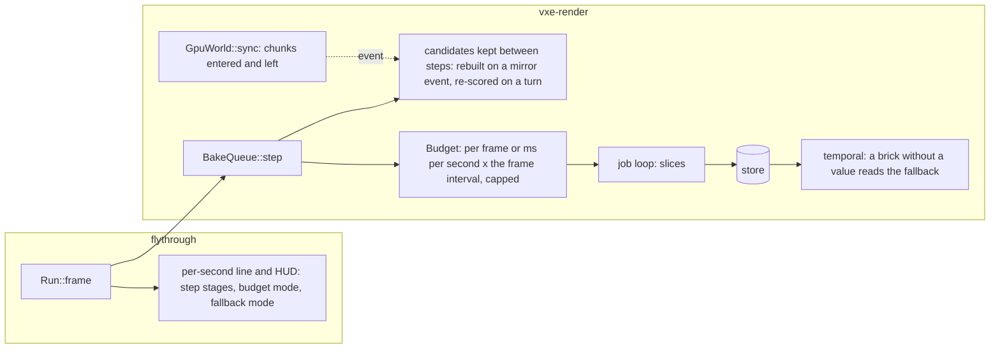

# 0067: The frame's CPU: a cheap queue step, a bake budget by time, and no black for missing light

> **Status:** draft
> **Created:** 2026-11-11
> **Milestone:** M2 (the light that holds in the dark has to hold at a playable frame), and
> cross-cutting like [Plan 0064](0064-the-windows-frame-pacing-workers-and-readbacks-that-wait.md).
> It serves `docs/nfr.md` section 2's frame and streaming lines and section 1's slow adapter.
> **Related ADRs:** [ADR-0052](../adrs/0052-the-live-queues-bake-budget-is-time-per-second-not-a-slice-per-frame.md)
> (proposed): the bake budget's unit. It rests on
> [ADR-0046](../adrs/0046-static-emissive-light-is-baked-per-chunk-when-a-chunk-loads-or-changes.md)
> and [ADR-0048](../adrs/0048-the-live-queue-orders-by-the-view-and-withdraws-the-work-a-flight-has-passed.md)
> and changes nothing they decided about the store, the order or the withdrawal. If Phase 1's
> reading sends the queue's bookkeeping off the render thread, or Phase 5's arm is picked, the
> architect writes that ADR before the phase starts.
> **Source:** the owner, 2026-11-11, after Plan 0060's and 0064's windows: "we are not there -
> either lagging too much, or the picture is unacceptable or both"; "address performance next
> after this set of plans". The readings are those windows' (`docs/plans/logs/0060.md` Phase 4,
> `docs/plans/logs/0064.md` Phases 1 and 2) and Plan 0060's Phase 5 autopilot.
> **Starts after:** Plan 0061 has merged, ahead of Plan 0058 (`docs/plans/README.md`, Sequence,
> owner 2026-11-11). Phase 1 is readings only and may run beside Plan 0061's Phase 2 once Plans
> 0064 and 0065 have merged. It takes Plan 0065's Phase 6 (the queue's step), struck there.

## TL;DR

On the RTX the GPU is not the lag. In the owner's window at 2560 x 1440 the march reads 6.1 to
6.7 ms, while the render thread's frame CPU reads 7.1 ms p50 at rest and 11.5 ms in the streamed
cave, with a p99 of 71.5 ms in flight; the live queue's step alone reads 7.0 ms p50 at rest and
10.3 ms in flight, on the main thread every frame, and single steps of 25 to 56 ms. On the Radeon
the frame is GPU-bound (52 ms at the window's size) and the bake, a 1.5 ms slice a frame, gets a
tenth of the RTX's bake time a second, so distant caves stay black. This plan **measures where the
step's time goes, then makes a step that has nothing to do cost nothing**, gives the bake a budget
in milliseconds per second rather than a slice per frame (ADR-0052), draws a brick with no light
value as a fallback instead of black, and reads an arm that bakes far chunks whose reach can never
be resident. The owner picks the budget, the fallback and the reach arm in a window on both
adapters. The first thing anyone sees: a `step` breakdown in the per-second `bake queue:` line and
the HUD's queue row, so the 7 ms has a name.

## Context & problem

Every figure is a reading unless marked; the conditions are in the logs named. "RTX" is the
NVIDIA GeForce RTX 3080 Laptop GPU, "Radeon" the AMD Radeon Graphics (RADV RENOIR), the slow
adapter of `docs/nfr.md` section 1. The dev box presents across both (the panel hangs off the
iGPU), which Plan 0064 records as a label on windowed readings.

- **The owner's window, Plan 0060 Phase 4** (release at 83e72e1, 2560 x 1440 window, FSR 2 at
  1.5, HUD on, 1-minute load about 1; `live/session60.log`, untracked):

  | scene | adapter | frame CPU p50 / p99 ms | queue step p50 (median of the per-second lines) | `update + poll + sync` p99 | march GPU p50 / p99 |
  |---|---|---|---|---|---|
  | the patch at rest | RTX | 7.076 / 11.598 | 7.012 (line max up to 24.9) | 0.047 | 6.281 / 7.333 |
  | the streamed cave, flown fast | RTX | 11.495 / 71.540 | 10.342 (line max up to 56.3) | 48.048 | 6.650 / 14.966 |
  | the vein, slow, digs | RTX | 3.660 / 12.492 | 2.095 | 0.045 | 6.132 / 13.233 |
  | the cave at 1280 x 720 | RTX | 14.934 / 63.587 | 13.099 | 39.510 | 2.903 / 10.328 |
  | the cave, window size | Radeon | 4.740 / 48.140 | 2.657 | 39.580 | 52.331 / 72.512 |
  | the cave at 1280 x 720 | Radeon | 4.149 / 48.324 | 2.252 | 40.505 | 15.880 / 18.973 |

  At rest the step is the CPU frame. In the patch's first minute the line reads `baked +0`
  for seconds on end beside `jobs 3` and `depth 3068`: the step spends 7 ms finding nothing to
  open. The Radeon at the window's size: fps 15.1, hit 26.2 ms, FSR 2 18.5 ms (1707 x 960 to
  2560 x 1440), a-trous 4.4 ms; light store 526 bricks, **36 932 missing** after 137 s, 5 601
  in view waiting. Owner: "after several seconds distant caves still black".
- **The step's cost grew with Plan 0060.** Its Phase 5 autopilot (RTX, quiet, headless
  2530 x 1378, `docs/plans/logs/0060.md`): the step p50 1.007 ms at the base a8b1a2c, 3.29 to
  3.39 ms at the tip; p99 18.3 to 18.6 ms at both. About 0.77 ms of it is Phase 1's census on
  every step, which the 0060 lane is gating to the line's cadence before it merges; the rest is
  unattributed. The autopilot's path is lighter than the window's fast flight (3.3 against 10.3
  ms), so this plan's readings include that flight, not only the autopilot.
- **Where the step's time can go** (a code read of `bake.rs` at 95ce5ac, to be measured, not
  trusted): each step filters every store block against the mirror and `retain`s seven maps;
  `open` rebuilds a candidate from **every full chunk in the mirror** (about 3 000 at the
  level, 17 000 in a streamed flight), scores and sorts them, runs the view census, then checks
  `reach_ready` on up to 16 candidates, each a walk of `(2 light_radius + 3)^3 = 1 331` chunk
  lookups; `collect` copies each read-back block into a `Vec` and places its words. `open` runs
  whenever the loop holds fewer than two slices of samples and the quiet box (8 steps) has
  passed; with a job open and nothing ready, that is every step.
- **The reach rule caps the far light** (ADR-0046: "the bake radius is at most `r_full -
  light_radius`, 12 at the defaults"). `reach_ready` with a streamer present wants every chunk
  within `light_radius` resident full; a chunk at 13 to 16 chunks from the camera has
  neighbours that are LOD-only and **cannot bake while the camera stands still**. Plan 0060's
  patch at rest read 1 002 then 586 chunks in view waiting, all coarse, never 0, and the owner
  saw "the far caves stay coarse whether I stay in place or move". How many of the in-view
  waiting chunks are reach-bound is not read; Phase 1 counts them.
- **The slice is per frame.** `DEFAULT_BAKE_SLICE_MS` 1.5 a frame: about 150 to 210 ms of bake
  a second on the RTX at 100 to 140 fps, about 22 ms a second on the Radeon at 15 fps. The
  Radeon also pays 92 ns a sample against the RTX's 6 to 10 (the per-second lines). **Arithmetic
  from those lines:** a coarse chunk is about 7.2e4 samples (the pre-roll's 2.236e7 over 312), so
  the Radeon bakes about 3 coarse chunks a second today and about 22 at 150 ms a second; 5 600
  in view would take four minutes. A per-second budget gives the Radeon the RTX's bake time, not
  its bake; the fallback is what the slow adapter sees in the meantime.
- **The window paces by the compositor until Plan 0064 lands** (`docs/plans/logs/0064.md`:
  free 2 to 4 ms faster at wall p50, picked). Its Phases 3 and 4 remove the HUD's and the queue
  line's GPU waits and give the sync a time budget; the `update + poll + sync` p99 of 40 to 48
  ms in flight is its row. This plan starts after it and re-reads that p99 at its Phase 1; if
  it is still over one frame (16.6 ms), the plan goes back to the architect for an amendment
  rather than guessing a phase now.
- **The backlog** (`docs/backlog.md`, on Plan 0060's branch until it merges): "Far light on a
  slow adapter: a bake budget per second, and no black for missing light" (owner, 2026-11-11)
  is this plan's Phases 3 and 4. "A dug chunk's settled light differs from a one-shot bake"
  stays there.

## Decision

Measure the step first, then remove its idle cost where the profile points, in `bake.rs` on the
render thread; state the bake budget in milliseconds of GPU time per second (ADR-0052); draw
missing light as a fallback; read a partial-reach arm. The owner picks the values in a window.

- We rejected **moving the queue's bookkeeping to a worker thread first**: the step's work at
  rest is work that need not happen at all (nothing changed), and a thread hides a scan that
  should be an event. If Phase 2 meets its bar no thread is needed; if it does not, the thread is
  the next step and gets its ADR (the mirror's residency would cross a thread boundary).
- We rejected **lowering the slice on the slow adapter**: the far caves are black there already.
- We rejected **a resolution or quality profile for the Radeon here**: its GPU frame at the
  window's size (hit 26 ms, FSR 2 18.5 ms) is a profile question the render settings and
  profiles plan owns (`docs/plans/README.md`, Sequence step 6; the frame ledger in
  `docs/nfr/02-frame-budget.md` says the same), and Plan 0065 takes the passes' waste. This plan
  reads the Radeon at the window's size and at 1280 x 720 and records what it sees.

## Architecture diagram



## Implementation phases

Every phase gates on `node scripts/test-changed.mjs --profile quick`, plus `--profile gpu
--binaries <the phase's gpu_* binaries>` under the perf lock when it touches `vxe-render`; the tip
gates on `cargo nextest run --profile gate`. A reading names the machine, adapter, resolution,
scene, commit, lock and 1-minute load, and runs on both adapters where it is a frame or bake
figure. **The rigs:** (a) `--level --pose patch` at rest; (b) Plan 0060's cave glide at 150 and
300 (`docs/plans/logs/0060.md`, Phase 1's runs, headless at 2530 x 1378); (c) the autopilot of
`docs/nfr.md` section 5's protocol; (d) the owner's window scenes of Plan 0060 Phase 4, windowed.
Phases 2 to 5 are **exploration** before the owner's window (lane rules 2b): they name readings
and CPU tests of data and API, not image bars; Phase 7 writes the bars against the picks.

### Phase 1: Where the frame's CPU goes
- **Owner skill:** dev
- **What:** stage timers inside `BakeQueue::step` (the mirror filter and `retain`s, boxes,
  withdrawal, the candidate build, the censuses, the sort, the reach and light checks,
  `refresh_tables`, `collect`'s poll, copy and placement, the submit) summed per frame into
  `QueueStats`, printed in the per-second `bake queue:` line as `step: <stage> N ms ...` and in
  the `frames:` summary as per-stage p50 and p99, with a `step` figure in the HUD's queue row;
  a count of the in-view waiting candidates whose reach crosses the full radius; the bake's ms a
  second in the line. The window shell takes `--adapter` as the headless run does (today it
  prints "the window takes the default adapter"), so the Radeon arms need no Mesa variable.
- **Files touched:** `crates/vxe-render/src/bake.rs`, `crates/vxe-app/src/shell.rs`,
  `apps/flythrough/src/main.rs`, `hud.rs`, `apps/flythrough/tests/gpu_queue.rs`,
  `docs/plans/logs/0067.md` (new).
- **Done when:**
  - `the_step_s_stages_sum_to_its_time` (`gpu_queue`, lavapipe, about 3 s, an estimate): over
    20 steps of a seeded rig the stage sum is within 5 % of the step's own time, and no stage
    reads negative.
  - `the_window_takes_the_adapter_flag` (CPU, under 1 s): the shell's config carries the
    substring and the selector picks the first adapter whose name contains it, on a fixed list.
  - The log holds, for rigs (a) to (c) on the RTX and (a) and (b) on the Radeon, headless, plus
    rig (d) on the RTX windowed: the step's p50 and p99 per stage, the frame CPU p50 and p99,
    `update + poll + sync` p99, the reach-bound count against the in-view waiting count, and
    the bake's ms a second. **The readings decide the next phases:** the log names the stage
    with at least half the step's p50 at rest and in flight; Phase 2 takes that stage. If the
    reach-bound count is under a tenth of the in-view waiting at the patch, Phase 5 is struck.
    If `update + poll + sync` p99 reads over 16.6 ms in rig (b) with Plan 0064 merged, the lane
    stops for an architect amendment before Phase 2.

### Phase 2: A step with nothing to do costs nothing
- **Owner skill:** dev
- **What:** the candidate list is kept between steps and rebuilt only when the mirror gained or
  lost a chunk, a job ended, or the camera's chunk changed; a turn re-scores the kept list; a
  candidate's reach verdict is cached and dropped only for candidates within `light_radius + 1`
  of a chunk the sync just mirrored or evicted (the sync reports those); the mirror filter and
  the seven `retain`s run only when the mirror moved. Plan 0065's Phase 6 as it was written
  there, extended by the reach cache. If Phase 1 names another stage (the collect's copies, the
  placement), this phase takes that one as well and the log says so.
- **Files touched:** `crates/vxe-render/src/bake.rs`, `gpu_world.rs` (the sync's entered and
  left lists), `apps/flythrough/tests/gpu_queue.rs`.
- **Done when:**
  - `a_still_step_scans_nothing` (`gpu_queue`, lavapipe, about 5 s, an estimate): after the
    queue drains on a still camera, 100 further steps read `QueueStats`' new `scanned` and
    `reach_checks` counters at 0; evicting one chunk makes the next step scan and free exactly
    that chunk's block; mirroring one chunk re-checks exactly the candidates within
    `light_radius + 1` of it.
  - The order of jobs a seeded flight opens is identical to the start commit's (`gpu_queue`'s
    order tests, with a recording of the start commit's order where none pins it).
  - Rig (a) on the RTX: the step's p50 at rest at most **0.5 ms** with the queue holding its
    unready candidates (3 000 at the level); rig (b): p50 at most 1.0 ms and no step over 4 ms
    in 3 600 frames. If the bar is missed after the named stage is gone, the lane stops for the
    architect (the thread question of "Decision").

### Phase 3: The bake budget in milliseconds per second
- **Owner skill:** dev
- **What:** `BakeQueue` takes a `Budget`: `PerFrame { ms }` (today's slice) or `PerSecond {
  ms_per_s, cap }`, the second sizing each step's slice as `ms_per_s x the last frame's
  interval`, clamped to `cap x interval` and to the slice's floor; the fly-through passes the
  interval, a headless test passes a fixed one. `--bake-budget frame:MS|second:MS,CAP` and a key
  cycle it; the HUD's queue row and the banner name the mode and value. The default stays
  `frame:1.5` until Phase 6.
- **Files touched:** `crates/vxe-render/src/bake.rs`, `marcher.rs`, `apps/flythrough/src/main.rs`,
  `hud.rs`, `apps/flythrough/tests/gpu_queue.rs`.
- **Done when:**
  - `a_per_second_budget_sizes_the_slice_by_the_interval` (CPU, under 1 s): at 150 ms a second
    a 10 ms interval gives a 1.5 ms slice and a 66 ms interval 9.9 ms; at 300 ms a second and a
    cap of 0.25 the 66 ms interval gives 16.5 ms, the cap; a 0 interval gives the floor.
  - `the_banner_names_the_budget` (CPU, under 1 s) asserts the row's text for both modes.
  - Rig (b) on both adapters under `second:150,0.25`: the bake's ms a second read within 10 %
    of each other, and the Radeon's frame CPU p50 grows by at most the cap's share of its
    interval; under `frame:1.5` the RTX reads what the start commit read.

### Phase 4: A brick without a light value is not black
- **Owner skill:** dev
- **What:** the temporal pass writes a fallback for a pixel whose brick holds no value:
  `--missing-light black|flat:L` with `L` a constant irradiance in the store's units; the
  arriving value crossfades over the store's `FADE` frames as a baked block does today. The
  HUD's light row and the banner name the mode; a key steps `L`. The default stays `black` until
  Phase 6.
- **Files touched:** `crates/vxe-render/src/shaders/temporal.wgsl`, `marcher.rs`,
  `apps/flythrough/src/main.rs`, `hud.rs`, `apps/flythrough/tests/gpu_bake.rs`.
- **Done when:**
  - `a_brick_without_a_value_reads_the_fallback` (`gpu_bake`, lavapipe, about 5 s, an estimate):
    a frame over a world whose store holds no block reads every lit-face pixel's stored term
    equal to `L` under `flat:L` and 0 under `black`; the `store_missing` counter is the same in
    both arms.
  - Every golden is byte-identical under `black`.
  - Rig (b) on the Radeon at the window's size under `flat`: the no-value share and the
    fallback's pixel share are in the per-second line (a reading, no bar).

### Phase 5: Far light beyond the bake radius (exploration, conditional)
- **Owner skill:** dev
- **What:** an arm `--reach full|partial`: under `partial` a chunk whose reach crosses the full
  radius bakes from its resident reach and its block is flagged partial; a chunk that later
  arrives within its reach re-queues it as a refinement. Struck by Phase 1's rule if few chunks
  are reach-bound. If the owner picks it in Phase 6, the architect amends ADR-0046 (an ADR with
  an Outcome, or a new one) before Phase 7.
- **Files touched:** `crates/vxe-render/src/bake.rs`, `apps/flythrough/src/main.rs`,
  `apps/flythrough/tests/gpu_queue.rs`.
- **Done when:**
  - `a_partial_reach_chunk_bakes_and_is_rebaked_when_its_reach_arrives` (`gpu_queue`,
    lavapipe, about 6 s, an estimate): in a rig where one chunk's neighbour within the light
    radius is LOD-only, `full` leaves it waiting over 50 steps and `partial` bakes it with the
    flag set; loading the neighbour full re-queues it, and its settled block equals a one-shot
    bake of the whole rig.
  - Rig (a) on the RTX under `partial`: the in-view waiting count reaches 0 within 60 s, or the
    log says what still waits.

### Phase 6: The owner's window
- **Owner skill:** human
- **What:** the owner flies rig (d) on the RTX through `--adapter` on the Radeon at the window's
  size and at 1280 x 720, cycling the budget (`frame:1.5`, `second:150,0.25`, one higher value),
  the fallback (`black`, two `L` values) and, if built, the reach arm, each named on screen.
  `dev` sets the defaults to the picks and names them in the banner.
- **Files touched:** `apps/flythrough/src/main.rs`, `crates/vxe-render/src/bake.rs` (the
  defaults), `docs/plans/logs/0067.md`.
- **Done when:** the log holds the owner's words per arm and adapter, the picks, and the
  per-second lines of each run; a plain start prints the picked modes.

### Phase 7: The bars against the picks, and the close's readings
- **Owner skill:** dev
- **What:** the image tests the exploration phases owe (the fallback's golden under the picked
  `L`, a store-less frame; the far normal and every other golden byte-identical), the budget
  lines of "Budgets" into `docs/nfr.md` and the readings into `docs/nfr/02-frame-budget.md`,
  Plan 0064's wall-frame row re-read with this plan in.
- **Files touched:** `apps/flythrough/tests/gpu_bake.rs`, `docs/nfr.md`,
  `docs/nfr/02-frame-budget.md`, `docs/plans/logs/0067.md`.
- **Done when:** every row of "Budgets" has a before (Phase 1's start commit) and an after on
  both adapters, and `docs/nfr.md` section 2 carries the queue's step and the bake budget as
  lines with their readings.

## Data shapes

```rust
// illustrative
pub enum Budget {
    /// Today's slice: milliseconds of bake a frame.
    PerFrame { ms: f64 },
    /// Milliseconds of bake a second of wall time, spent in slices sized by the frame's
    /// interval and capped at `cap` of it.
    PerSecond { ms_per_s: f64, cap: f64 },
}

pub struct StepStages {
    pub filter_ms: f64,
    pub withdraw_ms: f64,
    pub candidates_ms: f64,
    pub census_ms: f64,
    pub sort_ms: f64,
    pub checks_ms: f64,
    pub collect_ms: f64,
    pub submit_ms: f64,
}
```

No change to the store's layout, the pool or the block format. A partial flag, if Phase 5 is
built, lives in the queue's maps, not in the store.

## Budgets

Every "proposed" figure is a proposal until Phase 7 reads it; the base is Phase 1's reading at
its start commit (Plans 0060, 0064 and 0065 merged), not the figures of "Context".

| `nfr.md` figure | On record (RTX window, 83e72e1, unless named) | Proposed | How the close measures it |
|---|---|---|---|
| §2 streaming line (1.0 ms): the queue's step, no line of its own today | 7.0 ms p50 at rest, 10.3 in flight, single steps to 56 ms; autopilot 3.3 ms p50 (Plan 0060 Phase 5) | p50 at most 0.5 ms at rest with a full queue, 1.0 ms in flight; no step over 4 ms in 3 600 frames; a line of its own in §2 | rigs (a), (b) and (c), both adapters |
| The frame's CPU (render thread; no line) | p50 7.1 at rest, 11.5 in flight; p99 11.6 / 71.5 | p50 at most 2.0 ms at rest; p99 at most 16.6 ms in flight, Plan 0064's sync budget in | the same |
| The window's wall frame (Plan 0064's row) | free pacing 10.6 ms p50 at the level, quiet, main (`docs/plans/logs/0064.md`) | p50 at most the march GPU p50 plus 2 ms at rest; p99 at most 33 ms in flight | rig (d), both pacing modes logged |
| The bake's throughput (no line) | RTX about 150 to 210 ms a second; Radeon about 22 (arithmetic from the lines) | the same ms a second on both adapters within 10 % at the picked budget; the slow adapter's frame grows by at most the cap's share | the per-second lines, both adapters |
| Missing light on screen (no line) | Radeon, window size: 36 932 bricks missing at 137 s, no-value share 0.10 | no pixel black for want of a value under the picked fallback; the no-value share at 10 s at rest at most 0.01 on the RTX, the Radeon's recorded | `--read-missing` and the per-second lines |
| §5 residency p95 (500 ms; 365 to 379 ms on record) | Plan 0059's reading | no worse than the spread: the per-second budget takes GPU time the sync's uploads share | rig (c) |

## Risks & open questions

- **The profile may name a stage this plan's Phase 2 does not fit** (the collect's copies, the
  placement, `refresh_tables`): the phase takes it, and the bar is what decides.
- **Plan 0060's lane is lowering the step before it merges** (the census to the line's
  cadence). Phase 1 reads the merged tip; "Context"'s figures are the window's and will be high.
- **A per-second budget lengthens the slow adapter's frame** by up to the cap's share: 25 % of
  a 66 ms frame is 16 ms. That is the trade ADR-0052 records and the owner judges in Phase 6.
- **The fallback is a look.** A flat `L` lights a cave that should be dark; the owner may want
  it dim, or want the coarse pass faster instead. Phase 6 decides; Phase 4 is cheap.
- **A partial-reach bake is light that is wrong at the edge** until the reach arrives, and
  departs from ADR-0046's rule. It is read, not shipped, until the owner picks it.
- **Threading:** none new. The queue stays on the render thread; the sync's entered and left
  lists are plain data it already holds.
- **Determinism:** untouched; everything is in `vxe-render` and the fly-through. The budget's
  interval is wall time the shell measures, as the slice's `ns_per_sample` already is.
- **GPU features:** none new.

## What this plan does NOT do

- The Radeon's GPU frame at the window's size (hit 26 ms, FSR 2 18.5 ms): the render settings
  and profiles plan (owed, Sequence step 6) and [Plan 0065](0065-the-baked-lights-waste-atomics-a-filter-of-zeros-and-a-scan-per-frame.md)'s passes.
- The window's pacing, the HUD's waits, the sync's time budget and the worker count:
  [Plan 0064](0064-the-windows-frame-pacing-workers-and-readbacks-that-wait.md).
- A worker thread for the queue: only if Phase 2 misses its bar, with its own ADR.
- Baked light on far-field cells, and the dug chunk whose settled light differs from a
  one-shot bake (`docs/backlog.md`).
- Removing `own`, or any upscaler or resolution change (`docs/backlog.md`).

## Implementation log

> Written by `dev`: one row per phase as its commit lands, then the close block. Readings,
> attempts and resume notes go to `docs/plans/logs/0067.md`.

| phase | owner | state | commit |
|---|---|---|---|
| 1: where the frame's CPU goes | dev | not started | |
| 2: a step with nothing to do costs nothing | dev | not started | |
| 3: the bake budget per second | dev | not started | |
| 4: no black for missing light | dev | not started | |
| 5: far light beyond the bake radius | dev | not started | |
| 6: the owner's window | human | not started | |
| 7: the bars and the close's readings | dev | not started | |

### Notes

### Close triggers

- **What shipped:**
- **Public API changed:**
- **Budget readings:**
- **Gate at the tip:**
- **Outstanding `human` phases:**

## Followups
