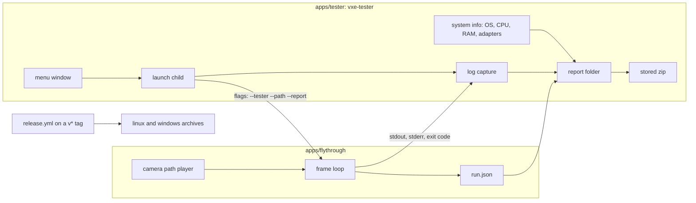

# 0068: A tester build for Linux and Windows: three scenes, a camera path, free flight and a report

> **Status:** in-progress
> **Created:** 2026-11-11
> **Milestone:** M7 in `docs/roadmap.md` (the benchmark lane)
> **Related ADRs:** [ADR-0054](../adrs/0054-the-tester-build-is-a-launcher-that-runs-the-flythrough-per-scene.md) (proposed)

## TL;DR

A tag on main builds two archives on CI, one for Linux x86_64 and one for Windows x86_64, and
attaches them to a GitHub Release. A tester unpacks one, runs `vxe-tester`, and gets a small
window with a menu: the streamed cave, the showcase hall or the castle; an automatic flight
along that scene's fixed camera path, or free flight; a quality choice; "run all benchmarks";
"save report". Each run is the release fly-through started as a child process. The path is the
same on every machine, so a benchmark run is comparable between testers; as a tour it loops,
and any move or look input hands the camera to the tester. "Save report" writes one zip with
the machine (OS, CPU, RAM, every adapter and its driver), each run's frame-time readings and
exit code, and the full log, which the tester sends back by hand. The first thing the owner
sees is `flythrough --source showcase --path showcase --report out/` flying the hall's path and
writing `out/run.json`.

## Context & problem

Every reading so far comes from the owner's two machines (the RTX 3080 laptop and the Radeon
iGPU). The floor in `docs/nfr.md` section 1 is a GTX 1660-class card nobody here owns, and the
Windows arm has only ever run CPU tests on CI. The engine needs runs on other people's hardware,
and those runs are only useful if they come back with the machine's details, comparable timings
and the log of whatever went wrong.

The fly-through can show all three scenes, but through about 150 flags and dozens of debug keys,
from a build the tester would have to compile. It has `--autopilot` (a dig and a 300 m straight
flight in the cave) but no camera path through a scene, and its peak RSS reading reads
`/proc`, so it says nothing on Windows. Nothing collects system information, nothing packages a
build, and the release profile is not exercised by CI.

The roadmap's M7 lists a benchmark lane as remaining; this plan is its first form: a fixed
path per scene, timed by the wall clock, with percentiles in a machine-readable file.

## Decision

Build a launcher, `apps/tester` (binary `vxe-tester`), that runs the release fly-through once per
scene as a child process (ADR-0054). The fly-through gains a camera-path player (`--path NAME`,
`--path-mode bench|tour`), a run report (`--report DIR`) and a tester mode (`--tester`: debug keys
off, a key-help panel on `F1`, the mode shown on screen). The launcher writes the system section
of the report, logs every child's output, and zips the folder with a stored-only zip writer. A
`release.yml` workflow builds both archives on a `v*` tag or by hand and attaches them to a
Release on the public repo.

We rejected a tester mode inside the fly-through because in-process scene switching would land in
the unsplit `main.rs`, and an app with its own frame loop because its render setup would drift
from the look the owner tunes (ADR-0054). We rejected auto-upload of reports (the owner's call,
2026-11-11): no network code, the tester sends the zip.

## Architecture diagram



## Implementation phases

### Phase 1: a camera path through the showcase, and its run.json
- **Owner skill:** dev
- **What:** The fly-through flies a keyframed camera path through the showcase hall by elapsed
  wall time, then exits, and writes the run's readings to `run.json`.
- **Files touched:** `apps/flythrough/src/path.rs` (new: `CameraPath`, keyframes, sampling),
  `apps/flythrough/src/report.rs` (new: `RunReport`, its JSON), `apps/flythrough/src/lib.rs`,
  `apps/flythrough/src/main.rs` (the flags, the player's hook into the camera update, the
  report at exit), `apps/flythrough/tests/path.rs` (new).
- **Shape:** a path is a list of keyframes `(t_s, eye, yaw, pitch)` sampled by a centripetal
  Catmull-Rom on position and a shortest-arc blend on yaw, with no reversal at a keyframe. In
  `bench` mode the path runs once by wall time and the fly-through exits at its end; frames are
  not counted to a fixed number, because a fixed route time is what makes two machines
  comparable. A headless run (`--headless`) advances the path's time by a fixed 1/60 s per frame
  so a test is deterministic. The first 2 s of a bench run are a warm-up excluded from the
  percentiles (streaming and the bake settle) and reported separately. `run.json` carries:
  schema version, app version and commit, scene, mode, output and internal resolution,
  upscaler, the adapter's name, vendor, device id, driver, driver info and backend, the frame
  count, the wall, CPU and GPU frame time at p50, p95, p99 and max, the count of frames over
  33.3 ms and over 100 ms, the warm-up's duration and frame count, and the peak RSS (or `null`
  where the platform reading is missing until Phase 3). Written with `std` only, no serde.
- **Done when:**
  - `path.rs` tests (CPU, under 1 s): sampling the showcase path at each keyframe's time returns
    that keyframe's eye exactly; sampling at the end time returns the last; between two
    keyframes the eye moves monotonically along the segment's chord direction for a straight
    three-point path; a yaw keyframe pair 350 and 10 degrees turns through 20 degrees, not 340.
  - Every keyframe and every 0.25 s sample of the showcase path lies in air:
    `HallSource::new(seed).material` is the air id at the sample's voxel and at the six voxels
    1 m away along the axes (CPU, under 2 s). This is the headless guard that a path change or
    a generator change does not fly the camera through rock.
  - `report.rs` test (CPU): a `RunReport` built from a fixed 100-frame list with known times
    writes JSON whose p50, p95, p99 and max equal the nearest-rank values worked out in the
    test, whose `over_33ms` count is the hand-counted one, and which round-trips through a
    minimal parser in the test; a string with a quote, a backslash and a newline is escaped.
  - Reading (owner's box, written to `docs/plans/logs/0068.md`): `flythrough --source showcase
    --path showcase --report out/` flies the hall's path in a window and exits; `out/run.json`
    names the RTX 3080 and gives the percentiles. No GPU test in this phase.

### Phase 2: paths for the cave and the castle, the tour, and the tester mode
- **Owner skill:** dev
- **What:** All three scenes have a path; `--path-mode tour` loops it and hands control to the
  tester on input; `--tester` turns the debug keys off and shows the controls.
- **Files touched:** `apps/flythrough/src/path.rs`, `apps/flythrough/src/main.rs`,
  `apps/flythrough/src/hud.rs` (the help panel, the mode banner), `apps/flythrough/tests/path.rs`.
- **Shape:** the cave path runs through the streamed cave at its default seed from
  `UNBOUNDED_SPAWN`, long enough to cross chunk borders and load new ones (about 60 s at a
  fly-through's cruising speed; the dev picks the keyframes and the length is a proposal);
  the castle path visits the gate, nave, window and dungeon shots in order, outdoor legs flown
  in the open air. In `tour` mode the path loops; the first move, look or dig input switches to
  free flight from the camera's current pose, and `T` resumes the path from its nearest point.
  The window shows the mode (`benchmark 23 s / 60 s`, `tour`, `free flight - T resumes the tour`)
  in a corner, always (`references/best-practices.md`, Tests). `--tester` disables every key
  but movement, look, dig, `F1` (help panel: the keys, the scene, the mode) and `Esc`
  (ends the run; in bench mode the report marks it `aborted`); the stats HUD is not reachable.
  Walk mode is out (fly only), digging stays in free flight.
- **Done when:**
  - The air test of Phase 1 holds for the cave path against `CaveSource::unbounded(seed)` and the
    castle path against the castle's source, at the seeds the tester passes (CPU; the cave's
    sampled chunks generate in under 5 s in the gate's test profile, or the test is born
    `#[ignore = "soak"]` and says so).
  - A unit test of the tour's state machine: a move input during `tour` gives `free` at the
    input's pose; `T` in `free` gives `tour` at the path time whose eye is nearest the camera;
    `Esc` in `bench` gives `aborted`.
  - A unit test of the key filter: under `--tester`, `F2`, `F7`, `F10`, `B`, `Q`, `V`, `X`, `Z`
    map to no action; `W`, mouse look, `F1` and `Esc` map to theirs.
  - Reading: each scene's bench run on the owner's box, wall p50/p95/p99, in the readings log.

### Phase 3: the system report and Windows readings
- **Owner skill:** dev
- **What:** A `system.json` with what the run's numbers need to be read: OS, CPU, RAM and every
  adapter; peak memory read on Windows as well as Linux.
- **Files touched:** `apps/tester/` (new crate: `Cargo.toml`, `src/main.rs`, `src/system.rs`),
  `apps/flythrough/src/main.rs` and `src/hud.rs` (the peak RSS reader's Windows arm),
  `Cargo.toml` (workspace member; `windows-sys` pinned to the lockfile's `=0.61.2` as a
  Windows-only dependency with the memory and system-info features), `deny.toml` if needed.
- **Shape:** `system.json` holds: the tester's version and commit, the OS name and version
  (Linux: `/etc/os-release`'s `PRETTY_NAME` and `uname` from `/proc/sys/kernel/osrelease`;
  Windows: `RtlGetVersion`'s major, minor and build), the session type on Linux
  (`XDG_SESSION_TYPE`, `WAYLAND_DISPLAY` set or not), the CPU model and logical core count
  (`/proc/cpuinfo`; Windows: the registry's `ProcessorNameString` and
  `GetSystemInfo`), the total RAM (`/proc/meminfo`; `GlobalMemoryStatusEx`), the display's
  size and refresh as `winit` reports them, and for every adapter `wgpu` enumerates on every
  backend: name, vendor, device, device type, driver, driver info, backend, and the limits the
  fly-through requests (max buffer size, max storage buffer binding size) with whether this
  adapter meets them. No user name, host name, path under the home directory or serial number
  is written; the README says what is collected. The fly-through's peak RSS on Windows reads
  `GetProcessMemoryInfo`'s `PeakWorkingSetSize`.
- **Done when:**
  - `vxe-tester --system-json PATH` (headless, no window) writes the file and exits 0; a test
    runs it on the CPU path with a fixed fake adapter list and asserts the JSON's fields and
    that neither `$USER`/`%USERNAME%` nor the host name appears in it (CPU, under 1 s).
  - On CI's Windows arm the same command runs as a step and its output is printed, so the
    Windows readers are exercised on a real Windows (the CPU test runs there too).
  - `run.json`'s `peak_rss_bytes` is a number on Windows (CI step: a 3-frame headless run is
    not possible there with WARP off CI (the backlog's WARP entry), so this is read by the
    owner on a Windows machine in Phase 6 and recorded then).

### Phase 4: the launcher window, runs, logs and the zip
- **Owner skill:** dev
- **What:** `vxe-tester` opens a window with the menu, runs the fly-through per scene, logs each
  run, and saves the report as one zip.
- **Files touched:** `apps/tester/src/main.rs`, `src/menu.rs`, `src/run.rs`, `src/zip.rs`,
  `apps/tester/tests/` (new), `apps/tester/Cargo.toml` (`vxe-app`, `vxe-render` for the HUD
  overlay, `crc32fast` pinned to the lockfile's `=1.5.2`).
- **Shape:** the menu is text through `vxe-render`'s `HudOverlay` on a cleared frame, driven
  by arrow keys and Enter (and number keys): scene (cave, showcase, castle), mode (benchmark,
  tour), quality (output 1280x720, 1920x1080 or the display's size; internal scale 1, 1.5 or
  2), "run all benchmarks" (the three scenes in order, one child each), "save report", "open
  report folder", "quit". The fly-through is found next to `current_exe()`; a missing one is a
  message in the window, not a panic. Each child's stdout and stderr go line by line to
  `runs/NN-<scene>-<mode>/log.txt` and the child writes `run.json` there; the window shows
  the run's state, and after it the scene's wall p50 and p95, or the exit code and the log's
  last 10 lines if the child failed (panic, crash, no `run.json`). The tester's own log
  (adapter choice, every command line it ran, every exit code) is `tester.log`. The report
  folder is `vxe-report-<version>-<os>-<UTC yyyymmdd-hhmmss>/` under `reports/` beside the
  executable, or under the OS's temp directory if that is not writable; the window names the
  path. The zip is stored (no compression), with CRC-32 per entry, readable by Windows
  Explorer, `unzip` and Python's `zipfile`.
- **Done when:**
  - `zip.rs` test (CPU): a zip of three files (one empty, one 1 MiB, one with a UTF-8 name)
    unpacks with Python's `zipfile` in the test (skipped with a message where `python3` is
    absent) and through an in-test reader of the central directory, byte-equal, CRCs matching.
  - `run.rs` test (CPU): the launcher's command line for each menu choice is the exact flag
    list (a table in the test), and each flag is accepted by the fly-through's argument parser
    (`flythrough`'s `parse_args_from` reached through a `--check-args` mode that parses and
    exits 0), so a renamed flag fails the gate, not a tester's run.
  - `run.rs` test (CPU): a fake child (a test binary that prints, writes a `run.json` and exits
    with a chosen code, or panics) gives a run row of `ok` with its p50, or `failed: exit 101`
    with the log's tail, and the report still saves.
  - Reading: on the owner's box, "run all benchmarks" then "save report" gives a zip holding
    `system.json`, `tester.log` and three run folders each with `log.txt` and `run.json`.

### Phase 5: the release archives on CI
- **Owner skill:** dev
- **What:** `.github/workflows/release.yml` builds both archives in the release profile, checks
  them, and attaches them to a GitHub Release.
- **Files touched:** `.github/workflows/release.yml` (new), `dist/README-TESTER.txt` (new:
  how to run, the keys, what is collected and what is not, where the report goes, how to send
  it, the Linux needs: a Vulkan driver and `libvulkan.so.1`; the Windows SmartScreen prompt on
  an unsigned exe), `dist/THIRD-PARTY-NOTICES.txt` (generated, see below), `scripts/` if a
  packaging script helps.
- **Shape:** triggered by a `v*` tag push or `workflow_dispatch`. Linux builds on the oldest
  Ubuntu runner image GitHub still offers, so the glibc floor is as low as the runners allow,
  and the README names that floor; Windows on `windows-latest`, MSVC. Each archive
  (`vxe-tester-<version>-linux-x86_64.tar.gz`, `vxe-tester-<version>-windows-x86_64.zip`)
  holds `vxe-tester`, `flythrough`, the README, `LICENSE*` and the notices. The notices name
  every crate's licence and include the texts the licences require, with DXC's NCSA notice
  for the Windows archive (ADR-0035, `deny.toml`); they are generated by a pinned tool installed
  with `cargo install --locked <tool>@<exact version>` (the dev names the tool in the readings
  log; it is a CI tool, not a dependency). The commit is passed into both binaries at build
  (`VXE_COMMIT` from `GITHUB_SHA`, read with `option_env!`, `unknown` locally). A
  `workflow_dispatch` run uploads the archives as workflow artifacts only; a tag run creates
  the Release.
- **Done when:**
  - A `workflow_dispatch` run on the plan's branch is green and its two artifacts exist.
  - In that run, each archive is unpacked in a fresh directory and `vxe-tester --system-json`
    and `flythrough --check-args --tester --path cave` run from it and exit 0 (Linux with the
    workflow's lavapipe from `.github/actions/lavapipe`, so the adapter list is non-empty;
    Windows with whatever adapters the runner has, empty allowed).
  - The Linux binary's highest required `GLIBC_` symbol version (`objdump -T`) is printed in the
    log and written into the README.

### Phase 6: the owner's runs on Linux and Windows
- **Owner skill:** human
- **What:** The owner downloads both artifacts of the Phase 5 run, runs "run all benchmarks"
  and a free flight in each scene on the dev box (Linux) and on a Windows machine, saves a
  report on each, and reads the README as a tester would.
- **Done when:** both reports open and hold what Phase 4 lists; the Windows `run.json` gives a
  numeric `peak_rss_bytes`; the owner says the menu, keys, help panel and README are fit to
  hand to a tester, or names what to change (a dev fix pass before the close). The owner
  then decides whether to tag the first release.

## Data shapes

```rust
// illustrative
pub struct Keyframe { pub t_s: f32, pub eye: [f32; 3], pub yaw_deg: f32, pub pitch_deg: f32 }
pub struct CameraPath { pub name: &'static str, pub scene: Scene, pub keys: &'static [Keyframe] }
pub enum PathMode { Bench, Tour }
pub enum Drive { Path { t_s: f32 }, Free, Aborted }

pub struct RunReport {
    pub schema: u32,               // 1
    pub version: &'static str, pub commit: &'static str,
    pub scene: &'static str, pub mode: &'static str,
    pub output: [u32; 2], pub internal_scale: f32, pub upscaler: &'static str,
    pub adapter: AdapterLine,      // name, vendor, device, driver, driver_info, backend
    pub frames: u32, pub warmup_frames: u32, pub warmup_s: f32,
    pub wall_ms: Percentiles, pub cpu_ms: Percentiles, pub gpu_ms: Option<Percentiles>,
    pub over_33ms: u32, pub over_100ms: u32,
    pub peak_rss_bytes: Option<u64>,
    pub ended: &'static str,       // "completed" | "aborted"
}
```

Report folder:

```
vxe-report-0.48.0-windows-20261112-101500/
  system.json
  tester.log
  runs/01-cave-bench/{run.json, log.txt}
  runs/02-showcase-bench/{run.json, log.txt}
  runs/03-castle-tour/{run.json, log.txt}
```

## Budgets

No `nfr.md` budget moves: the plan adds no per-frame work to the renderer. The path player
replaces input handling for the camera; its cost is a spline sample per frame. The report's
frame list is preallocated for the path's length at 240 fps and grows past it only in a tour
left running (where the report keeps a rolling window, not every frame), so the frame path
stays allocation-free (the stats HUD's rule since Plan 0016).

What the plan produces is readings, not budget lines: each run's percentiles on a named
machine. The close records the owner's three bench readings on the RTX 3080 and on the Windows
machine in the readings log; they become `nfr.md` readings only through a later plan that asks
for them. The release profile's build time on CI is recorded there too.

## Risks & open questions

- **Comparable but not reproducible.** A bench run is timed by the wall clock, so a slow machine
  flies the same route in the same time with fewer frames, and streaming in the cave may not
  keep up. That is the reading, not a fault: the report carries the warm-up and the hitch counts.
  The headless path at a fixed step is the deterministic arm.
- **The cave path and the generator.** A change to `CaveSource` can move rock into the path.
  The air test in the gate catches it, and the fix is new keyframes.
- **Linux portability.** The binary links glibc at the runner's version and loads Vulkan,
  Wayland and X11 at run time. A distribution older than the runner fails to start; the README
  names the floor. No AppImage or Flatpak in this plan.
- **Windows trust.** The exe is unsigned, so SmartScreen warns. Code signing costs money and a
  certificate; out of scope, the README explains the prompt.
- **Two windows on Wayland.** The launcher's window stays open while the run's opens; some
  compositors place the new one behind. The launcher keeps its window showing "running" and the
  key to end a run (`Esc` in the run's window); if the owner finds it confusing in Phase 6, the
  launcher can minimise itself, a dev fix.
- **Privacy.** The report holds no names or paths by test; the log is the fly-through's stdout,
  which prints no paths under home today. The README lists what is in the zip, and the tester
  can read every file before sending.
- **Open:** whether a release tag is cut at the close (Phase 6 asks), and whether the menu later
  gains the render profiles once that owed plan exists.

## What this plan does NOT do

- Upload reports, crash dumps, telemetry or any network call (owner, 2026-11-11).
- Sign the executables, or package as AppImage, Flatpak, an MSI or an installer.
- Fullscreen, settings beyond resolution and internal scale, or the render profiles (the owed
  profiles plan, `docs/plans/README.md`'s sequence step 6).
- The lamp-lit level, walk mode, audio, the server or the WASM logic in the tester build
  (the fly-through still has them; the tester's flags do not reach them).
- macOS, ARM or 32-bit builds.
- In-process scene switching (ADR-0054, Alternative A); Plan 0045 may make it cheap later.
- A results database or comparison page across testers.

## Implementation log

> Written by `dev`: one row per phase as its commit lands, then the close block. Readings,
> attempts and resume notes go to [`docs/plans/logs/0068.md`](logs/0068.md).

| phase | owner | state | commit |
|---|---|---|---|
| 1: a camera path through the showcase, and its run.json | dev | done; windowed reading owed (live/readings68.sh) | 2704f51 |
| 2: paths for the cave and the castle, the tour, and the tester mode | dev | done; bench readings owed (live/readings68.sh) | committed with this row |
| 3: the system report and Windows readings | dev | not started | |
| 4: the launcher window, runs, logs and the zip | dev | not started | |
| 5: the release archives on CI | dev | not started | |
| 6: the owner's runs on Linux and Windows | human | not started | |

### Notes

- Names in the tree (readings log, Phase 1 table): the showcase's air test reads
  `ShowcaseSource::new(PATH_SEED)`, not `HallSource` (the castle's hall); `PATH_SEED` = 1 and
  `--path` refuses another `--seed`; `run.json` gives `internal` in pixels beside
  `internal_scale`.
- The castle path joins its four shots with cut keys (`Keyframe::cut`: the camera holds, then
  cuts): no passage into the keep or down to the dungeon is 1 m clear on every side (readings
  log, Phase 2). The dungeon leg pans at the shot's eye.
- The cave path is 71 s, not about 60 s: the route to 1400 voxels along +x.
- `--tester` needs `--path` and refuses `--hud`; `Esc` in a tour reports `ended` `completed`.
- `report.rs`'s JSON test round-trips through `flythrough::report::json`, the reader the
  launcher uses, not a parser private to the test.

### Close triggers

## Followups
