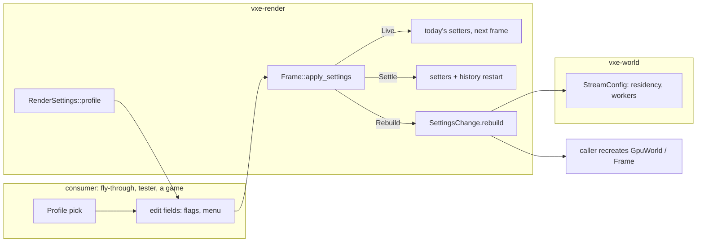

# 0069: Render settings: one surface, an apply class per field, and named quality profiles

> **Status:** approved (owner, 2026-11-11: "go with recommended on all"; every open question
> took its recommendation, recorded under "Owner answers")
> **Created:** 2026-11-11
> **Milestone:** M10's first plan (`docs/roadmap.md`, M10 "Order": the render-profile plan that
> holds M10 against the budget), and the roadmap's decisions row "Floor, profiles and scene
> scale" (the floor, portable and performance profiles). It serves `docs/nfr.md` sections 1 and 2.
> **Related ADRs:** [ADR-0055](../adrs/0055-render-settings-are-one-struct-with-an-apply-class-per-field-and-profiles-are-named-values.md)
> (proposed): the surface's shape and what a profile is.
> **Source:** the owner's parked idea of 2026-10-22 (`docs/backlog.md`, "Render settings surface
> and named quality profiles"); the static performance review of 2026-11-10, which asked for this
> draft before Plan 0058's lane (owner agreed the same day); the Radeon's GPU frame, which Plans
> 0065 and 0067 left here.
> **Starts after:** Plans 0045, 0058 and 0044 have closed (`docs/plans/README.md`, Sequence;
> 0045 moved ahead of 0058 and 0044's render phases, owner 2026-11-11), so Plans 0058, 0061,
> 0067 and 0068 are on main and their settings exist. The architect re-reads Phases 1 to 3
> against that tip before the lane starts, since 0045 moves `marcher.rs` apart.
> **Drafted with the owner away** (2026-11-11 overnight); the owner took every recommendation
> the same evening ("Owner answers").
> **Owner, 2026-11-11, Plan 0061's window:** FSR 2 at internal scale 1 looked "fine, maybe even
> a bit better". Offered as a quality setting, not the default: Phase 4 reads it as a candidate
> profile value (`High`, Floor at scale 1, or Performance's scale) and Phase 5 places it.

## TL;DR

`vxe-render` gains `RenderSettings`, one plain struct holding every setting of the frame and the
mirror by value, a table naming each field's apply class (`Live`, `Settle`, `Rebuild`),
`Frame::apply_settings` that applies the first two and returns the third, and three named
profiles, `Floor` (the default, today's look), `Portable` (720p, the slow adapter's class) and
`Performance` (a fast machine past 60 fps). A test fails when a `pub fn set_*` lands on the
renderer without a field or an input listing, so every new mechanism arrives as a documented
setting. The first thing the owner sees is `flythrough --settings` printing every field with its
class and value; then `--profile portable` and `F4` cycling the profiles in the window, the
profile's name on the HUD.

## Context & problem

The renderer's knobs are spread over `Frame`'s setters (`set_lighting`, `set_resolution`,
`set_look`, `set_lod`, `set_upscaler_kind`, `set_sharpness`, the bake's setters and more), the
mirror's `MirrorConfig` at creation, `vxe-world`'s `StreamConfig` (residency, workers) and the
fly-through's flags. Four gaps (backlog, 2026-10-22): no single surface; no statement of which
changes are live, which restart the temporal history (a visible settle, against "stable image
first", owner 2026-11-03) and which need a rebuild; no named profiles, although the roadmap
promises three; and no rule that a new mechanism lands as a setting.

The budget side. Plan 0065's close (03b00ab, 2530 x 1378 output, FSR 2 at 1.5) reads the default
frame at 4.1 ms (vein) and 8.6 ms (hall) on the RTX 3080 Laptop, and 30.5 and 72.9 ms on the
Cezanne RADV, the slow adapter; FSR 2 alone is 2.1 to 2.4 ms and 15.7 to 16.1 ms, over section
2's 1.5 ms upscale line, and the lamp-on a-trous at the full tier (3.1 to 3.3 ms, RTX) is over
the denoise line (`docs/nfr.md` section 2). The backlog's "Budget lines over with no owner" asks
whether each line moves or a profile owns it. Plans 0058 (eight lights), 0062 (entities) and
0032 to 0037 (sky, far field, liquids, clouds, weather, night sky) multiply shadow rays with no
product cap; Plan 0035's allotment spends all of section 2's headroom on the floor.

## Decision

Build the surface of ADR-0055 over the existing setters, not beside them: `RenderSettings`
holds values, `apply_settings` calls today's setters, and each field's rustdoc names its class
and each profile's value. Profiles are constructors the consumer picks and may edit; the default
settings are `Floor`'s, which are today's fly-through defaults, so no golden moves until the
owner's window picks otherwise. The fly-through's flags edit a profile's values on top, and the
tester's quality menu (Plan 0068) gains the profile. The plan proposes per-profile frame lines;
the close writes them into `docs/nfr.md` from the readings.

We rejected a string-keyed settings file (a dependency and run-time type errors; the consumer
serialises the struct itself), an engine that picks the profile from the adapter or scales the
resolution per frame (a vendor branch, and a moving image), and keeping the setters with the
classes in prose (no gate, no product row); ADR-0055 has each.

## Architecture diagram



## Implementation phases

Each phase ships as its own commit. `dev` implements all dev phases in one session. Lane rule 9c
applies: exploratory runs on the RTX through `VXE_TEST_ADAPTER=rtx`, labelled; asserted figures
on lavapipe. **Phases 4 and 5 are exploration** (a look-driven plan's phases before the owner's
window, owner 2026-11-10): readings, no image tests; Phase 7 writes the image tests against the
picks. Per phase: `node scripts/test-changed.mjs --profile quick`, then `--profile gpu
--binaries <the phase's>` under the perf lock, clippy, fmt. At the tip: `cargo nextest run
--workspace --profile gate` under the perf lock, doctests, clippy, fmt, deny, the doc and tier
gates. Readings go to `docs/plans/logs/0069.md`. Test times are estimates from Plan 0058's
figures (a hand-built box on lavapipe renders a few dozen frames at 192 x 108 in 2 to 3 s).

### Phase 1: the struct, read back and applied (walking skeleton)
- **Owner skill:** dev
- **What:** `RenderSettings` with every field of today's settings by value, `ApplyClass`,
  `RenderSettings::FIELDS`, `Frame::settings()`, `Frame::apply_settings()` returning a
  `SettingsChange`, and `flythrough --settings`, which prints the table and exits.
- **Files touched:** `crates/vxe-render/src/settings.rs` (new), `src/lib.rs`, the file that
  holds `impl Frame` after Plan 0045, `crates/vxe-render/tests/gpu_settings.rs` (new),
  `apps/flythrough/src/main.rs` (or its args module after 0045).
- **Shape:** the fields group as the setters do (`lighting: Lighting`, `look: LookParams`,
  `lod: LodParams`, `lighting_resolution`, `scale: RenderScale`, `upscaler: UpscalerKind`,
  `fsr2: Fsr2Settings`, `own: Upscaler`, the bake's slice, digs and budget, Plan 0058's light
  settings) plus `build: BuildSettings`, the `Rebuild` group (`mirror_budget_bytes`,
  `record_chunks`, the light-sample sizes, `bake_pool_bytes`, `residency: vxe_world::Residency`,
  `workers`). A field's class is the class of the setter it reaches; where one setter takes a
  struct whose fields differ in class (`Lighting::bake_pool_bytes` is allocated once), the
  field moves to `build`, and the setter keeps working as before. `FIELDS` names leaves
  (`lighting.shadow_walk`), not groups.
- **Done when:**
  - CPU, `settings.rs` unit test: the field names `FIELDS` lists equal the leaf names of
    `RenderSettings`'s `Debug` output, each once (under 1 s).
  - `gpu_settings`: `applying_the_frames_own_settings_changes_nothing`: a default frame at
    192 x 108 over a hand-built box, `apply_settings(&frame.settings())` returns an empty
    `SettingsChange`, and the next 8 frames' bytes equal those of a frame never applied to
    (about 3 s).
  - `gpu_settings`: `a_scale_change_settles_and_a_budget_change_waits_for_a_rebuild`: changing
    `scale` from 1.5 to 2 is reported as `Settle` and `settings().scale` reads 2 after the next
    frame; changing `build.mirror_budget_bytes` is reported in `rebuild` and `settings()` still
    reads the old value (about 3 s).
  - `flythrough --settings` prints one line per field: name, class, value; a CPU test in the
    fly-through checks the line count equals `FIELDS.len()`.

### Phase 2: the classes, proved, and the setter gate
- **Owner skill:** dev
- **What:** each field's class is defended by a test, the frame counts its history restarts,
  and a test fails on an unlisted setter.
- **Files touched:** `crates/vxe-render/src/settings.rs`, the `impl Frame` file,
  `crates/vxe-render/tests/gpu_settings.rs`.
- **Shape:** `Frame::history_restarts() -> u64` counts the restarts of the temporal history (the
  temporal pass's and the upscaler's), read-only. `settings::NOT_SETTINGS` lists every
  `pub fn set_*` in `crates/vxe-render/src` that is not a setting, each with its reason
  (a per-frame input such as `set_dt`, `set_frame_index`, `set_focus`; a test hook such as
  `set_composite_capture`; another type's method, such as `HudOverlay::set_text`).
- **Done when:**
  - `gpu_settings`: `every_live_field_keeps_the_history_and_every_settle_field_restarts_it`:
    for each `FIELDS` row of class `Live` or `Settle`, on one frame warmed 4 frames, a changed
    value (each row's test value is in a table beside `FIELDS`) leaves `history_restarts()`
    unchanged for `Live` and raises it by exactly 1 for `Settle`. Under 10 s at 64 x 36, or
    split by group into tests that are; the split is named in the log.
  - CPU, `settings.rs` unit test: `every_setter_is_a_setting_or_an_input`: every `pub fn set_`
    found in the crate's source files (read at test time from `CARGO_MANIFEST_DIR`) is the
    setter of a `FIELDS` row or in `NOT_SETTINGS`; the failure names the setter (under 1 s).
  - Every field's rustdoc states its class; `cargo doc -p vxe-render` builds without warnings.

### Phase 3: the profiles, in the fly-through and the tester
- **Owner skill:** dev
- **What:** `Profile` and `RenderSettings::profile`, `Default` equal to `Floor`, the
  fly-through's `--profile NAME` with flags on top and `F4` cycling profiles live, the HUD row,
  and the tester's quality menu choosing a profile.
- **Files touched:** `crates/vxe-render/src/settings.rs`, `apps/flythrough/src/main.rs` (or its
  args module), `apps/flythrough/src/hud.rs`, `apps/tester/src/menu.rs`, `apps/tester/src/run.rs`.
- **Shape:** the profiles' starting values are the table under "Data shapes". `F4` applies the
  next profile's `Live` and `Settle` fields and leaves the `Rebuild` ones; the HUD row reads
  `profile: portable` or `profile: portable +2` (two fields edited by flags or keys) and, while
  a rebuild is pending, `restart for: residency, mirror budget`; stdout prints the same. The
  `output_hint` sizes a headless run with no `--render`; a window's own size wins. The
  tester's quality menu replaces "internal scale 1, 1.5 or 2" with the three profiles, keeping
  its output size choice.
- **Done when:**
  - CPU: `RenderSettings::default() == RenderSettings::profile(Profile::Floor)`, and the
    fly-through's parsed settings with no flags equal `Floor` with the fly-through's own
    scene-independent overrides, listed in the test (under 1 s). The existing goldens pass
    unchanged, which is the proof that `Floor` is today's look.
  - CPU, fly-through: `--profile portable --translucent-layers 4` parses to `Portable` with
    `look.translucent_layers` 4 and the HUD row `profile: portable +1` (under 1 s).
  - CPU, tester's `run.rs` table test (Plan 0068 Phase 2's): each profile choice's command line
    carries `--profile NAME` and is accepted by `--check-args`.
  - Windowed check folded into Phase 5: `F4` changes the HUD row on the first frame after the
    key.

### Phase 4: readings of each profile on both adapters (exploration)
- **Owner skill:** dev
- **What:** the per-pass GPU time, the frame CPU and the reserved VRAM of each profile on the
  RTX and the Cezanne, at the vein, the hall and the castle, at each profile's output size, and
  the portable profile's two upscaler arms if `own` is still in the tree. A candidate column,
  `High` (Floor with `scale` 1, FSR 2; the owner's Plan 0061 window), is read beside them on
  both adapters.
- **Files touched:** `docs/plans/logs/0069.md`.
- **Done when:** a table per adapter in the readings log, each cell the median of three quiet
  rounds of `flythrough --level --seed 1 --headless --render WxH --frames 600 --adapter
  NVIDIA|AMD --profile P [--pose vein|hall]` and the castle equivalent, under the perf lock and
  the memory cap, with the commit; and beside each, the profile's projection from the "Budgets"
  section and the difference.

### Phase 5: the owner's window
- **Owner skill:** human
- **What:** the owner flies each profile on both adapters and picks.
- **Done when:** the owner's words are in the readings log for: (a) does each profile hold a
  stable image (no flicker or aliasing) at walk and at a slow pan, per adapter; (b) the portable
  profile's upscaler confirmed as FSR 2 (answer 2); (c) portable's lamp bounce, translucent
  layers and light cap; (d) the `High` candidate (FSR 2 at scale 1): a fourth profile, or not
  offered (Performance stays Floor at scale 2, answer 3); (e) the frame lines (answer 4);
  (f) any field whose value a profile should change.

### Phase 6: the picks into the profiles
- **Owner skill:** dev
- **What:** the profiles' values become Phase 5's picks, with their rustdoc and the HUD.
- **Files touched:** `crates/vxe-render/src/settings.rs`, `apps/flythrough/src/hud.rs` if a row
  moves.
- **Done when:** CPU, `the_profiles_hold_the_owners_picks`: each profile's values equal the
  table in the readings log's Phase 5 entry, field by field (under 1 s); the fly-through's
  `--settings --profile P` output matches the same table.

### Phase 7: image tests against the picks, and the tip's readings
- **Owner skill:** dev
- **What:** one golden per non-default profile, re-read Phase 4's table at the tip, and the
  per-profile ledger row.
- **Files touched:** `apps/flythrough/tests/gpu_golden.rs` (or the golden binary after 0045),
  `apps/flythrough/tests/golden/`, `docs/nfr/02-frame-budget.md`, `docs/plans/logs/0069.md`.
- **Done when:** `portable_profile_golden` and `performance_profile_golden` render the hall at
  320 x 180 output on lavapipe and hold the existing goldens' floor (the same max pixel delta
  and share as `castle_gate_golden`), each under 10 s or born `#[ignore = "soak"]`; each
  differs from `Floor`'s image at the same pose by more than that floor (so the profile is
  applied); `docs/nfr/02-frame-budget.md` gains a dated ledger paragraph per profile per
  adapter from the tip's reading.

## Data shapes

```rust
// illustrative
pub enum ApplyClass { Live, Settle, Rebuild }
pub enum Profile { Floor, Portable, Performance }
pub struct RenderSettings { /* the groups of Phase 1 */ pub build: BuildSettings, pub output_hint: Option<[u32; 2]> }
pub struct SettingsChange { pub live: Vec<&'static str>, pub settled: Vec<&'static str>, pub rebuild: Vec<&'static str> }
impl RenderSettings {
    pub const FIELDS: &'static [(&'static str, ApplyClass)];
    pub fn profile(p: Profile) -> Self;
}
impl Frame {
    pub fn settings(&self) -> RenderSettings;
    pub fn apply_settings(&mut self, device: &wgpu::Device, queue: &wgpu::Queue, s: &RenderSettings) -> SettingsChange;
    pub fn history_restarts(&self) -> u64;
}
```

`output_hint` is a suggestion: the consumer owns the window, the engine renders what it is given.

**The profiles' starting values** (proposals; every row not listed is `Floor`'s in all three):

| field | Floor (default) | Portable | Performance |
|---|---|---|---|
| output hint | 1920 x 1080 | 1280 x 720 | none (the display) |
| `scale` | 1.5 | 1.5 | 2 |
| `upscaler` | FSR 2 | FSR 2 (answer 2) | FSR 2 |
| `lighting_resolution` | half | half | half |
| `look.translucent_layers` | 4 | 2 | 4 |
| Plan 0058's light cap | 8 (`MAX_LIGHTS`) | 4 | 8 |
| `lighting.lamp_bounce` | the fly-through's today (on) | off | on |
| `build.residency` | `flythrough::RESIDENCY` (16, 24, 1) | (12, 18, 1) | (16, 24, 1) |
| `build.mirror_budget_bytes` | sized to the residency, as the fly-through's today | sized to its residency | as Floor |
| Plan 0067's bake budget | 0067's pick | half of it | 0067's pick |

The far normal, the shadow walk, the filter and FSR 2's own settings stay at the picks of Plans
0056 and 0061 in every profile: they are image-stability choices, and no profile trades those
(answer 1). Portable's residency (three quarters of each radius) is a guess for
a 9 GB shared-memory class, to be read in Phase 4.

## Budgets

`docs/nfr.md` section 2's split becomes **the Floor profile's** budget (60 fps at 1080p output on
the floor class). Proposed lines, for the close to set from Phase 4's and 7's readings (answer
4): streaming CPU 1.0, primary rays 3.0, lighting 4.0 (6.0 today; the baked store and
the half tier read about 1 ms of light pass on the RTX), denoise 2.0, **the bake's slice 1.0**
(new; the backlog's "no line"), upscale and post 3.0 (FSR 2 owns it), headroom 2.6 (2.1 today);
sum 16.6 ms. Portable gets a column at 33.3 ms (30 fps, the low end of the roadmap's 30 to 60) at
720p output. Performance has no gate.

**Projections (guesses until Phase 4 reads them),** from Plan 0065's close by pixel count: the
passes before the upscaler scale with internal pixels, FSR 2 with output pixels, fixed costs
ignored. Cezanne RADV, Portable (853 x 480 internal, 0.264 of the read internal pixels and 0.264
of the output's): vein 14.7 x 0.264 + 15.7 x 0.264 = **about 8.0 ms**, hall 57.2 x 0.264 + 15.7
x 0.264 = **about 19.3 ms**, inside 33.3. Cezanne at Floor (1280 x 720 internal, 0.594 and
0.595): vein about 18.1 ms, hall about 43.4 ms, over 16.6, as expected below the floor's class.
RTX at Floor: vein about 2.4 ms, hall about 5.1 ms. The light cap and the bake's slice are not in
these; Plan 0058 projects 0.6 to 1.0 ms per light in reach on the Cezanne at 1080p, so Portable's 4
lights would add about 1.1 to 1.8 ms at its internal size (by the same pixel ratio, 0.264 / 0.594 of 4 x 0.6 to 1.0).

**How the close measures:** Phase 7's tip readings, the Phase 4 command, both adapters, three
quiet rounds, labelled by adapter. VRAM: the mirror's and the frame's reserved bytes per profile
(`docs/nfr.md` section 3), read from the `--settings` run's log.

## Owner answers

Owner, 2026-11-11 (~21:25, "go with recommended on all"): recommendation taken on each.

1. **A profile never trades image stability for speed.** Profiles change resolution, radius,
   layers, light count and bounce, never the far normal, the shadow walk, the filter or the
   temporal settings ("stable image first").
2. **Portable uses FSR 2 at 720p output**, and the plan removing `own` goes ahead after this
   one. Phase 4 still reads the `own` arm if it is in the tree; the window confirms.
3. **Performance is Floor at scale 2**, for a fast machine past 60 fps. FSR 2 at scale 1 (the
   owner's Plan 0061 window, the same day) is read in Phase 4 as the `High` candidate.
4. **The frame lines are rebalanced as proposed under "Budgets"** and set at the close from
   the readings; Portable gets a 33.3 ms column.
5. **The plan runs after Plan 0045** (which moved ahead of Plans 0058 and 0044's render phases
   the same day; this plan stays after all three).
6. **Plan 0058 is unchanged.** It lands with `MAX_LIGHTS` 8 as the bound; this plan owns the
   per-profile cap, a `Live` field at or under it, Portable 4 (a guess).
7. **The rule** is in `.claude/skills/architect/references/best-practices.md` (GPU): a new
   render mechanism lands as a `RenderSettings` field with its apply class and each profile's
   value, gated by Phase 2's test. Each M10 plan gains a "Profile rows" line at its re-read.

## Risks

**Risks.** Two ways to set a knob (the setters and the struct) can drift: Phase 1's no-op test
and Phase 2's class tests bound it, and folding the setters in is a followup. A field whose class
is wrong shows a settle the owner reads as flicker: Phase 2's restart count defends it. The
Cezanne stands in for the portable class; a Switch-2-class device may differ in bandwidth, which
the readings cannot see. No determinism risk: nothing here reaches `vxe-world`'s edit path, and
`Residency` is passed as a value.

## What this plan does NOT do

- Remove `own` (its own owed plan, after this one; answer 2).
- Pick a profile from the adapter, benchmark at start, or scale the resolution per frame
  (ADR-0055 Alternative B; a start-up suggestion is a later idea).
- Serialise settings to a file, or add a game options screen.
- Rebuild the mirror or the streamer live in the fly-through: `F4` applies `Live` and `Settle`
  and names the rest.
- Settings for M10's mechanisms: each M10 plan adds its own rows (answer 7; `.claude/skills/architect/references/best-practices.md`, GPU).
- Change any mechanism's default: Floor is today's look until the window picks.

## Implementation log

> Written by `dev`: one row per phase, then the close block. Readings, sweeps and resume notes
> go to `docs/plans/logs/0069.md`.

| phase | owner | state | commit |
|---|---|---|---|
| 1: the struct, read back and applied | dev | not started | |
| 2: the classes, proved, and the setter gate | dev | not started | |
| 3: the profiles, in the fly-through and the tester | dev | not started | |
| 4: readings of each profile on both adapters | dev | not started | |
| 5: the owner's window | human | not started | |
| 6: the picks into the profiles | dev | not started | |
| 7: image tests against the picks, and the tip's readings | dev | not started | |

### Notes

### Close triggers

## Followups

- Fold `Frame`'s setters into `apply_settings` once the struct has been the surface for a plan.
- A start-up benchmark that suggests a profile without applying it.
