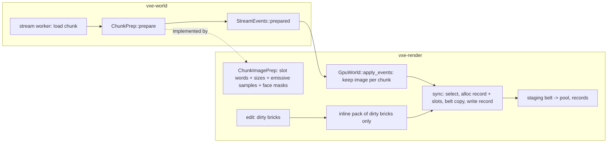

# 0070: The sync off the frame: a chunk's slot image packed on the stream workers, the render thread copies

> **Status:** draft, awaiting owner go
> **Created:** 2026-11-12 (the overnight architecture review, `docs/reviews/2026-11-12-architecture-review.md`)
> **Milestone:** M2 (a playable frame under the light that holds), cross-cutting like Plans
> 0064 and 0067. It serves `docs/nfr.md` section 2's streaming line and section 5's residency.
> **Related ADRs:** [ADR-0056](../adrs/0056-the-mirrors-slot-image-is-packed-on-the-stream-workers-and-the-render-thread-only-allocates-and-copies.md)
> (proposed): where a chunk's slot words are packed. Rests on ADR-0012 and Plan 0028 (a slot is
> the packed brick's bytes), ADR-0017 (`ChunkPrep`, the workers' hook) and ADR-0022 (the belt).
> **Source:** Plan 0068's bench readings (`docs/plans/logs/0068.md`, Phases 2 and 4) and Plan
> 0067's Phase 1 stop rule ("if `update + poll + sync` p99 reads over 16.6 ms in rig (b) ... the
> lane stops for an architect amendment"), which those readings already trip at 39.9 ms. The
> owner, 2026-11-11: "we are not there - either lagging too much, or the picture is unacceptable".
> **Starts after:** Plan 0067 has merged (recommended; the owner's call, review question 1).
> Before Plan 0045, whose Phase 0 re-cuts `gpu_world.rs`'s seams at its own start commit.
> If the owner puts it after 0045, every path below is read from the split tree.

## TL;DR

On the RTX the streamed scenes are CPU-bound by 5 to 9x their GPU time: the tester's cave and
castle paths read wall p95 36.6 and 58.1 ms with the GPU at 6.3 ms, and `update + poll + sync`
p99 39.9 and 40.7 ms, while the bounded showcase reads 12.8 ms and 0.02 ms. Plan 0067 owns the
bake queue's step beside it; nobody owns the mirror's `sync`, which packs every loaded chunk's
slot words on the render thread at about 0.3 ms a chunk. This plan **moves the packing to the
stream workers**, which already run a pure function per loaded chunk (`ChunkPrep`, the face
masks), so the render thread allocates records and copies bytes and does nothing per brick for a
chunk that arrives packed; an edited chunk re-packs its dirty bricks inline. The mirror's bytes
are byte-identical whichever thread packed them, and a test says so. The first thing anyone sees:
the per-second `sync` line and the tester's `run.json` split the sync into its stages, so the
0.3 ms has a name; then the cave bench's p95 with `--pack workers`.

## Context & problem

Every figure is a reading unless marked. "RTX" is the NVIDIA GeForce RTX 3080 Laptop GPU,
"Radeon" the AMD Radeon Graphics (RADV RENOIR), the slow adapter of `docs/nfr.md` section 1.

- **The tester's benches** (Plan 0068 Phase 2, release `12ffee5`, RTX, 2530 x 1378, FSR 2 at
  1.5, exclusive perf lock, one run each; `docs/plans/logs/0068.md`):

  | scene | wall p50 / p95 / p99 ms | CPU p50 / p95 | GPU p50 / p95 | frames over 33 ms | `update + poll + sync` p99 |
  |---|---|---|---|---|---|
  | cave | 14.3 / 36.6 / 65.3 | 13.8 / 36.1 | 6.35 / 7.41 | 228 of 4098 | 39.9 ms |
  | showcase | 10.4 / 12.8 / 13.9 | 1.8 / 3.1 | 6.28 / 7.31 | 0 | 0.02 ms |
  | castle | 13.8 / 58.1 / 69.6 | 13.4 / 57.6 | 6.27 / 7.98 | 133 of 1657 | 40.7 ms |

  At 1280 x 720 through the launcher (Phase 4): cave p95 34.0, castle 55.7 ms, GPU 2.2 ms. The
  CPU p50 of 13.8 ms in flight is the queue's step (Plan 0067, about 10 ms) plus the sync; the
  p95 and the frames over 33 ms are the sync's, by the `update + poll + sync` p99.
- **The streaming line** (`docs/nfr.md` section 2, 1.0 ms): the autopilot of section 5's protocol
  reads streaming CPU p50 3.4 to 4.2 ms, p99 45.9 to 83.6 ms, "the sync stage is most of it in
  every arm (3.19 to 3.90 ms p50)" (Plan 0059's quiet re-read, `docs/nfr/02-frame-budget.md`).
  A recorded miss since Plan 0002.
- **A budget does not help** (Plan 0064 Phase 4b, `docs/plans/logs/0064.md`): `--sync-ms` 2, 4
  or 8 read residency p95 2.7 to 6.9 s against 0.30 s with none, at about 0.3 ms of render-thread
  time a chunk. The backlog's "Slot words packed on the workers" names this plan's mechanism and
  says "pick up after Plan 0067, with the upload-copy ADR".
- **What the sync does per chunk** (`crates/vxe-render/src/gpu_world.rs` at `56008fa`):
  `select` (:2105) orders the pending chunks; `need` (:1976) computes the chunk's 512 solid
  masks and the surface bands under the chunk's write lock and sizes the slots; `upload` (:2225)
  packs the slot words brick by brick, scans `Full` bricks for emissive samples
  (`SyncStats::light_us`) and places them, and copies into the staging belt (`Belt::write`,
  :1092). Every step but the allocation and the belt copy is a function of the chunk's content
  and the material table's flags.
- **The workers already do this kind of work.** `vxe_world::ChunkPrep`
  (`crates/vxe-world/src/stream.rs:1034-1036`): "a pure function of the chunk's content, whose
  result the world carries to `Streamer::poll`'s events and never reads"; `FacePrep`
  (`crates/vxe-render/src/bake.rs:309`) computes the bake's face masks there, mean 177.8 us a
  chunk, max 5.7 ms over 90 702 chunks (Plan 0059's fix pass). The result travels as
  `Prepared(Arc<dyn Any + Send + Sync>)` in `StreamEvents::prepared` (:112) and the mirror reads
  it in `apply_events` (:1701).
- **Plan 0067's stop rule and bar.** Its Phase 1 stops the lane for an amendment if
  `update + poll + sync` p99 reads over 16.6 ms in its rig (b); the tester reads 39.9 ms. Its
  Budgets bar the frame's CPU at p99 16.6 ms in flight, which the step alone cannot reach. This
  plan is that amendment.

## Decision

Build ADR-0056: one `ChunkPrep` on the workers produces a loaded full chunk's **slot image**
(its slot words in size classes, its emissive samples, its face masks), the sync consumes the
image where one exists (allocate, copy, write the record) and keeps the inline path for a
chunk's dirty bricks after an edit. Both paths give the same bytes, asserted. The mode is a
`MirrorConfig` field and a fly-through flag (`--pack workers|render`) until the owner's window
picks; the default then follows the readings. We rejected a budget on the render-thread sync
(read in Plan 0064: it costs residency), a second upload thread (ADR-0022's belt orders the
copies in the frame's encoder) and GPU-side packing (the slots are the packed bytes already).

## Architecture diagram



## Implementation phases

Every phase gates on `node scripts/test-changed.mjs --profile quick`, plus `--profile gpu
--binaries <names>` under the perf lock for the binaries it names; the tip gates on
`cargo nextest run --profile gate`. Every phase proves the mirror's bytes did not move: the
existing slot tests, the pinned hashes and the fly-through's goldens byte-identical. No phase
changes a shader or a layout.

### Phase 1: the sync's stages on the clock (walking skeleton)
- **Owner skill:** dev
- **What:** `SyncStats` gains a microsecond per stage (`select_us`, `size_us` for `need`,
  `pack_us`, `light_us` as today, `copy_us` for the belt writes, `alloc_us`) and a count of
  bricks packed inline (`packed_bricks`). The fly-through's per-second `sync` line and the
  `frames:` exit line print the stages' p50 and p99; the tester's `run.json` gains a `streaming`
  object with the same percentiles (Plan 0068's report schema, additive). A reading on the
  tester's cave and castle benches on both adapters, release, three rounds under the perf lock,
  names the stage with at least half of the sync's p50 and of its p99.
- **Files touched:** `crates/vxe-render/src/gpu_world.rs`, `apps/flythrough/src/main.rs`
  (the two lines and the autopilot summary), `apps/flythrough/src/report.rs`,
  `apps/flythrough/tests/path.rs`, `crates/vxe-render/tests/gpu_mirror.rs`,
  `docs/plans/logs/0070.md`.
- **Done when:**
  - `the_sync_stages_sum_to_its_wall` (`gpu_mirror.rs`, lavapipe, about 2 s): over a 4 x 4 x 4
    chunk world's first sync, the six stage microseconds sum to within 10 % of the sync's
    measured wall, and `packed_bricks` equals the world's `Full` brick count.
  - `run_json_carries_the_streaming_stages` (`path.rs`, CPU, under 1 s): a report written from a
    fixed `SyncStats` series has `streaming.pack_us.p50` and friends with the expected values.
  - The readings log names the dominant stage per adapter and scene, with the percentiles.
    If `pack_us + size_us + light_us` is under half of the sync's p99 in the cave bench, the
    lane stops for an architect amendment before Phase 2: the premise (the packing is the cost)
    did not hold.

### Phase 2: the slot image on the workers
- **Owner skill:** dev
- **What:** `ChunkImagePrep` in `vxe-render` implements `ChunkPrep`: for a full chunk it builds
  the `SlotImage` (per-brick slot words and size class, the emissive samples `upload` would
  extract, the face masks `FacePrep` makes today, which it absorbs). `GpuWorld::apply_events`
  keeps the image per chunk; `sync`'s `upload` takes it for a chunk whose image is current
  (no edit since), skipping `need` and the per-brick pack, and writes record and slots from it.
  `MirrorConfig::pack: Pack::{RenderThread, Workers}` selects; the default stays
  `RenderThread` until Phase 6. The fly-through gets `--pack workers|render` and shows the mode
  on the HUD's streaming row (the owner's standing rule). A material flag the image depends on
  (`emissive`, `translucent`) is read from the table the mirror was built with; `rewrite_materials`
  drops every image.
- **Files touched:** `crates/vxe-render/src/{gpu_world.rs,bake.rs,lib.rs}`,
  `crates/vxe-world/src/stream.rs` (only if `Prepared` is typed; otherwise none),
  `apps/flythrough/src/{main.rs,hud.rs}`, `apps/flythrough/tests/gpu_level_mirror.rs`,
  `crates/vxe-render/tests/gpu_mirror.rs`.
- **Done when:**
  - `the_image_and_the_inline_pack_give_the_same_mirror_bytes` (`gpu_level_mirror.rs`, lavapipe,
    about 6 s): a seeded 6 x 6 x 3 chunk cave is loaded to full residency under both `Pack`
    modes; the pool's and the records' bytes read back are equal, byte for byte, and equal to
    the current golden's mirror hash.
  - `a_prepared_chunk_packs_no_brick_on_the_render_thread` (`gpu_mirror.rs`, lavapipe, about
    2 s): with `Pack::Workers`, after the images arrive, the first sync's `packed_bricks` is 0
    and `size_us` is 0 for every chunk that had an image; `sized_chunks` reads 0 (Plan 0044
    Phase 4's property, kept here).
  - `a_slot_holds_the_packed_brick_s_own_words` and every existing mirror test pass unchanged.
  - The fly-through's frame goldens are byte-identical under `--pack workers`
    (`gpu_golden.rs`'s default pose, run once by name).
  - The HUD's streaming row reads `pack workers` or `pack render`.

### Phase 3: the edit path re-packs dirty bricks only
- **Owner skill:** dev
- **What:** an edit marks the chunk's image stale by brick (the chunk's dirty bits already
  exist); the sync re-packs those bricks inline and keeps the image's other bricks; `need` runs
  over the dirty bricks' masks, not the chunk's 512. An image whose chunk was edited while it
  was in flight from the worker is dropped on arrival (the contract of `ChunkPrep`: "throws a
  result away once the chunk is edited").
- **Files touched:** `crates/vxe-render/src/gpu_world.rs`, `crates/vxe-render/tests/gpu_mirror.rs`,
  `crates/vxe-world/benches/` (none; the edit bench is `apps/flythrough`'s `B` line).
- **Done when:**
  - `an_edit_repacks_its_dirty_bricks_and_no_other` (`gpu_mirror.rs`, lavapipe, about 2 s): a
    radius-10 sphere carve (4169 voxels) at the centre of a prepared solid 3 x 3 x 3 chunk
    world touches at most 27 bricks (a 21-voxel diameter spans at most 3 bricks an axis), the
    next sync's `packed_bricks` is at most 27, and the mirror's bytes equal a fresh
    `Pack::RenderThread` upload of the edited world.
  - `an_image_that_arrives_after_an_edit_is_dropped` (`gpu_mirror.rs`, lavapipe, about 1 s): the
    chunk is edited between `prepare` and `apply_events`; the sync packs inline, and the bytes
    equal the reference.
  - The fly-through's `B` line (100 carves, `docs/nfr.md` section 4) reads within the spread of
    its three pre-plan runs on the dev box, and its upload's `packed_bricks` is at most 6400.
  - The replay and determinism tests give equal bytes (nothing in `vxe-world` changed).

### Phase 4: the readings, both modes alternated
- **Owner skill:** dev
- **What:** the autopilot of `docs/nfr.md` section 5's protocol (`--seed 1`, headless, 1280 x
  720) and the tester's cave and castle benches (`--tester --path cave|castle --report`, RTX at
  the window's size, Radeon at 1280 x 720), release, exclusive perf lock, three rounds, the two
  `Pack` modes alternated, each run's 1-minute load logged. Read: streaming CPU p50 and p99,
  `update + poll + sync` p99, wall p50 and p95, frames over 33 ms, residency p95, the images
  waiting (count and bytes, peak), peak RSS. With Plan 0067 merged the step's share is read
  beside it, never pooled.
- **Files touched:** `docs/plans/logs/0070.md`, `docs/nfr/02-frame-budget.md`,
  `docs/nfr.md` (section 5's residency line).
- **Done when:** the log holds the table above per adapter, scene and mode, with loads; the
  Budgets table's proposals are each marked met or missed by the `Workers` arm against the
  `RenderThread` arm of the same session.

### Phase 5: the owner's window
- **Owner skill:** human
- **What:** the owner flies the streamed cave fast (`--glide 300` or by hand) and the castle,
  with `--pack workers`, then toggles to `render` by key, HUD on, stdout visible; `dev` prepares
  the two commands and pings when ready, both adapters if the owner wants the Radeon.
- **Done when:** the owner says whether the hitches on fast passes are gone or not, and picks the
  default, or says the picture changed (it must not; a difference is a stop).

### Phase 6: the default, the lines and the bookkeeping
- **Owner skill:** dev
- **What:** the picked mode becomes `MirrorConfig`'s default and the fly-through's; the flag
  stays as a setting (Plan 0069 lists it as a `Rebuild` field, `pack`). The readings replace
  `docs/nfr.md` section 2's streaming-line note and section 5's residency figure; the backlog's
  "Slot words packed on the workers" entry leaves; `docs/roadmap.md`'s M1 paragraph gets one
  sentence on the upload-copy ADR. If the owner struck Plan 0044's Phase 4 into this plan
  (review question 2), its row says so.
- **Files touched:** `crates/vxe-render/src/gpu_world.rs`, `apps/flythrough/src/main.rs`,
  `docs/nfr.md`, `docs/nfr/02-frame-budget.md`, `docs/backlog.md`, `docs/roadmap.md`.
- **Done when:** the default's gate is green; the fly-through started with no flag reads the
  picked mode on the HUD; the doc gates pass.

## Data shapes

```rust
// illustrative
pub struct SlotImage {
    pub bricks: Vec<SlotBrick>,          // one per Full brick: slot words in 64-byte units, class
    pub emissive: Vec<LightSample>,      // what upload's scan would extract
    pub faces: FaceMasks,                // today's FacePrep output
    pub table_epoch: u64,                // the MaterialTable the image was built against
}
pub struct SlotBrick { pub index: u16, pub class: u8, pub words: Vec<u32> }
pub enum Pack { RenderThread, Workers }
// SyncStats gains: select_us, size_us, pack_us, copy_us, alloc_us, packed_bricks, images_waiting, image_bytes
```

Arithmetic: 0.87 GB live over about 17 077 full chunks at `r_full` 16 (Plan 0028, Plan 0042's
census) is about 51 KB a chunk on average; a worst chunk is 512 `Full` bricks at 1 KiB, 512 KB.
A window shift that loads 300 chunks before a sync holds about 15 MB of images; the bar below
caps the waiting bytes at 64 MiB as a proposal, above which the oldest image is dropped and its
chunk takes the inline path (never a stall).

## Budgets

| `docs/nfr.md` figure | On record | Proposed (met by the `Workers` arm, A/B in one session) | How the close measures it |
|---|---|---|---|
| section 2, streaming CPU per frame (1.0 ms p50, a recorded miss since Plan 0002) | p50 3.4 to 4.2 ms, p99 45.9 to 83.6 (RTX autopilot, Plan 0059's re-read) | p50 at most 1.0 ms (the line, met on the dev box); p99 at most 8 ms (a proposal: the copy of 300 chunks at about 50 KB is about 15 MB, under 4 ms at 4 GB/s into mapped memory, plus select and alloc) | the section 5 autopilot, both adapters, three rounds alternated |
| `update + poll + sync` p99 in the tester's cave and castle benches (no line; Plan 0067 bars the frame's CPU p99 at 16.6 ms) | 39.9 and 40.7 ms (RTX window, release) | at most 16.6 ms in both scenes, so Plan 0067's bar becomes reachable | the Phase 4 benches, RTX |
| wall p95 of the cave and castle benches (no line) | 36.6 and 58.1 ms, GPU 6.3; showcase 12.8 | at most 20 ms in both with Plan 0067 merged (1.5x the showcase's, which has no streaming; a proposal), frames over 33 ms under 1 % | the same |
| section 5 residency p95 (500 ms; 365 to 379 ms on record) | Plan 0059's reading | no worse than the spread; the workers do more per chunk, so a rise of up to 10 % is read, not barred | the autopilot's residency line |
| section 3, RAM (4 GB) and section 2's belt | peak RSS 1.40 GB cave, 1.70 castle (Plan 0068) | images waiting at most 64 MiB peak (the cap above); peak RSS within 5 % of the base | Phase 4's log |
| section 4, the edit's upload "fits the streaming line" | the `B` line 0.99 to 1.00 ms | unchanged within its spread; `packed_bricks` at most the dirty bricks (at most 6400 for 100 carves) | the fly-through's `B` line, three runs |

A figure without a measurement above is a proposal; Phase 4 reads it, Phase 6 writes it.

## Risks & open questions

- **The premise.** If Phase 1 reads the packing under half of the sync's p99, the cost is
  elsewhere (the lock wait on a chunk the workers hold, the belt's chunk replacement, `select`
  over a large pending set) and the plan stops for an amendment. Phase 1 exists for that.
- **Two packers that must agree.** The image path and the inline path are two implementations
  of one format. Phase 2's byte-equality test over a seeded cave and Phase 3's over edits guard
  it; the honest fix on divergence is one shared packing function both call, which Phase 2
  should write from the start (the inline path calls the same `pack_brick` on a slice).
- **Determinism:** nothing here touches `vxe-world`'s edit path or results; the mirror's bytes
  are asserted equal, and the goldens are byte-identical.
- **Memory:** the waiting images are bounded by the cap; a prep that outruns the sync for
  seconds (a 300 chunk shift at 10 m/s) holds about 15 MB.
- **Threading:** the workers read the material table's flags; the table is immutable after
  `generate` today. `rewrite_materials` (no caller) must drop every image; a test says so.
- **The `Prepared` erasure.** `Prepared(Arc<dyn Any>)` carrying 50 KB values is fine; typing
  it (`Prepared<T>`) is a `vxe-world` API change this plan may make if the downcast reads as a
  cost in Phase 1. Not a decision; a code comment.
- **Order.** If the owner runs this after Plan 0045, every path above moves
  (`gpu_world/stage.rs` and friends); the mechanism does not.

## What this plan does NOT do

- The bake queue's step, its budget by time and the missing-light fallback: Plan 0067.
- The window's pacing, the HUD's waits and the worker count: Plan 0064 (closed).
- Narrowing on the workers in the sense of Plan 0023's "narrowing" (the palette): gone since
  Plan 0028; nothing to move.
- The near shell's cost in a flight and the streaming edge (the backlog): the bake's, not the
  sync's.
- Any shader, layout or look change; any change to `vxe-world`'s results or hashes.
- Splitting `gpu_world.rs`: Plan 0045 Phase 2.

## Implementation log

> Written by `dev`: one row per phase as its commit lands, then the close block. **The phases
> above are the contract. This section records what happened.** Observations, never conclusions:
> no pass list, no self-assessment. Deviations and unmet done-whens are **always** disclosed.
> Readings, gate counts, attempts, sweeps and resume notes go to the plan's readings log,
> `docs/plans/logs/0070.md`, and this section links it once it exists.

| phase | owner | state | commit |
|---|---|---|---|
| 1: the sync's stages on the clock | dev | not started | |
| 2: the slot image on the workers | dev | not started | |
| 3: the edit path re-packs dirty bricks only | dev | not started | |
| 4: the readings, both modes alternated | dev | not started | |
| 5: the owner's window | human | not started | |
| 6: the default, the lines and the bookkeeping | dev | not started | |

### Notes

_(empty)_

### Close triggers

- **What shipped:**
- **Public API changed:**
- **Budget readings:**
- **Gate at the tip:**
- **Outstanding `human` phases:**

## Followups

- A typed `Prepared<T>` if the erased hook reads as a cost (Phase 1).
- Moving existing render tests that need only a world into `vxe-render` (Plan 0071's rig).
