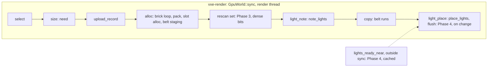

# 0070: The sync off the frame: the stage clock fixed, then the sync's measured stages cut on the render thread

> **Status:** in-progress (dev lane `plan-0070`, started 2026-11-13 at `c1d1d3f`; approved by the
> owner, 2026-11-12: "45 after 67, 70 after 45. all draft plans can be approved"). Review question 1 answered against the recommendation: this plan starts after
> Plan 0045 merges, on the split tree. Question 2 takes the recommendation: Plan 0044's Phase 4
> is struck into this plan.
> **Amended 2026-11-13 (orchestrator default, owner may overturn):** Phase 1's stop rule
> tripped. The worker packing (old Phases 2 and 3) is struck; the plan now fixes the stage
> clock, then cuts the sync's measured stages in place on the render thread (`alloc`'s rescan
> set, `light`'s per-sync walks). See "Amendment 2026-11-13" below and its owner questions.
> **Paths (architect, 2026-11-13, at Plan 0045's close):** Plan 0045 split files this plan names
> by their old paths (`gpu_world.rs`, `marcher.rs`, `bake.rs`, `fsr2.rs`, `march.wgsl`,
> `tests/gpu_mirror.rs`, `tests/gpu_strip.rs`'s reading, the fly-through's `main.rs` and
> `hud.rs`). Read each through "Where things moved" in
> [Plan 0045](done/0045-structure-pass-split-the-mega-files-share-the-fixtures.md); the
> phases re-cut their Files touched at their start.
> **Created:** 2026-11-12 (the overnight architecture review, `docs/reviews/2026-11-12-architecture-review.md`)
> **Milestone:** M2 (a playable frame under the light that holds), cross-cutting like Plans
> 0064 and 0067. It serves `docs/nfr.md` section 2's streaming line and section 5's residency.
> **Related ADRs:** [ADR-0056](../adrs/0056-the-mirrors-slot-image-is-packed-on-the-stream-workers-and-the-render-thread-only-allocates-and-copies.md)
> (proposed): where a chunk's slot words are packed. Rests on ADR-0012 and Plan 0028 (a slot is
> the packed brick's bytes), ADR-0017 (`ChunkPrep`, the workers' hook) and ADR-0022 (the belt).
> **Source:** Plan 0068's bench readings (`docs/plans/logs/0068.md`, Phases 2 and 4) and Plan
> 0067's Phase 1 stop rule ("if `update + poll + sync` p99 reads over 16.6 ms in rig (b) ... the
> lane stops for an architect amendment"), which those readings already trip at 39.9 ms. The
> owner, 2026-11-11: "we are not there - either lagging too much, or the picture is unacceptable".
> **Starts after:** Plan 0045 has merged (owner, 2026-11-12), and before Plan 0058. Every path
> below is read from 0045's split tree; the lane maps them in its Notes at its start commit.

## TL;DR

**As amended 2026-11-13.** Phase 1 put the sync's stages on a clock and read the premise false:
the packing is about 1.5 ms of a cave sync p99 of 44 to 47 ms, and `pack + size + light` 34 %
of it, under the 50 % stop line. The p99 stage is `alloc`, the brick loop of `upload_record`
(27 to 29 ms), whose largest self cost in the profile is the `rescan` `BTreeSet<usize>`; the p50
stage is `light` (164 to 167 us of a 180 us sync), the per-sync walks of `lights.chunks`. The
plan now (Phase 2) stops the clock lapping per brick, which on this machine's `hpet` clocksource
inflated the tip's readings, and re-reads the base; (Phase 3) replaces the rescan set with a
dense per-chunk bitset; (Phase 4) makes the light walks pay only when something changed; then
reads both against the base, the owner's window, and the bookkeeping. The mirror's bytes do not
move in any phase. The worker packing of ADR-0056 is deferred by reading, not rejected; Phase 5
decides whether it returns as its own plan.

The draft's TL;DR, kept for the record (its premise is the one Phase 1 refuted):

On the RTX the streamed scenes are CPU-bound by 5 to 9x their GPU time: the tester's cave and
castle paths read wall p95 36.6 and 58.1 ms with the GPU at 6.3 ms, and `update + poll + sync`
p99 39.9 and 40.7 ms, while the bounded showcase reads 12.8 ms and 0.02 ms. Plan 0067 owns the
bake queue's step beside it; nobody owns the mirror's `sync`, which packs every loaded chunk's
slot words on the render thread at about 0.3 ms a chunk. This plan **moves the packing to the
stream workers**, which already run a pure function per loaded chunk (`ChunkPrep`, the face
masks), so the render thread allocates records and copies bytes and does nothing per brick for a
chunk that arrives packed; an edited chunk re-packs its dirty bricks inline. The mirror's bytes
are byte-identical whichever thread packed them, and a test says so. The first thing anyone sees:
the per-second `sync` line and the tester's `run.json` split the sync into its stages, so the
0.3 ms has a name; then the cave bench's p95 with `--pack workers`.

## Context & problem

Every figure is a reading unless marked. "RTX" is the NVIDIA GeForce RTX 3080 Laptop GPU,
"Radeon" the AMD Radeon Graphics (RADV RENOIR), the slow adapter of `docs/nfr.md` section 1.

- **The tester's benches** (Plan 0068 Phase 2, release `12ffee5`, RTX, 2530 x 1378, FSR 2 at
  1.5, exclusive perf lock, one run each; `docs/plans/logs/0068.md`):

  | scene | wall p50 / p95 / p99 ms | CPU p50 / p95 | GPU p50 / p95 | frames over 33 ms | `update + poll + sync` p99 |
  |---|---|---|---|---|---|
  | cave | 14.3 / 36.6 / 65.3 | 13.8 / 36.1 | 6.35 / 7.41 | 228 of 4098 | 39.9 ms |
  | showcase | 10.4 / 12.8 / 13.9 | 1.8 / 3.1 | 6.28 / 7.31 | 0 | 0.02 ms |
  | castle | 13.8 / 58.1 / 69.6 | 13.4 / 57.6 | 6.27 / 7.98 | 133 of 1657 | 40.7 ms |

  At 1280 x 720 through the launcher (Phase 4): cave p95 34.0, castle 55.7 ms, GPU 2.2 ms. The
  CPU p50 of 13.8 ms in flight is the queue's step (Plan 0067, about 10 ms) plus the sync; the
  p95 and the frames over 33 ms are the sync's, by the `update + poll + sync` p99.
- **The streaming line** (`docs/nfr.md` section 2, 1.0 ms): the autopilot of section 5's protocol
  reads streaming CPU p50 3.4 to 4.2 ms, p99 45.9 to 83.6 ms, "the sync stage is most of it in
  every arm (3.19 to 3.90 ms p50)" (Plan 0059's quiet re-read, `docs/nfr/02-frame-budget.md`).
  A recorded miss since Plan 0002.
- **A budget does not help** (Plan 0064 Phase 4b, `docs/plans/logs/0064.md`): `--sync-ms` 2, 4
  or 8 read residency p95 2.7 to 6.9 s against 0.30 s with none, at about 0.3 ms of render-thread
  time a chunk. The backlog's "Slot words packed on the workers" names this plan's mechanism and
  says "pick up after Plan 0067, with the upload-copy ADR".
- **What the sync does per chunk** (`crates/vxe-render/src/gpu_world.rs` at `56008fa`):
  `select` (:2105) orders the pending chunks; `need` (:1976) computes the chunk's 512 solid
  masks and the surface bands under the chunk's write lock and sizes the slots; `upload` (:2225)
  packs the slot words brick by brick, scans `Full` bricks for emissive samples
  (`SyncStats::light_us`) and places them, and copies into the staging belt (`Belt::write`,
  :1092). Every step but the allocation and the belt copy is a function of the chunk's content
  and the material table's flags.
- **The workers already do this kind of work.** `vxe_world::ChunkPrep`
  (`crates/vxe-world/src/stream.rs:1034-1036`): "a pure function of the chunk's content, whose
  result the world carries to `Streamer::poll`'s events and never reads"; `FacePrep`
  (`crates/vxe-render/src/bake.rs:309`) computes the bake's face masks there, mean 177.8 us a
  chunk, max 5.7 ms over 90 702 chunks (Plan 0059's fix pass). The result travels as
  `Prepared(Arc<dyn Any + Send + Sync>)` in `StreamEvents::prepared` (:112) and the mirror reads
  it in `apply_events` (:1701).
- **Plan 0067's stop rule and bar.** Its Phase 1 stops the lane for an amendment if
  `update + poll + sync` p99 reads over 16.6 ms in its rig (b); the tester reads 39.9 ms. Its
  Budgets bar the frame's CPU at p99 16.6 ms in flight, which the step alone cannot reach. This
  plan is that amendment.

## Amendment 2026-11-13 (orchestrator default, owner may overturn)

**What Phase 1 read** (`docs/plans/logs/0070.md`, Phase 1; RTX 3080 Laptop host, Vulkan, the
tester's benches headless at 2530 x 1378, release, exclusive perf lock; both adapters, which
differ little because the sync is CPU work on the same laptop CPU):

| reading (cave unless named) | tip `7493526` (per-brick laps) | builds without per-brick laps (A/B and pre-pass rounds) |
|---|---|---|
| sync p50 / p99 | 184 us / 303 ms | 180 to 192 us / 41.5 to 47.7 ms (castle 43.0 to 60.8 ms; one loaded cave run, 63.6 ms, left out of every cave range) |
| `alloc` p99 (the brick loop) | 157 ms | 26.5 to 30.7 ms (pre-pass, packing separated: 27.2 to 29.1 ms) |
| `pack` alone p99 | 113 ms | 1.47 to 1.57 ms (pre-pass round) |
| `size` p99, `select` p99, `copy` p99 | 3.0, 2.1, 23.0 ms | 2.7 to 3.5, 2.1 to 2.3, 0.8 to 1.0 ms |
| `light` p50 / p99 | 168 us / 7.0 ms | 164 to 177 us / 10.4 to 11.5 ms |
| `pack + size + light` over sync p99 | 40.5 % | 33.6 % (RTX), 34.1 % (Radeon), pre-pass |
| `update + poll + sync` p99 | 307 ms | 43.7 to 55.2 ms |

The flat profile of the sync without per-brick laps (profile 3) puts its largest self cost in
`BTreeMap<usize, ()>::insert` (895 samples, against `upload_record` 276, `need` 153, the filter
over `lights.chunks` in `place_lights` 73, `fill_slot` 65); the one `BTreeSet<usize>` in
`vxe-render` is `upload_record`'s `rescan`, the brick and its six neighbours inserted per brick
written into a chunk with emitters (`gpu_world/slot.rs`). `PoolAlloc::release_page` reads no
sample. `lights_ready_near`, outside the sync, reads 259 samples. The profile's unwinding stops
at the first non-inlined frame, so the attribution is a flat ranking, not a share of the stage:
Phase 3 confirms it by reading.

**The clock.** The RTX laptop's kernel marks the TSC unstable at every boot since 2026-11-05
and falls back to `hpet`, about 1.7 us per `Instant::now()`. The tip's stage clock reads it
twice per brick uploaded and twice per `Full` brick staged, which is most of the gap between the
tip's 303 ms and the 42 to 64 ms of the same benches without those laps. Every reading after
Phase 1 is taken with a clock that reads per chunk or per pass, never per brick, and states the
clocksource. Readings on this machine since 2026-11-05 that time hot loops are inflated
(`docs/backlog.md`, "The RTX laptop's TSC is marked unstable").

**What changes.**

- **Struck:** old Phase 2 (the slot image on the workers) and old Phase 3 (the edit path
  re-packs dirty bricks only). Moving `pack + size` off the thread would save about 5 ms of a
  45 ms p99. The lane's untracked Phase 2 drafts (`live/p2_wire.py`, `live/p2-draft/`) stay
  where they are, uncommitted, for a follow-up plan if Phase 5 calls one.
- **New Phase 2:** the stage clock per chunk and per pass, `light` split into its per-sync part
  and its per-brick part, counters for the rescan inserts; the base re-read.
- **New Phase 3:** the rescan set as a dense 512-bit set per record, visited in ascending slot
  order (the order the `BTreeSet` gives, so `note_lights` sees the same sequence and the bytes
  cannot move).
- **New Phase 4:** `place_lights`' two walks, `flush_dropped_lights` and `lights_ready_near` pay
  only when their inputs changed (the focus chunk, the radius or hold, a chunk's lists, a
  dropped range).
- **Phases 5 to 7** are the old 4 to 6 re-aimed: readings against the Phase 2 base, the owner's
  window (two binaries, no mode toggle: nothing here is a mode), the bookkeeping.
- **ADR-0056** stays accepted and gains a dated Outcome: its mechanism is deferred by reading.
  No new ADR: the in-place changes reject no alternative a code comment cannot carry, and the
  worker packing is not rejected, only measured as the smaller share today.
- **`Pack`, `MirrorConfig::pack`, `--pack`, `SlotImage`** leave the plan. The Data shapes below
  name what replaces them.

**Owner questions (each a default taken while the owner slept; overturn any in the morning):**

1. **Worker packing struck from this plan** (alternative: keep it as Phases 2 and 3 after the
   in-place fixes). Default because it moves about 5 ms of a 45 ms p99; Phase 5 re-reads the
   share and calls a follow-up plan if `pack + size` is half or more of what remains.
2. **ADR-0056 kept with a dated Outcome, no superseding ADR** (alternative: a new ADR that
   rejects worker packing and supersedes 0056). Default because nothing refutes the mechanism,
   only its share at today's costs.
3. **The rescan set as a dense bitset per chunk** (alternative: a `Vec<usize>` sorted and
   deduplicated once per record). Default because 512 slots fit in eight `u64` words with no
   allocation and visit in ascending order, the order the `BTreeSet` gives today.
4. **The instrument fixed in code, not the clocksource** (alternative: boot with
   `tsc=reliable` or `clocksource=tsc` and keep the per-brick laps). Default because the
   boot setting is the owner's call and the engine's readings should not depend on it; the
   backlog carries the clock.
5. **No `--rescan` or `--light-walks` toggle; the window compares two binaries** (alternative:
   keep both paths behind a flag, as the owner's "cheap modes stay settings" rule does for look
   arms). Default because these are data-structure changes with byte-identical output, not
   modes with a picture to pick.
6. **The goal bar stays Plan 0067's 16.6 ms for `update + poll + sync` p99**, with proposals
   per stage below (alternative: lower the goal to what the two fixes are expected to reach).
   Default because the bar is the frame's; a miss at Phase 5 names the next stage, it does not
   move the bar.

## Decision

**As amended 2026-11-13:** the sync stays on the render thread for this plan; its measured
stages are cut in place (a dense rescan set, light walks that run on change), with byte-identical
mirror and light-buffer bytes, read against a base taken with a clock that reads per chunk. The
worker packing below is the draft's decision, deferred (ADR-0056's Outcome).

The draft's decision: build ADR-0056: one `ChunkPrep` on the workers produces a loaded full chunk's **slot image**
(its slot words in size classes, its emissive samples, its face masks), the sync consumes the
image where one exists (allocate, copy, write the record) and keeps the inline path for a
chunk's dirty bricks after an edit. Both paths give the same bytes, asserted. The mode is a
`MirrorConfig` field and a fly-through flag (`--pack workers|render`) until the owner's window
picks; the default then follows the readings. We rejected a budget on the render-thread sync
(read in Plan 0064: it costs residency), a second upload thread (ADR-0022's belt orders the
copies in the frame's encoder) and GPU-side packing (the slots are the packed bytes already).

## Architecture diagram

As amended 2026-11-13: the sync's stages on the render thread, and where Phases 3 and 4 cut.



## Implementation phases

Every phase gates on `node scripts/test-changed.mjs --profile quick`, plus `--profile gpu
--binaries <names>` under the perf lock for the binaries it names; the tip gates on
`cargo nextest run --profile gate`. Every phase proves the mirror's bytes did not move: the
existing slot tests, the pinned hashes and the fly-through's goldens byte-identical. No phase
changes a shader or a layout.

### Phase 1: the sync's stages on the clock (walking skeleton)
- **Owner skill:** dev
- **What:** `SyncStats` gains a microsecond per stage (`select_us`, `size_us` for `need`,
  `pack_us`, `light_us` as today, `copy_us` for the belt writes, `alloc_us`) and a count of
  bricks packed inline (`packed_bricks`). The fly-through's per-second `sync` line and the
  `frames:` exit line print the stages' p50 and p99; the tester's `run.json` gains a `streaming`
  object with the same percentiles (Plan 0068's report schema, additive). A reading on the
  tester's cave and castle benches on both adapters, release, three rounds under the perf lock,
  names the stage with at least half of the sync's p50 and of its p99.
- **Files touched:** `crates/vxe-render/src/gpu_world.rs`, `apps/flythrough/src/main.rs`
  (the two lines and the autopilot summary), `apps/flythrough/src/report.rs`,
  `apps/flythrough/tests/path.rs`, `crates/vxe-render/tests/gpu_mirror.rs`,
  `docs/plans/logs/0070.md`.
- **Done when:**
  - `the_sync_stages_sum_to_its_wall` (`gpu_mirror.rs`, lavapipe, about 2 s): over a 4 x 4 x 4
    chunk world's first sync, the six stage microseconds sum to within 10 % of the sync's
    measured wall, and `packed_bricks` equals the world's `Full` brick count.
  - `run_json_carries_the_streaming_stages` (`path.rs`, CPU, under 1 s): a report written from a
    fixed `SyncStats` series has `streaming.pack_us.p50` and friends with the expected values.
  - The readings log names the dominant stage per adapter and scene, with the percentiles.
    If `pack_us + size_us + light_us` is under half of the sync's p99 in the cave bench, the
    lane stops for an architect amendment before Phase 2: the premise (the packing is the cost)
    did not hold.

### Phase 2: the stage clock per chunk, and the base re-read (amended 2026-11-13)
- **Owner skill:** dev
- **What:** the stage clock stops lapping inside per-brick code: `upload_brick` and `stage`
  read no clock (the substance of `live/ab-no-brick-laps.patch`), so a brick's pack, slot
  allocation, belt staging and rescan inserts land in `alloc_us`, the brick loop's stage, and
  `pack_us` keeps only `fix_band`'s per-chunk packing. `light_us` splits into
  `light_place_us` (per sync: `place_lights`, `flush_dropped_lights`, the per-record emissive
  check) and `light_note_us` (per chunk: the `note_lights` pass over the rescan set); `light_us`
  stays their sum. New counters: `rescan_inserts` (insert calls into the rescan set) and
  `clock_reads` (stage-clock reads this sync). `run.json`'s `streaming` object and the `sync:`
  line carry the new fields (additive). The readings state the host's clocksource
  (`/sys/devices/system/clocksource/clocksource0/current_clocksource`) beside the load. The
  pre-pass build stays a reading tool, uncommitted.
- **Files touched:** `crates/vxe-render/src/gpu_world/{mod.rs,window.rs,slot.rs,stage.rs,lights.rs}`,
  `apps/flythrough/src/report.rs`, `apps/flythrough/src/run/frame.rs`,
  `apps/flythrough/tests/path.rs`, `crates/vxe-render/tests/gpu_mirror_budget.rs`,
  `docs/plans/logs/0070.md`.
- **Done when:**
  - `the_sync_stages_sum_to_its_wall` (`gpu_mirror_budget`, lavapipe, about 2 s) still holds
    within 10 %, with `light_place_us + light_note_us == light_us`.
  - `the_stage_clock_reads_per_chunk_not_per_brick` (`gpu_mirror_budget`, lavapipe, about 2 s):
    two 2 x 2 x 2 chunk worlds of the same chunk count, one with every brick `Full` and one with
    one `Full` brick a chunk, read the same `clock_reads` on their first sync.
  - `run_json_carries_the_streaming_stages` covers the new fields.
  - **The base:** three rounds of the tester's cave and castle benches on both adapters
    (`--tester --path cave|castle --report DIR --headless --render 2530x1378`, release,
    exclusive perf lock, load before and after, clocksource named) with this phase's binary,
    kept as `live/bin/flythrough-base70` for Phases 3 to 6. The log holds the per-stage p50 and
    p99 table per adapter and scene.
  - **Stop:** if `alloc` is not the p99 stage of the cave bench on both adapters, or `light` is
    not its p50 stage, the lane stops for an amendment before Phase 3.

### Phase 3: the rescan set dense (amended 2026-11-13)
- **Owner skill:** dev
- **What:** `upload_record`'s `rescan: BTreeSet<usize>` becomes a 512-bit set (`[u64; 8]`, one
  bit per brick slot of a chunk, on the stack or reused from `self.up`), inserted with a bit
  OR and visited in ascending slot order with `trailing_zeros`, the order the `BTreeSet`
  gives; `note_lights` runs over it unchanged. A comment names why the order matters (the
  chunk's light lists and the samples' order in the buffer follow it).
- **Files touched:** `crates/vxe-render/src/gpu_world/slot.rs` (and a small helper type where
  `slot.rs`'s neighbours live), `crates/vxe-render/tests/gpu_mirror_budget.rs` or the module's
  unit tests, `docs/plans/logs/0070.md`.
- **Done when:**
  - `the_dense_rescan_set_visits_the_btree_order` (unit, CPU, under 1 s): for 1000 seeded
    insert sequences over slots 0..512 (with repeats and the six-neighbour pattern), the dense
    set's visit sequence equals a `BTreeSet<usize>`'s.
  - The mirror's bytes did not move: the existing slot and light tests in `gpu_mirror_*` and
    the fly-through's default golden (`gpu_golden`, by name) are byte-identical;
    `light_samples` and `light_chunks` after a seeded 4 x 4 x 4 first sync with an emissive
    material equal the Phase 2 binary's (a pinned hash in the test).
  - **Reading:** one round of the cave bench on the RTX, this phase's binary and
    `flythrough-base70` alternated in one session: `alloc` p99 falls by at least 40 % against
    the base's. **Stop:** under 40 %, the profile's attribution did not hold; the lane stops for
    an amendment with a fresh profile of `alloc` (per-chunk timing, never per brick).

### Phase 4: the light walks on change (amended 2026-11-13)
- **Owner skill:** dev
- **What:** `place_lights` keeps its result and walks `lights.chunks` only when an input
  changed since its last walk: the focus chunk, `light_radius` or `hold`, a chunk entering or
  leaving `lights.chunks`, a chunk marked dirty, a range released, or chunks left waiting on the
  sample budget (`lights.wait` non-empty). The release walk runs on a focus or radius change
  only. `flush_dropped_lights` returns at once on an empty list. `lights_ready_near` caches its
  answer on (`light_epoch`, the dirty set's change count, `coord`, `r`). Every early return is a
  pure skip of a walk whose result is known: the buffer's bytes, `light_chunks()`'s order and
  `light_oldest_wait` are what the full walk gives.
- **Files touched:** `crates/vxe-render/src/gpu_world/{lights.rs,mod.rs}`,
  `crates/vxe-render/tests/gpu_mirror_budget.rs`, `docs/plans/logs/0070.md`.
- **Done when:**
  - `the_light_walks_skip_only_what_did_not_change` (`gpu_mirror_budget`, lavapipe, about 3 s):
    a scripted flight over a seeded emissive world (focus steps, a carve that changes a lit
    brick, a radius change, a sample budget small enough to leave chunks waiting) gives, after
    every sync, the same light buffer bytes, `light_chunks()` and `light_oldest_wait` as the
    same flight with the walks forced every sync (a test-only switch, `#[cfg(test)]` or a
    `pub(crate)` field).
  - `lights_ready_near` answers equal the uncached function's at every step of that flight.
  - **Reading:** one round of the cave bench on the RTX, alternated with Phase 3's binary:
    `light_place_us` p50 at most 20 us (a proposal; the base reads about 165 us for `light`).

### Phase 5: the readings against the base (amended 2026-11-13)
- **Owner skill:** dev
- **What:** the tip and `flythrough-base70` alternated, three rounds, the tester's cave and
  castle benches on both adapters (RTX at 2530 x 1378, Radeon at 1280 x 720) and the autopilot
  of `docs/nfr.md` section 5's protocol (`--seed 1`, headless, 1280 x 720), release, exclusive
  perf lock, each run's load and the clocksource logged. Read: sync p50 and p99 per stage,
  `update + poll + sync` p99, streaming CPU p50 and p99, wall p50 and p95, frames over 33 ms,
  residency p95, peak RSS, and the fly-through's `B` line (three runs each binary). With Plan
  0067 merged the queue step's share is read beside, never pooled.
- **Files touched:** `docs/plans/logs/0070.md`, `docs/nfr/02-frame-budget.md`.
- **Done when:** the log holds the table per adapter, scene and binary, with loads and the
  clocksource; each Budgets proposal is marked met or missed by the tip against the base of
  the same session; and the log names the next stage if `update + poll + sync` p99 still reads
  over 16.6 ms. **Route, not a stop:** if `pack + size` is half or more of the tip's cave sync
  p99, the log says so and the close review carries ADR-0056's worker packing to the backlog's
  head as a follow-up plan; if another stage dominates, the log names it for the same.

### Phase 6: the owner's window
- **Owner skill:** human
- **What:** the owner flies the streamed cave fast (`--glide 300` or by hand) and the castle
  with the tip's binary and with `flythrough-base70`, HUD on, stdout visible (the `sync:` line
  per second); `dev` prepares the two commands per binary (`live/session70.sh`) and pings when
  ready, both adapters if the owner wants the Radeon.
- **Done when:** the owner says whether the hitches on fast passes are fewer or not, and says
  the picture did not change (it must not; a difference is a stop).

### Phase 7: the lines and the bookkeeping
- **Owner skill:** dev
- **What:** the readings replace `docs/nfr.md` section 2's streaming-line note (machine,
  clocksource, commit); the backlog's "Slot words packed on the workers" entry is rewritten
  with Phase 5's share and its pickup condition, or leaves for a follow-up plan the owner
  approves; `docs/roadmap.md`'s M2 line on the sync gets one sentence. If the owner struck
  Plan 0044's Phase 4 into this plan (review question 2), its row says what became of it: the
  property it guarded (`sized_chunks` 0 for a prepared chunk) leaves with the worker packing.
- **Files touched:** `docs/nfr.md`, `docs/nfr/02-frame-budget.md`, `docs/backlog.md`,
  `docs/roadmap.md`, `docs/plans/logs/0070.md`.
- **Done when:** the gate tier is green at the tip; the doc gates pass.

## Data shapes

```rust
// illustrative (amended 2026-11-13)
struct RescanSet([u64; 8]);              // one bit per brick slot of a chunk (512)
impl RescanSet {
    fn insert(&mut self, slot: usize) { self.0[slot / 64] |= 1 << (slot % 64); }
    fn iter(&self) -> impl Iterator<Item = usize> + '_ { /* ascending, trailing_zeros */ }
}
// SyncStats gains: light_place_us, light_note_us (light_us = their sum), rescan_inserts, clock_reads
```

Arithmetic: a cave sync at p99 writes about 13 300 bricks (`packed_bricks` p99, Phase 1), about
26 chunks of 512; with every chunk emitting, the rescan set takes up to 7 inserts a brick, about
93 000 a sync, each a heap-allocating B-tree insert today and one OR into 64 bytes after Phase 3.
The stage clock after Phase 2 reads a bounded number of times a chunk: at 26 chunks and, say,
ten reads a chunk at 1.7 us (`hpet`) it costs about 0.4 ms of a sync, against about 45 ms for
four reads a brick at 13 300 bricks (a guess from the per-read cost, consistent with the tip's
303 ms against 42 to 64 ms).

## Budgets

As amended 2026-11-13. "Base" is Phase 2's binary (`flythrough-base70`), read in the same
session as the tip. Every figure is from the RTX 3080 Laptop host on its `hpet` clocksource
(2026-11-13 boot) unless named; a reading on another clocksource is not compared with these.

| `docs/nfr.md` figure | On record | Proposed (the tip against the base, one session) | How the close measures it |
|---|---|---|---|
| `update + poll + sync` p99, tester cave and castle (no line; Plan 0067 bars the frame's CPU p99 at 16.6 ms) | 43.7 to 55.2 ms cave, 46.2 to 67.6 ms castle (Phase 1 builds without per-brick laps, both adapters) | at most 16.6 ms in both scenes (the goal); a miss names the next stage in Phase 5 | Phase 5 benches, both adapters |
| the cave sync's `alloc` p99 (no line) | 26.5 to 30.7 ms | at least 40 % under the base's (Phase 3's stop line; a proposal, the profile ranks the rescan inserts first but gives no share) | Phase 3 and Phase 5 |
| the cave sync's `light_place_us` p50 (no line) | `light` p50 164 to 177 us of a sync p50 of 180 to 192 us | at most 20 us; sync p50 at most 50 us (proposals) | Phase 4 and Phase 5 |
| section 2, streaming CPU per frame (1.0 ms p50, a recorded miss since Plan 0002) | p50 3.4 to 4.2 ms, p99 45.9 to 83.6 (RTX autopilot, Plan 0059's re-read, clocksource not recorded) | read and recorded with the clocksource; p50 at most 1.0 ms if the sync's p50 cut carries through (a proposal, not a gate) | the section 5 autopilot, both binaries, three rounds alternated |
| wall p95 and frames over 33 ms of the cave and castle benches (no line) | 36.6 and 58.1 ms, GPU 6.3 (Plan 0068, windowed) | read, not barred: the queue step (Plan 0067) shares them | Phase 5 |
| section 5 residency p95 (500 ms; 365 to 379 ms on record) | Plan 0059's reading | no worse than the base's spread | the autopilot's residency line |
| section 4, the edit's upload "fits the streaming line" | the `B` line 0.99 to 1.00 ms | unchanged or lower within its spread | the fly-through's `B` line, three runs each binary |
| section 3, RAM | peak RSS 1.30 GB cave (Phase 1 tip) | within 2 % of the base (nothing here allocates more) | Phase 5's log |

A figure without a measurement above is a proposal; Phase 5 reads it, Phase 7 writes it.

## Risks & open questions

- **The attribution.** The profile's unwinding stops at the first non-inlined frame, so the
  rescan set ranks first by self samples without a share of `alloc`. Phase 3's 40 % line is the
  check; under it the lane stops and re-profiles `alloc` per chunk.
- **The order of the light lists.** `note_lights` runs over the rescan set in ascending slot
  order today; the dense set must keep it, or a chunk's samples land in another order and the
  light buffer's bytes move. Phase 3's unit test and pinned hash guard it.
- **A skipped walk that was needed.** Phase 4's change inputs are a list; a forgotten one (a
  chunk whose range was evicted by `write_chunk_lights`, a `hold_lights` change) leaves a chunk
  unlit until the next change. The forced-walk comparison over a scripted flight is the guard;
  any input it misses is added to the list, not worked around.
- **The clock.** The readings depend on the host's clocksource; a reboot onto `tsc` changes
  every absolute figure. Base and tip are always read in one session.
- **The worker packing.** Deferred, not refuted (ADR-0056's Outcome). If the in-place cuts work,
  `pack + size` (about 5 ms) may become the larger share of what remains; Phase 5 reads it.
- **Determinism:** nothing here touches `vxe-world`; the mirror's and the light buffer's bytes
  are asserted equal, and the goldens are byte-identical.

## What this plan does NOT do

- The worker packing (ADR-0056, the draft's Phases 2 and 3): deferred to a follow-up plan if
  Phase 5 calls one; `Pack`, `--pack` and `SlotImage` are not built.
- `note_lights`' own cost (`light_note_us`, the `light` p99 of about 10.5 ms in
  `exposed_emitters`): Phase 2 reads it apart; cutting it is a follow-up unless Phase 3's set
  alone moves it.
- The machine's clocksource: the owner's boot setting (`docs/backlog.md`).
- The bake queue's step, its budget by time and the missing-light fallback: Plan 0067.
- The window's pacing, the HUD's waits and the worker count: Plan 0064 (closed).
- The near shell's cost in a flight and the streaming edge (the backlog): the bake's, not the
  sync's.
- Any shader, layout or look change; any change to `vxe-world`'s results or hashes.

## Implementation log

> Written by `dev`: one row per phase as its commit lands, then the close block. **The phases
> above are the contract. This section records what happened.** Observations, never conclusions:
> no pass list, no self-assessment. Deviations and unmet done-whens are **always** disclosed.
> Readings, gate counts, attempts, sweeps and resume notes go to the plan's readings log,
> `docs/plans/logs/0070.md`, and this section links it once it exists.

| phase | owner | state | commit |
|---|---|---|---|
| 1: the sync's stages on the clock | dev | done; the stop rule tripped, the lane waits for an amendment ([log](logs/0070.md)) | `7493526` (code); `3926018` (readings) |
| 2: the stage clock per chunk, and the base re-read | dev | done; the stop rule held ([log](logs/0070.md)) | `bdca60a` (code); `6c1f9f5` (readings) |
| 3: the rescan set dense | dev | done ([log](logs/0070.md)) | `297e7a9` (code); committed with this row (readings) |
| 4: the light walks on change | dev | not started | |
| 5: the readings against the base | dev | not started | |
| 6: the owner's window | human | not started | |
| 7: the lines and the bookkeeping | dev | not started | |

### Notes

**Paths at the start (`c1d1d3f`, Plan 0045's "Where things moved"; the tree's names win):**

| plan names | tree |
|---|---|
| `crates/vxe-render/src/gpu_world.rs` | `gpu_world/`: `mod.rs` (`GpuWorld`, `SyncStats`, `MirrorConfig`, `sync`), `window.rs` (`select`, `upload`, the sync's clocks), `slot.rs` (`need`, `upload_record`, `upload_brick`, `fill_slot`, `fix_band`), `stage.rs` (the staged runs and the belt), `lights.rs` (`note_lights`, `place_lights`), `alloc.rs`, `format.rs` |
| `crates/vxe-render/src/bake.rs` (`FacePrep`) | `bake/faces.rs`; its results are taken in `bake/queue/mod.rs` (`take_prepared`) |
| `crates/vxe-render/tests/gpu_mirror.rs` | `gpu_mirror_alloc.rs`, `gpu_mirror_tiers.rs`, `gpu_mirror_budget.rs`, `tests/support/mod.rs` |
| `crates/vxe-world/src/stream.rs` (`ChunkPrep`, `Prepared`) | `stream/workers.rs`, `stream/mod.rs` |
| `apps/flythrough/src/main.rs`: the `frames:` exit line | `run/hud_feed.rs` (`RunTimes::line`) |
| `apps/flythrough/src/main.rs`: the per-second `sync` line | none in the tree; the queue's once-a-second lines are in `run/queue.rs`. Phase 1 adds a `sync:` line at their cadence in `run/frame.rs`, with its state in `streaming.rs` |
| `apps/flythrough/src/main.rs`: the autopilot summary | `run/pilot.rs` (its series in `autopilot.rs`) |
| `apps/flythrough/src/main.rs`: `--pack` and the sync's caller | `cli/flags.rs`, `cli/mod.rs`, `setup.rs` (the streamer's hook), `run/frame.rs`, `run/mod.rs` (`init_stream`), `toggles.rs` (a key) |
| `apps/flythrough/src/hud.rs` (the streaming row) | `hud/` (`stats.rs`, `modes.rs`) and `run/hud_feed.rs` |
| the tester's `run.json` | `apps/flythrough/src/report.rs`; written in `run/tour.rs` |

**Phase 1 deviations and unmet done-whens:**

- `SyncStats::lock_us` (the chunk-lock wait inside `select_us` and `alloc_us`) is not in the
  plan (`7493526`).
- The stage clock reads `Instant::now()` twice per brick uploaded and twice per `Full` brick
  staged. On the RTX laptop's current `hpet` clocksource a read costs about 1.7 us, and the
  tip's sync p99 in the cave bench reads 303 ms against 42 to 64 ms without the per-brick laps
  (`7493526`; readings in the log).
- The done-when's readings (three rounds of the four benches with the tip's binary) were not
  run. One round-1 RTX cave run of the tip is in; the per-stage percentiles per adapter and
  scene come from three rounds of a build without the per-brick laps (pack folded into
  `alloc`) and one round of a build that times the packing in a separate pass per chunk.
  Neither build is committed.
- The stop rule tripped: `pack + size + light` is under half of the sync's p99 in the cave
  bench. Phase 2 is not started.

**Phase 2 deviations:**

- `place_band` reads no clock either (it is per brick in the upload's loop), so a band slot's
  placement in the upload lands in `alloc_us` (`bdca60a`).
- `the_sync_stages_sum_to_its_wall` no longer asserts `pack_us > 0`: `pack_us` holds only the
  band repair, off in that test's mirror (`bdca60a`).
- `apps/flythrough/src/run/frame.rs` and `gpu_world/lights.rs` are not changed: the `sync:`
  line takes the new fields through `report::SyncSeries::line`.
- The base's Radeon runs are at 1280x720, as in Phase 1 and Phase 5 (`live/bench.sh`), not
  the phase's 2530x1378.

Readings, gate counts and attempts: [`docs/plans/logs/0070.md`](logs/0070.md).

### Close triggers

- **What shipped:**
- **Public API changed:**
- **Budget readings:**
- **Gate at the tip:**
- **Outstanding `human` phases:**

## Followups

- The worker packing (ADR-0056) as its own plan, if Phase 5 reads `pack + size` at half or
  more of the tip's cave sync p99; the lane's untracked drafts are in `live/p2_wire.py` and
  `live/p2-draft/`. A typed `Prepared<T>` goes with it.
- `note_lights`' cost in `exposed_emitters` (the `light` p99), if Phase 5 names it the next
  stage.
- Moving existing render tests that need only a world into `vxe-render` (Plan 0071's rig).
