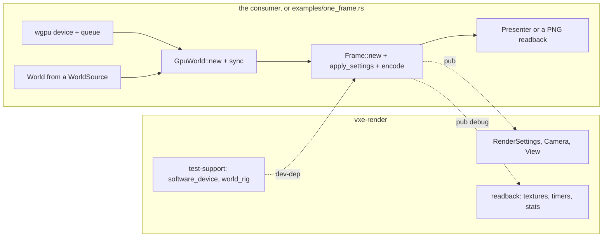

# 0071: The consumer's path: a render example as the contract, a renderer tested without the testbed, one name per thing, every error an `Error`

> **Status:** draft, awaiting owner go
> **Created:** 2026-11-12 (the overnight architecture review, `docs/reviews/2026-11-12-architecture-review.md`)
> **Milestone:** cross-cutting (the first consumer's hand-off; `docs/roadmap.md`, "The first
> consumer's needs, mapped", every P0 row). No budget figure moves.
> **Related ADRs:** [ADR-0057](../adrs/0057-the-render-api-is-three-objects-and-a-settings-struct-with-a-compiled-example-as-the-contract.md)
> (proposed): the render API's shape and its contract. Rests on ADR-0001 (a library, not a
> framework) and on Plan 0069's ADR-0055 (`RenderSettings`).
> **Source:** the owner, 2026-11-11, for the review: "clear API"; the review's section 3.
> **Starts after:** Plans 0045 (the curated re-exports) and 0069 (`RenderSettings`) have merged,
> since both change the surface this plan documents; Plan 0044's Phase 8 (the `test-support`
> device helper) too, which Phase 2 here builds on. Before M10's plans, each of which adds
> settings a consumer must find.

## TL;DR

The engine has every mechanism the first consumer's P0 list asks for, and no written way to call
it: `vxe-render`'s crate doc is six lines, the README has no Rust, and the twelve steps from a
`World` to a presented frame exist only in the testbed's `main.rs`. `Frame` has 98 public
methods, 52 used by nothing under `crates/`. This plan writes **one compiled example per
consumer-facing crate** (the render one is the contract of ADR-0057: a world from a closure to
a PNG, headless, under 60 lines, run in CI), gives `vxe-render` a **world-only test rig** so
the renderer's tests stop needing the cave, **narrows `Frame`** to what the example, the tests
and the testbed call, makes **names consistent** (one word for the mirror, one suffix for a
settings type, one shape for a ray query, the voxel scale in one place) with deprecated
re-exports for one minor, gives the two error types that lack it a `Display` and an `Error`
impl, and turns on `missing_docs`. The first thing anyone sees: `cargo run -p vxe-render
--example one_frame` writes `one_frame.png` of a lit box, from a `main` that fits on a screen.

## Context & problem

Counts are from the review of 2026-11-12 (read-only, `grep` and `wc` at `56008fa`); re-read at
this plan's start, since Plans 0045 and 0069 will have moved them.

- **No path.** `crates/vxe-render/src/lib.rs:1-6` has no example; `vxe-app` and
  `vxe-script-wasm` have none; `README.md` has `sh` blocks only. The seven `examples/` are
  tools. A consumer follows `main.rs:4033-4120` and `:5760-5830`: adapter and device (the
  library offers no helper; `vxe_render::limits_for` must be called), `World` and `Streamer`,
  `GpuWorld::with_config(MirrorConfig::new(Window::...))`, `Frame::new`, `Presenter::new`;
  per frame `apply_events`, `set_focus`, `sync`, `invalidate` after edits, `params`, `encode`,
  `advance`, `presenter.encode`, `submit`.
- **The surface.** `Frame`: 98 pub fns (22 `set_*`, 19 bake and store, 14 raw `&wgpu::Texture`
  getters; `bake_until` takes 7 arguments, `encode` 6). 52 are used by nothing under `crates/`;
  10 by nothing at all (`metering`, `set_probe_axis`, `sharpness`, `upscaler`, `set_bake_slice`,
  `digs_pending`, `pending_digs`, `probe_emission_scale`, `emission_scales`, `transmittance`).
  `GpuWorld`: 62 pub fns, 8 with no caller outside the file. `Params` (38 fields) and
  `View::_pad`, `_pad2` are public. `Upscaler` is taken by `set_upscaler` and not re-exported.
  No crate sets `missing_docs`; pub items with no doc line: `vxe-world` 63, `vxe-render` 55.
- **The renderer is tested through the testbed.** 18 `gpu_*` files, 20 711 lines, in
  `apps/flythrough/tests/`; 8 files, 5115 lines, in `crates/vxe-render/tests/`. Plan 0045 leaves
  that ("they need the cave scene builders"); the queue, bake, FSR 2 history and frame-wait
  tests need a world, not a cave.
- **Names.** `GpuWorld` / `MirrorConfig` / `MirrorError` / `sync` / "upload" (57 doc hits) /
  "the mirror" (141). Config suffixes `*Params` (7), `*Settings` (4), `*Config` (5),
  `*Tuning`, and `Lighting`. `Host::raycast(origin: Fixed3, dir: Fixed3, max: i64) -> Option<Hit>`
  against `World::raycast(origin, dir: [i64; 3], max_t) -> Result<Option<Hit>, EditError>`;
  `Host::unsupported(&[CellCoord])` against `find_unsupported(&[CellChange])`; `WalkableMap`'s
  `(ChunkCoord, u16)`. `tick` (server, logic, controller, log) against `Frame::step`,
  `AutoExposure::step`, `Frame::advance`. `HudColour` against `TextColor`. The voxel scale:
  `VOXELS_PER_METRE = 10.0` private in `vxe-render/src/light.rs:5`; `metres_per_voxel` an
  argument in `vxe-audio` (`Mixer::new`, 23 uses); the roadmap: "voxel size one scalar per world".
- **Errors.** 16 public error types, hand-written; `SpillError` (`persist.rs:62`) and
  `StreamError` (`stream.rs:90`) have no `Display` or `Error`; `AudioError` and `ShellError`
  carry `String`s. `Streamer::update` takes an unused `_world` (`stream.rs:376`).
- **Testbed words in library docs:** "the lower-case name the fly-through prints and parses"
  (`marcher.rs:198, 600`, `fsr2.rs:111`, `exposure.rs:74`); "the fly-through turns it on"
  (`marcher.rs:812`); `Lighting::lamp_bounce` defaults `false` in the library and `true` in the
  app (Plan 0069's amendment note takes the default; this plan takes the doc).

## Decision

Build ADR-0057. Three objects, a settings struct, a compiled example as the contract; the
surface is what the example, the tests and the testbed call; readbacks live behind one module.
Names change with a deprecated re-export kept for one minor (0.x: "any minor may break", the
CHANGELOG's rule), each listed in the CHANGELOG. The voxel scale becomes a field of the world
(`World::voxel_size`, metres, default 0.1) that `vxe-render` and `vxe-audio` read, as the roadmap
decided; no new ADR, since the decision exists. We rejected a `Renderer` facade (ADR-0057 A), a
C ABI (B) and a guide without a gate (C).

## Architecture diagram



## Implementation phases

Every phase gates on `node scripts/test-changed.mjs --profile quick`, plus `--profile gpu
--binaries <names>` for the binaries it names; the tip gates on `cargo nextest run --profile
gate`. No phase changes a mechanism, a default, a layout or a golden; every golden is
byte-identical at every phase (a rename is a rename).

### Phase 1: `one_frame`, the contract (walking skeleton)
- **Owner skill:** dev
- **What:** `crates/vxe-render/examples/one_frame.rs`: a 4 x 4 x 4 chunk world from a closure
  (a lit box: rock walls, one emissive material), a software or any device through a
  `vxe_render::test_support::software_device`-like helper that is **not** test-only
  (`vxe_render::headless_device(preference) -> Result<(Device, Queue), LimitsError>`, the
  one device helper the library offers, built on `limits_for`), `GpuWorld`, `Frame` with
  `RenderSettings::profile(Floor)`, `sync`, `encode`, `advance`, a readback of the composite to
  `one_frame.png`. Consumer code (after `use`) under 60 lines. CI builds and runs it on lavapipe
  (`cargo run -p vxe-render --example one_frame`) and a test asserts the PNG is not black. The
  crate doc of `vxe-render` quotes the example's body as a doctest (`compile_fail`-free, marked
  `no_run`), and `README.md` gains a "Render a frame" section with the same code.
- **Files touched:** `crates/vxe-render/examples/one_frame.rs` (new),
  `crates/vxe-render/src/lib.rs`, `crates/vxe-render/Cargo.toml` (the example, `png` as a
  dev-dependency, pinned), `crates/vxe-render/tests/gpu_one_frame.rs` (new), `README.md`,
  `.github/workflows/ci.yml`.
- **Done when:**
  - `the_example_renders_a_lit_box` (`gpu_one_frame.rs`, lavapipe, about 3 s at 320 x 180): the
    example's function, called with a fixed seed, returns an image whose mean luma is over 8 of
    255 and whose centre pixel is not the clear colour; the image's hash is pinned on lavapipe.
  - `cargo test --doc -p vxe-render` runs the crate-doc example (compiles; `no_run`).
  - The example's consumer code is under 60 lines (`wc -l` from the first statement of `main` to
    its close, asserted by a CPU test over the file).

### Phase 2: a renderer tested with a world, not a cave
- **Owner skill:** dev
- **What:** `vxe-render`'s `test-support` feature (Plan 0044 Phase 8's device helper) gains a
  `world_rig`: a seeded `FnSource` world of N chunks, a `GpuWorld` synced to full residency, a
  `Frame` at a size, a camera at a named pose, a readback of any target; the bake queue drivable
  by frames. The fly-through's `tests/support/mod.rs` uses it for its device and world (its cave
  builders stay). Every **new** renderer test from this plan on lives in `crates/vxe-render/tests`
  unless it needs a scene. Three existing fly-through tests that need only a world move as the
  proof: one queue test (`gpu_queue.rs`'s `the_score_blends_distance_and_the_view`, 10.8 s
  today), one frame-wait test, one FSR 2 history test; each keeps its name, mark and time.
- **Files touched:** `crates/vxe-render/src/test_support.rs`, `crates/vxe-render/Cargo.toml`,
  `crates/vxe-render/tests/gpu_queue.rs` (new), `gpu_frame_waits.rs` (new), `gpu_fsr2.rs`
  (new), `apps/flythrough/tests/{support/mod.rs,gpu_queue.rs,gpu_frame_waits.rs,gpu_fsr2.rs}`.
- **Done when:**
  - The three moved tests pass in their new binaries with the same assertions, byte for byte in
    the assertion bodies (shown by `git diff --color-moved`), and the fly-through's binaries lose
    exactly those three (`cargo nextest list` counts before and after; the gate's total is
    unchanged).
  - `world_rig_is_deterministic` (`vxe-render/tests/gpu_frame.rs`, lavapipe, about 2 s): two
    rigs from one seed give equal mirror bytes and equal first-frame hit buffers.
  - `check-test-tiers.mjs` passes (the new files carry `gpu_`).

### Phase 3: `Frame` is what the example, the tests and the testbed call
- **Owner skill:** dev
- **What:** every `Frame` and `GpuWorld` pub fn with no caller in `crates/`, `apps/` or the
  example at this plan's start commit is deleted (the review's list of 10 and 8 is the draft;
  Phase 3 re-greps). Methods only the fly-through calls stay public and gain a doc line that
  names them a tool ("A reading for the testbed and tests; not needed to render a frame").
  Raw-texture getters, timers, store readbacks and `CrackShares` move behind `pub mod debug`,
  re-exported at their old paths with `#[deprecated(since = "0.X", note = "use vxe_render::debug::...")]`
  for one minor. `Params`'s fields and `View::_pad*` go `pub(crate)` or `#[doc(hidden)]`.
  `Upscaler` is re-exported where `UpscalerKind` is (or leaves with the `own` removal plan,
  whichever lands first).
- **Files touched:** `crates/vxe-render/src/{marcher.rs or frame/*,gpu_world.rs or gpu_world/*,lib.rs,camera.rs}`,
  `CHANGELOG.md`.
- **Done when:**
  - A CPU test (`vxe-render/tests/surface.rs`, under 1 s) parses `src/lib.rs`'s re-export list
    and asserts the count of `pub fn` on `Frame` is at most 60 and on `GpuWorld` at most 45
    (proposals from today's 98 and 62 less the dead and the debug moves; Phase 3 states the
    reached numbers in the log and the test pins them).
  - Every golden byte-identical; the fly-through and the tester build with no change but
    `use` paths.
  - The CHANGELOG lists every removed and every moved item.

### Phase 4: one name per thing
- **Owner skill:** dev
- **What:** a rename table, each with a `#[deprecated]` re-export or type alias for one minor:
  - the mirror: `GpuWorld` stays (it is the world's GPU copy); `MirrorConfig` becomes
    `GpuWorldConfig`, `MirrorError` `GpuWorldError`; docs say "the mirror" for the concept and
    "sync" for the act (never "upload", which is the belt's copy).
  - settings types take `*Settings` (`LightSettings` for the lamp's per-call block,
    `LookSettings`, `LodSettings`, `ControllerSettings`, `SupportSettings`,
    `WalkableSettings`, `PlaySettings`, `SurfaceSettings`); `*Config` stays for things built
    once (`StreamConfig`, `PersistConfig`, `ShellConfig`, `WasmConfig`, `GpuWorldConfig`);
    `Lighting` becomes a group inside `RenderSettings` (Plan 0069 may have done this; then
    nothing).
  - `Host::raycast` takes `dir: [i64; 3]` and returns `Result<Option<Hit>, EditError>` like
    `World::raycast`; `Host::unsupported` takes `&[CellChange]` like `find_unsupported`, or
    both take `&[CellCoord]` (the smaller change; `dev` picks and says why in the log).
  - `Frame::step` becomes `Frame::render_once` (it submits), `AutoExposure::step` stays
    (a simulation step); `tick` stays for the server, the logic and the controller.
  - `HudColour` becomes `HudColor` to match `TextColor` (the codebase's spelling elsewhere is
    American in identifiers: `color_in`).
  - `Streamer::update` loses `_world`.
- **Files touched:** `crates/vxe-render/src/*`, `crates/vxe-net/src/logic.rs`,
  `crates/vxe-world/src/{stream.rs,support.rs,walkable.rs}`, `crates/vxe-sim/src/controller.rs`,
  `crates/vxe-audio/src/voice.rs`, `apps/flythrough/src/*`, `apps/tester/src/*`,
  `CHANGELOG.md`. The logic component's WIT (`crates/vxe-script-wasm/wit/`) is **not**
  touched: the `Host` change is Rust-side; the WIT's raycast keeps its shape and the host
  adapts, asserted by the equality tests.
- **Done when:**
  - `cargo build --workspace --all-targets` with `-D deprecated` on the apps fails on zero
    sites (the apps use the new names); with the default lints the old names compile through
    the deprecated re-exports (a CPU test in each renamed crate uses each old name once under
    `#[allow(deprecated)]`).
  - `crates/vxe-script-wasm/tests/equality.rs` and the fly-through's `component` test give
    equal bytes.
  - Every pinned hash and golden is unchanged.

### Phase 5: errors, docs, the scale
- **Owner skill:** dev
- **What:** `SpillError` and `StreamError` implement `Display` and `std::error::Error`;
  `AudioError::{Format, Stream}` and `ShellError::Setup` keep their `String` (they wrap `cpal`
  and `winit` messages) and say so in the doc. `#![warn(missing_docs)]` goes on every crate and
  the lane documents every public item it flags (the review counted 63 in `vxe-world`, 55 in
  `vxe-render`, 21 in `vxe-audio`; one line each); at the tip it becomes `deny` in
  `[workspace.lints]`. The voxel scale: `World` gains `voxel_size: f32` (metres, default 0.1)
  set at `World::new`/`generate` through `MaterialTable`'s sibling `WorldScale` or a builder
  argument (`dev` picks the smaller change); `vxe-render`'s `light.rs` constant and
  `vxe-audio`'s `metres_per_voxel` arguments read it from the `World` they are given, the
  arguments deprecated for one minor.
- **Files touched:** `crates/vxe-world/src/{persist.rs,stream.rs,store.rs,lib.rs}`,
  `crates/vxe-render/src/light.rs`, `crates/vxe-audio/src/{mixer.rs,acoustics.rs}`, every
  `src/lib.rs`, `Cargo.toml` (`[workspace.lints.rust] missing_docs = "deny"` at the tip).
- **Done when:**
  - `cargo clippy --workspace --all-targets -- -D warnings` exits 0 with `missing_docs` denied.
  - `every_error_type_is_an_error` (`vxe-world/tests/errors.rs`, CPU, under 1 s): each public
    error type of `vxe-world` is passed to a `fn takes(_: &dyn std::error::Error)`.
  - `the_scale_is_read_not_assumed`: a world at `voxel_size` 0.05 gives the audio
    `occlusion` twice the voxel distance of the same scene at 0.1, and the lamp's reach in
    voxels doubles (CPU for audio, lavapipe about 1 s for the lamp; the light's test reads
    `Params`).
  - Every golden byte-identical at the default scale.

### Phase 6: the consumer guide, and the first consumer compiles
- **Owner skill:** dev
- **What:** `docs/consumer-guide.md`: one page per crate pair a game composes (world + edits,
  render, sim, audio, net + logic), each quoting that crate's example, plus the one-line answers
  the review listed (hardness is the game's; emission at runtime is a replace op or a render
  scale; notifications are return values; indestructible is per material; the coarse cell is
  0.8 m). Examples for `vxe-world` (`edit_and_query.rs`), `vxe-sim` (`walk.rs`), `vxe-audio`
  (`knock.rs`, headless mixer to a WAV), `vxe-net` (`solo_server.rs`), each under 60 lines and
  built in CI (`cargo build --workspace --examples` is already in nextest's build; a run step
  for the headless ones). The first consumer's checkout (`~/Work/voxel-roguelite`) is grepped
  for every engine item it uses, and each is in the guide or named in the log as not yet used.
- **Files touched:** `docs/consumer-guide.md` (new), `crates/*/examples/*.rs` (new),
  `crates/*/Cargo.toml`, `README.md`, `.github/workflows/ci.yml`, `CLAUDE.md` (one row for the
  guide; the owner's file, proposed in the log for the close).
- **Done when:**
  - Every example builds and the headless ones run in CI in under 30 s each on lavapipe.
  - `check-doc-links.mjs` passes with the guide's links.
  - A CPU test (`scripts/check-guide-examples.mjs`, or a test in the fly-through) asserts each
    guide code block equals its example file's body, so the guide cannot drift from the code.

## Data shapes

```rust
// illustrative
pub fn headless_device(prefer: DevicePreference) -> Result<(wgpu::Device, wgpu::Queue), LimitsError>;
pub mod debug { pub use crate::frame::{PassTimer, CrackShares, /* texture getters as fns */}; }
impl World { pub fn voxel_size(&self) -> f32 /* metres, 0.1 default */ }
#[deprecated(since = "0.X.0", note = "renamed to GpuWorldConfig")]
pub type MirrorConfig = GpuWorldConfig;
```

## Budgets

No `docs/nfr.md` figure moves, and the close reads none anew. The gate's wall must not grow:
Phase 1 adds about 3 s of lavapipe (`gpu_one_frame`), Phase 2 moves tests without adding; the
tip's gate is read against the start commit's and a rise over 10 s is a finding. The examples'
CI run step is bounded at 30 s each.

## Risks & open questions

- **Renames in 0.x.** The first consumer is one checkout the owner controls; the deprecated
  re-exports make the break a warning for one minor. The owner may prefer no aliases (review
  question 3).
- **Plan 0069's shape.** If `RenderSettings` absorbs `Lighting`, `LookParams` and `LodParams`,
  Phase 4's `*Settings` row shrinks to the crates outside `vxe-render`; re-read at the start.
- **Plan 0045's cut.** Phase 3's counts depend on what 0045's curated list left; the test pins
  the numbers Phase 3 reaches, not the review's guesses.
- **The scale.** Reading `voxel_size` from the world in `vxe-audio` changes the `Mixer::new`
  signature the consumer sees; the deprecated argument form stays one minor. No determinism
  risk: the scale never enters an edit or a hash (edits are in voxel units; the test asserts
  `voxel_hash` unchanged at any scale).
- **`missing_docs` at deny.** About 140 one-line docs; the risk is filler. The reviewer reads a
  sample of 20 at the close.

## What this plan does NOT do

- Change any mechanism, default, layout or look. (`Lighting::lamp_bounce`'s default mismatch is
  Plan 0069's amendment note.)
- Move every render test out of the testbed: three move as the proof, the rig makes the rest
  possible, a followup lists them.
- Remove `own` (its owed plan), or touch the WIT world of `vxe-script-wasm`.
- A documentation site (backlog) or rustdoc hosting; the guide is markdown in `docs/`.
- Split files: Plan 0045.

## Implementation log

> Written by `dev`: one row per phase as its commit lands, then the close block. **The phases
> above are the contract. This section records what happened.** Observations, never conclusions:
> no pass list, no self-assessment. Deviations and unmet done-whens are **always** disclosed.
> Readings, gate counts, attempts, sweeps and resume notes go to the plan's readings log,
> `docs/plans/logs/0071.md`, and this section links it once it exists.

| phase | owner | state | commit |
|---|---|---|---|
| 1: `one_frame`, the contract | dev | not started | |
| 2: a renderer tested with a world, not a cave | dev | not started | |
| 3: `Frame` is what the example, the tests and the testbed call | dev | not started | |
| 4: one name per thing | dev | not started | |
| 5: errors, docs, the scale | dev | not started | |
| 6: the consumer guide, and the first consumer compiles | dev | not started | |

### Notes

_(empty)_

### Close triggers

- **What shipped:**
- **Public API changed:**
- **Budget readings:**
- **Gate at the tip:**
- **Outstanding `human` phases:**

## Followups

- The remaining fly-through render tests that need only a world, moved onto Phase 2's rig.
- Dropping the deprecated re-exports one minor after this plan's version.
