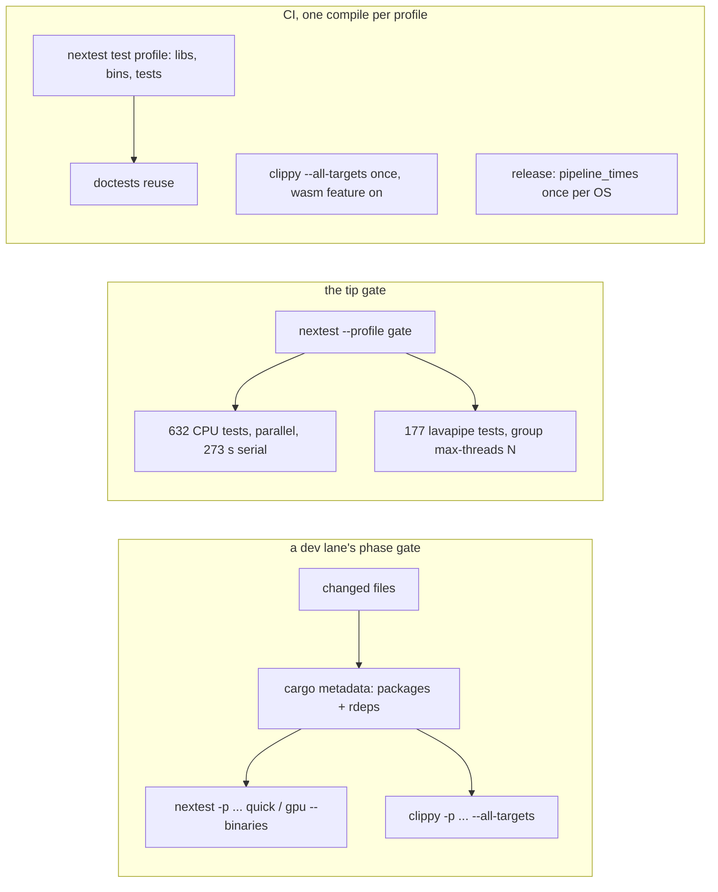

# 0072: Development speed: the build graph read, a dev profile that pays for what it buys, a gate narrowed to the change, the lavapipe queue measured at two, and one compile per CI profile

> **Status:** in-progress (approved by the owner, 2026-11-12: "all draft plans can be approved"; review questions 4
> and 5 as recommended: the pinned cache only on Phase 1's number, the lavapipe group at two
> kept only on a quarter's cut with no flake in three runs)
> **Created:** 2026-11-12 (the overnight architecture review, `docs/reviews/2026-11-12-architecture-review.md`)
> **Milestone:** cross-cutting (the harness; `docs/nfr.md` section 7, "Startup and build").
> **Related ADRs:** none at the draft. Phase 6 writes one (a compilation cache is a tool
> outside Cargo with a pinned version) only if its reading adopts the cache; the rejected
> alternative would be the seeded `target/`.
> **Source:** the owner, 2026-11-11, for the review: "performance, both development and render";
> the review's sections 1.5 to 1.7; the backlog's "CI's cold cache after a workspace change" and
> "The gate tier is over its wall-time budget".
> **Starts after:** any time; it touches `Cargo.toml`'s profiles, `scripts/`, `.config/nextest.toml`,
> `.github/workflows/` and the skills' gate lines, which no lane edits. Its Phase 1 readings need
> a quiet box, so not beside a lane's own readings. Recommended slot: beside Plan 0045 (which
> moves source files, not these), or right after Plan 0070.

## TL;DR

The gate's 610 s is the serial sum of 177 lavapipe tests and nothing else (the 632 CPU tests
run beside them in 273 s); a fresh lane's first `quick` tier builds for 7.5 to 9.4 minutes
because every worktree has its own `target/` and `test-changed.mjs` builds the whole workspace's
test targets however narrow its filter; every phase gate runs `cargo clippy --workspace
--all-targets`; the dev profile compiles every dependency at `opt-level = 2` with full debug
info; CI compiles the workspace in about six configurations (Windows 55 min cold, 17 warm); and
the one incremental-build reading in `docs/nfr.md` is from 2026-10-17, when the tree was a third
of its size. This plan **reads first** (`cargo build --timings` cold, incremental and fresh-lane;
the gate by group), then changes one knob per phase with a reading on each side: the debug-info
level, a gate narrowed to the changed packages for nextest and clippy, the lavapipe group at two
and three threads, one compile per profile in CI, and a fresh-lane warm start (a seeded
`target/` or a pinned `sccache`, by the number). Every bar is against this plan's own start
commit. The first thing anyone sees: `docs/nfr.md` section 7's incremental-build line with a
2026 reading on it, and a `cargo build --timings` critical path with a name.

## Context & problem

Every figure is a reading from the tree at `56008fa` unless marked (the review of 2026-11-12,
read-only; nothing was built).

- **The gate is lavapipe-serial.** `node scripts/test-times.mjs live/plan-0068/merge-gate.log`:
  809 tests, 610.2 s wall; the 177 `gpu_*` tests sum to 610.2 s serial, the `lavapipe` test group
  is `max-threads = 1` (`.config/nextest.toml:44-45`); the 632 CPU tests sum to 272.7 s in
  parallel. Over the 10 s line: `castle_vector` 22.1 s and `showcase_vector` 19.6 s (CPU, in the
  gate by the owner's call), `the_castle_path_flies_in_air` 20.3 s (CPU, Plan 0068),
  `a_baked_view_is_final_on_its_first_frame` 17.5 s. Gate readings in `docs/nfr.md` section 7:
  505 s (2026-11-10, after the soak marks), 553 s (11-11), 610 s (11-11, with Plan 0068).
- **A fresh lane's first build.** `Finished test profile in 9m25s` (`live/plan-0061/p1-quick.log`),
  `9m13s` (`plan-0068/p1-quick.log`), `7m32s` (`plan-0060/p1-quick.log`); later phases 12 to
  60 s. Each worktree has its own `target/` (`.claude/worktrees/plan-0067/target/` beside the
  main checkout's); no `.cargo/config.toml`, no shared target dir, no compilation cache.
  `scripts/test-changed.mjs` runs `cargo nextest run --workspace --profile 
 -E 'rdeps(a) | ...'`
  (`:184-194`), which builds every workspace test target, `wasmtime` (`vxe-script-wasm`'s `host`
  feature) and the seven guests included, before the filter runs anything.
- **The per-phase gate.** The dev skill's gate is `cargo build`, the quick tier, `cargo test
  --doc`, `cargo clippy --workspace --all-targets -- -D warnings`, `fmt`
  (`.claude/skills/dev/SKILL.md:67-70`); the lane rules cap builds at `CARGO_BUILD_JOBS=4` with
  three or more lanes. The clippy step is a check build of every crate's tests, benches and
  examples for a one-crate change.
- **The profiles** (`Cargo.toml:112-137`): `[profile.release] lto = "thin", codegen-units = 1`;
  `[profile.dev.package."*"] opt-level = 2`; `vxe-world`, `vxe-sim`, `vxe-audio` and `flythrough`
  at `opt-level = 2` in dev (the cave at 52 s unoptimised against 1.7 s, the comment says).
  `debug` is the default (full) everywhere; no `split-debuginfo`, no `[profile.test]`. Rust
  1.97.1, so `lld` is the default linker already.
- **The incremental figure.** `docs/nfr.md` section 7: "Incremental build of a one-crate
  change under 10 s", one reading: Plan 0011's 1.40 to 1.49 s for a `pub const` change in
  `vxe-world/src/lib.rs` (2026-10-17, `CARGO_BUILD_JOBS=3`). Plan 0043's context notes 28 s for
  the same change (`docs/plans/done/0043-...md:41-42`), never carried over. Rust code has grown
  from about 15 000 to 45 299 lines since (`scripts/loc.mjs`).
- **CI** (`.github/workflows/ci.yml`): `cargo build --workspace` (:54), `pipeline_times
  --release` (Linux once, Windows twice, :66-76), `nextest --workspace --profile ci` (:81-90),
  `nextest -p flythrough --features wasm` (:113), `cargo test --workspace --doc` (:116),
  `clippy --workspace --all-targets` (:117), `clippy -p flythrough --features wasm` (:118),
  two wasm32 clippy runs (:122-131), `build-guests.sh` (:51). The backlog's cold-cache entry
  (2026-11-11): Windows 55 min against about 17 warm; `cargo build` 14.8 min against 1.3;
  `clippy --workspace` 6 min against 25 s; options listed, none taken. The comment at `:17-27`
  says warm runs took 13 min on Linux and 26 on Windows.
- **Shader compile** is Plan 0045 Phase 4's (every pass prepends the 2496-line `march.wgsl`);
  this plan does not touch it.

## Decision

Measure, then change one knob at a time with its reading on both sides, each against this
plan's start commit on the dev reference: (1) the build graph and the gate by group; (2) the
dev and test profiles' debug-info level; (3) a per-phase gate narrowed to the changed packages
and their dependents for nextest **and** clippy, through `scripts/test-changed.mjs`; (4) the
lavapipe group at two and three threads, kept only if the gate's wall falls by a quarter with no
flaky test over three runs; (5) one compile per profile in CI; (6) a fresh lane's warm start by
the number. We rejected changing `opt-level` for the world and the renderer's dependencies (the
cave's 52 s is the reason it is 2, and tests run the cave), a shared `target/` across lanes
(concurrent lanes serialize on Cargo's lock), and a cache adopted before its reading.

## Architecture diagram

## Implementation phases

No phase changes engine code or any test's assertion. A phase that moves a test's time or a
binary's name is a stop. Every reading: dev reference, exclusive perf lock, 1-minute load
logged, three runs, the start commit and the phase's tip alternated.

### Phase 1: the build graph and the gate, read (walking skeleton)
- **Owner skill:** dev
- **What:** `cargo build --timings` for (a) a cold test-profile build of the workspace in a
  fresh worktree (`cargo nextest run --profile quick --no-run`), the critical path's crates
  named; (b) the incremental rebuild after a one-line change to `crates/vxe-world/src/lib.rs`
  (a `pub const`), for `cargo build` (default members) and for the quick tier's `--no-run`;
  (c) the same after a one-line change in `apps/flythrough/src/main.rs`; (d) `cargo clippy
  --workspace --all-targets` on a warm tree; (e) the gate (`--profile gate`) with
  `--status-level pass`, split by `node scripts/test-times.mjs` into the lavapipe group's serial
  sum and the CPU tests' sum, and the wall. `docs/nfr.md` section 7's incremental line takes
  reading (b) beside Plan 0011's.
- **Files touched:** `docs/plans/logs/0072.md`, `docs/nfr.md` (section 7's two lines).
- **Done when:**
  - The log holds (a) to (e) with loads, the `--timings` HTML's critical path (crate names and
    seconds) for (a) and (b), and the gate's wall against its lavapipe serial sum (the review's
    claim that they are equal, confirmed or refuted).
  - `docs/nfr.md` section 7 reads (b) as the incremental figure, dated, with the 10 s budget
    marked met or missed.

### Phase 2: the dev and test profiles pay for what they buy
- **Owner skill:** dev
- **What:** candidates, one at a time against Phase 1's (a) and (b): `[profile.dev.package."*"]
  debug = "line-tables-only"` (dependencies keep line numbers for backtraces, lose type info);
  `[profile.dev] split-debuginfo = "unpacked"` on Linux; `[profile.test]` made explicit as
  `inherits = "dev"` with the same; `incremental = true` confirmed for the workspace's own
  `opt-level = 2` crates. Each candidate kept if it cuts (a) or (b) by at least 10 % with every
  test's assertion unchanged and a panicking test's backtrace still naming `file:line` in the
  workspace's own code.
- **Files touched:** `Cargo.toml`, `docs/plans/logs/0072.md`, `docs/nfr.md`.
- **Done when:**
  - The log's table: each candidate's (a) and (b), kept or dropped, with the reason.
  - A deliberately failing test (a scratch assertion, not committed) shows `file:line` of the
    assertion and of a `vxe-world` frame in its backtrace under the kept profile.
  - The gate at the tip: every test passes, count unchanged.

### Phase 3: the phase gate narrowed to the change, for nextest and clippy
- **Owner skill:** dev
- **What:** `scripts/test-changed.mjs` passes `-p <pkg>` for each changed package and each
  dependent (from `cargo metadata`'s resolve graph, which it already reads) instead of
  `--workspace`, so only their test targets build; the `-E rdeps(...)` filter stays for the
  tests. A `--clippy` mode (or `scripts/clippy-changed.mjs` sharing the package resolver) runs
  `cargo clippy -p ... --all-targets -- -D warnings` over the same set. The dev skill's gate
  line and the lane rules point at them for phase gates; the tip gate and CI keep the
  workspace-wide forms. A change to the root manifests, the lockfile, `clippy.toml` or the
  scripts still selects everything (today's rule).
- **Files touched:** `scripts/test-changed.mjs`, `scripts/fixtures/test-changed/` (if the
  fixture exists; otherwise its README row), `.claude/skills/dev/SKILL.md`,
  `.claude/skills/orchestrate/references/lane-rules.md`, `CLAUDE.md`'s `scripts/` row (one line).
- **Done when:**
  - `a_sim_change_builds_sim_and_its_dependents_only` (`node --test scripts/test-changed.test.mjs`,
    CPU, under 1 s): a one-line change to `crates/vxe-sim/src/body.rs` resolves to
    `vxe-sim`, `flythrough`, `vxe-tester` and nothing else, and the generated command carries
    exactly those `-p` flags.
  - The quick tier for that change, warm, reads under Phase 1's (c)-shaped figure by at least
    a third (a proposal; `wasmtime`'s and the guests' test targets no longer build).
  - `clippy --clippy` for the same change runs under 60 s warm (a proposal) and reports the same
    findings on `vxe-sim` as the workspace-wide run (a seeded lint in a scratch file, shown once).

### Phase 4: the lavapipe group at two and three
- **Owner skill:** dev
- **What:** `[test-groups] lavapipe = { max-threads = N }` at 2 and 3, each with lavapipe's own
  thread count left default and once with `LP_NUM_THREADS=8`; the gate run three times per
  cell, all tests passing, `test-times.mjs` on each log. Kept at the smallest N that cuts the
  gate's wall by at least a quarter with zero failures and no test over twice its N = 1 time;
  otherwise N stays 1 and the readings stand.
- **Files touched:** `.config/nextest.toml`, `docs/nfr.md` (section 7's gate line),
  `docs/plans/logs/0072.md`.
- **Done when:**
  - The log's table: wall, lavapipe serial sum, failures, the slowest five per cell, loads.
  - `docs/nfr.md` section 7's gate proposal is restated from the kept cell (the review proposes
    8 min, 480 s, if N = 2 holds; otherwise the 12 min line stays with the reading).
  - `node scripts/check-test-tiers.mjs` passes.

### Phase 5: one compile per profile in CI
- **Owner skill:** dev
- **What:** `ci.yml` drops `cargo build --workspace` (nextest's build makes the same libs,
  bins and test targets; `vxe-tester --system-json` runs from nextest's `target/debug`); the two
  clippy invocations become one, `cargo clippy --workspace --all-targets --features
  flythrough/wasm -- -D warnings` (the superset; a comment says why); `pipeline_times` runs once
  per OS (Windows keeps its FXC-against-DXC pair only on `workflow_dispatch`); the wasm32 clippy
  runs stay (a different target). One diagnostic run with
  `CARGO_LOG=cargo::core::compiler::fingerprint=info` on a prefix-restored cache reads why a
  restored cache recompiled `proc-macro2` and friends (the backlog's option 2), and the finding
  goes in the log, with the fix if it is the key's inputs.
- **Files touched:** `.github/workflows/ci.yml`, `docs/backlog.md` (the cold-cache entry
  leaves), `docs/plans/logs/0072.md`.
- **Done when:**
  - The Linux job's warm wall reads under 10 min and Windows under 15 (proposals against 13
    and 17 warm, from `ci.yml`'s comment and the backlog's run 43011459965), read on the first
    two pushes after the merge and written in the log.
  - Every check the old steps made still runs: the gate's count is unchanged, the `component`
    test still runs under `--features wasm`, doctests run, the guests' clippy runs.
  - The fingerprint reading names the dirty cause or says it could not.

### Phase 6: a fresh lane starts warm
- **Owner skill:** dev
- **What:** two candidates against Phase 1's (a), the cold fresh-worktree test build:
  (A) seed the new worktree's `target/` from the main checkout's (`cp --reflink=auto -r`; on
  btrfs a reflink copy is seconds, on ext4 it is a copy of several GB, read either way);
  (B) `sccache` at a pinned version (`cargo install --locked sccache@<x.y.z>`, the owner's
  no-unpinnable-packages rule), `RUSTC_WRAPPER` set in a `.cargo/config.toml` that CI does not
  use. Each read as the first `quick` tier in a fresh worktree, three times. Kept if it brings
  (a) under half; (B) also needs the ADR named in the header, written before its commit. The
  orchestrate skill's worktree setup takes the kept step.
- **Files touched:** `.cargo/config.toml` (new, only if B), `.claude/skills/orchestrate/SKILL.md`
  or its lane rules (the setup line), `docs/adrs/` (only if B), `docs/plans/logs/0072.md`.
- **Done when:**
  - The log's table: (a) cold, (A), (B), each three runs with loads and the disk used.
  - If kept: a fresh worktree's first quick tier reads under half of Phase 1's (a). If neither
    holds, the phase records both and changes nothing; the lane rules say so in one line.

## Data shapes

None. Configuration only: `Cargo.toml` profiles, `.config/nextest.toml`, `ci.yml`, two scripts.

## Budgets

| `docs/nfr.md` figure (section 7) | On record | Proposed | How the close measures it |
|---|---|---|---|
| incremental build of a one-crate change (10 s) | 1.40 to 1.49 s (Plan 0011, 2026-10-17); 28 s noted at Plan 0043, never recorded | read in Phase 1; at most 10 s after Phase 2, or the line is re-set from the reading | Phase 1 (b), repeated at the tip |
| the gate's wall (12 min proposal) | 610 s at 809 tests (2026-11-11) | at most 480 s at the same test set (a proposal, Phase 4 at N = 2); unchanged if N stays 1 | the tip's gate, three runs |
| the quick tier (under 60 s, so a phase holds no lock) | 12 to 60 s warm; 7.5 to 9.4 min on a fresh lane | under 60 s warm for a one-crate change (Phase 3); a fresh lane under half of Phase 1 (a) (Phase 6) | Phase 3 and Phase 6 readings |
| CI's Linux and Windows jobs (no line; 13 and 17 min warm per `ci.yml`'s comment) | 55 min cold on Windows (backlog) | under 10 and 15 min warm (proposals); a new line in section 7 | the first two pushes after the merge |
| no test's assertion, mark or binary moves | 809 tests, 104 skipped | the same counts at the tip | `cargo nextest list` before and after |

## Risks & open questions

- **Debug info and the readings' backtraces.** `line-tables-only` on dependencies loses
  variable info in `wgpu`'s frames under a debugger; the lanes read panics, not variables. Phase
  2's backtrace check guards the workspace's own frames.
- **Narrowed clippy misses a cross-crate lint.** A lint that fires only when a dependent is
  checked (an unused import left by a signature change) is caught by the tip gate's workspace
  run and by CI, both unchanged. The phase gate is a fast loop, not the last word.
- **Two lavapipe tests at once.** lavapipe's own threads contend; a test with a wall-time bound
  (`gpu_shutdown`'s 120 s) could trip under load. Phase 4's "no test over twice its time" rule
  is the stop; N stays 1 if any cell fails.
- **CI's folded clippy changes the feature set checked.** The `wasm` feature on is the
  superset for `flythrough`; the default feature set is still built by nextest. A lint that
  fires only without `wasm` would be missed; none is known.
- **A cache outside Cargo.** `sccache` is a pinned binary and a `.cargo/config.toml`; a stale
  cache can hide a change only if the hash is wrong, which is its one job. The ADR records the
  alternative (A) and the rule that CI never uses it.
- **Determinism, memory, GPU:** none touched.

## What this plan does NOT do

- Shader compile time (Plan 0045 Phase 4) or a pipeline cache (backlog).
- Change any test's size, frames or marks; the 10 s soak line and the tiers stay as Plan 0066
  left them. A test that should shrink is that plan's finding, not this one's.
- Change `opt-level` for the world, the renderer or their dependencies.
- The weekly soak's cost, or Windows GPU tests (no WARP, owner 2026-11-09).
- Plan size or the readings protocol (the owner's, review section 1.7).

## Implementation log

> Written by `dev`: one row per phase as its commit lands, then the close block. **The phases
> above are the contract. This section records what happened.** Observations, never conclusions:
> no pass list, no self-assessment. Deviations and unmet done-whens are **always** disclosed.
> Readings, gate counts, attempts, sweeps and resume notes go to the plan's readings log,
> `docs/plans/logs/0072.md`, and this section links it once it exists.

| phase | owner | state | commit |
|---|---|---|---|
| 1: the build graph and the gate, read | dev | done; readings in [`logs/0072.md`](logs/0072.md). Deviations: every reading at `CARGO_BUILD_JOBS=4` in a 6G scope (two lanes); the first (b), (c) and (d) series void (the probe loop touched other files; clippy's `items_after_test_module`) and re-read; the gate 700 to 794 s, over the 12 min line in two of three | 17fb491 |
| 2: the dev and test profiles pay for what they buy | dev | done; `line-tables-only` and `split-debuginfo` both kept. Deviations: `[profile.test]` not written (cargo's default already); the combined pair read after the alternated base/`lt`/`sd` rounds, not alternated with the base | committed with this row |
| 3: the phase gate narrowed to the change | dev | not started | |
| 4: the lavapipe group at two and three | dev | not started | |
| 5: one compile per profile in CI | dev | not started | |
| 6: a fresh lane starts warm | dev | not started | |

### Notes

_(empty)_

### Close triggers

- **What shipped:**
- **Public API changed:**
- **Budget readings:**
- **Gate at the tip:**
- **Outstanding `human` phases:**

## Followups

- The GPU tests' pixels and frames, test by test, against the 10 s line (Plan 0066's successor,
  if Phase 4 leaves the gate over its line).
