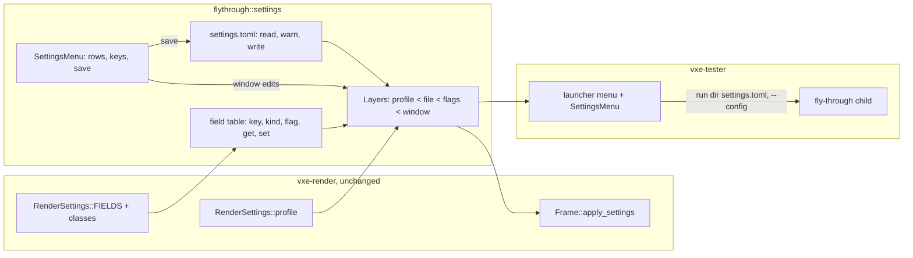

# 0073: A settings menu and a settings file for the fly-through and the tester

> **Status:** approved (owner, 2026-11-12: the design questions and every open question below
> took its recommendation, so this plan starts after Plans 0069 and 0071 have merged)
> **Created:** 2026-11-12
> **Milestone:** none of its own. The testbed and the tester build (M7, Plan 0068) on Plan
> 0069's settings surface; M10's plans add rows to it.
> **Related ADRs:** [ADR-0058](../adrs/0058-the-apps-keep-render-settings-in-a-toml-file-layered-over-a-profile-through-an-app-side-field-table.md)
> (proposed): the field table, the precedence, where the file lives, which runs read it, when it
> is written. Rests on [ADR-0055](../adrs/0055-render-settings-are-one-struct-with-an-apply-class-per-field-and-profiles-are-named-values.md)
> (the engine stays file-free) and ADR-0009 (the HUD is the 8 x 8 font overlay, no UI library).
> **Starts after:** [Plan 0069](0069-render-settings-one-surface-an-apply-class-per-field-and-named-quality-profiles.md)
> has merged (`RenderSettings`, `FIELDS` with the apply classes, the profiles, `F4`, the
> tester's profile choice). The architect re-reads Phases 1, 3 and 5 against that tip before the
> lane starts: the args module and the HUD files may have moved under Plan 0045, and how 0069's
> `F4` and its "+N" count treat edits sets what Phase 1's layers wrap. See open question 2 on
> Plan 0071.
> **Owner answers, 2026-11-12 (decided):** apps only, the engine file-free; the menu is the
> engine's text overlay, no new UI dependency; TOML via `serde` and `toml`, exact pins in the
> workspace table, used by the apps only; unknown keys warn, missing keys take the profile's
> value; the slot is after Plan 0069; every cheap exploration mode stays a render setting with
> its picked default, and the menu shows them grouped, each with its value and apply class, a
> profile pick on top and edits over the profile; the fly-through's key toggles and the tester's
> quality menu keep working.

## TL;DR

The fly-through and the tester gain a settings file and an in-window menu over Plan 0069's
`RenderSettings`. A field table in the fly-through's library gives every `FIELDS` leaf a TOML
key, a kind, its flag and a getter and setter; the effective settings are the profile, then the
file, then the flags, then the in-window edits. `Tab` opens the menu on the HUD overlay: the
profile on top, the groups, and per field its value, its apply class and a mark when it differs
from the profile; a save row writes the file. The first thing the owner sees is `flythrough
--config my.toml --settings` printing every field with its value, class and source (`profile`,
`file`, `flag`); the first thing in the window is `Tab` and a field stepped live.

## Context & problem

Plan 0069 makes every renderer knob one field with an apply class, and names three profiles, but
leaves settings to flags: the fly-through has over 100 of them, nothing persists between runs,
and the owner's standing rule (2026-11-12) adds a setting for every cheap exploration mode (Plan
0067's bake budget `frame:1.5|second:N`, missing light `black|neighbour|parent|chain`, full-first
`off|N`, reach `full|partial`). The owner tries mechanisms by eye in the window ("explore lighting
by eye", 2026-11-08), so a setting reached only through a restart with a different flag is slow
to judge. The tester's launcher (Plan 0068, `apps/tester/src/menu.rs`) has a quality menu of its
own, and a tester's report records the flags of a run but not a settings set that can be loaded
again.

ADR-0055 rejected a settings file in the engine: the consumer serialises the struct. The apps are
consumers; this plan is the first one doing it. No `docs/nfr.md` figure moves: the menu draws
through the existing overlay pass and builds its text only while open.

## Decision

Build ADR-0058 in the apps. `flythrough::settings` (library side, so the tester reuses it) holds
the field table, the layers, the TOML reader and writer, the per-OS path and the menu's state;
the fly-through and the tester draw the menu through `HudOverlay::set_lines`, as the tester's
launcher menu does today. `vxe-render` does not change. The tester's existing menu keeps its rows;
its profile choice (Plan 0069 Phase 3) becomes the settings menu's profile row, so there is one
profile control.

We rejected name-keyed access in `vxe-render` (the string-keyed surface ADR-0055 kept out),
`serde` derives on `RenderSettings` (the dependency stays in the apps; owner), the file beside the
executable or in the working directory (lost with each tester archive; the tester's children run
in the report folder), and saving on every change or never (ADR-0058 has each).

## Architecture diagram



## Implementation phases

Each phase ships as its own commit. `dev` implements all dev phases in one session. Every test
named here is a CPU test (under 1 s each on any machine); **this plan names no `gpu_*` binary**,
and the menu's draw is defended by a text test of the rows the overlay is given, not by an image.
Per phase: `node scripts/test-changed.mjs --profile quick`, clippy, fmt. At the tip: `cargo
nextest run --workspace --profile gate` under the perf lock, doctests, clippy, fmt, `cargo deny
check`, the doc and tier gates. Readings and the window's notes go to `docs/plans/logs/0073.md`.

### Phase 1: the file read and layered, printed by `--settings` (walking skeleton)
- **Owner skill:** dev
- **What:** the field table over every `FIELDS` leaf, `Layers` (profile, file, flags, window),
  `--config PATH` reading `profile` and `[render]`, and `--settings` gaining a source column.
- **Files touched:** `Cargo.toml` (workspace `serde` with `derive` at the lockfile's 1.0.229 and
  `toml`, both `=` pins), `Cargo.lock`, `apps/flythrough/Cargo.toml`,
  `apps/flythrough/src/settings/{mod,fields,layers,file}.rs` (new), `apps/flythrough/src/lib.rs`,
  the fly-through's args module (`main.rs` or where Plan 0045 put it).
- **Shape:** the flags that set a `RenderSettings` field write the flags layer through the table's
  row instead of the struct directly; the table's `flag` names the row's flag. A text-kind row
  parses the file's string with the flag's parser. Where Plan 0069's "+N" count already tracks
  edits, the count becomes the sum of the layers' edits.
- **Done when:**
  - `every_field_has_a_row`: the table's names equal the leaf names of `RenderSettings::FIELDS`,
    each once; the failure names the leaf.
  - `the_layers_stack_profile_file_flags`: with no file and no flags the settings equal
    `RenderSettings::profile(Floor)` with the fly-through's scene-independent overrides (0069's
    list); a file `profile = "portable"` with `[render.look] translucent_layers = 3` gives
    Portable with 3; adding `--translucent-layers 4` gives 4; adding `--profile performance`
    gives Performance's values with 4, and `build.residency` (in no layer) equals Performance's.
  - `cargo tree -i toml` lists `flythrough` (and `vxe-tester` from Phase 5) and no crate under
    `crates/`; `cargo deny check` exits 0.
  - `flythrough --config F --settings` prints one line per leaf with name, class, value and
    source; a test over the second bullet's fixture reads the source column of three rows as
    `file`, `flag` and `profile`.

### Phase 2: the file's edges: warnings, the default path, who reads it
- **Owner skill:** dev
- **What:** warnings for unknown keys, wrong types, out-of-range values and a malformed file; the
  per-OS default path; the default file read by windowed runs only; `--no-config`.
- **Files touched:** `apps/flythrough/src/settings/{file,path}.rs`, the args module,
  `apps/flythrough/src/hud.rs` (the warning row).
- **Shape:** a warning names the file, the line and the key, goes to stdout and to a red HUD row
  that stays until the menu opens or 10 s pass; the key's value is the lower layer's. A malformed
  file is one warning with its line, and the run starts with an empty file layer. The path is a
  pure function of the OS and an environment lookup, so tests pass a map, not the process's
  environment.
- **Done when:**
  - `unknown_and_mistyped_keys_warn_and_keep_the_profile`: a file whose line 2 is
    `look.translucnet_layers = 3` and line 3 `look.translucent_layers = "three"` under `[render]`
    yields exactly two warnings naming lines 2 and 3 and their keys, and settings equal the profile.
  - `an_out_of_range_value_warns`: `scale = 7` (past the row's range) and an unknown choice for a
    choice row each warn once and keep the profile's value.
  - `a_broken_file_is_ignored_with_its_line`: an unclosed table header on line 4 gives one
    warning naming line 4 and an empty file layer.
  - `the_config_path_per_os`: Linux with `XDG_CONFIG_HOME=/x` gives
    `/x/vxe-flythrough/settings.toml`; Linux with only `HOME=/h` gives
    `/h/.config/vxe-flythrough/settings.toml`; Windows with `APPDATA=C:\A` gives
    `C:\A\vxe-flythrough\settings.toml`; neither variable gives no path and no warning.
  - `only_windowed_runs_read_the_default_file`: with a default file present, the parsed
    arguments of a windowed run hold its file layer; `--headless`, `--tester` and `--no-config`
    hold none; `--headless --config F` holds F's. The goldens are untouched (they run headless).

### Phase 3: the menu in the fly-through
- **Owner skill:** dev
- **What:** `SettingsMenu` drawn on the HUD overlay, opened and closed by `Tab`, editing the
  window layer and applying through `Frame::apply_settings` each time a value changes.
- **Files touched:** `apps/flythrough/src/settings/menu.rs` (new), `apps/flythrough/src/hud.rs`,
  the fly-through's frame and key handling (`main.rs` or its split).
- **Shape:** the first page has the profile row (`profile < portable >  +2`, the same function as
  `F4`), one row per group (the leaf's first segment) with its edit count, and the reset, save and
  close rows. A group's page has one row per field: name, `< value >`, the class (`Live`,
  `Settle`, `Rebuild`) and `*` when it differs from the profile; a `Rebuild` field whose edit is
  not yet in effect is red with `restart`. The footer names the selected field's source, its flag
  and the file's path. Keys while open: arrows move and step, `Enter` steps or opens, `Backspace`
  resets the field to the layers below the window, `Esc` goes back a page and closes from the
  first; the wheel moves the selection, left click steps forward and right click back. While open,
  mouse look, the left-click dig and the scroll's own use pause, and `Escape` does not end the
  run; every other key keeps its binding, and a key toggle that changes a `RenderSettings` field
  writes the window layer, so the menu shows it. `--tester` runs have no menu.
- **Done when:**
  - `the_menu_draws_its_rows`: for Floor with one file edit and one window edit of a `Rebuild`
    field, the text and colours given to the overlay for the first page and that group's page
    equal the fixture in the test: the edited rows carry `*`, the selected row is yellow, the
    pending `Rebuild` row is red with `restart`, and every row names its class.
  - `the_menu_keys_edit_the_window_layer`: from the first page, opening the `look` group and
    stepping `translucent_layers` right once puts the next value in the window layer and the
    profile row reads `+1`; `Backspace` empties the layer; `Esc` twice closes the menu.
  - `key_routing_with_the_menu_open`: a function over a key and the menu's state routes `Escape`,
    the arrows, `Enter`, `Backspace`, the wheel and both clicks to the menu while it is open, and
    every other key in the fly-through's key table to its toggle as when closed; closed, `Escape`
    ends the run as before.
  - `a_key_toggle_shows_in_the_menu`: for each key toggle that changes a `RenderSettings` field
    (listed in the test from the key table), pressing it changes that field's menu value and
    marks its source `window`; its HUD mode row and stdout line are unchanged.
  - Windowed check folded into Phase 6: a `Live` step changes the image on the next frame and a
    `Settle` step shows the settle.

### Phase 4: save and reset
- **Owner skill:** dev
- **What:** the save row writes the file the run read (the `--config` path, else the default
  path, creating its folder), and the reset rows clear the window's edits or all edits.
- **Files touched:** `apps/flythrough/src/settings/{file,menu,layers}.rs`.
- **Shape:** the file holds `profile` when it is not Floor, and under `[render]` only the leaves
  whose effective value differs from the profile, from the file and window layers, never the
  flags; a header comment names `flythrough --settings` and says a save rewrites the file. After a
  save the window's edits move into the file layer. A failed write is a red HUD row and a stdout
  line, and the layers do not change.
- **Done when:**
  - `a_saved_file_loads_to_the_same_settings`: for each profile, window edits to one leaf of each
    kind (bool, integer, float, choice, and Plan 0067's budget text `second:4`) are saved to a
    temporary path and loaded with no flags; the settings equal the ones saved from, and the file
    has exactly those leaves under `[render]`.
  - `a_save_leaves_the_flags_out`: a run with `--translucent-layers 4` and one window edit saves
    a file with the window's leaf and not `look.translucent_layers`.
  - `a_failed_save_changes_nothing`: saving to a path under a regular file returns an error, the
    layers equal those before, and the warning row names the path.

### Phase 5: the tester
- **Owner skill:** dev
- **What:** the launcher's menu gains a settings row opening `SettingsMenu`, the tester keeps its
  own file, and each run gets its settings as a file in its folder.
- **Files touched:** `apps/tester/Cargo.toml`, `apps/tester/src/{menu,run,main}.rs`,
  `apps/tester/src/zip.rs` if the listing needs it.
- **Shape:** the tester's file is `vxe-tester/settings.toml` in the config folder, with
  `profile`, `[render]` and a `[tester]` table (scene, mode, output) its menu starts from and its
  save writes. The launcher has no frame: every class applies at the next run, and the menu still
  shows each field's class. Each run writes its effective settings to `<run_dir>/settings.toml`
  and passes `--config settings.toml` (the child's working directory is the run folder); the
  child reads nothing else (Phase 2). `--auto` reads the tester's file too. The profile row
  replaces Plan 0069's profile choice in the launcher's menu; the output choice stays.
- **Done when:**
  - `fly_args` table test (Plan 0068 Phase 2's): every run's arguments carry `--config
    settings.toml`, the child accepts them under `--check-args`, and the written file loads to
    the launcher's effective settings.
  - `the_tester_file_round_trips`: scene, mode, output, profile and one render edit, saved and
    loaded, equal the menu's state before the save.
  - The report zip's test lists `settings.toml` in each run's folder.
  - The launcher's menu text test (Plan 0068's) holds the settings row and the profile row, and
    no other row changed.

### Phase 6: the owner's window
- **Owner skill:** human
- **What:** the owner uses the menu in the fly-through and the tester on the dev box.
- **Done when:** the owner's words are in the readings log for: (a) `Tab` as the key, and the
  menu's reading at the window's size; (b) a `Live`, a `Settle` and a `Rebuild` field each behave
  as their class says; (c) a save, a restart with no flags, and the same settings back; (d) the
  key toggles and `F4` still work with the menu open and closed, and show in it; (e) the tester's
  settings row, a run at an edited Portable, and the report's `settings.toml`; (f) anything to
  move, rename or regroup.

### Phase 7: the window's notes
- **Owner skill:** dev
- **What:** Phase 6's notes go in.
- **Files touched:** `apps/flythrough/src/settings/`, `apps/tester/src/menu.rs`, as the notes need.
- **Done when:** each note in the readings log names its commit or the owner's "leave it"; the
  text tests of Phases 3 and 5 hold the changed rows; the gate at the tip exits 0.

## Data shapes

```rust
// illustrative
pub enum Kind { Bool, Int { min: i64, max: i64, step: i64 }, Float { min: f32, max: f32, steps: &'static [f32] },
                Choice(&'static [&'static str]), Text { parse: fn(&str) -> Result<Value, String>, presets: &'static [&'static str] } }
pub struct Row { pub name: &'static str, pub flag: Option<&'static str>, pub kind: Kind,
                 pub get: fn(&RenderSettings) -> Value, pub set: fn(&mut RenderSettings, &Value) -> Result<(), String> }
pub enum Source { Profile, File, Flag, Window }
pub struct Layers { pub profile: [Option<Profile>; 3] /* file, flags, window */, pub edits: [Edits; 3] }
impl Layers { pub fn effective(&self) -> RenderSettings; pub fn source(&self, leaf: &str) -> Source; }
```

```toml
# illustrative: vxe-flythrough/settings.toml; keys are `flythrough --settings` names.
profile = "portable"
[render.look]
translucent_layers = 3
[render.bake]
budget = "second:4"
```

## Budgets

No `docs/nfr.md` figure moves. The menu builds its text only on open and on a change, and draws
through the overlay pass the HUD already runs. The close reads the frame's CPU p50 with the menu
closed on the vein pose (RTX, one quiet round) against the same reading at the plan's start
commit, in the readings log; a closed menu costs nothing beyond the key routing.

## Risks

A wrong row (a getter or setter on the wrong field) is not caught by the row test: Phase 4's
round trip per kind and Phase 1's precedence test bound it, and the owner's window reads it.
A key toggle that keeps writing the struct directly bypasses the window layer and the menu shows a
stale value: Phase 3's toggle test walks the key table. A user's file on the dev box leaking into
a reading is closed by Phase 2's rule and test. No determinism risk: nothing here reaches
`vxe-world`, and the file's floats are render settings.

## Open questions

All answered by the owner on 2026-11-12, each with its recommendation (first option).

1. **Does save write the flags too?** Recommended: no (Phase 4). A flag is a run's choice; saving
   it would make it stick silently. The menu shows a flag's source, so it is visible.
2. **Run after Plan 0071 as well as 0069?** Recommended: yes. Plan 0071 renames settings types
   (with deprecated re-exports for one minor), and a leaf renamed after files exist turns saved
   keys into warnings. If the owner keeps "right after 0069", the plan runs as written and a
   rename after it warns until the file is saved again.
3. **Does a profile change keep the edits?** Recommended: yes, in the menu and `F4` alike (one
   function): the edits sit over whichever profile is picked, and the reset row drops them. If
   Plan 0069's `F4` shipped dropping edits, Phase 3 aligns it and the log says so.
4. **`Tab` opens the menu?** Recommended: yes; it is unbound in the fly-through, unlike `Escape`
   and `F1` to `F10`. The window confirms (Phase 6 a).
5. **No menu in a `--tester` child?** Recommended: none. A benchmark's settings are the
   launcher's, and the child's report would no longer match its `settings.toml`.
6. **Keep a hand-written comment across a save?** Recommended: no for now; the header says the
   file is rewritten. Keeping them needs `toml_edit` as a direct dependency.

## What this plan does NOT do

- Give `vxe-render` a file, a `serde` feature or name-keyed access (ADR-0055, ADR-0058).
- Show a consumer doing the same in Plan 0071's render example: a followup there.
- Rebuild the mirror or the streamer live: a `Rebuild` edit applies at the next start, as in
  Plan 0069.
- Put the fly-through's debug views and non-setting toggles (cutaway, views, audio) in the menu
  or the file: they are not `RenderSettings` fields.
- Add mouse pointing (the cursor's position over a row): `vxe-app` reports clicks and the wheel,
  not the cursor's position, and the menu needs no more.
- Add a game's options screen; a game draws its own.

## Implementation log

> Written by `dev`: one row per phase, then the close block. Readings, attempts and resume notes
> go to `docs/plans/logs/0073.md`.

| phase | owner | state | commit |
|---|---|---|---|
| 1: the file read and layered, printed by `--settings` | dev | not started | |
| 2: the file's edges: warnings, the default path, who reads it | dev | not started | |
| 3: the menu in the fly-through | dev | not started | |
| 4: save and reset | dev | not started | |
| 5: the tester | dev | not started | |
| 6: the owner's window | human | not started | |
| 7: the window's notes | dev | not started | |

### Notes

### Close triggers

## Followups

- Plan 0071's render example, or a later one, shows a consumer serialising `RenderSettings`
  itself (owner, 2026-11-12); the backlog carries it.
- If a second consumer writes the same field table, a superseding ADR may move it into the engine
  (ADR-0058, Alternative A).
